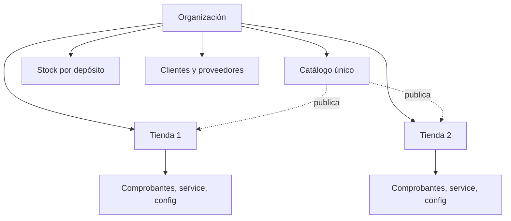
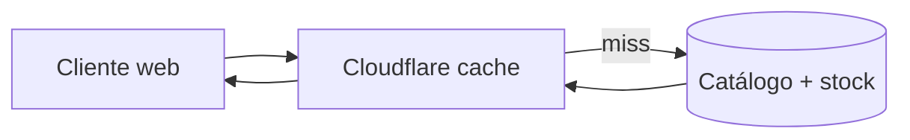

# Tiendas y vitrinas

## Multi-tienda

Una organización agrupa N tiendas. Casi todo es compartido (catálogo, stock,
clientes, proveedores) y lo que es propio de la tienda se asigna explícitamente.

| Tema | Regla |
|---|---|
| Asignación | Todo registro de tienda lleva su `empresa_id`; clientes y proveedores usan "Disponible en" |
| Tienda activa | Selector global; filtra listas y define permisos |
| Cambio de tienda | Refresca datos y rol sin reautenticar |
| Publicación | Un producto se publica por tienda con precio y visibilidad propios |

## Vitrinas online

Cada tienda tiene vitrina propia sobre el mismo catálogo y stock. Cloudflare
cachea el contenido público; el panel, dinámico, no se cachea.

El stock visible en la vitrina es el **disponible** con una caché corta; la
reserva definitiva ocurre al confirmar el pedido.

## Canales externos (Etapa 2)

Mercado Libre se agrega como canal: publicaciones sincronizadas por workers
con outbox, credenciales OAuth gestionadas en Nango, y el mismo stock único
para evitar sobreventa.
