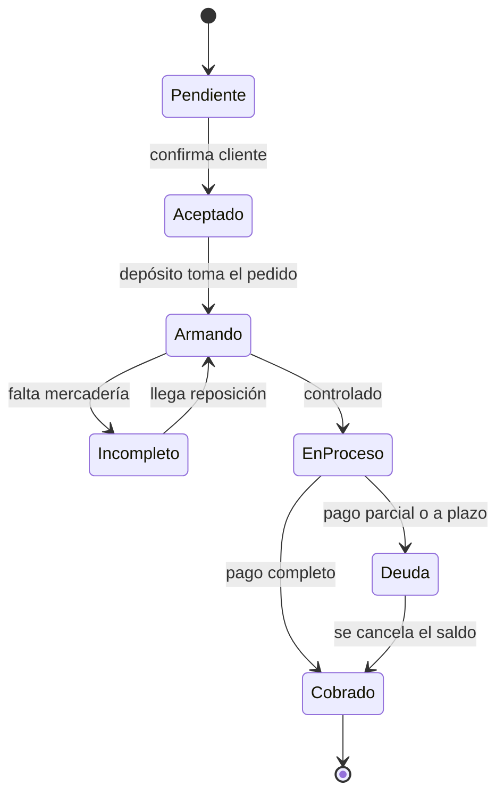
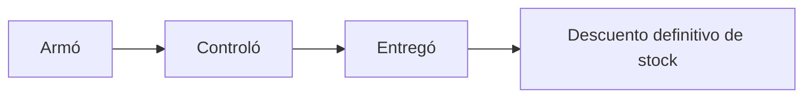

# Ventas y despacho

## Ciclo del comprobante

Estados: Pendiente, Aceptado, Cobrado, En proceso, Deuda, Armando, Incompleto.
Los comprobantes son internos; no hay emisión fiscal en el MVP.

**Cobrado** y **Deuda** no los cambia una persona: los dispara el cobro registrado sobre la factura
(MSF-195). Detalle: [Ventas · cobros y conciliación (técnico)](../tecnico/ventas-cobros-y-conciliacion.md).

## Precio

El precio de cada línea sale de la **escala** (x1, x5, x10, x50) según la
cantidad y el tipo de cliente. La escala se evalúa por línea o por total del
comprobante (decisión pendiente del cliente).

## Despacho

Cada paso registra usuario y hora. La separación de funciones del diseño original era
«quien arma no controla y quien controla no entrega».

**Lo que se construyó (MSF-135):** el despacho es un campo **propio** de la
factura (`estado_despacho`), separado del estado documental del diagrama de
arriba: *Sin armar → Armando → Listo para despachar → Entregado*, con
*Incompleto* entre Armando y Listo. Las reglas que quedaron implementadas son
**quien armó no controla** (salvo el Administrador) y **quién entrega es quien
tenga la acción `despachar`** (Administrador y Depósito), que puede ser la
misma persona que controló. Al entregar se descuentan las reservas «A pedido»
de la misma transacción; el stock normal ya se había descontado al confirmar.
Detalle: [Ventas · despacho y faltantes (técnico)](../tecnico/ventas-despacho-y-faltantes.md).

## Postventa y logística

- **RMA**: devolución o garantía ligada al comprobante; puede reingresar stock o ir a service.
- **Faltantes**: líneas que no se pudieron armar; generan seguimiento y alertan a Depósito. Con MSF-135 quedan
  **registradas** por línea de factura y se listan en **Ventas · Faltantes**; el aviso al cliente es de MSF-161.
- **Transportes y contrarreembolsos**: transporte asignado al despacho; el contrarreembolso crea una cobranza pendiente que se cierra al rendir el transporte.

## Service técnico

Las órdenes de reparación pertenecen a **una** tienda, usan el cliente
compartido de la organización y consumen repuestos del stock mediante
movimientos.
