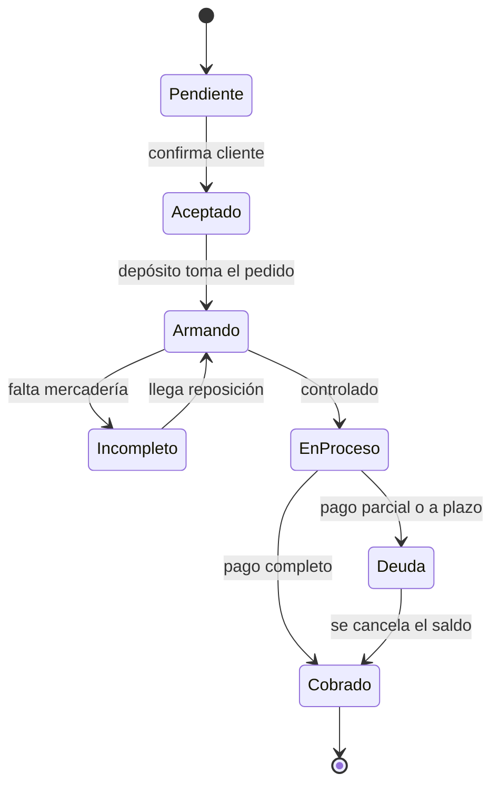

# Ventas y despacho

## Ciclo del comprobante

Estados: Pendiente, Aceptado, Cobrado, En proceso, Deuda, Armando, Incompleto.
Los comprobantes son internos; no hay emisión fiscal en el MVP.

**Cobrado** y **Deuda** no los cambia una persona: los dispara el cobro registrado sobre la factura
(MSF-195). Detalle: [Ventas · cobros y conciliación (técnico)](../tecnico/ventas-cobros-y-conciliacion.md).

El saldo de una factura resta **cobros** y **notas de crédito**. Un cobro mal cargado no se borra: se corrige con una **reversión**
(contra-asiento de importe negativo, solo Administrador, que reabre Cobrado → Deuda si vuelve a haber saldo). La **anulación** de una
factura no corre si ya fue entregada o tiene cobros registrados: se corrige con una nota de crédito (o se revierte el cobro y se anula).
Detalle en [cobros por comprobante](../cobros-por-comprobante.md) y [listado, estados y anulación](../tecnico/ventas-listado-estados-y-anulacion.md).

## Catálogos de cobro y envío (MSF-139)

Antes de vender, cada empresa define sus **formas de pago** (tipo, exige cuenta de cobro, genera deuda,
estado inicial del comprobante) y sus **formas de envío** (exige transporte y guía, costo por defecto,
estado de despacho inicial). La organización carga sus **cuentas de cobro** con CBU/CUIT validados y sus
**transportes** con terminal de retiro, y marca en qué empresas se usan. Nada se borra: se desactiva.

Lee quien tiene la sección `ventas`; escribe solo el Administrador. Las cuentas de cobro dejan actividad
sin exponer datos bancarios. La elección de estos catálogos al cargar un comprobante es de MSF-159.
Detalle: [Ventas · catálogos](../producto/ventas-catalogos.md) · [Técnico](../tecnico/ventas-catalogos.md).

## Precio

El precio de cada línea sale de la **escala** (x1, x5, x10, x50) según la
cantidad y el tipo de cliente. La escala se evalúa por línea o por total del
comprobante (decisión pendiente del cliente). El precio final con IVA se redondea **al centavo**, igual que el total del comprobante ([IVA y precio final](../iva-precio-final.md)).

## Despacho

Cada paso registra usuario y hora. La separación de funciones del diseño original era
«quien arma no controla y quien controla no entrega».

**Lo que se construyó (MSF-135):** el despacho es un campo **propio** de la
factura (`estado_despacho`), separado del estado documental del diagrama de
arriba: *Sin armar → Armando → Listo para despachar → Entregado*, con
*Incompleto* entre Armando y Listo. Las reglas que quedaron implementadas son
**quien armó no controla** (salvo el Administrador) y **quién entrega es quien
tenga la acción `despachar`** (Administrador y Depósito), que puede ser la
misma persona que controló. Al entregar se descuentan las reservas «A pedido»
de la misma transacción; el stock normal ya se había descontado al confirmar.
Detalle: [Ventas · despacho y faltantes (técnico)](../tecnico/ventas-despacho-y-faltantes.md).

## Postventa y logística

- **RMA**: devolución o reclamo ligado a una factura confirmada y a una de sus líneas. Con MSF-178 se
  registra por ítem con su forma, motivo y observaciones, se sigue por *Abierta → En gestión → Cerrada* y
  se resuelve con una **nota de crédito** (devolución de importe) o con el **reingreso de stock** al
  depósito de origen, reutilizando `emitir_nota_credito` y `registrar_movimiento_stock`. El caso con
  proveedor todavía se lleva en las observaciones. Detalle:
  [Ventas · devoluciones (RMA), técnico](../tecnico/ventas-rma-devoluciones.md).
- **Faltantes**: líneas que no se pudieron armar; generan seguimiento y alertan a Depósito. Con MSF-135 quedan
  **registradas** por línea de factura y se listan en **Ventas · Faltantes**; el aviso al cliente es de MSF-161.
- **Transportes y contrarreembolsos**: transporte asignado al despacho; el contrarreembolso crea una cobranza pendiente que se cierra al rendir el transporte.

## Service técnico

Las órdenes de reparación pertenecen a **una** tienda, usan el cliente
compartido de la organización y consumen repuestos del stock mediante
movimientos.
