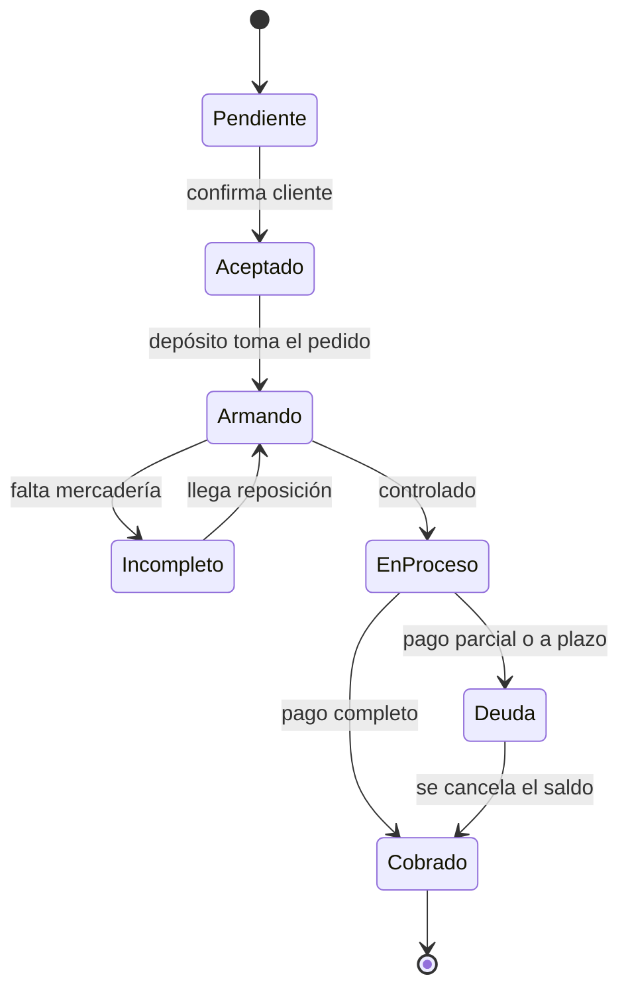

# Ventas y despacho

## Ciclo del comprobante

Estados: Pendiente, Aceptado, Cobrado, En proceso, Deuda, Armando, Incompleto.
Los comprobantes son internos; no hay emisión fiscal en el MVP.

## Precio

El precio de cada línea sale de la **escala** (x1, x5, x10, x50) según la
cantidad y el tipo de cliente. La escala se evalúa por línea o por total del
comprobante (decisión pendiente del cliente).

## Despacho

Cada paso registra usuario y hora. Quien arma no controla, y quien controla no
entrega (separación de funciones configurable).

## Postventa y logística

- **RMA**: devolución o garantía ligada al comprobante; puede reingresar stock o ir a service.
- **Faltantes**: líneas que no se pudieron armar; generan seguimiento y alertan a Depósito.
- **Transportes y contrarreembolsos**: transporte asignado al despacho; el contrarreembolso crea una cobranza pendiente que se cierra al rendir el transporte.

## Service técnico

Las órdenes de reparación pertenecen a **una** tienda, usan el cliente
compartido de la organización y consumen repuestos del stock mediante
movimientos.

> **Revisión de fuentes:** 2026-10-25 23:00 — se revisaron las fuentes de esta página (specs, prototipos, migraciones y código) y su contenido no cambia.
