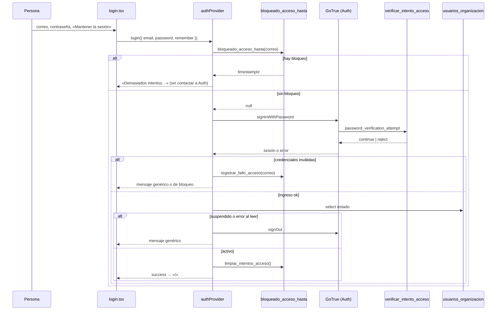

# Acceso y organización: modelo, contratos y operación (MSF-119)

Épica **MSF-119 · Acceso, organización y permisos · Acceso y organización**. Spec:
`specs/20261012-140000-acceso-y-organizacion/` (`spec.md`, `plan.md`, `tasks.md`). Resumen de producto:
[Acceso: ingreso, recuperación y sesión](../acceso-ingreso.md). Regla de aislamiento para tablas nuevas:
[Aislamiento por organización](../aislamiento-por-organizacion.md).

La épica es **adecuación sobre el template**, no construcción: el login, las rutas protegidas, la invitación,
definir/recuperar contraseña y el aislamiento por RLS venían de las specs 003 y 006. Lo que la épica agrega es
el estado de membresía, el bloqueo por intentos, el vencimiento de sesión, las reglas de contraseña del producto
y la prueba que exige RLS en toda tabla expuesta.

## Alcance de entrega

`refine` (`apps/web`) y `supabase` (migraciones, RLS, RPC, Auth Hook, pgTAP). Sin `kestra`, `superset` ni
`workers` (`spec.md:13`).

## Mapa de la épica

| Historia | Qué resuelve | Dónde está construido |
|---|---|---|
| F-ACC-01 · US1 | Ingreso con correo y contraseña, mensaje genérico, bloqueo por intentos, «Mantener la sesión iniciada», rechazo de suspendidos | `apps/web/src/pages/login.tsx`, `apps/web/src/providers/authProvider.ts`, migraciones `20261012140100`, `20261012140200`, `20261012140300` |
| F-ACC-02 · US2 | Recuperar contraseña con aviso neutro y definir contraseña con reglas visibles | `apps/web/src/pages/acceso/solicitar-recuperacion.tsx`, `apps/web/src/pages/acceso/definir-contrasena.tsx`, `apps/web/src/lib/passwordPolicy.ts` |
| F-ACC-03 · US3 | «Cerrar sesión» desde el menú de cuenta, vencimiento por inactividad y corte de la sesión del suspendido | `apps/web/src/components/navegacion/MenuCuenta.tsx`, `apps/web/src/lib/vencimientoSesion.ts`, `supabase/config.toml`, migración `20261012150000` |
| F-ORG-01 · US4 | Toda tabla expuesta con RLS por organización y una prueba que recorre el catálogo | `supabase/tests/database/rls_en_toda_tabla.test.sql`, `aislamiento_organizaciones.test.sql` |

## Datos

Las dos tablas que la épica crea o altera son **de plataforma / autenticación**, por eso viven en `public` y no en
`dominio` (`spec.md:38-47`).

| Tabla | Estado | Cambio |
|---|---|---|
| `public.usuarios_organizacion` | **alterada** | `estado text not null default 'activo' check (estado in ('activo','suspendido'))` (`20261012140100`). Sin cambios de PK ni de FK: `user_id` sigue siendo clave primaria, así que una persona pertenece a **una sola** organización. |
| `public.intentos_acceso` | **nueva** | Contador de fallos por correo: `correo_hash text primary key`, `fallos integer not null default 0`, `ultimo_fallo timestamptz not null default now()`, `bloqueado_hasta timestamptz` (`20261012140200`); columna `ultimo_fallo_servidor timestamptz` (`20261014100000`) e índice `intentos_acceso_ultimo_fallo_idx` sobre `ultimo_fallo` (`20261013180000`). |
| `public.organizaciones` | existente | Sin cambios: es la base de la regla de aislamiento. |
| `auth.users` | existente | Sin cambios: el login y la recuperación los resuelve GoTrue (Supabase Auth). |
| `auth.sessions` | existente | Sin cambios de esquema; la épica borra filas desde el trigger `cortar_sesiones_suspendido`. |

`public.intentos_acceso` tiene **RLS activado y ninguna policy** (`20261012140200:27`): el acceso es solo por
funciones `security definer` y por el Auth Hook. Los privilegios de tabla se revocan para `anon` y
`authenticated` (`20261012140200:28`). El DER completo está en [Datos y DER](datos.md#acceso-y-membresia-msf-119).

### Funciones de RLS ajustadas por la épica

`20261012140100` redefine `private.organizacion_id()` y `private.puede_escribir()` para que un suspendido no
resuelva organización ni pueda escribir; `20261012140300` hace lo mismo con las cuatro funciones de autorización
que seguían leyendo la membresía sin filtrar el estado:

| Función | Efecto del filtro `estado = 'activo'` |
|---|---|
| `private.organizacion_id()` | Un suspendido no resuelve organización → las políticas no devuelven filas (fail-closed). |
| `private.puede_escribir()` | Un suspendido no escribe aunque conserve un token válido. |
| `private.puede_gestionar_membresias(uuid)` | Sin privilegios de administración de miembros. |
| `private.es_administrador_de(uuid)` | No es administrador de la organización. |
| `private.rol_id()` | Sin rol efectivo. |
| `private.puede_gestionar_reportes(uuid)` | Sin acceso a reportes. |

El **superadmin sin membresía** no tiene fila en `usuarios_organizacion` y no es rechazo: `private.organizacion_id()`
cae a `superadmin_organizacion_activa` (`20261012140100:24-28`).

## Contratos (RPC)

| RPC | Rol | Para qué |
|---|---|---|
| `public.bloqueo_acceso_hasta(p_correo text) → timestamptz` | `anon`, `authenticated` | Instante hasta el que el correo queda bloqueado, o `null`. Se consulta **antes** de contactar a Auth. |
| `public.registrar_fallo_acceso(p_correo text) → timestamptz` | `anon`, `authenticated` | Suma un fallo al contador del correo; devuelve el bloqueo vigente si lo hay. |
| `public.limpiar_intentos_acceso()` | `authenticated` | Borra el contador **del correo del JWT** tras un ingreso exitoso; nadie puede resetear el de otro. |
| `public.verificar_intento_acceso(event jsonb) → jsonb` | `supabase_auth_admin` | Auth Hook `password_verification_attempt` (ver abajo). |
| `private.hash_correo_acceso(p_correo text) → text` | `postgres` (revocado a `public`, `anon`, `authenticated`) | HMAC-SHA256 del correo normalizado con la clave `acceso_hmac` de Vault. |
| `private.contar_fallo_acceso(p_hash text, p_servidor boolean) → timestamptz` | `postgres` | Conteo atómico con `pg_advisory_xact_lock`; `p_servidor` marca que ya contó el hook. |
| `private.purgar_intentos_acceso(p_excepto text)` | `postgres` | Purga acotada de filas viejas. |

Las tres RPC de acceso nacen en `20261012140200` (`bloqueo_acceso_hasta` `:41-51`, `registrar_fallo_acceso`
`:55-106`, `limpiar_intentos_acceso` `:111-120`) con sus `revoke`/`grant` en `:122-130`; el hook, en
`20261014100000:187-236`. Contratos generales de RPC: [API y RPC](api.md).

### Superficie de `anon`

`grant usage on schema public to anon` existe **solo** para que `anon` alcance las RPC de bloqueo antes de tener
sesión (`20261012140200:127`; sin `USAGE` el ingreso fallaría cerrado). Como `USAGE` habilita cualquier función
de `public` que conserve `EXECUTE` por defecto, `20261013120001` revoca `EXECUTE` a `public` y `anon` sobre todas
las funciones de `public` salvo `bloqueo_acceso_hasta`, `registrar_fallo_acceso` y `limpiar_intentos_acceso`, y
re-granta explícitamente a `authenticated`, `service_role` y los roles administrativos de Supabase lo que hasta
entonces recibían vía `PUBLIC`. `20261013130000` quita además los **privilegios por defecto** de `anon` sobre
funciones, tablas y secuencias que nazcan después en `public`.

Regla para el equipo: **toda RPC nueva lleva `grant execute ... to authenticated` explícito**, y toda función
nueva en `public` nace con `revoke execute ... from public, anon` (ver `CLAUDE.md`). El test pgTAP
`estado_usuario` falla si `anon` ejecuta algo fuera de las RPC de acceso.

**MSF-130 (interés por WhatsApp)** suma una RPC pública de la tienda:
`publico.registrar_interes_whatsapp(host text, producto_id uuid)` es ejecutable por `anon` y `authenticated`,
pero vive en el esquema **`publico`** (no en `public`), así que **no** entra en la lista de RPC de `public`
permitidas a `anon`: esa lista sigue siendo `bloqueo_acceso_hasta`, `registrar_fallo_acceso` y
`limpiar_intentos_acceso`. La empresa sale **solo del dominio** (`dominio.tiendas`), no guarda datos
personales y responde el mismo `P0002` para dominio desconocido y empresa desactivada. `anon` no tiene
privilegios sobre `dominio.intereses_whatsapp` ni sobre la vista `public.interes_whatsapp_por_producto`.
Detalle: [Consultas: modelo, RPC y aviso](consultas.md#interes-por-whatsapp-f-con-02-msf-130).

## Flujo de ingreso



Los mensajes viven en `apps/web/src/providers/authProvider.ts:9-13` y son **exactamente**:

| Constante | Texto |
|---|---|
| `mensajeIngresoGenerico` | «Revisá el correo y la contraseña e intentá de nuevo.» |
| `mensajeIngresoTecnico` | «No pudimos verificar tu ingreso por un problema del servicio. Intentá de nuevo en unos minutos.» |
| `mensajeIngresoBloqueado` | «Demasiados intentos. Esperá unos minutos antes de volver a intentar.» |

La pantalla de ingreso (`apps/web/src/pages/login.tsx`) **no pinta ningún `Alert` propio**: recoge los datos y
muestra la notificación de Refine (toast) que el provider decide. Mientras espera, el botón dice
«Ingresando...». El correo se normaliza con `trim().toLowerCase()` antes de todo (`authProvider.ts:32`).

Reglas de seguridad del flujo:

- **Falla cerrado**: si la consulta de bloqueo falla, el ingreso se rechaza con `mensajeIngresoTecnico` **sin
  contactar a Auth** (`authProvider.ts:38-43`); si la consulta de membresía falla, se cierra la sesión y se
  rechaza con el mensaje genérico (`authProvider.ts:94-97`).
- **Solo `invalid_credentials` cuenta como fallo**: un 400 por otra causa (p. ej. `email_not_confirmed`) no suma
  al contador (`esCredencialInvalida`, `authProvider.ts:22-24`).
- **No se filtra la existencia del correo**: correo inexistente y contraseña incorrecta devuelven el mismo texto.
  Un suspendido también recibe ese mismo texto (`authProvider.ts:94-126`).
- **Preferencias atómicas**: la marca «Mantener la sesión» se fija **antes** de autenticar (Auth guarda la sesión
  al responder) y se revierte si el ingreso no prospera, restaurando el valor previo en vez de forzar `false`
  (`authProvider.ts:45-50`).

## Bloqueo por intentos

### Por qué una tabla propia

El límite nativo de Supabase Auth (`[auth.rate_limit].sign_in_sign_ups`) es **por IP y por ventana de 5 minutos**,
no por correo ni a 5 intentos / 15 minutos: no alcanza (decisión de T003, `tasks.md:26`). Por eso existe
`public.intentos_acceso` y las RPC que la acceden.

### Reglas

- 5 fallos por correo bloquean 15 minutos (`spec.md:32`, S1).
- El correo se guarda **en hash**: hoy HMAC-SHA256 con el secreto `acceso_hmac` de Vault (`20261014100000:72-90`).
  Antes de esa migración era `sha256`; los contadores viejos no se pueden pasar a HMAC (el hash no se revierte) y
  quedan huérfanos: **se purgan solos**.
- Un correo nulo, vacío o de más de 254 caracteres no cuenta y **no se hashea**: el corte es previo al hash
  (`20261013110000:29-32`, `20261013200000:19-21`).
- La purga corre en cada fallo, en cada intento del hook (válido o no) y no depende de que alguien falle un
  ingreso: `private.purgar_intentos_acceso` borra hasta 100 filas por llamada, con `for update skip locked`
  (`20261014100000:94-109`) y saltea las filas que otra transacción ya está tomando.

### Auth Hook (servidor) — MSF-470

El bloqueo del cliente lo esquivaba un llamado directo a `POST /auth/v1/token`. La migración `20261014100000` lo
cierra con el **Auth Hook `password_verification_attempt`** de GoTrue:

```toml
# supabase/config.toml:320-324
[auth.hook.password_verification_attempt]
enabled = true
uri = "pg-functions://postgres/public/verificar_intento_acceso"
```

Contrato de la función (`20261014100000:183-186`): entrada `{user_id, valid}`, salida
`{decision: 'continue' | 'reject', message?}`. Si la función lanza, GoTrue **rechaza** el ingreso (falla cerrado).
El mensaje de rechazo es el mismo del cliente: «Demasiados intentos. Esperá unos minutos antes de volver a
intentar.» (`20261014100000:222-225`).

| Situación | Decisión del hook | Efecto |
|---|---|---|
| Correo bloqueado | `reject` | Rechaza **siempre**, sea la contraseña válida o no: la respuesta no depende de la contraseña, así que frena la fuerza bruta y no delata la correcta. Los intentos rechazados no suman fallos. |
| Sin bloqueo, contraseña inválida | `continue` + cuenta el fallo | Mismo contador que el cliente. |
| Sin bloqueo, contraseña válida | `continue` + limpia el contador | El ingreso prospera. |

El hook toma `pg_advisory_xact_lock(20261014, hashtext(v_hash))` **antes** de mirar el bloqueo
(`20261014100000:212`): los intentos concurrentes del mismo correo se serializan y no eluden el tope de 5.

**Doble conteo.** El cliente sigue llamando `registrar_fallo_acceso` (cubre los correos inexistentes, que no
pasan por el hook). Para un usuario existente, `registrar_fallo_acceso` ignora el intento si el hook ya lo contó
hace menos de 10 segundos (`ultimo_fallo_servidor`, `20261014100000:115-166`). Riesgo conocido: si el reporte del
cliente llega más de 10 s después del hook (red muy lenta) se cuenta otra vez y un usuario legítimo podría
bloquearse con 3-4 fallos reales.

### Activación por entorno (checklist)

`supabase/config.toml` solo rige en local. En los entornos self-hosted (STG y PROD) la migración **no** activa el
hook: hay que habilitarlo en la configuración de GoTrue del entorno y reiniciar Auth:

```
GOTRUE_HOOK_PASSWORD_VERIFICATION_ATTEMPT_ENABLED=true
GOTRUE_HOOK_PASSWORD_VERIFICATION_ATTEMPT_URI=pg-functions://postgres/public/verificar_intento_acceso
```

Verificación tras cada deploy (también en [Entornos y despliegue](../deployment.md)):

1. `select decrypted_secret is not null from vault.decrypted_secrets where name = 'acceso_hmac'` → `true`.
2. `select has_function_privilege('supabase_auth_admin', 'public.verificar_intento_acceso(jsonb)', 'execute')`
   → `true`.
3. Con un usuario de prueba: 5 llamados a `POST /auth/v1/token?grant_type=password` con contraseña incorrecta y un
   6.º con la correcta deben responder el rechazo «Demasiados intentos…» (no un token). **Si el 6.º devuelve
   sesión, el hook no está activo.**

**Estado (2026-10-15): activado y verificado en STG y PROD** (T022a/T022b), y persistido en el
`supabase/config.toml` del workdir del Supabase CLI de cada entorno (`/root/supabase-stg`, `/root/supabase-prd`).

### Rol de migración, HMAC, Vault y rotación

- La clave `acceso_hmac` se genera al azar por la migración `20261014100000:49-62` y **nunca está en Git**. Si falta,
  la función falla en vez de volver a un hash sin clave.
- **Rol de migración**: `scripts/migrar-supabase-cloud.mjs` debe correr con el rol `postgres` (o uno con acceso a
  `vault.secrets`) y Vault habilitado; si no, la migración aborta de entrada con un mensaje claro (la verificación
  va antes de cualquier cambio de esquema o datos).
- **Rotar `acceso_hmac` equivale a poner todos los contadores a cero** (los hashes viejos quedan huérfanos y se
  purgan solos): `vault.update_secret` con el secreto nuevo y, si se quiere limpiar de inmediato,
  `delete from public.intentos_acceso`.
- Tras un restore sin Vault hay que recrear el secreto:
  `vault.create_secret(encode(extensions.gen_random_bytes(32), 'hex'), 'acceso_hmac')`.
- **Costo**: cada llamada descifra la clave de Vault (también las RPC abiertas a `anon`); es una lectura puntual y
  no se cachea por transacción para no dejar la clave en un setting de sesión.

### Limitaciones conocidas

- `registrar_fallo_acceso` sigue abierta a `anon` (los correos inexistentes no pasan por el hook), así que cualquiera
  puede bloquear 15 minutos el correo de otra persona (riesgo aceptado, FR-003; anotado en
  `20261012140200:9-13`).
- Un usuario sin correo (o con más de 254 caracteres) no tiene contador.
- El hook solo corre para **usuarios existentes**: un llamado directo a `/token` con un correo inexistente no se
  bloquea por el hook (el cliente sí lo cuenta por RPC).
- **Enumeración (abierta)**: `/token` no está libre de enumeración. Tras 5 llamados directos a `/auth/v1/token` con
  un correo, `bloqueo_acceso_hasta(correo)` (ejecutable por `anon`) responde «bloqueado» solo si el correo existe y
  «no bloqueado» si no existe. Se cierra con un componente aparte (gateway o Edge Function que cuente también los
  correos inexistentes); queda como historia de seguimiento.

## Contraseña y enlaces

La política vive en `apps/web/src/lib/passwordPolicy.ts` y es la **única fuente** de las reglas (la usan
`definir-contrasena.tsx` y `cuenta/cambiar-contrasena.tsx`):

| Regla | Etiqueta visible | Comprobación |
|---|---|---|
| Longitud | «Al menos 12 caracteres» | `value.length >= 12` |
| Mayúscula | «Una mayuscula» | `/[A-Z]/` |
| Minúscula | «Una minuscula» | `/[a-z]/` |
| Número | «Un numero» | `/\d/` |
| Símbolo | «Un simbolo» | `/[^A-Za-z0-9]/` |

Descripción que ve la persona: «La contrasena debe tener al menos 12 caracteres e incluir mayuscula, minuscula,
numero y simbolo.» Si la confirmación no coincide: «Las contraseñas no coinciden.» (la única cadena del módulo
con acentos; el resto está sin tildes a propósito).

`definir-contrasena.tsx` muestra cada regla con su estado («Cumple: …» / «Falta: …») en una lista con
`aria-label="Reglas de la contrasena"`, y un `role="status" aria-live="polite"` con «La contrasena cumple todas
las reglas.» o «Faltan N de 5 reglas.».

Enlaces (`supabase/config.toml`): `[auth.email] otp_expiry = 3600` (1 h) y `max_frequency = "15m"`; el OTP es de un
solo uso por defecto en Auth (T010, verificado sin cambios). `[auth] minimum_password_length = 12` y
`password_requirements = "lower_upper_letters_digits_symbols"` son la puerta de Auth; la política de la app es la
que muestra las reglas.

`[auth] enable_signup = false`: no hay registro propio; toda cuenta llega invitada.

## Sesión

| Pieza | Dónde | Qué hace |
|---|---|---|
| Almacenamiento | `apps/web/src/lib/supabase.ts:83-104` | Con «Mantener la sesión» la sesión vive en `localStorage`; sin ella, en `sessionStorage`. El adaptador `getItem` lee `sessionStorage` y después `localStorage`; `setItem` escribe primero en el destino y limpia el otro almacén **solo si** la escritura funcionó (una cuota llena no pierde el token anterior). |
| Marca «mantener» | `localStorage["sesion:mantener"]` (`lib/vencimientoSesion.ts:6`) | Decide dónde se guardan los ingresos nuevos y exime del vencimiento por inactividad. |
| Rastro de actividad | `localStorage["sesion:ultima-actividad"]` (`lib/vencimientoSesion.ts:5`) | Epoch en ms de la última actividad. |
| Inactividad 12 h | `apps/web/src/lib/vencimientoSesion.ts:4` (`INACTIVIDAD_MAXIMA_MS = 12 * 60 * 60 * 1000`) | `sesionVencidaPorInactividad()` cierra la sesión si pasaron 12 h sin actividad, salvo con la marca «mantener». |
| Tope 30 días | `supabase/config.toml:303-308` (`[auth.sessions] timebox = "720h"`) | Tope duro en el servidor para toda sesión. |
| Corte por suspensión | `supabase/migrations/20261012150000_cortar_sesiones_suspendido.sql` | Trigger `AFTER UPDATE` que borra las filas de `auth.sessions` del usuario cuando `estado` pasa a `suspendido`. |

**Por qué la inactividad se aplica en el cliente:** GoTrue tiene una **única política global** de sesiones; un
`inactivity_timeout` de 12 h cortaría también a quien eligió «Mantener la sesión iniciada». La alternativa es el
`timebox` de 30 días en servidor + el reloj de inactividad en el cliente (`spec.md:134`, decisión 3 de `plan.md`).

Contrato del rastro de actividad (`lib/vencimientoSesion.ts:14-16`): **sin** marca de actividad (almacenamiento
limpiado o sesión previa al despliegue) la sesión **no** se considera vencida; `authProvider.check` registra
actividad en cada llamada para que el reloj arranque. `seguirActividad` (`main.tsx:15-19`) escucha `pointerdown` y
`keydown` y, si detecta la sesión vencida, cierra sesión y manda a `/login`.

**Sesión previa al deploy**: `migrarSesionLegacy` (`lib/supabase.ts:72-79`) fija la marca «mantener» si hay una
sesión de Supabase en `localStorage` sin marca, para que el refresh no la mueva a `sessionStorage`.

**Cierre de sesión**: «Cerrar sesión» está en `MenuCuenta` (`apps/web/src/components/navegacion/MenuCuenta.tsx:105-108`),
junto a Perfil, Cambiar contraseña y Cambiar correo electrónico. `authProvider.logout` borra el rastro de sesión y
la marca «mantener» **después** de un `signOut` exitoso; si el cierre global falla, reintenta con
`{ scope: 'local' }` y conserva la marca porque la sesión sigue en `localStorage`.

## Aislamiento por organización (F-ORG-01)

La regla ya existía en el template (spec 003). Lo que agrega esta épica:

- `supabase/tests/database/rls_en_toda_tabla.test.sql` (plan 4) recorre el **catálogo** y falla si alguna tabla
  expuesta no tiene RLS. Enumera `pg_class` × `pg_namespace` con `n.nspname in ('public','dominio')`,
  `relkind in ('r','p')`, saltando particiones hijas (`not c.relispartition`) y tablas de extensiones
  (`d.deptype = 'e'`). No usa una lista fija: una tabla nueva sin RLS rompe `pnpm test:db` sin tocar la prueba.
  Incluye un **control positivo** sobre `public.clientes` para que la prueba no pueda pasar en vacío.
- `supabase/tests/database/aislamiento_organizaciones.test.sql` (plan 66) verifica con dos organizaciones que cada
  uno ve solo lo suyo y que un usuario sin membresía no ve nada.
- `supabase/tests/database/estado_usuario.test.sql` (plan 40) cubre el estado de la membresía, el bloqueo por
  intentos y la superficie de `anon`.

La regla para escribir una tabla de dominio nueva está en
[Aislamiento por organización](../aislamiento-por-organizacion.md).

## Pruebas

| Ámbito | Dónde | Qué corre |
|---|---|---|
| pgTAP | `supabase/tests/database/estado_usuario.test.sql` (plan 40) | Estado por defecto `activo`, `check` de valores, suspendido sin organización/escritura/lectura/privilegios, contador de fallos, bloqueo a los 5 intentos, `anon` solo con las RPC de acceso, objetos nuevos de `public` sin privilegios para `anon`, purga acotada a 100 filas, `bloqueo_acceso_hasta` en plpgsql. |
| pgTAP | `supabase/tests/database/bloqueo_servidor.test.sql` (plan 38) | Hook: decide `continue`/`reject`, mensaje igual al del cliente, bloqueo con contraseña válida e inválida, no reabre el contador, un intento inválido estando bloqueado no incrementa, bloqueo vencido reinicia en 1, purga desde el hook, `supabase_auth_admin` ejecuta y `anon`/`authenticated` no, HMAC normaliza mayúsculas y espacios. |
| pgTAP | `supabase/tests/database/cortar_sesiones_suspendido.test.sql` (plan 4) | Suspender corta las sesiones abiertas; las de otros usuarios no se tocan; actualizar otra columna no vuelve a cortar. |
| pgTAP | `supabase/tests/database/rls_en_toda_tabla.test.sql` (plan 4) | Catálogo de tablas expuestas con RLS. |
| pgTAP | `supabase/tests/database/aislamiento_organizaciones.test.sql` (plan 66) | Aislamiento entre dos organizaciones y usuario sin membresía. |
| Vitest | `apps/web/src/providers/authProvider.test.ts` (2 `describe`), `authProvider.listener.test.ts`, `lib/vencimientoSesion.test.ts`, `lib/passwordPolicy.test.ts`, `lib/supabase.test.ts`, `pages/login.test.tsx`, `pages/acceso/solicitar-recuperacion.test.tsx`, `pages/acceso/definir-contrasena.test.tsx`, `components/navegacion/MenuCuenta.test.tsx` | Ingreso (éxito, superadmin sin membresía, mensaje genérico, bloqueo, suspendido, error técnico, «Mantener»), cierre y vencimiento, marcador `SIGNED_OUT`, reglas de contraseña, adaptador de almacenamiento con storage bloqueado, neutralidad de la recuperación, enlace vencido, menú de cuenta. |
| Chequeo estático | `scripts/verificar-hook-bloqueo.test.mjs` (`pnpm test:auth:hook-bloqueo`) | Corre **dentro de `pnpm test`**: el hook está activo, apunta a una función existente con la firma que espera GoTrue y su mensaje de rechazo es el del cliente. |
| E2E local | `scripts/e2e-acceso.e2e.mjs` (`pnpm test:acceso:e2e`) | Ingreso con contraseña errónea, ingreso correcto, «Cerrar sesión» (vuelve a `/login` y una ruta protegida redirige), recuperación con aviso neutro, enlace generado por la Admin API, redefinición de contraseña, la anterior deja de servir y el enlace no se reutiliza. **No** forma parte de `pnpm test` ni corre en el CI: requiere `pnpm dev:supabase`, `pnpm dev:refine` y `pnpm dev:playwright`. |
| E2E del hook | `scripts/verificar-hook-bloqueo.e2e.mjs` (`pnpm test:auth:hook-bloqueo:e2e`) | 5 fallos + 6.º correcto contra `/auth/v1/token`, 10 intentos concurrentes y reinicio del contador. Fuera de `pnpm test` y del CI (su stack excluye `kong`). Un stack local ya levantado debe reiniciarse con `supabase stop && supabase start` para tomar el hook de `config.toml`. |
| E2E en el CI | `apps/web/e2e/acceso-publico.e2e.ts`, `apps/web/e2e/recorrido-publico.e2e.ts` (`pnpm test:e2e`) | Rutas protegidas sin sesión → ingreso; camino a la recuperación; aviso de enlace vencido; el ingreso no tiene registro propio. |

## Reversión

Todas las migraciones de la épica son **aditivas** y cada una lleva su camino de reversión en la cabecera; ninguna
reversión se ejecuta en el mismo PR que crea el objeto.

| Migración | Reversión documentada en su cabecera |
|---|---|
| `20261012140100_usuarios_organizacion_estado.sql` | Restaurar `private.organizacion_id()` y `private.puede_escribir()` con las definiciones de `20260908172920` y luego eliminar la columna `estado` (en un PR posterior). |
| `20261012140200_intentos_acceso.sql` | Eliminar las tres funciones `public.*` y la tabla. |
| `20261012140300_suspendidos_sin_privilegios.sql` | Restaurar cada función con su definición original (indicadas en el encabezado). |
| `20261012150000_cortar_sesiones_suspendido.sql` | Quitar el trigger `cortar_sesiones_suspendido` y la función `private.cortar_sesiones_suspendido()`. |
| `20261013100000` … `20261013200000` | Volver a la definición anterior de la función redefinida (cada encabezado dice cuál). |
| `20261014100000_bloqueo_acceso_en_servidor.sql` | Restaurar `private.hash_correo_acceso` y `registrar_fallo_acceso` a sus definiciones previas, quitar `[auth.hook.password_verification_attempt]` de `config.toml`, eliminar `public.verificar_intento_acceso`, `private.contar_fallo_acceso` y `private.purgar_intentos_acceso`, la columna `ultimo_fallo_servidor` y el secreto `acceso_hmac` de Vault. |

## Operación, límites y pendientes

- **Plan de Supabase (pendiente)**: confirmar que el plan contratado permite `[auth.sessions] timebox` (y
  `inactivity_timeout`, que **no** se usa) antes de producción. No es verificable desde el repo. T012.
  **Dueño: responsable de plataforma.**
- **Sesión previa al deploy**: `migrarSesionLegacy` fija la marca «mantener» para que el refresh no mueva la
  sesión a `sessionStorage`.
- **Limitación de diseño del almacenamiento**: hay una sola clave de storage compartida por todas las pestañas del
  navegador, así que un ingreso nuevo con otra preferencia (p. ej. sin la casilla) reemplaza la sesión guardada
  por otra pestaña; la marca solo decide dónde se guardan los ingresos nuevos.
- **E2E sin CI**: `test:acceso:e2e` y `test:auth:hook-bloqueo:e2e` no corren en el CI; los recorridos críticos
  quedan en **MSF-499**.
- **Fuera de alcance de la épica**: administrar el estado (activo/suspendido) desde pantalla (MSF-125 · F-USR-02) y
  el alta de organizaciones nuevas (MSF-162 · F-ORG-02). La cuenta web del cliente es otra épica (MSF-237): ver
  [Cuenta web del cliente (técnico)](cuenta-web-cliente.md).
