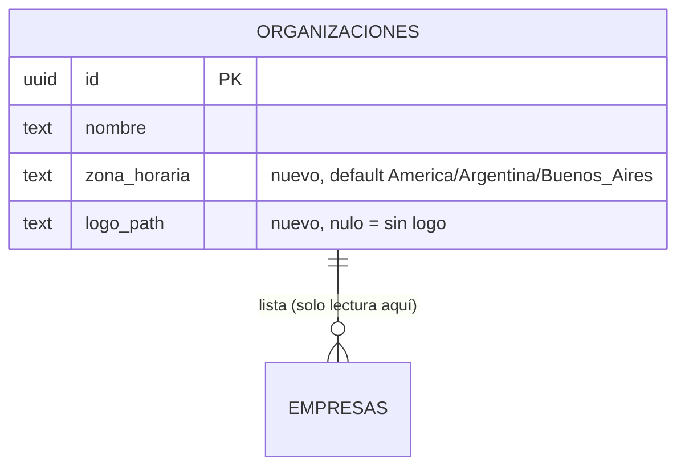

# Administración de usuarios y organización: técnico (MSF-132)

Épica MSF-132, spec `specs/20261014-140000-administracion-de-usuarios-y-organizacion/`. Alcance de entrega: `refine`, `supabase`. Dos historias: F-ORG-03 (MSF-253) y F-USR-03 (MSF-264). El detalle de campos, RPC y logo está en [Administración de la organización](../administracion-organizacion.md); el flujo de restablecer contraseña, en [Invitar usuarios](../invitar-usuarios.md). El alta de empresas **no** es de esta épica: es MSF-475.

## F-ORG-03: datos de la organización

- **Datos** (esquema `public`, Principio VII): la migración aditiva `supabase/migrations/20261014160000_organizacion_datos_y_configuracion.sql` agrega `zona_horaria` (`text not null`, default `America/Argentina/Buenos_Aires`) y `logo_path` (`text` nulo) a `public.organizaciones`. No hay tablas nuevas.
- **Escritura**: único camino la RPC `public.actualizar_organizacion(p_nombre, p_zona_horaria, p_logo_path)` (`security definer`); no hay política UPDATE ni `grant update` sobre la tabla. Exige administrador activo (`private.puede_escribir()`).
- **Logo**: bucket privado `logos-organizacion` con cuatro políticas `logos_organizacion_*` en `storage.objects` (mismo archivo de migración). La pantalla firma la URL con `createSignedUrl(logoPath, 300)` y tope de 1 MB (`apps/web/src/pages/organizacion/edit.tsx`).
- **Pantalla**: ruta `/organizacion` (`apps/web/src/App.tsx`, recurso `organizacion`, etiqueta «Mi organización») con `RequiereOrganizacionActiva`. Lista las empresas con `useEmpresas` y enlace a `/empresas/edit/:id`.
- **Empresa activa**: no aplica; la pantalla es de la organización, no de una empresa (la lista de empresas es informativa).

## F-USR-03: restablecer la contraseña de otro usuario

- Sin migración ni RPC: `restablecerContrasena` en `apps/web/src/pages/usuarios/list.tsx` llama a `supabaseClient.auth.resetPasswordForEmail` con redirect `definir-contrasena?tipo=recuperacion` (flujo de F-ACC-02, MSF-119).
- Suspendido (FR-006) y no-administrador / fila propia (FR-007) son guardas de UX en el cliente; el bloqueo real de un suspendido vive en la membresía/RLS (`docs/acceso-ingreso.md`).

## Datos (DER)

## Pruebas

- pgTAP: `supabase/tests/database/organizacion_datos_y_configuracion.test.sql` (administrador edita; operador, consulta y suspendido rechazados; datos inválidos; aislamiento; `anon`).
- Vitest: `apps/web/src/pages/organizacion/edit.test.tsx` y `apps/web/src/pages/usuarios/list.test.tsx`.
- E2E: no hay (desvío de T010/T017); deuda trazada en **MSF-499** (`docs/e2e-app.md`).

## Reversión

Migración aditiva; pasos en [Administración de la organización](../administracion-organizacion.md#reversión). F-USR-03: revertir el commit. Toda la spec: `git revert -m 1 <merge>`.

## Pendiente

- Limpieza de logos huérfanos en `logos-organizacion` (job vía Kestra): sin historia propia todavía (TODO dueño: producto).
- `actualizar_organizacion` no verifica que el objeto exista en `storage.objects` (límite conocido, ver la página de producto).

> **Revisión de fuentes:** 2026-10-25 23:00 — se revisaron las fuentes de esta página (specs, prototipos, migraciones y código) y su contenido no cambia.
