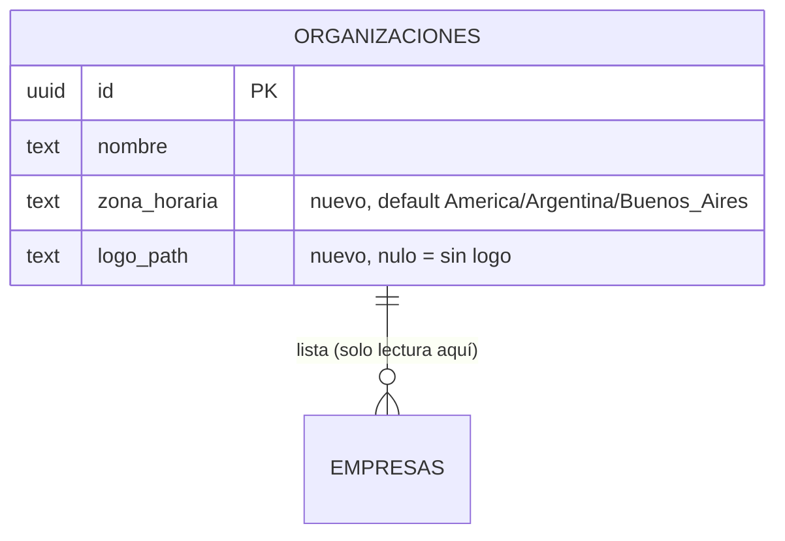

# Administración de usuarios y organización: técnico (MSF-132)

Épica MSF-132, spec `specs/20261014-140000-administracion-de-usuarios-y-organizacion/`. Alcance de entrega: `refine`, `supabase`. Dos historias: F-ORG-03 (MSF-253) y F-USR-03 (MSF-264). El detalle de campos, RPC y logo está en [Administración de la organización](../administracion-organizacion.md); el flujo de restablecer contraseña, en [Invitar usuarios](../invitar-usuarios.md). El alta de empresas **no** es de esta épica: es MSF-475.

## F-ORG-03: datos de la organización

- **Datos** (esquema `public`, Principio VII): la migración aditiva `supabase/migrations/20261014160000_organizacion_datos_y_configuracion.sql` agrega `zona_horaria` (`text not null`, default `America/Argentina/Buenos_Aires`) y `logo_path` (`text` nulo) a `public.organizaciones`. No hay tablas nuevas.
- **Escritura**: único camino la RPC `public.actualizar_organizacion(p_nombre, p_zona_horaria, p_logo_path)` (`security definer`); no hay política UPDATE ni `grant update` sobre la tabla. Exige administrador activo (`private.puede_escribir()`).
- **Logo**: bucket privado `logos-organizacion` con cuatro políticas `logos_organizacion_*` en `storage.objects` (mismo archivo de migración). La pantalla firma la URL con `createSignedUrl(logoPath, 300)` y tope de 1 MB (`apps/web/src/pages/organizacion/edit.tsx`).
- **Pantalla**: ruta `/organizacion` (`apps/web/src/App.tsx`, recurso `organizacion`, etiqueta «Mi organización») con `RequiereOrganizacionActiva`. Lista las empresas con `useEmpresas` y enlace a `/empresas/edit/:id`.
- **Empresa activa**: no aplica; la pantalla es de la organización, no de una empresa (la lista de empresas es informativa).
- **Edición de los datos de la organización**: quien no es administrador ve el componente compartido `AccesoRestringido` («Mi organización») en lugar del estado de error con texto fijo (`apps/web/src/pages/organizacion/edit.tsx:136`).

## F-USR-03: restablecer la contraseña de otro usuario

- Sin migración ni RPC: `restablecerContrasena` en `apps/web/src/pages/usuarios/list.tsx` llama a `supabaseClient.auth.resetPasswordForEmail` con redirect `definir-contrasena?tipo=recuperacion` (flujo de F-ACC-02, MSF-119).
- Suspendido (FR-006) y no-administrador / fila propia (FR-007) son guardas de UX en el cliente; el bloqueo real de un suspendido vive en la membresía/RLS (`docs/acceso-ingreso.md`).

## Baja de organización: requisitos de la primera RPC y límites conocidos

Hoy no hay ninguna RPC que dé de baja una organización (ver [Empresas](../empresas.md)). Cuando se escriba la primera (`baja_organizacion*`), **debe** cumplir, y lo comprueba `supabase/tests/database/baja_organizacion_requisitos_catalogo.test.sql` (falla si aparece una función con ese nombre que no llame a las tres; antes de buscar se descartan comentarios, bloques `$tag$…$tag$` y literales de texto, así que nombrarlas ahí no alcanza; el análisis es textual: un comentario (`--` o `/*`) dentro de un literal produce un falso fallo (nunca un falso pase), una función de más de 10000 caracteres cuenta como incumplimiento (el borde es estricto), una etiqueta `$tag$` de más de 30 caracteres no se descarta (caso teórico que cubre la revisión de código) y una llamada real en una rama que nunca se ejecuta sí pasa y lo cubre la revisión de código):

- Exigir **superadmin** (`private.is_superadmin()`), no «administrador de la organización»: borrar una organización entera no es una decisión de quien la usa.
- **Registrar la actividad** con `private.registrar_actividad` (quién, cuándo y qué organización), antes de borrar.
- Terminar llamando a `private.confirmar_claves_diferidas()` para traducir el 23503 de las claves diferidas a un error de negocio (P0001).

Límites conocidos de las claves diferidas (MSF-844/847/848, #1008):

- `private.confirmar_claves_diferidas()` restaura el modo **declarado** de cada restricción (`pg_constraint.condeferred`), no el que tenía la sesión. Hacerlo exacto **no es viable**: PostgreSQL no expone el estado de `SET CONSTRAINTS` de la sesión en ningún catálogo ni función, así que no hay de dónde leerlo para guardarlo y restaurarlo. Quien necesite otro modo lo fija de nuevo después de llamarla.
- Un `DELETE` directo de `dominio.empresas` con reparaciones asociadas (fuera de una RPC que llame a la función de arriba) **falla en el `COMMIT`** con 23503 **sin traducir** (mensaje crudo de PostgreSQL, no P0001), porque la clave `reparaciones.empresa_id` es `deferrable initially deferred`. Es el comportamiento esperado: ninguna pantalla ni RPC borra empresas hoy; quien borre por SQL debe llamar a la función antes del `COMMIT` si quiere el error de negocio.

## Datos (DER)

## Pruebas

- pgTAP: `supabase/tests/database/organizacion_datos_y_configuracion.test.sql` (administrador edita; operador, consulta y suspendido rechazados; datos inválidos; aislamiento; `anon`).
- Vitest: `apps/web/src/pages/organizacion/edit.test.tsx` y `apps/web/src/pages/usuarios/list.test.tsx`.
- E2E: no hay (desvío de T010/T017); deuda trazada en **MSF-499** (`docs/e2e-app.md`).

## Reversión

Migración aditiva; pasos en [Administración de la organización](../administracion-organizacion.md#reversion). F-USR-03: revertir el commit. Toda la spec: `git revert -m 1 <merge>`.

## Pendiente

- Limpieza de logos huérfanos en `logos-organizacion` (job vía Kestra): sin historia propia todavía (TODO dueño: producto).
- `actualizar_organizacion` no verifica que el objeto exista en `storage.objects` (límite conocido, ver la página de producto).
