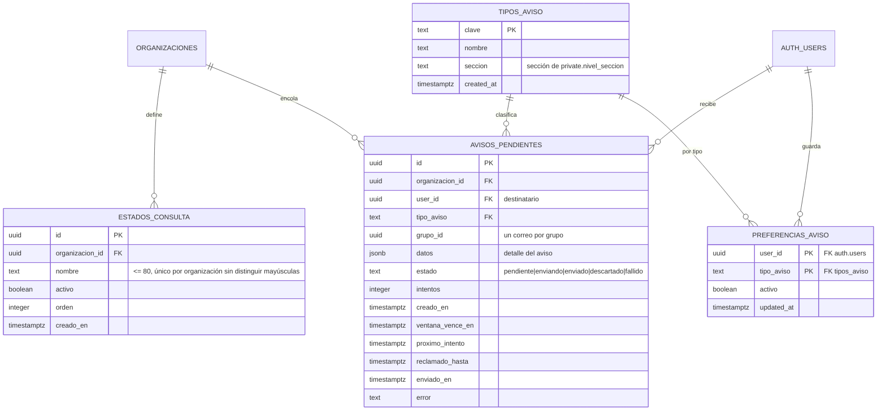
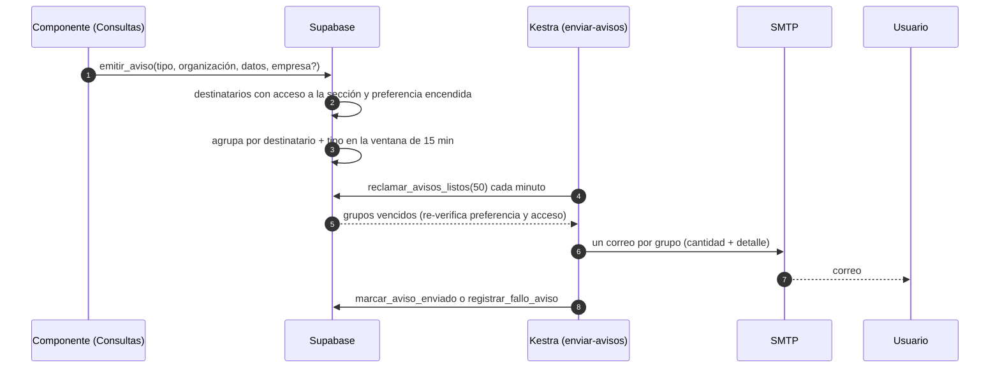
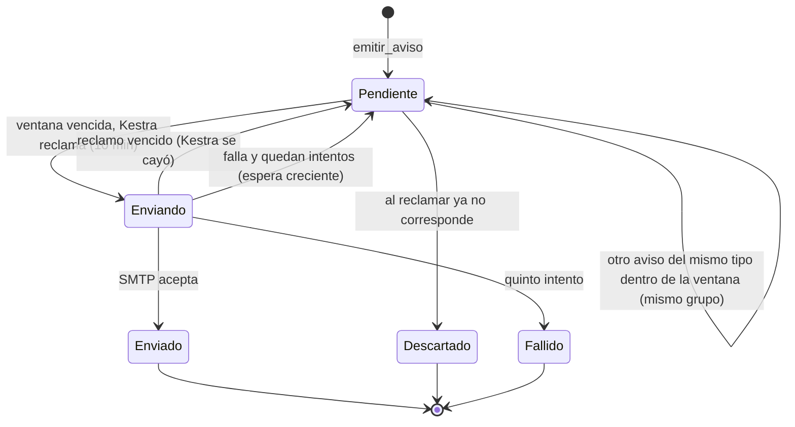

# Avisos y listas: modelo, RPC y flujos (MSF-189)

**Épica:** MSF-189 · **Spec:** `specs/20261024-120000-avisos-y-listas-configurables/` (rama
`epic/MSF-189-plataforma-avisos-y-listas-configurables`, pendiente de merge a `main` en este repositorio).
**Alcance de entrega:** `refine`, `supabase` y `kestra`; sin `superset` ni `workers`.

F-NOT-01 agrega un catálogo de tipos y preferencias por usuario en `public`, una cola durable de correos en
`public` y un flow de Kestra que envía. F-CFG-01 agrega `dominio.estados_consulta` y reutiliza
`dominio.motivos_movimiento` sin cambios. Los avisos de seguridad de Supabase Auth quedan fuera del sistema.

## Modelo

| Objeto | Esquema | Para qué | Migración |
|---|---|---|---|
| `public.tipos_aviso` | `public` | Catálogo transversal: clave, nombre y sección de permisos que habilita el tipo. Siembra `consulta_nueva`. | `20261210120000_avisos_catalogo.sql` |
| `public.preferencias_aviso` | `public` | Preferencia de cada usuario por tipo (PK `user_id` + `tipo_aviso`). Sin fila = encendido. | `20261210120100_avisos_preferencias.sql` |
| `public.avisos_pendientes` | `public` | Cola/outbox durable: destinatario, tipo, grupo, datos, estado, ventana, intentos, reclamo y error. | `20261210120300_avisos_cola.sql` |
| `dominio.estados_consulta` | `dominio` | Lista de estados de consulta por organización (`nombre`, `activo`, `orden`). | `20261210130000_estados_consulta_lista.sql` |
| `dominio.motivos_movimiento` | `dominio` | **Sin cambio**: es la lista de motivos de stock de F-STK-02 y se edita también desde `/stock/motivos`. | F-STK-02 |

Migraciones aditivas; cada una lleva su reversión en el encabezado. La migración
`20261210130300_consultas_aviso_emitir.sql` no crea ni altera tablas: cambia el disparador de
`dominio.consultas` para que emita por esta cola.

La relación con `dominio.consultas` es **solo por lógica** en esta entrega: `consultas.estado` sigue siendo
texto con `nueva|en_curso|resuelta` y `estados_consulta` todavía no tiene FK ni alimenta la bandeja (ver
[Límites](#límites-y-deuda)). El diagrama completo y el detalle de las tablas existentes están en
[Datos y DER](datos.md#avisos-y-listas-configurables-msf-189).

## Permisos y RLS

- `public.tipos_aviso`: RLS activa; `select` para `authenticated`, **sin** `insert`/`update`/`delete` desde la
  app; `anon` sin privilegios. Un componente registra su tipo con una migración.
- `public.preferencias_aviso`: cada usuario lee, inserta y actualiza **solo sus filas**
  (`user_id = auth.uid()`); sin `delete`; `anon` sin privilegios.
- `public.avisos_pendientes`: RLS activa **sin políticas** para `authenticated`; `revoke all` de `public`,
  `anon` y `authenticated`. Solo la tocan funciones `security definer` y las tres funciones que ejecuta
  Kestra.
- `dominio.estados_consulta`: `select` con organización activa y `private.nivel_seccion('consultas')` en
  `lectura` o `edicion`; `insert`/`update` solo con `private.puede_escribir()` (Administrador); **sin
  delete** y `anon` sin privilegios.
- `dominio.motivos_movimiento` conserva la RLS de F-STK-02. La pantalla de listas reutiliza el editor; no hay
  tabla nueva ni copia.

## RPC públicas

Todas se ejecutan como `authenticated`, hacen `revoke … from public, anon` y `grant execute … to
authenticated`. Las de preferencias son `security invoker`; la RLS sigue siendo la autoridad.

| RPC | Devuelve / hace | Errores |
|---|---|---|
| `public.listar_preferencias_aviso()` | `(tipo, nombre, activo)[]` de los tipos con `private.nivel_seccion(seccion)` en `lectura` o `edicion`; sin fila = `activo = true` | — |
| `public.guardar_preferencia_aviso(p_tipo text, p_activo boolean)` | `(tipo, activo)`; hace upsert de la fila del usuario actual | `22023` tipo desconocido o `p_activo` nulo; `42501` tipo de una sección sin acceso |
| `public.crear_estado_consulta(p_nombre text)` | `(id, nombre, activo, orden)`; el nuevo estado queda al final (`max(orden)+1`) | `42501` sin permiso; `23514` nombre vacío; `23505` repetido |
| `public.renombrar_estado_consulta(p_id uuid, p_nombre text)` | `(id, nombre)` de la organización | `42501`, `23514`, `23505`, `P0002` inexistente |
| `public.cambiar_estado_estado_consulta(p_id uuid, p_activo boolean)` | `(id, activo)`; no borra | `42501`, `P0002` |

El nombre se normaliza con `btrim` en un trigger y se compara con `lower(btrim(nombre))` en un índice único
por organización: un duplicado que solo cambia mayúsculas o espacios se rechaza. El orden se calcula sin
bloqueo: dos altas simultáneas podrían repetir `orden`; es cosmético y no se usa como clave.

## Funciones internas

No se conceden a `authenticated` ni a `anon`.

| Función (`private`) | Qué hace |
|---|---|
| `nivel_seccion_de_usuario(user_id, seccion)` | Nivel de **otra** persona en una sección (`edicion`/`lectura`/`ninguno`). Usa su mejor rol entre sus empresas y no depende de la empresa activa. Suspendida, ajena o sin membresía: `ninguno`. |
| `empresas_accesibles_de_usuario(user_id)` | Empresas activas a las que accede una persona (Administrador: las de su organización). Necesaria porque el disparador de Consultas corre sin `auth.uid()`. |
| `emitir_aviso(tipo, organizacion, datos, empresa default null)` | Resuelve destinatarios (miembro activo, con correo, con acceso a la sección, preferencia encendida y, si viene `empresa`, acceso a esa empresa) y encola. Devuelve la cantidad. |
| `ventana_agrupacion_aviso()` | Intervalo de la ventana: **15 minutos**. |
| `reclamar_avisos_listos(limite default 50)` | Reclama grupos vencidos sin doble toma (`for update skip locked` y candado por destinatario + tipo), re-verifica preferencia, actividad y acceso, descarta lo que ya no corresponde y deja el reclamo por 10 minutos. |
| `marcar_aviso_enviado(grupo_id)` | Marca el grupo `enviado`; **idempotente** y acepta `enviando` o un `pendiente` cuyo reclamo venció. |
| `registrar_fallo_aviso(grupo_id, error)` | Suma un intento, reprograma con espera de 1, 2, 4 y 8 minutos; al quinto intento deja `fallido` con el error (máximo 500 caracteres). |
| `max_intentos_aviso()` | Tope de intentos: **5**. |
| `encolar_aviso_consulta()` | Disparador `AFTER INSERT` de `dominio.consultas`: emite `consulta_nueva` con empresa, origen, nombre, contacto, producto y mensaje. Un fallo se registra con `RAISE WARNING` y **no frena el alta**. |

La agrupación usa un candado asesor por `destinatario:tipo`: dos emisiones simultáneas no abren dos grupos y
un aviso emitido durante el reclamo no queda fuera del correo. El flow de Kestra ejecuta solo
`reclamar_avisos_listos`, `marcar_aviso_enviado` y `registrar_fallo_aviso` con el rol existente
`kestra_orquestacion`; no tiene privilegios sobre las tablas.

## Flujo del aviso

Estados de una fila de la cola:

Un aviso `descartado` conserva el motivo en `error`; un `fallido` conserva el último error útil. La garantía
es **al menos una vez**: si el correo sale y `marcar_aviso_enviado` no llega a ejecutarse, el reclamo vence a
los 10 minutos y el grupo se reenvía.

## Flow de Kestra

`infra/kestra/flows/enviar-avisos.yml` (namespace `platform.avisos`):

1. **Cada minuto** ejecuta `select … from private.reclamar_avisos_listos(50)` con el rol
   `kestra_orquestacion`.
2. Itera los grupos con `ForEach` (concurrencia 5) y envía **un** `MailSend` por grupo por SMTP genérico.
   Asunto: `N avisos: <tipo>` o `Aviso: <tipo>`.
3. El cuerpo resume la cantidad y el detalle de cada aviso; los valores de negocio se escapan con `escape`.
   El correo **no incluye un enlace a la consulta**: el detalle identifica empresa, origen, nombre, contacto,
   producto y mensaje, y remite a la pantalla de preferencias.
4. Después del envío llama a `private.marcar_aviso_enviado`. Si el envío falla, el bloque `errors` llama a
   `private.registrar_fallo_aviso` con el error real, sin frenar a los demás grupos.

`infra/kestra/flows/avisos-consultas.yml` sigue existiendo solo para **terminar de enviar** las filas que
quedaron en `dominio.consultas_avisos` por el camino anterior. Las consultas nuevas ya no encolan ahí: el
disparador emite por `private.emitir_aviso`, con la empresa de la consulta como alcance. La dirección de
avisos por empresa (`dominio.consultas_configuracion`) no se usa en el camino nuevo.

## Pantallas

| Ruta | Dónde | Archivos |
|---|---|---|
| `/cuenta/avisos` | Menú de la cuenta → «Avisos por correo», cualquier rol con algún tipo visible; carga diferida | `apps/web/src/pages/cuenta/avisos.tsx`, `hooks/usePreferenciasAviso.ts`, `lib/avisos.ts` |
| `/configuracion/listas` | Administración → «Listas configurables» (icono de ajustes), solo Administrador; carga diferida | `apps/web/src/pages/configuracion/listas.tsx`, `PanelEstadosConsulta.tsx`, `hooks/useEstadosConsulta.ts`, `lib/listas.ts` |

- La pantalla de avisos muestra carga, vacío, error con reintento y confirmación de guardado. Un solo cambio a
  la vez; si el guardado falla, el interruptor no cambia. No lista los avisos de seguridad.
- La pantalla de listas reutiliza `PanelMotivos` de `apps/web/src/pages/stock/motivos.tsx`: es la misma tabla y
  el mismo editor que `/stock/motivos`. Los estados tienen alta y renombre en diálogo, y activar/desactivar en
  la fila; no hay borrado ni reordenamiento.
- **Empresa activa:** no aplica. Las preferencias son de la persona y las listas de la organización; cambiar
  de empresa no recarga ni altera ninguna de las dos pantallas. Los tests lo verifican.

## Operación

Variables del envío, solo en `.env` (nunca en Git):

| Variable | Dónde | Para qué |
|---|---|---|
| `KESTRA_SMTP_HOST`, `KESTRA_SMTP_PORT`, `KESTRA_SMTP_TRANSPORTE`, `KESTRA_SMTP_USERNAME`, `KESTRA_SMTP_PASSWORD`, `KESTRA_SMTP_FROM` | `infra/kestra/.env.example` y `infra/kestra/compose.yaml` | SMTP genérico del flow `enviar-avisos`; el proveedor concreto está por definir |
| `KESTRA_ORQUESTACION_DB_URL`, `KESTRA_ORQUESTACION_DB_PASSWORD` | `.env.example` y `infra/kestra/compose.yaml` | Rol `kestra_orquestacion` para reclamar y registrar el resultado |

- Revisar la cola (como superusuario): `select estado, count(*) from public.avisos_pendientes group by 1;`.
- Avisos fallidos: `select grupo_id, user_id, tipo_aviso, intentos, error from public.avisos_pendientes
  where estado = 'fallido' order by creado_en desc;`.
- Un reclamo vencido vuelve solo a `pendiente` en la siguiente corrida. No hay botón de reenvío manual.
- La ventana se cambia reemplazando `private.ventana_agrupacion_aviso()` en una migración; el tope de
  intentos, reemplazando `private.max_intentos_aviso()`.
- Si el proveedor de correo cambia, cambian las variables de Kestra; el modelo y el flow no cambian.
- En local el correo se lee en **Mailpit**.

## Límites y deuda

- **Estados de consulta sin conectar:** `dominio.estados_consulta` y su pantalla existen, pero
  `dominio.consultas.estado` sigue con los tres valores fijos de MSF-122. Falta una historia que haga que la
  bandeja lea la lista, migre los estados y defina qué pasa con los estados de sistema.
  `TODO (dueño: Producto / Consultas)`.
- **Preferencias por persona:** no por persona y empresa; agregar `empresa_id` a la clave sería una migración
  aditiva si el producto lo pide.
- **Proveedor y remitente:** sin definir; sin SPF/DKIM los correos pueden caer en spam.
  `TODO (dueño: Operaciones)`.
- **Ventana de 15 minutos:** pendiente de confirmar con el cliente. `TODO (dueño: Producto)`.
- **Un solo tipo registrado:** `consulta_nueva`. Los demás componentes deben registrar los suyos en sus
  migraciones (`insert into public.tipos_aviso …`).
- **Sin historial para el usuario ni reenvío desde la UI:** la cola se opera desde la base.
- **Sin reordenamiento ni borrado de ítems:** se desactivan.
- **Campanita:** MSF-224, fuera de esta épica.

## Verificación

- pgTAP: `avisos_aislamiento.test.sql`, `avisos_preferencia_apagada.test.sql`, `avisos_agrupacion.test.sql`,
  `avisos_reintentos.test.sql`, `avisos_consulta_nueva.test.sql`, `avisos_listas_grants_seguridad.test.sql`,
  `avisos_recorrido_sc007.test.sql`, `listas_configurables.test.sql` y `rls_en_toda_tabla`.
- Vitest: `apps/web/src/pages/cuenta/avisos.test.tsx` y
  `apps/web/src/pages/configuracion/listas.test.tsx` (roles, estados de carga/error, teclado y 320/768/1440
  px, cambio de empresa sin efecto).
- Kestra: `infra/kestra/validar-avisos-flow.test.mjs` y `validar-avisos-consultas.test.mjs`;
  `pnpm test:kestra:copias` y `pnpm infra:config`.
- Suite: `pnpm test:db`, `pnpm test:web`, `pnpm lint`, `pnpm build`, `pnpm docs:check`.

## Reversión

En una migración posterior, de lo más nuevo a lo más viejo:

1. `drop function public.cambiar_estado_estado_consulta(uuid, boolean)`,
   `public.renombrar_estado_consulta(uuid, text)`, `public.crear_estado_consulta(text)`, el trigger
   `estados_consulta_normalizar`, `private.normalizar_estado_consulta()` y `dominio.estados_consulta`
   (exportar antes los datos).
2. Restaurar `private.emitir_aviso(text, uuid, jsonb)` y `private.encolar_aviso_consulta()` con el cuerpo de
   `20261210120400_avisos_agrupacion.sql` y `20261205200100_consultas_avisos.sql`; `drop function
   private.empresas_accesibles_de_usuario(uuid)`.
3. `drop function private.marcar_aviso_enviado(uuid)`, `private.registrar_fallo_aviso(uuid, text)`,
   `private.max_intentos_aviso()`, `private.reclamar_avisos_listos(integer)`,
   `private.ventana_agrupacion_aviso()`, `private.emitir_aviso(text, uuid, jsonb)`,
   `private.nivel_seccion_de_usuario(uuid, text)`, `public.listar_preferencias_aviso()` y
   `public.guardar_preferencia_aviso(text, boolean)`; luego `drop table public.avisos_pendientes`,
   `public.preferencias_aviso` y `public.tipos_aviso`.
4. Apagar el flow `enviar-avisos` en Kestra. La pantalla se retira quitando las rutas y los ítems de menú;
   `/stock/motivos` sigue funcionando.

Para deshacer el cierre completo en Git: `git revert -m 1 <merge del PR>`.

> **Revisión de fuentes:** 2026-10-25 23:00 — se revisaron las fuentes de esta página (specs, prototipos, migraciones y código) y su contenido no cambia.
