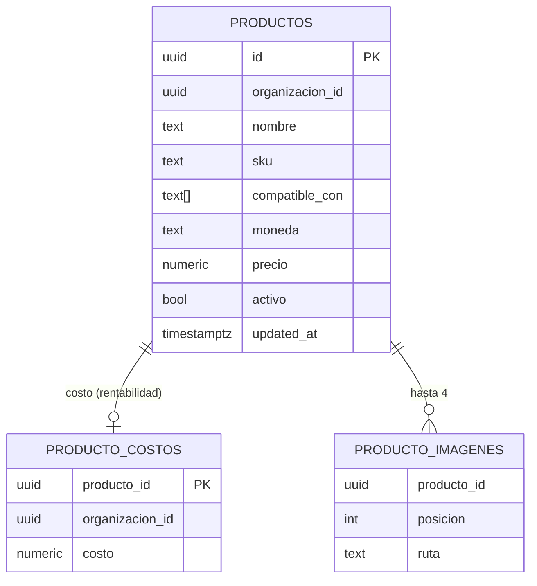

# Catálogo: alta y edición (MSF-456), construcción interna

**Épica:** MSF-456 · **Spec:** `specs/20261017-120000-catalogo-alta-y-edicion/` · **Producto:**
[Catálogo: alta y edición](../producto/catalogo-alta-y-edicion.md). Detalle por historia, límites y reversiones:
[Catálogo de productos](../catalogo.md).

Dependencias: `registro_actividad` (MSF-455), empresas y `producto_empresa` (MSF-138). La lee MSF-160 y la extiende
MSF-205 (proveedor) y MSF-179 ([costo y disponibilidad](catalogo-costo-y-disponibilidad.md)).

## Datos (esquema `dominio`, Principio VII)

| Tabla | Migración | Notas |
|---|---|---|
| `dominio.productos` | `20261017120100` | nombre, SKU, descripción, `compatible_con text[]`, moneda `USD`/`ARS`, precio de lista, `activo`. Aislada por `organizacion_id = private.organizacion_id()`. Sin DELETE. |
| `dominio.producto_costos` | `20261017120100` | costo aparte para restringirlo por fila (`rentabilidad`). FK compuesta `(producto_id, organizacion_id)`. |
| `dominio.producto_imagenes` | `20261017120500` | `posicion` 1..4, `ruta`; único `(producto_id, posicion)`; sin UPDATE. |

DER general en [Datos](datos.md). Se ubican en `dominio` por ser negocio del producto.

## Contratos (RPC en `public`, `security invoker`; `grant ... authenticated`, `revoke ... public, anon`)

| RPC | Migración | Reglas |
|---|---|---|
| `crear_producto` | `20261017120200` | `edicion` en `productos`; costo exige `edicion` en `rentabilidad` (si no, `42501`); precio > 0, 2 decimales; no recibe stock. |
| `actualizar_producto` | `20261017120400` | Bloqueo optimista con `p_actualizado_en` (conflicto de edición si cambió, «no existe» si no existe; códigos en [errores de negocio](../errores-negocio-postgrest.md)); `p_costo` nulo no toca el costo. |
| `cambiar_estado_producto` | `20261017120600` | Solo escribe `activo`; idempotente. |

SKU único (`20261017120300`): índice `dominio.productos_org_sku_uidx` sobre `(organizacion_id, lower(btrim(sku)))`
(`23505` ante duplicado) y disparador `productos_sku` que genera `PRD-` + 8 hexadecimales si viene vacío.

## Imágenes

Bucket privado `productos-imagenes` (2 MB; `image/jpeg|png|webp`), ruta `<organizacion_id>/<producto_id>/…`.
Políticas en `storage.objects` por `edicion`/`lectura` en `productos`. El tope de 4 lo impone el disparador
`producto_imagenes_tope` (`23514`). El cliente sube al guardar y usa URLs firmadas de 5 minutos
(`apps/web/src/lib/productoImagenes.ts`, `components/productos/ImagenesProducto.tsx`).

**Optimización al subir** (`apps/web/src/lib/optimizarImagen.ts`): al elegir cada archivo el navegador lo decodifica
(`createImageBitmap` con `imageOrientation: 'from-image'`, respeta EXIF), lo achica a un lado largo máximo de 1600 px
(nunca agranda) y lo recodifica a WebP con calidad 0,82 (conserva transparencia); el `File` resultante se llama
`<base>.webp`. Si no queda más chico que el original, o el entorno no puede decodificar/codificar, se conserva el
original (degradación segura). Primero se optimiza y después se valida: el origen admite hasta **15 MB** en el
navegador, pero el límite contra el bucket sigue siendo **2 MB sobre el archivo optimizado** (el bucket no cambia);
si aun optimizado pasa de 2 MB se rechaza con mensaje claro. Una foto de celular de 2–5 MB queda típicamente en un
peso mucho menor. No cambian las rutas (`<organizacion_id>/<producto_id>/<uuid>.<ext>`) ni las posiciones 1–4.
Antes de decodificar se lee el encabezado (PNG, JPEG, WebP) y se rechaza lo que pase de 100 megapíxeles («tiene
demasiados píxeles»), para que una imagen muy comprimida pero enorme no tumbe la pestaña; si el encabezado no se puede
leer se sigue con la degradación segura. Mientras se optimiza se ve «Optimizando imágenes…», se deshabilitan «Agregar
imágenes» y «Quitar» y el formulario no guarda hasta que termina; el resultado se aplica sobre el estado actual (el
tope de 4 se recalcula al aplicarlo). Las imágenes ya subidas no se recomprimen y la importación por planilla/ZIP queda fuera. Otras subidas: ver «Optimización en otras subidas» más abajo.

### Optimización en otras subidas

`optimizarImagen(archivo, ladoMaximo = 1600)` acepta el lado largo según el uso y solo toca JPG, PNG y WebP (SVG, ICO y
cualquier otro tipo se devuelven sin cambios). Cada subida se revisó contra su contrato (bucket, tipos, tope, ruta);
en todas se optimiza primero y el tope existente se valida sobre el resultado, con degradación segura y control bloqueado
mientras se optimiza:

| Subida | Decisión | Parámetros y motivo |
|---|---|---|
| Producto | Optimiza (sin cambios) | 1600 px, WebP; tope 2 MB sobre el resultado |
| Foto de perfil (`fotos-perfil`) | Optimiza | 512 px, WebP; origen 15 MB; tope 2 MiB sobre el resultado. Ruta fija sin extensión y bucket con jpeg/png/webp: el tipo de salida no rompe nada |
| Logo de la organización (`logos-organizacion`) | Optimiza | 1024 px, WebP; origen 15 MB; tope 1 MB sobre el resultado. El bucket admite webp y la extensión de la ruta sale del tipo de salida |
| Banner y banner móvil de la tienda (`tienda-identidad`) | Optimiza | 1920 px y 1200 px, WebP; origen 15 MB; tope 3 MB sobre el resultado. Las medidas 1440×440 y 390×300 son sugeridas, no exactas, y la ruta toma la extensión del tipo (`webp` ya admitido) |
| Logo de la tienda (`tienda-identidad`) | NO se optimiza | Admite solo PNG o SVG y lo leen el PDF de comprobantes (`workers/comprobantes-pdf`, que no decodifica WebP) y la imagen para redes (`og:image`); recodificarlo a WebP los rompería, y mantener PNG sin cambiar el contrato no ahorra de forma garantizada. Ya tiene tope de 1 MB |
| Favicon | No existe subida | La web no sube favicon; si se agrega, no se redimensiona (tamaños exactos) ni se convierte (ICO/SVG) |

## Actividad

Disparadores en la misma transacción, solo con sesión: `producto.creado`, `producto.editado` (solo con cambio real,
`productos_updated_at_real`), `producto.activado`/`producto.desactivado`, `producto.imagen_agregada`/`imagen_eliminada`.
Los detalles nunca llevan costo, precio ni ruta.

## Frontend

Rutas en `apps/web/src/App.tsx`: `/productos` (`pages/productos/list.tsx`), `/productos/create` (`create.tsx`) y
`/productos/:id/edit` (`edit.tsx`), con guard de sección `productos`; formulario común
`components/productos/FormularioProducto.tsx`. Desde el listado, «Nuevo producto» y «Editar» se abren en un popup
(`components/productos/DialogoProducto.tsx`, que monta `AltaProducto` y `EdicionProducto`); las rutas siguen
disponibles para el acceso directo; mensajes de error en `lib/productos.ts` (`mensajeDeError`).

## Pruebas

pgTAP en `supabase/tests/database/`: `catalogo_productos`, `catalogo_sku_unico`, `catalogo_actualizar_producto`,
`catalogo_producto_imagenes`, `catalogo_estado_producto`. Vitest: `pages/productos/*.test.tsx`, `lib/productos.test.ts`,
`lib/productoImagenes.test.ts`, `components/productos/ImagenesProducto.test.tsx`. E2E `[MSF-456:T025]`: pendiente (ver
[E2E de la app](../e2e-app.md)).

## Operación y reversión

Migraciones aditivas; la reversión (posterior, no en el mismo PR) está en [Catálogo de productos](../catalogo.md).
Límite conocido: el tipo de imagen se valida por `file.type`; un archivo huérfano en el bucket no se barre
automáticamente.
