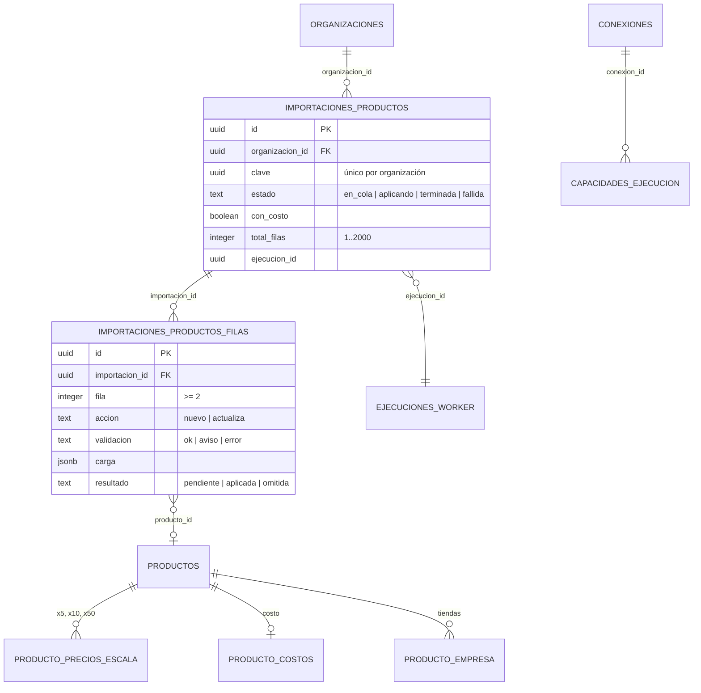
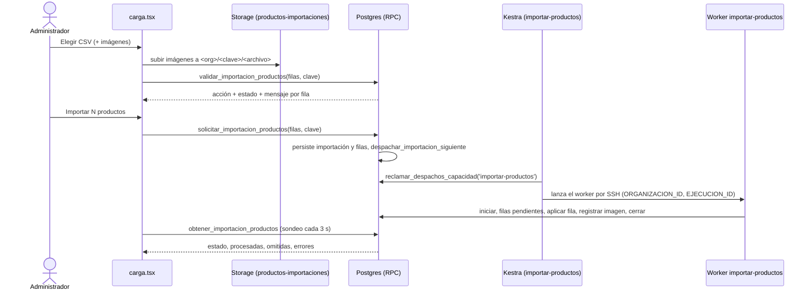

# Catálogo: compatibilidad y planillas — filtro, importación y exportación (MSF-202)

**Épica:** MSF-202 — Catálogo · Catálogo compatibilidad y planillas.
**Historias:** F-CAT-09 (filtro «Compatible con»), F-CAT-10 (importar productos desde CSV, MSF-375) y F-CAT-11 (exportar productos a CSV).
**Spec:** `specs/20270125-100000-catalogo-compatibilidad-y-planillas/` (`spec.md`, `plan.md`, `tasks.md`, `contracts/`, `tasks/F-CAT-09.md`, `F-CAT-10.md`, `F-CAT-11.md`, `CIERRE.md`).
**Entrega:** PR de la épica #757 y su paso a `dokploy` #767. Alcance: `refine` (`apps/web`), `supabase` (migraciones, RPC y pgTAP), `workers` (`workers/importar-productos`) y un flow de `kestra` (`infra/kestra/flows/importar-productos.yml`; la spec declaraba «sin kestra», pero el despacho de la importación lo necesita: ver [Importación](#f-cat-10-importar-productos-desde-csv)).
**Manual de usuario:** [Productos: filtrar por compatible, importar y exportar planillas](../producto/catalogo-compatibilidad-y-planillas.md).
**Guías por historia (en `docs/` de la épica):** `docs/catalogo.md`, `docs/catalogo-importacion.md` y `docs/catalogo-exportacion.md`.

## Estado de entrega

| Historia | Estado | Dónde |
|---|---|---|
| F-CAT-09 filtro «Compatible con» | Entregada | migraciones `20270206100101`, `20270206100102`; `FiltrosListado.tsx`, `useCompatibles.ts` |
| F-CAT-10 importación CSV | Entregada | migraciones `20270206100001`…`5` y `20270217200000`; `workers/importar-productos`; flow `importar-productos`; `carga.tsx` |
| F-CAT-11 exportación CSV | Entregada | migraciones `20270205110210` y `20270217200001`; `DialogoExportarProductos.tsx`, `lib/exportarProductos.ts` |
| Cierre (T031–T033) | Hecho | índice en `docs/catalogo.md`, revisión de seguridad, fila en `docs/roadmap-template.md` |

Diferencias entre la spec y lo construido (verificadas contra el código):

- **«Lo filtrado» de la exportación y «Compatible con».** Resuelto: `filtrosExportacion` manda `compatible` (variantes ya expandidas) igual que el listado.
- **Numeración de migraciones.** Las guías `docs/catalogo-importacion.md` y la spec citan las versiones previas a la integración (`20270121121303…07`, `20270125…`). Las versiones reales en `dokploy` son las de la tabla de [Migraciones](#migraciones).
- **Importación habilitada por organización.** La spec no lo dice: `private.capacidad_importacion_productos()` exige una conexión `importar-productos` en `public.conexiones`; sin ella falla con `SIN_CONEXION_IMPORTACION` (`P0001`). No se aprovisiona sola (mismo patrón que el historial de ventas): la pantalla consulta `importacion_productos_habilitada()` al abrirse y avisa antes de pedir el CSV.
- **Seguimiento al volver a la pantalla.** Resuelto: la importación en curso vive en `?importacion=<id>` y se rehidrata con `obtener_importacion_productos`.
- **La validación del servidor corre dos veces.** Una vez en la vista previa (`validar_importacion_productos`) y otra al solicitar (`solicitar_importacion_productos`); la segunda es la que manda.
- **Rótulos de prueba.** Los tests de `dokploy` no llevan el rótulo `[MSF-202:T0yy]` en su nombre; la correspondencia con las tareas de `tasks.md` está en [Pruebas](#pruebas).

## Modelo de datos

Principio VII (esquema por naturaleza): lo del producto va en `dominio`; el contrato de lectura del listado y las RPC van en `public`.

| Objeto | Esquema | Estado | Cambio |
|---|---|---|---|
| `dominio.productos` | `dominio` | existente | Índice nuevo `productos_compatible_con_gin` (GIN sobre `compatible_con text[]`). No se altera la tabla. |
| `public.v_productos_listado` | `public` | alterada | Vista `security_invoker`: se agrega `compatible_con` como **última** columna. |
| `dominio.importaciones_productos` | `dominio` | **nueva** | Una importación: clave, solicitante, estado, totales, ejecución del worker. |
| `dominio.importaciones_productos_filas` | `dominio` | **nueva** | Cada fila validada (`carga jsonb`) y su resultado. |
| Bucket `productos-importaciones` | Storage | **nuevo** | Imágenes temporales de la importación, en `<organizacion_id>/<clave>/<archivo>`. |
| `public.sistemas_externos` / `public.conexiones` / `public.capacidades_ejecucion` | `public` | existentes | La importación cuelga de una conexión `importar-productos` y de una capacidad `importar-productos` (tiempo máximo 3600 s) que se crea al primer uso. |
| `dominio.producto_costos`, `producto_precios_escala`, `producto_empresa`, `producto_imagenes`, `categorias`, `proveedores` | `dominio` | existentes | Las escribe el worker con las mismas reglas que el alta y la edición. Sin cambios de esquema. |
| `public.registro_actividad` | `public` | existente | Recibe `producto.creado`, `producto.editado` (por fila importada) y `producto.exportado`. |

### `dominio.importaciones_productos`

| Columna | Tipo | Notas |
|---|---|---|
| `id` | `uuid` PK | `gen_random_uuid()` |
| `organizacion_id` | `uuid` | FK a `public.organizaciones` con `on delete cascade` |
| `clave` | `uuid` | Idempotencia: único por organización |
| `solicitante` | `uuid` | Quien pidió la importación (el actor de la actividad) |
| `estado` | `text` | `en_cola` (por defecto) · `aplicando` · `terminada` · `fallida` |
| `con_costo` | `boolean` | Si el solicitante tenía Rentabilidad en `edicion` **al pedirla** |
| `total_filas` | `integer` | Entre 1 y 2000 |
| `importables` / `procesadas` / `omitidas` | `integer` | Contadores |
| `ejecucion_id` | `uuid` | Ejecución del worker; índice único parcial `importaciones_productos_ejecucion_uidx` |
| `mensaje_fallo` | `text` | Hasta 500 caracteres |
| `creada_en` / `iniciada_en` / `terminada_en` | `timestamptz` | |

### `dominio.importaciones_productos_filas`

| Columna | Tipo | Notas |
|---|---|---|
| `importacion_id` + `organizacion_id` | FK compuesta | A `importaciones_productos (id, organizacion_id)` con `on delete cascade` |
| `fila` | `integer` | Número de línea en el archivo (≥ 2; el encabezado es la 1) |
| `sku` | `text` | Hasta 200 |
| `accion` | `text` | `nuevo` · `actualiza` |
| `validacion` / `validacion_mensaje` | `text` | `ok` · `aviso` · `error`; mensaje hasta 1000 |
| `carga` | `jsonb` | Las 12 columnas de la plantilla (más `fila`), cada una acotada a 1000 caracteres; una clave extra del archivo no se guarda |
| `resultado` / `resultado_mensaje` | `text` | `pendiente` (por defecto) · `aplicada` · `omitida` |
| `producto_id` / `aplicada_en` | `uuid` / `timestamptz` | Producto resultante |
| `motivo_codigo` | `text` | Nulo, o `ERROR_TEMPORAL` (omitida por intentos agotados; check) |
| `intentos` | `smallint` | Fallos transitorios registrados por el worker; al tercero (igual a los 3 reintentos del flow) la fila queda `omitida` con `motivo_codigo = 'ERROR_TEMPORAL'` («Error temporal repetido; volvé a importar esta fila»; el texto es solo para mostrar y `obtener_importacion_productos` cuenta `omitidas_temporales` por el código); solo cuentan errores con SQLSTATE 40/53/55/57 |
| `imagenes_pendientes` | `boolean` | `true` en una fila `aplicada` cuyas imágenes el worker todavía no adjuntó ni confirmó (migración `20270217200000`) |

Los índices parciales `importaciones_productos_filas_pendientes_idx` e `importaciones_productos_filas_imagenes_idx` aceleran `filas_pendientes_importacion_productos`.

### Seguridad de las tablas

- RLS activada en las dos tablas. Políticas `importaciones_productos_select` e `importaciones_productos_filas_select`: lectura solo para el Administrador de la organización. **Sin** políticas de escritura para `authenticated`: escriben las RPC `security definer` y el worker.
- `revoke all … from public, anon, authenticated` y `grant select … to authenticated`. `anon` sin privilegios.
- El bucket `productos-importaciones` tiene políticas de `select`, `insert` y `delete` por prefijo `<organizacion_id>/` y solo para el Administrador.

## Migraciones

Todas aditivas (versiones reales en `origin/dokploy`):

| Versión | Qué hace | Historia |
|---|---|---|
| `20270205110210_exportar_productos` | `public.exportar_productos` | F-CAT-11 |
| `20270206100001_catalogo_importaciones` | Tablas, RLS, bucket, `private.codigo_tienda(text)`, `private.capacidad_importacion_productos()` | F-CAT-10 |
| `20270206100002_validar_importacion_productos` | `public.validar_importacion_productos` y `private.validar_filas_importacion_productos` | F-CAT-10 |
| `20270206100003_solicitar_importacion_productos` | `public.solicitar_importacion_productos`, `public.obtener_importacion_productos`, `private.despachar_importacion_siguiente` | F-CAT-10 |
| `20270206100004_importacion_rpc_worker` | RPC `private.*` del rol de worker: iniciar, listar filas pendientes, aplicar fila, registrar imagen, cerrar | F-CAT-10 |
| `20270206100005_importacion_cierre_fallida` | `private.reconciliar_importaciones_fallidas`; redefine `despachar_importacion_siguiente` y `obtener_importacion_productos` para reconciliar | F-CAT-10 |
| `20270206100101_catalogo_compatible_filtro` | Índice GIN y columna `compatible_con` en `v_productos_listado` | F-CAT-09 |
| `20270217200000_importacion_productos_robustez` | Columna `imagenes_pendientes`; redefine validar (tope por celda, `carga` acotada), `aplicar_fila` (errores transitorios 40/53/55/57 se propagan), `iniciar`, `filas_pendientes` y `solicitar` (`reutilizada`); redefine también `cerrar_importacion_productos` y `obtener_importacion_productos` (campo `sin_imagenes`); nuevas `confirmar_imagenes_fila_importacion_productos`, `registrar_fallo_fila_importacion_productos`, `imagenes_temporales_a_borrar` e `importacion_productos_habilitada` | F-CAT-10 (revisión) |
| `20270217200001_exportar_productos_cursor` | Reemplaza `exportar_productos` por la firma con `p_entregadas` y `p_con_total` (cursor sin recalcular, tope de 50.000) | F-CAT-11 (revisión) |
| `20270206100102_listar_compatibles` | `public.listar_compatibles()` | F-CAT-09 |

## F-CAT-09: filtro «Compatible con»

### Servidor

`public.listar_compatibles() returns text[]` — `stable`, `security definer`, `search_path = ''`. Devuelve los valores **distintos** de `dominio.productos.compatible_con` de la organización de la sesión, sin vacíos, ordenados por `lower(valor)`. Exige lectura o edición en la sección `productos` (`private.nivel_seccion('productos')`); si no, devuelve `{}`. `revoke … from public, anon` + `grant … to authenticated`.

`public.v_productos_listado` incorpora `compatible_con` al final (`create or replace view`, sin cambiar las columnas anteriores). El índice `productos_compatible_con_gin` sostiene el filtro por solapamiento de arreglos.

### Pantalla

- `hooks/useCompatibles.ts` pide los valores con `listarCompatibles` (`lib/productosListado.ts`, que llama a la RPC `listar_compatibles`) y los vuelve a pedir al cambiar de empresa (Principio VIII; «la última petición gana»). La RPC es de la **organización**, no de la empresa: los valores son los mismos, y lo que cambia con la empresa es el listado filtrado.
- `lib/productosListado.ts`: `agruparCompatibles` agrupa los valores por clave en minúsculas (el selector muestra una sola etiqueta por grupo) y `expandirCompatibles` vuelve a expandir cada clave a **todas** las variantes de mayúsculas, que es lo que se envía a la consulta (coincidencia exacta del valor, sin distinguir mayúsculas).
- `components/productos/FiltrosListado.tsx`: `Autocomplete` múltiple con la etiqueta «Compatible con». Se muestra solo si hay al menos un grupo o hubo error al cargar. Textos: `noOptionsText` «No hay valores que coincidan»; error «No pudimos cargar los valores.»
- `pages/productos/list.tsx`: descarta las claves elegidas que ya no existen (`clavesCompatibles`) y reencuadra a la página 1 al cambiar de empresa. «Limpiar filtros» limpia también el compatible. Las etiquetas por fila se dibujan con `etiquetasCompatible` (`role="list"`, `aria-label="Compatible con"`); sin valores no se renderiza nada.
- El campo «Compatible con» del alta y la edición (`FormularioProducto.tsx`) no se modificó.

## F-CAT-10: importar productos desde CSV

### Flujo

### Lado del navegador (`lib/importacion-productos.ts`, `pages/productos/carga.tsx`)

- Ruta `/productos/carga` (`App.tsx`, carga diferida). Sin ítem de menú; se llega desde el botón «Importar CSV» del listado, que solo ve el Administrador (`useEsAdministrador`). Sin permiso: «No tenés permiso para importar productos.»
- **CSV:** UTF-8, separador `,` o `;`, con o sin BOM (`leerCsvUtf8`). Columnas de la plantilla (`COLUMNAS_PLANTILLA`): `sku, nombre, categoria, costo, precio_x1, precio_x5, precio_x10, precio_x50, proveedor, codigo_barras, tiendas, imagenes`. Obligatorias: `sku`, `nombre`, `categoria`. Máximo `MAXIMO_FILAS_IMPORTACION = 2000`.
- **Importes:** `normalizarImporte` acepta `1200`, `1200,50` y `1.200,50`, quita espacios y `$`, y deja `1200.50`. Lo que no reconoce lo deja como vino para que el servidor lo marque como error.
- **Imágenes:** ZIP (hasta 50 MB, `MAX_BYTES_ZIP`) o sueltas; JPG, PNG o WebP de hasta 2 MB (`MAX_BYTES_IMAGEN_IMPORTACION`); hasta 500 por importación (`MAX_IMAGENES_CARGA`). Los topes de 500 entradas y 100 MB descomprimidos por carga (todos los ZIP de la misma selección) se comprueban en streaming (fflate `Unzip`, rebanadas de 16 KB) con los bytes reales de cada entrada y del total, porque la cabecera del ZIP puede mentir; al pasar un tope se termina la entrada y, si es el total, se deja de leer el ZIP (lo transitorio queda acotado a ~16 MB). Nombres repetidos: gana siempre la primera (carpetas de un ZIP, archivos de una selección y selecciones sucesivas); `leerImagenes(archivos, limites?)` acepta los topes como último argumento. ZIP ilegible: «No pudimos abrir «x.zip»» cuando no emitió entradas y no trae el registro final (`PK\x05\x06` en los últimos 66 KB) o dejó entradas sin terminar; un ZIP vacío válido, con solo carpetas o sin imágenes no da error. Limitación: un ZIP truncado justo después de su última entrada completa (sin directorio central) no se detecta, pero no se pierde nada porque todas las entradas llegaron enteras. Se suben a `productos-importaciones/<organización>/<clave>/<archivo>` con `upsert`. «Cancelar» las elimina (`descartarImagenes`).
- **Clave de idempotencia:** `crypto.randomUUID()` por importación; se regenera con «Importar otro archivo».
- **Seguimiento en la URL:** la importación en curso vive en `?importacion=<id>` (`PARAMETRO_IMPORTACION`); al volver o recargar se rehidrata con `obtener_importacion_productos`. Un id que no es UUID se ignora y uno inexistente (`P0002`) limpia la URL. Al abrir, `importacion_productos_habilitada()` avisa si falta la conexión y deshabilita la elección de archivos antes de pedir el CSV.
- **Sondeo:** `ESPERA_SONDEO_MS = 3000` sobre `obtener_importacion_productos` hasta `terminada` o `fallida`.
- **Reporte de errores:** `armarReporteErrores` arma `errores-importacion-productos.csv` (`fila,sku,motivo`, BOM, CRLF) con las celdas neutralizadas contra fórmulas.
- **Errores de red/RPC** (`mensajeDeErrorImportacion`): `42501` → «No tenés permiso para importar productos. Puede que tu rol haya cambiado: recargá la página.»; `22023` → el mensaje del servidor sin su prefijo; `SIN_CONEXION_IMPORTACION` → «Tu organización todavía no tiene habilitada la importación de productos. Un Administrador tiene que crear la conexión «importar-productos» (servidor y credencial).»
- No depende de la empresa activa (FR-113): las tiendas salen de la columna `tiendas`.

### RPC públicas

Todas en `public`, `security definer`, `search_path = ''`; organización y actor salen de la sesión (`private.organizacion_id()`, `auth.uid()`), nunca de un argumento. `revoke execute … from public, anon` + `grant execute … to authenticated`.

| Función | Devuelve | Errores |
|---|---|---|
| `validar_importacion_productos(p_filas jsonb, p_clave uuid default null)` | `table (fila, sku, accion, estado, mensaje)` | `42501` no es Administrador · `22023` `FILAS_INVALIDAS` (no es lista, vacía o más de 2000) |
| `solicitar_importacion_productos(p_filas jsonb, p_clave uuid default gen_random_uuid())` | `jsonb { importacion_id, estado, importables, omitidas, reutilizada }` | `42501` · `22023` `CLAVE_INVALIDA`, `FILAS_INVALIDAS` (fuera de 1…2000 o «ninguna fila se puede importar») · `P0001` `SIN_CONEXION_IMPORTACION` |
| `obtener_importacion_productos(p_importacion_id uuid)` | `jsonb { estado, procesadas, omitidas, omitidas_temporales, sin_imagenes, errores[{fila, sku, mensaje}], mensaje_fallo }` (`sin_imagenes`: productos aplicados cuyas imágenes no se adjuntaron, también en una importación `fallida`; la pantalla lo avisa) | `42501` · `P0002` «La importación no existe» |

Comportamiento de `solicitar_importacion_productos`:

1. Toma un `pg_advisory_xact_lock` por organización y busca una importación con la misma `clave`: si existe, devuelve esa con `reutilizada: true` (idempotente, sin encolar de nuevo y sin tomar las filas enviadas ahora; la UI lo avisa).
2. Verifica la conexión con `private.capacidad_importacion_productos()` (crea la capacidad si falta).
3. Fija `con_costo` según `nivel_seccion('rentabilidad') = 'edicion'`.
4. Valida **otra vez** todas las filas (`private.validar_filas_importacion_productos`) e inserta las filas: las de `error` nacen `omitida`, las demás `pendiente`.
5. Si no queda ninguna importable, falla con `22023`.
6. Llama a `private.despachar_importacion_siguiente(org)`.

### Reglas de validación (por fila)

**Errores** (la fila se omite): falta SKU, nombre o categoría; SKU de más de 80 caracteres o nombre de más de 200; la categoría (ruta `A > B > C`) no existe; SKU repetido en la planilla; importes no numéricos, negativos o con más de 2 decimales; `precio_x1` no mayor a cero; falta `precio_x1` en un producto nuevo; código de barras que no tiene 13 dígitos, repetido en la planilla o usado por otro producto.

**Avisos** (la fila se importa): costo ignorado por falta de Rentabilidad; proveedor inexistente (se ignora); tienda desconocida; imagen citada que no se subió o es inválida; más de 4 imágenes (se usan 4).

`accion` es `actualiza` si existe un producto de la organización con el mismo SKU (comparación sin mayúsculas ni espacios) y `nuevo` si no.

### Despacho y serialización (FR-109)

`private.despachar_importacion_siguiente(p_org)` toma un lock por organización. No despacha si ya hay una importación `aplicando` o `en_cola` con ejecución asignada. Si no, toma la más antigua `en_cola` sin ejecución y llama a `public.iniciar_ejecucion_worker(conexion, 'importar-productos', 'manual', solicitante, {importacion_id})`; si esa función responde `YA_EN_CURSO`, la importación queda en cola para quien cierre la ejecución anterior. Al cerrar una importación se despacha la siguiente.

### Flow de Kestra y worker

- **Flow** `producto.catalogo.importar-productos` (`infra/kestra/flows/importar-productos.yml`): `private.reclamar_despachos_capacidad('importar-productos', 5, 3600)`; por cada despacho (concurrencia 2) resuelve la conexión (`private.datos_despacho_conexion`) y lanza por SSH la imagen `importar_productos_imagen` (`IMPORTAR_PRODUCTOS_IMAGEN`) con `timeout: PT30M` y reintentos exponenciales (3 intentos, 30 s a 2 min). Una falla con código 78 (no reintentable) se agota en el primer intento.
- **Worker** `@workers/importar-productos` (`workers/importar-productos/src/{index,importar,infra,imagen}.ts`), contrato `workers/CONTRATO.md`. Variables: `ORGANIZACION_ID`, `EJECUCION_ID`, `SUPABASE_URL`, `SUPABASE_SERVICE_ROLE_KEY` y `PG*`; la clave de servicio **solo** vive en el servidor. Códigos de salida: `0` éxito, `78` no reintentable (p. ej. `EJECUCION_NO_EN_CURSO`), `1` falla técnica (el flow reintenta).
- **Imágenes** (`imagen.ts`): se comprueban los **bytes** (firma JPG/PNG/WebP), no el tipo declarado por el navegador; la extensión debe coincidir con el contenido; máximo 2 MB. Una imagen que no pasa se omite y la fila se importa igual. La ruta final es determinista por nombre, así que reintentar reescribe el mismo objeto y no duplica.

### RPC del worker (`private`, no ejecutables por `authenticated`)

Todas validan la ejecución con `private.autorizar_worker_importacion_productos(p_ejecucion_id)`: exigen un rol `worker_*` y que la ejecución exista y esté en curso (`NO_AUTORIZADO`, `EJECUCION_DESCONOCIDA`, `EJECUCION_NO_EN_CURSO`, todas `P0001`).

| Función | Para qué |
|---|---|
| `iniciar_importacion_productos(p_ejecucion_id)` | Pasa la importación a `aplicando` (fija `iniciada_en`) y devuelve `(importacion_id, organizacion_id, clave, pendientes)` |
| `filas_pendientes_importacion_productos(p_ejecucion_id, p_limite default 200)` | Lote de filas `pendiente` **o `aplicada` con `imagenes_pendientes`** (límite 1…1000, si no `LIMITE_INVALIDO`) |
| `confirmar_imagenes_fila_importacion_productos(p_ejecucion_id, p_fila_id)` | El worker confirma que adjuntó (o descartó con motivo) las imágenes de la fila |
| `registrar_fallo_fila_importacion_productos(p_ejecucion_id, p_fila_id)` | Suma un intento fallido (error transitorio) a una fila pendiente en su propia transacción; al tercero la omite. El worker lo llama y sigue con las demás filas; si quedan filas con intentos disponibles la corrida sale con error y el flow reintenta |
| `imagenes_temporales_a_borrar(p_ejecucion_id, p_dias default 7, p_incluir_importacion default true)` | Rutas del bucket temporal a borrar: las de la importación (si `p_incluir_importacion`; al empezar una corrida el worker pasa `false`) y las huérfanas de la organización de más de `p_dias` días que no son de una importación en curso (hasta 1000); el borrado lo hace el worker por la API de Storage, al empezar (solo huérfanos) y al cerrar `terminada` (también las de la importación), hasta 5 tandas por fase; es de mejor esfuerzo: si falla, la importación igual termina y se reintenta en la corrida siguiente |
| `aplicar_fila_importacion_productos(p_ejecucion_id, p_fila_id)` | Aplica una fila (ver abajo) |
| `registrar_imagen_importacion_productos(p_ejecucion_id, p_fila_id, p_nombre, p_ruta)` | Asocia la imagen subida al producto (`RUTA_INVALIDA` si la ruta no es del producto) |
| `cerrar_importacion_productos(p_ejecucion_id, p_estado, p_mensaje)` | Cierra en `terminada` o `fallida` (`ESTADO_INVALIDO` si no); devuelve contadores |

`aplicar_fila_importacion_productos` (idempotente: si la fila ya no está `pendiente`, devuelve su resultado previo y, si fue aplicada, las imágenes a adjuntar):

- Busca el producto por SKU (sin mayúsculas ni espacios) con `for update`.
- **Nuevo:** inserta `dominio.productos` con nombre, SKU, `precio_lista = precio_x1`, categoría, proveedor y código de barras.
- **Existente:** actualiza nombre y categoría **siempre**; `precio_lista`, proveedor y código de barras **solo si la celda trae valor** (`coalesce`); una celda vacía no pisa (Decisión 7).
- Costo: solo si `con_costo` y la celda trae valor (`on conflict (producto_id) do update`).
- Escalas `x5`, `x10`, `x50`: `upsert` de las celdas con valor en `producto_precios_escala`.
- Tiendas: con valor, borra de `producto_empresa` las que no estén en la lista e inserta las nuevas; vacía = no se toca.
- Registra actividad (`producto.creado` o `producto.editado`, con el solicitante como actor).
- Cada fila corre en su propio subbloque: ante un error la fila queda `omitida` con un motivo legible (`23505` → «El SKU o el código de barras ya lo usa otro producto»; `P0001` → el mensaje; otro → «No se pudo aplicar la fila (código)»), sin efectos parciales. Los errores transitorios (SQLSTATE clases 40, 53, 55 y 57: deadlock, lock no disponible, recursos, cancelación) **no** se convierten en `omitida`: se propagan para que el flow reintente.
- Una fila aplicada con imágenes queda con `imagenes_pendientes = true` hasta que el worker las adjunta y confirma, así un fallo de Storage no las pierde; el worker borra las imágenes temporales al cerrar y las huérfanas de más de 7 días (mejor esfuerzo).

### Falla técnica y reconciliación

Si el flow agota los reintentos, el worker sale con 78 o la ejecución supera `tiempo_max_seg` (3600), nadie llama a `cerrar_importacion_productos`. `private.reconciliar_importaciones_fallidas(p_org)` marca `fallida` (con `mensaje_fallo`: «La importación falló antes de terminar. Reintentala.» o «La importación tardó más de lo permitido. Reintentala.»), recalcula contadores y libera la ejecución (`fallida` o `timeout`) para destrabar la cola. La llaman `despachar_importacion_siguiente` y `obtener_importacion_productos`, de modo que el sondeo de la pantalla basta para liberar la cola.

## F-CAT-11: exportar productos a CSV

### Servidor

`public.exportar_productos(p_filtros jsonb, p_columnas text[], p_desde uuid default null, p_limite integer default 500, p_entregadas integer default 0, p_con_total boolean default false) returns jsonb` (`{ filas, siguiente, total, tope, recortado }`), firma vigente desde `20270217200001` (reemplaza a la de 4 parámetros). Cada página lee solo desde el cursor de `id`; el total se calcula en la primera página o con `p_con_total` (en las otras `total` es nulo); tope de 50.000 productos por archivo (`p_entregadas` lleva la cuenta; `recortado` avisa y el listado muestra una advertencia). `security definer` (necesita registrar actividad) con autorización propia sobre la organización de la sesión. Solo lectura sobre `v_productos_listado` y `dominio`.

| Condición | Error |
|---|---|
| No es Administrador de la organización | `42501` |
| Pide `costo` o `proveedor` sin acceso a Rentabilidad | `42501` |
| Columna desconocida, `p_limite` fuera de 1…1000 o `p_entregadas` negativo | `22023` |

- `p_filtros`: `{ busqueda, categoria_id, estado, empresa_id, disponibilidad, compatible: text[], todos: boolean }`. `todos: true` ignora el resto.
- `p_columnas`: `sku, nombre, categoria, precio, costo, stock, visible_en, estado, codigo_barras, proveedor`.
- Paginación estable por cursor de `id` (`p_desde`/`siguiente`); el navegador pide páginas de 500 y las concatena.
- La **primera página** registra la actividad `producto.exportado` (quién, cuántos productos, qué columnas; sin precios ni costos). Una exportación cancelada a mitad igual queda registrada.

### Pantalla

- `list.tsx` muestra «Exportar» solo al Administrador y monta `DialogoExportarProductos` con `consulta`, `totalFiltrado` y `veRentabilidad`.
- `lib/exportarProductos.ts`: `filtrosExportacion`, `armarCsvProductos` y `nombreArchivoProductos` (`productos-AAAA-MM-DD.csv`, con la fecha en la zona de la organización).
- Formato del archivo: UTF-8 con BOM, separador `;`, fin de línea CRLF. `campoCsv` entrecomilla si hay `"`, `;`, `,` o saltos de línea y duplica las comillas; todo texto pasa antes por `neutralizarFormula` (celdas que empiezan con `=`, `+`, `-` o `@` se anteponen con `'`). «Precio» sale como `MONEDA monto`; «Stock», con la etiqueta de disponibilidad del listado.
- Diálogo: «Qué exportar» (Lo filtrado / Todos, con sus notas), «Formato» (CSV; «Excel (.xlsx)» deshabilitado), «Columnas» (por defecto las ocho primeras; Costo y Proveedor solo con Rentabilidad). Admite «Cancelar exportación» y «Reintentar».
- Aviso final: `Exportación CSV lista: N productos, M columnas`. Si cambia la empresa activa con el diálogo abierto, `list.tsx` lo cierra con «Cambiaste de empresa: se cerró la exportación. Volvé a abrirla para exportar con la empresa nueva.» (Principio VIII).

## Permisos por rol

| Acción | Quién | Dónde se hace cumplir |
|---|---|---|
| Ver el filtro y las etiquetas «Compatible con» | Lectura o edición en Productos | `listar_compatibles()` (devuelve `{}` sin acceso) y RLS de `v_productos_listado` |
| Importar (validar, solicitar, consultar) | Administrador | `es_administrador_de` en cada RPC; RLS de lectura de las tablas; políticas del bucket |
| Importar el costo | Administrador con `rentabilidad = edicion` | `con_costo` fijado al solicitar; la validación avisa si falta |
| Exportar | Administrador | `exportar_productos` (`42501`) |
| Exportar costo y proveedor | Administrador con acceso a Rentabilidad | `exportar_productos` (`42501`) |
| Rol Consulta | No importa ni exporta | Decisión 4 de la spec (supuesto de la épica: «exclusivas del Administrador») |
| `anon` | Nada | `revoke execute … from public, anon` y sin privilegios sobre las tablas |

En la interfaz solo se ocultan los botones; la autoridad es la base de datos.

## Actividad

| Evento | Cuándo | Detalle |
|---|---|---|
| `producto.creado` | Por cada fila nueva aplicada | «Creó el producto … (SKU …) desde una importación CSV»; actor: el solicitante |
| `producto.editado` | Por cada fila existente aplicada | «Actualizó el producto … (SKU …) desde una importación CSV» |
| `producto.exportado` | Primera página de una exportación | Quién, cuántos productos y qué columnas; sin precios ni costos |

## Empresa activa (Principio VIII)

| Pantalla | Comportamiento |
|---|---|
| Listado de Productos (filtro compatible) | Al cambiar de empresa se recargan los productos y los valores del selector, se descartan los valores que ya no existen y se vuelve a la página 1. |
| Diálogo «Exportar productos» | «Lo filtrado» replica la consulta del listado con la empresa activa. Si cambia la empresa con el diálogo abierto, se cierra con aviso. |
| Carga masiva (`/productos/carga`) | **No aplica.** Opera sobre la organización; las tiendas salen de la columna `tiendas`. Cambiar de empresa con una vista previa abierta no altera filas ni resultado. |

## Pruebas

Los tests de `dokploy` no llevan el rótulo `[MSF-202:T0yy]` en el nombre; la columna «Tarea» da la correspondencia con `tasks.md`.

| Archivo | Cubre | Tarea |
|---|---|---|
| `supabase/tests/database/catalogo_compatible_filtro.test.sql` | Columna `compatible_con` en la vista, índice GIN, `listar_compatibles` (distintos, ordenados, sin vacíos, aislamiento, solo lectura), `anon` sin acceso | [MSF-202:T003] (SC-001) |
| `apps/web/src/pages/productos/filtro-compatible.test.tsx` | Filtro OR sin mayúsculas, combinación con búsqueda y categoría, etiquetas, limpiar filtros, estado vacío, cambio de empresa | [MSF-202:T005], [MSF-202:T006], [MSF-202:T007] (SC-002) |
| `supabase/tests/database/catalogo_importacion.test.sql` | Aislamiento, solo Administrador, `anon`, validación por fila, costo sin Rentabilidad, idempotencia por clave, límite de filas, serialización (segunda importación `en_cola`), estados | [MSF-202:T019] (SC-101) |
| `workers/importar-productos/test/importar.test.ts` | Alta, actualización, celda vacía, reintento sin duplicar, `EJECUCION_NO_EN_CURSO` con código 78 | [MSF-202:T020] (SC-103) |
| `workers/importar-productos/test/imagen.test.ts` | Firma de bytes, tipo, tamaño y ruta determinista | [MSF-202:T012] |
| `apps/web/src/lib/importacion-productos.test.ts` | Parser de CSV (BOM, `,`/`;`), importes, plantilla, límites de filas e imágenes, reporte de errores | [MSF-202:T013], [MSF-202:T021] (SC-102) |
| `apps/web/src/pages/productos/carga-productos.test.tsx` | Botón y ruta solo Administrador, pasos, vista previa y contadores, Cancelar no persiste, Importar encola, cuatro estados, mensaje final, cambio de empresa | [MSF-202:T014]…[MSF-202:T018], [MSF-202:T021] |
| `supabase/tests/database/catalogo_exportar.test.sql` | Aislamiento, Administrador, `42501` por costo sin Rentabilidad, paginación estable, actividad sin precios | [MSF-202:T029] (SC-201) |
| `apps/web/src/lib/exportar-productos.test.ts` | Escape de CSV y neutralización de `=`, `+`, `-`, `@` | [MSF-202:T024] |
| `apps/web/src/components/productos/exportar-productos.dialogo.test.tsx` | Botón solo Administrador, filtrado vs todos, Excel deshabilitado, columnas por defecto, descarga y aviso, cambio de empresa | [MSF-202:T025]…[MSF-202:T028], [MSF-202:T030] (SC-202) |

## Cómo probarlo

Los pgTAP requieren `pnpm dev:supabase` corriendo.

1. **Pruebas automáticas**
   - `pnpm test` (incluye los tres pgTAP de la épica).
   - `pnpm --filter @platform/web test -- filtro-compatible carga-productos importacion-productos exportar-productos`
   - `pnpm --filter @workers/importar-productos test`
2. **Filtro** (cualquier rol con lectura de Productos): cargar productos con «Compatible con» (`PS5, PS4`, `ps5`), abrir Catálogo → Productos y elegir `PS5` en «Compatible con»: deben verse los dos aunque difieran en mayúsculas; «Limpiar filtros» vuelve al listado completo.
3. **Importación** (como Administrador, con la conexión `importar-productos` habilitada para la organización):
   - Descargar la plantilla, cargar tres filas (una nueva, una con SKU existente y una con categoría inexistente) y elegirla: la vista previa debe mostrar `Nuevo`, `Actualiza` y un error con «La categoría «…» no existe».
   - Importar: pasa por **En cola** → **Aplicando** → **Terminada** con «2 productos procesados, 1 omitido por error»; «Descargar reporte de errores» baja `errores-importacion-productos.csv`.
   - Repetir la importación con la **misma clave** (mismo envío): no duplica productos ni imágenes.
   - Pedir dos importaciones seguidas: la segunda queda **En cola** hasta que termine la primera.
   - Con un rol distinto de Administrador, `/productos/carga` responde «No tenés permiso para importar productos.»
4. **Exportación** (como Administrador): «Exportar» → «Lo filtrado» → dejar las ocho columnas por defecto → el archivo `productos-AAAA-MM-DD.csv` se abre en Excel en castellano. Probar un nombre que empiece con `=`: sale con apóstrofo. Sin acceso a Rentabilidad no aparecen «Costo» ni «Proveedor». Revisar en Actividad el evento `producto.exportado`.

## Reversión

Todo es aditivo; la reversión va en una migración posterior (nunca en el mismo PR que las crea) y después de exportar los datos que interesen:

- **F-CAT-09:** `drop function public.listar_compatibles();`, `drop index dominio.productos_compatible_con_gin;` y volver a crear `public.v_productos_listado` sin la columna `compatible_con` (patrón de `20261022121000`).
- **F-CAT-10:** `drop table dominio.importaciones_productos_filas; drop table dominio.importaciones_productos;`, borrar las funciones `public.validar_importacion_productos`, `public.solicitar_importacion_productos`, `public.obtener_importacion_productos` y las `private.*` de la importación, y vaciar y borrar el bucket `productos-importaciones` **por la API de Storage** (`DELETE /storage/v1/bucket/productos-importaciones/empty` y luego `DELETE /storage/v1/bucket/productos-importaciones`; el `delete from storage.objects` del comentario de `20270206100001` no funciona en self-hosted y esa migración es inmutable). Quitar el flow `importar-productos` y el paquete `workers/importar-productos`.
- **F-CAT-11:** `drop function public.exportar_productos(jsonb, text[], uuid, integer, integer, boolean);` y quitar el botón del listado. No hay datos que migrar.

Revertir el merge del PR de la épica con `git revert -m 1` deshace el código; las tablas y funciones ya aplicadas en una base requieren la migración de baja.

## Deuda trazada y pendientes

- **Limitaciones conocidas de la revisión:** el borrado de imágenes temporales es de mejor esfuerzo (una importación cerrada como `fallida` por la base deja sus imágenes hasta que se barren como huérfanas a los 7 días); las migraciones no crean la conexión `importar-productos`, que depende de la operación. Si una importación cierra con productos sin imágenes, `cerrar_importacion_productos` y `obtener_importacion_productos` devuelven `sin_imagenes` y la pantalla lo avisa.
- **Capturas del manual de producto** de la carga masiva, el diálogo de exportar y el filtro.
- **Conexión `importar-productos` por organización:** no se aprovisiona sola (igual que el historial de ventas, MSF-293: la crea un Administrador con `crear_conexion`, con servidor y credencial). La pantalla avisa antes de pedir el CSV. Es una decisión de operación, no de código.
- **Decisiones de la spec marcadas «OK pendiente»** (Decisión 1, orden de entrega y alcance de F-CAT-09; Decisión 4, el rol Consulta no exporta; Decisión 7, una celda vacía no pisa el valor actual): se construyeron con el supuesto de la épica; falta la confirmación del dueño del producto.
- **F-IMP-01 (MSF-206):** la pantalla de importaciones y monitoreo podrá listar estas ejecuciones; esta épica no depende de ella.

## Ver también

- [Productos: filtrar por compatible, importar y exportar planillas](../producto/catalogo-compatibilidad-y-planillas.md)
- [Catálogo: alta y edición](catalogo-alta-y-edicion.md)
- [Catálogo: listado y categorías](catalogo-listado-y-categorias.md)
- [Catálogo: costo y disponibilidad](catalogo-costo-y-disponibilidad.md)
- [Datos](datos.md)
