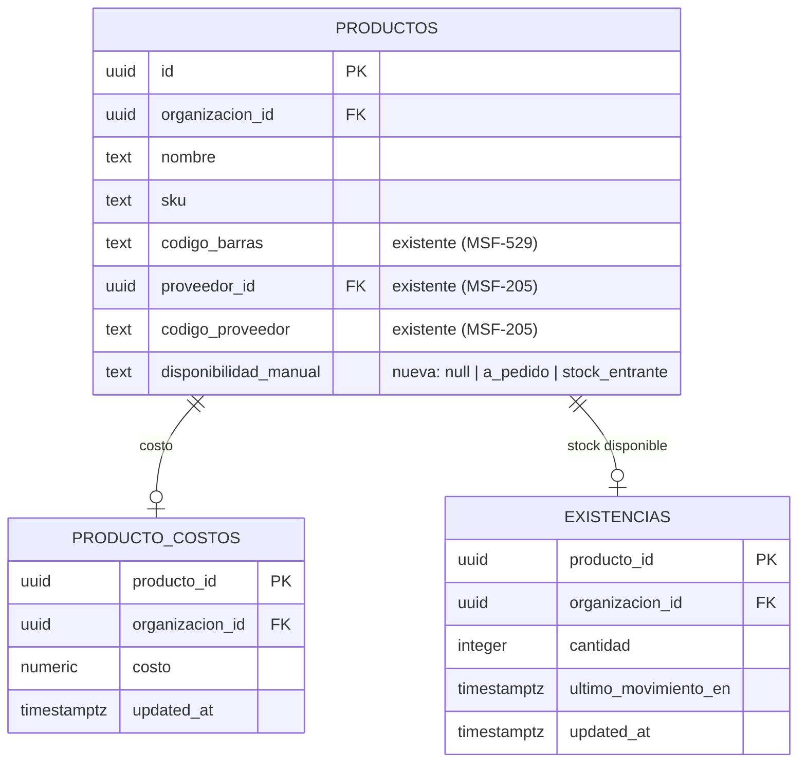
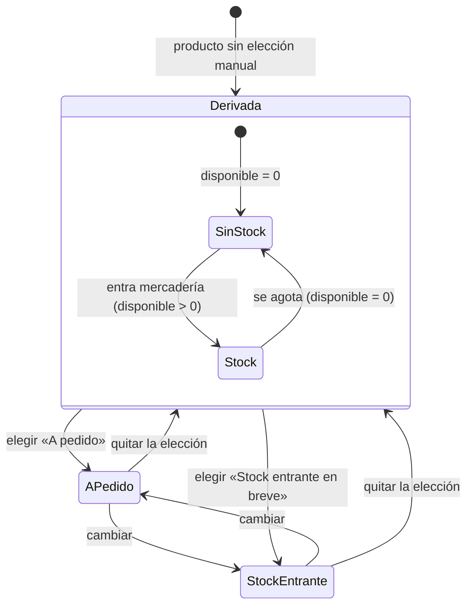
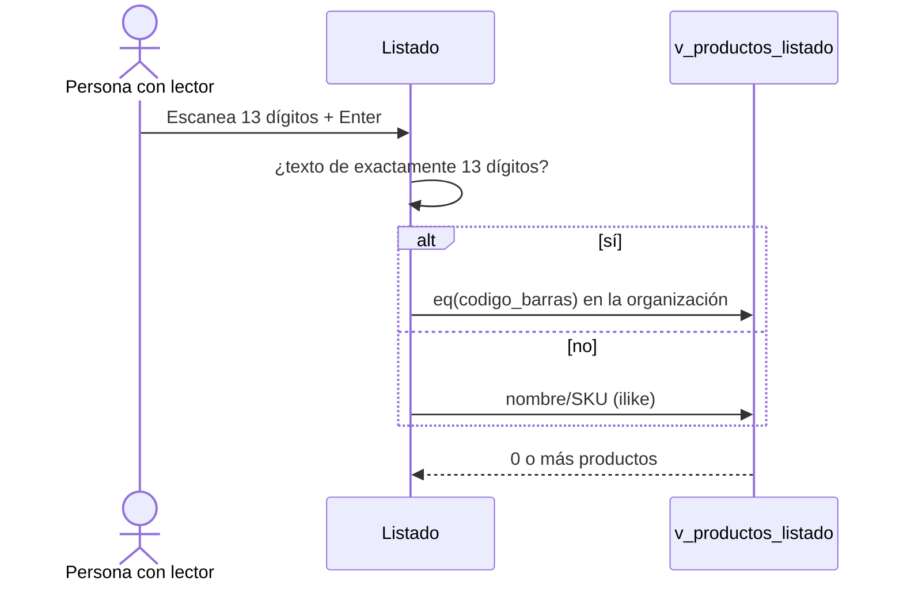

# Catálogo: costo y disponibilidad (técnico)

**Épica:** MSF-179 · **Historias:** F-CAT-16 (MSF-321), F-CAT-17 (MSF-335) y F-CAT-14 (MSF-350).
**Spec:** `specs/20261022-120000-catalogo-costo-y-disponibilidad/` (rama
`epic/MSF-179-catalogo-catalogo-costo-y-disponibilidad`, merge `a485805f`, **pendiente de merge a `main`**).
**Alcance de entrega:** `refine` (`apps/web`) y `supabase` (migraciones, RPC, vista y pgTAP). Sin `kestra`,
`superset` ni `workers`.
Guía de producto: [Catálogo: costo y disponibilidad](../producto/catalogo-costo-y-disponibilidad.md).

## Estado de entrega

| Historia | Qué entrega | Commits | Migración |
|---|---|---|---|
| F-CAT-17 · Disponibilidad | Columna `disponibilidad_manual`, dos funciones de derivación, RPC con la disponibilidad, columna `disponibilidad` de la vista, sección en el formulario, filtro y columna en el listado | `f5fe5146`, `64872f61` | `supabase/migrations/20261022120900_catalogo_disponibilidad.sql` |
| F-CAT-14 · Código de barras | Columna `codigo_barras` de la vista, coincidencia exacta en el buscador, Enter inmediato | `db7463ff`, `6b6750e0` | `supabase/migrations/20261022121000_catalogo_listado_codigo_barras.sql` |
| F-CAT-16 · Costo, proveedor y escalas | Columna Costo del listado (solo con Rentabilidad), bloque «Precios por escala · sin IVA» en la ficha | `7a2763f1`, `cf59637a`, `c6b2a5f4` | Sin migración (reutiliza `dominio.producto_costos`) |
| Cierre | E2E, revisión de seguridad, docs y roadmap | `b0b285fd` (PR #277) | — |

Depende de MSF-160 (`public.v_productos_listado` y el listado) y MSF-205 (`dominio.proveedores`), también en sus
ramas. La spec es `0045526f`.

> **Numeración de las migraciones:** las versiones originales (`20261022120000` y `20261022120100`) colisionaron
> con migraciones de Ventas al integrar DEV (`formas_pago_rpc` y `formas_envio`); se renumeraron a `…120900` y
> `…121000`. No estaban desplegadas.

## Modelo de datos (DER)

Ninguna tabla nueva: la épica **altera una columna** y **agrega dos funciones** en `private`.

| Objeto | Esquema | Estado | Cambio |
|---|---|---|---|
| `dominio.productos` | `dominio` | **alterada** | + `disponibilidad_manual text` con CHECK `productos_disponibilidad_manual_valor` (nulo \| `a_pedido` \| `stock_entrante`) y `grant insert/update (disponibilidad_manual) to authenticated`. Hereda la RLS de `productos`; sin políticas nuevas. |
| `dominio.producto_costos` | `dominio` | existente | Sin cambios: select con `lectura`/`edicion` en `rentabilidad`; insert/update con `edicion`; el Operador obtiene 0 filas. |
| `dominio.existencias` | `dominio` | existente | Solo se lee: la disponibilidad deriva de `cantidad` hasta MSF-292. |
| `private.disponibilidad_producto(uuid)` | `private` | **nueva** | `stable`, `security definer`, `search_path = ''`; devuelve solo la etiqueta. `revoke … from public, anon` + `grant execute … to authenticated`. |
| `private.productos_con_stock()` | `private` | **nueva** | `stable`, `security definer`, `search_path = ''`; ids de la organización con disponible > 0 (versión por lotes de la anterior). Mismos permisos. |
| `public.v_productos_listado` | `public` | **alterada** | `create or replace` con `disponibilidad` y después `codigo_barras` **al final**; `security_invoker = true`, sin costo, `revoke … from public, anon` + `grant select … to authenticated`. Es una vista, no una tabla. |



- **[ERD interactivo (Archify)](../diagrams/msf-160-erd.html)** — el modelo del catálogo. Se generó con MSF-160
  y es **anterior** a `disponibilidad_manual`: se regenera cuando la épica entre a `main`.
- El **DER** de esta página es el vigente para MSF-179; el de [Datos y DER](datos.md#catalogo-costo-y-disponibilidad-msf-179)
  repite el mismo modelo para el resto de la documentación.

## Disponibilidad: contrato para MSF-292

`private.disponibilidad_producto(p_producto_id uuid) → text` devuelve **solo la etiqueta**:

1. Si `dominio.productos.disponibilidad_manual` no es nulo, devuelve esa elección (`a_pedido` o
   `stock_entrante`).
2. Si no, devuelve `stock` cuando el disponible es mayor que 0 y `sin_stock` cuando es 0.
3. **Hoy** (hasta MSF-292) el disponible es `dominio.existencias.cantidad`, con reservado = 0 y un solo stock
   por organización.
4. Filtra por `private.organizacion_id()`, exige `private.nivel_seccion('productos')` en `lectura` o `edicion` y
   devuelve `null` si el producto no existe o es de otra organización.

`private.productos_con_stock() → setof uuid` aplica el mismo criterio por lotes: ids de la organización con
`existencias.cantidad > 0`. La vista la usa como subconsulta **no correlacionada** (se evalúa una vez, no por
fila).

**Qué cambia MSF-292:** solo el cuerpo de esas dos funciones, para que el disponible sea cantidad menos
reservado y sume depósitos. Deben seguir dando el mismo resultado entre sí (lo verifica
`catalogo_disponibilidad.test.sql`). La vista, el filtro y la pantalla no cambian. La tienda pública mantiene su
propia función (`private.disponible_publico`, MSF-167), que ignora la elección manual y solo publica
«Disponible» / «Sin stock».

## RPC: cambio de contrato de alto riesgo

`public.crear_producto` suma un parámetro final opcional:

```text
p_disponibilidad_manual text default null   -- 11.º
```

`public.actualizar_producto` suma dos parámetros finales opcionales:

```text
p_disponibilidad_manual text default null,   -- 15.º
p_cambiar_disponibilidad boolean default false -- 16.º
```

- La disponibilidad solo cambia con `p_cambiar_disponibilidad = true`; `null` quita la elección manual y vuelve
  a la derivada. Los llamadores anteriores siguen funcionando (parámetros opcionales al final).
- Un valor que no sea `a_pedido` o `stock_entrante` se rechaza con `22023`.
- Se exigen `edicion` en `productos` y `edicion` en `rentabilidad` para escribir costo (sin cambio: MSF-456).
- Se conservan `revoke … from public, anon` y `grant execute … to authenticated`.
- El cambio de disponibilidad avanza `updated_at` (disparador `private.conservar_updated_at_producto`) y registra
  `producto.editado` («Editó el producto …»), sin datos de costo.

## Vista del listado

`public.v_productos_listado` es una vista `security_invoker` (rige la RLS de las tablas base), sin `anon` y **sin
costo**. Conserva las columnas de MSF-160 y suma **al final**:

| Columna | Tipo | Origen |
|---|---|---|
| `disponibilidad` | `text` | `coalesce(disponibilidad_manual, 'stock' \| 'sin_stock')` con `private.productos_con_stock()` |
| `codigo_barras` | `text` | `dominio.productos.codigo_barras` (MSF-529) |

La búsqueda por EAN-13 es una igualdad (`eq`) sobre `codigo_barras`, que usa el índice único existente
`dominio.productos_org_codigo_barras_uidx`. La vista no expone `producto_costos`.

## Frontend

| Pieza | Archivo | Qué hace |
|---|---|---|
| Tipos y textos | `apps/web/src/lib/productos.ts` | `Disponibilidad`, `DisponibilidadManual`, `DISPONIBILIDADES` con etiqueta, ayuda y variante de `EtiquetaEstado`; `infoDisponibilidad`; `p_disponibilidad_manual` en los parámetros de las RPC y `p_cambiar_disponibilidad` en la edición |
| Formulario | `apps/web/src/components/productos/FormularioProducto.tsx` | Sección «Disponibilidad»: «Stock» y «Sin stock» calculadas (no elegibles), «A pedido» y «Stock entrante en breve» elegibles y «Quitar la elección manual»; ayuda del código de barras |
| Listado | `apps/web/src/pages/productos/list.tsx` | Columna Stock con la etiqueta; filtro Disponibilidad en el servidor; columna Costo condicionada por `useNivelSeccion('rentabilidad')`; Enter dispara la búsqueda |
| Consulta | `apps/web/src/lib/productosListado.ts` | `COLUMNAS` suma `disponibilidad` y `codigo_barras`; `codigoBarrasBuscado` reconoce `^[0-9]{13}$`; `consultarCostos` lee `dominio.producto_costos` por los ids de la página; `formatearCosto` deja dos decimales |
| Filtros | `apps/web/src/components/productos/FiltrosListado.tsx` | Selector «Disponibilidad» y `onBuscar` para Enter; rótulo «Buscar por nombre, SKU o código de barras»; el chip «Sin stock» deshabilitado de MSF-160 se reemplaza por el filtro |
| Ficha | `apps/web/src/pages/productos/edit.tsx` | Lee `disponibilidad` de la vista y renderiza `EscalasPrecio` |
| Escalas | `apps/web/src/components/productos/EscalasPrecio.tsx`, `apps/web/src/hooks/useEscalasPrecio.ts`, `apps/web/src/lib/escalasPrecio.ts` | Bloque «Precios por escala · sin IVA» en solo lectura; `leerEscalasPrecio` es el **único punto de enlace** con Precios y hoy devuelve `null` → «No disponible» |

Detalles de comportamiento:

- **Costo (FR-002).** La columna solo se renderiza con `rentabilidad` en `lectura` o `edicion`. Cuando está, se
  hace **una** segunda consulta a `dominio.producto_costos` por los ids de la página. Sin acceso no se consulta
  y la columna no existe; la autoridad sigue siendo RLS. Si la consulta falla, el listado se muestra con «—» y
  el aviso «No pudimos cargar los costos: la columna Costo puede no estar completa.». El costo se muestra con
  dos decimales y sin símbolo de moneda porque `producto_costos` no guarda moneda.
- **Disponibilidad (FR-008, FR-009).** «Stock» y «Sin stock» se renderizan deshabilitados con el sufijo
  «(calculado)»; «A pedido» y «Stock entrante en breve» son las dos elegibles. El texto de ayuda dice «Sin
  elección manual: se calcula según las existencias.» o «Elegida a mano: manda sobre las existencias.» según
  el estado. El filtro del listado se resuelve en el servidor con `eq('disponibilidad', …)` sobre la vista.
- **Búsqueda (FR-012, FR-013).** `codigoBarrasBuscado` recorta el texto y exige exactamente 13 dígitos; si
  coincide, arma `eq('codigo_barras', …)` en lugar del `or` por nombre/SKU. Enter llama a `buscarYa`, que aplica
  el texto sin esperar los 300 ms de tipeo; el campo no se desmonta y conserva el foco.
- **Escalas (FR-004).** Los rangos son fijos (`x1` 1 a 4 u., `x5` 5 a 9 u., `x10` 10 a 49 u., `x50` 50 u. o
  más); el precio de cada escala vendrá de Precios (F-PRE-15, MSF-114). No se muestra la línea de margen.

## Flujos





## Permisos y RLS

- **Costo:** vive solo en `dominio.producto_costos`; RLS por organización y `rentabilidad`. Ninguna vista lo
  expone. `catalogo_costo_visibilidad.test.sql` verifica que el Operador obtiene 0 filas, que la vista no tiene
  costo y que `anon` no accede.
- **Disponibilidad manual:** escribe quien tiene `edicion` en `productos` (la RPC lo vuelve a exigir).
- **Disponibilidad derivada:** las funciones `security definer` filtran por organización y exigen lectura en
  `productos`; devuelven solo la etiqueta o ids, nunca cantidades. Sin `public` ni `anon`.
- **Proveedor:** sigue la regla de MSF-205 (lo ve y elige quien edita productos). Restringirlo al Administrador
  quedó fuera de alcance (Decisión 1 de la spec).

## Pruebas

| Prueba | Archivo | Cubre |
|---|---|---|
| pgTAP de disponibilidad | `supabase/tests/database/catalogo_disponibilidad.test.sql` (25 aserciones) | Derivación Stock/Sin stock con existencias, la manual manda, aislamiento entre organizaciones, `anon` sin acceso, compatibilidad de firmas, evento sin costo |
| pgTAP de rendimiento | `supabase/tests/database/catalogo_disponibilidad_rendimiento.test.sql` (10 aserciones) | 10 000 productos: página y total por cada filtro como `authenticated`, con cota de humo de 10 s |
| pgTAP de costo | `supabase/tests/database/catalogo_costo_visibilidad.test.sql` (11 aserciones) | Operador sin filas, vista sin costo, `anon`, aislamiento |
| pgTAP de código de barras | `supabase/tests/database/catalogo_listado_codigo_barras.test.sql` (8 aserciones) | La vista expone `codigo_barras` solo de la organización y no expone costo |
| Vitest | `apps/web/src/lib/productos.test.ts`, `lib/productosListado.test.ts`, `components/productos/EscalasPrecio.test.tsx`, `pages/productos/{create,edit,list}.test.tsx` | Formulario, etiquetas, filtro, costo por nivel, búsqueda por 13 dígitos + Enter, escalas y «No disponible» |
| E2E | `apps/web/e2e/catalogo-costo-disponibilidad.e2e.ts` | Administrador ve Costo y Operador no; ambos ven disponibilidad, filtran «A pedido» y escanean; el foco queda en el buscador |

El E2E se omite sin `SUPABASE_URL` y `SUPABASE_SERVICE_ROLE_KEY`, aborta si el Supabase no es local y **no se
ejecutó** en el entorno del Desarrollador por falta de Docker; se corre a mano con `pnpm dev:supabase` y
`pnpm --filter @platform/web test:e2e catalogo-costo-disponibilidad`.

## Operación y reversión

Orden de aplicación en la rama: primero F-CAT-17 (`20261022120900`) y después F-CAT-14 (`20261022121000`),
porque ambas redefinen la misma vista con `create or replace`.

Reversión en una migración posterior, exportando antes `disponibilidad_manual`:

```sql
-- F-CAT-14: la vista no puede perder columnas con create or replace
drop view public.v_productos_listado;
-- volver a crear la vista de 20261022120900 y sus revoke/grant
-- F-CAT-17
drop function private.disponibilidad_producto(uuid);
drop function private.productos_con_stock();
alter table dominio.productos drop column disponibilidad_manual;
-- restaurar crear_producto, actualizar_producto y los disparadores de 20261019120000
```

## Límites conocidos

- `disponibilidad` es una columna calculada: filtrar por ella no puede usar un índice. La consulta hace un
  `hashed subplan` de productos con existencias y recorre la organización; la latencia crece con el tamaño del
  catálogo. El pgTAP de rendimiento usa una cota de humo de 10 s (el objetivo de producto es < 2 s) para no
  dar falsos rojos en el runner self-hosted. Si un catálogo la supera, materializar la disponibilidad
  (MSF-292).
- `leerEscalasPrecio` devuelve `null` hasta que Precios publique el contrato de F-PRE-15 (MSF-114): la ficha
  muestra «No disponible».
- El lector es de teclado/USB (teclea y envía Enter); no hay lectura por cámara.
- «A pedido» y «Stock entrante en breve» no reservan ni descuentan stock en esta épica (MSF-292).
- El E2E de cierre quedó escrito pero sin ejecutar en el entorno del Desarrollador (sin Docker).

## Para profundizar

- [Catálogo: costo y disponibilidad (producto)](../producto/catalogo-costo-y-disponibilidad.md)
- [Catálogo de productos](../catalogo.md)
- [Stock: movimientos, historial, mínimo y sin negativos](../stock.md)
- [Permisos por rol](../permisos-por-rol.md)
- [API y RPC](api.md)
- [Datos y DER](datos.md)
