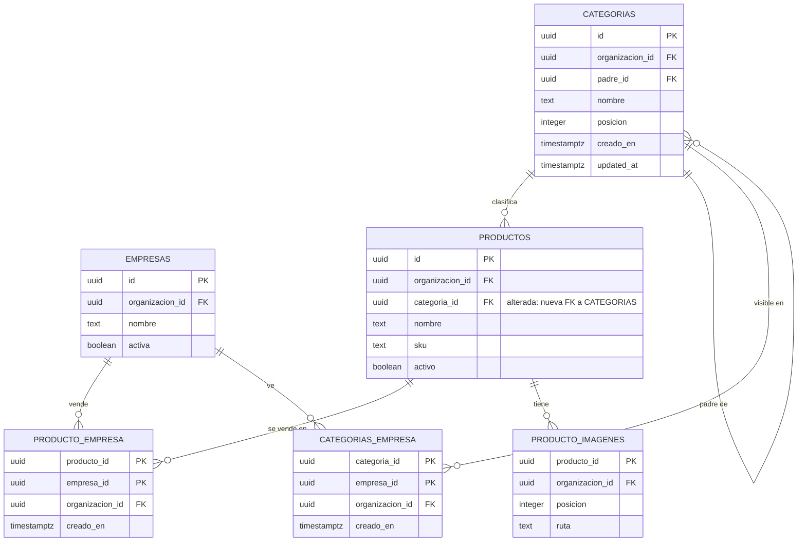

# Catálogo: listado, empresas y categorías (MSF-160)

Spec: `specs/20261020-120000-catalogo-listado-y-categorias/` (épica MSF-160, historias F-CAT-01, F-CAT-07 y
F-CAT-08). Delivery scope: `refine` (`apps/web`) y `supabase` (migraciones, RPC, vistas y pgTAP). No toca Kestra,
Superset ni workers. Guía de producto: [Catálogo: listado y categorías](../producto/catalogo-listado-y-categorias.md).

## Piezas

| Pieza | Dónde | Qué resuelve |
|---|---|---|
| Vista de listado | `public.v_productos_listado` | Contrato de lectura paginada del catálogo, sin costo ni precio |
| Búsqueda e índices | `supabase/migrations/20261020120101_catalogo_listado_indices.sql` | `ilike` por nombre/SKU y orden estable sobre `dominio.productos` |
| Empresas del producto | `dominio.producto_empresa` + `public.definir_empresas_producto` | Qué tiendas publican cada producto |
| Categorías | `dominio.categorias`, `dominio.categorias_empresa` | Árbol de dos niveles y visibilidad por tienda |
| RPC de categorías | `public.guardar_categoria`, `public.reordenar_categorias`, `public.eliminar_categoria`, `public.asignar_categoria_producto` | Escrituras atómicas del árbol y de la categoría del producto |
| Pantallas | `apps/web/src/pages/productos/list.tsx`, `pages/categorias/list.tsx` y componentes de `components/productos` / `components/categorias` | Listado, empresas en el formulario y árbol de categorías |

Migraciones de la épica, en orden de aplicación: `20261020120000_catalogo_listado_vista.sql`,
`20261020120101_catalogo_listado_indices.sql`, `20261020130000_catalogo_producto_empresa.sql`,
`20261020130101_catalogo_producto_empresa_rpc.sql`, `20261020130201_catalogo_listado_visible_en.sql`,
`20261020140001_catalogo_categorias.sql`, `20261020140100_catalogo_categorias_rpc.sql` y
`20261020140200_catalogo_productos_categoria.sql`. Todas son aditivas y documentan su reversión en el encabezado.

## Modelo de datos (DER)

| Tabla | Estado | Cambio |
|---|---|---|
| `dominio.productos` | alterada | + `categoria_id` (FK compuesta, `on delete set null (categoria_id)`) |
| `dominio.producto_empresa` | nueva | Producto ↔ empresa que lo vende |
| `dominio.categorias` | nueva | Árbol de categorías (raíz y subcategoría) |
| `dominio.categorias_empresa` | nueva | Visibilidad de una categoría por tienda |
| `dominio.empresas` | existente | Solo suma `unique (id, organizacion_id)` para la FK compuesta |
| `dominio.producto_imagenes` | existente | La vista usa la imagen de menor posición; no cambia |

- **[ERD interactivo (Archify)](../diagrams/msf-160-erd.html)** — columnas, PK/FK y cardinalidad.
- **[Arquitectura del catálogo](../diagrams/msf-160-architecture.html)** — quién lee y quién escribe.
- `v_productos_listado` y `v_categorias_productos` son **vistas** de `public`, no tablas; no se dibujan como entidades.
- `producto_empresa`, `categorias` y `categorias_empresa` viven en `dominio` (Principio VII). `rls_en_toda_tabla`
  (pgTAP) recorre `public` y `dominio` y las incluye.

## Vistas de lectura

`public.v_productos_listado` es `security_invoker = true`: rige la RLS de `dominio.productos`,
`dominio.producto_imagenes`, `dominio.producto_empresa` y `dominio.categorias`. Sin `anon`; `grant select` a
`authenticated`. **No expone costo ni precio.** Las tres migraciones que la usan la reemplazan con
`create or replace view` y **solo agregan columnas al final** (contrato para MSF-179 y MSF-202):

| Columna | Origen | Desde |
|---|---|---|
| `id`, `organizacion_id`, `nombre`, `sku`, `activo`, `updated_at` | `dominio.productos` | `20261020120000` |
| `imagen_ruta` | `producto_imagenes` de menor `posicion` | `20261020120000` |
| `empresa_ids` | `array_agg` de `producto_empresa` | `20261020130201` |
| `categoria_id`, `categoria_ruta` («Padre > Hija»), `categoria_ids` (`[hija, padre]` o `[raíz]`) | `productos` + `categorias` | `20261020140200` |

`public.v_categorias_productos` es también `security_invoker` y devuelve `organizacion_id, categoria_id, productos`
con el conteo **directo** por categoría; el árbol suma las subcategorías en el cliente.

## Listado (F-CAT-01)

- La pantalla consulta la vista por PostgREST con `range` y `count: 'exact'` (`productosListado.ts`), 25 filas por
  página. El total y el pie «desde–hasta de N» salen del servidor; nunca se traen todas las filas.
- **Búsqueda** (`filtroBusquedaProductos`): `ilike` sobre `nombre` o `sku`, máximo 80 caracteres, espera de tipeo de
  300 ms. Se quitan `, ( ) " \ *` y se escapan `%` y `_` para que se busquen como texto. Al cambiar la búsqueda vuelve
  a la página 1.
- **Filtro de estado**: `todos` o `inactivos` (`activo = false`). Los filtros «Sin stock», «Stock bajo» y «Sin
  vincular a ML» están deshabilitados en la UI hasta Stock y Mercado Libre (no hay columnas para ellos en la vista).
- **Filtro de tienda**: `empresa_ids @> {empresa}`. **Filtro de categoría**: `categoria_ids @> {categoría}`, de modo que
  una raíz incluye sus subcategorías. Ambos se resuelven en el servidor.
- **Orden**: `nombre`, `sku` o `activo`, ascendente/descendente y desempate por `id` (`order(...).order('id')`). Los
  nulos van al final en ascendente y al principio en descendente.
- **Índices** (`20261020120101`, esquema `dominio`): GIN trigram sobre `nombre` y `sku` (requiere `pg_trgm`, ya
  habilitada) y btree `(organizacion_id, nombre, id)` y `(organizacion_id, sku, id)`. Se indexa la columna cruda
  —no `lower(col)`— porque PostgREST expresa `ilike` y `order` sobre la columna.
- **Estados de pantalla**: carga, catálogo vacío, «No hay productos que coincidan» con «Limpiar filtros» y error con
  «Reintentar». La página fuera de rango vuelve a la 1.
- **Permisos**: `useNivelSeccion('productos')` decide si se muestran «Nuevo producto», «Editar» y Activar/Desactivar;
  la RLS y las RPC son la autoridad.
- **Pruebas**: pgTAP `catalogo_listado.test.sql` (aislamiento, `anon`, la vista no expone costo, comodines) y
  `catalogo_listado_plan.test.sql` (10 000 filas; el `ilike` usa el trigram y el orden usa los btree).

## Empresas que venden el producto (F-CAT-07)

### Tabla `dominio.producto_empresa`

- PK `(producto_id, empresa_id)`, `organizacion_id` y `creado_en`.
- FKs compuestas `(producto_id, organizacion_id)` → `productos` y `(empresa_id, organizacion_id)` → `empresas`, ambas
  `on delete cascade`; una fila no puede cruzar organizaciones. La migración suma
  `empresas_id_organizacion_uk unique (id, organizacion_id)` a `dominio.empresas` (aditivo).
- Índices `(empresa_id, producto_id)` y `(organizacion_id)`.
- RLS: select con `lectura`/`edicion` en `productos`; insert y delete con `edicion`; **sin UPDATE**. `anon` sin
  privilegios. Grants por columna en el insert (`producto_id`, `empresa_id`, `organizacion_id`).

### RPC `public.definir_empresas_producto(p_producto_id uuid, p_empresa_ids uuid[])`

- `security invoker` (rige RLS): exige `edicion` en `productos` (`42501`). Producto inexistente o de otra organización:
  `P0002`. Empresa inexistente, ajena o valor nulo en la lista: `22023`, sin cambios parciales.
- Atómica e idempotente: calcula el delta, inserta lo que falta y borra lo que sobra en una transacción. Toma
  `pg_advisory_xact_lock` por producto para serializar dos guardados simultáneos. Devuelve cuántas empresas quedan.
- `revoke ... public, anon` + `grant execute ... authenticated`.

### Actividad

Los triggers por sentencia `producto_empresa_actividad_alta` y `_baja` (tablas de transición) emiten **un** evento
`producto.empresas_actualizadas`, en la misma transacción, solo con sesión y solo ante cambios reales. La RPC guarda lo
agregado en una variable de transacción y la baja lo combina: «Cambió las empresas del producto <nombre> (SKU …):
agregó …; quitó …». Sin precios ni costo. Una escritura directa (sin la RPC) también registra, agrupada por producto.

### UI

`EmpresasProducto` dentro de `FormularioProducto` (alta y edición): una fila por empresa con `Precio: —` e interruptor
`role="switch"`; no asume cantidad de empresas. En el alta el producto se crea primero y las empresas se guardan
después; si falla ese segundo paso el producto queda creado y se ofrece «Reintentar empresas». En la edición, si solo
cambian las empresas no se llama a `actualizar_producto` (no avanza `updated_at` ni deja `producto.editado`).

## Categorías (F-CAT-08)

### Tablas

- `dominio.categorias`: `id`, `organizacion_id`, `nombre` (1–100, recortado), `padre_id`, `posicion` (≥ 0), `creado_en`
  y `updated_at`. FK compuesta `(padre_id, organizacion_id)` con `on delete set null (padre_id)`.
- Índice único `categorias_nombre_nivel_uk` sobre
  `(organizacion_id, coalesce(padre_id, '000…0'), lower(btrim(nombre)))`: nombre único por nivel, sin distinguir
  mayúsculas ni espacios extremos.
- `dominio.categorias_empresa`: PK `(categoria_id, empresa_id)`, `organizacion_id` y `creado_en`; FKs compuestas a
  categorías y empresas. Una categoría sin filas no se ve en ninguna tienda.
- RLS por organización y por `private.nivel_seccion('categorias')` (`select` con lectura/edición; insert/update/delete
  con edición; nunca `puede_escribir()`). `anon` sin privilegios y grants por columna.
- Disparadores: `categorias_normalizar` (recorta el nombre, rechaza vacío con `23514` y toma un candado asesor por
  organización) y `categorias_dos_niveles` (`constraint trigger` diferido). Este último valida sobre el estado final:
  el padre debe ser raíz, una categoría con hijos no puede tener padre y nadie es su propio padre. Así un reordenado
  válido no falla por estados intermedios.

### RPC

Todas son `security invoker`, atómicas, toman el mismo candado asesor por organización (`categorias:<org>`) y hacen
`revoke ... public, anon` + `grant execute ... authenticated`. Sin permiso de edición devuelven `42501`.

| RPC | Contrato |
|---|---|
| `public.guardar_categoria(p_id uuid, p_nombre text, p_padre_id uuid, p_empresa_ids uuid[])` | Alta si `p_id` es nulo; edición si no. Devuelve el id. Nombre vacío o > 100 y empresas inválidas: `22023`; padre/categoría inexistente: `P0002`; nombre repetido en el nivel: `23505`; viola los dos niveles: `23514`. Reemplaza la visibilidad en la misma transacción. |
| `public.reordenar_categorias(p_orden jsonb)` | Recibe `[{id, padre_id, posicion}]`, valida que no haya ids repetidos ni valores inválidos y persiste padre/posición en una sola sentencia. Valida los dos niveles sobre el resultado. Devuelve cuántas filas cambiaron. |
| `public.eliminar_categoria(p_id uuid)` | Sube las subcategorías a raíz, deja los productos sin categoría (`on delete set null (categoria_id)`) y borra la categoría. Devuelve `{productos, subcategorias}`. Si una subcategoría choca de nombre con una raíz, rechaza con `23505` y no borra nada. |
| `public.asignar_categoria_producto(p_producto_id uuid, p_categoria_id uuid)` | Asigna o quita (`null`) la categoría. Exige `edicion` en `productos`; `P0002` si el producto o la categoría no existen o son de otra organización. Idempotente: el mismo valor no escribe ni deja evento. |

### Datos y UI

- `dominio.productos.categoria_id` es aditiva, con FK compuesta a `categorias` y `on delete set null (categoria_id)`;
  índice parcial `(organizacion_id, categoria_id) where categoria_id is not null`.
- `asignar_categoria_producto` no toca `updated_at` ni deja `producto.editado`: el evento propio es
  `producto.categoria_asignada` (trigger `productos_actividad_categoria`, solo ante un cambio real; la baja de la
  categoría la cubre `categoria.eliminada`).
- `apps/web/src/lib/categorias.ts` arma el árbol de dos niveles, calcula la ruta, valida nombre y movimientos y llama a
  las RPC. `ArbolCategorias` implementa arrastrar y soltar HTML5 nativo (sin dependencia nueva) y Subir/Bajar por
  teclado; un movimiento inválido se avisa antes de llamar a la base. `FormularioCategoria` limita «Categoría padre» a
  raíces y `EliminarCategoriaDialogo` muestra los conteos.
- `SelectorCategoria` en alta/edición de producto guarda con `asignar_categoria_producto`; si la categoría actual no se
  puede leer, se conserva y se avisa sin mostrar el id.
- `leerCategorias` hace tres lecturas (`categorias`, `categorias_empresa`, `v_categorias_productos`) y arma el árbol en
  el cliente.

### Actividad

Triggers por sentencia sobre `dominio.categorias`: `categoria.creada`, `categoria.editada`, `categoria.reordenada` y
`categoria.eliminada`. Se emiten en la misma transacción, solo con sesión y solo ante cambios reales. Las RPC marcan la
transacción para que un reordenado deje **un** evento («Reordenó las categorías (N cambios)») y la eliminación no deje
un «editada» por cada subcategoría que sube. La visibilidad por tienda cuenta como edición. Detalles legibles, sin ids
técnicos: «Creó la categoría|subcategoría <ruta>», «Editó la categoría <ruta>», «Eliminó la categoría <ruta>: N
productos quedaron sin categoría; M subcategorías subieron a raíz».

## Empresa activa

- **Productos**: `useFiltroPorEmpresaActiva` inicializa el filtro con la empresa activa de la barra superior. Elegir
  otra tienda en la pantalla es una sobreescritura local: no cambia la empresa activa persistida y se descarta cuando
  la activa vuelve a cambiar. Al cambiar la empresa activa, el listado se vuelve a consultar y la página vuelve a 1.
- **Categorías**: la pantalla se recarga al cambiar la empresa activa o la organización (`cargar` depende de
  `empresaActivaId` y `organizacionId`; RLS resuelve la organización). Al cambiar de **organización** además vacía el
  árbol, reinicia la expansión y cierra los diálogos, para no guardar datos de la organización anterior. Las categorías
  son de la organización: la empresa solo filtra qué se ve.

## Límites conocidos

- La lectura de categorías y de visibilidad no paginan; PostgREST corta en `max-rows` (1000 por defecto). Con más filas,
  los chips «Visible en», el filtro de tienda y los conteos quedarían incompletos. El volumen esperado (decenas de
  categorías) está muy por debajo; si crece, hay que paginar con `range`.
- `reordenar_categorias` recibe el árbol completo calculado en el cliente: con dos editores simultáneos gana el último y
  puede revertir un movimiento ajeno. El candado asesor serializa, no fusiona.
- El `DELETE` directo sobre `dominio.categorias` está concedido a quien edita la sección y la RLS lo acota a su
  organización, pero no toma el candado ni ordena las subcategorías como `eliminar_categoria`; la app solo usa la RPC.
- El filtro por tienda (`empresa_ids @> …`) y el filtro por categoría (`categoria_ids @> …`) operan sobre columnas
  calculadas de la vista: no usan `producto_empresa_empresa_idx` ni `productos_categoria_idx`, sino un recorrido de los
  productos ya acotado por `organizacion_id`. Es aceptable para los volúmenes actuales; si el listado se vuelve lento,
  hay que filtrar con `exists`/`in` sobre las tablas base en una migración posterior.
- `v_categorias_productos` cuenta productos **directos**; la suma de subcategorías se hace en el cliente.
- Al integrar la base de deploy coincidieron versiones de migración: las de esta épica se corrieron +1 segundo
  (`20261020120101`, `20261020130101`, `20261020130201`, `20261020140001`) sin cambiar el contenido.

## Pruebas

- pgTAP: `catalogo_listado.test.sql`, `catalogo_listado_plan.test.sql`, `catalogo_producto_empresa.test.sql` y
  `catalogo_categorias.test.sql`. Cubren aislamiento por organización, `anon` sin acceso, la vista sin costo,
  comodines, permisos por rol, atomicidad e idempotencia de las RPC, dos niveles, nombre único por nivel, reordenado
  concurrente, eliminación, asignación, eventos y `rls_en_toda_tabla`.
- Vitest: `lib/productosListado`, `lib/productoEmpresas`, `lib/categorias`, `EmpresasProducto`, `SelectorCategoria`,
  `ArbolCategorias`, `FormularioCategoria`, `EliminarCategoriaDialogo` y las pantallas `productos/list|create|edit` y
  `categorias/list`.
- Los pgTAP corren en el CI (job `database`); localmente hace falta `pnpm dev:supabase`.

## Reversión

En migraciones posteriores, nunca en el mismo PR: restaurar la vista sin las columnas nuevas (`create or replace view`
con la definición anterior), `drop view public.v_categorias_productos`, `drop trigger productos_actividad_categoria`,
`drop function private.registrar_actividad_producto_categoria(), public.asignar_categoria_producto(uuid, uuid)`,
`alter table dominio.productos drop column categoria_id` (exportar antes: pierde la asignación), quitar los triggers y
funciones de actividad de categorías, `drop function public.guardar_categoria(uuid, text, uuid, uuid[]),
public.reordenar_categorias(jsonb), public.eliminar_categoria(uuid)`, `drop table dominio.categorias_empresa,
dominio.categorias`, `drop function private.normalizar_categoria(), private.validar_categorias_dos_niveles()`, quitar
los triggers y funciones de `producto_empresa`, `drop table dominio.producto_empresa`, `drop constraint
empresas_id_organizacion_uk` y `drop view public.v_productos_listado` + los índices de búsqueda.
