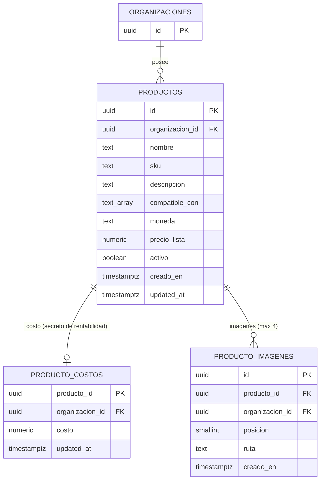

# Catálogo de productos: alta, edición, imágenes y estado (MSF-456)

Épica **MSF-456** — Catálogo · Catálogo alta y edición. Spec: `specs/20261017-120000-catalogo-alta-y-edicion/`
(`spec.md`, `plan.md`, `tasks.md`). Historias: `F-CAT-02` alta (MSF-458), `F-CAT-03` SKU único (MSF-459),
`F-CAT-04` edición (MSF-460), `F-CAT-05` imágenes (MSF-461), `F-CAT-06` estado activo/inactivo (MSF-462).
Alcance de entrega: `refine` + `supabase` (sin `kestra`, `superset` ni `workers`).

La página de producto es [Catálogo de productos](../catalogo.md); acá va cómo está construido.

## Alcance, dependencias y qué queda afuera

- **Depende de** MSF-455 (`registro_actividad`, `private.nivel_seccion` vía MSF-125) y MSF-138 (empresas y
  `producto_empresa`). El producto es de la **organización**: la relación con empresas (`producto_empresa`) no se
  usa en esta épica.
- **Bloquea a** MSF-160 (listado y categorías, lee `dominio.productos`) y MSF-205 (proveedor y código de barras).
- **Fuera de alcance** (no está construido, no es un hecho documentado): categorías y listado completo (MSF-160),
  proveedor y código de barras (MSF-205), IVA y precio en pesos (MSF-114), variantes, productos relacionados,
  escalas de precio, stock inicial, video, sugerencias de «Compatible con» (F-CAT-09), publicaciones de Mercado
  Libre y «Desvincular publicación» (Etapa 2), eliminación física de productos.
- El precio de lista se carga **sin IVA** y en la moneda elegida (`USD` o `ARS`); «Precio en pesos» se muestra
  «No disponible» hasta que Precios entregue F-PRE-01.

## Migraciones

Cada historia trae su migración aditiva, con la reversión escrita en el encabezado.

| Migración | Historia | Contenido |
|---|---|---|
| `supabase/migrations/20261017120100_catalogo_productos_y_costos.sql` | F-CAT-02 | `dominio.productos`, `dominio.producto_costos`, RLS, grants |
| `supabase/migrations/20261017120200_catalogo_crear_producto.sql` | F-CAT-02 | RPC `public.crear_producto` + trigger `producto.creado` |
| `supabase/migrations/20261017120300_catalogo_sku_unico.sql` | F-CAT-03 | Índice único de SKU + trigger de autogenerado |
| `supabase/migrations/20261017120400_catalogo_actualizar_producto.sql` | F-CAT-04 | RPC `public.actualizar_producto` + trigger `producto.editado` |
| `supabase/migrations/20261017120500_catalogo_producto_imagenes.sql` | F-CAT-05 | `dominio.producto_imagenes`, bucket, políticas, tope de 4 |
| `supabase/migrations/20261017120600_catalogo_cambiar_estado.sql` | F-CAT-06 | RPC `public.cambiar_estado_producto` + trigger de estado |

## Modelo de datos

Esquema `dominio` (Principio VII): las tres tablas son entidades del negocio del producto; ninguna va a `public`.

| Tabla | Columnas que importan | RLS (`nivel_seccion`) |
|---|---|---|
| `dominio.productos` | `nombre` (obligatorio, ≤ 200), `sku` (≤ 80), `descripcion` (≤ 4000), `compatible_con text[]` (≤ 50 valores, ≤ 100 caracteres cada uno), `moneda` (`USD`/`ARS`), `precio_lista numeric(14,2) > 0`, `activo` (def. `true`), `creado_en`, `updated_at`, `unique (id, organizacion_id)` | select con `lectura`/`edicion` en `productos`; insert/update con `edicion`; **sin política DELETE** (se desactiva, no se borra) |
| `dominio.producto_costos` | `producto_id` (PK, FK compuesta con `organizacion_id`), `costo numeric(14,2) >= 0`, `updated_at` | select con `lectura`/`edicion` en `rentabilidad`; insert/update con `edicion`; sin DELETE. El Operador ve 0 filas |
| `dominio.producto_imagenes` | `id`, `producto_id`, `organizacion_id`, `posicion` 1..4, `ruta`, `creado_en`, `unique (producto_id, posicion)`, `unique (ruta)` | select con `lectura`/`edicion` en `productos`; insert/delete con `edicion`; **sin UPDATE** (no se reordena ni reemplaza) |

- Todas las políticas filtran además por `organizacion_id = (select private.organizacion_id())`.
- **Grants por columna** (`20261017120100`): el llamador no fija `organizacion_id`, `creado_en` ni `updated_at`;
  `anon` no tiene privilegios; `authenticated` recibe `select` más `insert`/`update` con columnas explícitas. No hay
  `delete` concedido en `productos` ni en `producto_costos`.
- La FK compuesta `(producto_id, organizacion_id)` impide colgar un costo o una imagen de un producto de otra
  organización.
- Normalización al escribir (`private.normalizar_producto`, trigger `productos_normalizar`): nombre recortado y no
  vacío, SKU y descripción con `null` si quedan en blanco, «Compatible con» sin vacíos ni repetidos. El `updated_at`
  lo toca ese trigger, pero `productos_updated_at_real` (F-CAT-04) lo restaura cuando el guardado no cambió nada
  real: solo avanza ante cambios reales o ante un cambio de costo.

## RPC

Las tres son `security invoker` con `search_path = ''`: **rige la RLS del llamador**, no un permiso propio de la
función. Todas con `revoke execute … from public, anon` y `grant execute … to authenticated`.

| RPC | Qué hace | Errores |
|---|---|---|
| `public.crear_producto(p_nombre, p_descripcion, p_sku, p_compatible_con, p_moneda, p_precio_lista, p_costo default null) returns dominio.productos` | Alta en la organización de la sesión; el producto nace **activo**. No recibe stock (FR-002) ni organización. El costo solo se guarda si el llamador edita `rentabilidad` | `42501` (sin `edicion` en `productos`, o costo sin `edicion` en `rentabilidad`), `22023` (nombre vacío, moneda distinta de USD/ARS, precio ≤ 0 o con más de 2 decimales, costo negativo) |
| `public.actualizar_producto(p_id, p_actualizado_en, p_nombre, p_descripcion, p_sku, p_compatible_con, p_moneda, p_precio_lista, p_costo default null) returns dominio.productos` | Edición con **bloqueo optimista**: `p_actualizado_en` es el `updated_at` leído al abrir la ficha; si la fila cambió se rechaza. `p_costo` nulo = no tocar el costo (no hay baja de costo) | `42501`, `22023`, `40001` (conflicto de edición concurrente), `P0002` (no existe o es de otra organización) |
| `public.cambiar_estado_producto(p_id, p_activo) returns dominio.productos` | Activa o desactiva **sin tocar** nombre, SKU, precio, costo ni imágenes. Idempotente: pedir el estado que ya tiene no escribe ni registra evento | `42501` (sin `edicion` en `productos`), `22023` (estado nulo), `P0002` |

- `actualizar_producto` serializa ediciones concurrentes con `select … for update` sobre la fila y usa
  `on conflict … do update … where c.costo is distinct from excluded.costo` para el costo: solo cuenta como cambio
  real si el valor cambió.
- El cambio de estado **sí** avanza `updated_at` (trigger `productos_updated_at_real`), así una ficha abierta en
  otra pestaña detecta el conflicto al guardar.
- MSF-205 (F-PRV-03) amplió `crear_producto` y `actualizar_producto` con `p_proveedor_id`, `p_codigo_proveedor` y
  `p_cambiar_proveedor`: ver [Proveedores (modelo y RPC)](proveedores.md).

### Errores y cómo los ve la pantalla

El mapeo está en `apps/web/src/lib/productos.ts` (`mensajeDeError`): `40001` → aviso de conflicto con opción de
recargar, `P0002` → «El producto ya no existe o no pertenece a tu organización», `42501` → «No tenés permiso para
esta acción», `22023` → dato no válido, `22003` → importe demasiado grande, y `23505` **con el índice
`productos_org_sku_uidx`** → «Ese SKU ya existe» (otra restricción única no se muestra como SKU repetido).
El texto crudo de Postgres queda en la consola; al usuario solo se muestra castellano.

## SKU único (F-CAT-03)

- Índice `dominio.productos_org_sku_uidx` sobre `(organizacion_id, lower(btrim(sku)))`: único por organización sin
  distinguir mayúsculas ni espacios extremos. Otra organización puede repetir el SKU.
- El índice es el **árbitro de las altas simultáneas**: una gana y la otra recibe `23505`; la regla vive en la
  base, no solo en la pantalla.
- SKU vacío (alta o edición) → el trigger `productos_sku` (`private.asegurar_sku_producto`) genera
  `PRD-` + 8 hexadecimales en mayúsculas y reintenta ante colisión (hasta 10 intentos; si no, `23505`). Un SKU
  cargado a mano se respeta.
- La migración `20261017120300` rellena los SKU vacíos que quedaron de F-CAT-02 y trae en su encabezado la consulta
  previa de duplicados que impedirían crear el índice.

## Imágenes (F-CAT-05)

- **Tabla `dominio.producto_imagenes`**: `posicion` 1..4, `ruta` con extensión jpg/jpeg/png/webp y prefijo
  `<organizacion_id>/<producto_id>/` propio (check de la tabla). La imagen de **menor `posicion` es la principal**;
  al quitar una no se renumera, la siguiente pasa a serlo.
- **Tope de 4 en la base** (también ante llamada directa): trigger `producto_imagenes_tope`
  (`private.limitar_imagenes_producto`) toma un candado asesor por producto —sin él dos altas simultáneas pasarían
  ambas el conteo— y rechaza con `23514`; `unique (producto_id, posicion)` da `23505`.
- **Bucket privado `productos-imagenes`** (patrón de `logos-organizacion`): `file_size_limit` 2 097 152 bytes (2 MB),
  `allowed_mime_types` `image/png`, `image/jpeg`, `image/webp` (sin SVG), `public = false`.
- **Políticas sobre `storage.objects`**: `productos_imagenes_select` (prefijo de la organización + `lectura`/`edicion`
  en `productos`), `productos_imagenes_insert` (prefijo de la organización + `edicion` + el producto debe ser de la
  sesión) y `productos_imagenes_delete` (prefijo + `edicion`). **No hay política de UPDATE**: un archivo no se
  reemplaza.
- **Pantalla**: `apps/web/src/components/productos/ImagenesProducto.tsx` con la validación en el cliente (tipo,
  2 MB, 4 como máximo) y la lógica en `apps/web/src/lib/productoImagenes.ts` (`aplicarCambiosImagenes`): primero
  quita (borra la fila y después el archivo) y después sube (sube el archivo, inserta la fila y, si el insert
  falla, borra el archivo recién subido). Las vistas usan **URLs firmadas de 5 minutos**
  (`SEGUNDOS_URL_FIRMADA = 300`, `createSignedUrls`).
- En el alta, las imágenes se **suben al guardar** el producto: si una falla, el producto queda creado y se ofrece
  «Reintentar subida» (`pages/productos/create.tsx`).

## Actividad

Los eventos se registran en la **misma transacción** que el cambio, con triggers `security definer` sobre
`private.insertar_actividad` y solo si hay sesión (`auth.uid()` no nulo). El detalle nunca lleva costo ni precio.

| Evento | Trigger | Cuándo |
|---|---|---|
| `producto.creado` | `productos_registrar_actividad` (`private.registrar_actividad_producto`) | alta |
| `producto.editado` | `productos_registrar_actividad_edicion` | solo si hubo cambios reales; un cambio de estado no lo cuenta |
| `producto.activado` / `producto.desactivado` | `productos_registrar_actividad_estado` | ante cualquier cambio real de `activo` (también por `UPDATE` directo) |
| `producto.imagen_agregada` / `producto.imagen_eliminada` | `producto_imagenes_registrar_actividad` | alta/baja de una imagen |

El detalle lleva el nombre y el SKU («Creó el producto X (SKU Y)»). Contrato completo: [Actividad e historial](../actividad.md).

## Frontend (`apps/web`)

| Pieza | Archivo | Qué define |
|---|---|---|
| Rutas | `src/App.tsx:285`–`:304` | `/productos`, `/productos/create`, `/productos/:id/edit`, las tres con `RequiereAccesoSeccion seccion="productos"` y carga diferida (`lazy`) |
| Recurso | `src/App.tsx:202` | `{ name: 'productos', list: '/productos', create: '/productos/create', edit: '/productos/:id/edit' }` |
| Menú | `src/components/navegacion/destinosPanel.ts:60` | destino «Productos» en Catálogo, ícono `Inventory2Icon`, `audiencia: 'organizacion'`, `seccionPermiso: 'productos'` |
| Pantallas | `src/pages/productos/create.tsx`, `edit.tsx`, `list.tsx` | alta, edición y grilla mínima de solo lectura |
| Componentes | `src/components/productos/FormularioProducto.tsx`, `ImagenesProducto.tsx`, `CambiarEstadoProducto.tsx` | formulario (aviso «Faltan datos obligatorios», diálogo «Descartar cambios», aviso de conflicto), imágenes y activar/desactivar |
| Librería | `src/lib/productos.ts`, `src/lib/productoImagenes.ts` | validación, parámetros de las RPC, mapeo de errores, límites y URLs firmadas |

- La **autoridad es la RLS**: `useNivelSeccion` solo decide si se muestra el formulario o el campo de costo; el
  Operador no ve el costo en pantalla, y la RPC lo rechaza igual (`42501`).
- El formulario no tiene **stock inicial** (FR-002): el prototipo lo muestra, pero el requisito manda.
- La grilla `/productos` es la **mínima de solo lectura** (Decisión 3 de la spec): nombre, SKU y estado, con «Editar»
  y activar/desactivar solo con edición en `productos`. El listado real llega con MSF-160.

## Seguridad y concurrencia

- RLS como autoridad; el costo en tabla aparte para poder restringirlo por fila; nunca se usa la service-role key
  en el navegador.
- SKU único garantizado por índice (no por la pantalla); tope de 4 imágenes garantizado por trigger con candado
  asesor.
- Edición con bloqueo optimista por `updated_at`; el conflicto se avisa y no se pisan cambios en silencio.
- URLs firmadas de corta vida para las imágenes; el bucket es privado.

## Pruebas

| Tipo | Archivo | Qué cubre |
|---|---|---|
| pgTAP | `supabase/tests/database/catalogo_productos.test.sql` | aislamiento entre dos organizaciones, permisos por rol (`productos`, `producto_costos`: Operador 0 filas), `anon` sin privilegios, evento de Actividad sin costo |
| pgTAP | `supabase/tests/database/catalogo_sku_unico.test.sql` | mayúsculas/espacios, SKU vacío autogenerado, edición a SKU ocupado, altas concurrentes |
| pgTAP | `supabase/tests/database/catalogo_actualizar_producto.test.sql` | Operador no cambia el costo, solo lectura no actualiza, conflicto concurrente, evento solo ante cambios reales |
| pgTAP | `supabase/tests/database/catalogo_producto_imagenes.test.sql` | aislamiento en tabla y Storage, permisos por rol, quinta imagen, formato, eventos |
| pgTAP | `supabase/tests/database/catalogo_estado_producto.test.sql` | desactivar conserva datos e imágenes, solo lectura rechazado, eventos, aislamiento |
| Vitest | `src/lib/productos.test.ts`, `src/lib/productoImagenes.test.ts`, `src/pages/productos/{create,edit,list}.test.tsx`, `src/components/productos/ImagenesProducto.test.tsx` | validación, avisos, descarte, conflicto, costo oculto al Operador, límites de imágenes, acciones de la grilla |

- El **E2E de punta a punta** «crear, editar, subir fotos y desactivar» con Administrador y Operador (SC-001, SC-006)
  está **pendiente**: no hay suite E2E de la app con fixtures por rol. Ver [E2E de la app](../e2e-app.md).
- `rls_en_toda_tabla` recorre `public` y `dominio`: las tres tablas quedan cubiertas.

## Reversión

Las migraciones son aditivas y se revierten en migraciones posteriores (no en el mismo PR). Cada encabezado trae el
`drop` exacto; el resumen:

| Migración | Reversión |
|---|---|
| `…120100` | `drop trigger productos_normalizar`; `drop function private.normalizar_producto()`; `drop table dominio.producto_costos`; `drop table dominio.productos` (exportar los datos antes) |
| `…120200` | `drop trigger productos_registrar_actividad`; `drop function private.registrar_actividad_producto()`; `drop function public.crear_producto(...)` |
| `…120300` | `drop trigger productos_sku`; `drop function private.asegurar_sku_producto()`; `drop index dominio.productos_org_sku_uidx` (los SKU generados quedan como datos válidos) |
| `…120400` | `drop trigger productos_registrar_actividad_edicion`; `drop trigger productos_updated_at_real`; `drop function private.registrar_actividad_producto_editado()`; `drop function private.conservar_updated_at_producto()`; `drop function public.actualizar_producto(...)` |
| `…120500` | `drop trigger producto_imagenes_registrar_actividad`; `drop trigger producto_imagenes_tope`; `drop function private.registrar_actividad_producto_imagen()`; `drop function private.limitar_imagenes_producto()`; `drop policy productos_imagenes_{select,insert,delete} on storage.objects`; `delete from storage.buckets where id = 'productos-imagenes'` (tras vaciar el bucket); `drop table dominio.producto_imagenes` |
| `…120600` | `drop trigger productos_registrar_actividad_estado`; `drop function private.registrar_actividad_producto_estado()`; `drop function public.cambiar_estado_producto(uuid, boolean)` |

## Límites conocidos

- El tipo de imagen se valida por `file.type` (lo declara el cliente, igual que el bucket): no se verifican los
  bytes del archivo. Con un bucket privado y URL firmada el riesgo es bajo, pero queda anotado.
- Si se borra la fila de una imagen y falla el borrado del archivo, este queda **huérfano** en el bucket: la
  pantalla lo avisa, pero no hay barrido automático de huérfanos.
- Las imágenes no se reordenan ni se reemplazan (no hay UPDATE sobre `producto_imagenes`); quitar una hace que la
  siguiente sea la principal.
- No hay baja de costo: `p_costo` nulo deja el costo como está.
- El E2E de punta a punta de la épica sigue pendiente (ver arriba).
