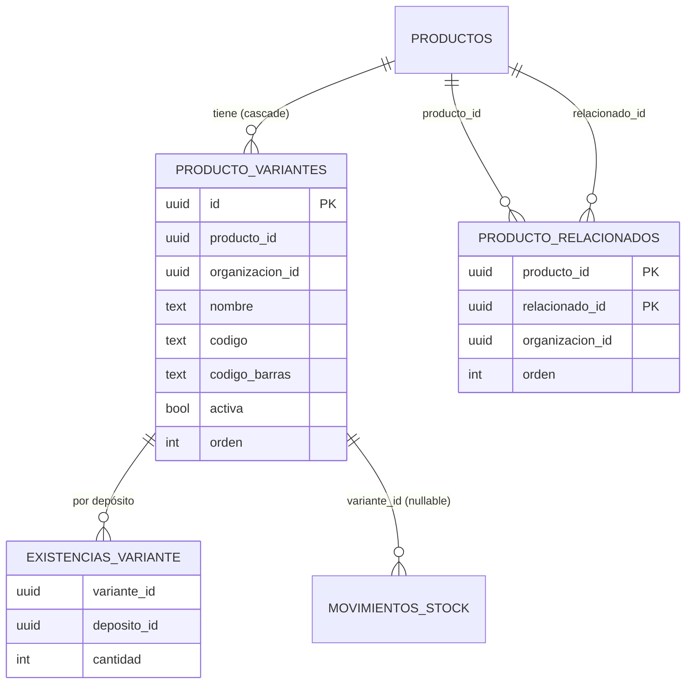

# Catálogo: variantes y relacionados (MSF-229), construcción interna

**Épica:** MSF-229 · **Historias:** F-CAT-15 (variantes, MSF-408) y F-CAT-18 (relacionados, MSF-416); cierre MSF-765.
**Spec:** `specs/20270125-100000-catalogo-variantes/` (`spec.md`, `plan.md`, `contracts/variantes.md`, `contracts/relacionados.md`).
**Producto:** [Variantes y productos relacionados](../producto/catalogo-variantes-y-relacionados.md).
Alcance de entrega: `refine` y `supabase`.

> **Fuente.** Implementación mergeada en `dokploy` (PR #749, rama `integra/msf-229`). Los datos salen de sus migraciones
> `20270220120100` a `20270220120600` y `20270220170000`, y de `docs/catalogo.md`, `docs/stock.md` y
> `docs/exportacion-total.md` de esa rama.

## Datos (esquema `dominio`, Principio VII)

| Objeto | Migración | Notas |
|---|---|---|
| `dominio.producto_relacionados` | `20270220120100_catalogo_relacionados` | PK `(producto_id, relacionado_id)`, `orden >= 1`, `check (producto_id <> relacionado_id)`, FKs compuestas a `productos` con `on delete cascade`. Unidireccional. |
| `dominio.producto_variantes` | `20270220120200_catalogo_variantes_tablas` | `nombre`, `codigo`, `codigo_barras` (EAN-13), `activa`, `orden`. Sin precio ni costo propios. Sin INSERT/UPDATE/DELETE directos: se escribe por RPC. |
| `dominio.existencias_variante` | `20270220120300_catalogo_variantes_stock` | Cantidad por variante y depósito; RLS por `nivel_seccion('stock')`; escriben solo las RPC. |
| `dominio.movimientos_stock.variante_id` | `20270220120400_catalogo_variantes_movimientos` | Columna nullable, aditiva. |
| `private.disponibilidad_producto`, `productos_con_stock`, `disponible_publico` | `20270220120500_catalogo_variantes_disponibilidad` | Solo cambia el cuerpo: con variantes, suma de las activas. |
| `public.guardar_variantes_producto` | `20270220120600_catalogo_variantes_rpc` | Ver «Contratos». |
| `public.v_producto_variantes`, `public.v_producto_relacionados` | `…120600`, `…120100` | Vistas `security_invoker`, `anon` sin acceso. |
| Exportación total | `20270220170000_exportacion_total_variantes_y_relacionados` | Suma `producto_variantes`, `existencias_variante` y `producto_relacionados` al conjunto exportado (`docs/exportacion-total.md`). |

## Contratos

- `guardar_variantes_producto(p_producto, p_actualizado_en, p_variantes jsonb)`: reemplazo completo e idempotente, orden
  = posición del arreglo, bloqueo optimista `40001`, `P0002`, `23505` (código o EAN repetido), `22023` (EAN-13, nombre
  vacío, variante ausente del arreglo, primera variante sobre producto con stock > 0), `42501`. Una fila con `stock`
  distinto exige además `edicion` en `stock` y registra un `ajuste` «Conteo de inventario» en el depósito por defecto.
  Stock máximo 2147483647. Evento `producto.variantes_editadas` solo ante cambio real.
- **Stock y concurrencia:** la ficha manda `stock` solo de las variantes cuyo stock se editó, con el valor que se vio
  (`stock_leido`); si el stock actual ya es otro, la RPC responde `40001` y hay que recargar la ficha (no pisa lo que otra
  persona movió). Sin edición en Stock se rechaza cualquier valor de stock (`42501`), aunque coincida con el actual. La RPC
  toma los bloqueos en el mismo orden que `registrar_movimiento_stock` (primero `existencias`, después `productos`).
- `guardar_relacionados(p_producto, p_relacionados uuid[])`: reemplazo idempotente; `P0002`, `22023`, `42501`; evento
  `producto.relacionados_editados` solo ante cambio real.
- `registrar_movimiento_stock` pasa de 8 a **9 parámetros** (`p_variante uuid default null`): **BREAKING** de firma, los
  llamadores existentes siguen válidos. Con variantes es obligatoria (`22023`); sin variantes debe ser nula.
- Unicidad cruzada de `codigo` y `codigo_barras` por organización entre variantes y productos, con disparadores y
  `pg_advisory_xact_lock`.
- **Desvío del contrato:** `contracts/*.md` dice `security invoker` para las RPC; las dos son
  `security definer` (`guardar_variantes_producto` y `guardar_relacionados`) (necesario para registrar el evento de actividad), validando organización y rol antes de escribir
  (encabezados de `…120100` y `…120600`).

## Frontend

`BloqueVariantes` y `BloqueRelacionados` (`apps/web/src/components/productos/`) dentro de `FormularioProducto`, con
`apps/web/src/lib/productos-variantes.ts` y `productos-relacionados.ts`. Alta: se crea el producto y luego se guardan los
bloques; si falla la segunda parte, el producto queda creado y se puede reintentar (RPC idempotentes).
Empresa activa: no aplica (datos de la organización, stock único compartido).

## Límites y fuera de alcance

Limitaciones reales de lo entregado (detalle en `docs/catalogo.md`, «Avisos de límites de las variantes»):

- **Un producto con variantes hoy no se puede vender.** Comprobantes (`confirmar_comprobante`) y reservas leen y mueven
  `dominio.existencias` del producto, que vale 0: la venta se rechaza («No hay stock suficiente… hay 0», salvo líneas «a
  pedido»). Falla cerrado, sin sobreventa. Mercado Libre y tienda tampoco descuentan stock de variante (Decisión 5);
  `stock.actualizado` no se emite para movimientos de variante.
- **Otros llamadores de `registrar_movimiento_stock` no pasan `p_variante`** y fallan con `22023` sobre un producto con
  variantes: ingreso de mercadería (y su anulación), toma de inventario (`confirmar_toma_inventario`), carga inicial de
  stock, reingreso de RMA, lotes y el diálogo «Nuevo movimiento». El ingreso y la toma son todo-o-nada: una línea con un
  producto con variantes aborta el ingreso o la confirmación completos; hay que dejar ese producto afuera.
- **Lecturas que no suman variantes:** `public.stock_estados` (pantalla Stock y alertas de Inicio),
  `analitica.inventario_productos_stock` (reportes de inventario) y `listar_catalogo_tienda` leen `dominio.existencias`. Un
  producto con variantes figura «Con stock» en catálogo y ficha, y «Sin stock» ahí. Solo `disponibilidad_producto`,
  `productos_con_stock` y `disponible_publico` suman variantes.
- **Las variantes no se borran**, se desactivan: un producto con variantes queda siempre en «modo variantes». Se aceptan
  movimientos sobre una variante inactiva (entran al libro, no suman a la disponibilidad).
- **Relacionados curados sin consumidor:** la ficha pública de la tienda arma «relacionados» por categoría
  (`publico.relacionados_por_dominio`); `v_producto_relacionados` no se lee en público. Hoy es escritura sin lectura pública.
  Tampoco se sugieren en comprobantes.
- **Detalles aceptados:** intercambiar los códigos de dos variantes en un solo guardado se rechaza (`23505`, «ya lo usa otra
  variante»; se hace en dos pasos); sin tope de cantidad de variantes ni de relacionados; «Duplicar» no copia variantes ni
  relacionados; el buscador de relacionados incluye productos inactivos.
- **Escritura directa de relacionados:** quien edita Productos puede insertar, borrar y reordenar filas de
  `producto_relacionados` por PostgREST (RLS por organización y FKs compuestas); esa vía no registra evento de actividad ni
  garantiza un `orden` sin huecos. Decisión del diseño original; si se quiere solo por RPC, quitar esos permisos en una
  migración posterior.
- Precio propio por variante: fuera (hereda `private.precio_para` del producto).
- Importación (MSF-202) y envío de stock/precios a Mercado Libre (MSF-123, MSF-137): siguen operando por producto.

## Reversión (migración posterior, no en el mismo PR)

`drop function public.guardar_relacionados(uuid, uuid[]); drop view public.v_producto_relacionados; drop table
dominio.producto_relacionados;` y, para variantes, `drop function public.guardar_variantes_producto(uuid, timestamptz,
jsonb); drop view public.v_producto_variantes;`, restaurar los cuerpos de las funciones `private` y la firma de 8
parámetros, quitar `variante_id` y las tablas de variantes (exportar antes el libro con variante). Detalle en
`docs/catalogo.md` de la rama de la épica.

## Guía de prueba

**Prerrequisitos:** entorno DEV o local (`pnpm dev:supabase`); un Administrador con edición en Productos y Stock; un
producto sin stock; un usuario de solo lectura; una segunda organización.

**Pasos (UI, `/productos/:id/edit`):**
1. En «Variantes» agregar «Negro» (código `5134a-N`, EAN `7790000000011`, stock 4) y «Blanco» (stock 3); guardar → el
   producto muestra stock 7.
2. Desactivar «Blanco» → 4. Repetir el código de «Negro» en «Blanco» → error de código repetido y se conserva lo escrito.
3. En un producto con stock > 0, agregar la primera variante → rechazo con el mensaje de cómo seguir.
4. En «Productos relacionados» buscar «vidrio», agregar dos, subir uno con ↑, guardar y reabrir → mismo orden; quitar con ✕ y guardar.
5. Con el usuario de solo lectura: ambos bloques sin controles de edición.

**Pasos (SQL/pgTAP):** `supabase/tests/database/catalogo_variantes_datos.test.sql`, `…_stock.test.sql`, `…_rpc.test.sql` y
`catalogo_relacionados.test.sql` (unicidad cruzada, EAN-13, RLS, `anon`, suma de activas, libro con variante, idempotencia,
`40001`, evento sin costo, cascada).

**Resultado esperado:** el stock de un producto con variantes es la suma de las activas; ningún código/EAN se repite en la
organización; el orden de relacionados guardado se lee igual; dos organizaciones no se ven entre sí.

**Automatización:** E2E `apps/web/e2e/productos-variantes.e2e.ts` (`[MSF-765:T029]`) y `productos-relacionados.e2e.ts`
(`[MSF-416:T008]`); se omiten sin el stack local (`docs/e2e-app.md`). Vitest: `BloqueVariantes`, `BloqueRelacionados`,
`productos-variantes`, `productos-relacionados`, `FormularioProducto.regresion`.

## Pendientes

- TODO (dueño: Documentación/QA): capturas del manual en `docs/producto/img/catalogo-variantes-y-relacionados/` con
  `pnpm docs:capturas`.
- Decisión de producto pendiente: adaptar ventas, reservas, ingresos, toma de inventario, carga inicial, RMA, lotes,
  «Nuevo movimiento» y las pantallas Stock/alertas/reportes a variantes (o excluir de los selectores los productos con
  variantes).
- Decisión de producto pendiente: qué hacer con los relacionados curados (mostrarlos en la ficha pública o retirarlos).
- TODO (dueño: Producto): confirmar con el cliente las Decisiones 3 y 4 de la spec (precio por variante, traspaso de stock a
  la primera variante).
