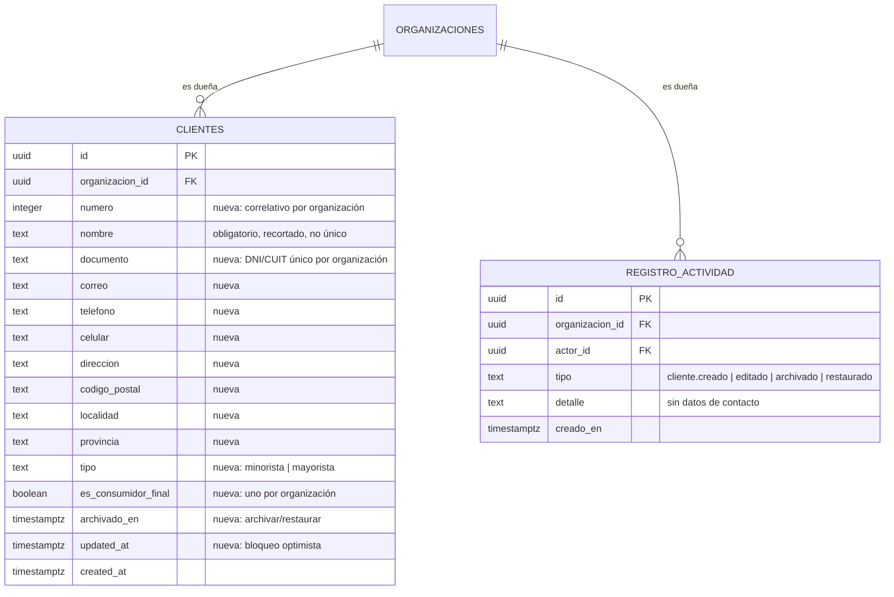

# Clientes: modelo, RPC y pantallas (MSF-180)

**Épica:** MSF-180 — Clientes y proveedores · Clientes alta y búsqueda.
**Historias:** F-CLI-01 (MSF-262), F-CLI-02 (MSF-282), F-CLI-03 (MSF-301), F-CLI-04 (MSF-318).
**Spec:** `specs/20261016-130000-clientes-alta-y-busqueda/` (`spec.md`, `plan.md`, `tasks.md`).
**Alcance de entrega:** `refine` (`apps/web`) y `supabase` (migraciones, RPC y pgTAP). Sin `kestra`,
`superset` ni `workers`.
**Guía de producto:** [Clientes](../clientes.md).

## Estado de entrega

La épica está **integrada en `main`**: las migraciones `20261016130000`–`20261016160000` y las
pantallas `/clientes` (listado, alta, edición y ficha) están en el árbol. Las historias se cerraron por
PR separados (`#83` F-CLI-01/MSF-262, `#81` F-CLI-02/MSF-282, `#82` F-CLI-03/MSF-301, `#80`
F-CLI-04/MSF-318). La columna «Expreso preferido» y la tabla fiel del prototipo llegaron después, en
`20261017120001_clientes_expreso_preferido.sql` (fuera de MSF-180).

Todo lo de abajo está verificado contra esas migraciones y contra el código de `apps/web`.

## Modelo de datos

**No hay tablas nuevas.** La épica extiende `public.clientes`, que ya existía como esqueleto del
template (`id`, `organizacion_id`, `nombre`, `created_at`; creada en
`20260908172920_fundacion_multitenant.sql`). La tabla queda en **`public`** por **excepción
documentada** al Principio VII: es preexistente y expuesta, y moverla a `dominio` no es aditivo ni
rompe `clientes_identificadores_externos` ni el control positivo de las pruebas de aislamiento. El
traslado a `dominio` quedó trazado como seguimiento: [MSF-505].

| Tabla / objeto | Estado | Cambio |
|---|---|---|
| `public.clientes` | **alterada** | Gana `numero integer not null` (correlativo por organización), `documento`, `correo`, `telefono`, `celular`, `direccion`, `codigo_postal`, `localidad`, `provincia`, `archivado_en timestamptz`, `updated_at timestamptz not null default now()`, `tipo text not null default 'minorista'` y `es_consumidor_final boolean not null default false`. |
| `public.organizaciones` | existente | Recibe el disparador `organizaciones_crear_consumidor_final`: cada organización nueva nace con su «Consumidor final». Sin cambios de esquema. |
| `public.registro_actividad` | existente | Recibe `cliente.creado`, `cliente.editado`, `cliente.archivado` y `cliente.restaurado`. Sin cambios de esquema. |
| `public.clientes_identificadores_externos` | existente | FK a `clientes(id)`; sin cambios. El mapeo de identificadores sigue válido (la numeración se asigna sola). |

Restricciones e índices sobre `public.clientes`:

| Objeto | Qué garantiza |
|---|---|
| `clientes_org_numero_uq` (único) | Un número por `(organizacion_id, numero)`. |
| `clientes_org_documento_uq` (único parcial) | Un DNI/CUIT por organización, comparado **solo por dígitos y letras** (`private.documento_normalizado`) e **incluyendo archivados**, para que restaurar nunca choque. |
| `clientes_consumidor_final_uq` (único parcial) | Un solo Consumidor final por organización. |
| `clientes_org_nombre_idx` | Orden por defecto `(organizacion_id, lower(nombre), id)`. |
| `clientes_busqueda_trgm_idx` (GIN trigram) | Búsqueda parcial sobre la expresión normalizada (nombre + documento + correo + teléfono + celular + localidad + número). |
| `clientes_largos_ck` | Topes de largo de los campos de la ficha; **creado `NOT VALID`** para no abortar el despliegue si un cliente heredado excede el tope. Validarlo es un paso aparte, tras auditar. |
| `clientes_tipo_ck` | `tipo in ('minorista','mayorista')`. |
| `clientes_consumidor_final_ck` | El Consumidor final es minorista y no está archivado. |

## Migraciones

| Migración | Qué agrega |
|---|---|
| `20261016130000_clientes_ficha_y_numeracion.sql` | Columnas de la ficha, backfill de `numero` y `set not null`, disparadores `clientes_asignar_numero` (advisory lock) y `clientes_normalizar`, `private.documento_normalizado` + índice único de documento, índices de orden y de búsqueda. |
| `20261016130200_clientes_rls_por_seccion_y_actividad.sql` | Reemplaza las políticas de `private.puede_escribir()` por `private.nivel_seccion('clientes')`, grants por columna, disparador `clientes_registrar_actividad`. |
| `20261016130300_clientes_tipo_y_consumidor_final.sql` | `tipo` y `es_consumidor_final`, índice único parcial, backfill del Consumidor final, disparador `organizaciones_crear_consumidor_final`, inmutabilidad (`clientes_proteger_consumidor_final`) y `public.escala_de_cliente`. |
| `20261016140000_clientes_buscar.sql` | `public.buscar_clientes` (M4, parte 1). |
| `20261016150000_clientes_exportar.sql` | `public.exportar_clientes` (M4, parte 2). |
| `20261016160000_clientes_habilitar_pg_trgm.sql` | Habilita `pg_trgm` en `extensions` y garantiza el índice GIN: **aborta con error si el índice no queda creado**, para que no haya un salto silencioso (en CI la extensión no estaba instalada y la migración de la ficha no creaba el índice). |

La orden es deliberada: M3 reinicia los grants por columna, por eso M2 (`tipo`) va después.

## RLS, grants y columnas protegidas

`20261016130200` y `20261016130300` dejan la tabla así:

- **`select`**: `organizacion_id = private.organizacion_id()` **y** `private.nivel_seccion('clientes')`
  en (`lectura`, `edicion`).
- **`insert` / `update`**: misma organización **y** `nivel_seccion('clientes') = 'edicion'`.
- **Sin `delete`**: no hay política ni grant de borrado para nadie. La única baja física es la cascada
  al borrar la organización. La columna `archivado_en` es el «eliminar lógico» (FR-003).
- **Grants por columna**: `authenticated` puede escribir `nombre`, `documento`, `correo`, `telefono`,
  `celular`, `direccion`, `codigo_postal`, `localidad`, `provincia`, `archivado_en` y `tipo`.
  **No** puede escribir `numero` (lo asigna la base), `es_consumidor_final` (solo los disparadores) ni
  `organizacion_id`.
- **`anon` y `public`**: sin ningún privilegio sobre la tabla ni ejecución de las RPC.

El contrato por rol y la matriz vigente están en [Permisos por rol](../permisos-por-rol.md); el
aislamiento, en [Aislamiento por organización](../aislamiento-por-organizacion.md).

Matriz inicial sembrada en `20261013130002_roles_basicos_permisos.sql` para la sección `clientes`
(`E` = edición, `L` = lectura, `N` = ninguno):

| Rol | Nivel | Acción `exportar` |
|---|---|---|
| Administrador | `edicion` | sí |
| Operador | `edicion` | sí |
| Administración | `edicion` | sí |
| Mostrador | `edicion` | no |
| Consulta | `lectura` | no |
| Miembro | `lectura` | no |
| Depósito | `ninguno` | no |

`exportar` se concede por rol en `permisos_rol_accion` (administrador, operador y administración). La
matriz es editable desde Usuarios y roles (MSF-125); esta épica no la cambia: el texto de la épica que
decía «Depósito solo lee» quedó **sin aplicar** (Decisión 1 de la spec) y la divergencia está anotada
en el PR de la historia.

## Número correlativo y unicidad de documento

- **Número**: `private.asignar_numero_cliente()` (`BEFORE INSERT`) toma
  `pg_advisory_xact_lock(hashtext(organizacion_id::text))` y asigna `coalesce(max(numero),0)+1` de su
  organización **solo si viene nulo**. Serializa las altas de la misma organización: no hay números
  duplicados bajo concurrencia, y las inserciones sin sesión (importación de MSF-142, API) también
  numeran. El backfill de `20261016130000` ordenó por `created_at, id`.
- **Documento**: `private.documento_normalizado(text)` quita puntos, guiones, espacios y mayúsculas
  (`regexp_replace(lower(btrim(x)),'[^0-9a-z]','','g')`); vacío → nulo. La unicidad la impone el
  índice parcial `clientes_org_documento_uq`, no la interfaz. La violación es `23505` y la interfaz la
  traduce a «Ya existe un cliente con ese DNI/CUIT» **en el campo**. Dos clientes con el mismo nombre
  sí pueden coexistir.
- **Normalización**: `private.normalizar_cliente()` (`BEFORE INSERT OR UPDATE`) recorta el nombre
  (error `23514` si queda vacío), deja en `null` los campos de contacto en blanco y refresca
  `updated_at`.

## Tipo de cliente y Consumidor final

- `tipo` es `minorista` (default) o `mayorista`, con `check` en base; **no hay tabla de tipos ni
  pantalla para crearlos** (el prototipo las tenía; quedan fuera de alcance).
- El **Consumidor final** es un cliente más, de tipo minorista, que existe en todas las
  organizaciones: por backfill en las existentes y por el disparador `organizaciones_crear_consumidor_final`
  en las nuevas. Recibe el siguiente número de su organización (es el 1 solo en organizaciones nuevas).
- Es **inmutable en la base**: `clientes_proteger_consumidor_final` (`BEFORE UPDATE OR DELETE`) rechaza
  editarlo, archivarlo, cambiarle el tipo o borrarlo, incluso para `postgres`/`service_role`. Solo se
  permite el borrado en cascada al eliminar la organización. `es_consumidor_final` no se concede a
  `authenticated`: nadie puede convertir a otro cliente en Consumidor final.

## Contratos RPC

| RPC | Qué hace | Seguridad |
|---|---|---|
| `public.buscar_clientes(p_texto text, p_tipo text, p_archivados boolean, p_pagina integer, p_tamano integer)` | Listado paginado con total: `id`, `numero`, `nombre`, `documento`, `correo`, `telefono`, `celular`, `localidad`, `expreso_preferido`, `tipo`, `es_consumidor_final`, `archivado_en` y `total`. Búsqueda parcial e insensible a mayúsculas en nombre, documento, correo, teléfono, celular, localidad y número; escapa `\`, `%` y `_`; filtra por tipo y por activos/archivados; ordena por `lower(nombre), id`. Página de 25 por defecto, tope 100. | `security invoker` (hereda RLS); `search_path = ''`; `revoke` a `public, anon`; `grant` a `authenticated`. |
| `public.exportar_clientes(p_texto text, p_tipo text, p_archivados boolean, p_despues_de uuid, p_limite integer)` | Mismas filas que la búsqueda, en **lotes por keyset** `(lower(nombre), id)`: devuelve `id`, `numero`, `nombre`, `documento`, `tipo`, `correo`, `telefono`, `celular`, `direccion`, `codigo_postal`, `localidad`, `provincia`, `expreso_preferido`, `archivado_en` y `total`. Tope de lote 1000; tope total 50.000 filas. | `security definer`, `search_path = ''`; exige `private.puede_accion('clientes','exportar')`; organización de `private.organizacion_id()`, nunca de un parámetro; `42501` sin permiso, `54000` si supera el tope, `40001` si el cursor ya no existe. |
| `public.escala_de_cliente(p_cliente_id uuid)` | Escala de precios del cliente: `x1` para minorista, `por_cantidad` para mayorista; `null` si el cliente no existe o no es visible. | `security invoker` (hereda RLS); `revoke` a `public, anon`; `grant` a `authenticated`. |

**Regla de `escala_de_cliente`:** es un contrato **provisorio** hasta que Precios decida si la escala la
fija el tipo o la cantidad. Si cambia, cambia solo el cuerpo de la función; Ventas y Service técnico no
se enteran.

Detalle de las RPC en [API y RPC](api.md#clientes-msf-180).

## Búsqueda: índices y plan

- La expresión de búsqueda es la **misma** del índice GIN `clientes_busqueda_trgm_idx`, para que el
  planificador lo use.
- La búsqueda es insensible a mayúsculas pero **no ignora tildes**: «ñ» no coincide con «n». No hay
  `unaccent` en el índice.
- La pantalla espera **≈300 ms** antes de consultar (no busca en cada tecla) y vuelve a la primera
  página cuando cambia el texto.
- El navegador **nunca** carga la lista completa: la paginación, el total y los filtros se resuelven en
  el servidor.
- Evidencia de plan: `supabase/tests/database/clientes_plan_indices.test.sql` (T019) siembra ~5.000
  clientes con tilde y corre `EXPLAIN` con `enable_seqscan = off`; **falla** si la búsqueda no usa
  `clientes_busqueda_trgm_idx` o la paginación no usa `clientes_org_nombre_idx`. Es un test de
  *usabilidad* del índice, no de elección por costos. El script manual es
  `supabase/verificacion/clientes_explain.sql` (`EXPLAIN ANALYZE`, solo base local).

## Exportación a Excel (F-CLI-04)

- **Quién:** solo quien tiene la acción `exportar` en Clientes
  (`private.puede_accion('clientes','exportar')`; por defecto Administrador, Administración y Operador).
  La UI oculta «Exportar» sin el permiso y la RPC lo vuelve a exigir en el servidor (`42501`).
- **Cómo:** `apps/web/src/lib/exportarClientes.ts` itera `exportar_clientes` con el cursor
  (`p_despues_de`) hasta agotar las filas. El total se cuenta **solo en el primer lote** (los
  siguientes devuelven 0); un cursor inexistente falla con `40001` («reintentá»), nunca con un archivo
  truncado. Tope de lote 1000; tope total 50.000 filas (`54000` → «Afiná la búsqueda»).
- **Archivo:** `.xlsx` real, hoja «Clientes», generado en el navegador con **`write-excel-file`** (MIT;
  `fflate` MIT), cargado con `import()` diferido al pulsar «Exportar» para no pesar en el recorrido
  principal. Encabezados en la primera fila, una columna por campo, celdas de datos escritas **como
  texto** (`type: String`).
- **Fórmulas:** todo valor que empieza con `=`, `+`, `-`, `@`, tab o retorno lleva un apóstrofo
  delante (`neutralizarFormula`). Es el costo aceptado de la defensa: el apóstrofo queda visible (un
  teléfono «+54…» se ve «'+54…»).
- **UX** (`apps/web/src/components/clientes/ExportarClientes.tsx`): confirmación con el total,
  progreso, cancelación y error con «Reintentar».

## Actividad

`private.registrar_actividad_cliente()` (`AFTER INSERT OR UPDATE`, `security definer`,
`search_path = ''`) registra en la **misma transacción**:

| Evento | Cuándo |
|---|---|
| `cliente.creado` | `INSERT`. |
| `cliente.archivado` | `archivado_en` pasa de `null` a un valor. |
| `cliente.restaurado` | `archivado_en` pasa de un valor a `null`. |
| `cliente.editado` | Cualquier otro cambio real (se compara la fila sin `updated_at`). |

El detalle lleva «Nº <número> · <nombre>» y **nada de contacto**. No se registra sin sesión (importación,
API) ni ante un cambio que no cambió nada (archivar un cliente ya archivado no duplica el evento).
Catálogo completo: [Actividad e historial](../actividad.md).

## Frontend

| Pieza | Archivo |
|---|---|
| Listado (búsqueda con espera, filtros de tipo y estado, paginación en servidor, estados compartidos, vista adaptable) | `apps/web/src/pages/clientes/list.tsx` |
| Hook de búsqueda («última petición gana»; conserva filas mientras llega la siguiente) | `apps/web/src/hooks/useBuscarClientes.ts` |
| Formulario compartido por alta y edición (validación en el campo, error `23505` en «DNI/CUIT», selector de tipo con explicación y aviso de cambio) | `apps/web/src/components/clientes/FormularioCliente.tsx` |
| Ficha (datos, estado, «Editar» y «Archivar»/«Restaurar» con confirmación; sin «Eliminar») | `apps/web/src/pages/clientes/show.tsx` |
| Pestañas de la ficha: «Datos» (el contenido previo, sin cambios) y «Reparaciones» (MSF-232); la segunda se carga diferida y no aparece sin acceso a Service técnico | `apps/web/src/pages/clientes/show.tsx`, `apps/web/src/components/clientes/ReparacionesDeCliente.tsx`, `apps/web/src/lib/reparacionesDeCliente.ts` |
| Botón «Exportar» (confirmación, progreso, cancelación, reintento) | `apps/web/src/components/clientes/ExportarClientes.tsx` |
| Armado del `.xlsx` por lotes | `apps/web/src/lib/exportarClientes.ts` |
| Rutas | `apps/web/src/App.tsx`: `/clientes`, `/clientes/create`, `/clientes/edit/:id`, `/clientes/show/:id` |

Puntos de contrato con la base:

- El tipo de cliente del formulario es `minorista`/`mayorista`, con la explicación de cada uno
  (`apps/web/src/lib/clientes.ts`: «Compra al precio de lista (escala x1).» / «Compra con precio por
  cantidad.»). Al cambiarlo en una edición se muestra el aviso `AVISO_CAMBIO_TIPO`: «Al cambiar el
  tipo, las próximas ventas usarán la escala de precios del nuevo tipo. Lo ya vendido no cambia.»
- El error `23505` de `clientes_org_documento_uq` se muestra **en el campo «DNI/CUIT»**, no como un
  error genérico de la pantalla.
- `lib/permisos.ts` ya no lista `clientes` en `RECURSOS_ESCRITURA_SOLO_ADMINISTRADOR`: la escritura la
  gobierna `nivel_seccion('clientes')`, igual que la RLS.
- La pantalla del listado **muestra** columnas que hoy no tienen backend (`Tiendas`, `Cuenta web`) como
  «—»: esas capacidades son de MSF-237.

## Pruebas

**pgTAP** (`supabase/tests/database/`):

| Archivo | Qué cubre |
|---|---|
| `clientes_alta_y_edicion.test.sql` (43 aserciones) | Permisos por sección (editan / leen / `ninguno`), aislamiento entre organizaciones, archivar y restaurar con evento (y sin evento sin sesión), número correlativo, columnas protegidas, unicidad de DNI/CUIT (otro formato, contra archivados) y nombre repetido aceptado, mismo documento en otra organización aceptado, sin `DELETE`, `anon` sin acceso. |
| `clientes_busqueda_exportacion.test.sql` (44) | Búsqueda parcial por cada campo, escape de `%`/`_`, filtros de tipo y archivados, paginación con total y tope, aislamiento, `anon` sin acceso; `exportar_clientes` solo con permiso, keyset sin repetidos ni omisiones y tope de lote. |
| `clientes_tipo_y_consumidor_final.test.sql` (31) | Un Consumidor final por organización (existente y nueva), inmutable incluso para `postgres`, `tipo` restringido y `escala_de_cliente` con RLS y sin `anon`. |
| `clientes_plan_indices.test.sql` (5) | Seed de ~5.000 clientes y `EXPLAIN` sobre los índices de búsqueda y de orden. |

**Vitest**: `apps/web/src/pages/clientes/list.test.tsx`, `edit.test.tsx`, `show.test.tsx`,
`apps/web/src/hooks/useBuscarClientes.test.tsx`,
`apps/web/src/components/clientes/FormularioCliente.test.tsx`,
`apps/web/src/components/clientes/ExportarClientes.test.tsx`,
`apps/web/src/lib/exportarClientes.test.ts`.

**E2E**: la suite de la app existe (`apps/web/e2e/`), pero el caso «alta, búsqueda y exportación» de
clientes está **pendiente** por falta de fixtures por rol (seguimiento [MSF-499]); hoy lo cubren Vitest
y pgTAP. Ver [E2E de la app](../e2e-app.md).

## Reversión

Todas las migraciones de la épica son **aditivas** y traen la reversión escrita en el encabezado. El
patrón es: una migración posterior hace el `drop` de funciones, disparadores, políticas e índices, y
**las columnas no se borran** en el mismo PR que las crea (para eso hace falta haber exportado los
datos). Un `git revert -m 1` del PR deja columnas e índices huérfanos hasta esa migración.

Reversión por migración:

- `20261016130000`: `drop trigger clientes_normalizar`, `drop trigger clientes_asignar_numero`, `drop function private.normalizar_cliente()`, `private.asignar_numero_cliente()`, `private.documento_normalizado(text)`; `drop index clientes_org_documento_uq`, `clientes_org_numero_uq`, `clientes_org_nombre_idx`, `clientes_busqueda_trgm_idx`.
- `20261016130200`: `drop trigger clientes_registrar_actividad`, `drop function private.registrar_actividad_cliente()`, `drop policy clientes_select|insert|update` y restaurar las políticas de `20260908172920_fundacion_multitenant.sql` (`private.puede_escribir()`), con sus grants.
- `20261016130300`: `drop function public.escala_de_cliente(uuid)`, `drop trigger organizaciones_crear_consumidor_final`, `drop function private.crear_consumidor_final()`, `drop trigger clientes_proteger_consumidor_final`, `drop function private.proteger_consumidor_final()`, `drop index clientes_consumidor_final_uq`, `drop constraint clientes_consumidor_final_ck`, `clientes_tipo_ck`, y `revoke insert (tipo), update (tipo)`.
- `20261016140000` / `20261016150000`: `drop function public.buscar_clientes(text,text,boolean,integer,integer)` y `public.exportar_clientes(text,text,boolean,uuid,integer)`.
- `20261016160000`: `drop index if exists public.clientes_busqueda_trgm_idx` y `drop extension if exists pg_trgm` (sin `cascade`, y solo si ningún otro índice trigram la usa).

## Deuda trazada

| Deuda | Seguimiento |
|---|---|
| Trasladar `public.clientes` al esquema `dominio` (Principio VII) | [MSF-505] |
| Registrar la exportación de clientes en la actividad (la RPC es `stable`; registrarlo exige `volatile` o un registro desde el cliente) | [MSF-508] |
| E2E de alta, búsqueda y exportación | [MSF-499] |
| Test de concurrencia con dos conexiones (número correlativo y DNI/CUIT simultáneos): el pgTAP corre en una sola sesión, así que no la ejercita; la garantía es el advisory lock + el índice único | Desvío anotado en T007 de la spec; **sin Jira asociado todavía** |

## Ver también

- [Clientes](../clientes.md) — guía de producto: qué resuelve, para quién y qué no hace.
- [Service técnico: cobro, avisos y ficha del cliente](service-cobro-y-avisos.md) — la RPC
  `reparaciones_de_cliente` y la pestaña «Reparaciones» de la ficha (MSF-232).
- [Permisos por rol](../permisos-por-rol.md) — contrato `nivel_seccion` / `puede_accion`.
- [Aislamiento por organización](../aislamiento-por-organizacion.md) — control positivo sobre `public.clientes`.
- [Actividad e historial](../actividad.md) — eventos `cliente.*`.
- [Datos y DER](datos.md#clientes-msf-180) — el modelo dentro del panorama.
- [API y RPC](api.md#clientes-msf-180) — los contratos resumidos.
