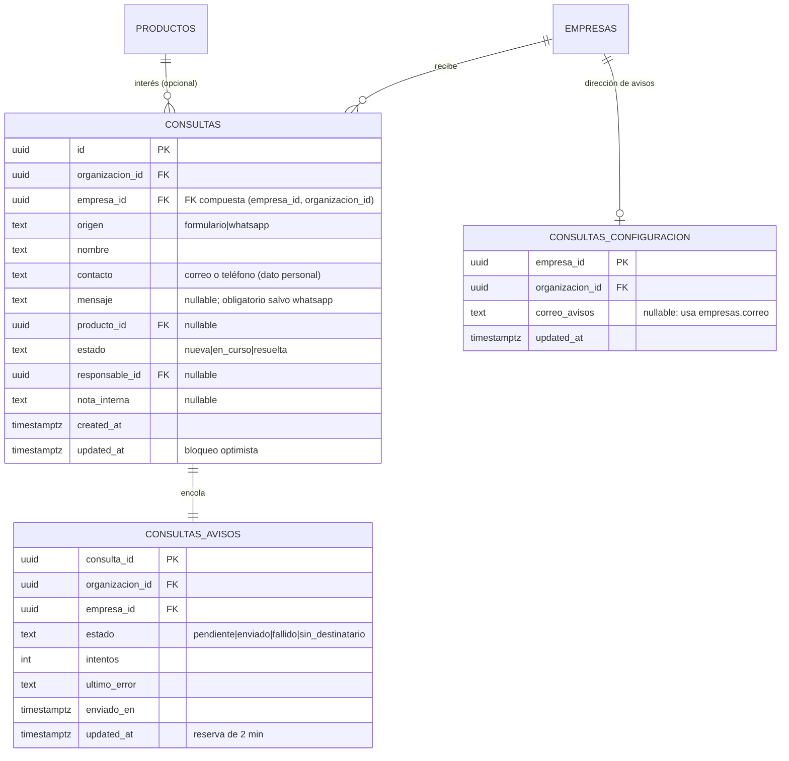
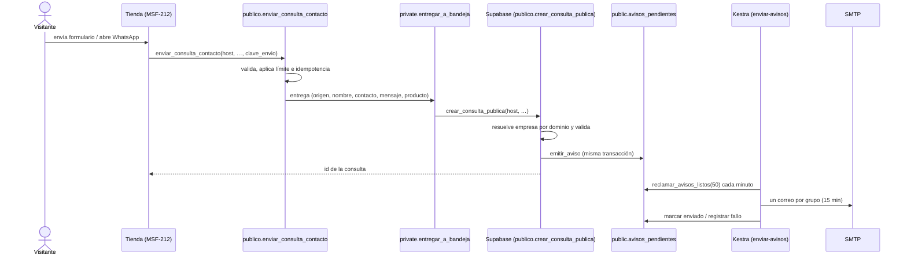

# Consultas: modelo, RPC y aviso

**Épica:** MSF-122 · **Spec:** `20261023-120000-consultas-bandeja-y-aviso` (rama
`epic/MSF-122-consultas-y-ventas-consultas-bandeja-y-a`, pendiente de merge a `main` en este repositorio).

La bandeja es un registro: el panel no responde al visitante. El alta entra solo por una RPC pública que
resuelve la empresa por el dominio de la tienda; la edición va por RPC con permisos y bloqueo optimista. El
aviso por correo se emite en la misma transacción y lo envía el flow `enviar-avisos` de Kestra, con
preferencias por usuario, agrupación y reintentos (MSF-189).

## Modelo

Todo es entidad de negocio y vive en `dominio` (Principio VII). `public` solo expone la vista y las RPC del
panel; `publico` expone la RPC que llama la tienda.

| Objeto | Esquema | Para qué | Migración |
|---|---|---|---|
| `dominio.consultas` | `dominio` | Lo que preguntó un visitante a una empresa. | `20261205100000_consultas.sql` |
| `dominio.consultas_configuracion` | `dominio` | Dirección de avisos de la empresa (una fila por empresa); desde MSF-189 solo la usa el camino anterior de drenaje. | `20261205200000_consultas_configuracion.sql` |
| `dominio.consultas_avisos` | `dominio` | Cola histórica del aviso por correo; desde MSF-189 solo drena lo ya encolado (el camino nuevo usa `public.avisos_pendientes`). | `20261205200100_consultas_avisos.sql` |
| `publico.crear_consulta_publica` | `publico` | Único punto de alta; la llama la tienda como `anon`. | `20261205100100_crear_consulta_publica.sql` |
| `public.consultas_bandeja` + RPC del panel | `public` | Lectura y edición desde el panel; no guardan datos. | `20261205100200`, `20261205100300`, `20261205100500` |

Migraciones aditivas; la reversión va en una migración posterior (ver [Reversión](#reversion)). Las
migraciones `20261205200200_consultas_avisos_reintentos.sql` redefinen dos funciones del aviso, sin tablas
nuevas.



Detalle del grafo y de las tablas existentes: [Datos y DER](datos.md).

## Permisos y RLS

- `dominio.consultas`: lectura con `organizacion_id = private.organizacion_id()`,
  `empresa_id in private.empresas_accesibles()` y `private.nivel_seccion('consultas')` en `lectura` o
  `edicion`. **Sin políticas de escritura**: el alta es solo la RPC pública y la edición solo
  `public.actualizar_consulta`.
- `dominio.consultas_configuracion`: lectura con `consultas` o `empresas` en `lectura`/`edicion`; escritura
  solo por `public.guardar_correo_avisos_consultas` con `empresas = edicion`.
- `dominio.consultas_avisos`: lectura solo con `empresas = edicion`; escritura solo desde funciones
  `security definer` y las RPC de `service_role` que usa la función de aviso.
- `anon` no tiene privilegios sobre las tablas. **Desde MSF-212** ya no ejecuta
  `publico.crear_consulta_publica` de forma directa (ver la sección «RPC pública»): el único camino
  público del alta es `publico.enviar_consulta_contacto`, que aplica el límite de envíos.

Fuente: `supabase/migrations/20261205100000_consultas.sql`, `20261205200000_consultas_configuracion.sql` y
`20261205200100_consultas_avisos.sql`. Las políticas se prueban en `supabase/tests/database/consultas.test.sql`,
`consultas_aviso.test.sql` y `rls_en_toda_tabla`.

## RPC pública

```ts
publico.crear_consulta_publica(
  host: text,
  origen: text,
  nombre: text,
  contacto: text,
  mensaje: text default null,
  producto_id: uuid default null
): uuid
```

- La empresa sale **solo del host** (`dominio.tiendas`, normalizado). No recibe `empresa_id`.
- Host desconocido, inválido o de empresa desactivada → mismo error `P0002` genérico, resuelto **antes** de
  validar los datos para no permitir sondear dominios.
- Datos inválidos → `22023` con el campo en `DETAIL`: `origen` ∈ {`formulario`, `whatsapp`}; nombre de 1 a
  120; contacto correo o teléfono (7 a 15 dígitos), hasta 200; mensaje obligatorio salvo `whatsapp`, hasta
  2000; `producto_id` de la misma organización.
- Crea la consulta en estado `nueva`, devuelve su id y encola el aviso.
- **Permisos:** hasta MSF-212 era ejecutable por `anon` y `authenticated`. La migración
  `20261212100100_crear_consulta_publica_solo_interna.sql` (rama de MSF-212) le revoca la ejecución a
  `public`, `anon` y `authenticated` y la deja en `service_role` y el propietario: mientras estuvo
  abierta, `anon` podía llamarla por PostgREST y saltearse el límite de 5 envíos por hora. Ahora la
  invoca `private.entregar_a_bandeja` desde `publico.enviar_consulta_contacto` (que es `security
  definer`). Detalle: [Tienda pública: WhatsApp y contacto](tienda-whatsapp-y-contacto.md).
- La protección anti-spam (límite de **5 envíos por hora por visitante y empresa**, validación por
  campo e idempotencia) es de la tienda (MSF-212), no de esta RPC.

Contrato completo: `specs/20261023-120000-consultas-bandeja-y-aviso/contracts/consultas.md` (rama de la
épica) y
`specs/20261202-100000-tienda-whatsapp-y-contacto/contracts/tienda-contacto.md` (MSF-212, rama de la
épica).

## RPC del panel

| RPC | Contrato |
|---|---|
| `public.actualizar_consulta(p_id, p_estado, p_responsable_id, p_nota_interna, p_updated_at)` | Exige `consultas = edicion` y empresa accesible. Valida el responsable (usuario activo con acceso a la empresa y a la sección), aplica bloqueo optimista por `updated_at` (`40001`), es idempotente y registra `consulta.estado_cambiado`, `consulta.asignada` y `consulta.nota_actualizada` en `registro_actividad` solo si el valor cambió. Cambia solo estado, responsable y nota. |
| `public.contar_consultas_nuevas(p_empresa_id uuid default null)` | Contador de nuevas para el menú; respeta RLS. |
| `public.responsables_consultas(p_empresa_id uuid)` | Personas asignables a consultas de una empresa. |
| `public.consultas_bandeja` (vista `security_invoker`) | Filas de la bandeja con empresa, producto, responsable y nota; la paginación, la búsqueda y los filtros los arma el cliente sobre PostgREST. |
| `public.guardar_correo_avisos_consultas(p_empresa_id, p_correo, p_updated_at default null)` | Exige `empresas = edicion`; valida formato; `null` vuelve a usar `dominio.empresas.correo`; bloqueo optimista (`40001`); evento de actividad. |

Errores que traduce la UI: `40001` conflicto de edición, `42501` sin permiso, `22023` dato inválido. Fuente:
`apps/web/src/lib/consultas.ts` y las migraciones `20261205100200`, `20261205100300` y
`20261205100500`.

## Pantalla y empresa activa

- Menú: **Canales → Consultas** (`/consultas`, sección `consultas`), primero del grupo, con contador de
  nuevas (`apps/web/src/components/navegacion/destinosPanel.ts`, `InsigniaConsultasNuevas.tsx`).
- Lista: búsqueda, chips de estado, filtro de fecha y chips de tienda; tabla con `Estado`, `Cuándo`,
  `Empresa`, `Contacto`, `Producto` y `Origen`; pie «N consultas»; paginación de 25
  (`apps/web/src/pages/consultas/list.tsx`, `apps/web/src/lib/consultas.ts`).
- Detalle: `apps/web/src/components/consultas/DetalleConsulta.tsx`; abre por fila o por
  `/consultas?consulta=<id>`.
- **Empresa activa:** la barra superior manda. Con una empresa concreta, los chips de tienda quedan
  seleccionados y bloqueados; con «Todas mis empresas» filtran entre las accesibles. Al cambiarla se
  invalidan y recargan lista, contador y responsables, se reencuadra la paginación, se descarta la selección
  y se cierra el detalle abierto. Test: `apps/web/src/pages/consultas/list.test.tsx` y
  `apps/web/src/hooks/useConsultas.test.tsx`.

## Aviso por correo

> **Desde MSF-189 / MSF-562:** el alta ya no encola en `dominio.consultas_avisos` ni se envía directo. El
> disparador `consultas_encolar_aviso` llama a `private.emitir_aviso('consulta_nueva', organizacion, datos,
> empresa)` y el flow `enviar-avisos` envía el correo respetando la preferencia de cada persona, la
> agrupación de 15 minutos y el acceso a la empresa de la consulta. Un fallo al emitir se registra con
> `RAISE WARNING` y **no frena el alta**. La dirección `consultas_configuracion.correo_avisos` no se usa en
> el camino nuevo. Detalle: [Avisos y listas](avisos-y-listas.md).

1. El disparador `AFTER INSERT` de `dominio.consultas` (`private.encolar_aviso_consulta`, migración
   `20261210130300_consultas_aviso_emitir.sql`) llama a `private.emitir_aviso` con tipo `consulta_nueva`, la
   organización, los datos legibles y la empresa de la consulta.
2. `emitir_aviso` resuelve los destinatarios (miembros activos con correo, con acceso a `consultas`, con la
   preferencia encendida y con acceso a esa empresa) y encola en `public.avisos_pendientes`, agrupando por
   destinatario y tipo en una ventana de 15 minutos.
3. El flow `enviar-avisos` (`infra/kestra/flows/enviar-avisos.yml`) corre cada minuto, reclama los grupos
   vencidos, re-verifica preferencia y acceso, y envía **un correo por grupo** por SMTP genérico
   (`KESTRA_SMTP_*`). El detalle incluye Empresa, Origen, Nombre, Contacto, Producto y Mensaje.
4. Reintentos: `registrar_fallo_aviso` reprograma con espera de 1, 2, 4 y 8 minutos; al quinto intento queda
   `fallido` con el error. Un reclamo vence a los 10 minutos: si Kestra se cae a mitad de un envío, el grupo
   vuelve a estar disponible. Garantía **al menos una vez** (puede duplicarse en esa falla poco frecuente).
5. `dominio.consultas_avisos`, el flow `avisos-consultas` y la Edge Function `enviar-aviso-consulta` quedan
   **solo para drenar** lo que ya estaba encolado por el camino anterior. Las consultas nuevas no entran ahí.



## Operación

El envío nuevo usa las variables de `infra/kestra/.env.example`: `KESTRA_SMTP_HOST`, `KESTRA_SMTP_PORT`,
`KESTRA_SMTP_TRANSPORTE`, `KESTRA_SMTP_USERNAME`, `KESTRA_SMTP_PASSWORD`, `KESTRA_SMTP_FROM`,
`KESTRA_ORQUESTACION_DB_URL` y `KESTRA_ORQUESTACION_DB_PASSWORD`. Sin secretos en Git. Qué proveedor y
dominio (SPF/DKIM) es una decisión operativa todavía abierta. Detalle:
[Avisos y listas](avisos-y-listas.md#operación).

Quedan solo para el camino anterior (drenaje de `dominio.consultas_avisos`):

| Variable | Dónde | Para qué |
|---|---|---|
| `SMTP_HOST`, `SMTP_PORT`, `SMTP_TLS`, `SMTP_USER`, `SMTP_PASS`, `SMTP_FROM` | `supabase/functions/.env.example` | Proveedor de la Edge Function; en local, Mailpit. |
| `PANEL_URL` | `supabase/functions/.env.example` y `.env.example` | Base pública del panel para el enlace del correo. |
| `AVISOS_CONSULTAS_TOKEN` | `supabase/functions/.env.example` | Secreto compartido con Kestra; sin él la función responde 503. |
| `SECRET_AVISOS_CONSULTAS_TOKEN` (base64) y URL/clave del barrido | `infra/kestra/.env.example` | El flow `avisos-consultas` los usa para llamar a la función. |

Para reprocesar el camino anterior a mano, invocá la función con `{"barrer": true}` y el header
`x-aviso-token`, o dejá que el flow `avisos-consultas` corra en el minuto siguiente. La cola nueva
(`public.avisos_pendientes`) se opera como se describe en [Avisos y listas](avisos-y-listas.md#operación).

## Retención

No hay política definida para las consultas ni para los datos personales que traen (decisión abierta de la
spec). Esta entrega **no borra ni expira nada**. Cuando se defina, será una spec aparte.

## Reversión

Las migraciones son aditivas; la reversión va en una migración posterior, de la más nueva a la más vieja:

1. Aviso: `drop trigger consultas_encolar_aviso on dominio.consultas`, `drop function` de
   `public.avisos_consulta_pendientes`, `tomar_aviso_consulta`, `cerrar_aviso_consulta` y
   `private.encolar_aviso_consulta`, y `drop table dominio.consultas_avisos`. Apagar el flow de Kestra
   `avisos-consultas` y retirar la función `enviar-aviso-consulta`.
2. Dirección de avisos: `drop function public.guardar_correo_avisos_consultas` y
   `private.correo_avisos_consulta`, y `drop table dominio.consultas_configuracion`.
3. Bandeja: `drop view public.consultas_bandeja`, `drop function` de `contar_consultas_nuevas`,
   `responsables_consultas`, `actualizar_consulta`, `private.responsables_posibles` y los auxiliares de
   nombres, `drop function publico.crear_consulta_publica(text, text, text, text, text, uuid)` y, al final,
   `drop table dominio.consultas` (borra las consultas registradas: exportar antes si importan).

Para deshacer el cierre completo en Git: `git revert -m 1 <merge del PR>`.

## Verificación

- pgTAP: `supabase/tests/database/consultas.test.sql`, `consultas_aviso.test.sql` y `rls_en_toda_tabla`
  (aislamiento entre dos organizaciones, tres niveles de permiso, alta solo por RPC, validaciones, conflicto
  de edición, actividad y `anon`).
- Vitest: `apps/web/src/pages/consultas/list.test.tsx`, `components/consultas/DetalleConsulta.test.tsx`,
  `hooks/useConsultas.test.tsx`, `pages/empresas/CorreoAvisosConsultas.test.tsx`,
  `supabase/functions/enviar-aviso-consulta/handler.test.ts` e
  `infra/kestra/validar-avisos-consultas.test.mjs`.
- E2E de cierre: `apps/web/e2e/consultas-recorrido.e2e.ts` — envía una consulta como `anon`, comprueba que
  aparece en la bandeja en menos de 5 s, dispara el barrido, lee el correo en Mailpit, abre el enlace,
  asigna, anota y resuelve con los tres roles, y verifica que otra organización no la ve. Se omite sin
  `SUPABASE_URL`/`SUPABASE_SERVICE_ROLE_KEY` y aborta si `SUPABASE_URL` no es un host local.
