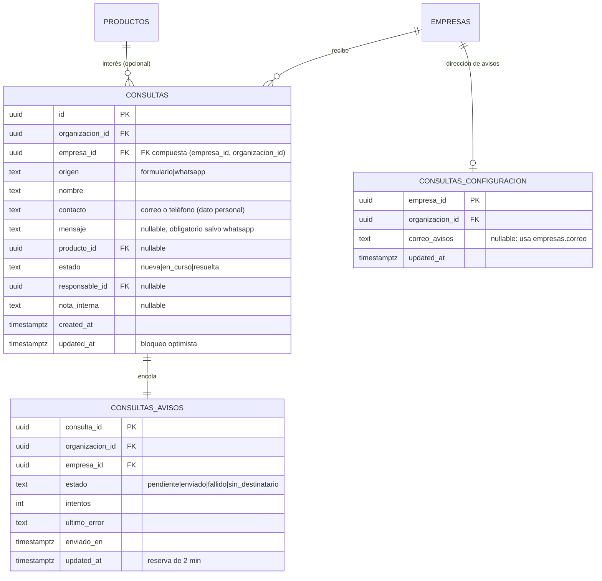
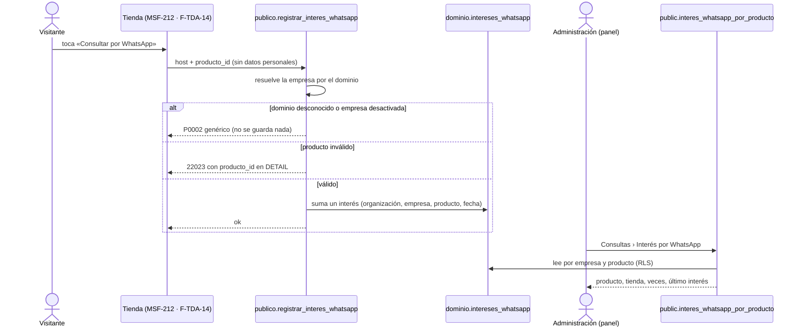
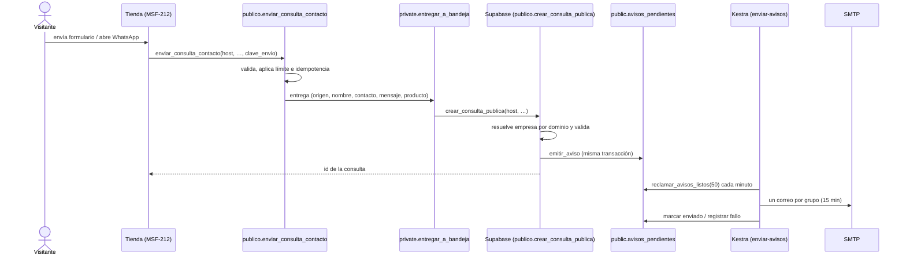

# Consultas: modelo, RPC y aviso

**Épicas:** MSF-122 (bandeja y aviso) · **MSF-130** (interés por WhatsApp y respuesta desde el panel).
**Specs:** `20261023-120000-consultas-bandeja-y-aviso` (rama
`epic/MSF-122-consultas-y-ventas-consultas-bandeja-y-a`, pendiente de merge a `main` en este repositorio) y
`20261024-140000-consultas-seguimiento-y-whatsapp` (rama
`epic/MSF-130-consultas-y-ventas-consultas-seguimiento`, pendiente de merge).

La bandeja es un registro: el panel no responde al visitante. El alta entra solo por una RPC pública que
resuelve la empresa por el dominio de la tienda; la edición va por RPC con permisos y bloqueo optimista. El
aviso por correo se emite en la misma transacción y lo envía el flow `enviar-avisos` de Kestra, con
preferencias por usuario, agrupación y reintentos (MSF-189).

**MSF-130** agrega dos objetos aditivos al mismo dominio: el registro del **interés por WhatsApp** (F-CON-02,
tabla en `dominio`, RPC en `publico` y vista en `public`) y la **respuesta desde el panel** (F-CON-04), que no
migra nada: reusa `public.actualizar_consulta` de MSF-122.

## Modelo

Todo es entidad de negocio y vive en `dominio` (Principio VII). `public` solo expone la vista y las RPC del
panel; `publico` expone la RPC que llama la tienda.

| Objeto | Esquema | Para qué | Migración |
|---|---|---|---|
| `dominio.consultas` | `dominio` | Lo que preguntó un visitante a una empresa. | `20261205100000_consultas.sql` |
| `dominio.consultas_configuracion` | `dominio` | Dirección de avisos de la empresa (una fila por empresa); desde MSF-189 solo la usa el camino anterior de drenaje. | `20261205200000_consultas_configuracion.sql` |
| `dominio.consultas_avisos` | `dominio` | Cola histórica del aviso por correo; desde MSF-189 solo drena lo ya encolado (el camino nuevo usa `public.avisos_pendientes`). | `20261205200100_consultas_avisos.sql` |
| `publico.crear_consulta_publica` | `publico` | Único punto de alta; la llama la tienda como `anon`. | `20261205100100_crear_consulta_publica.sql` |
| `public.consultas_bandeja` + RPC del panel | `public` | Lectura y edición desde el panel; no guardan datos. | `20261205100200`, `20261205100300`, `20261205100500` |
| `dominio.intereses_whatsapp` | `dominio` | Un registro por cada toque en «Consultar por WhatsApp» de un producto de una tienda. **Sin datos personales.** | `20261214100000_intereses_whatsapp.sql` |
| `publico.registrar_interes_whatsapp` | `publico` | Alta del interés; la ejecuta la tienda como `anon`. | `20261214100100_registrar_interes_whatsapp.sql` |
| `public.interes_whatsapp_por_producto` (vista `security_invoker`) | `public` | Lectura agrupada por empresa y producto; no guarda datos. | `20261214100200_interes_whatsapp_por_producto.sql` |

Migraciones aditivas; la reversión va en una migración posterior (ver [Reversión](#reversion)). Las
migraciones `20261205200200_consultas_avisos_reintentos.sql` redefinen dos funciones del aviso, sin tablas
nuevas.



Detalle del grafo y de las tablas existentes: [Datos y DER](datos.md).

## Permisos y RLS

- `dominio.consultas`: lectura con `organizacion_id = private.organizacion_id()`,
  `empresa_id in private.empresas_accesibles()` y `private.nivel_seccion('consultas')` en `lectura` o
  `edicion`. **Sin políticas de escritura**: el alta es solo la RPC pública y la edición solo
  `public.actualizar_consulta`.
- `dominio.consultas_configuracion`: lectura con `consultas` o `empresas` en `lectura`/`edicion`; escritura
  solo por `public.guardar_correo_avisos_consultas` con `empresas = edicion`.
- `dominio.consultas_avisos`: lectura solo con `empresas = edicion`; escritura solo desde funciones
  `security definer` y las RPC de `service_role` que usa la función de aviso.
- `anon` no tiene privilegios sobre las tablas. **Desde MSF-212** ya no ejecuta
  `publico.crear_consulta_publica` de forma directa (ver la sección «RPC pública»): el único camino
  público del alta es `publico.enviar_consulta_contacto`, que aplica el límite de envíos.

Fuente: `supabase/migrations/20261205100000_consultas.sql`, `20261205200000_consultas_configuracion.sql` y
`20261205200100_consultas_avisos.sql`. Las políticas se prueban en `supabase/tests/database/consultas.test.sql`,
`consultas_aviso.test.sql` y `rls_en_toda_tabla`.

## RPC pública

```ts
publico.crear_consulta_publica(
  host: text,
  origen: text,
  nombre: text,
  contacto: text,
  mensaje: text default null,
  producto_id: uuid default null
): uuid
```

- La empresa sale **solo del host** (`dominio.tiendas`, normalizado). No recibe `empresa_id`.
- Host desconocido, inválido o de empresa desactivada → mismo error `P0002` genérico, resuelto **antes** de
  validar los datos para no permitir sondear dominios.
- Datos inválidos → `22023` con el campo en `DETAIL`: `origen` ∈ {`formulario`, `whatsapp`}; nombre de 1 a
  120; contacto correo o teléfono (7 a 15 dígitos), hasta 200; mensaje obligatorio salvo `whatsapp`, hasta
  2000; `producto_id` de la misma organización.
- Crea la consulta en estado `nueva`, devuelve su id y encola el aviso.
- **Permisos:** hasta MSF-212 era ejecutable por `anon` y `authenticated`. La migración
  `20261212100100_crear_consulta_publica_solo_interna.sql` (rama de MSF-212) le revoca la ejecución a
  `public`, `anon` y `authenticated` y la deja en `service_role` y el propietario: mientras estuvo
  abierta, `anon` podía llamarla por PostgREST y saltearse el límite de 5 envíos por hora. Ahora la
  invoca `private.entregar_a_bandeja` desde `publico.enviar_consulta_contacto` (que es `security
  definer`). Detalle: [Tienda pública: WhatsApp y contacto](tienda-whatsapp-y-contacto.md).
- La protección anti-spam (límite de **5 envíos por hora por visitante y empresa**, validación por
  campo e idempotencia) es de la tienda (MSF-212), no de esta RPC.

Contrato completo: `specs/20261023-120000-consultas-bandeja-y-aviso/contracts/consultas.md` (rama de la
épica) y
`specs/20261202-100000-tienda-whatsapp-y-contacto/contracts/tienda-contacto.md` (MSF-212, rama de la
épica).

## RPC del panel

| RPC | Contrato |
|---|---|
| `public.actualizar_consulta(p_id, p_estado, p_responsable_id, p_nota_interna, p_updated_at)` | Exige `consultas = edicion` y empresa accesible. Valida el responsable (usuario activo con acceso a la empresa y a la sección), aplica bloqueo optimista por `updated_at` (`40001`), es idempotente y registra `consulta.estado_cambiado`, `consulta.asignada` y `consulta.nota_actualizada` en `registro_actividad` solo si el valor cambió. Cambia solo estado, responsable y nota. |
| `public.contar_consultas_nuevas(p_empresa_id uuid default null)` | Contador de nuevas para el menú; respeta RLS. |
| `public.responsables_consultas(p_empresa_id uuid)` | Personas asignables a consultas de una empresa. |
| `public.consultas_bandeja` (vista `security_invoker`) | Filas de la bandeja con empresa, producto, responsable y nota; la paginación, la búsqueda y los filtros los arma el cliente sobre PostgREST. |
| `public.guardar_correo_avisos_consultas(p_empresa_id, p_correo, p_updated_at default null)` | Exige `empresas = edicion`; valida formato; `null` vuelve a usar `dominio.empresas.correo`; bloqueo optimista (`40001`); evento de actividad. |

Errores que traduce la UI: `40001` conflicto de edición, `42501` sin permiso, `22023` dato inválido. Fuente:
`apps/web/src/lib/consultas.ts` y las migraciones `20261205100200`, `20261205100300` y
`20261205100500`.

## Interés por WhatsApp (F-CON-02, MSF-130)

Cuenta cuántas veces los visitantes tocaron «Consultar por WhatsApp» en cada producto. **Sin datos
personales**: cada fila es un toque, no una persona.

### Modelo

| Objeto | Esquema | Para qué |
|---|---|---|
| `dominio.intereses_whatsapp` | `dominio` | `id`, `organizacion_id`, `empresa_id`, `producto_id`, `created_at`. FK compuestas a `dominio.empresas` y `dominio.productos` (`on delete cascade`). |
| `publico.registrar_interes_whatsapp(host text, producto_id uuid) → void` | `publico` | Alta del interés. `security definer`, `search_path = ''`. |
| `public.interes_whatsapp_por_producto` | `public` (vista) | Lectura agrupada por empresa y producto. `security_invoker`. |

- **Sin datos personales:** ni nombre, ni teléfono, ni correo, ni IP, ni mensaje. La RPC **no los recibe**:
  sus dos argumentos son el `host` y el `producto_id`.
- **La empresa sale solo del dominio** (`dominio.tiendas` normalizado, empresa activa): el cliente nunca manda
  `empresa_id` ni `organizacion_id`.
- **Errores**: dominio desconocido o empresa desactivada → el **mismo** `P0002` genérico
  (`'tienda no disponible'`), resuelto **antes** de validar el producto para que no se pueda sondear qué
  dominios existen; producto nulo, inexistente o de otra organización → `22023` con `producto_id` en `DETAIL`.
- **Sin anti-spam propio:** cada toque suma; el límite es de la tienda (MSF-212, F-TDA-14).
- **[ERD interactivo (Archify)](../diagrams/msf-130-erd.html)** — columnas, PK/FK y cardinalidad de la tabla
  y de la vista.

```ts
publico.registrar_interes_whatsapp(host: text, producto_id: uuid): void
```

Permisos: `revoke execute … from public` + `grant execute … to anon, authenticated`. Vive en `publico`, así que
**no** entra a la lista de RPC de `public` permitidas a `anon` (detalle: [Acceso y organización](acceso.md#superficie-de-anon)).

### Vista de lectura

```ts
public.interes_whatsapp_por_producto
// organizacion_id, empresa_id, empresa_nombre, producto_id, producto_nombre, sku, total, ultimo_interes_at
```

`security_invoker`: aplica la RLS de `dominio.intereses_whatsapp`, de `dominio.empresas` y de
`dominio.productos` del usuario que consulta. `revoke all … from public, anon, authenticated` +
`grant select … to authenticated`. Es el **contrato de lectura** de la pantalla de Consultas y del futuro
reporte de productos más consultados (F-REP-04).

### RLS

`dominio.intereses_whatsapp` tiene `enable row level security` y **una sola política de `select`** para
`authenticated`:

```sql
organizacion_id = (select private.organizacion_id())
and empresa_id in (select private.empresas_accesibles())
and (select private.nivel_seccion('consultas')) in ('lectura', 'edicion')
```

**Sin políticas de escritura** (nadie inserta, edita ni borra desde la app: el alta es solo la RPC) y
`revoke all on dominio.intereses_whatsapp from public, anon, authenticated` + `grant select … to authenticated`.
Índices: `(organizacion_id)`, `(empresa_id, producto_id, created_at desc)` y `(producto_id)`.

### Frontend

- `apps/web/src/lib/interesWhatsapp.ts`: `listarInteresWhatsapp(empresaId)` lee la vista filtrando por empresa
  (`null` = «Todas mis empresas») y ordena por `total` descendente, `ultimo_interes_at` descendente y
  `producto_nombre` para que el orden sea estable; `formatearUltimoInteres` muestra `dd/mm/aaaa` en hora de
  Argentina.
- `apps/web/src/pages/consultas/InteresWhatsappDialog.tsx`: diálogo con las columnas **Producto** (nombre y
  `sku`), **Tienda** (solo con «Todas mis empresas»), **Veces** y **Último interés**; estados compartidos de
  carga, vacío y error con reintento. `BotonInteresWhatsapp` (mismo archivo) muestra el botón solo con
  `consultas` ≥ lectura.
- **Empresa activa (Principio VIII):** el diálogo guarda la empresa con la que se abrió; si la empresa activa
  cambia mientras está abierto, descarta lo cargado y **se cierra con aviso**
  (`«Cambiaste de empresa: cerramos el interés por WhatsApp…»`). Al reabrir, nunca asoman filas de la
  empresa anterior.



### Reversión

Migraciones aditivas `20261214100000`…`20261214100200` (la primera es re-aplicable: `create table if not exists`
y `drop policy if exists` antes de `create policy`). En una migración posterior, de la más nueva a la más
vieja: `drop view public.interes_whatsapp_por_producto`, `drop function
publico.registrar_interes_whatsapp(text, uuid)` y `drop table dominio.intereses_whatsapp` (exportar antes los
datos si importan).

### Pruebas

- pgTAP `supabase/tests/database/interes_whatsapp.test.sql` (38 aserciones): la fila **no tiene columnas
  personales**, el mismo `P0002` para dominio desconocido y empresa desactivada, producto de otra organización,
  aislamiento entre **dos organizaciones** y entre empresas sin acceso, permisos por nivel de la sección
  `consultas`, insert/update/delete directos rechazados, `anon` sin privilegios sobre la tabla ni la vista y
  `anon` solo con la RPC.
- Vitest `apps/web/src/pages/consultas/InteresWhatsappDialog.test.tsx`: lista y orden, vacío con explicación,
  error con reintento, columna **Tienda** según la empresa activa, cambio de empresa con el diálogo abierto
  (avisa y cierra), respuesta tardía de una lectura vieja, teclado (Escape y botón Cerrar) y visibilidad del
  botón según el nivel de `consultas`.
- **Pendiente:** el E2E que llama a la RPC como lo hace la tienda (spec, T009) no está escrito; hoy la RPC
  está cubierta por pgTAP como `anon` y el diálogo por Vitest. Dueño: responsable de plataforma (cierre de la
  épica).

## Responder desde el panel (F-CON-04, MSF-130)

El botón «Responder por …» del detalle **no envía nada**: arma el enlace al cliente externo y registra en la
base que la consulta quedó atendida. **Sin migración**: reusa `public.actualizar_consulta` de MSF-122.

### Canal y enlace

`apps/web/src/lib/responderConsulta.ts`, función `enlaceRespuesta`:

- El canal sale del **formato del contacto**: si tiene `@` → correo; si son dígitos → WhatsApp.
- Correo: `mailto:<correo codificado>?subject=<asunto codificado>&body=<cuerpo codificado>`. El correo va
  codificado entero, así un `?bcc=…` queda como texto del destinatario.
- Teléfono: `https://wa.me/<solo dígitos>?text=<cuerpo codificado>`, con **7 a 15 dígitos** (el rango que ya
  valida MSF-122). No se asume código de país: los dígitos van tal cual.
- Un contacto que no es ni correo ni teléfono **no ofrece enlace** (el botón no se muestra).
- El enlace se abre en pestaña nueva (`window.open(href, '_blank', 'noopener,noreferrer')`) **en el mismo gesto
  del clic**, para que el navegador no lo bloquee; recién después se registra la respuesta.

### Texto inicial

`apps/web/src/lib/textoInicialConsulta.ts`, función `armarTextoInicial`: plantilla fija con saludo por el
nombre, nombre de la tienda y, si la consulta tiene producto, su nombre.

```ts
asunto: 'Tu consulta en San Javucho'
cuerpo:  'Hola Ana Pérez, te escribimos de San Javucho por tu consulta por Funda. '
```

Es el **único punto** que arma el mensaje: F-CON-06 (MSF-144 · contactos y respuestas rápidas) lo reemplaza
sin tocar el botón ni el enlace.

### Registro en la base

`registrarRespuesta` (mismo archivo) llama a `public.actualizar_consulta` con:

- `p_estado` = `en_curso` **solo si** la consulta estaba `nueva`; si estaba `en_curso` o `resuelta` conserva
  el actual (**no reabre** una resuelta).
- `p_responsable_id` = el usuario actual **solo si no había** responsable: no pisa al que ya estaba.
- `p_nota_interna` y `p_updated_at` vigentes.

La actividad (`consulta.estado_cambiado`, `consulta.asignada`) la registra la propia RPC. Un reintento tras un
éxito no genera conflicto: `actualizar_consulta` es idempotente.

### Permisos y fallos

- Con `consultas` = `edicion` responde y registra. Con `lectura` el botón queda **deshabilitado** con la ayuda
  «Necesitás permiso de edición»; la base lo impone igual (`actualizar_consulta` exige `edicion` y responde
  `42501`).
- Si el registro falla (`40001` conflicto, `42501` permiso, error de red) **la aplicación externa ya se
  abrió**: el detalle muestra el error con **Reintentar** (registra otra vez, sin reabrir la aplicación) o
  **Recargar** ante un conflicto (trae los datos de la otra persona). El formulario se monta con el
  `updated_at` vigente, así que tras «Recargar» arranca con los datos nuevos.
- El **aviso de éxito dice cómo quedó la consulta** (`«Consulta En curso a tu nombre · Ana»`), nunca que el
  mensaje salió: el panel no envía mensajes ni puede saber si salieron.

### Pruebas

- Vitest `apps/web/src/pages/consultas/responder.test.tsx`: texto con y sin producto, enlace de correo y de
  WhatsApp codificados, parámetros de `actualizar_consulta` (nueva → en curso, no pisa responsable, no reabre
  una resuelta), error con reintento, solo lectura deshabilitado.
- pgTAP `supabase/tests/database/consultas_responder.test.sql` (13 aserciones): la llamada exacta que hace el
  panel, el aislamiento entre dos organizaciones y los permisos por rol.
- E2E `apps/web/e2e/consultas-responder.e2e.ts`: una consulta de WhatsApp y una de correo abren el enlace
  correcto, quedan En curso con el responsable y el rol de solo lectura ve el botón deshabilitado.

## Revisión de seguridad (MSF-130)

- **RLS en la tabla nueva**: `enable row level security`, una sola política de `select` por organización,
  empresa accesible y `consultas` ≥ lectura; **sin políticas de escritura**; `revoke all … from public, anon,
  authenticated` + `grant select … to authenticated`.
- **`anon`**: sin privilegios sobre la tabla ni sobre la vista; su única puerta es
  `publico.registrar_interes_whatsapp` (`security definer`, `search_path = ''`), que vive en `publico` y por
  eso no altera la lista de RPC de `public` permitidas a `anon`.
- **Sin datos personales**: la RPC no los recibe ni los guarda; no hay IP, nombre, teléfono, correo ni
  mensaje. No hay forma de deduplicar toques sin identificar a la persona: cada toque cuenta.
- **Sin enumeración de dominios**: mismo `P0002` para dominio desconocido y empresa desactivada, resuelto
  antes de validar el producto.
- **Enlaces codificados**: `encodeURIComponent` en el `mailto:` (correo, asunto y cuerpo) y en el `text` de
  `wa.me`; el teléfono se reduce a dígitos. Un nombre con acentos, `&` o saltos de línea no rompe el enlace.
- **Esquemas contra el Principio VII**: la tabla es una entidad de negocio y vive en `dominio`; la RPC en
  `publico` (superficie de la tienda) y la vista en `public` (no almacena datos). `publico` sigue **sin
  tablas**.

## Pantalla y empresa activa

- Menú: **Canales → Consultas** (`/consultas`, sección `consultas`), primero del grupo, con contador de
  nuevas (`apps/web/src/components/navegacion/destinosPanel.ts`, `InsigniaConsultasNuevas.tsx`).
- Lista: búsqueda, chips de estado, filtro de fecha y chips de tienda; tabla con `Estado`, `Cuándo`,
  `Empresa`, `Contacto`, `Producto` y `Origen`; pie «N consultas»; paginación de 25
  (`apps/web/src/pages/consultas/list.tsx`, `apps/web/src/lib/consultas.ts`).
- Detalle: `apps/web/src/components/consultas/DetalleConsulta.tsx`; abre por fila o por
  `/consultas?consulta=<id>`. Desde MSF-130 el botón «Responder por …» elige el canal por el formato del
  contacto y registra la respuesta (ver «Responder desde el panel»).
- Diálogo del conteo: `apps/web/src/pages/consultas/InteresWhatsappDialog.tsx` (botón «Interés por
  WhatsApp» en el encabezado de la pantalla, visible con `consultas` ≥ lectura).
- **Empresa activa:** la barra superior manda. Con una empresa concreta, los chips de tienda quedan
  seleccionados y bloqueados; con «Todas mis empresas» filtran entre las accesibles. Al cambiarla se
  invalidan y recargan lista, contador y responsables, se reencuadra la paginación, se descarta la selección
  y se cierra el detalle abierto. El diálogo de interés por WhatsApp hace lo propio: al cambiar la empresa con
  el diálogo abierto, descarta lo cargado y se cierra con aviso. Test: `apps/web/src/pages/consultas/list.test.tsx`,
  `apps/web/src/hooks/useConsultas.test.tsx` y `apps/web/src/pages/consultas/InteresWhatsappDialog.test.tsx`.

## Aviso por correo

> **Desde MSF-189 / MSF-562:** el alta ya no encola en `dominio.consultas_avisos` ni se envía directo. El
> disparador `consultas_encolar_aviso` llama a `private.emitir_aviso('consulta_nueva', organizacion, datos,
> empresa)` y el flow `enviar-avisos` envía el correo respetando la preferencia de cada persona, la
> agrupación de 15 minutos y el acceso a la empresa de la consulta. Un fallo al emitir se registra con
> `RAISE WARNING` y **no frena el alta**. La dirección `consultas_configuracion.correo_avisos` no se usa en
> el camino nuevo. Detalle: [Avisos y listas](avisos-y-listas.md).

1. El disparador `AFTER INSERT` de `dominio.consultas` (`private.encolar_aviso_consulta`, migración
   `20261210130300_consultas_aviso_emitir.sql`) llama a `private.emitir_aviso` con tipo `consulta_nueva`, la
   organización, los datos legibles y la empresa de la consulta.
2. `emitir_aviso` resuelve los destinatarios (miembros activos con correo, con acceso a `consultas`, con la
   preferencia encendida y con acceso a esa empresa) y encola en `public.avisos_pendientes`, agrupando por
   destinatario y tipo en una ventana de 15 minutos.
3. El flow `enviar-avisos` (`infra/kestra/flows/enviar-avisos.yml`) corre cada minuto, reclama los grupos
   vencidos, re-verifica preferencia y acceso, y envía **un correo por grupo** por SMTP genérico
   (`KESTRA_SMTP_*`). El detalle incluye Empresa, Origen, Nombre, Contacto, Producto y Mensaje.
4. Reintentos: `registrar_fallo_aviso` reprograma con espera de 1, 2, 4 y 8 minutos; al quinto intento queda
   `fallido` con el error. Un reclamo vence a los 10 minutos: si Kestra se cae a mitad de un envío, el grupo
   vuelve a estar disponible. Garantía **al menos una vez** (puede duplicarse en esa falla poco frecuente).
5. `dominio.consultas_avisos`, el flow `avisos-consultas` y la Edge Function `enviar-aviso-consulta` quedan
   **solo para drenar** lo que ya estaba encolado por el camino anterior. Las consultas nuevas no entran ahí.



## Operación

El envío nuevo usa las variables de `infra/kestra/.env.example`: `KESTRA_SMTP_HOST`, `KESTRA_SMTP_PORT`,
`KESTRA_SMTP_TRANSPORTE`, `KESTRA_SMTP_USERNAME`, `KESTRA_SMTP_PASSWORD`, `KESTRA_SMTP_FROM`,
`KESTRA_ORQUESTACION_DB_URL` y `KESTRA_ORQUESTACION_DB_PASSWORD`. Sin secretos en Git. Qué proveedor y
dominio (SPF/DKIM) es una decisión operativa todavía abierta. Detalle:
[Avisos y listas](avisos-y-listas.md#operación).

Quedan solo para el camino anterior (drenaje de `dominio.consultas_avisos`):

| Variable | Dónde | Para qué |
|---|---|---|
| `SMTP_HOST`, `SMTP_PORT`, `SMTP_TLS`, `SMTP_USER`, `SMTP_PASS`, `SMTP_FROM` | `supabase/functions/.env.example` | Proveedor de la Edge Function; en local, Mailpit. |
| `PANEL_URL` | `supabase/functions/.env.example` y `.env.example` | Base pública del panel para el enlace del correo. |
| `AVISOS_CONSULTAS_TOKEN` | `supabase/functions/.env.example` | Secreto compartido con Kestra; sin él la función responde 503. |
| `SECRET_AVISOS_CONSULTAS_TOKEN` (base64) y URL/clave del barrido | `infra/kestra/.env.example` | El flow `avisos-consultas` los usa para llamar a la función. |

Para reprocesar el camino anterior a mano, invocá la función con `{"barrer": true}` y el header
`x-aviso-token`, o dejá que el flow `avisos-consultas` corra en el minuto siguiente. La cola nueva
(`public.avisos_pendientes`) se opera como se describe en [Avisos y listas](avisos-y-listas.md#operación).

## Retención

No hay política definida para las consultas ni para los datos personales que traen (decisión abierta de la
spec). Esta entrega **no borra ni expira nada**. Cuando se defina, será una spec aparte.

Los intereses por WhatsApp (MSF-130) **no guardan datos personales**, pero sus filas tampoco tienen política
de vencimiento: cada toque queda para siempre hasta que se defina la retención.

## Reversión

Las migraciones son aditivas; la reversión va en una migración posterior, de la más nueva a la más vieja:

1. Aviso: `drop trigger consultas_encolar_aviso on dominio.consultas`, `drop function` de
   `public.avisos_consulta_pendientes`, `tomar_aviso_consulta`, `cerrar_aviso_consulta` y
   `private.encolar_aviso_consulta`, y `drop table dominio.consultas_avisos`. Apagar el flow de Kestra
   `avisos-consultas` y retirar la función `enviar-aviso-consulta`.
2. Dirección de avisos: `drop function public.guardar_correo_avisos_consultas` y
   `private.correo_avisos_consulta`, y `drop table dominio.consultas_configuracion`.
3. Interés por WhatsApp (MSF-130): `drop view public.interes_whatsapp_por_producto`, `drop function
   publico.registrar_interes_whatsapp(text, uuid)` y `drop table dominio.intereses_whatsapp` (exportar antes
   los datos si importan).
4. Bandeja: `drop view public.consultas_bandeja`, `drop function` de `contar_consultas_nuevas`,
   `responsables_consultas`, `actualizar_consulta`, `private.responsables_posibles` y los auxiliares de
   nombres, `drop function publico.crear_consulta_publica(text, text, text, text, text, uuid)` y, al final,
   `drop table dominio.consultas` (borra las consultas registradas: exportar antes si importan).

La respuesta desde el panel (F-CON-04) **no tiene migración ni datos propios**: para deshacerla basta
revertir el merge de la historia.

Para deshacer el cierre completo en Git: `git revert -m 1 <merge del PR>`.

## Verificación

- pgTAP: `supabase/tests/database/consultas.test.sql`, `consultas_aviso.test.sql`,
  `interes_whatsapp.test.sql` (38 aserciones), `consultas_responder.test.sql` (13 aserciones) y
  `rls_en_toda_tabla` (aislamiento entre dos organizaciones, tres niveles de permiso, alta solo por RPC,
  validaciones, conflicto de edición, actividad y `anon`).
- Vitest: `apps/web/src/pages/consultas/list.test.tsx`, `components/consultas/DetalleConsulta.test.tsx`,
  `hooks/useConsultas.test.tsx`, `pages/consultas/InteresWhatsappDialog.test.tsx`,
  `pages/consultas/responder.test.tsx`, `pages/empresas/CorreoAvisosConsultas.test.tsx`,
  `supabase/functions/enviar-aviso-consulta/handler.test.ts` e
  `infra/kestra/validar-avisos-consultas.test.mjs`.
- E2E: `apps/web/e2e/consultas-recorrido.e2e.ts` — envía una consulta como `anon`, comprueba que
  aparece en la bandeja en menos de 5 s, dispara el barrido, lee el correo en Mailpit, abre el enlace,
  asigna, anota y resuelve con los tres roles, y verifica que otra organización no la ve. Se omite sin
  `SUPABASE_URL`/`SUPABASE_SERVICE_ROLE_KEY` y aborta si `SUPABASE_URL` no es un host local.
