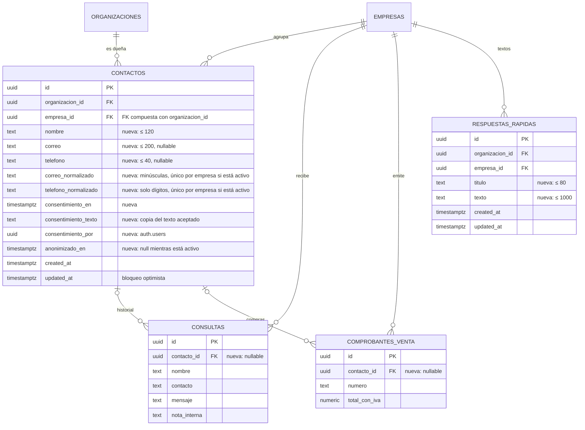

# Contactos y respuestas rápidas: modelo, RPC y pantallas (MSF-144)

**Épica:** MSF-144 — Consultas y ventas · Contactos y respuestas rápidas.
**Historias:** F-CON-05 Libreta de contactos (MSF-260) y F-CON-06 Respuestas rápidas (MSF-274).
**Spec:** `specs/20261029-120000-contactos-y-respuestas-rapidas/` (`spec.md`, `plan.md`, `tasks.md`,
contrato en `contracts/contactos.md`).
**Alcance de entrega:** `refine` (`apps/web`) y `supabase` (migraciones, RPC, vistas y pgTAP). Sin
`kestra`, `superset` ni `workers`.
**Guía de producto:** [Contactos: la libreta de personas](../producto/contactos.md).

## Estado de entrega

La épica se construyó en la rama
`epic/MSF-144-consultas-y-ventas-contactos-y-respuesta` (merge de desarrollo `e57118a0`, PR #646). Las
migraciones `20270201100000`–`20270201100500` y `20270201200000`–`20270201200100`, las rutas
`/contactos` y `/contactos/:id` y los diálogos de Consultas están en esa rama. Al escribir esta página,
`main` **todavía no las tiene promovidas**: se verifica contra el árbol de la épica. El cierre documental
quedó en `433bc3ca` y la spec en `e22a1374`.

## Modelo de datos

Dos tablas nuevas en **`dominio`** (Principio VII: entidades de negocio), dos columnas aditivas en tablas
de dominio existentes y funciones/vistas en `public` como superficie de ejecución y lectura.

| Objeto | Estado | Cambio |
|---|---|---|
| `dominio.contactos` | **nueva** | Persona de una **empresa**: `nombre` (≤ 120), `correo` (≤ 200), `telefono` (≤ 40), `correo_normalizado`, `telefono_normalizado`, `consentimiento_en`, `consentimiento_texto` (≤ 2000), `consentimiento_por`, `anonimizado_en`, `created_at`, `updated_at`; `unique (id, organizacion_id)` y FK compuesta `(empresa_id, organizacion_id)` a `dominio.empresas`. |
| `dominio.consultas` | existente | Gana `contacto_id uuid` nullable con FK compuesta `(contacto_id, organizacion_id)` a `contactos`; no cambia su RLS. |
| `dominio.comprobantes_venta` | existente | Gana `contacto_id uuid` nullable con la misma FK compuesta; no cambia su RLS ni sus importes. |
| `public.consultas_bandeja` | **vista alterada** | Suma `contacto_id` **al final**; cambio aditivo. |
| `dominio.respuestas_rapidas` | **nueva** | Textos por **empresa**: `titulo` (≤ 80), `texto` (≤ 1000), `created_at`, `updated_at`; FK compuesta a `dominio.empresas` y `unique (id, organizacion_id)`. Sin datos personales. |
| `public.respuestas_rapidas_lista` | **vista nueva** | `security_invoker`; aplica la RLS de la tabla. |
| `public.crear_contacto`, `actualizar_contacto`, `vincular_consulta_contacto`, `vincular_comprobante_contacto`, `anonimizar_contacto`, `buscar_contactos`, `historial_contacto`, `guardar_respuesta_rapida`, `eliminar_respuesta_rapida` | **RPC nuevas** | Superficie de ejecución/lectura; no guardan datos. Ninguna para `anon`. |



- Detalle del grafo completo: [Datos y DER](datos.md#contactos-y-respuestas-rapidas-msf-144).
- TODO (dueño: Documentador): ERD Archify interactivo de MSF-144. Por ahora el DER vive en Mermaid en
  esta página y en `docs/tecnico/datos.md`.

## Migraciones

| Migración | Qué agrega |
|---|---|
| `20270201100000_contactos.sql` | Tabla `dominio.contactos`, índices únicos parciales por empresa sobre correo y teléfono normalizados (solo contactos no anonimizados), índices de organización y nombre, disparador `private.normalizar_contacto`, RLS de solo lectura y grants. |
| `20270201100100_contactos_vinculos.sql` | `contacto_id` nullable y FK compuesta en `dominio.consultas` y `dominio.comprobantes_venta`; índices parciales; redefine `public.consultas_bandeja` con `contacto_id` al final. |
| `20270201100200_contactos_crear_actualizar.sql` | `private.validar_contacto`, `public.crear_contacto` y `public.actualizar_contacto`. |
| `20270201100300_contactos_vincular.sql` | `public.vincular_consulta_contacto` y `public.vincular_comprobante_contacto`. |
| `20270201100400_contactos_lectura.sql` | `public.buscar_contactos` (`security invoker`) y `public.historial_contacto` (`security definer`). |
| `20270201100500_anonimizar_contacto.sql` | `public.anonimizar_contacto`. |
| `20270201200000_respuestas_rapidas.sql` | Tabla `dominio.respuestas_rapidas`, índices, disparador `private.normalizar_respuesta_rapida`, RLS de solo lectura y grants. |
| `20270201200100_respuestas_rapidas_rpc.sql` | Vista `public.respuestas_rapidas_lista`, `public.guardar_respuesta_rapida` y `public.eliminar_respuesta_rapida`. |

Todas son aditivas y llevan su reversión en el encabezado.

## Reglas de negocio en la base

### Duplicados

Por empresa, el correo normalizado (minúsculas, sin espacios) y el teléfono normalizado (solo dígitos)
son únicos **entre contactos no anonimizados**. Lo imponen los índices parciales
`contactos_empresa_correo_uq` y `contactos_empresa_telefono_uq`. `private.validar_contacto` valida lo
mismo antes de escribir y responde `23505` con el **id del contacto existente** en `DETAIL`; la pantalla
lo usa para ofrecer «Vincular la consulta al existente». Anonimizar libera las claves porque el índice
solo alcanza a `anonimizado_en is null`.

### Consentimiento

`public.crear_contacto` exige `p_consentimiento = true` y un `p_consentimiento_texto` no vacío (≤ 2000).
Guarda `consentimiento_en`, `consentimiento_por` y una **copia** del texto vigente. La constante vive en
`apps/web/src/lib/consentimientoContacto.ts` (`TEXTO_CONSENTIMIENTO`, versión `v1-pendiente`); cambiar el
texto no reescribe contactos anteriores.

### Alta, edición y vínculos

- `crear_contacto` valida sección `consultas = edicion`, empresa accesible, nombre, correo, teléfono y
  consentimiento. Si recibe `p_consulta_id`, exige que la consulta sea de la misma empresa, no tenga
  contacto y la vincula en la misma transacción.
- `actualizar_contacto` valida la misma regla de duplicados y usa `updated_at` como bloqueo optimista:
  `40001` si otra persona cambió el contacto; no escribe si los datos son idénticos.
- `vincular_consulta_contacto` exige contacto y consulta activos, de la misma empresa y organización.
- `vincular_comprobante_contacto` acepta `p_contacto_id = null` para desvincular; no toca importes,
  estados ni fechas del comprobante.
- Ninguna RPC acepta un contacto anonimizado (`22023`).
- Errores comunes: `42501` sin permiso o sin acceso, `22023` datos inválidos o contacto anonimizado,
  `23505` duplicado, `40001` conflicto.

### Anonimización

`public.anonimizar_contacto(p_id, p_updated_at)` es irreversible y solo opera sobre un contacto activo:

- Contacto: `nombre = 'Anonimizado'`, `correo = null`, `telefono = null`, `anonimizado_en = now()`.
- Consultas vinculadas de la organización: `nombre = 'Anonimizado'`, `contacto = 'Anonimizado'`,
  `nota_interna = null` y `mensaje` neutro (en una consulta de WhatsApp sin mensaje queda `null`).
- No borra filas ni toca `dominio.comprobantes_venta`: las compras conservan estado, fechas y totales, y
  su `contacto_id` sigue apuntando al contacto anonimizado.
- Conserva el consentimiento (fecha, texto y quién lo registró) como prueba.
- La actividad no copia nombre, correo ni teléfono.

### Respuestas rápidas

- `guardar_respuesta_rapida(p_id, p_empresa_id, p_titulo, p_texto)` crea (`p_id = null`) o edita; una
  respuesta existente no cambia de empresa. Exige `consultas = edicion` y empresa accesible.
- `eliminar_respuesta_rapida(p_id)` borra una respuesta de una empresa accesible.
- Título y texto se recortan; el texto conserva sus saltos de línea internos. Límites: 80 y 1000.
- `resolverVariables` (`apps/web/src/lib/respuestasRapidas.ts`) reemplaza `{nombre}`, `{tienda}` y
  `{producto}` en **una sola pasada**. Un valor vacío no deja llaves ni espacios dobles; una variable
  desconocida queda tal cual.
- `armarTextoInicial` (`apps/web/src/lib/textoInicialConsulta.ts`) sigue siendo el único punto que arma el
  mensaje: si recibe una respuesta rápida usa su texto resuelto; si no, la plantilla fija anterior. El
  asunto no cambia y el panel no envía nada.

## RPC y contrato

```ts
public.crear_contacto(p_empresa_id uuid, p_nombre text, p_correo text, p_telefono text,
                      p_consentimiento boolean, p_consentimiento_texto text,
                      p_consulta_id uuid default null) returns uuid
public.actualizar_contacto(p_id uuid, p_nombre text, p_correo text, p_telefono text,
                           p_updated_at timestamptz) returns timestamptz
public.vincular_consulta_contacto(p_consulta_id uuid, p_contacto_id uuid) returns void
public.vincular_comprobante_contacto(p_comprobante_id uuid, p_contacto_id uuid) returns void
public.anonimizar_contacto(p_id uuid, p_updated_at timestamptz) returns void
public.buscar_contactos(p_empresa_id uuid default null, p_busqueda text default null,
                        p_limite integer default 25, p_desde integer default 0)
public.historial_contacto(p_contacto_id uuid)
public.guardar_respuesta_rapida(p_id uuid, p_empresa_id uuid, p_titulo text, p_texto text) returns uuid
public.eliminar_respuesta_rapida(p_id uuid) returns void
```

- `buscar_contactos` es `security invoker`: la RLS de `dominio.contactos` decide qué filas existen. Con
  `p_empresa_id = null` devuelve todas las empresas accesibles; una empresa ajena devuelve cero filas.
  Busca por nombre, correo y teléfono, con paginación de hasta 200 y `total` de ventana.
- `historial_contacto` es `security definer` porque lee compras (RLS de `ventas`) desde una pantalla
  gobernada por `consultas`. Devuelve consultas y compras vinculadas, ordenadas por fecha descendente,
  solo de empresas accesibles. Un contacto inexistente o ajeno devuelve cero filas.
- `respuestas_rapidas_lista` es `security_invoker` y solo expone las respuestas que la RLS deja ver.
- La app **no escribe** en `dominio.contactos` ni en `dominio.respuestas_rapidas`: solo por RPC.

## Permisos y RLS

- `dominio.contactos`: RLS por `organizacion_id = private.organizacion_id()`,
  `empresa_id in private.empresas_accesibles()` y `private.nivel_seccion('consultas') in ('lectura','edicion')`.
  Sin políticas de escritura. `revoke all` a `public, anon, authenticated` y `grant select` solo a
  `authenticated`.
- `dominio.respuestas_rapidas`: la misma RLS de lectura; sin escritura directa; mismo esquema de grants.
- Las RPC nuevas hacen `revoke ... from public, anon` y `grant execute ... to authenticated`. `anon` no
  tiene privilegios nuevos.
- `historial_contacto` exige `consultas` en lectura o edición; `crear`, `editar`, `vincular` y `anonimizar`
  exigen `consultas = edicion`. Un contacto inexistente, ajeno o de una empresa sin acceso responde
  `42501` igual que uno sin permiso.

## Pantallas

| Ruta / componente | Qué hace |
|---|---|
| `/contactos` (`pages/contactos/list.tsx`) | Libreta de la empresa activa o de todas las accesibles: búsqueda con espera de 300 ms, tabla adaptable, paginación de 25, estados de carga/vacío/error y botón **Nuevo contacto** (exige una tienda elegida). |
| `/contactos/:id` (`pages/contactos/ficha.tsx`) | Ficha con carga diferida: edición con bloqueo optimista, historial, **Vincular comprobante**, **Desvincular** y **Anonimizar**. Si cambia la empresa activa, vuelve a la libreta con aviso. |
| `pages/consultas/CrearContactoDialog.tsx` | Alta desde la libreta o desde una consulta; precarga nombre y contacto, valida consentimiento y ofrece vincular al existente ante `23505`. |
| `pages/consultas/ContactoConsulta.tsx` | En el detalle de la consulta: **Crear contacto** o el enlace **Contacto en la libreta**. |
| `pages/contactos/AnonimizarContactoDialog.tsx` | Confirmación irreversible; explica qué se borra y qué se conserva. |
| `pages/contactos/VincularComprobanteDialog.tsx` | Busca comprobantes de la empresa del contacto y vincula uno. |
| `pages/consultas/RespuestasRapidasDialog.tsx` | Lista, crea, edita y elimina respuestas de la empresa activa; ayuda de variables; solo lectura con `lectura`. |
| Detalle de consulta (`components/consultas/DetalleConsulta.tsx`) | Selector **Respuesta rápida** con las respuestas de la empresa de la consulta; **Texto de siempre** por defecto. |

La entrada de menú **Contactos** vive en el grupo **Canales**, debajo de Consultas, con la sección de
permisos `consultas` (`apps/web/src/components/navegacion/destinosPanel.ts`). No hay prototipo dibujado:
se usan los patrones compartidos del panel.

### Empresa activa (Principio VIII)

- La libreta invalida y recarga al cambiar la empresa, reencuadra la paginación y cierra el formulario
  abierto con aviso.
- La ficha vuelve a la libreta con aviso.
- Los diálogos de alta, anonimización, vinculación y respuestas rápidas se cierran con aviso.
- El selector de respuesta rápida del detalle lee solo por la empresa de la consulta.

## Actividad

`private.insertar_actividad` registra, sin datos personales:

- `contacto.creado`, `contacto.actualizado`, `contacto.anonimizado`.
- `contacto.consulta_vinculada`, `contacto.comprobante_vinculado`, `contacto.comprobante_desvinculado`.
- `respuesta_rapida.creada`, `respuesta_rapida.editada`, `respuesta_rapida.eliminada` (con el título y la
  empresa, nunca el texto).

## Reversión

Migraciones aditivas; en una migración posterior y exportando antes los datos personales o los textos:

1. `drop function public.anonimizar_contacto(uuid, timestamptz);`
2. `drop function public.historial_contacto(uuid);` y
   `drop function public.buscar_contactos(uuid, text, integer, integer);`
3. `drop function public.vincular_comprobante_contacto(uuid, uuid);` y
   `drop function public.vincular_consulta_contacto(uuid, uuid);`
4. `drop function public.actualizar_contacto(uuid, text, text, text, timestamptz);`,
   `drop function public.crear_contacto(uuid, text, text, text, boolean, text, uuid);` y
   `drop function private.validar_contacto(uuid, uuid, text, text, text);`
5. `drop view public.consultas_bandeja` y recrearla sin `contacto_id`; quitar índices, FKs y columnas
   `contacto_id` de `dominio.consultas` y `dominio.comprobantes_venta`.
6. `drop trigger contactos_normalizar on dominio.contactos;`,
   `drop function private.normalizar_contacto();` y `drop table dominio.contactos;`.
7. `drop view public.respuestas_rapidas_lista;`, `drop function public.guardar_respuesta_rapida(uuid, uuid, text, text);`,
   `drop function public.eliminar_respuesta_rapida(uuid);`, `drop trigger respuestas_rapidas_normalizar ...;`,
   `drop function private.normalizar_respuesta_rapida();` y `drop table dominio.respuestas_rapidas;`.

Los datos ya anonimizados solo se recuperan desde una copia de seguridad. Para deshacer la historia en
Git: `git revert -m 1 e57118a0`.

## Pruebas

- **pgTAP** `supabase/tests/database/contactos.test.sql` (311 líneas, 2 organizaciones y 2 empresas):
  alta, duplicados por correo y teléfono, consentimiento obligatorio, texto copiado, vínculos a consulta y
  comprobante, historial, anonimización sin romper consultas ni ventas, escritura directa rechazada,
  `anon` sin acceso y `rls_en_toda_tabla`.
- **pgTAP** `supabase/tests/database/respuestas_rapidas.test.sql`: aislamiento entre organizaciones y
  empresas, permisos por nivel, escritura directa rechazada y `anon` sin acceso.
- **Vitest** (`pnpm --filter @platform/web test`): `lib/contactos.test.ts`,
  `lib/respuestasRapidas.test.ts`, `pages/contactos/list.test.tsx`, `pages/contactos/ficha.test.tsx`,
  `pages/contactos/AnonimizarContactoDialog.test.tsx`, `pages/consultas/ContactoConsulta.test.tsx`,
  `pages/consultas/CrearContactoDialog` (cubierto por el anterior), `pages/consultas/RespuestasRapidasDialog.test.tsx`,
  `pages/consultas/list.test.tsx`, `pages/consultas/responder.test.tsx` y
  `components/navegacion/destinosPanel.permisos.test.ts`.
- **E2E** `apps/web/e2e/contactos-recorrido.e2e.ts`, rótulo `[MSF-260:T013]`: crear un contacto desde una
  consulta, ver su historial y anonimizarlo sin romper consultas ni ventas.
- **E2E** `apps/web/e2e/consultas-respuestas-rapidas.e2e.ts`, rótulo `[MSF-274:T021]`: crear una respuesta
  rápida con variables y usarla al responder; el texto inicial abierto es el esperado.
- **Capturas del manual:** pendientes de generar desde un entorno con la épica desplegada. Dueño:
  Documentador. No se inventaron imágenes.

## Cómo probarlo

### Prerrequisitos

- `pnpm dev:supabase` activo y migraciones aplicadas; `pnpm dev:refine:host` para la aplicación.
- Usuario con `consultas = edicion` (por ejemplo Administrador) y una empresa accesible; una consulta
  existente con nombre y contacto, y al menos un comprobante de la misma empresa.

### Pasos

1. Abrí **Canales → Contactos**. Elegí una tienda en la barra superior: se ve la libreta de esa tienda,
   con búsqueda y paginación.
2. Abrí **Canales → Consultas**, abrí una consulta sin contacto y tocá **Crear contacto**. Verificá que el
   nombre y el contacto vengan precargados, confirmá el consentimiento y guardá: la consulta queda con el
   enlace **Contacto en la libreta**.
3. En la ficha del contacto, vinculá un comprobante con **Vincular comprobante** y comprobá que aparece en
   **Historial** como **Compra**; probá **Desvincular**.
4. Volvé al detalle de la consulta, elegí una **Respuesta rápida** (creá una antes con `{nombre}`,
   `{tienda}` y `{producto}`) y tocá **Responder por correo** o **Responder por WhatsApp**: el texto
   inicial tiene las variables resueltas y el estado/responsable se registran como siempre.
5. En la ficha del contacto, tocá **Anonimizar**, confirmá y verificá que la ficha queda **Anonimizado**,
   el contacto desaparece de la búsqueda por su correo/teléfono, y la consulta y el comprobante siguen
   abriéndose sin datos personales.
6. Cambiá la empresa activa con la libreta abierta y con la ficha abierta: la lista recarga, la ficha
   vuelve a la libreta y ningún diálogo guarda datos de la tienda anterior.

### Resultado esperado

- Dado un contacto nuevo con consentimiento, cuando se guarda desde una consulta, entonces la consulta
  queda vinculada y aparece en su historial.
- Dado un correo o teléfono repetido en la misma empresa, cuando se intenta crear otro contacto, entonces
  no se crea y se ofrece el contacto existente.
- Dado un contacto anonimizado, entonces sus datos personales desaparecen del contacto y de sus consultas,
  pero las consultas y ventas siguen existiendo con sus estados, fechas y totales.
- Dada una respuesta rápida con variables, cuando se responde una consulta, entonces el texto inicial
  abierto en WhatsApp o correo las tiene resueltas; el panel no envía nada.

### Cómo automatizarlo

- E2E Playwright: `pnpm --filter @platform/web test:e2e --grep "T013"` para
  `[MSF-260:T013]` y `--grep "T021"` para `[MSF-274:T021]`.
- Base de datos: `pnpm test:db` (incluye `contactos.test.sql`, `respuestas_rapidas.test.sql` y
  `rls_en_toda_tabla.test.sql`). Para una corrida puntual:
  `supabase test db --local supabase/tests/database/contactos.test.sql` y
  `supabase test db --local supabase/tests/database/respuestas_rapidas.test.sql`.
- Sin video: la verificación es funcional y de base de datos; no hay una grabación de la épica.

## Decisiones abiertas y límites

1. **Texto de consentimiento y plazo de conservación**: el texto definitivo y el plazo los define el
   cliente. Hoy el texto es una constante versionada marcada `v1-pendiente` y **no hay expiración
   automática**: solo anonimización manual. Dueño: producto/cliente.
2. **Contacto y cliente**: son entidades separadas, sin FK entre `dominio.contactos` y `public.clientes`.
   Si deben unificarse, se decide antes de que MSF-154 consuma contactos. Dueño: producto.
3. **Vínculo de compras**: es manual desde la ficha porque el alta de ventas (MSF-159) no pide un
   contacto. Dueño: producto/Ventas.
4. **Capturas y ERD Archify**: pendientes de generar. Dueño: Documentador.
5. **Promoción a `main`**: la épica está integrada en la rama de desarrollo, no en `main` a la fecha de
   esta página. Dueño: responsable de plataforma.

## Contrato para MSF-154

MSF-154 consume contactos solo por `buscar_contactos`, `historial_contacto` y `contacto_id` en
`consultas_bandeja`; no lee `dominio.contactos` directo ni escribe. Respeta el consentimiento guardado y
excluye los anonimizados (`anonimizado_en` no nulo).
