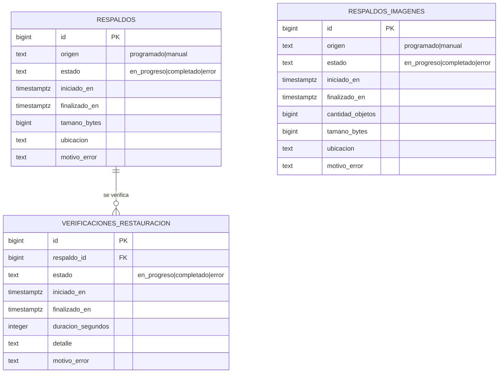

# Copias de seguridad y restauración (MSF-457)

**Épica:** MSF-457 · **Historias:** F-OPS-01 (copias y restauración) y F-OPS-05 (documentación).
**Spec:** `specs/20261018-120000-operacion-copias-y-documentacion/`, en la rama
`epic/MSF-457-plataforma-operacion-copias-y-documentac` y liberada a STG en `release/stg-lote`; pendiente de
merge a `main` en este repositorio.
**Alcance de entrega:** `supabase` (migración aditiva + pgTAP), `kestra` (flows versionados) y `docs/`.
Sin `refine`, `superset` ni `workers`.

Extiende la copia diaria de Postgres de la [spec 011](../../specs/011-backups-postgres/spec.md) con copia de
imágenes, retención, verificación periódica de restauración y aviso por correo. El respaldo de la base sigue
usando `public.respaldos`, el rol `kestra_backups` y la verificación estructural «PGDMP»; no se reemplaza.

## Qué corre y cuándo

Todos los flows viven en `infra/kestra/flows/`, namespace `platform.backups`, y se publican desde Git con
`publicar-flows-kestra.yml` (nunca se editan sólo en la UI).

| Qué | Flow | Horario | Registro auditable |
|---|---|---|---|
| Base completa (`pg_dump --format=custom`) | `respaldo-postgres.yml` | 03:00 diario | `public.respaldos` |
| Objetos de Storage | `respaldo-imagenes.yml` | 03:15 diario | `public.respaldos_imagenes` |
| Purga por retención | `retencion-copias.yml` | 04:30 diario | Resultado en la ejecución de Kestra |
| Restauración de la última copia de base en un Postgres efímero | `verificar-restauracion.yml` | lunes 05:00 | `public.verificaciones_restauracion` |
| Aviso por correo de cualquier fallo | `aviso-fallo-copias.yml` (subflow) | — | Correo a `SOPORTE_CORREO` |

Cada flow acepta el input `origen` (`programado` por el Schedule, `manual` al ejecutarlo desde la UI de
Kestra). Una sola fila `en_progreso` por tipo: si ya hay una corrida vigente, la función de inicio corta con
`55006` y el flow no copia nada. Una fila colgada más de 3 horas se auto-sana a `error` en la corrida
siguiente.

## Destino de las copias

Por decisión del propietario (2026-10-17) el destino es un **directorio dedicado del mismo servidor**, fuera
de los volúmenes de Supabase: `RESPALDOS_DIR_HOST`, por defecto
`/var/lib/automation-platform/respaldos`. Los flows no lo tocan por ruta: usan siempre un remoto `rclone` de
nombre estable, `respaldos`.

```
<destino>/base/AAAAMMDD-HHMMSS-<id>.dump
<destino>/imagenes/AAAAMMDD-HHMMSS/...
```

`base/` guarda un archivo por corrida de `respaldo-postgres`; `imagenes/` guarda una «foto» completa de
Storage por corrida de `respaldo-imagenes`. El archivo de base se copia al destino sólo después de la
verificación estructural y se comprueba que el tamaño en destino coincida con el verificado
(`infra/kestra/flows/respaldo-postgres.yml`, tarea `copiar_a_destino`). Si la copia de imágenes falla, se
purga la carpeta parcial para que la retención no la cuente como válida.

### Portabilidad a S3 / B2 / SFTP

El contrato es el mismo: remoto `respaldos` + prefijos `base/` e `imagenes/`. Para mover las copias fuera del
servidor se cambian sólo variables en `infra/kestra/.env` (nunca en Git) y se reinicia Kestra:

| Variable | Local (hoy) | S3 / compatible | SFTP |
|---|---|---|---|
| `RESPALDOS_RCLONE_TIPO` | `local` | `s3` | `sftp` |
| `RESPALDOS_RUTA` | `/respaldos` | `bucket/prefijo` | `/ruta/en/el/servidor` |
| `RESPALDOS_RCLONE_PROVIDER` / `_ENDPOINT` / `_REGION` | vacías | las del proveedor | vacías |
| `RESPALDOS_RCLONE_ACCESS_KEY_ID` / `_SECRET_ACCESS_KEY` | vacías | credenciales | vacías |
| `RESPALDOS_RCLONE_HOST` / `_USER` / `_PASS` | vacías | vacías | host, usuario y clave ofuscada con `rclone obscure` |

Para Backblaze B2 se usa el tipo `s3` con su endpoint S3. Tras migrar hay que copiar el contenido previo al
nuevo destino y volver a correr `verificar-restauracion`.

## Retención

`retencion-copias.yml` conserva las **30 copias diarias** más recientes y **la primera copia de cada uno de
los 12 últimos meses**, en `base/` (archivos) e `imagenes/` (carpetas). Nunca borra la copia más reciente.
Sólo toca nombres con la forma `AAAAMMDD-HHMMSS…`; cualquier otro archivo del destino se ignora.

- Parámetros: `RESPALDOS_RETENCION_DIARIAS` y `RESPALDOS_RETENCION_MENSUALES` (o los inputs `diarias` y
  `mensuales` para una corrida puntual).
- Un valor no entero o `diarias < 1` falla antes de borrar nada.
- Un destino inalcanzable falla la tarea; una carpeta que todavía no existe se trata como vacía.

## Modelo de datos

Migración aditiva `supabase/migrations/20261018120000_copias_imagenes_y_verificaciones.sql` (en la rama de
la épica, pendiente de merge a `main`). Las dos tablas nuevas van en `public` porque son de plataforma,
transversal a todas las organizaciones; ninguna va en `dominio`. `public.respaldos` no se altera.

| Tabla | Estado | Cambio |
|---|---|---|
| `public.respaldos` | existente | Historial de la copia de base de la spec 011; no cambia. |
| `public.respaldos_imagenes` | **nueva** | Copia de Storage: origen, estado, tiempos, cantidad de objetos, tamaño, ubicación y motivo de error. |
| `public.verificaciones_restauracion` | **nueva** | Resultado de restaurar una copia de base: `respaldo_id`, estado, duración, detalle y motivo de error. |



Las tres tablas tienen un `check` de consistencia por estado, como `respaldos`: en `en_progreso` los campos
de cierre son nulos; en `completado` están completos y sin motivo de error; en `error` hay `finalizado_en` y
`motivo_error`. Las tablas nuevas tienen un índice único parcial para impedir dos filas `en_progreso`
simultáneas.

### RLS y permisos

- `alter table … enable row level security` en `respaldos_imagenes` y `verificaciones_restauracion`.
- Una policy `select` para `authenticated` con `private.is_superadmin()`. Ningún rol de organización ni
  `anon` lee nada; no hay policies de escritura.
- `revoke all … from anon, authenticated` y `grant select … to authenticated`.
- La escritura pasa sólo por funciones `security definer` con `set search_path = ''`, ejecutables únicamente
  por el rol `kestra_backups` (mismo criterio que la spec 011). `anon` no tiene privilegios.

## Verificación de restauración

`verificar-restauracion.yml` elige la última fila `completado` de `public.respaldos`, trae el `.dump` desde el
destino con `rclone` y lo restaura **dentro de un contenedor Postgres efímero, sin red** (`networkMode: none`
y sólo socket Unix). Nunca se conecta al Postgres operativo.

- Comprueba que cada tabla de `RESPALDOS_VERIFICAR_TABLAS` exista y tenga al menos una fila. Por defecto:
  `public.respaldos,public.organizaciones`.
- Los errores de `pg_restore` por roles/extensiones de Supabase ausentes se cuentan en el detalle, pero no
  cortan: lo que decide es que las tablas de control tengan datos.
- Registra `duracion_segundos` y un `detalle` con `errores_pg_restore=<n>; <tabla>=<filas>…`.
- Sin copia completada corta con `P0002`; con otra verificación en curso, con `55006`.

Esto prueba que la **base** se puede restaurar, pero no reemplaza el simulacro completo de base + imágenes en
staging ni mide el tiempo de punta a punta.

## Avisos por correo

Los bloques `errors:` de los cuatro flows invocan el subflow `aviso-fallo-copias`, que envía un correo SMTP a
`SOPORTE_CORREO` con asunto `[Copias] Falló <flow>`, el motivo (tarea + mensaje) y el id de la ejecución de
Kestra. Se usa `transmitFailed: false`: **si el SMTP no está configurado, el aviso se pierde en silencio**.

Variables (sólo en `.env.example` / `infra/kestra/.env.example`, valores reales en `infra/kestra/.env`):

| Grupo | Variables |
|---|---|
| Destino | `RESPALDOS_DIR_HOST`, `RESPALDOS_RUTA`, `RESPALDOS_RCLONE_*` |
| Retención | `RESPALDOS_RETENCION_DIARIAS`, `RESPALDOS_RETENCION_MENSUALES` |
| Verificación | `RESPALDOS_VERIFICAR_TABLAS` |
| Origen de imágenes | `RESPALDOS_STORAGE_ENDPOINT`, `RESPALDOS_STORAGE_REGION`, `RESPALDOS_STORAGE_ACCESS_KEY_ID`, `RESPALDOS_STORAGE_SECRET_ACCESS_KEY` |
| Correo | `KESTRA_SMTP_HOST`, `KESTRA_SMTP_PORT`, `KESTRA_SMTP_TRANSPORTE`, `KESTRA_SMTP_USERNAME`, `KESTRA_SMTP_PASSWORD`, `KESTRA_SMTP_FROM`, `SOPORTE_CORREO` |
| Base | `KESTRA_BACKUPS_DB_URL`, `KESTRA_BACKUPS_DB_PASSWORD`, `KESTRA_BACKUPS_PGDUMP_URL` |

El origen de imágenes usa las claves del endpoint S3 de Supabase Storage. Preparación única: crear
`RESPALDOS_DIR_HOST` en el servidor y dejarlo con permisos `700` (las copias contienen `auth.users` y datos de
todas las organizaciones).

**Puesta en marcha:** después de configurar el SMTP, ejecutar a mano `aviso-fallo-copias` desde Kestra y
confirmar que el correo llega. Repetirlo en cada simulacro.

## Operación

### Leer el historial

Como superadmin (o desde el SQL editor de Studio):

```sql
select id, estado, iniciado_en, finalizado_en, tamano_bytes, ubicacion, motivo_error
  from public.respaldos order by id desc limit 10;

select id, estado, iniciado_en, cantidad_objetos, tamano_bytes, ubicacion, motivo_error
  from public.respaldos_imagenes order by id desc limit 10;

select v.id, v.estado, v.iniciado_en, v.duracion_segundos, v.detalle, v.motivo_error, r.ubicacion
  from public.verificaciones_restauracion v
  join public.respaldos r on r.id = v.respaldo_id
  order by v.id desc limit 10;
```

Sano = una fila `completado` por día en `respaldos` y `respaldos_imagenes`, y la última verificación
`completado`.

### Qué hacer ante el correo de fallo

1. Abrir la ejecución en Kestra (namespace `platform.backups`) y leer el log de la tarea fallida.
2. Causas típicas: disco lleno o sin permisos en `RESPALDOS_DIR_HOST`; Storage o base inalcanzables; copia
   corrupta (si falló `verificar-restauracion`, la copia de ese día no es confiable: correr
   `respaldo-postgres` a mano y luego `verificar-restauracion`).
3. «Ya hay un respaldo en progreso» no es un daño: otra corrida seguía activa.
4. Corregir y relanzar el flow a mano desde Kestra (`origen` queda en `manual`). No hay que limpiar nada: una
   corrida fallida no deja copias a medias.

### Procedimiento guiado de restauración

Restaurar **sobrescribe** el entorno destino. Probarlo primero en staging; en producción exige aprobación
manual. Objetivo propuesto: volver a operar en **4 horas**.

**A. Base de datos**

1. Elegir la última copia `completado` de `public.respaldos` (columna `ubicacion`) o la anterior si se
   sospecha corrupción. Con destino local el archivo es `<RESPALDOS_DIR_HOST>/base/<nombre>.dump`.
2. Traerlo al host de restauración. Si el destino es remoto:
   `rclone copyto respaldos:<ruta>/base/<nombre>.dump ./respaldo.dump`.
3. Detener escrituras: apagar `web`, los workers y Kestra.
4. Restaurar sobre una base vacía de Supabase self-hosted (los roles y extensiones propios deben existir en
   el destino):

   ```bash
   pg_restore --dbname="$DATABASE_URL" --clean --if-exists --no-owner --no-privileges \
     --single-transaction respaldo.dump
   ```

5. Comprobar `select count(*) from public.organizaciones;`, que `public.respaldos` tenga datos y que se pueda
   entrar con un superadmin.
6. Volver a levantar Kestra, workers y la app. Correr `respaldo-postgres` a mano para dejar una copia fresca.

**B. Imágenes (Storage)**

1. Elegir la foto más reciente `completado` de `public.respaldos_imagenes` (columna `ubicacion`).
2. Subirla al Storage con el mismo remoto que usa el flow:
   `rclone copy "respaldos:<ruta>/imagenes/<foto>" storage:`. Cada carpeta de primer nivel es un bucket; los
   buckets deben existir (los crean las migraciones).
3. Comprobar abriendo una imagen de producto en el catálogo.

Anotar hora de inicio y fin de cada paso: son el dato del simulacro y de la confirmación del objetivo de
recuperación con el cliente. Runbook de guardia: [Restaurar base de datos](runbooks/db-restore.md).

### Simulacro pendiente

El simulacro completo en staging (base + imágenes, tiempo medido y firma del propietario) **no se ejecutó**
por falta de autorización para tocar staging. Seguimiento **MSF-520** (dueño: propietario del producto). La
verificación semanal automática cubre la restauración de la base, no el simulacro ni el tiempo de punta a
punta.

## Riesgo conocido: todo en el mismo servidor

Mientras el destino sea un directorio del mismo VPS, la pérdida total del servidor (disco o VPS) se lleva
también las copias. Mitigaciones actuales: ruta en un disco o punto de montaje propio, permisos `700` en la
carpeta y cifrado en reposo si el disco lo permite. El traslado a un destino remoto se activa sólo cambiando
variables, sin tocar los flows; queda como seguimiento.

## Reversión

Nada se destruye en el mismo PR que lo crea. En orden inverso, la migración deja escrito:

```sql
drop function public.finalizar_verificacion_error(bigint, text);
drop function public.finalizar_verificacion_completado(bigint, integer, text);
drop function public.iniciar_verificacion_restauracion();
drop function public.finalizar_respaldo_imagenes_error(bigint, text);
drop function public.finalizar_respaldo_imagenes_completado(bigint, bigint, bigint, text);
drop function public.iniciar_respaldo_imagenes(text);
drop table public.verificaciones_restauracion;
drop table public.respaldos_imagenes;
```

Los flows nuevos se desactivan o se borran de Kestra; `respaldo-postgres.yml` vuelve a su versión anterior en
Git.

## Pruebas y evidencia

- `supabase/tests/database/copias_imagenes_verificaciones.test.sql` (pgTAP): sólo el superadmin lee, ningún
  rol de organización ni `anon`; sin escritura directa; funciones sólo ejecutables por `kestra_backups`;
  estados consistentes; `rls_en_toda_tabla` y el test de ejecutabilidad por `anon` siguen verdes.
- `infra/kestra/validar-copias-flows.test.mjs` (`node --test`): estructura de los cuatro flows, aviso en
  `errors:`, variables y namespace.
- `pnpm infra:config` valida los Compose; el simulacro en staging queda pendiente (MSF-520).

## Documentación de uso, operación y entrega

- Producto y límites: [Operación, copias y documentación](../producto/operacion-copias-y-documentacion.md).
- Operación general: [Operación](operacion.md) · [Deployment](../deployment.md) ·
  [Ambientes](../ambientes-verificacion.md).
- Runbook de guardia: [Restaurar base de datos](runbooks/db-restore.md).
