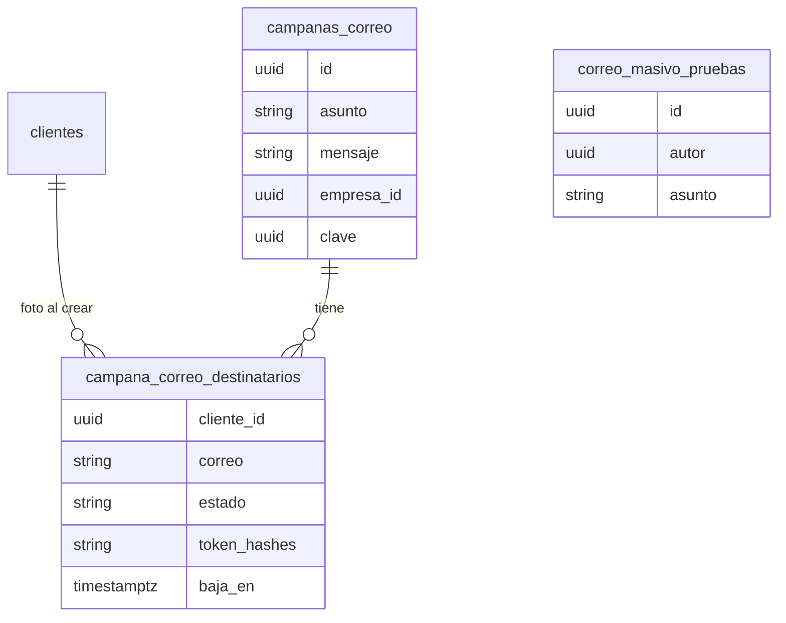

# Correo masivo a clientes: datos, RPC, flow y baja (MSF-155)

**Épica:** MSF-155 — Clientes y proveedores · Correo masivo a clientes. **Historias:** F-CLI-11 (MSF-357),
F-CLI-12 (MSF-370), F-CLI-13 (MSF-376). **Alcance de entrega:** `refine` + `supabase` + `kestra` (sin `superset`
ni `workers`). **Spec:** `specs/20261028-100000-correo-masivo-a-clientes/` (`spec.md`, `plan.md`, `tasks.md`,
`contracts/correo-masivo.md`). Guía de producto: [Correo masivo](../producto/correo-masivo-a-clientes.md).
La guía de la rama de la épica es `docs/correo-masivo.md`.

> **Estado:** verificado contra la rama `epic/MSF-155-clientes-y-proveedores-correo-masivo-a-c` (commits
> `2e5001e9`, `3f3a73b1`, `20ac90fd`, `1e5e9280`, `0c12a720`), todavía **no en `main`** al 2026-10-31. Las
> tareas de `tasks.md` nombran migraciones `20270114…`; las reales son `20270120…`/`20270121…` (abajo).
> TODO (dueño: quien mergee la épica): re-verificar contra `main`.

## Datos

Migraciones aditivas, cada una con su reversión en el encabezado:

| Migración | Objeto | Esquema | Justificación (Principio VII) |
|---|---|---|---|
| `20270120100000_clientes_acepta_correo_masivo` | `public.clientes.acepta_correo_masivo boolean not null default false` | `public` | Dato genérico del cliente; los existentes quedan sin consentimiento. |
| `20270121110000_campanas_correo` | `dominio.campanas_correo` | `dominio` | Hecho del negocio: campaña, asunto y mensaje. |
| idem | `dominio.campana_correo_destinatarios` | `dominio` | Foto de destinatarios al crear y estado (`pendiente`, `enviado`, `fallido`, `omitido`). |
| idem | `dominio.correo_masivo_pruebas` | `dominio` | Pedidos de prueba al autor; no son campaña; sin acceso por API. |
| `20270121110300_campanas_correo_historial` | `campana_correo_destinatarios.baja_en` | `dominio` | Atribuye la baja a la campaña del enlace. |

RLS por organización y sección `clientes`; `authenticated` no escribe (todo por RPC). `token_hashes` y el
vencimiento del reclamo quedan fuera del `grant select` por columna. El token en claro nunca se guarda
(solo su SHA-256). La entrada resumida está en [Datos](datos.md).

## RPC

| Función | Esquema / rol | Notas |
|---|---|---|
| `listar_destinatarios_correo_masivo`, `resumen_destinatarios_correo_masivo` | `public`, invoker, `authenticated` | Exigen **edición** en `clientes` (`42501` con lectura). Filtro común: `private.clientes_para_correo_masivo`. Resumen: `elegibles` / `sin_correo` / `no_aceptan`. |
| `crear_campana_correo(p_clave, …)` | `public`, definer | Idempotente por clave; rechaza sin elegibles (`22023`, hint `sin_destinatarios`); actividad `campana_correo.crear`. |
| `solicitar_prueba_correo_masivo` | `public`, definer | Máx. 5 por hora y persona; no cuenta contra el cupo. |
| `listar_campanas_correo`, `detalle_campana_correo` | `public`, definer | Acceso `lectura`/`edicion`; devuelve totales y `baja`; nunca hashes; otra organización → `P0002`; página ≤ 100. |
| `dar_de_baja_correo_masivo(p_token_hash)` | `public`, solo `service_role` | Apaga `acepta_correo_masivo`, pasa a `omitido` los pendientes, actividad `campana_correo.baja` solo la primera vez. Vive en `public` porque supabase-js solo llama esquemas expuestos. |
| `private.reclamar_lote_correo_masivo`, `private.cerrar_envio_correo_masivo` | `private`, `kestra_orquestacion` | Ver flow. |

`anon` no ejecuta ninguna (pgTAP de superficie de `anon`; ver `docs/acceso-ingreso.md`).

## Flow de envío

`infra/kestra/flows/correo-masivo.yml` (+ `correo-masivo.test.mjs`, `pnpm test:kestra:correo-masivo`) corre cada
minuto: pruebas primero (fuera del cupo); re-verificación de cada destinatario (FR-020); cupo diario por
organización desde las 00:00 hora de la base; reclamo con vencimiento (900 s) y enlace de baja nuevo por
destinatario (se acumulan los hashes). SMTP de Kestra `KESTRA_SMTP_*` (el de `enviar-avisos`). Fallos: 4
reintentos con espera creciente, luego `fallido` con motivo fijo «No se pudo enviar el correo». Entrega **al menos
una vez**. Variables en `infra/kestra/.env.example`: `CORREO_MASIVO_LOTE` (50), `CORREO_MASIVO_LIMITE_DIARIO`
(500), `CORREO_MASIVO_URL_BAJA`.

## Baja

Página pública `/baja-correo/:token` (`apps/web/src/pages/baja-correo.tsx`) → Edge Function anónima
`supabase/functions/baja-correo-masivo` (`{ token }`): calcula el SHA-256 y llama a la RPC con service-role (solo
en servidor). Responde siempre `{ ok: true }` (400 si el token tiene forma inválida, 500 sin detalle).

## Pantallas y rutas

`/clientes/correo-masivo` (`nueva.tsx`, `vista-previa.tsx`), `/clientes/correo-masivo/historial` y `…/:id`
(`historial.tsx`, `detalle.tsx`), `DialogoCorreoSeleccionados` en el listado, interruptor en
`FormularioCliente` y bloque «Comunicaciones» de la ficha. Empresa activa (Principio VIII): recarga y reencuadre
en las tres pantallas; diálogos abiertos se cierran con aviso.

## Pruebas

pgTAP `correo_masivo_destinatarios`, `correo_masivo_campanas`, `correo_masivo_lote`, `correo_masivo_historial`
(`pnpm test:db`); `pnpm test:kestra:correo-masivo`; `pnpm test:edge:baja-correo-masivo`; Vitest `nueva`,
`vista-previa`, `empresa-activa`, `historial`, `historial.empresa-activa`, `detalle`, `baja-correo`,
`DialogoCorreoSeleccionados`, `list.correo-masivo`, `lib/correoMasivo`. Sin E2E Playwright (pendiente).

## Seguridad (cierre T041)

Revisión `authz-security` + `crypto-secrets` sin hallazgos críticos ni altos. Riesgos bajos aceptados: la Edge
Function anónima sin límite de frecuencia propio (conviene limitar en el borde) y token en la ruta, mitigado
porque la baja exige un POST de confirmación.

## Reversión

Migraciones posteriores (nunca en el mismo PR): borrar las funciones de baja, historial, lote, creación y
destinatarios; `drop table` de las tres tablas de `dominio` (exportar antes el historial si hace falta); luego
`alter table public.clientes drop column acepta_correo_masivo`. El flow y la Edge Function se retiran aparte.
