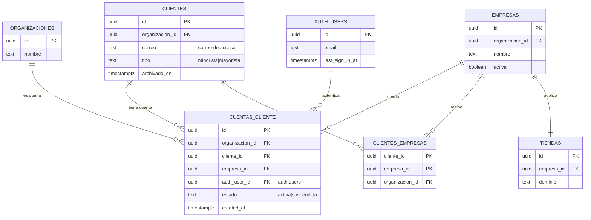
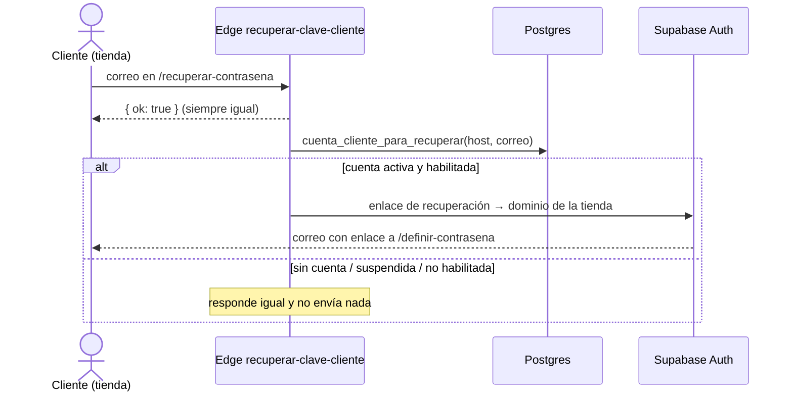
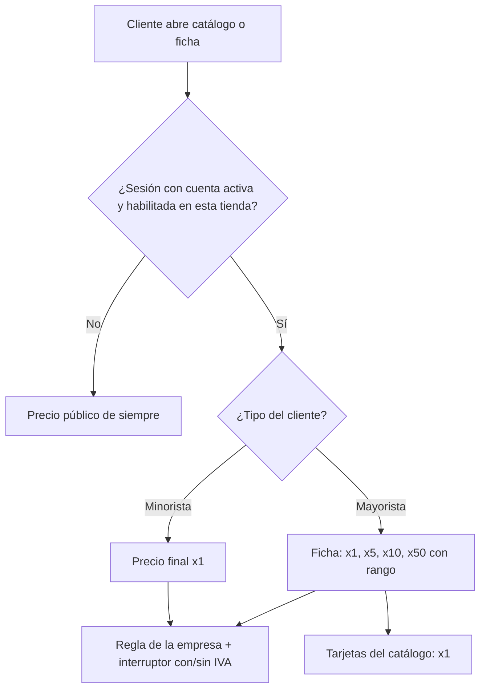

# Cuenta web del cliente (MSF-237)

Épica **MSF-237 · Clientes y proveedores: cuenta web del cliente** (F-CLI-05, F-CLI-06 y F-CLI-07). Spec:
`specs/20261024-051500-cuenta-web-del-cliente/spec.md`; plan, tareas y contratos en la misma carpeta.
Implementación en la rama `epic/MSF-237-clientes-y-proveedores-cuenta-web-del-cl` (commits `2f9d44f`,
`8bc7cd5`, `457bc7f`, `0c25d0a`, `3f30298`, `a71a052`, `27f480b` y `5a850de`), **pendiente de merge a
`main`**. Resumen de producto y límites: [Cuenta web del cliente](../producto/cuenta-web-cliente.md).

## Alcance de entrega

- **`supabase`:** una tabla nueva, RPC, funciones de `publico` para el acceso y los precios, dos Edge
  Functions y configuración de Auth. Migraciones **aditivas**, cada una con su reversión en el encabezado.
- **`refine`:** panel de Clientes (ficha, listado y formulario) y front público de la tienda
  (`apps/web/src/pages/tienda-publica/`).
- **Sin** `kestra`, `superset`, `workers` ni Compose nuevo.

| Historia | Migración | Contenido | Reversión |
|---|---|---|---|
| F-CLI-05 | `supabase/migrations/20261206100000_cuentas_cliente.sql` | Tabla `public.cuentas_cliente`, índice único `(cliente_id, empresa_id)`, índices por organización/empresa/usuario, disparador de misma organización, RLS y grants. | `drop table public.cuentas_cliente` (pierde las cuentas; los usuarios de Auth quedan sin uso) |
| F-CLI-05 | `20261206100100_cuentas_cliente_rpc.sql` | `preparar_cuenta_cliente`, `vincular_cuenta_cliente`, `cambiar_estado_cuenta_cliente`, `cuentas_web_de_cliente` y el auxiliar `private.exigir_gestion_cuenta_cliente`. | `drop function` de las cinco, en una migración posterior |
| F-CLI-05 | `20261206100150_cuentas_cliente_actividad.sql` | Eventos `cliente.cuenta_creada/suspendida/reactivada/restablecida` y `registrar_restablecimiento_cuenta_cliente`. | `drop function` de las dos funciones |
| F-CLI-05 | `20261206100200_acceso_cliente_por_dominio.sql` | `publico.acceso_cliente_por_dominio(host)`. | `drop function publico.acceso_cliente_por_dominio(text)` |
| F-CLI-05 | `20261206100250_buscar_clientes_cuenta_web.sql` | Recrea `public.buscar_clientes` y `public.exportar_clientes` con `p_con_cuenta_web` y la columna `cuentas_web`. | Recrear ambas como en `20261018150000_clientes_filtro_por_tienda.sql` |
| F-CLI-05 | `20261206100300_cuentas_cliente_select_por_tienda.sql` | Reemplaza la política `cuentas_cliente_select` para acotar la lectura a `private.empresas_accesibles()`. | Volver a la política sin el filtro de tiendas |
| F-CLI-06 | `20261206100400_cuenta_cliente_para_recuperar.sql` | `public.cuenta_cliente_para_recuperar(host, correo)` (solo `service_role`). | `drop function public.cuenta_cliente_para_recuperar(text, text)` |
| F-CLI-07 | `20261206110000_precio_final_publico_escala.sql` | `private.precio_final_publico_escala(producto, empresa, escala)`. | `drop function private.precio_final_publico_escala(uuid, uuid, text)` |
| F-CLI-07 | `20261206110100_precios_cliente_por_dominio.sql` | `publico.precios_cliente_por_dominio(host, productos)`. | `drop function publico.precios_cliente_por_dominio(text, uuid[])` |

El orden importa: la tabla antes que las RPC; la actividad se crea después de las RPC que la llaman
(plpgsql resuelve al ejecutar); `acceso_cliente_por_dominio` antes que `precios_cliente_por_dominio`, que
reutiliza su estado. `20261206100250` y `20261206100300` son cambios de contrato/RLS sobre lo anterior.

## Modelo de datos

| Tabla | Estado | Cambio |
|---|---|---|
| `public.cuentas_cliente` | **nueva** | Cuenta de autenticación por `(cliente, tienda)`: `id`, `organizacion_id`, `cliente_id`, `empresa_id`, `auth_user_id`, `estado` (`activa` \| `suspendida`), `created_at`; única `(cliente_id, empresa_id)`; FK en cascada a organización, cliente, empresa y `auth.users`. |
| `public.clientes` | existente | Solo se referencia (`cliente_id`); el correo de acceso sale de `clientes.correo`. |
| `public.clientes_empresas` | existente | Determina «Habilitado en» y el estado derivado «No habilitado». |
| `public.organizaciones` | existente | Dueña de la fila y del aislamiento. |
| `dominio.empresas` | existente | Tienda de la cuenta; la empresa debe ser de la misma organización. |
| `dominio.tiendas` | existente | Aporta el dominio para la redirección del enlace. |
| `auth.users` | existente | Un solo usuario de Auth por cliente (D1); `last_sign_in_at` alimenta «Último ingreso». |
| `public.usuarios_organizacion` | existente | **No** recibe filas de cuentas web: así `private.organizacion_id()` es nulo y la cuenta no ve el panel. |

- **Estados derivados:** «Sin cuenta» = no hay fila; «No habilitado» = el cliente no está en
  `clientes_empresas` para esa empresa (prevalece sobre el estado guardado). Solo `activa` y `suspendida`
  se guardan.
- **Misma organización:** el disparador reutilizado `private.validar_cliente_empresa()` rechaza una fila
  cuyo cliente o empresa no pertenezca a la organización.
- **RLS:** activada. La política `cuentas_cliente_select` deja leer a `authenticated` con
  `organizacion_id = private.organizacion_id()`, nivel `lectura`/`edicion` en Clientes y
  `empresa_id in (select private.empresas_accesibles())`. No hay políticas de escritura: escriben solo las
  RPC `security definer`. `anon` y `PUBLIC` no tienen privilegios; `authenticated` solo `select`.
- **Reversión:** `drop table public.cuentas_cliente` y, en una migración posterior, las funciones. No se
  destruye la tabla en el mismo PR que la crea.



El modelo completo del catálogo y de clientes está en [Datos y DER](datos.md); esta sección solo agrega el
grafo de la cuenta web.

## Contratos del panel (`public`)

Todas las RPC de `public` que usa la app llevan `revoke execute … from public, anon` y `grant execute … to
authenticated`, salvo las de service-role. `search_path = ''`.

| RPC | Devuelve | Seguridad / reglas |
|---|---|---|
| `preparar_cuenta_cliente(p_cliente, p_empresa)` | `correo`, `dominio`, `auth_user_id` | `security definer`; exige edición de Clientes y alcance sobre la tienda; cliente habilitado, no archivado y con correo; devuelve el usuario de Auth ya vinculado si existe. **No escribe**. Se aparta del contrato original (`security invoker`) porque lee `dominio.tiendas`, cuya RLS exige la sección Empresas. |
| `vincular_cuenta_cliente(p_cliente, p_empresa, p_auth_user, p_actor default null)` | `uuid` | Solo `service_role`; alta **idempotente** en estado `activa`; rechaza un usuario de `usuarios_organizacion` (D5) y un usuario ya vinculado a otro cliente (D1); no reactiva una cuenta suspendida ni duplica el evento. `p_actor` viene de la Edge Function porque no hay sesión. |
| `cambiar_estado_cuenta_cliente(p_cliente, p_empresa, p_estado)` | `void` | `authenticated`; exige edición y alcance; estado `activa`/`suspendida`; **idempotente**; registra el evento. El acceso cambia al instante porque el estado se consulta en cada llamada. |
| `cuentas_web_de_cliente(p_cliente)` | `empresa_id`, `estado`, `correo`, `ultimo_ingreso` | `authenticated`; lectura de Clientes; solo tiendas accesibles; `correo` sale de `clientes.correo` y `ultimo_ingreso` de `auth.users.last_sign_in_at`. |
| `registrar_restablecimiento_cuenta_cliente(p_cliente, p_empresa)` | `void` | `authenticated`; solo con cuenta activa; deja el evento `cliente.cuenta_restablecida` después de enviar el enlace. |
| `cuenta_cliente_para_recuperar(p_host, p_correo)` | `correo`, `dominio` | Solo `service_role`; devuelve fila **solo** si hay cuenta activa, cliente no archivado y habilitado, empresa activa y el correo coincide; si no, cero filas (la Edge Function responde igual). |
| `buscar_clientes(..., p_con_cuenta_web default false)` | Columnas previas + `cuentas_web jsonb` | `security invoker`; agrega `[{empresa_id, estado}]` y filtra «Con cuenta web» (cuenta activa y habilitada; por tienda si hay `p_empresa_id`). |
| `exportar_clientes(..., p_con_cuenta_web default false)` | Mismo contrato de exportación | `security definer`; exige `exportar`; respeta el filtro «Con cuenta web» y el alcance por tienda. |

Errores usados: `42501` sin edición/alcance o sin permiso de exportación; `P0002` cliente/empresa
inexistente; `22023` estado, correo, dominio o habilitación inválidos; `23505` unicidad. La UI traduce a
mensajes controlados; el texto de Postgres no se muestra.

### Actividad

Cada acción registra un evento en `public.registro_actividad` con actor, cliente (N.º y nombre) y tienda
(nombre en el detalle), en la misma transacción:

- `cliente.cuenta_creada` (`vincular_cuenta_cliente`)
- `cliente.cuenta_suspendida` / `cliente.cuenta_reactivada` (`cambiar_estado_cuenta_cliente`)
- `cliente.cuenta_restablecida` (`registrar_restablecimiento_cuenta_cliente`)

Nunca guardan el correo ni datos de contacto. `private.registrar_actividad_cuenta_cliente` es la única
puerta de escritura.

## Edge Functions

| Función | Entrada | Qué hace |
|---|---|---|
| `invitar-cliente` | `POST { cliente_id, empresa_id, accion?: 'crear' \| 'restablecer', invitar?: boolean }` con el **JWT del operador** | `crear`: valida con `preparar_cuenta_cliente`, crea o reutiliza el usuario de Auth (`createUser`), vincula con `vincular_cuenta_cliente` (service-role) y, si `invitar` no es `false`, envía el enlace de Auth con redirección al dominio de la tienda. `restablecer`: solo con cuenta activa; envía el enlace al correo del usuario de Auth (no al `clientes.correo` actual) y registra la actividad. **Nunca escribe `usuarios_organizacion`.** |
| `recuperar-clave-cliente` | `POST { host, correo }` (anónima) | Valida la forma; responde **siempre** `{ ok: true }`; en segundo plano consulta `cuenta_cliente_para_recuperar` y, solo si hay cuenta activa en la tienda del `host`, envía el correo de Auth con redirección al dominio guardado en la base. |

- **Idempotencia y compensación:** `vincular_cuenta_cliente` usa `on conflict (cliente_id, empresa_id) do
  nothing`; si el vínculo falla tras crear el usuario, `invitar-cliente` borra el usuario recién creado
  para no dejarlo huérfano. Un reintento no duplica fila, usuario ni evento.
- **Mensajes controlados:** `invitar-cliente` mapea los códigos y devuelve textos fijos
  (`No se puede crear la cuenta web con esos datos.`, `Carga un correo para crear la cuenta.`, etc.). El
  correo de un usuario del panel, un cliente de otra organización y una tienda no habilitada comparten el
  mensaje genérico (D5/FR-018).
- **Service-role:** vive solo en el entorno de las Edge Functions; el navegador usa la clave pública. El
  redireccionamiento se arma con el dominio devuelto por la base, no con un parámetro libre.
- **Límite de recuperación:** mejor esfuerzo por instancia, en memoria: 3 pedidos por correo+tienda cada
  10 minutos, con poda de claves vencidas. Al reiniciar o con varias instancias el contador se reinicia;
  lo que excede se descarta en silencio con la misma respuesta.

## Funciones públicas de la tienda (`publico`)

`publico` sigue **sin tablas**. Las dos funciones son `security definer`, `stable`, `search_path = ''`,
resuelven el `host` con `private.normalizar_host`, filtran por `empresa.activa` y devuelven una lista
blanca. `anon` **no** las ejecuta: solo `authenticated`. El visitante nunca llama a la base por estos
datos.

| Función | Devuelve |
|---|---|
| `publico.acceso_cliente_por_dominio(host text)` | `{ estado: 'activa' \| 'suspendida' \| 'sin_cuenta' \| 'no_habilitado', tipo: 'minorista' \| 'mayorista' \| null }` o `null`. `tipo` solo si `estado = 'activa'`. Host desconocido o empresa desactivada ⇒ `null`. Un cliente archivado ⇒ `sin_cuenta`. |
| `publico.precios_cliente_por_dominio(host text, productos uuid[])` | `{ tipo, precios: [{ producto_id, escalas: [{ escala, desde, hasta, final }] }] }` o `null`. Reutiliza `acceso_cliente_por_dominio`: solo responde a una cuenta **activa y habilitada** en esa tienda. Minorista ⇒ `x1`; mayorista ⇒ `x1`, `x5`, `x10`, `x50` con rangos 1–4, 5–9, 10–49 y 50 o más. Máximo 50 productos por llamada (`22023` si se excede); solo productos efectivamente visibles (`private.catalogo_tienda_efectivo`). |

`private.precio_final_publico_escala(producto, empresa, escala)` compone las fórmulas únicas
`private.a_pesos` → `private.aplicar_regla_precio` → `private.aplicar_iva`. Respeta el interruptor
`precios_empresa.mostrar_con_iva`; una escala sin precio usa `precio_lista` (igual que `private.precio_para`).
No tiene `grant` a `anon`/`authenticated`; el pgTAP de paridad exige que coincida con
`private.precio_para(...).final`.

## Flujos

### Invitación y primer ingreso

```mermaid
sequenceDiagram
  actor Op as Operador (panel)
  participant UI as Ficha / formulario
  participant EF as Edge invitar-cliente
  participant DB as Postgres (cuentas_cliente)
  participant Auth as Supabase Auth
  actor Cli as Cliente (tienda)
  Op->>UI: Crear cuenta web (cliente, tienda)
  UI->>EF: POST (JWT del operador, accion=crear)
  EF->>DB: preparar_cuenta_cliente (permisos, correo, dominio, auth_user)
  EF->>Auth: createUser o reutiliza el existente
  EF->>DB: vincular_cuenta_cliente (service_role, estado activa)
  DB-->>DB: evento cliente.cuenta_creada
  EF->>Auth: enlace de definir contraseña → /definir-contrasena
  Auth-->>Cli: correo con enlace al dominio de la tienda
  Cli->>Auth: define la contraseña
  Cli->>DB: acceso_cliente_por_dominio(host)
  DB-->>Cli: activa | suspendida | sin_cuenta | no_habilitado
  Note over Cli: solo activa deja la sesión; otro estado la cierra
```

### Recuperación de contraseña



### Precio según el tipo



## Front público

Rutas registradas por archivo en `apps/web/src/pages/tienda-publica/rutas/*.tsx`; el enrutador las carga
con `lazy` (MSF-167). Las nuevas:

| Ruta | Archivos | Qué hace |
|---|---|---|
| `/ingresar` | `rutas/ingresar.tsx` | Formulario de correo y contraseña; al entrar vuelve al inicio de la tienda. |
| `/definir-contrasena` | `rutas/definir-contrasena.tsx` | Acepta el enlace de invitación o recuperación; muestra las reglas de `passwordPolicy`, guarda con `supabase.auth.updateUser`, cierra las demás sesiones (`signOut({ scope: 'others' })`) y deja la sesión solo si la cuenta sigue activa en esa tienda. Enlace vencido/usado ⇒ aviso con salida a recuperar. |
| `/recuperar-contrasena` | `rutas/recuperar-contrasena.tsx` | Pide el correo y muestra el aviso uniforme. |

- **Encabezado:** `layout/AccesoCliente.tsx` muestra «Ingresar» o «Salir» según `useSesionCliente(host)`;
  mientras no se conoce el estado (carga o falla de red) no muestra ninguno.
- **Sesión:** `lib/tiendaCuenta.ts` centraliza `ingresarCliente`, `salirCliente`, `sesionActivaEnTienda` y
  `solicitarRecuperacionCliente`. El ingreso consulta primero `bloqueo_acceso_hasta` (mismo bloqueo del
  template), luego `signInWithPassword` y por último `acceso_cliente_por_dominio`; cualquier estado distinto
  de `activa` cierra la sesión **local** (`scope: 'local'`, no afecta otras pestañas) y devuelve el mensaje
  genérico.
- **Precios:** `lib/tiendaPreciosCliente.ts` y `hooks/usePreciosCliente.ts` hacen **una llamada por carga**
  de la ficha, solo si hay sesión, sin caché de escala. `ficha/PreciosCliente.tsx` muestra «Tu precio»
  (minorista) o «Tus precios por cantidad» (mayorista); `TarjetaProducto.tsx` sigue mostrando x1.
- **Accesibilidad:** las tres rutas y la tabla de precios usan componentes del sistema de diseño; hay
  pruebas con axe de ingreso, definir contraseña, recuperar y precios de ficha.

## Panel

| Archivo | Rol |
|---|---|
| `apps/web/src/lib/cuentasCliente.ts` | Derivación de los cuatro estados (`estadoEfectivoCuentaWeb`), agregado D4 (`estadoCuentaWebListado`), consultas (`cuentas_web_de_cliente`), acciones (invitar, cambiar estado, habilitar tienda) y `aplicarCuentaWebEnTiendas` para el formulario. |
| `hooks/useCuentasWebDeCliente.ts` | Lectura por cliente con Refine. |
| `components/clientes/BloqueTiendas.tsx` | Interruptor «Habilitado en la tienda», texto y chip por estado. |
| `components/clientes/BloqueCuentaWeb.tsx` | Pestañas por tienda, correo, último ingreso y acciones por estado. |
| `pages/clientes/show.tsx` | Integra los bloques, ejecuta las acciones y muestra los mensajes; la pestaña inicial sigue la empresa activa. |
| `pages/clientes/list.tsx` | Columna «Cuenta web», filtro «Con cuenta web» y reencuadre al cambiar de empresa. |
| `pages/clientes/create.tsx` / `edit.tsx` | Campo «Cuenta web», casilla de invitación y aplicación por tienda tildada; el formulario se remonta con la empresa activa. |

`buscar_clientes` devuelve `cuentas_web` y el filtro «Con cuenta web» también se aplica a
`exportar_clientes`, con el alcance de tiendas del operador. La ficha usa `useEmpresasAccesibles` para
elegir la pestaña de la empresa activa y descartar la anterior.

## Auth y despliegue

- **Sin auto-registro:** `supabase/config.toml` conserva `[auth] enable_signup = false` y
  `enable_anonymous_sign_ins = false`; no hay ruta de registro en `tienda-publica/rutas/`. Un test
  estático (`apps/web/src/lib/configAuth.test.ts`) falla si se habilita o si aparece una ruta de registro.
- **Contraseña:** política del template (`minimum_password_length = 12`,
  `lower_upper_letters_digits_symbols`) y bloqueo por intentos del Auth Hook (`password_verification_attempt`)
  sin cambios; el correo del cliente pasa por el mismo hook.
- **Redirecciones:** `additional_redirect_urls` incluye los dominios de las tiendas del seed
  (`mundojc.localhost` y `sanjavucho.localhost`, con y sin `:4300`) y **no** usa comodines.
  - En local, `config.toml` es la fuente; `pnpm infra:config` valida.
  - En **STG/PROD self-hosted** no rige `config.toml`: al dar de alta cada dominio hay que agregar
    `https://<dominio>/definir-contrasena` a `GOTRUE_URI_ALLOW_LIST` del servicio Auth y reiniciar Auth. Sin
    ese paso el enlace cae en `site_url` (el panel) y el cliente no puede definir su clave.
- **Edge Functions:** desplegar `invitar-cliente` y `recuperar-clave-cliente`; la service-role solo existe
  en su entorno. `recuperar-clave-cliente` es anónima por diseño (responde igual para todos); no requiere
  JWT.

## Seguridad y aislamiento

- **La cuenta web no es del panel:** no tiene fila en `usuarios_organizacion`; `private.organizacion_id()`
  es nulo, la RLS no le devuelve filas y el login del panel la rechaza con «Acceso restringido». El pgTAP
  `cuentas_cliente.test.sql` lo prueba con una sesión real de cuenta web (cero filas y cero escrituras en
  `public`/`dominio`).
- **Aislamiento:** la tabla y las RPC validan organización, sección Clientes y tiendas accesibles; el
  disparador impide cruzar organizaciones. El pgTAP de aislamiento recorre `public` + `dominio` e incluye
  `cuentas_cliente`.
- **Superficie de `anon`:** no ejecuta ninguna RPC de `public`/`publico` de esta épica; solo puede invocar
  la Edge Function anónima de recuperación. La tabla no tiene grants para `anon`.
- **Anti-enumeración:** ingreso con mensaje genérico, recuperación con respuesta uniforme (y consulta +
  envío en segundo plano para no filtrar por tiempo), y `acceso_cliente_por_dominio` devuelve `null` igual
  para host desconocido o empresa desactivada. Un correo de usuario del panel no se invita.
- **Lista blanca de precios:** la respuesta solo trae `producto_id`, `escala`, `desde`, `hasta` y `final`;
  nunca costos, margen, existencias ni `organizacion_id`. El tipo sale de la base, no del llamador.
- **Sesión:** el ingreso rechazado cierra solo la sesión local; la definición de contraseña cierra las
  demás sesiones de la cuenta. La suspensión se ve en la próxima llamada (no hay caché ni estado en el
  token).
- **Service-role:** no se expone al navegador; el front usa la clave pública y las funciones de `publico` o
  las Edge Functions.

## Operación

1. Aplicar las migraciones en orden (`20261206100000` → `20261206110100`) en cada entorno. Son aditivas.
2. Desplegar las Edge Functions `invitar-cliente` y `recuperar-clave-cliente`; configurar sus secretos en
   el entorno (nunca en Git).
3. Sumar cada dominio de tienda a `GOTRUE_URI_ALLOW_LIST` y reiniciar Auth en STG/PROD (ver arriba).
4. Verificar que `publico` siga expuesto en PostgREST (`PGRST_DB_SCHEMAS` / `SUPABASE_API_SCHEMAS` incluye
   `publico` y `dominio`), como en MSF-167. Si falta, la tienda no resuelve el acceso ni los precios.
5. No hay worker ni cron: el estado, la suspensión, la recuperación y los precios se resuelven al
   consultar. Las cuentas se crean desde el panel.

## Verificación

| Qué | Archivos |
|---|---|
| Tabla, RLS, permisos, disparador, idempotencia y sesión de cuenta web sin acceso al panel | `supabase/tests/database/cuentas_cliente.test.sql` |
| Estados y tipo por dominio; host/empresa desactivada ⇒ `null` | `supabase/tests/database/acceso_cliente_por_dominio.test.sql` |
| Eventos de Actividad por acción | `supabase/tests/database/cuentas_cliente_actividad.test.sql` |
| Recuperación solo con cuenta activa y habilitada | `supabase/tests/database/cuenta_cliente_para_recuperar.test.sql` |
| Paridad de precio por escala con `private.precio_para`, lista blanca y estados | `supabase/tests/database/precios_cliente.test.sql` |
| Búsqueda/exportación con `cuentas_web` y «Con cuenta web» | `supabase/tests/database/clientes_filtro_tienda.test.sql` y los pgTAP de clientes |
| Edge `invitar-cliente` (crear/reutilizar, no membresía, D5, enlace, idempotencia, errores) | `supabase/functions/invitar-cliente/handler.test.ts` |
| Edge `recuperar-clave-cliente` (respuesta uniforme, envío solo con cuenta activa, límite) | `supabase/functions/recuperar-clave-cliente/handler.test.ts` |
| Derivación de estados, D4, acciones y formulario | `apps/web/src/lib/cuentasCliente.test.ts`, `pages/clientes/estados-cuenta-web.test.tsx`, `formulario-cuenta-web.test.tsx`, `list.test.tsx` y `show.test.tsx` |
| Ingreso, recuperación, definir contraseña y precio por tipo | `apps/web/src/lib/tiendaCuenta.test.ts`, `tiendaPreciosCliente.test.ts`, `rutas/{ingresar,definir-contrasena,recuperar-contrasena}.test.tsx` y `ficha/ficha-precios-cliente.test.tsx` |
| E2E con las dos tiendas del seed | `apps/web/e2e/cuenta-web-cliente.e2e.ts` (requiere `pnpm dev:supabase`; no corre en el CI público) |

```bash
pnpm dev:supabase
pnpm test:edge:invitar-cliente
pnpm test:edge:recuperar-clave-cliente
pnpm --filter @platform/web test tiendaCuenta
pnpm --filter @platform/web test:e2e cuenta-web-cliente
```

## Decisiones y desvíos

| | Decisión / desvío | Dónde |
|---|---|---|
| **D1** | Un usuario de Auth por cliente y una fila `(cliente, tienda)`; el mismo usuario no sirve a dos clientes. | `vincular_cuenta_cliente`, `preparar_cuenta_cliente` |
| **D2** | Solo invitación; sin auto-registro ni aprobación del mayorista. | `enable_signup = false`, sin ruta de registro |
| **D3** | Mayorista ve escalas en la ficha; tarjetas del catálogo en x1. | `PreciosCliente.tsx`, `TarjetaProducto.tsx` |
| **D4** | Agregado del listado: Activa > Suspendida > Sin cuenta. | `estadoCuentaWebListado` |
| **D5** | Correo de usuario del panel ⇒ rechazo genérico; no se mezclan identidades. | `invitar-cliente`, `vincular_cuenta_cliente` |
| **D6** | Pantallas públicas no dibujadas: se construyeron con el sistema de diseño. | `tienda-publica/rutas/` |
| **Desvío** | `preparar_cuenta_cliente` es `security definer` (no `invoker`) porque `dominio.tiendas` exige la sección Empresas; valida los permisos explícitamente. | `20261206100100_cuentas_cliente_rpc.sql` |
| **Desvío** | `vincular_cuenta_cliente` agrega `p_actor` opcional porque la llama service-role sin sesión; el actor viaja desde la Edge Function. | `20261206100100_cuentas_cliente_rpc.sql` |
| **Desvío** | `20261206100300` acota la lectura directa de la tabla a las tiendas accesibles, además de la RPC. | `20261206100300_cuentas_cliente_select_por_tienda.sql` |

## Límites y deuda

- **Pantallas públicas sin prototipo (D6).** Ingresar, Definir contraseña y Recuperar contraseña se
  construyeron con el sistema de diseño; falta que Producto las dibuje y valide.
- **Conflicto de roadmap.** El «Roadmap a diciembre» no menciona la cuenta web y Tiendas online deja las
  cuentas de cliente en P3 (F-TDA-27); esta épica es P0. Queda anotado; rige el roadmap hasta que se
  defina. No se resuelve en código.
- **Recuperación con límite por instancia.** El contador de 3/10 min es en memoria: con varias instancias o
  tras un reinicio no es global. Es una mitigación, no un rate limit distribuido.
- **Usuarios de Auth huérfanos.** Al eliminar o archivar un cliente, la fila de `cuentas_cliente` se borra
  en cascada y el acceso devuelve vacío; el usuario de Auth no se borra automáticamente y queda sin
  organización ni acceso. Su limpieza no está automatizada.
- **Sin caché ni lote en el catálogo.** La ficha pide una vez por carga; las tarjetas no piden precios por
  producto. Un cambio de tipo o una suspensión se ven en la próxima carga, no en vivo.
- **Fuera de alcance:** auto-registro, historial/favoritos (F-CLI-20/MSF-450), compra/carrito (MSF-176),
  tipo «Distribuidor», selección automática de escala en ventas (F-VTA-06), cambio de correo/contraseña
  desde la tienda más allá de definir/recuperar, y resolución del conflicto de roadmap.
- **E2E:** `cuenta-web-cliente.e2e.ts` necesita el stack local y datos sembrados; no forma parte de
  `pnpm test` ni del CI público (misma regla que el resto de los recorridos con sesión, ver
  [Suite E2E](../e2e-app.md)).
