# Datos y DER

## Esquemas

| Esquema | Qué guarda |
|---|---|
| `public` | Plataforma: organizaciones, usuarios, roles, permisos, actividad, ejecuciones, imports |
| `dominio` | Negocio: empresas, clientes, productos, categorías, stock, ingresos de mercadería, comprobantes, reparaciones, ítems de reparación, historial |
| `publico` | **Solo funciones** `security definer` de lectura anónima de la tienda online; **sin tablas** |

Toda tabla expuesta tiene **RLS** por organización. Las secciones por empresa resuelven el nivel con `private.nivel_seccion()` y la empresa activa.

## Modelo del catálogo (MSF-160)

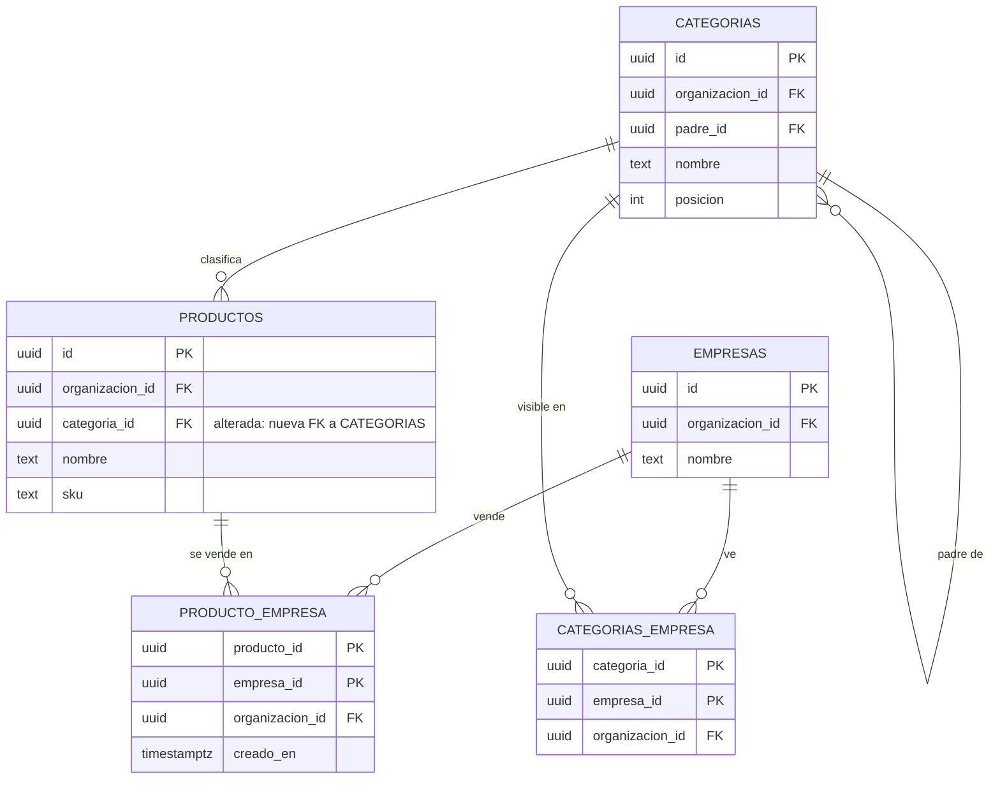

- **[ERD interactivo (Archify)](../diagrams/msf-160-erd.html)** — todas las columnas, PK/FK y cardinalidad.
- **[Arquitectura del catálogo](../diagrams/msf-160-architecture.html)** — cómo se lee y quién consume.

## Modelo de la tienda (MSF-147)

Cinco tablas nuevas en `dominio` (Principio VII), el bucket `tienda-identidad` y funciones de lectura en
`publico`. Migraciones aditivas `20261023100000`–`20261023100300` (rama de la épica, pendiente de merge a
`main`; reversión en el encabezado de cada una y consolidada en
[Tienda online: dominio, identidad y catálogo visible](tienda-dominio-e-identidad.md#alcance-de-entrega)).
No hay borrador ni versiones: cada cambio se aplica al guardar.

| Tabla | Estado | Cambio |
|---|---|---|
| `dominio.tiendas` | **nueva** | Una tienda por empresa (`empresa_id` único) con `dominio` único y normalizado; FK compuesta a `dominio.empresas`. |
| `dominio.tienda_identidad` | **nueva** | Identidad visual por `empresa_id` (PK): cuatro colores `#RRGGBB`, dos tipografías de la lista cerrada de DS-04 y rutas de logo/banner/banner móvil. |
| `dominio.tienda_contenido` | **nueva** | Textos comerciales por `empresa_id` (PK), recortados, con límites y destino del botón en lista cerrada. |
| `dominio.categorias_tienda` | **nueva** | Visibilidad de categorías por `(empresa_id, categoria_id)`; sin fila = visible. |
| `dominio.productos_tienda` | **nueva** | Visibilidad y destacado por `(empresa_id, producto_id)`; sin fila = visible y no destacado. |
| `dominio.empresas` | existente | Solo se referencia con FK compuesta; no cambia. (Alta de empresas, MSF-475: gana el índice único `empresas_organizacion_nombre_uq (organizacion_id, lower(btrim(nombre)))`, ver `supabase/migrations/20261015110000_alta_de_empresas.sql`.) |
| `dominio.categorias` | existente | Solo se referencia con FK compuesta (MSF-160); no cambia. |
| `dominio.productos` | existente | Solo se referencia con FK compuesta; no cambia. |
| `storage.buckets` / `storage.objects` | existente | Se agrega el bucket `tienda-identidad` y sus políticas; no es una tabla de negocio. |

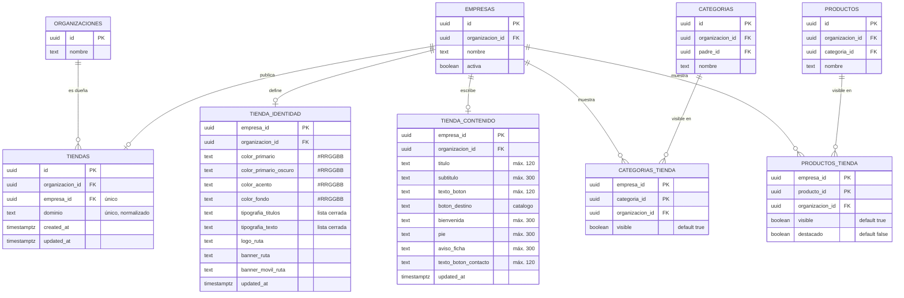

- **Ausencia de fila = valor predeterminado:** identidad y contenido usan el tema base y textos vacíos;
  categorías y productos se toman visibles (y no destacados).
- Los dominios los configura el equipo técnico; no hay pantalla ni RPC de alta de dominio. El cambio de
  dominio queda auditado (`tienda.dominio_configurado`).
- La visibilidad efectiva de un producto se calcula en `private.catalogo_tienda_efectivo` (producto activo,
  visible y con categoría y categoría padre visibles). El detalle de contratos y operación está en
  [Tienda online: dominio, identidad y catálogo visible](tienda-dominio-e-identidad.md).

## Ingreso de mercadería por proveedor (MSF-219)

Dos tablas nuevas en `dominio`, sin cambios de columnas en las tablas existentes. Migraciones aditivas
`20261021180000_ingresos_mercaderia_tablas.sql`, `…180100_ingresos_mercaderia_registrar.sql`,
`…180200_ingresos_mercaderia_listar.sql` y `…180300_ingresos_mercaderia_anular.sql` en la rama de la
épica, pendiente de promoción a `main`; reversión en el encabezado de cada una y consolidada en
[Ingreso de mercadería: modelo, RPC y flujos](ingreso-de-mercaderia.md#reversión).

| Tabla | Estado | Cambio |
|---|---|---|
| `dominio.ingresos_mercaderia` | **nueva** | Cabecera del ingreso: empresa, proveedor, fecha, comprobante, estado, anulación, actor y clave de idempotencia. |
| `dominio.ingresos_mercaderia_lineas` | **nueva** | Producto, cantidad, costo unitario USD y vínculo a los movimientos de entrada y anulación. |
| `dominio.movimientos_stock` | existente | Se referencia; sin cambios de esquema. |
| `dominio.motivos_movimiento` | existente | Alta del motivo «Anulación de ingreso de mercadería» (`{salida}`); sin cambios de esquema. |
| `dominio.proveedores` | existente | FK compuesta `(proveedor_id, organizacion_id)`; sin cambios. |
| `dominio.productos` | existente | FK compuesta `(producto_id, organizacion_id)`; sin cambios. |
| `dominio.producto_costos` | existente | La RPC de registro puede actualizar `costo`; sin cambios de esquema. |
| `dominio.existencias` | existente | La actualiza `registrar_movimiento_stock`; sin cambios. |
| `dominio.empresas` | existente | «Compra a nombre de»; sin cambios. |
| `public.organizaciones` | existente | Alcance multi-tenant; sin cambios. (MSF-132 agrega `zona_horaria` y `logo_path`: ver [administración de la organización](administracion-organizacion.md).) |
| `public.registro_actividad` | existente | Eventos `ingreso.registrado` e `ingreso.anulado`; sin cambios. |

- **[ERD interactivo (Archify)](../diagrams/msf-219-erd.html)** — cabecera, líneas, proveedor, producto y vínculos con el stock.

- La cabecera tiene `unique (organizacion_id, clave_idempotencia)` y un `check` de coherencia de
  anulación; las líneas tienen `unique (ingreso_id, producto_id)` y movimientos únicos de entrada y
  anulación. Detalle de columnas, índices y RLS: [Ingreso de mercadería](ingreso-de-mercaderia.md#modelo-de-datos).
- `dominio.ingresos_mercaderia` y `dominio.ingresos_mercaderia_lineas` tienen RLS de solo `select` con
  `organizacion_id = private.organizacion_id()` y `nivel_seccion('stock')` en `lectura` o `edicion`; sin
  políticas de escritura y sin privilegios para `anon`.
- El stock no se separa por empresa ni por depósito: cada línea mueve el stock único de la organización
  con `public.registrar_movimiento_stock` y el motivo «Compra a proveedor». Los depósitos son MSF-292.

## Acceso y membresía (MSF-119)

- `public.usuarios_organizacion.estado` (`activo` | `suspendido`, default `activo`): migración aditiva `20261012140100`. Las funciones `private.organizacion_id()` y `private.puede_escribir()` excluyen a los suspendidos (más `20261012140300` para las de administración). El trigger `cortar_sesiones_suspendido` (`20261012150000`) borra `auth.sessions` al suspender.
- `public.intentos_acceso` (`correo_hash` PK, `fallos`, `ultimo_fallo`, `bloqueado_hasta`; `20261012140200`): contador de fallos por correo en hash HMAC (clave `acceso_hmac` en Vault). RLS activado y sin privilegios para `anon`/`authenticated`; solo se accede por RPC y por el hook `verificar_intento_acceso` (`20261014100000`). Es plataforma/auth, por eso vive en `public`. Cada migración lleva su reversión en el encabezado.
- Una persona pertenece a una sola organización (`user_id` PK de `usuarios_organizacion`, spec 003).
- El alta de organizaciones nuevas (MSF-162) no cambia el modelo: sin migraciones ni tablas nuevas. La Edge Function `crear-organizacion` escribe con `service_role` en `public.organizaciones` y `public.usuarios_organizacion` (fundador con `rol_id = 'administrador'`); `authenticated` y `anon` no tienen `INSERT` sobre `organizaciones`. `user_id` sigue siendo PK (un usuario, una organización). Detalle: [Organizaciones nuevas](organizaciones-nuevas.md).

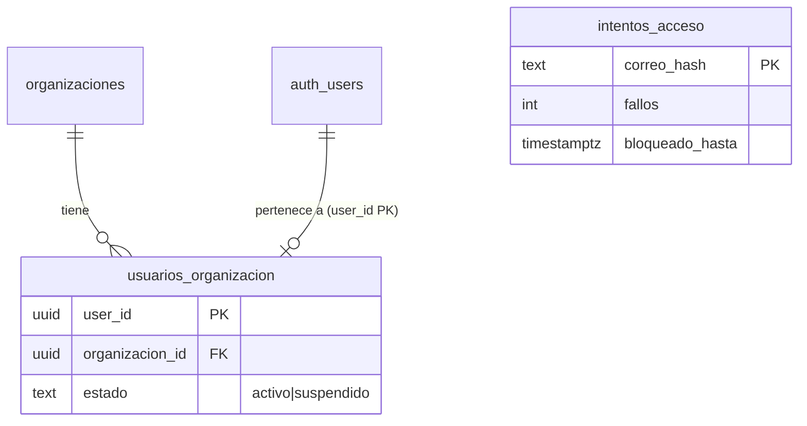

Detalle y operación: [Acceso](../acceso-ingreso.md) · regla para tablas nuevas: [Aislamiento](../aislamiento-por-organizacion.md).

## Usuarios y roles (MSF-125)

Tablas de plataforma en `public` (Principio VII), con RLS por organización y sin privilegios para `anon`. Migraciones aditivas `20261013130002_roles_basicos_permisos.sql`, `20261013140001_invitaciones_usuarios.sql` y `20261014120000_usuarios_suspension_y_roles.sql`. Detalle: [Usuarios y roles](usuarios-y-roles.md) · [Permisos por rol](../permisos-por-rol.md).

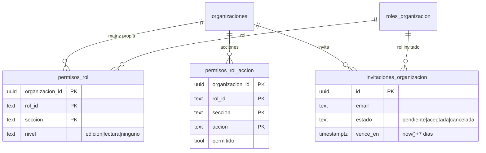

## Permisos por empresa (MSF-121)

Dos tablas nuevas en `public` (pertenencia y contexto de sesión) y una columna aditiva en
`invitaciones_organizacion`; el resto solo se referencia. Migraciones aditivas
`20261016140100_roles_por_empresa.sql`, `20261016150100_cambiar_empresa_activa.sql`,
`20261016160100_asignar_empresas_usuario.sql` y `20261017120000_cambiar_empresa_activa_serializada.sql`.
Detalle de contratos y RPC: [Permisos por empresa](permisos-por-empresa.md) · [Permisos por rol](../permisos-por-rol.md).

| Tabla | Estado | Cambio |
|---|---|---|
| `public.usuarios_empresas` | **nueva** | Rol por empresa: `user_id`, `empresa_id`, `organizacion_id`, `rol_id`, `created_at`; PK `(user_id, empresa_id)`. `check` de los cinco roles por empresa (`operador`, `consulta`, `mostrador`, `deposito`, `administracion`); trigger que exige misma organización. RLS de lectura propia o de Administrador; sin escritura directa. |
| `public.usuario_empresa_activa` | **nueva** | Empresa activa persistida: `user_id` PK, `empresa_id`, `updated_at`; una fila por usuario. RLS de lectura propia; sin escritura directa (solo la RPC `cambiar_empresa_activa`). |
| `public.invitaciones_organizacion` | **alterada** | `asignaciones jsonb not null default '[]'` (`[{"empresa_id": uuid, "rol_id": text}]`), aplicada por `aceptar_invitacion`. |
| `public.usuarios_organizacion` | existente | Solo se lee la membresía, el rol de organización y `estado`; sin cambios. |
| `public.roles_organizacion` | existente | FK de `rol_id`; sin cambios. |
| `public.organizaciones` | existente | FK de `organizacion_id`; sin cambios. |
| `dominio.empresas` | existente | FK de `empresa_id` en ambas tablas nuevas; solo se lee. |
| `auth.users` | existente | FK de `usuario_empresa_activa.user_id`; sin cambios. |
| `public.registro_actividad` | existente | Recibe `usuario.empresa_activa_cambiada` y `usuario.empresas_asignadas`; sin cambios de esquema. |

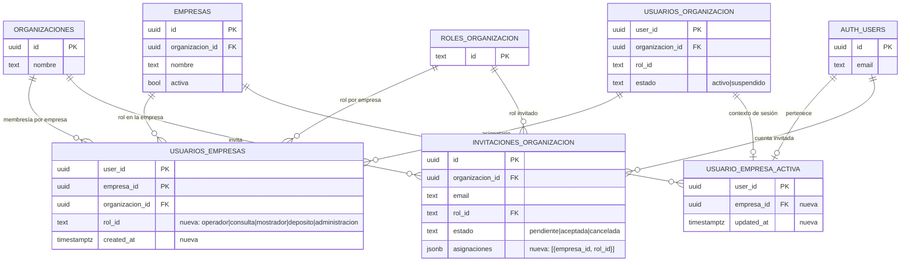

- Ambas tablas nuevas tienen RLS, `anon` sin privilegios y sin escritura directa para `authenticated`
  (`grant select` únicamente): el único camino de escritura son las RPC de F-ROL-06 y F-ROL-07.
- La empresa activa solo es válida si sigue siendo accesible (`private.empresa_activa_valida()`); si se
  pausa la empresa, se quita la asignación o se suspende al usuario, deja de resolverse y las secciones
  por empresa quedan en `ninguno` hasta elegir otra.
- El Administrador de la organización no tiene filas en `usuarios_empresas`: accede a todas las empresas
  activas de su organización.

## Perfil y permisos avanzados (MSF-148)

Una tabla nueva en `public` (plataforma: pedidos de acceso de una persona a una sección del panel), sin
cambios de esquema en las tablas existentes. Migraciones aditivas
`20261017100000_solicitudes_acceso.sql` y `20261017100001_rpc_solicitar_acceso.sql` (merge PR #110,
`415163c4`); reversión en el encabezado de cada una. Detalle del flujo, RPC, correo y operación:
[Perfil y permisos avanzados](perfil-y-permisos.md).

| Tabla | Estado | Cambio |
|---|---|---|
| `public.solicitudes_acceso` | **nueva** | Pedido de acceso por persona, organización, sección y día: `id`, `organizacion_id`, `usuario_id`, `seccion` (≤ 60), `dia`, `creada_en` y `correo_enviado_en` (nulo = aviso pendiente). Única por `(organizacion_id, usuario_id, seccion, dia)`; RLS de lectura propia o de administrador; sin escritura directa. |
| `public.organizaciones` | existente | FK con `on delete cascade`; sin cambios. |
| `auth.users` | existente | FK `usuario_id` con `on delete cascade`; sin cambios. |
| `public.usuarios_organizacion` | existente | Sólo lectura para resolver la membresía activa y los administradores activos; sin cambios. |
| `public.perfiles_usuario` | existente | Sólo lectura para el nombre visible del solicitante; sin cambios (spec 008). |

- `authenticated` sólo tiene `select` sobre la tabla; `anon` y `PUBLIC` no tienen privilegios. El alta va
  por `public.solicitar_acceso(p_seccion)`, `security definer` con `search_path = ''`, que valida sesión,
  membresía activa, sección del catálogo y que no haya acceso previo. `correo_enviado_en` lo escribe la Edge
  Function con la service-role.
- `solicitar_acceso` devuelve `{ id, organizacion_id, nuevo, correo_enviado }`; `nuevo = false` cuando el
  pedido del día ya existía. La clave única es lo que evita duplicados por doble clic o reintento.
- **Reversión:** `drop function public.solicitar_acceso(text)` y, después, `drop table
  public.solicitudes_acceso` en una migración posterior (se pierden los pedidos; exportarlos antes).

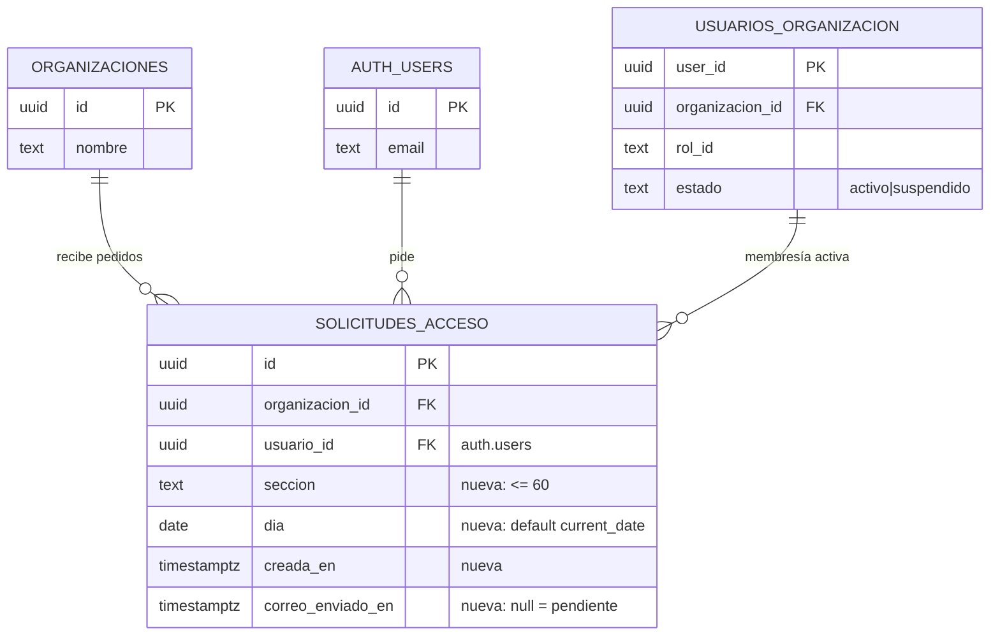

## Service técnico (MSF-182)

Todas las tablas van en `dominio` (Principio VII), con RLS por `organizacion_id` y nivel de `service_tecnico` (`private.nivel_seccion`); lectura además restringida a tiendas accesibles (`20261020140000`). Sin `delete`. Migraciones: `supabase/migrations/20261020100100`–`20261020150000` (aditivas; reversión en el encabezado de cada una).

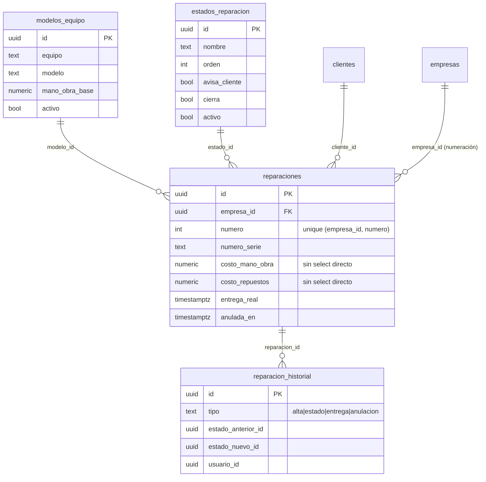

- **Modelos y estados son por organización; la numeración es por empresa** (`private.siguiente_numero_reparacion`, bloqueo asesor por transacción). Sembrado idempotente: `private.sembrar_service` (`20261020100300`, siete modelos y siete estados).
- FK compuestas `(…_id, organizacion_id)` impiden cruzar organizaciones.
- Costos: grant por columna sin `costo_*`; solo los entrega `obtener_reparacion`, enmascarados sin `ver_costos`.
- `reparacion_historial` es solo lectura para la app; lo escriben las RPC en la misma transacción.
- Rol `tecnico`: solo datos en `roles_organizacion`/`permisos_rol` (matriz fija); detalle en la rama de la épica (`docs/permisos-por-rol.md`).

## Stock único y alertas (MSF-231)

La cola durable `public.cola_eventos` es la única tabla nueva; `dominio.existencias` y
`dominio.movimientos_stock` no cambian de esquema (la primera se publica en Realtime y la segunda gana un
disparador de emisión). Migraciones aditivas `20261018180000`–`20261018180500` y `20261018190000` en la
rama de la épica (integradas al lote de STG en `112250fd`, pendientes de promoción a `main`).

- **[ERD interactivo (Archify)](../diagrams/msf-231-erd.html)** — cola de eventos, existencias, movimientos,
  productos y organizaciones.

| Tabla | Estado | Cambio |
|---|---|---|
| `public.cola_eventos` | **nueva** | Cola durable de eventos de dominio: organización, tipo, clave de idempotencia, `carga` jsonb, estado, intentos, lease (`reclamada_en`/`vence_en`), próximo intento y último error sanitizado. `unique (organizacion_id, tipo, clave_idempotencia)`; RLS de lectura solo Administrador. |
| `dominio.existencias` | existente | Sin cambios de esquema. Se agrega a la publicación `supabase_realtime` para el listado en vivo; la cantidad sigue siendo única por producto y organización. |
| `dominio.movimientos_stock` | existente | Sin cambios de esquema. El disparador `movimientos_stock_emitir_evento` (`AFTER INSERT`) emite `stock.actualizado` por cada movimiento aceptado. |
| `dominio.productos` | existente | Solo lectura: nombre y SKU en el listado (`stock_estados`) y en el detalle del evento. |
| `public.organizaciones` | existente | FK `on delete cascade` de la cola; alcance multi-tenant. |

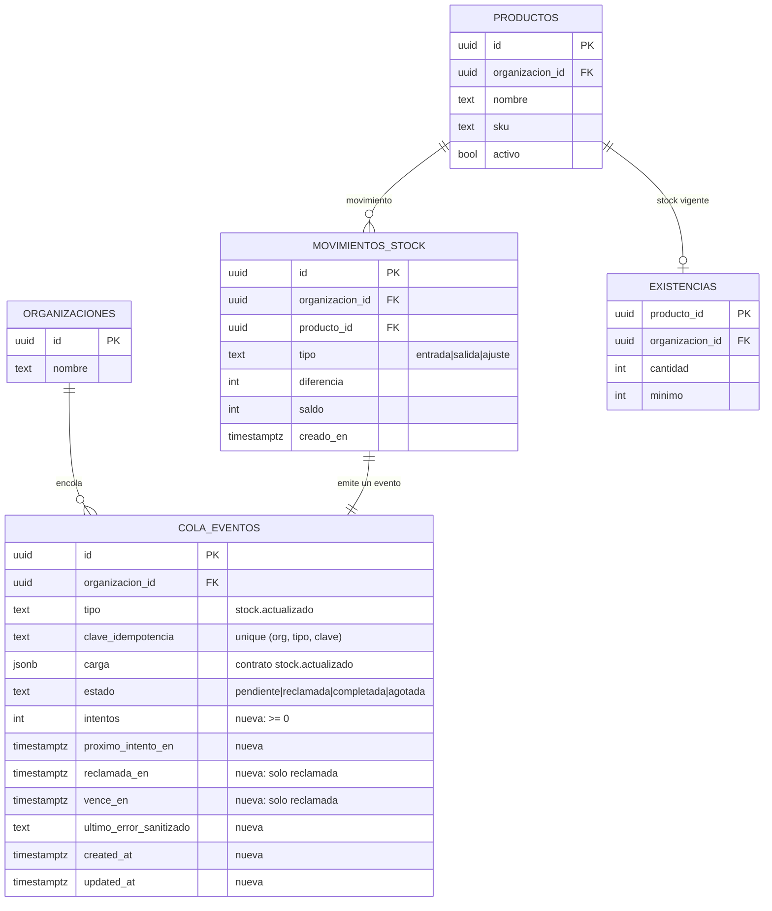

- El contrato del evento (`carga`: `organizacion_id`, `producto_id`, `movimiento_id`, `tipo_movimiento`,
  `cantidad`, `diferencia` y `ocurrido_en`) y las reglas de reclamo/lease/reintentos están en
  [Stock único y alertas](stock-unico-y-alertas.md#contrato-del-evento-stockactualizado).
- `public.cola_eventos` no la escribe la app: solo el disparador. `authenticated` no tiene `insert`,
  `update` ni `delete`; `anon` no tiene privilegios.
- La vista `public.stock_estados` (MSF-136) sigue siendo el contrato de lectura del listado y del resumen
  de reposición; Realtime avisa cambios sobre la tabla y el listado recarga la vista.

## Stock: lotes e inventario (MSF-131)

La carga en lote agrega `dominio.lotes_stock`; la toma de inventario no crea tablas, solo ajustes.

| Tabla | Estado | Cambio |
|-------|--------|--------|
| `dominio.lotes_stock` | nueva | Cabecera del lote: número correlativo por organización, proveedor en texto libre, fecha, motivo, clave de idempotencia y actor |
| `dominio.movimientos_stock` | alterada | Columna nullable `lote_id` con FK compuesta `(lote_id, organizacion_id)` e índice parcial |
| `dominio.motivos_movimiento` | existente | Fila de sistema nueva «Toma de inventario» (aplica a `ajuste`), sembrada y rellenada por organización |
| `dominio.existencias_deposito` | existente | Solo lectura: la toma compara el contado contra el stock del depósito por defecto |
| `dominio.depositos` | existente | Solo lectura: resuelve el depósito por defecto de la toma |
| `dominio.productos` | existente | Solo lectura: nombre y SKU de las líneas y del detalle |

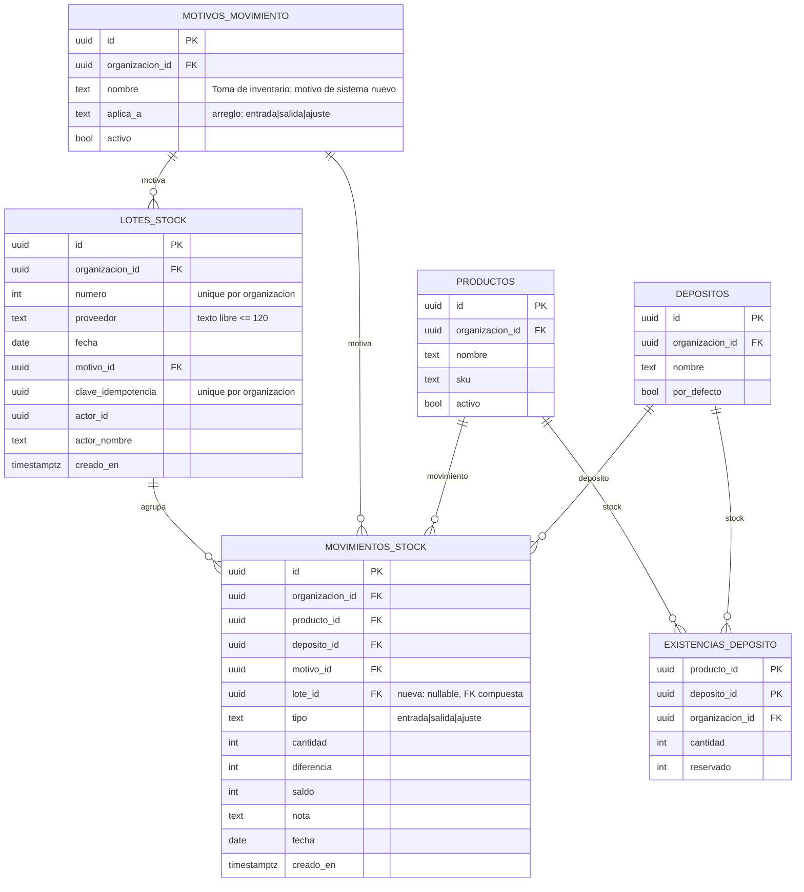

- Migraciones: `20261202100000_stock_lotes_tabla.sql` (tabla, columna y RLS), `20261202130000_stock_motivo_toma_inventario.sql`
  (motivo de sistema) y `20261202130100_stock_confirmar_toma.sql` (RPC de la toma).
- `lotes_stock` es de solo agregado y solo la escribe `registrar_lote_stock`; la toma no persiste una entidad, produce
  movimientos `ajuste` por la vía de `registrar_movimiento_stock`.
- Detalle técnico y reversión: [Stock · lotes e inventario](stock-lotes-e-inventario.md).
## Service técnico: ítems e impresión (MSF-199)

Se agrega `dominio.reparacion_items` (entidad de negocio del taller) y dos columnas derivadas en
`dominio.reparaciones`: `total_mano_obra` y `total_repuestos` (ARS sin IVA, de cara al cliente). Las RPC de
ítems y listado viven en `public` y las ayudas internas en `private`. Migraciones:
`supabase/migrations/20261022100100`–`20261022110200` (aditivas; reversión en el encabezado de cada una).
Detalle: [Service técnico: listado, ítems e impresión](service-listado-items-impresion.md).

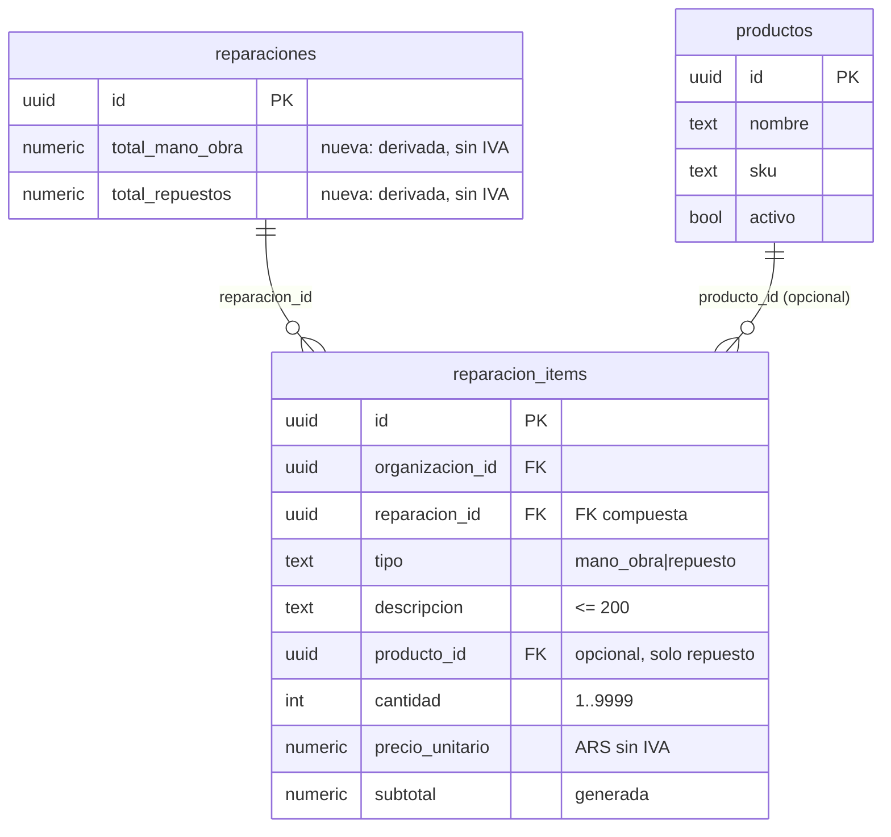

- **RLS**: `reparacion_items` filtra por organización, nivel `service_tecnico` (`lectura`/`edicion`) y tienda
  accesible; sin grants de escritura directa (`insert`/`update`/`delete`), solo escriben las RPC
  `security definer`. `anon` sin acceso.
- **FK compuestas** `(reparacion_id, organizacion_id)` y `(producto_id, organizacion_id)` impiden cruzar
  organizaciones.
- **Totales**: los mantiene solo `private.recalcular_totales_reparacion` dentro de la misma transacción que
  agrega o quita un ítem; `reparaciones` no tiene grants de escritura para esas columnas.
- **Stock**: los ítems no mueven existencias; el descuento de repuestos es de MSF-217.

## Consultas (MSF-122)

Tres tablas nuevas en `dominio` (Principio VII), con RLS por organización, empresa accesible y sección
`consultas`; sin escritura directa desde la app. El alta entra solo por `publico.crear_consulta_publica`
(la empresa sale del dominio de la tienda) y la edición por `public.actualizar_consulta`. Migraciones:
`20261205100000_consultas.sql`, `20261205200000_consultas_configuracion.sql` y
`20261205200100_consultas_avisos.sql` (aditivas; reversión en el encabezado de cada una y consolidada en
[Consultas: modelo, RPC y aviso](consultas.md#reversion)).

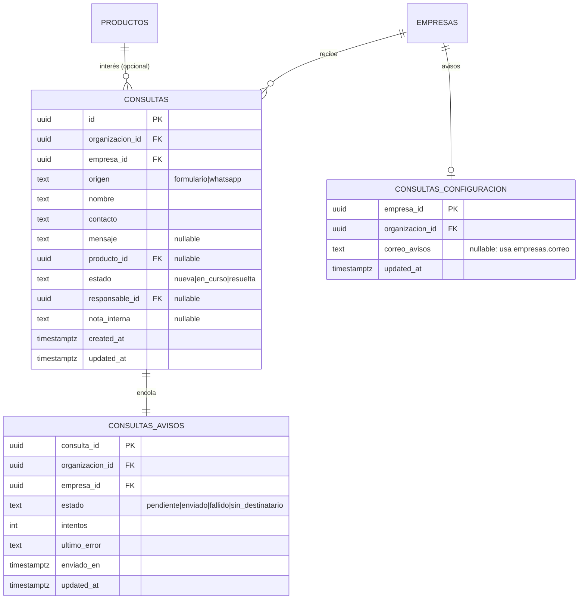

- `consultas` guarda estado, responsable y nota interna; `consultas_configuracion` la dirección de avisos
  (una fila por empresa); `consultas_avisos` la cola del correo, con `consulta_id` como clave (un aviso por
  consulta).
- FK compuestas `(empresa_id, organizacion_id)` y `(producto_id, organizacion_id)` impiden cruzar
  organizaciones.
- La vista `public.consultas_bandeja` y las RPC del panel viven en `public` y no almacenan datos.
- Desde MSF-189 (MSF-562) el alta **ya no encola en `dominio.consultas_avisos`**: el disparador emite por
  `private.emitir_aviso` y el flow `enviar-avisos` envía. `consultas_avisos` y la Edge Function quedan solo
  para drenar lo que ya estaba encolado. Detalle: [Avisos y listas](avisos-y-listas.md).
- Detalle de RPC, permisos, aviso y operación: [Consultas](consultas.md).

## Rentabilidad (MSF-120)

La tabla nueva va en `dominio` y las vistas en un esquema nuevo `analitica` (solo vistas, sin tablas ni RLS);
`public.reportes` suma una columna. Migraciones `20261130100000`–`20261130100400` (umbral, Actividad, vista
base, rol de Superset y `reportes.seccion`) y `20261130110000`–`20261130110100` (vistas del resumen y RPC de
conteo), todas aditivas y con reversión en el encabezado.

| Objeto | Esquema | Estado | Cambio |
|---|---|---|---|
| `rentabilidad_config` | `dominio` | nueva | `organizacion_id` PK y `umbral_margen_bajo` (0 < valor ≤ 1, default 0,10). |
| `margen_producto_canal` | `analitica` | nueva (vista) | Una fila por producto × tienda con margen calculable. |
| `rentabilidad_resumen_empresa` | `analitica` | nueva (vista) | Agregado por empresa. |
| `rentabilidad_consolidado` | `analitica` | nueva (vista) | Agregado por organización, ponderado. |
| `reportes.seccion` | `public` | alterada | Columna nueva nullable; exige una sección para emitir el token. |

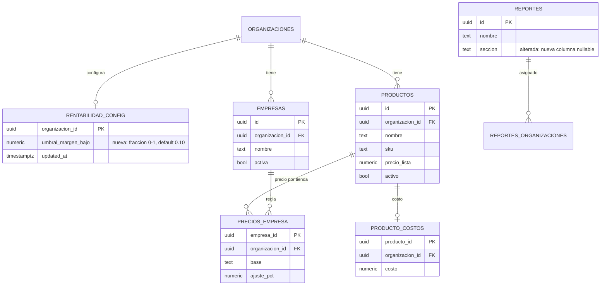

- El margen se **calcula al leer** (`analitica.margen_producto_canal`) desde
  `public.precios_empresa_neto` y `dominio.producto_costos` (convertido con `private.a_pesos`); no se guarda
  un importe en pesos.
- `analitica` no tiene tablas: está cerrado para `anon`/`authenticated` y lo lee solo el rol
  `superset_analitica`. El aislamiento por organización lo fuerza la cláusula `rls` del guest token, por eso
  cada vista expone `organizacion_id`.
- Detalle de RPC, tableros y operación: [Rentabilidad](rentabilidad.md).
## Migración inicial de datos (MSF-142)

El importador del panel anterior (MSF-142) agrega dos tablas de plataforma en `public`, una tabla de
historial en `dominio` y una columna en `dominio.proveedores`. Migraciones:
`20261201100000_migracion_cargas.sql`, `20261201110000_proveedores_id_externo.sql`,
`20261201120000_archivo_ingresos_mercaderia.sql` y `20261201130000_migracion_conciliacion.sql`
(aditivas; reversión en el encabezado de cada una).

| Tabla | Estado | Cambio |
|---|---|---|
| `public.organizaciones` | existente | Dueña de las cargas y del archivo; no cambia. |
| `public.migracion_cargas` | nueva | Cabecera de cada ejecución (entidad, archivo, filas, estado, contadores, actor). RLS de lectura solo Administrador. |
| `public.migracion_filas` | nueva | Resultado por fila; única por `(carga_id, fila)`. RLS de lectura solo Administrador. |
| `public.clientes` | existente | Destino de la carga de clientes; sin cambios de esquema. Los nuevos se habilitan en todas las tiendas. |
| `public.clientes_identificadores_externos` | existente | Clave de conciliación con `sistema = 'panel_actual'`; sin cambios de esquema. |
| `public.clientes_empresas` | existente | Relación cliente ↔ tienda que rellena el alta de la migración; sin cambios de esquema. |
| `dominio.empresas` | existente | Tiendas donde se habilitan los clientes nuevos; sin cambios de esquema. |
| `dominio.proveedores` | alterada | `+ id_externo` (nullable, único por organización cuando tiene valor). |
| `dominio.productos` | existente | La carga de vínculos fija `proveedor_id` y `codigo_proveedor`; sin cambios de esquema. |
| `dominio.archivo_ingresos_mercaderia` | nueva | Historial de ingresos del panel anterior, único por `(organizacion_id, id_externo)`; solo `select` para `authenticated`. |

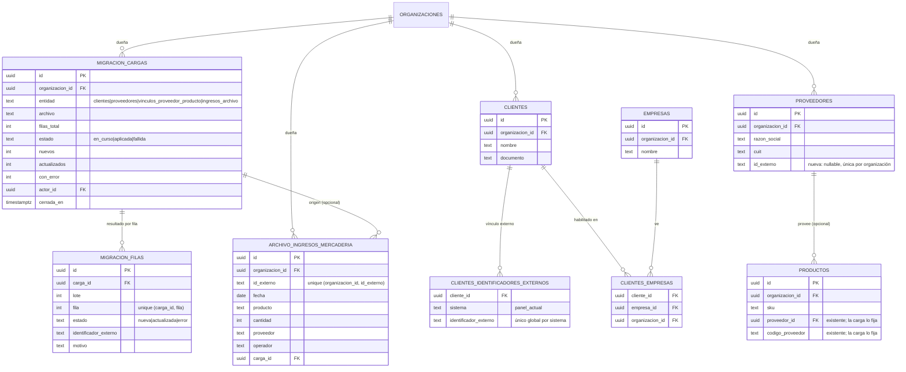

- `migracion_filas.fila` es el número de fila del archivo contando el encabezado como 1; es la base de
  la idempotencia `(carga, fila)`.
- `clientes_identificadores_externos` es único por `(sistema, identificador_externo)` en toda la base:
  el identificador del panel actual no se repite entre organizaciones.
- `archivo_ingresos_mercaderia` no tiene FK a productos, proveedores, depósitos ni a
  `dominio.ingresos_mercaderia`: no mueve stock ni se mezcla con los ingresos vivos.
- Detalle de RPC, contrato CSV, conciliación y operación:
  [Migración inicial de datos](migracion-inicial-de-datos.md).
## Ventas comprobantes (MSF-159)

Documento de venta interno (factura o presupuesto) con líneas y numeración por empresa y tipo. Todo vive
en `dominio`; la única tabla de plataforma que se toca es `public.permisos_rol_accion` (dato nuevo, sin
cambio de esquema). Migraciones: `20261203100100` … `20261204150200` (aditivas; reversión en el encabezado
de cada una y consolidada en [Ventas · comprobantes (técnico)](ventas-comprobantes.md#reversion)).

| Tabla | Estado | Cambio |
|---|---|---|
| `dominio.comprobantes_venta` | alterada | Empresa/tienda, canal, operador, vencimiento, forma de pago y envío elegidos, confirmación, `updated_at` y `numero_entero`; el resto del contrato de F-CLI-08 sigue igual. |
| `dominio.comprobantes_venta_lineas` | nueva | Producto, cantidad, precio sin IVA, escala, IVA, depósito de salida, «A pedido» y totales de la línea. |
| `dominio.comprobantes_venta_numeracion` | nueva | Contador `(organización, empresa, tipo) → último`; sin acceso directo. |
| `dominio.empresas`, `dominio.productos`, `dominio.depositos`, `dominio.existencias_deposito`, `dominio.reservas_stock` | existentes | Solo se leen al armar líneas y confirmar; la confirmación escribe movimientos y reservas con el motor de stock. |
| `public.clientes`, `public.permisos_rol_accion` | existentes | Sin cambio de esquema; `editar_precio` es un dato nuevo en la matriz de acciones de Ventas. |

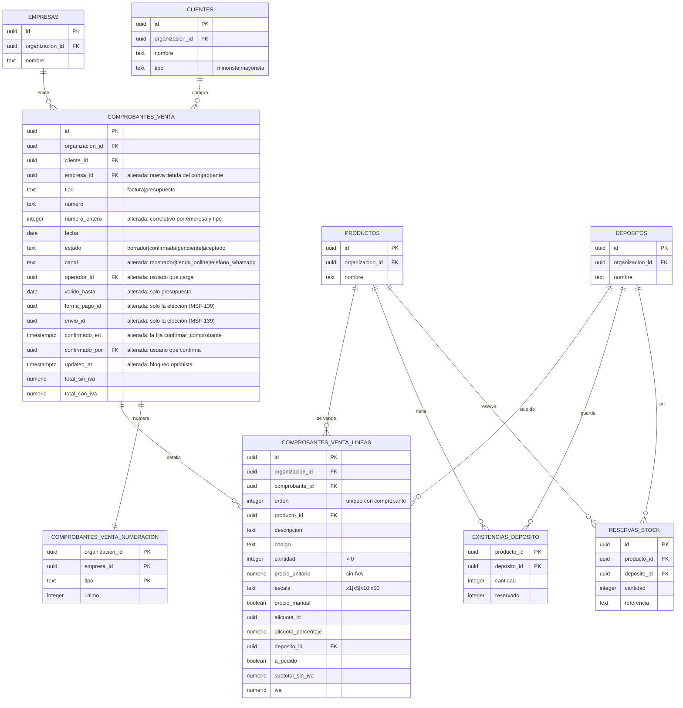

- **[ERD interactivo (Archify)](../diagrams/msf-159-erd.html)** — todas las tablas del grafo, columnas,
  PK/FK y cardinalidad.
- La numeración se toma con `private.siguiente_numero_comprobante` bajo bloqueo transaccional; el formato
  visible es provisorio (`lpad(..., 8, '0')`).
- La confirmación usa `private.aplicar_movimiento_deposito`; no llama a las RPC públicas de Stock porque
  exigen `stock` en edición y quien vende confirma con `ventas` en edición.
- Detalle de RPC, permisos, confirmación y reversión: [Ventas · comprobantes (técnico)](ventas-comprobantes.md).
## Avisos y listas configurables (MSF-189)

Tres tablas nuevas en `public` (plataforma/transversal), una en `dominio` (estado de consulta) y ninguna
alteración de `dominio.motivos_movimiento`. Migraciones aditivas `20261210120000`–`20261210120600` (avisos) y
`20261210130000`–`20261210130300` (listas y emisión desde Consultas), en la rama de la épica, pendiente de
merge a `main`; reversión en el encabezado de cada una y consolidada en
[Avisos y listas](avisos-y-listas.md#reversión). Los detalles de RPC, flow y operación están en
[Avisos y listas: modelo, RPC y flujos](avisos-y-listas.md).

| Tabla | Estado | Cambio |
|---|---|---|
| `public.tipos_aviso` | **nueva** | Catálogo de tipos (clave, nombre, sección de permisos); siembra `consulta_nueva`. RLS con `select` para `authenticated`, sin escritura desde la app. |
| `public.preferencias_aviso` | **nueva** | Preferencia por `(user_id, tipo_aviso)`; sin fila = encendido. Cada usuario lee y escribe solo las suyas; sin delete. |
| `public.avisos_pendientes` | **nueva** | Cola durable de correos con `grupo_id`, `datos`, estado, ventana, intentos, reclamo, `enviado_en` y `error`. RLS activa sin políticas para `authenticated`; solo `security definer` y el rol de Kestra. |
| `dominio.estados_consulta` | **nueva** | Lista de estados por organización (`nombre` ≤ 80, `activo`, `orden`), nombre único sin distinguir mayúsculas. RLS: lectura con `consultas`, escritura solo Administrador; sin delete. **Todavía no alimenta la bandeja de Consultas.** |
| `dominio.motivos_movimiento` | existente | **Sin cambio de tabla ni de RLS**; se edita también desde `/configuracion/listas` con el mismo editor de `/stock/motivos`. |
| `dominio.consultas` | existente | **Sin cambio de tabla**; el disparador de aviso ahora emite por `private.emitir_aviso` en lugar de encolar en `dominio.consultas_avisos`. |
| `public.organizaciones`, `public.usuarios_organizacion`, `auth.users` | existente | Solo se referencian con FK; no cambian. |

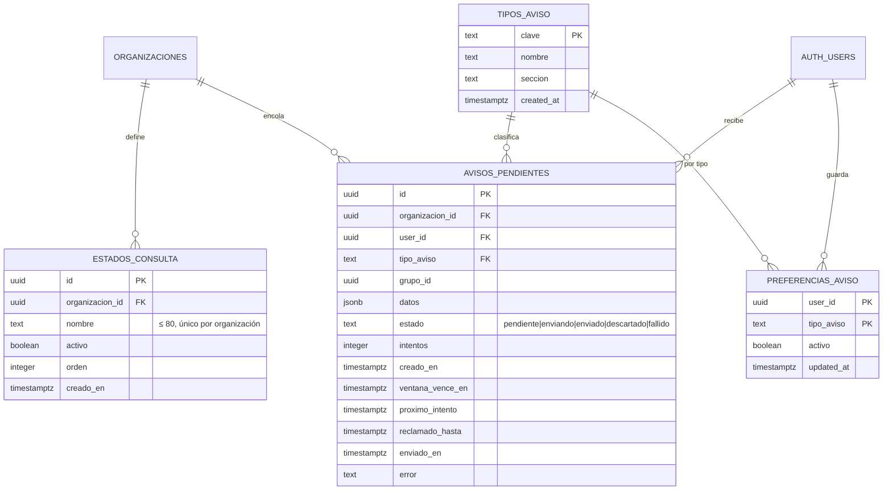

- `tipos_aviso` es un catálogo global (sin `organizacion_id`); cada componente registra sus claves por
  migración.
- `avisos_pendientes` agrupa por `grupo_id`: varias filas con el mismo grupo salen en un solo correo.
- `estados_consulta` no tiene FK desde `dominio.consultas.estado` en esta entrega; los estados de la bandeja
  siguen siendo los tres fijos de MSF-122. Conectarlos y migrar los valores es una historia de seguimiento.
- `motivos_movimiento` mantiene la forma de F-STK-02 (tipos a los que aplica y activo); la pantalla de listas
  no agrega columnas.

## Tienda pública (MSF-147 / MSF-167)

Las tablas del modelo de tienda son las cinco nuevas de **MSF-147** (ver arriba). **MSF-167** (catálogo y
ficha) **no crea ni altera tablas**: agrega funciones de lectura en `publico` y lógica interna en
`private`. `publico` sigue sin tablas.

| Función | Qué expone |
|---|---|
| `publico.tienda_por_dominio(host)` | Tienda pública (`tienda_id`, `empresa_nombre`, `estado`) o cero filas si el dominio no existe o la empresa está inactiva (MSF-147) |
| `publico.identidad_por_dominio(host)` | Colores, tipografías y rutas de logo/banners de la tienda; sin fila, valores del tema base (MSF-147) |
| `publico.contenido_por_dominio(host)` | Textos comerciales de la tienda; sin fila, todo vacío (MSF-147) |
| `publico.catalogo_visible_por_dominio(host)` | Categorías visibles y productos efectivamente visibles (destacados primero) con nombre, precio, indicador de imagen y categoría (MSF-147) |
| `publico.categorias_por_dominio(host)` | Categorías visibles de la tienda del dominio, con conteo de productos efectivos (MSF-167) |
| `publico.catalogo_pagina_por_dominio(host, categoria, solo_con_stock, precio_max, orden, pagina)` | Página de 24 productos con lista blanca (precio final, disponible, imagen, categoría y destacado) (MSF-167) |
| `publico.producto_por_dominio(host, producto)` | Ficha con nombre, descripción, SKU, categoría, precio, disponibilidad, compatibilidad e imágenes (MSF-167) |
| `publico.imagen_publica(ruta)` | Booleano que respalda la política de lectura anónima de imágenes de productos visibles (MSF-167) |

- La visibilidad efectiva sale de `private.catalogo_tienda_efectivo` (producto activo, visible y con
  categoría visible); el precio, de `private.precio_final_publico`, y la disponibilidad, de
  `private.disponible_publico` (solo booleano).
- `anon` ejecuta solo funciones de `publico`; las tablas conservan su RLS por organización.
- Detalle de contratos, seguridad y operación: [Tienda online: dominio, identidad y catálogo
  visible](tienda-dominio-e-identidad.md) y [Tienda pública: catálogo y ficha](tienda-catalogo-y-ficha.md).
  Modelo del catálogo y ERD vigente: [MSF-160](#modelo-del-catálogo-msf-160).

## Cuenta web del cliente (MSF-237)

Una tabla nueva en `public` (plataforma/autenticación, atada a `public.clientes` por la excepción
documentada) y funciones de lectura en `publico`/`private`; `publico` sigue **sin tablas**. Migraciones
aditivas `20261206100000`–`20261206110100` (rama de la épica, pendiente de merge a `main`; reversión en
el encabezado de cada una y consolidada en [Cuenta web del cliente](cuenta-web-cliente.md#alcance-de-entrega)).
Detalle de RLS, RPC y operación: [Cuenta web del cliente](cuenta-web-cliente.md).

| Tabla | Estado | Cambio |
|---|---|---|
| `public.cuentas_cliente` | **nueva** | Cuenta web por `(cliente, tienda)`: `id`, `organizacion_id`, `cliente_id`, `empresa_id`, `auth_user_id`, `estado` (`activa` \| `suspendida`), `created_at`; única `(cliente_id, empresa_id)`; FK en cascada a organización, cliente, empresa y `auth.users`. |
| `public.clientes` | existente | Solo se referencia; el correo de acceso sale de `clientes.correo` y el tipo define la escala. |
| `public.clientes_empresas` | existente | Determina «Habilitado en»; su ausencia deriva «No habilitado». |
| `public.organizaciones` | existente | Dueña y límite de aislamiento. |
| `dominio.empresas` / `dominio.tiendas` | existentes | Empresa de la cuenta y dominio para el enlace de Auth. |
| `auth.users` | existente | Un usuario por cliente (D1); `last_sign_in_at` alimenta «Último ingreso». |
| `public.usuarios_organizacion` | existente | **No** recibe la cuenta web: por eso no accede al panel. |

- RLS activada; lectura `authenticated` por organización, sección Clientes y `private.empresas_accesibles()`;
  sin políticas de escritura (solo RPC `security definer`). `anon` no tiene grants.
- «Sin cuenta» (sin fila) y «No habilitado» (cliente fuera de `clientes_empresas`) se **derivan**, no se
  guardan; «No habilitado» prevalece sobre el estado guardado.

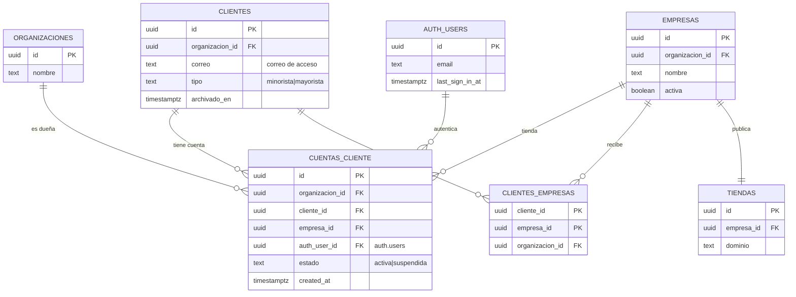

## Precios y dólar (MSF-116)

Tres tablas nuevas en `dominio` (Principio VII), una por organización y con RLS; la cotización es **de la
organización**, no de una empresa. La cuarta, `cotizacion_inicial`, ya existe (MSF-114) y queda como
respaldo. Migraciones aditivas `20261023140000`–`20261023140500` (rama de la épica, pendiente de merge a
`main`; reversión en el encabezado de cada una y consolidada en
[Dólar y recálculo](dolar-y-recalculo.md#reversión)).

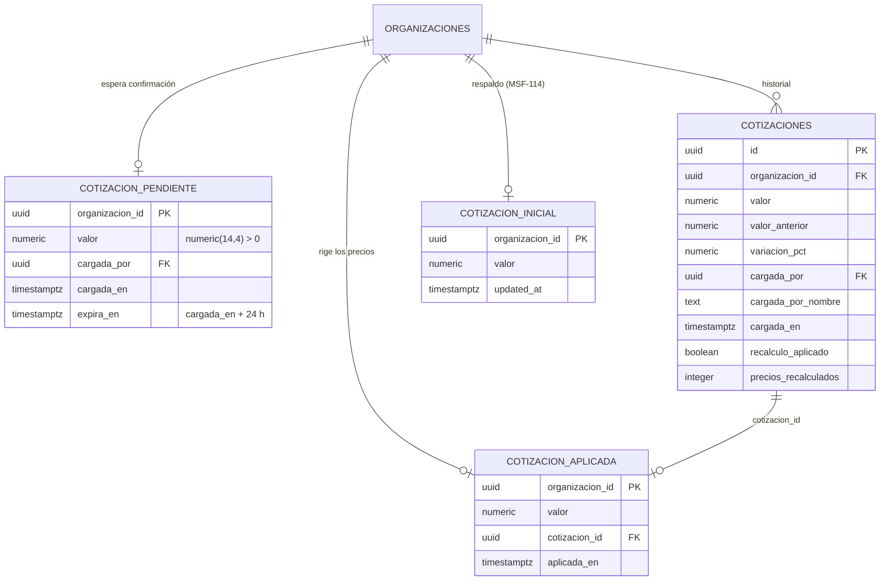

- `cotizacion_pendiente`: valor cargado que espera confirmación; vence a las 24 h y se resuelve al
  consultar; los tiempos los fija un trigger.
- `cotizaciones`: historial append-only de cargas confirmadas; sin grants de escritura y con triggers
  `ENABLE ALWAYS` que rechazan `UPDATE`, `DELETE` y `TRUNCATE`. Único escritor:
  `public.confirmar_cotizacion`.
- `cotizacion_aplicada`: una fila por organización; la lee `private.a_pesos` con
  `coalesce(aplicada, inicial)`. Sin fila, rige la inicial.
- `anon` sin privilegios en las tres. RPC, umbral, eventos y operación: [Dólar y recálculo](dolar-y-recalculo.md).

## Actividad e historial (MSF-455)

Migración aditiva `supabase/migrations/20261016120000_registro_actividad.sql` (esquema `public`: tabla transversal de plataforma, no de dominio). Detalle funcional y contrato de registro: [Actividad e historial](../actividad.md).

| Tabla | Estado | Notas |
|---|---|---|
| `public.registro_actividad` | nueva | Solo agregado; `tipo` con formato `entidad.accion` (máx. 60), `detalle` no vacío (máx. 500). Índices por `(organizacion_id, creado_en desc)`, tipo, actor y empresa. |
| `public.organizaciones` | existente | FK `organizacion_id`; sin cambios. |

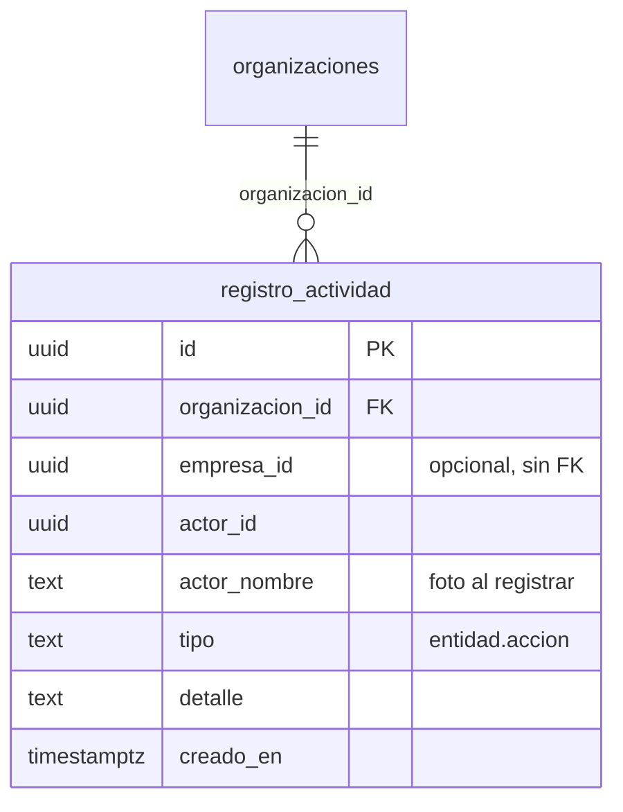

- RLS: solo `select` a `authenticated` de su organización con nivel `lectura`/`edicion` en `actividad` (`private.nivel_seccion`); sin escritura directa ni privilegios para `anon`.
- Escritura únicamente vía `private.registrar_actividad` (misma transacción que la operación de origen) y la RPC acotada `public.registrar_actividad`; lectura vía `public.listar_actividad` y `public.opciones_actividad`.
- Reversión: ver sección «Reversión» de [Actividad e historial](../actividad.md).

## Datos vivos vs. archivo

- **Vivos:** comprobantes, cobros, stock, reparaciones. Afectan estados, saldos y reportes.
- **Archivo (`historial_*`):** datos del panel anterior, importados una sola vez, **solo lectura**. No tocan stock, saldos ni estados.
  - **[Flujo de importación](../diagrams/msf-275-dataflow.html)**
  - **[Estados de la ejecución](../diagrams/msf-275-lifecycle.html)**
- **Archivo de ingresos (`dominio.archivo_ingresos_mercaderia`, MSF-142):** historial de ingresos del panel anterior, solo lectura y sin efecto en el stock. Ver [Migración inicial de datos](migracion-inicial-de-datos.md).

## Migraciones y RLS

- Cada historia trae **su propia migración aditiva** con reversión en el encabezado.
- Las RPC nuevas son `security invoker` (o `definer` justificado), con `revoke`/`grant` explícitos.
- `rls_en_toda_tabla` y `aislamiento_organizaciones` recorren `public` + `dominio` en pgTAP.

## Inventario

El listado de tablas/rutas/variables generado desde el código está en **[Inventario](../_generated/inventory.md)**.

> **service_role (server-only):** tiene grants explícitos en `public`, `dominio` y `private`; `BYPASSRLS` no alcanza para usar un esquema/tabla. Lo usa el sandbox y las herramientas server-side, nunca el navegador.
