# Datos y DER

## Esquemas

| Esquema | Qué guarda |
|---|---|
| `public` | Plataforma: organizaciones, usuarios, roles, permisos, actividad, ejecuciones, imports. También `clientes`, por la excepción documentada al Principio VII (ver «Clientes (MSF-180)») |
| `dominio` | Negocio: empresas, productos, categorías, stock, ingresos de mercadería, comprobantes, reparaciones, ítems de reparación, historial |
| `publico` | **Solo funciones** `security definer` de lectura anónima de la tienda online; **sin tablas** |

Toda tabla expuesta tiene **RLS** por organización. Las secciones por empresa resuelven el nivel con `private.nivel_seccion()` y la empresa activa.

## Clientes (MSF-180)

La épica **no crea tablas**: extiende `public.clientes`, que ya existía como esqueleto del template
(`id`, `organizacion_id`, `nombre`, `created_at`; creada en `20260908172920_fundacion_multitenant.sql`).
La tabla queda en **`public`** por **excepción documentada** al Principio VII: es preexistente y
expuesta, y moverla a `dominio` no es aditivo ni rompe `clientes_identificadores_externos` ni el control
positivo de las pruebas de aislamiento. El traslado quedó trazado como seguimiento: [MSF-505].
Migraciones `20261016130000`–`20261016160000`, ya integradas en `main`; reversión en el encabezado de
cada una y consolidada en [Clientes: modelo, RPC y pantallas](clientes.md#reversion).

| Tabla | Estado | Cambio |
|---|---|---|
| `public.clientes` | **alterada** | Gana `numero integer not null` (correlativo por organización), `documento`, `correo`, `telefono`, `celular`, `direccion`, `codigo_postal`, `localidad`, `provincia`, `archivado_en timestamptz`, `updated_at timestamptz not null default now()`, `tipo text not null default 'minorista'` y `es_consumidor_final boolean not null default false`. |
| `public.organizaciones` | existente | Recibe el disparador `organizaciones_crear_consumidor_final`: cada organización nueva nace con su «Consumidor final». Sin cambios de esquema. |
| `public.registro_actividad` | existente | Recibe `cliente.creado`, `cliente.editado`, `cliente.archivado` y `cliente.restaurado`. Sin cambios de esquema. |
| `public.clientes_identificadores_externos` | existente | FK a `clientes(id)`; sin cambios. El mapeo de identificadores sigue válido (la numeración se asigna sola). |

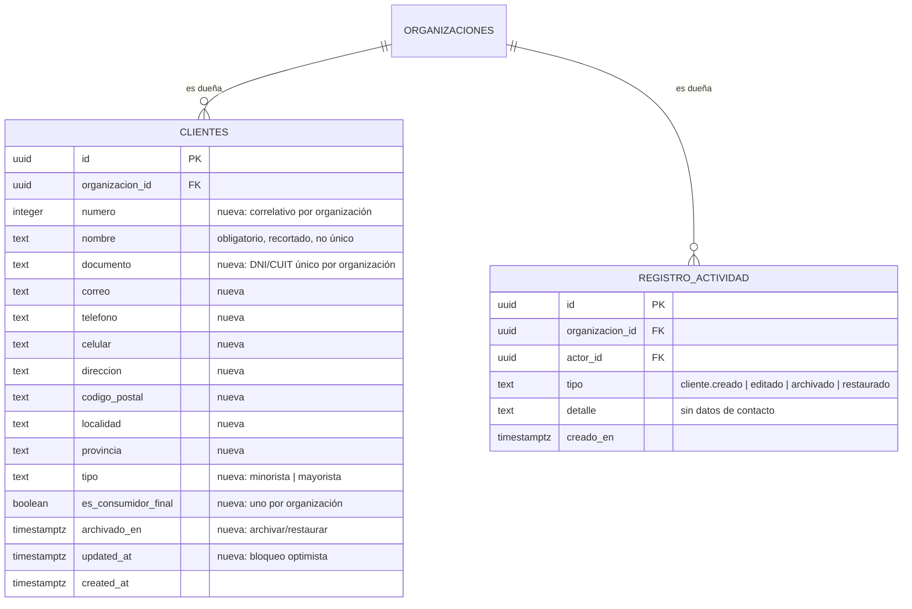

- Restricciones e índices (`clientes_org_numero_uq`, `clientes_org_documento_uq`,
  `clientes_consumidor_final_uq`, `clientes_org_nombre_idx`, `clientes_busqueda_trgm_idx`), RPC, RLS,
  grants por columna y plan de búsqueda:
  [Clientes: modelo, RPC y pantallas](clientes.md).
- El **Consumidor final** es un cliente más de la organización, de tipo minorista e inmutable en la
  base (`clientes_proteger_consumidor_final`): no se edita, no se archiva y no cambia de tipo.

## Modelo del catálogo (MSF-160)

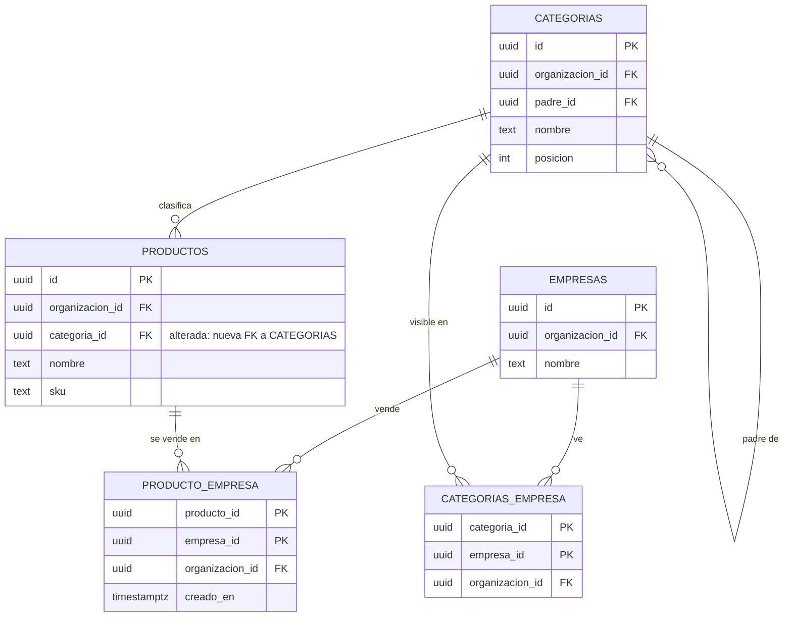

- **[ERD interactivo (Archify)](../diagrams/msf-160-erd.html)** — todas las columnas, PK/FK y cardinalidad.
- **[Arquitectura del catálogo](../diagrams/msf-160-architecture.html)** — cómo se lee y quién consume.

## Proveedores y productos (MSF-205)

Una tabla nueva en `dominio`, dos columnas aditivas en `dominio.productos` y una vista de superficie en
`public`. Migraciones `20261021161600`–`20261021162300` en la rama de la épica, todavía sin promover a
`main`; reversión en el encabezado de cada una y consolidada en
[Proveedores: modelo, RPC y pantallas](proveedores.md#reversión). El proveedor pertenece a la
**organización** y se comparte entre empresas (no hay `empresa_id`).

| Tabla | Estado | Cambio |
|---|---|---|
| `dominio.proveedores` | **nueva** | Razón social, CUIT (11 dígitos, único por organización incluso entre desactivados), contacto, correo, teléfono, dirección, observaciones y `activo`; `unique (id, organizacion_id)` habilita la FK compuesta. Se desactiva, no se borra. |
| `dominio.productos` | existente | Gana `proveedor_id` (FK compuesta a `proveedores`, `on delete restrict`) y `codigo_proveedor` (≤ 80); no hay código sin proveedor. |
| `public.proveedores_basico` | **vista nueva** | Solo `id`, `razon_social` y `activo` para selectores; no expone CUIT ni contacto. |
| `public.organizaciones` | existente | FK de `proveedores`; sin cambios. |
| `public.registro_actividad` | existente | Eventos `proveedor.creado|editado|desactivado|reactivado`; sin cambios de esquema. |

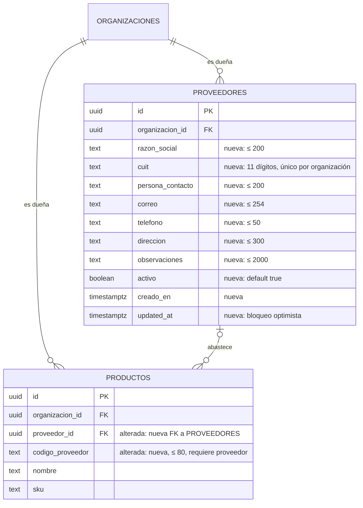

- Detalle de CUIT, RLS, RPC, vista, contrato de producto, errores y pruebas:
  [Proveedores: modelo, RPC y pantallas](proveedores.md).
- La ficha del proveedor lista sus productos con `public.productos_de_proveedor`; el ingreso de
  mercadería (MSF-219) usa `public.proveedores_basico` para elegir el proveedor.

## Modelo de la tienda (MSF-147)

Cinco tablas nuevas en `dominio` (Principio VII), el bucket `tienda-identidad` y funciones de lectura en
`publico`. Migraciones aditivas `20261023100000`–`20261023100300` (rama de la épica, pendiente de merge a
`main`; reversión en el encabezado de cada una y consolidada en
[Tienda online: dominio, identidad y catálogo visible](tienda-dominio-e-identidad.md#alcance-de-entrega)).
No hay borrador ni versiones: cada cambio se aplica al guardar.

| Tabla | Estado | Cambio |
|---|---|---|
| `dominio.tiendas` | **nueva** | Una tienda por empresa (`empresa_id` único) con `dominio` único y normalizado; FK compuesta a `dominio.empresas`. |
| `dominio.tienda_identidad` | **nueva** | Identidad visual por `empresa_id` (PK): cuatro colores `#RRGGBB`, dos tipografías de la lista cerrada de DS-04 y rutas de logo/banner/banner móvil. |
| `dominio.tienda_contenido` | **nueva** | Textos comerciales por `empresa_id` (PK), recortados, con límites y destino del botón en lista cerrada. |
| `dominio.categorias_tienda` | **nueva** | Visibilidad de categorías por `(empresa_id, categoria_id)`; sin fila = visible. |
| `dominio.productos_tienda` | **nueva** | Visibilidad y destacado por `(empresa_id, producto_id)`; sin fila = visible y no destacado. |
| `dominio.empresas` | existente | Solo se referencia con FK compuesta; no cambia. (Alta de empresas, MSF-475: gana el índice único `empresas_organizacion_nombre_uq (organizacion_id, lower(btrim(nombre)))`, ver `supabase/migrations/20261015110000_alta_de_empresas.sql`.) |
| `dominio.categorias` | existente | Solo se referencia con FK compuesta (MSF-160); no cambia. |
| `dominio.productos` | existente | Solo se referencia con FK compuesta; no cambia. |
| `storage.buckets` / `storage.objects` | existente | Se agrega el bucket `tienda-identidad` y sus políticas; no es una tabla de negocio. |


- **Ausencia de fila = valor predeterminado:** identidad y contenido usan el tema base y textos vacíos;
  categorías y productos se toman visibles (y no destacados).
- Los dominios los configura el equipo técnico; no hay pantalla ni RPC de alta de dominio. El cambio de
  dominio queda auditado (`tienda.dominio_configurado`).
- La visibilidad efectiva de un producto se calcula en `private.catalogo_tienda_efectivo` (producto activo,
  visible y con categoría y categoría padre visibles). El detalle de contratos y operación está en
  [Tienda online: dominio, identidad y catálogo visible](tienda-dominio-e-identidad.md).

## Stock: movimientos, mínimo y estados (MSF-136)

Tres tablas nuevas en `dominio` y una columna nueva, sin cambios en las tablas existentes. Migraciones aditivas
`20261017140000_stock_existencias_y_movimientos.sql` a `20261017180000_stock_historial_inmutable_sentencia.sql`;
reversión en el encabezado de cada una y consolidada en
[Stock · movimientos, historial y estados](stock-movimientos.md#reversión). El stock es único por organización y
compartido entre empresas.

| Tabla | Estado | Cambio |
|---|---|---|
| `dominio.existencias` | **nueva** | Cantidad vigente por producto (PK `producto_id`), `ultimo_movimiento_en` y `updated_at`; FK compuesta a `dominio.productos`. **Nueva:** columna `minimo` (entero ≥ 0, por defecto 0, migración `…160000`). |
| `dominio.movimientos_stock` | **nueva** | Libro de solo agregado: `tipo` (`entrada`/`salida`/`ajuste`), `cantidad` informada, `diferencia` con signo, `saldo`, `motivo_id`, `nota`, `fecha`, `actor_id`, `actor_nombre`, `creado_en`. |
| `dominio.motivos_movimiento` | **nueva** | Motivos por organización: `nombre` (único sin distinguir mayúsculas), `aplica_a` (`entrada`/`salida`/`ajuste`), `activo`. Se siembran 6 por organización. |
| `dominio.productos` | existente | FK compuesta desde `existencias`; disparador `productos_crear_existencias` crea la fila en 0. Sin cambios de columnas. |
| `public.organizaciones` | existente | FK `on delete cascade`; disparador de siembra de motivos. Sin cambios de columnas. |
| `public.registro_actividad` | existente | Eventos `stock.entrada`, `stock.salida`, `stock.ajuste` y `stock.minimo`; sin cambios. |
| `public.stock_estados` (vista) | **nueva** | Vista `security_invoker` sobre productos y existencias con `estado` calculado; contrato para Inicio (MSF-156) y MSF-231. No almacena datos. |

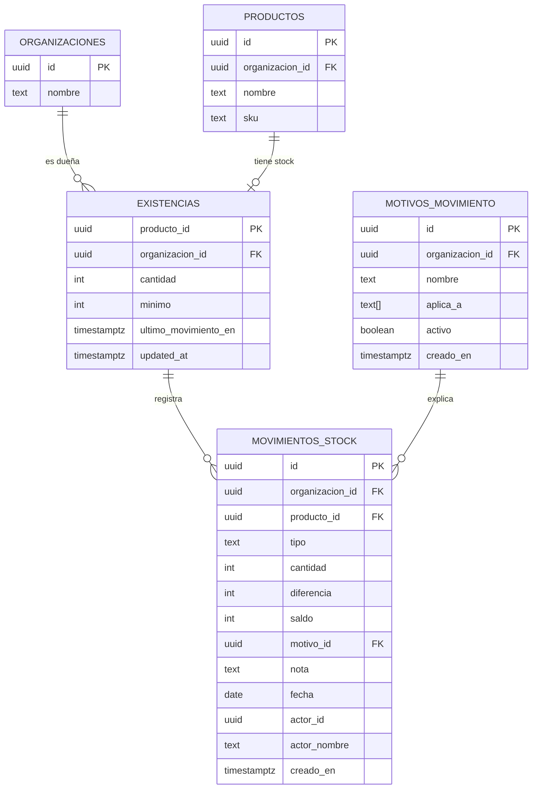

- `existencias` y `movimientos_stock` no tienen escritura directa: solo las RPC de stock. `motivos_movimiento` lo
  edita únicamente el Administrador. RLS por `organizacion_id` y `private.nivel_seccion('stock')`; `anon` sin
  privilegios.
- El detalle de contratos, inmutabilidad y operación está en
  [Stock · movimientos, historial y estados](stock-movimientos.md).

## Ingreso de mercadería por proveedor (MSF-219)

Dos tablas nuevas en `dominio`, sin cambios de columnas en las tablas existentes. Migraciones aditivas
`20261021180000_ingresos_mercaderia_tablas.sql`, `…180100_ingresos_mercaderia_registrar.sql`,
`…180200_ingresos_mercaderia_listar.sql` y `…180300_ingresos_mercaderia_anular.sql` en la rama de la
épica, pendiente de promoción a `main`; reversión en el encabezado de cada una y consolidada en
[Ingreso de mercadería: modelo, RPC y flujos](ingreso-de-mercaderia.md#reversión).

| Tabla | Estado | Cambio |
|---|---|---|
| `dominio.ingresos_mercaderia` | **nueva** | Cabecera del ingreso: empresa, proveedor, fecha, comprobante, estado, anulación, actor y clave de idempotencia. |
| `dominio.ingresos_mercaderia_lineas` | **nueva** | Producto, cantidad, costo unitario USD y vínculo a los movimientos de entrada y anulación. |
| `dominio.movimientos_stock` | existente | Se referencia; sin cambios de esquema. |
| `dominio.motivos_movimiento` | existente | Alta del motivo «Anulación de ingreso de mercadería» (`{salida}`); sin cambios de esquema. |
| `dominio.proveedores` | existente | FK compuesta `(proveedor_id, organizacion_id)`; sin cambios. |
| `dominio.productos` | existente | FK compuesta `(producto_id, organizacion_id)`; sin cambios. |
| `dominio.producto_costos` | existente | La RPC de registro puede actualizar `costo`; sin cambios de esquema. |
| `dominio.existencias` | existente | La actualiza `registrar_movimiento_stock`; sin cambios. |
| `dominio.empresas` | existente | «Compra a nombre de»; sin cambios. |
| `public.organizaciones` | existente | Alcance multi-tenant; sin cambios. (MSF-132 agrega `zona_horaria` y `logo_path`: ver [administración de la organización](administracion-organizacion.md).) |
| `public.registro_actividad` | existente | Eventos `ingreso.registrado` e `ingreso.anulado`; sin cambios. |

- **[ERD interactivo (Archify)](../diagrams/msf-219-erd.html)** — cabecera, líneas, proveedor, producto y vínculos con el stock.

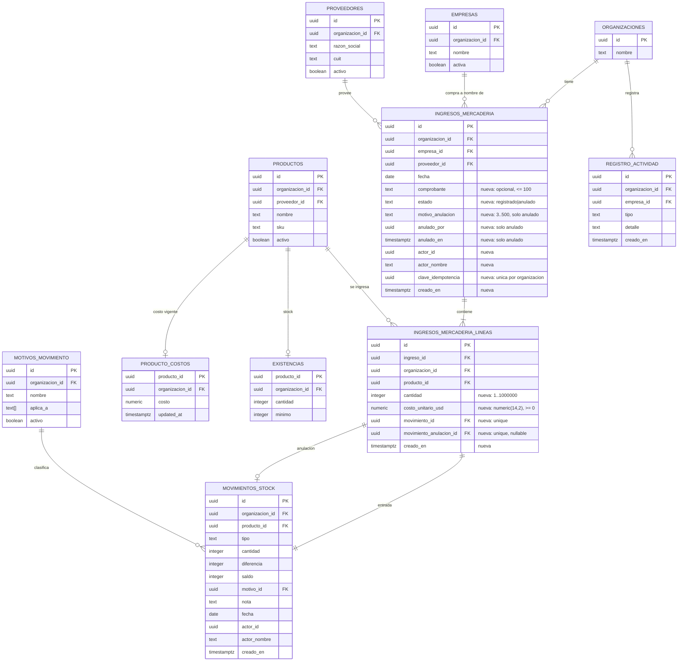

- La cabecera tiene `unique (organizacion_id, clave_idempotencia)` y un `check` de coherencia de
  anulación; las líneas tienen `unique (ingreso_id, producto_id)` y movimientos únicos de entrada y
  anulación. Detalle de columnas, índices y RLS: [Ingreso de mercadería](ingreso-de-mercaderia.md#modelo-de-datos).
- `dominio.ingresos_mercaderia` y `dominio.ingresos_mercaderia_lineas` tienen RLS de solo `select` con
  `organizacion_id = private.organizacion_id()` y `nivel_seccion('stock')` en `lectura` o `edicion`; sin
  políticas de escritura y sin privilegios para `anon`.
- El stock no se separa por empresa ni por depósito: cada línea mueve el stock único de la organización
  con `public.registrar_movimiento_stock` y el motivo «Compra a proveedor». El ingreso no elige depósito (entra
  al por defecto); con MSF-292 la anulación devuelve la salida al depósito del movimiento de entrada original.

## Acceso y membresía (MSF-119)

Épica MSF-119 (F-ACC-01, F-ACC-03, F-ORG-01). Tablas de plataforma y autenticación, por eso `public` (Principio VII).

| Tabla | Estado | Cambio |
|---|---|---|
| `public.usuarios_organizacion` | **alterada** | `estado text not null default 'activo' check (estado in ('activo','suspendido'))` (`20261012140100`). La PK `user_id` no cambia: una persona, una organización. |
| `public.intentos_acceso` | **nueva** | Contador de fallos por correo: `correo_hash text primary key`, `fallos integer not null default 0`, `ultimo_fallo timestamptz not null default now()`, `bloqueado_hasta timestamptz` (`20261012140200`); `ultimo_fallo_servidor timestamptz` (`20261014100000`) e índice `intentos_acceso_ultimo_fallo_idx` (`20261013180000`). |
| `public.organizaciones` | existente | Base de la regla de aislamiento; sin cambios de esquema. |
| `auth.users` | existente | Login y recuperación los resuelve GoTrue (Supabase Auth); sin cambios de esquema. |
| `auth.sessions` | existente | El trigger `cortar_sesiones_suspendido` (`20261012150000`) borra sus filas al suspender; sin cambios de esquema. |

- `public.usuarios_organizacion.estado` (`activo` | `suspendido`, default `activo`): migración aditiva `20261012140100`. Las funciones `private.organizacion_id()` y `private.puede_escribir()` excluyen a los suspendidos (más `20261012140300` para las de administración). El trigger `cortar_sesiones_suspendido` (`20261012150000`) borra `auth.sessions` al suspender.
- `public.intentos_acceso`: contador de fallos por correo en hash HMAC (clave `acceso_hmac` en Vault). RLS activado y sin policies: el acceso es solo por RPC (`bloqueo_acceso_hasta`, `registrar_fallo_acceso`, `limpiar_intentos_acceso`) y por el hook `verificar_intento_acceso` (`20261014100000`); `anon` y `authenticated` no tienen privilegios de tabla. Es plataforma/auth, por eso vive en `public`. Cada migración lleva su reversión en el encabezado.
- Una persona pertenece a una sola organización (`user_id` PK de `usuarios_organizacion`, spec 003).
- El alta de organizaciones nuevas (MSF-162) no cambia el modelo: sin migraciones ni tablas nuevas. La Edge Function `crear-organizacion` escribe con `service_role` en `public.organizaciones` y `public.usuarios_organizacion` (fundador con `rol_id = 'administrador'`); `authenticated` y `anon` no tienen `INSERT` sobre `organizaciones`. `user_id` sigue siendo PK (un usuario, una organización). Detalle: [Organizaciones nuevas](organizaciones-nuevas.md).

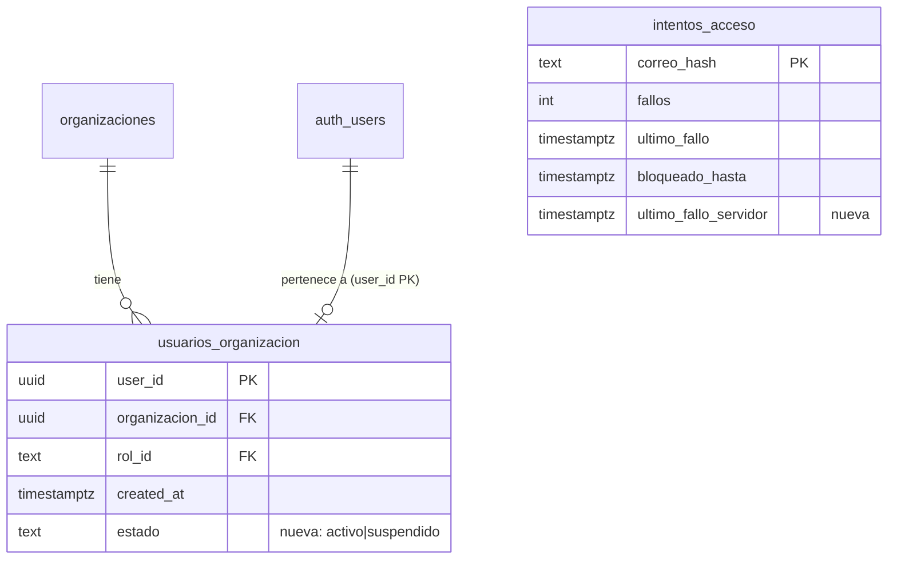

Detalle y operación: [Acceso y organización (técnico)](acceso.md) · resumen de producto: [Acceso](../acceso-ingreso.md) · regla para tablas nuevas: [Aislamiento](../aislamiento-por-organizacion.md).

## Usuarios y roles (MSF-125)

Tablas de plataforma en `public` (Principio VII), con RLS por organización y sin privilegios para `anon`. Migraciones aditivas `20261013130002_roles_basicos_permisos.sql`, `20261013140001_invitaciones_usuarios.sql` y `20261014120000_usuarios_suspension_y_roles.sql`. Detalle: [Usuarios y roles](usuarios-y-roles.md) · [Permisos por rol](../permisos-por-rol.md).

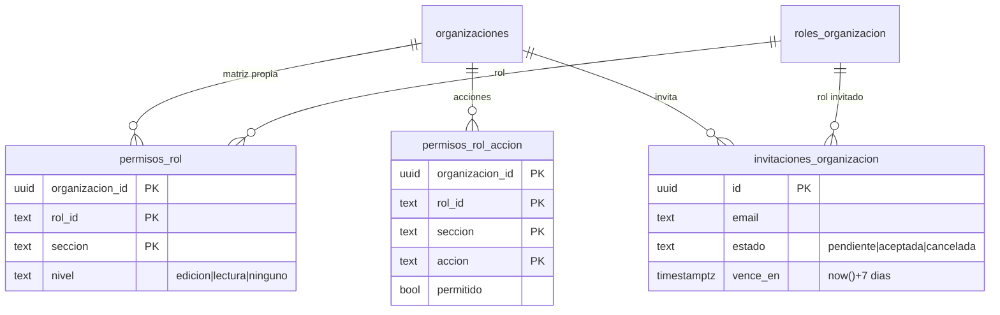

## Permisos por empresa (MSF-121)

Dos tablas nuevas en `public` (pertenencia y contexto de sesión) y una columna aditiva en
`invitaciones_organizacion`; el resto solo se referencia. Migraciones aditivas
`20261016140100_roles_por_empresa.sql`, `20261016150100_cambiar_empresa_activa.sql`,
`20261016160100_asignar_empresas_usuario.sql` y `20261017120000_cambiar_empresa_activa_serializada.sql`.
Detalle de contratos y RPC: [Permisos por empresa](permisos-por-empresa.md) · [Permisos por rol](../permisos-por-rol.md).

| Tabla | Estado | Cambio |
|---|---|---|
| `public.usuarios_empresas` | **nueva** | Rol por empresa: `user_id`, `empresa_id`, `organizacion_id`, `rol_id`, `created_at`; PK `(user_id, empresa_id)`. `check` de los cinco roles por empresa (`operador`, `consulta`, `mostrador`, `deposito`, `administracion`); trigger que exige misma organización. RLS de lectura propia o de Administrador; sin escritura directa. |
| `public.usuario_empresa_activa` | **nueva** | Empresa activa persistida: `user_id` PK, `empresa_id`, `updated_at`; una fila por usuario. RLS de lectura propia; sin escritura directa (solo la RPC `cambiar_empresa_activa`). |
| `public.invitaciones_organizacion` | **alterada** | `asignaciones jsonb not null default '[]'` (`[{"empresa_id": uuid, "rol_id": text}]`), aplicada por `aceptar_invitacion`. |
| `public.usuarios_organizacion` | existente | Solo se lee la membresía, el rol de organización y `estado`; sin cambios. |
| `public.roles_organizacion` | existente | FK de `rol_id`; sin cambios. |
| `public.organizaciones` | existente | FK de `organizacion_id`; sin cambios. |
| `dominio.empresas` | existente | FK de `empresa_id` en ambas tablas nuevas; solo se lee. |
| `auth.users` | existente | FK de `usuario_empresa_activa.user_id`; sin cambios. |
| `public.registro_actividad` | existente | Recibe `usuario.empresa_activa_cambiada` y `usuario.empresas_asignadas`; sin cambios de esquema. |


- Ambas tablas nuevas tienen RLS, `anon` sin privilegios y sin escritura directa para `authenticated`
  (`grant select` únicamente): el único camino de escritura son las RPC de F-ROL-06 y F-ROL-07.
- La empresa activa solo es válida si sigue siendo accesible (`private.empresa_activa_valida()`); si se
  pausa la empresa, se quita la asignación o se suspende al usuario, deja de resolverse y las secciones
  por empresa quedan en `ninguno` hasta elegir otra.
- El Administrador de la organización no tiene filas en `usuarios_empresas`: accede a todas las empresas
  activas de su organización.

## Perfil y permisos avanzados (MSF-148)

Una tabla nueva en `public` (plataforma: pedidos de acceso de una persona a una sección del panel), sin
cambios de esquema en las tablas existentes. Migraciones aditivas
`20261017100000_solicitudes_acceso.sql` y `20261017100001_rpc_solicitar_acceso.sql` (merge PR #110,
`415163c4`); reversión en el encabezado de cada una. Detalle del flujo, RPC, correo y operación:
[Perfil y permisos avanzados](perfil-y-permisos.md).

| Tabla | Estado | Cambio |
|---|---|---|
| `public.solicitudes_acceso` | **nueva** | Pedido de acceso por persona, organización, sección y día: `id`, `organizacion_id`, `usuario_id`, `seccion` (≤ 60), `dia`, `creada_en` y `correo_enviado_en` (nulo = aviso pendiente). Única por `(organizacion_id, usuario_id, seccion, dia)`; RLS de lectura propia o de administrador; sin escritura directa. |
| `public.organizaciones` | existente | FK con `on delete cascade`; sin cambios. |
| `auth.users` | existente | FK `usuario_id` con `on delete cascade`; sin cambios. |
| `public.usuarios_organizacion` | existente | Sólo lectura para resolver la membresía activa y los administradores activos; sin cambios. |
| `public.perfiles_usuario` | existente | Sólo lectura para el nombre visible del solicitante; sin cambios (spec 008). |

- `authenticated` sólo tiene `select` sobre la tabla; `anon` y `PUBLIC` no tienen privilegios. El alta va
  por `public.solicitar_acceso(p_seccion)`, `security definer` con `search_path = ''`, que valida sesión,
  membresía activa, sección del catálogo y que no haya acceso previo. `correo_enviado_en` lo escribe la Edge
  Function con la service-role.
- `solicitar_acceso` devuelve `{ id, organizacion_id, nuevo, correo_enviado }`; `nuevo = false` cuando el
  pedido del día ya existía. La clave única es lo que evita duplicados por doble clic o reintento.
- **Reversión:** `drop function public.solicitar_acceso(text)` y, después, `drop table
  public.solicitudes_acceso` en una migración posterior (se pierden los pedidos; exportarlos antes).

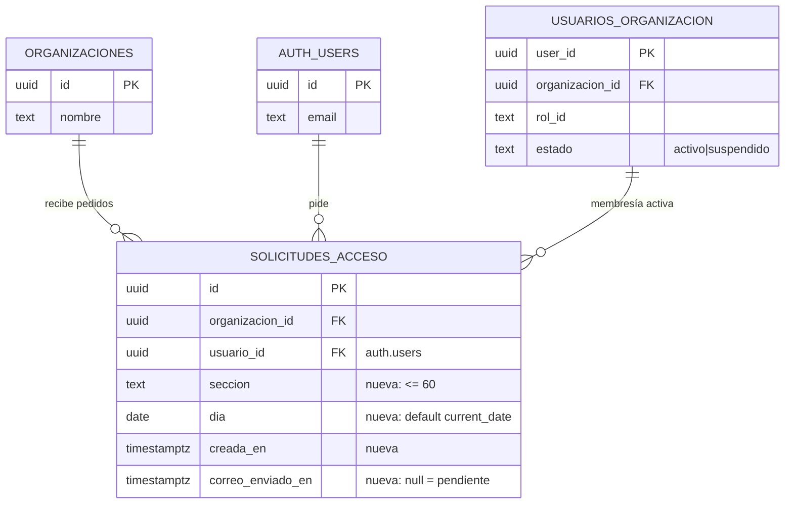

## Service técnico (MSF-182)

Todas las tablas van en `dominio` (Principio VII), con RLS por `organizacion_id` y nivel de `service_tecnico` (`private.nivel_seccion`); lectura además restringida a tiendas accesibles (`20261021170000`). Sin `delete`. Migraciones: `supabase/migrations/20261021163400`–`20261021170400` (aditivas; reversión en el encabezado de cada una).

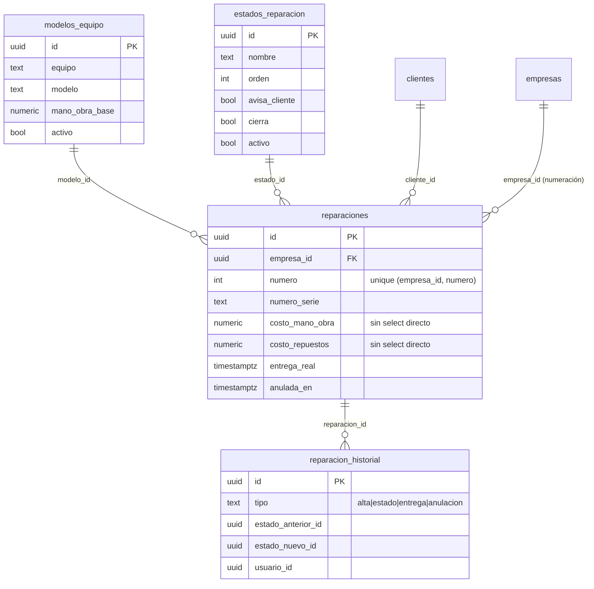

- **Modelos y estados son por organización; la numeración es por empresa** (`private.siguiente_numero_reparacion`, bloqueo asesor por transacción). Sembrado idempotente: `private.sembrar_service` (`20261021163600`, siete modelos y siete estados).
- FK compuestas `(…_id, organizacion_id)` impiden cruzar organizaciones.
- Costos: grant por columna sin `costo_*`; solo los entrega `obtener_reparacion`, enmascarados sin `ver_costos`.
- `reparacion_historial` es solo lectura para la app; lo escriben las RPC en la misma transacción.
- Rol `tecnico`: solo datos en `roles_organizacion`/`permisos_rol` (matriz fija); detalle en la rama de la épica (`docs/permisos-por-rol.md`).

## Stock: lotes e inventario (MSF-131)

La carga en lote agrega `dominio.lotes_stock`; la toma de inventario no crea tablas, solo ajustes.

| Tabla | Estado | Cambio |
|-------|--------|--------|
| `dominio.lotes_stock` | nueva | Cabecera del lote: número correlativo por organización, proveedor en texto libre, fecha, motivo, clave de idempotencia y actor |
| `dominio.movimientos_stock` | alterada | Columna nullable `lote_id` con FK compuesta `(lote_id, organizacion_id)` e índice parcial |
| `dominio.motivos_movimiento` | existente | Fila de sistema nueva «Toma de inventario» (aplica a `ajuste`), sembrada y rellenada por organización |
| `dominio.existencias_deposito` | existente | Solo lectura: la toma compara el contado contra el stock del depósito por defecto |
| `dominio.depositos` | existente | Solo lectura: resuelve el depósito por defecto de la toma |
| `dominio.productos` | existente | Solo lectura: nombre y SKU de las líneas y del detalle |

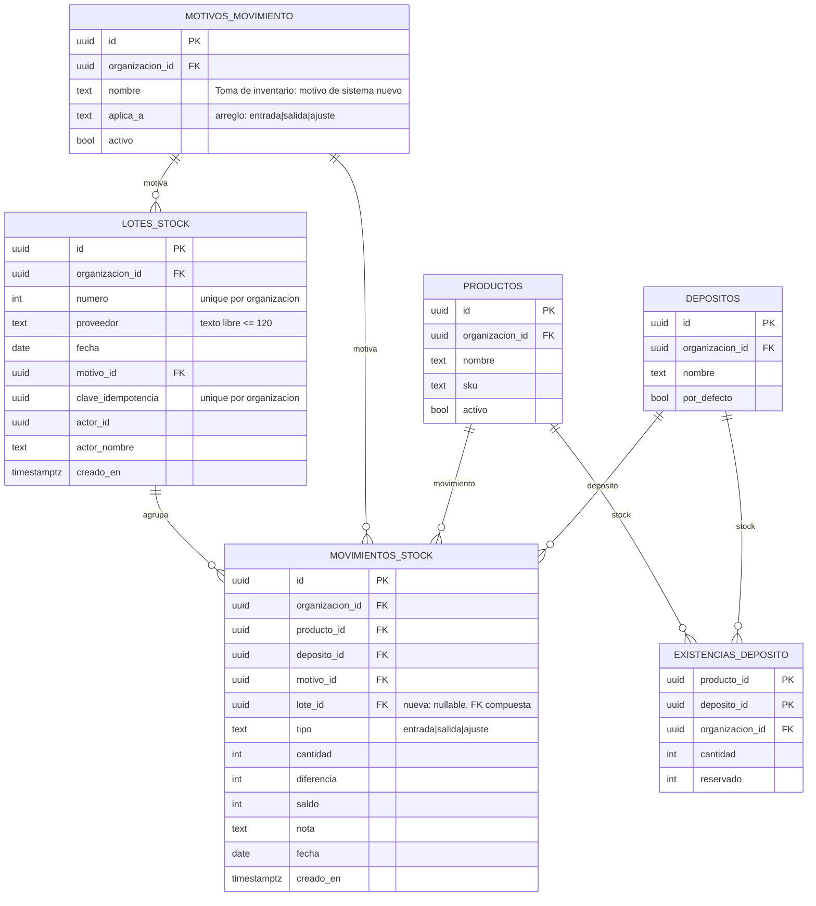

- Migraciones: `20261202100000_stock_lotes_tabla.sql` (tabla, columna y RLS), `20261202130000_stock_motivo_toma_inventario.sql`
  (motivo de sistema) y `20261202130100_stock_confirmar_toma.sql` (RPC de la toma).
- `lotes_stock` es de solo agregado y solo la escribe `registrar_lote_stock`; la toma no persiste una entidad, produce
  movimientos `ajuste` por la vía de `registrar_movimiento_stock`.
- Detalle técnico y reversión: [Stock · lotes e inventario](stock-lotes-e-inventario.md).

## Stock: depósitos y reservas (MSF-292)

Se agrega un nivel **depósito** debajo del stock único: cuatro tablas nuevas en `dominio` y dos columnas en tablas
existentes. Migraciones aditivas `20261023120000_depositos_tablas.sql` a `20261023130400_stock_motivo_traslado_reservado.sql`
en la rama de la épica `epic/MSF-292-stock-stock-depositos-y-reservas`, pendiente de promoción a `main`; reversión en
el encabezado de cada una y consolidada en
[Stock · depósitos y reservas](stock-depositos-y-reservas.md#reversión).

| Tabla | Estado | Cambio |
|---|---|---|
| `dominio.depositos` | **nueva** | Depósitos de la organización: `nombre` (≤ 80, único sin distinguir mayúsculas), `direccion` (≤ 200, opcional), `activo`, `por_defecto`. Restricción `depositos_defecto_activo` e índices únicos parciales de nombre y de por defecto. Sin `delete`: se desactivan. |
| `dominio.depositos_empresas` | **nueva** | Relación depósito ↔ empresa («Venden desde acá»), PK `(deposito_id, empresa_id)`. |
| `dominio.existencias_deposito` | **nueva** | `cantidad` (≥ 0) y `reservado` (≥ 0, `reservado ≤ cantidad`) por producto y depósito. |
| `dominio.reservas_stock` | **nueva** | Reservas de productos «A pedido»: `cantidad` (> 0), `estado` (`activa`/`descontada`/`liberada`), `referencia` (≤ 200, única por organización), responsable y fechas. |
| `dominio.existencias` | **alterada** | **Alterada:** columna `reservado integer not null default 0` y `check existencias_reservado_valido`. `cantidad` sigue siendo el total único (suma de los depósitos). |
| `dominio.movimientos_stock` | **alterada** | **Alterada:** columna `deposito_id uuid` (FK compuesta) y columna `traslado_id uuid` con índice único parcial `(traslado_id, tipo)`. El libro sigue de solo agregado. |
| `dominio.empresas` | existente | Se referencia en `depositos_empresas` («Venden desde acá»); sin cambios de esquema. |
| `dominio.productos` | existente | Se referencia en `existencias_deposito` y `reservas_stock`; sin cambios de esquema. |
| `public.organizaciones` | existente | Dueña de las tablas nuevas (FK `on delete cascade`); sin cambios de esquema. |
| `public.cola_eventos` | existente | Recibe la carga ampliada de `stock.actualizado`; sin cambios de esquema. |

```mermaid
erDiagram
  ORGANIZACIONES ||--o{ DEPOSITOS : "define"
  ORGANIZACIONES ||--o{ EXISTENCIAS : "es dueña"
  ORGANIZACIONES ||--o{ EXISTENCIAS_DEPOSITO : "es dueña"
  ORGANIZACIONES ||--o{ RESERVAS_STOCK : "es dueña"
  DEPOSITOS ||--o{ DEPOSITOS_EMPRESAS : "vende desde"
  EMPRESAS ||--o{ DEPOSITOS_EMPRESAS : "vende desde"
  DEPOSITOS ||--o{ EXISTENCIAS_DEPOSITO : "guarda"
  DEPOSITOS ||--o{ RESERVAS_STOCK : "reserva"
  PRODUCTOS ||--o| EXISTENCIAS : "tiene stock"
  PRODUCTOS ||--o{ EXISTENCIAS_DEPOSITO : "stock"
  PRODUCTOS ||--o{ RESERVAS_STOCK : "reserva"
  PRODUCTOS ||--o{ MOVIMIENTOS_STOCK : "movimiento"
  EXISTENCIAS ||--o{ MOVIMIENTOS_STOCK : "registra"
  DEPOSITOS ||--o{ MOVIMIENTOS_STOCK : "deposito"

  DEPOSITOS {
    uuid id PK
    uuid organizacion_id FK
    text nombre "nueva: <= 80, unico por organizacion"
    text direccion "nueva: <= 200, opcional"
    boolean activo "nueva: se desactiva, no se borra"
    boolean por_defecto "nueva: uno por organizacion"
  }
  DEPOSITOS_EMPRESAS {
    uuid deposito_id PK FK
    uuid empresa_id PK FK
    uuid organizacion_id FK
  }
  EXISTENCIAS_DEPOSITO {
    uuid producto_id PK FK
    uuid deposito_id PK FK
    uuid organizacion_id FK
    int cantidad "nueva: >= 0"
    int reservado "nueva: >= 0 y <= cantidad"
  }
  RESERVAS_STOCK {
    uuid id PK
    uuid organizacion_id FK
    uuid producto_id FK
    uuid deposito_id FK
    int cantidad "nueva: > 0"
    text estado "nueva: activa|descontada|liberada"
    text referencia "nueva: <= 200, idempotencia"
    uuid responsable_id
    text responsable_nombre
    timestamptz creado_en
    timestamptz resuelto_en
  }
  EXISTENCIAS {
    uuid producto_id PK
    uuid organizacion_id FK
    int cantidad "stock total unico: suma por deposito"
    int reservado "alterada: suma por deposito"
    int minimo
    timestamptz ultimo_movimiento_en
  }
  MOVIMIENTOS_STOCK {
    uuid id PK
    uuid organizacion_id FK
    uuid producto_id FK
    uuid deposito_id FK "alterada: deposito del movimiento"
    uuid traslado_id FK "alterada: vincula salida y entrada"
    text tipo
    int cantidad
    int diferencia
    int saldo
    date fecha
    timestamptz creado_en
  }
  EMPRESAS {
    uuid id PK
    uuid organizacion_id FK
    text nombre
    boolean activa
  }
  PRODUCTOS {
    uuid id PK
    uuid organizacion_id FK
    text nombre
    text sku
    boolean activo
  }
  ORGANIZACIONES {
    uuid id PK
    text nombre
  }
  COLA_EVENTOS {
    uuid id PK
    uuid organizacion_id FK
    text tipo
    jsonb carga
  }
```

- Las cuatro tablas nuevas tienen RLS por `organizacion_id` con `private.nivel_seccion('stock') in ('lectura','edicion')`
  para `select`; sin escritura directa de `authenticated` (escriben solo las RPC *security definer*) y `anon` sin
  privilegios.
- `dominio.existencias.cantidad` y `dominio.existencias.reservado` son las **sumas** de `existencias_deposito`, y se
  mantienen en la misma transacción que cada cambio (`private.aplicar_movimiento_deposito`).
- **Disponible = cantidad − reservado**, por depósito y en total: es la barrera contra negativos.
- Detalle técnico y reversión: [Stock · depósitos y reservas](stock-depositos-y-reservas.md).

## Stock: carga inicial, exportación y avisos (MSF-368)

Cuatro tablas nuevas en `dominio` (dato del producto) y una vista de lectura en `public` (contrato de pantalla).
Ninguna tabla nueva admite escritura directa de `authenticated`: escriben solo las RPC *security definer* o las RPC
exclusivas de `service_role`. Migraciones aditivas `20261212140000_stock_avisos_reposicion.sql` a
`20261213100500_productos_mas_vendidos.sql` en la rama de la épica
`epic/MSF-368-stock-stock-carga-exportacion-y-avisos`, pendiente de promoción a `main`; reversión en el encabezado de
cada una y consolidada en [Stock · carga inicial, exportación y avisos](stock-carga-exportacion-y-avisos.md#reversión).

| Tabla | Estado | Cambio |
|---|---|---|
| `dominio.cargas_iniciales_stock` | **nueva** | Una fila por producto que ya tuvo su carga inicial por planilla: `deposito_id`, `movimiento_id`, `cantidad`, `clave_idempotencia`, responsable. `unique (organizacion_id, producto_id)`: impide una segunda carga inicial, incluso simultánea. Solo de agregado (disparador de inmutabilidad). |
| `dominio.stock_avisos_reposicion` | **nueva** | Un resumen de reposición por organización: `generado_en`, `estado` (`pendiente`/`enviado`/`fallido`/`sin_destinatario`), `intentos`, `ultimo_error`, `enviado_en`, `productos jsonb` (foto de los incluidos), `sin_stock`, `stock_bajo`, `updated_at` (reserva de 2 minutos). |
| `dominio.stock_alertas_avisadas` | **nueva** | Marca por producto del estado con el que ya se avisó (`stock_bajo`/`sin_stock`): define qué es «nuevo en alerta». |
| `dominio.faltantes_avisos` | **nueva** | Cola de avisos de reposición, **una fila por línea faltante**: `empresa_id`, `cliente_id`, `estado` (`pendiente`/`enviado`/`agotado`), `intentos`, `ultimo_error`, `enviado_en`. FK compuestas a `dominio.empresas` y `public.clientes`: el aviso no puede apuntar a otra organización. |
| `public.faltantes_listado` (vista) | **nueva** | Lectura de los faltantes abiertos (`security_invoker`): una fila por línea «A pedido» de factura confirmada con reserva activa. No crea datos. |
| `dominio.existencias` | existente | La cantidad sigue siendo el total único; la escribe `registrar_movimiento_stock` desde la RPC de carga. Sin cambios de esquema. |
| `dominio.movimientos_stock` | existente | Recibe un movimiento `ajuste` por diferencia de la carga inicial (motivo de sistema «Carga inicial de stock»). Sin cambios de esquema. |
| `dominio.productos` | existente | Se referencia en `cargas_iniciales_stock` y `stock_alertas_avisadas`. Sin cambios de esquema. |
| `dominio.depositos` | existente | Se referencia en `cargas_iniciales_stock` (el depósito de la carga). Sin cambios de esquema. |
| `dominio.motivos_movimiento` | existente | Se leen y se **siembra** el motivo de sistema «Carga inicial de stock» (`aplica_a = {ajuste}`) para las organizaciones existentes y las nuevas. Sin cambios de esquema. |
| `dominio.comprobantes_venta` | existente | Se leen (tipo `factura`, estado `confirmada`) para derivar los faltantes. Sin cambios de esquema. |
| `dominio.comprobantes_venta_lineas` | existente | Se leen (`a_pedido = true`) y son la FK de `faltantes_avisos.linea_id`. Sin cambios de esquema. |
| `dominio.reservas_stock` | existente | Se leen: la reserva activa (`referencia = 'comprobante:<id>:linea:<orden>'`) define el faltante y su cierre automático. Sin cambios de esquema. |
| `dominio.empresas` | existente | Se referencia en `faltantes_avisos` (tienda del aviso) y en el filtro por ventas de la vista. Sin cambios de esquema. |
| `public.clientes` | existente | Se lee el correo del cliente para saber a quién se avisa. Sin cambios de esquema. |
| `public.organizaciones` | existente | Dueña de las tablas nuevas (FK `on delete cascade`). Sin cambios de esquema. |

```mermaid
erDiagram
  ORGANIZACIONES ||--o{ CARGAS_INICIALES_STOCK : "es dueña"
  ORGANIZACIONES ||--o{ STOCK_AVISOS_REPOSICION : "es dueña"
  ORGANIZACIONES ||--o{ STOCK_ALERTAS_AVISADAS : "es dueña"
  ORGANIZACIONES ||--o{ FALTANTES_AVISOS : "es dueña"
  PRODUCTOS ||--o{ CARGAS_INICIALES_STOCK : "carga inicial"
  PRODUCTOS ||--o{ STOCK_ALERTAS_AVISADAS : "alerta avisada"
  DEPOSITOS ||--o{ CARGAS_INICIALES_STOCK : "deposito"
  MOVIMIENTOS_STOCK ||--o| CARGAS_INICIALES_STOCK : "ajuste"
  PRODUCTOS ||--o| EXISTENCIAS : "tiene stock"
  EXISTENCIAS ||--o{ MOVIMIENTOS_STOCK : "registra"
  MOTIVOS_MOVIMIENTO ||--o{ MOVIMIENTOS_STOCK : "motivo"
  COMPROBANTES_VENTA_LINEAS ||--o| FALTANTES_AVISOS : "aviso"
  EMPRESAS ||--o{ FALTANTES_AVISOS : "tienda"
  CLIENTES ||--o{ FALTANTES_AVISOS : "cliente"
  COMPROBANTES_VENTA ||--o{ COMPROBANTES_VENTA_LINEAS : "tiene"
  RESERVAS_STOCK ||--o{ COMPROBANTES_VENTA_LINEAS : "reserva la linea"
  PRODUCTOS ||--o{ COMPROBANTES_VENTA_LINEAS : "vendido"
  COMPROBANTES_VENTA_LINEAS }o--|| FALTANTES_LISTADO : "se lee en"

  CARGAS_INICIALES_STOCK {
    uuid id PK
    uuid organizacion_id FK
    uuid producto_id FK
    uuid deposito_id FK
    uuid movimiento_id FK
    int cantidad "nueva: stock cargado"
    uuid clave_idempotencia "nueva: idempotencia del envio"
    uuid actor_id
    text actor_nombre
    timestamptz creado_en
  }
  STOCK_AVISOS_REPOSICION {
    uuid id PK
    uuid organizacion_id FK
    timestamptz generado_en
    text estado "nueva: pendiente|enviado|fallido|sin_destinatario"
    int intentos "nueva: >= 0"
    text ultimo_error "nueva: <= 500"
    timestamptz enviado_en
    jsonb productos "nueva: foto de los incluidos"
    int sin_stock "nueva: >= 0"
    int stock_bajo "nueva: >= 0"
    timestamptz updated_at "nueva: reserva de 2 minutos"
  }
  STOCK_ALERTAS_AVISADAS {
    uuid organizacion_id PK FK
    uuid producto_id PK FK
    text estado_avisado "nueva: stock_bajo|sin_stock"
    timestamptz avisado_en
  }
  FALTANTES_AVISOS {
    uuid linea_id PK FK
    uuid organizacion_id FK
    uuid empresa_id FK
    uuid cliente_id FK
    text estado "nueva: pendiente|enviado|agotado"
    int intentos "nueva: >= 0"
    text ultimo_error "nueva: <= 500"
    timestamptz enviado_en
    timestamptz created_at
    timestamptz updated_at
  }
  FALTANTES_LISTADO {
    uuid linea_id PK
    uuid organizacion_id
    uuid empresa_id
    uuid cliente_id
    uuid producto_id
    text producto
    text sku
    int pedido
    date desde
    text estado_stock
    int disponible
    text aviso "nueva: avisado|sin_avisar"
  }
  EXISTENCIAS {
    uuid producto_id PK
    uuid organizacion_id FK
    int cantidad "stock total unico"
    int reservado
    int minimo
  }
  MOVIMIENTOS_STOCK {
    uuid id PK
    uuid organizacion_id FK
    uuid producto_id FK
    uuid deposito_id FK
    text tipo "ajuste en la carga inicial"
    int cantidad
    int diferencia
    int saldo
    date fecha
  }
  PRODUCTOS {
    uuid id PK
    uuid organizacion_id FK
    text nombre
    text sku
    boolean activo
  }
  DEPOSITOS {
    uuid id PK
    uuid organizacion_id FK
    text nombre
    boolean activo
    boolean por_defecto
  }
  MOTIVOS_MOVIMIENTO {
    uuid id PK
    uuid organizacion_id FK
    text nombre
    text[] aplica_a
    boolean activo
  }
  COMPROBANTES_VENTA {
    uuid id PK
    uuid organizacion_id FK
    uuid empresa_id FK
    uuid cliente_id FK
    text tipo "factura"
    text estado "confirmada"
    timestamptz confirmado_en
  }
  COMPROBANTES_VENTA_LINEAS {
    uuid id PK
    uuid comprobante_id FK
    uuid producto_id FK
    int cantidad
    boolean a_pedido
    int orden
  }
  RESERVAS_STOCK {
    uuid id PK
    uuid producto_id FK
    uuid deposito_id FK
    int cantidad
    text estado "activa|descontada|liberada"
    text referencia "comprobante:<id>:linea:<orden>"
  }
  EMPRESAS {
    uuid id PK
    uuid organizacion_id FK
    text nombre
    boolean activa
  }
  CLIENTES {
    uuid id PK
    uuid organizacion_id FK
    text nombre
    text correo
  }
  ORGANIZACIONES {
    uuid id PK
    text nombre
  }
```

- Las cuatro tablas nuevas tienen RLS por `organizacion_id` con `private.nivel_seccion('stock') in ('lectura','edicion')`
  para `select`; sin escritura directa de `authenticated` (escriben solo las RPC *security definer* y las RPC
  exclusivas de `service_role`) y `anon` sin privilegios. `dominio.faltantes_avisos` filtra por **tienda**
  (`private.nivel_ventas_en_empresa`).
- `dominio.cargas_iniciales_stock` es **de solo agregado**: el disparador `cargas_iniciales_stock_inmutable`
  rechaza `update`/`delete` con `42501` (solo pasa la cascada de la organización).
- **No se crea una tabla `faltantes`**: el faltante se **deriva** de las líneas de venta y sus reservas, para no
  quedar un dueño duplicado frente a F-VTA-18/F-VTA-26 (MSF-135). Si MSF-135 define su propia tabla, hay que
  reapuntar `public.faltantes_listado`.
- La exportación a CSV (F-STK-08) **no agrega tablas, RPC ni permisos**: lee `stock_estados` y
  `listar_movimientos_stock`, las mismas fuentes y la misma RLS que la pantalla.
- Detalle técnico y reversión: [Stock · carga inicial, exportación y avisos](stock-carga-exportacion-y-avisos.md).

## Service técnico: ítems e impresión (MSF-199)

Se agrega `dominio.reparacion_items` (entidad de negocio del taller) y dos columnas derivadas en
`dominio.reparaciones`: `total_mano_obra` y `total_repuestos` (ARS sin IVA, de cara al cliente). Las RPC de
ítems y listado viven en `public` y las ayudas internas en `private`. Migraciones:
`supabase/migrations/20261022100100`–`20261022110200` (aditivas; reversión en el encabezado de cada una).
Detalle: [Service técnico: listado, ítems e impresión](service-listado-items-impresion.md).

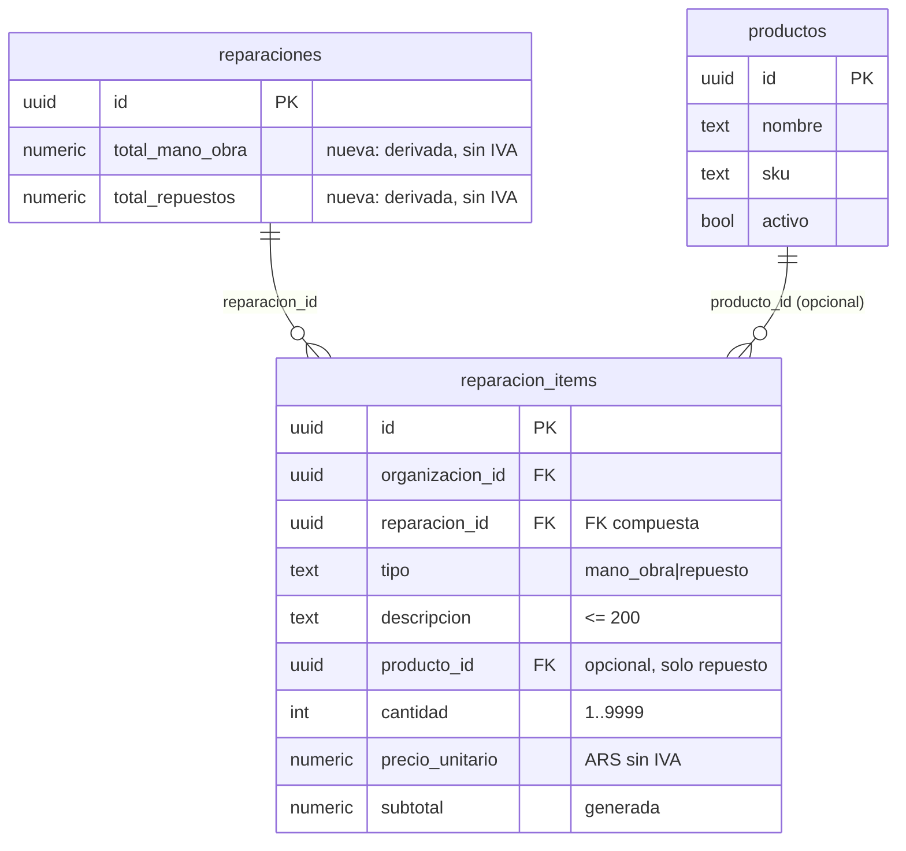

- **RLS**: `reparacion_items` filtra por organización, nivel `service_tecnico` (`lectura`/`edicion`) y tienda
  accesible; sin grants de escritura directa (`insert`/`update`/`delete`), solo escriben las RPC
  `security definer`. `anon` sin acceso.
- **FK compuestas** `(reparacion_id, organizacion_id)` y `(producto_id, organizacion_id)` impiden cruzar
  organizaciones.
- **Totales**: los mantiene solo `private.recalcular_totales_reparacion` dentro de la misma transacción que
  agrega o quita un ítem; `reparaciones` no tiene grants de escritura para esas columnas.
- **Stock**: los ítems no mueven existencias; el descuento de repuestos es de MSF-217 (ver la sección siguiente).

## Service técnico: repuestos y stock (MSF-217)

No hay tablas nuevas: la épica suma **columnas** a dos tablas de `dominio` y **funciones** nuevas (Principio VII).
`dominio.reparacion_items` gana `deposito_id` (FK compuesta a `dominio.depositos`) y `stock_estado`
(`sin_movimiento` | `descontado` | `pendiente` | `consumido` | `devuelto`, por defecto `sin_movimiento`).
`dominio.movimientos_stock` gana `origen` (solo `service`; nulo en los movimientos existentes), `reparacion_id`
(FK compuesta a `dominio.reparaciones`) y `referencia`, con **índice único parcial** `(organizacion_id, referencia)`
`where origen = 'service'` que hace idempotente el descuento y la devolución. Migraciones:
`supabase/migrations/20270114100100`–`20270114140200` (aditivas; reversión en el encabezado de cada una).
Detalle: [Service técnico: repuestos y stock](service-repuestos-y-stock.md) · **[ERD interactivo](../diagrams/msf-217-erd.html)**.

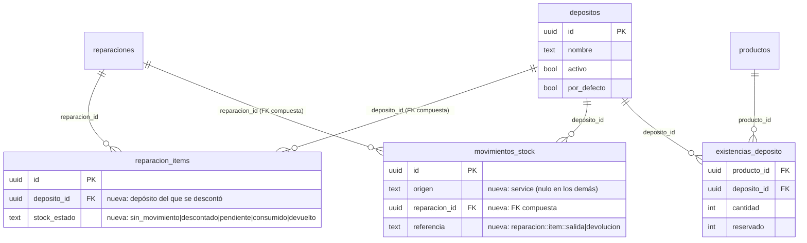

- **RLS**: sin tablas nuevas y sin políticas nuevas; las RPC de la épica son `security definer` con
  `revoke … from public, anon` y `grant execute … to authenticated` (`anon` no ejecuta).
- **Sin movimiento directo**: `reparacion_items` sigue sin `insert`/`update`/`delete` directos y
  `movimientos_stock` sigue siendo de solo agregado. El stock por depósito cambia solo por
  `private.aplicar_movimiento_deposito` (MSF-292).
- **Idempotencia**: la `referencia` del libro es única por organización para `origen = 'service'`; la devolución no
  puede asentar dos veces la misma entrada.

## Consultas (MSF-122)

Tres tablas nuevas en `dominio` (Principio VII), con RLS por organización, empresa accesible y sección
`consultas`; sin escritura directa desde la app. El alta entra solo por `publico.crear_consulta_publica`
(la empresa sale del dominio de la tienda) y la edición por `public.actualizar_consulta`. Migraciones:
`20261205100000_consultas.sql`, `20261205200000_consultas_configuracion.sql` y
`20261205200100_consultas_avisos.sql` (aditivas; reversión en el encabezado de cada una y consolidada en
[Consultas: modelo, RPC y aviso](consultas.md#reversion)).

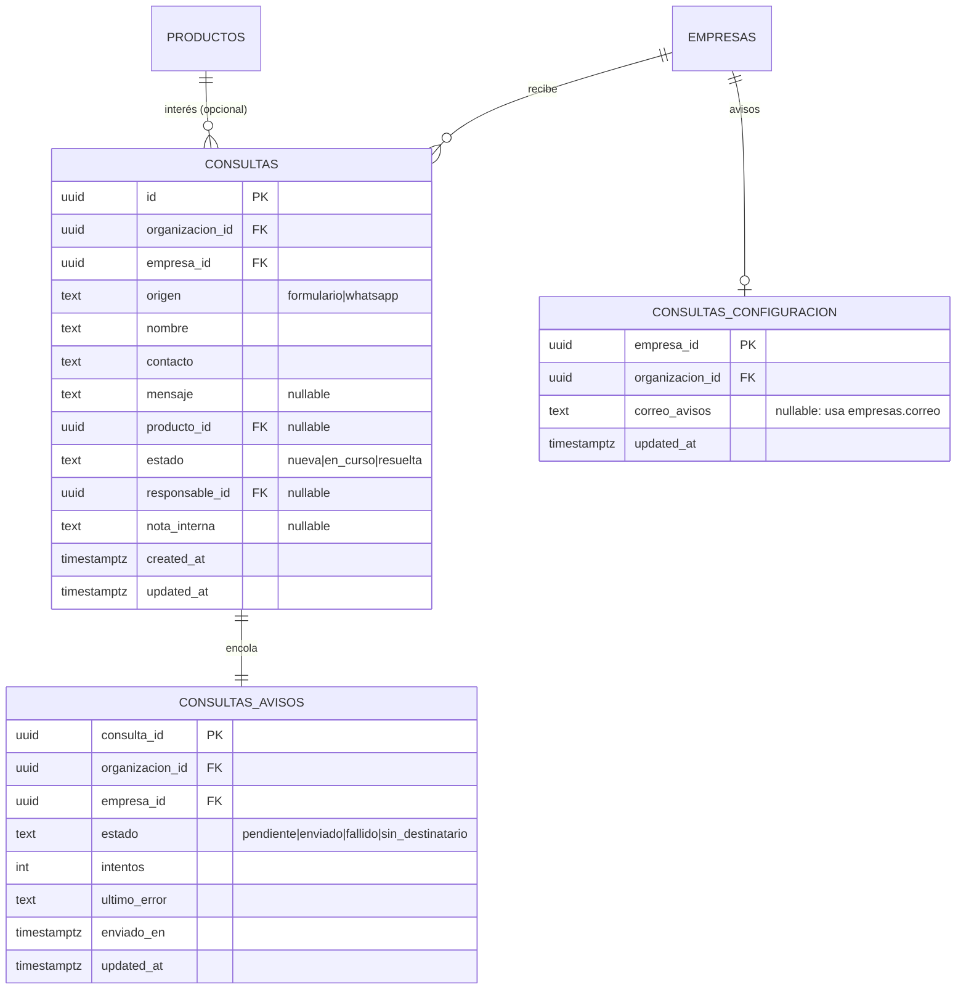

- `consultas` guarda estado, responsable y nota interna; `consultas_configuracion` la dirección de avisos
  (una fila por empresa); `consultas_avisos` la cola del correo, con `consulta_id` como clave (un aviso por
  consulta).
- FK compuestas `(empresa_id, organizacion_id)` y `(producto_id, organizacion_id)` impiden cruzar
  organizaciones.
- La vista `public.consultas_bandeja` y las RPC del panel viven en `public` y no almacenan datos.
- Desde MSF-189 (MSF-562) el alta **ya no encola en `dominio.consultas_avisos`**: el disparador emite por
  `private.emitir_aviso` y el flow `enviar-avisos` envía. `consultas_avisos` y la Edge Function quedan solo
  para drenar lo que ya estaba encolado. Detalle: [Avisos y listas](avisos-y-listas.md).
- Detalle de RPC, permisos, aviso y operación: [Consultas](consultas.md).

## Consultas: interés por WhatsApp y respuesta desde el panel (MSF-130)

Una tabla nueva en `dominio` y dos superficies de lectura: la RPC en `publico` (la llama la tienda) y la
vista en `public`. Migraciones aditivas `20261214100000_intereses_whatsapp.sql`,
`20261214100100_registrar_interes_whatsapp.sql` y `20261214100200_interes_whatsapp_por_producto.sql` (rama
`epic/MSF-130-consultas-y-ventas-consultas-seguimiento`, pendiente de merge a `main`; reversión en el
encabezado de cada una y consolidada en
[Consultas: modelo, RPC y aviso](consultas.md#reversion)). F-CON-04 (responder desde el panel) **no migra
nada**: reusa `public.actualizar_consulta` de MSF-122.

| Tabla | Estado | Cambio |
|---|---|---|
| `dominio.intereses_whatsapp` | **nueva** | Un registro por cada toque en «Consultar por WhatsApp» de un producto de una tienda: `id`, `organizacion_id`, `empresa_id`, `producto_id`, `created_at`. FK compuestas a `dominio.empresas` y `dominio.productos` (`on delete cascade`). **Sin datos personales**: ni nombre, ni teléfono, ni correo, ni IP, ni mensaje. RLS por organización, empresa accesible y `consultas` ≥ lectura; **sin políticas de escritura** (el alta es solo la RPC) y `anon` sin privilegios. |
| `public.interes_whatsapp_por_producto` (vista) | **nueva** | Lectura agrupada por empresa y producto: `organizacion_id`, `empresa_id`, `empresa_nombre`, `producto_id`, `producto_nombre`, `sku`, `total`, `ultimo_interes_at`. `security_invoker`: aplica la RLS de la tabla, de `dominio.empresas` y de `dominio.productos`. No almacena datos. |
| `dominio.empresas` | existente | Solo se referencia con FK compuesta; no cambia. |
| `dominio.productos` | existente | Solo se referencia con FK compuesta; no cambia. |
| `dominio.tiendas` | existente | Resuelve la empresa del `host` en la RPC; no cambia. |
| `dominio.consultas` | existente | La respuesta desde el panel la edita con `public.actualizar_consulta` (MSF-122); no cambia. |

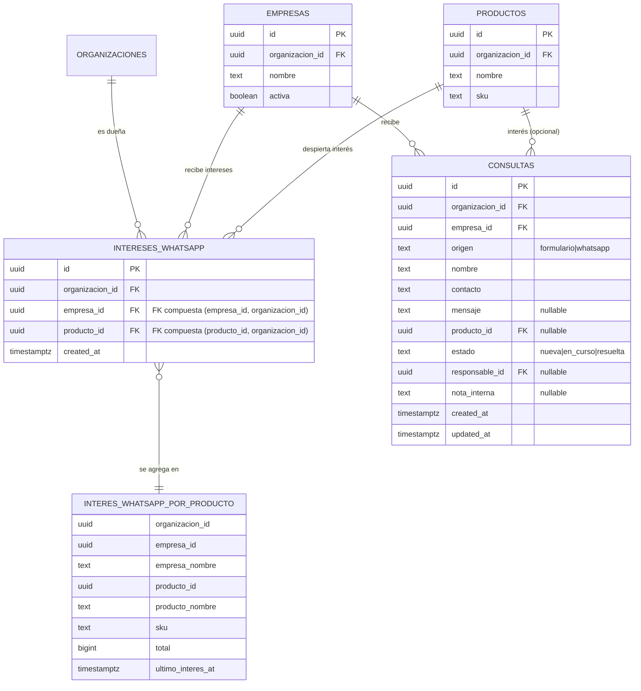

- **La tabla no tiene columnas personales:** la RPC `publico.registrar_interes_whatsapp(host, producto_id)`
  recibe solo el host y el producto; la empresa sale del dominio (`dominio.tiendas`).
- Cada toque es una fila: **no hay deduplicación** (identificar al visitante exigiría guardar datos) y el
  anti-spam es de la tienda (MSF-212).
- La vista es el **contrato de lectura** de la pantalla de Consultas y del reporte de productos más
  consultados (F-REP-04).
- **[ERD interactivo (Archify)](../diagrams/msf-130-erd.html)** — columnas, PK/FK y cardinalidad.
- Detalle de RPC, RLS, frontend, seguridad y reversión:
  [Consultas: modelo, RPC y aviso](consultas.md#interes-por-whatsapp-f-con-02-msf-130).

## Rentabilidad (MSF-120)

La tabla nueva va en `dominio` y las vistas en un esquema nuevo `analitica` (solo vistas, sin tablas ni RLS);
`public.reportes` suma una columna. Migraciones `20261130100000`–`20261130100400` (umbral, Actividad, vista
base, rol de Superset y `reportes.seccion`) y `20261130110000`–`20261130110100` (vistas del resumen y RPC de
conteo), todas aditivas y con reversión en el encabezado.

| Objeto | Esquema | Estado | Cambio |
|---|---|---|---|
| `rentabilidad_config` | `dominio` | nueva | `organizacion_id` PK y `umbral_margen_bajo` (0 < valor ≤ 1, default 0,10). |
| `margen_producto_canal` | `analitica` | nueva (vista) | Una fila por producto × tienda con margen calculable. |
| `rentabilidad_resumen_empresa` | `analitica` | nueva (vista) | Agregado por empresa. |
| `rentabilidad_consolidado` | `analitica` | nueva (vista) | Agregado por organización, ponderado. |
| `reportes.seccion` | `public` | alterada | Columna nueva nullable; exige una sección para emitir el token. |

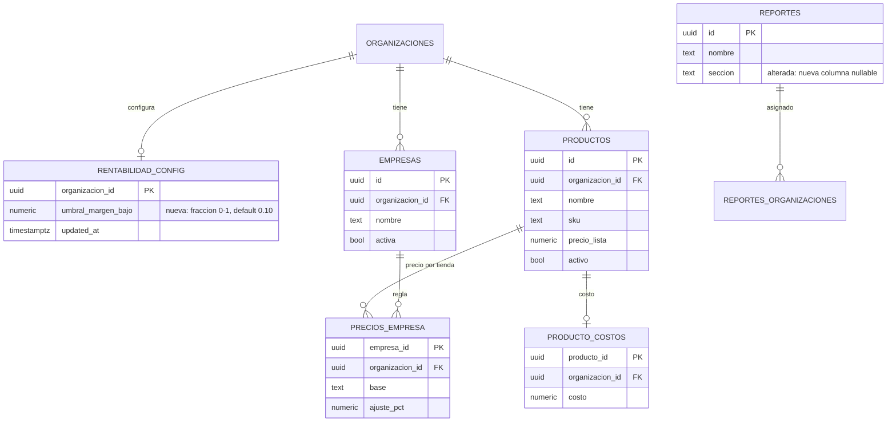

- El margen se **calcula al leer** (`analitica.margen_producto_canal`) desde
  `public.precios_empresa_neto` y `dominio.producto_costos` (convertido con `private.a_pesos`); no se guarda
  un importe en pesos.
- `analitica` no tiene tablas: está cerrado para `anon`/`authenticated` y lo lee solo el rol
  `superset_analitica`. El aislamiento por organización lo fuerza la cláusula `rls` del guest token, por eso
  cada vista expone `organizacion_id`.
- Detalle de RPC, tableros y operación: [Rentabilidad](rentabilidad.md).

## Rentabilidad: comparativo e historia (MSF-127)

Épica **MSF-127**, spec `rentabilidad-comparativos-e-historia`, rama
`epic/MSF-127-inicio-rentabilidad-y-reportes-rentabili` (pendiente de merge a `main`). Una tabla nueva en
`dominio` (la historia de costos), dos vistas nuevas en `analitica` y dos funciones de apoyo. Migraciones
`20270111100000_analitica_margen_comparativo.sql`,
`20270111100100_analitica_margen_comparativo_diferencia.sql`,
`20270111110000_dominio_producto_costos_historial.sql` y `20270111110100_analitica_margen_historico.sql`
(aditivas; reversión en el encabezado de cada una y consolidada en
[Rentabilidad](rentabilidad.md#comparativo-e-historia-msf-127)).

| Tabla | Estado | Cambio |
|---|---|---|
| `dominio.producto_costos_historial` | **nueva** | Append-only: `id` (PK), `organizacion_id`, `producto_id`, `costo` (`numeric(14,2)`, `>= 0`) y `vigente_desde`. FK compuesta a `dominio.productos (id, organizacion_id)` con `on delete cascade`. **Sin políticas de escritura**: la alimenta el disparador `private.registrar_costo_historial()` sobre `dominio.producto_costos` (alta o cambio real de costo) y una siembra inicial con el costo vigente al lanzar. RLS por organización y sección `rentabilidad` (`lectura`/`edicion`); `anon` sin privilegios. |
| `dominio.producto_costos` | existente | El costo vigente. No cambia: el disparador de MSF-127 lo observa (`after insert or update of costo`) sin alterar ninguna firma de RPC. |
| `dominio.cotizaciones` | existente | Historial de cotizaciones confirmadas (F-PRE-04): `valor` y `cargada_en`. Es la segunda fuente de fechas de la serie histórica. No cambia. |
| `dominio.productos` | existente | Fuente de nombre, SKU, moneda, precio de lista y estado; solo se referencia con FK compuesta. No cambia. |
| `dominio.empresas` | existente | Nombre y estado activo de cada tienda en las dos vistas. No cambia. |
| `dominio.precios_empresa` | existente | Regla de precio por empresa que se aplica al precio de cada fecha del histórico. No cambia. |

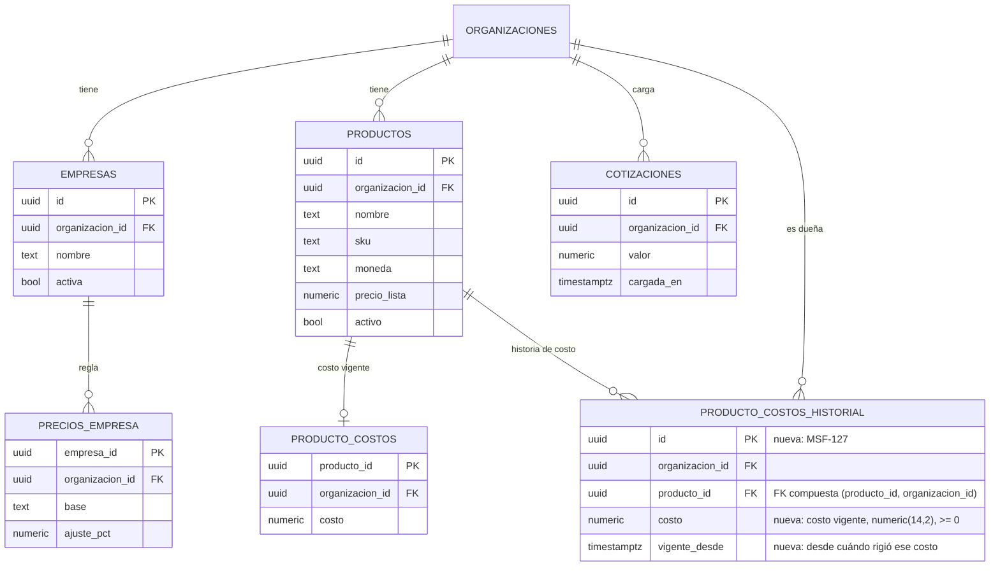

- **El comparativo** (`analitica.margen_comparativo_producto`) no guarda nada: deriva de
  `analitica.margen_producto_canal` y solo agrega `empresas_comparadas`, `margen_pct_mejor`, `margen_pct_peor`,
  `diferencia_pp`, `empresa_mejor` y `empresa_peor`. Solo incluye productos con margen en 2 o más empresas.
- **El histórico** (`analitica.margen_historico_producto_canal`) tampoco guarda nada: una fila por producto ×
  empresa × fecha de la serie (cambio de costo o carga de cotización), con el costo vigente de esa fecha
  (`analitica.costo_en_fecha`) y la cotización más cercana (`analitica.cotizacion_cercana`).
- `analitica` sigue siendo **solo vistas y funciones**: sin tablas ni RLS, cerrado para `anon` y
  `authenticated`, leído solo por el rol `superset_analitica`. El aislamiento por organización lo fuerza la
  cláusula `rls` del guest token, por eso **cada vista nueva expone `organizacion_id`**.
- **La historia de costos no sale de Actividad.** La Actividad sigue registrando «Cambió el costo de X» sin
  importes; el costo histórico se reconstruye desde `dominio.producto_costos_historial` (decisión de Nicolás,
  AGE-1102, 24/10).
- **Los dos tableros se registran en `public.reportes`** con `seccion = 'rentabilidad'` (importador
  idempotente). Esa tabla no cambia de esquema: la columna `seccion` es de MSF-120 y el registro de las filas
  «Comparativo» y «Historia» es de datos, no de esquema.
- **[ERD interactivo (Archify)](../diagrams/msf-127-erd.html)** — la historia de costos nueva, las dos vistas de
  `analitica` y las tablas de las que dependen, con columnas, PK/FK y cardinalidad.
- Detalle de RPC, tableros, seguridad y reversión:
  [Rentabilidad: datos, RPC y tableros](rentabilidad.md#comparativo-e-historia-msf-127).

## Migración inicial de datos (MSF-142)

El importador del panel anterior (MSF-142) agrega dos tablas de plataforma en `public`, una tabla de
historial en `dominio` y una columna en `dominio.proveedores`. Migraciones:
`20261201100000_migracion_cargas.sql`, `20261201110000_proveedores_id_externo.sql`,
`20261201120000_archivo_ingresos_mercaderia.sql` y `20261201130000_migracion_conciliacion.sql`
(aditivas; reversión en el encabezado de cada una).

| Tabla | Estado | Cambio |
|---|---|---|
| `public.organizaciones` | existente | Dueña de las cargas y del archivo; no cambia. |
| `public.migracion_cargas` | nueva | Cabecera de cada ejecución (entidad, archivo, filas, estado, contadores, actor). RLS de lectura solo Administrador. |
| `public.migracion_filas` | nueva | Resultado por fila; única por `(carga_id, fila)`. RLS de lectura solo Administrador. |
| `public.clientes` | existente | Destino de la carga de clientes; sin cambios de esquema. Los nuevos se habilitan en todas las tiendas. |
| `public.clientes_identificadores_externos` | existente | Clave de conciliación con `sistema = 'panel_actual'`; sin cambios de esquema. |
| `public.clientes_empresas` | existente | Relación cliente ↔ tienda que rellena el alta de la migración; sin cambios de esquema. |
| `dominio.empresas` | existente | Tiendas donde se habilitan los clientes nuevos; sin cambios de esquema. |
| `dominio.proveedores` | alterada | `+ id_externo` (nullable, único por organización cuando tiene valor). |
| `dominio.productos` | existente | La carga de vínculos fija `proveedor_id` y `codigo_proveedor`; sin cambios de esquema. |
| `dominio.archivo_ingresos_mercaderia` | nueva | Historial de ingresos del panel anterior, único por `(organizacion_id, id_externo)`; solo `select` para `authenticated`. |

```mermaid
erDiagram
  ORGANIZACIONES ||--o{ MIGRACION_CARGAS : "dueña"
  MIGRACION_CARGAS ||--o{ MIGRACION_FILAS : "resultado por fila"
  ORGANIZACIONES ||--o{ CLIENTES : "dueña"
  CLIENTES ||--o{ CLIENTES_IDENTIFICADORES_EXTERNOS : "vínculo externo"
  CLIENTES ||--o{ CLIENTES_EMPRESAS : "habilitado en"
  EMPRESAS ||--o{ CLIENTES_EMPRESAS : "ve"
  ORGANIZACIONES ||--o{ PROVEEDORES : "dueña"
  PROVEEDORES ||--o{ PRODUCTOS : "provee (opcional)"
  ORGANIZACIONES ||--o{ ARCHIVO_INGRESOS_MERCADERIA : "dueña"
  MIGRACION_CARGAS ||--o{ ARCHIVO_INGRESOS_MERCADERIA : "origen (opcional)"

  MIGRACION_CARGAS { uuid id PK
    uuid organizacion_id FK
    text entidad "clientes|proveedores|vinculos_proveedor_producto|ingresos_archivo"
    text archivo
    int filas_total
    text estado "en_curso|aplicada|fallida"
    int nuevos
    int actualizados
    int con_error
    uuid actor_id FK
    timestamptz cerrada_en }
  MIGRACION_FILAS { uuid id PK
    uuid carga_id FK
    int lote
    int fila "unique (carga_id, fila)"
    text estado "nueva|actualizada|error"
    text identificador_externo
    text motivo }
  CLIENTES { uuid id PK
    uuid organizacion_id FK
    text nombre
    text documento }
  CLIENTES_IDENTIFICADORES_EXTERNOS { uuid cliente_id FK
    text sistema "panel_actual"
    text identificador_externo "único global por sistema" }
  CLIENTES_EMPRESAS { uuid cliente_id FK
    uuid empresa_id FK
    uuid organizacion_id FK }
  EMPRESAS { uuid id PK
    uuid organizacion_id FK
    text nombre }
  PROVEEDORES { uuid id PK
    uuid organizacion_id FK
    text razon_social
    text cuit
    text id_externo "nueva: nullable, única por organización" }
  PRODUCTOS { uuid id PK
    uuid organizacion_id FK
    text sku
    uuid proveedor_id FK "existente; la carga lo fija"
    text codigo_proveedor "existente; la carga lo fija" }
  ARCHIVO_INGRESOS_MERCADERIA { uuid id PK
    uuid organizacion_id FK
    text id_externo "unique (organizacion_id, id_externo)"
    date fecha
    text producto
    int cantidad
    text proveedor
    text operador
    uuid carga_id FK }
```

- `migracion_filas.fila` es el número de fila del archivo contando el encabezado como 1; es la base de
  la idempotencia `(carga, fila)`.
- `clientes_identificadores_externos` es único por `(sistema, identificador_externo)` en toda la base:
  el identificador del panel actual no se repite entre organizaciones.
- `archivo_ingresos_mercaderia` no tiene FK a productos, proveedores, depósitos ni a
  `dominio.ingresos_mercaderia`: no mueve stock ni se mezcla con los ingresos vivos.
- Detalle de RPC, contrato CSV, conciliación y operación:
  [Migración inicial de datos](migracion-inicial-de-datos.md).
## Ventas comprobantes (MSF-159)

Documento de venta interno (factura o presupuesto) con líneas y numeración por empresa y tipo. Todo vive
en `dominio`; la única tabla de plataforma que se toca es `public.permisos_rol_accion` (dato nuevo, sin
cambio de esquema). Migraciones: `20261203100100` … `20261204150200` (aditivas; reversión en el encabezado
de cada una y consolidada en [Ventas · comprobantes (técnico)](ventas-comprobantes.md#reversion)).

| Tabla | Estado | Cambio |
|---|---|---|
| `dominio.comprobantes_venta` | alterada | Empresa/tienda, canal, operador, vencimiento, forma de pago y envío elegidos, confirmación, `updated_at` y `numero_entero`; el resto del contrato de F-CLI-08 sigue igual. |
| `dominio.comprobantes_venta_lineas` | nueva | Producto, cantidad, precio sin IVA, escala, IVA, depósito de salida, «A pedido» y totales de la línea. |
| `dominio.comprobantes_venta_numeracion` | nueva | Contador `(organización, empresa, tipo) → último`; sin acceso directo. |
| `dominio.empresas`, `dominio.productos`, `dominio.depositos`, `dominio.existencias_deposito`, `dominio.reservas_stock` | existentes | Solo se leen al armar líneas y confirmar; la confirmación escribe movimientos y reservas con el motor de stock. |
| `public.clientes`, `public.permisos_rol_accion` | existentes | Sin cambio de esquema; `editar_precio` es un dato nuevo en la matriz de acciones de Ventas. |

```mermaid
erDiagram
  EMPRESAS ||--o{ COMPROBANTES_VENTA : "emite"
  CLIENTES ||--o{ COMPROBANTES_VENTA : "compra"
  COMPROBANTES_VENTA ||--o{ COMPROBANTES_VENTA_LINEAS : "detalla"
  COMPROBANTES_VENTA ||--|| COMPROBANTES_VENTA_NUMERACION : "numera"
  PRODUCTOS ||--o{ COMPROBANTES_VENTA_LINEAS : "se vende"
  DEPOSITOS ||--o{ COMPROBANTES_VENTA_LINEAS : "sale de"
  PRODUCTOS ||--o{ EXISTENCIAS_DEPOSITO : "tiene"
  DEPOSITOS ||--o{ EXISTENCIAS_DEPOSITO : "guarda"
  PRODUCTOS ||--o{ RESERVAS_STOCK : "reserva"
  DEPOSITOS ||--o{ RESERVAS_STOCK : "en"

  EMPRESAS { uuid id PK
             uuid organizacion_id FK
             text nombre }
  CLIENTES { uuid id PK
             uuid organizacion_id FK
             text nombre
             text tipo "minorista|mayorista" }
  COMPROBANTES_VENTA { uuid id PK
                       uuid organizacion_id FK
                       uuid cliente_id FK
                       uuid empresa_id FK "alterada: nueva tienda del comprobante"
                       text tipo "factura|presupuesto"
                       text numero
                       integer numero_entero "alterada: correlativo por empresa y tipo"
                       date fecha
                       text estado "borrador|confirmada|pendiente|aceptado"
                       text canal "alterada: mostrador|tienda_online|telefono_whatsapp"
                       uuid operador_id FK "alterada: usuario que carga"
                       date valido_hasta "alterada: solo presupuesto"
                       uuid forma_pago_id "alterada: solo la elección (MSF-139)"
                       uuid envio_id "alterada: solo la elección (MSF-139)"
                       timestamptz confirmado_en "alterada: la fija confirmar_comprobante"
                       uuid confirmado_por FK "alterada: usuario que confirma"
                       timestamptz updated_at "alterada: bloqueo optimista"
                       numeric total_sin_iva
                       numeric total_con_iva }
  COMPROBANTES_VENTA_LINEAS { uuid id PK
                               uuid organizacion_id FK
                               uuid comprobante_id FK
                               integer orden "unique con comprobante"
                               uuid producto_id FK
                               text descripcion
                               text codigo
                               integer cantidad "> 0"
                               numeric precio_unitario "sin IVA"
                               text escala "x1|x5|x10|x50"
                               boolean precio_manual
                               uuid alicuota_id
                               numeric alicuota_porcentaje
                               uuid deposito_id FK
                               boolean a_pedido
                               numeric subtotal_sin_iva
                               numeric iva }
  COMPROBANTES_VENTA_NUMERACION { uuid organizacion_id PK
                                  uuid empresa_id PK
                                  text tipo PK
                                  integer ultimo }
  PRODUCTOS { uuid id PK
              uuid organizacion_id FK
              text nombre }
  DEPOSITOS { uuid id PK
              uuid organizacion_id FK
              text nombre }
  EXISTENCIAS_DEPOSITO { uuid producto_id PK
                         uuid deposito_id PK
                         integer cantidad
                         integer reservado }
  RESERVAS_STOCK { uuid id PK
                   uuid producto_id FK
                   uuid deposito_id FK
                   integer cantidad
                   text referencia }
```

- **[ERD interactivo (Archify)](../diagrams/msf-159-erd.html)** — todas las tablas del grafo, columnas,
  PK/FK y cardinalidad.
- La numeración se toma con `private.siguiente_numero_comprobante` bajo bloqueo transaccional; el formato
  visible es provisorio (`lpad(..., 8, '0')`).
- La confirmación usa `private.aplicar_movimiento_deposito`; no llama a las RPC públicas de Stock porque
  exigen `stock` en edición y quien vende confirma con `ventas` en edición.
- Detalle de RPC, permisos, confirmación y reversión: [Ventas · comprobantes (técnico)](ventas-comprobantes.md).
## Ventas listado, estados y anulación (MSF-177)

Listado con filtros y exportación de comprobantes, matriz de estados por rol y anulación con nota de crédito.
Todo en `dominio` (una tabla nueva, dos alteradas de forma aditiva) más el bucket de Storage
`exportaciones-ventas` (no es tabla). Migraciones: `20261212100500` … `20261212120600` (aditivas; reversión en
el encabezado de cada una y consolidada en
[Ventas · listado, estados y anulación (técnico)](ventas-listado-estados-y-anulacion.md#reversión)).

| Tabla | Estado | Cambio |
|---|---|---|
| `dominio.transiciones_estado_comprobante` | **nueva** | Matriz de transiciones de estado del documento de venta por organización, tipo, estado desde/hasta y rol. Solo la escribe la siembra; sin escritura directa. |
| `dominio.comprobantes_venta` | **alterada** | Columnas nulables de anulación y nota de crédito (`comprobante_origen_id`, `nc_tipo`, `nc_concepto`, `anulado_en`, `anulado_por`, `motivo_anulacion`) y `check` de `tipo` ampliado con `nota_credito`. |
| `dominio.comprobantes_venta_numeracion` | **alterada** | Solo el `check` de `tipo`: la nota de crédito lleva correlativo propio por organización y empresa. |
| `dominio.comprobantes_venta_lineas` | existente | Sin cambio de estructura: las líneas de una nota «Devolución de productos» reutilizan la tabla con el mismo `orden` que la línea acreditada. |
| `dominio.empresas`, `dominio.formas_pago`, `dominio.formas_envio`, `dominio.existencias_deposito`, `dominio.reservas_stock`, `dominio.movimientos_stock` | existentes | Solo se leen o escriben por el motor de stock (`private.aplicar_movimiento_deposito`) al anular o devolver mercadería. |
| `public.clientes`, `public.perfiles_usuario`, `public.registro_actividad` | existentes | Sin cambio de esquema; el historial del comprobante sale de `registro_actividad`. |
| `public.permisos_rol_accion` | existente | Sin cambio de esquema; `exportar`, `anular` y `emitir_nota_credito` son datos nuevos de la matriz de acciones de Ventas. |

```mermaid
erDiagram
  ORGANIZACIONES ||--o{ TRANSICIONES_ESTADO_COMPROBANTE : "define"
  ORGANIZACIONES ||--o{ COMPROBANTES_VENTA : "emite"
  EMPRESAS ||--o{ COMPROBANTES_VENTA : "tiende"
  CLIENTES ||--o{ COMPROBANTES_VENTA : "compra"
  COMPROBANTES_VENTA ||--o{ COMPROBANTES_VENTA : "acredita con nota"
  COMPROBANTES_VENTA ||--o{ COMPROBANTES_VENTA_LINEAS : "detalla"
  COMPROBANTES_VENTA ||--|| COMPROBANTES_VENTA_NUMERACION : "numera"
  TRANSICIONES_ESTADO_COMPROBANTE ||--o{ COMPROBANTES_VENTA : "autoriza el cambio"
  PRODUCTOS ||--o{ COMPROBANTES_VENTA_LINEAS : "se vende"
  DEPOSITOS ||--o{ COMPROBANTES_VENTA_LINEAS : "sale de"
  DEPOSITOS ||--o{ EXISTENCIAS_DEPOSITO : "guarda"
  PRODUCTOS ||--o{ EXISTENCIAS_DEPOSITO : "tiene"
  DEPOSITOS ||--o{ RESERVAS_STOCK : "en"
  PRODUCTOS ||--o{ RESERVAS_STOCK : "reserva"

  ORGANIZACIONES { uuid id PK }
  TRANSICIONES_ESTADO_COMPROBANTE { uuid id PK
                                    uuid organizacion_id FK
                                    text tipo "factura|presupuesto"
                                    text estado_desde
                                    text estado_hasta
                                    text rol_id "sistema = cobros (MSF-195)" }
  EMPRESAS { uuid id PK
             uuid organizacion_id FK
             text nombre }
  CLIENTES { uuid id PK
             uuid organizacion_id FK
             text nombre }
  COMPROBANTES_VENTA { uuid id PK
                       uuid organizacion_id FK
                       uuid cliente_id FK
                       uuid empresa_id FK
                       text tipo "alterada: factura|presupuesto|nota_credito"
                       text numero
                       integer numero_entero
                       date fecha
                       text estado "alterada: +cobrado|deuda|armando|incompleto|anulada"
                       uuid comprobante_origen_id FK "alterada: factura que acredita la nota"
                       text nc_tipo "alterada: devolucion_productos|devolucion_importe|descuento"
                       text nc_concepto "alterada: concepto de la nota"
                       timestamptz anulado_en "alterada: cuándo se anuló"
                       uuid anulado_por FK "alterada: quién la anuló"
                       text motivo_anulacion "alterada: motivo obligatorio"
                       numeric total_sin_iva
                       numeric total_con_iva }
  COMPROBANTES_VENTA_LINEAS { uuid id PK
                               uuid organizacion_id FK
                               uuid comprobante_id FK
                               integer orden "unique con comprobante; la nota copia el de la factura"
                               uuid producto_id FK
                               integer cantidad "> 0"
                               numeric subtotal_sin_iva
                               numeric iva }
  COMPROBANTES_VENTA_NUMERACION { uuid organizacion_id PK
                                  uuid empresa_id PK
                                  text tipo PK "alterada: +nota_credito"
                                  integer ultimo }
  PRODUCTOS { uuid id PK
              uuid organizacion_id FK
              text nombre }
  DEPOSITOS { uuid id PK
              uuid organizacion_id FK
              text nombre }
  EXISTENCIAS_DEPOSITO { uuid producto_id PK
                         uuid deposito_id PK
                         integer cantidad
                         integer reservado }
  RESERVAS_STOCK { uuid id PK
                   uuid producto_id FK
                   uuid deposito_id FK
                   integer cantidad
                   text referencia }
```

- La matriz de transiciones **no tiene escritura directa**: la siembra
  `private.sembrar_transiciones_comprobante(org)` la escribe por organización (y por trigger en cada
  organización nueva). La edición desde una pantalla es Etapa 2.
- La **anulación** revierte el stock con el motor `private.aplicar_movimiento_deposito` (motivo de sistema
  «Anulación de factura») y libera las reservas «A pedido» con `referencia = 'comprobante:<id>:linea:<orden>'`.
- La **nota de crédito** es un documento propio con valores **positivos**: el signo negativo lo aplican las
  lecturas (`private.signo_comprobante`).
- La exportación diferida no usa tablas del producto: se apoya en el ciclo de ejecuciones
  (`public.ejecuciones_worker`, `public.despachos_ejecucion`) y en el bucket privado `exportaciones-ventas`.
- **[ERD interactivo (Archify)](../diagrams/msf-177-erd.html)** — el documento de venta, sus líneas, el
  correlativo, la matriz de transiciones y las tablas de referencia, con PK/FK y cardinalidad.
- Detalle de RPC, worker, flow y reversión:
  [Ventas · listado, estados y anulación (técnico)](ventas-listado-estados-y-anulacion.md).

## Ventas reportes básicos (MSF-338)

Épica **MSF-338** (spec `20270104-100000-ventas-reportes-basicos`), rama
`epic/MSF-338-ventas-y-despacho-ventas-reportes-basico` (pendiente de merge a `main`). **No crea tablas**:
agrega dos **vistas** en el esquema `analitica` (solo vistas y funciones de apoyo), dos **RPC** en `public`
y **una columna** en `public.reportes`. Migraciones `20270104090000`–`20270104090200` (aditivas; reversión
en el encabezado de cada una y consolidada en
[Ventas · reportes básicos (técnico)](ventas-reportes.md#reversion)).

| Tabla | Estado | Cambio |
|---|---|---|
| `analitica.ventas_producto_mas_vendido` | **nueva (vista)** | Productos más vendidos: grano empresa × producto × depósito × fecha; unidades y facturado neto (con IVA) del período, con el stock vigente y su estado. |
| `analitica.ventas_ranking_clientes` | **nueva (vista)** | Ranking de clientes: grano empresa × cliente × fecha; comprobantes (solo facturas), facturado neto, participación, posición y fecha del último comprobante. |
| `public.reportes` | **alterada** | Columna `filtro_empresa boolean not null default false`: el reporte declara si su guest token acota las filas a las empresas accesibles del usuario. |
| `dominio.comprobantes_venta` | existente | Solo se lee (`tipo`, `estado`, `fecha`, `empresa_id`, `cliente_id`, `total_con_iva`); el signo y el predicado los aplica la lectura. |
| `dominio.comprobantes_venta_lineas` | existente | Solo se lee (`producto_id`, `deposito_id`, `cantidad`, `subtotal_sin_iva`, `iva`). |
| `dominio.productos`, `dominio.categorias`, `dominio.depositos`, `dominio.empresas` | existentes | Solo se leen (nombre, SKU, categoría, depósito y tienda de cada línea). |
| `public.clientes` | existente | Solo se lee (`numero`, `nombre`, `tipo`, `es_consumidor_final`). |
| `public.stock_estados` | existente | Solo se lee (`cantidad`, `estado`): el stock vigente del producto y su estado. |

```mermaid
erDiagram
  ORGANIZACIONES ||--o{ COMPROBANTES_VENTA : "emite"
  ORGANIZACIONES ||--o{ REPORTES : "catoga"
  ORGANIZACIONES ||--o{ CLIENTES : "registra"
  EMPRESAS ||--o{ COMPROBANTES_VENTA : "vende"
  CLIENTES ||--o{ COMPROBANTES_VENTA : "compra"
  COMPROBANTES_VENTA ||--o{ COMPROBANTES_VENTA_LINEAS : "detalla"
  PRODUCTOS ||--o{ COMPROBANTES_VENTA_LINEAS : "se vende"
  DEPOSITOS ||--o{ COMPROBANTES_VENTA_LINEAS : "sale de"
  PRODUCTOS ||--o| CATEGORIAS : "se clasifica en"
  COMPROBANTES_VENTA ||--o{ VENTAS_PRODUCTO_MAS_VENDIDO : "se agrega en"
  COMPROBANTES_VENTA ||--o{ VENTAS_RANKING_CLIENTES : "se agrega en"
  PRODUCTOS ||--o{ VENTAS_PRODUCTO_MAS_VENDIDO : "se vende en"
  DEPOSITOS ||--o{ VENTAS_PRODUCTO_MAS_VENDIDO : "ubica"
  CLIENTES ||--o{ VENTAS_RANKING_CLIENTES : "aparece en"
  EMPRESAS ||--o{ VENTAS_PRODUCTO_MAS_VENDIDO : "acota"
  EMPRESAS ||--o{ VENTAS_RANKING_CLIENTES : "acota"

  REPORTES { uuid id PK
    uuid superset_dashboard_uuid UK
    text nombre
    text seccion "alterada: nullable (MSF-120)"
    boolean filtro_empresa "alterada: nueva columna, default false" }
  VENTAS_PRODUCTO_MAS_VENDIDO { uuid organizacion_id
    uuid empresa_id
    text empresa_nombre
    uuid producto_id
    text producto_nombre
    text sku
    text categoria
    uuid deposito_id
    text deposito_nombre
    bigint unidades "nueva: unidades con signo"
    numeric facturado "nueva: neto con IVA"
    numeric stock_hoy "nueva: stock vigente"
    text stock_estado "nueva: sin_stock|stock_bajo|disponible"
    date fecha "nueva: para el filtro de período" }
  VENTAS_RANKING_CLIENTES { uuid organizacion_id
    uuid empresa_id
    text empresa_nombre
    bigint posicion "nueva: se recalcula sobre el filtro"
    uuid cliente_id
    integer numero "nueva: correlativo por organización"
    text nombre "nueva"
    text tipo "nueva: minorista|mayorista"
    boolean consumidor_final "nueva: marca, no excluye"
    date fecha "nueva: día del comprobante"
    bigint comprobantes "nueva: solo facturas"
    numeric facturado "nueva: neto con IVA"
    numeric participacion "nueva: porcentaje 0-100"
    date ultimo_comprador "nueva: fecha del último comprobante" }
  COMPROBANTES_VENTA { uuid id PK
    uuid organizacion_id FK
    uuid empresa_id FK
    uuid cliente_id FK
    text tipo
    text estado
    date fecha
    numeric total_con_iva }
  COMPROBANTES_VENTA_LINEAS { uuid id PK
    uuid comprobante_id FK
    uuid producto_id FK
    uuid deposito_id FK
    numeric cantidad
    numeric subtotal_sin_iva
    numeric iva }
  PRODUCTOS { uuid id PK
    uuid organizacion_id FK
    text nombre
    text sku
    uuid categoria_id FK }
  CATEGORIAS { uuid id PK
    uuid organizacion_id FK
    text nombre }
  DEPOSITOS { uuid id PK
    uuid organizacion_id FK
    text nombre }
  EMPRESAS { uuid id PK
    uuid organizacion_id FK
    text nombre
    bool activa }
  CLIENTES { uuid id PK
    uuid organizacion_id FK
    integer numero
    text nombre
    text tipo
    bool es_consumidor_final }
```

- **La épica no crea tablas**: las dos vistas viven en `analitica` (superficie de lectura de Superset, cerrada
  para `anon` y `authenticated`, leída solo por el rol `superset_analitica`) y las dos RPC en `public`
  (superficie de ejecución, sin datos propios). El dato de dominio sigue en
  `dominio.comprobantes_venta*` y `public.clientes`, con su RLS por organización.
- **El cálculo no se reimplementa**: las vistas llaman a `private.comprobante_cuenta_como_facturado`
  (factura o nota de crédito; no borrador ni anulada) y a `private.signo_comprobante` (nota de crédito = −1)
  a través de envoltorios `security definer` en `analitica`, porque el rol de Superset no tiene acceso a
  `private`.
- **La columna `filtro_empresa` de `public.reportes` es opt-in por tablero**: la cláusula `rls` del guest
  token se aplica a **todos** los datasets del tablero, así que un tablero cuyas vistas no exponen
  `empresa_id` (los consolidados por organización de Rentabilidad) no puede llevarla y la deja en `false`.
- **El aislamiento** lo fuerza la cláusula `rls` del guest token (`organizacion_id` + `empresa_id`): por eso
  cada fila de las dos vistas expone `organizacion_id`, `empresa_id` y `empresa_nombre`.
- **La épica no agrega entidades al grafo**: no hay tablas nuevas, así que no hay un ERD propio; el grafo de
  ventas es el de
  **[ERD interactivo (Archify)](../diagrams/msf-177-erd.html)** (documento de venta, líneas, clientes y
  stock) y las dos vistas se apoyan en él.
- Detalle de RPC, tableros, token, exportación y reversión:
  [Ventas · reportes básicos (técnico)](ventas-reportes.md).

## Ventas despacho y faltantes (MSF-135)

Estado de despacho con responsables, envío con transporte y guía, y registro de los faltantes de stock. Una
tabla **nueva** en `dominio` (`faltantes_venta`) y una **alterada** de forma aditiva
(`dominio.comprobantes_venta`), más un dato nuevo en `public.permisos_rol_accion` (`despachar`). Migraciones:
`20270112100100` … `20270112150000` (aditivas; reversión en el encabezado de cada una y consolidada en
[Ventas · despacho y faltantes (técnico)](ventas-despacho-y-faltantes.md#reversion)).

| Tabla | Estado | Cambio |
|---|---|---|
| `dominio.faltantes_venta` | **nueva** | Una fila por **línea de factura** que no se pudo despachar por falta de stock: `organizacion_id`, `empresa_id`, `comprobante_id`, `linea_orden`, `producto_id`, `deposito_id`, `cantidad_faltante` (> 0), `estado` (`abierto`/`resuelto`), `registrado_por`, `creado_en`, `resuelto_en`. FK compuestas a comprobante (`on delete cascade`), producto, depósito y empresa; índice único parcial `(comprobante_id, linea_orden) where estado = 'abierto'`; `check ((estado = 'abierto') = (resuelto_en is null))`. |
| `dominio.comprobantes_venta` | **alterada** | `estado_despacho` (5 valores, nulable, solo para `tipo = 'factura'`), `armo_id` / `controlo_id` / `entrego_id` (→ `auth.users`, `on delete set null`), `entregado_en`, `transporte_id` (FK compuesta a `dominio.transportes`), `guia` (≤ 100) y `fecha_envio` (date). Índice `(organizacion_id, empresa_id, estado_despacho)`. |
| `public.permisos_rol_accion` | existente | Sin cambio de esquema: `despachar` es un dato nuevo de la matriz de acciones de Ventas (Administrador y Depósito). |
| `dominio.formas_envio` | existente | Sin cambio: se leen `tipo`, `exige_transporte_guia` y `estado_despacho_inicial` (MSF-139). |
| `dominio.transportes`, `dominio.transportes_empresas` | existentes | Sin cambio: catálogo de MSF-139; se leen para validar el transporte elegido. |
| `dominio.reservas_stock`, `dominio.existencias_deposito`, `dominio.movimientos_stock` | existentes | Sin cambio: el motor de stock descuenta las reservas «A pedido» al entregar. |
| `public.registro_actividad` | existente | Sin cambio: auditoría transversal de `private.registrar_actividad`. |

```mermaid
erDiagram
  ORGANIZACIONES ||--o{ COMPROBANTES_VENTA : "emite"
  EMPRESAS ||--o{ COMPROBANTES_VENTA : "tiende"
  CLIENTES ||--o{ COMPROBANTES_VENTA : "compra"
  COMPROBANTES_VENTA ||--o{ COMPROBANTES_VENTA_LINEAS : "detalla"
  COMPROBANTES_VENTA ||--|| COMPROBANTES_VENTA_NUMERACION : "numera"
  COMPROBANTES_VENTA ||--o{ FALTANTES_VENTA : "tiene"
  COMPROBANTES_VENTA_LINEAS ||--o{ FALTANTES_VENTA : "falta la linea"
  PRODUCTOS ||--o{ FALTANTES_VENTA : "faltó"
  DEPOSITOS ||--o{ FALTANTES_VENTA : "se armaba desde"
  TRANSPORTES ||--o{ COMPROBANTES_VENTA : "sale con"
  FORMAS_ENVIO ||--o{ COMPROBANTES_VENTA : "define el envio"
  PRODUCTOS ||--o{ COMPROBANTES_VENTA_LINEAS : "se vende"
  DEPOSITOS ||--o{ COMPROBANTES_VENTA_LINEAS : "sale de"
  DEPOSITOS ||--o{ EXISTENCIAS_DEPOSITO : "guarda"
  PRODUCTOS ||--o{ EXISTENCIAS_DEPOSITO : "tiene"
  DEPOSITOS ||--o{ RESERVAS_STOCK : "en"
  PRODUCTOS ||--o{ RESERVAS_STOCK : "reserva"

  ORGANIZACIONES { uuid id PK }
  EMPRESAS { uuid id PK
             uuid organizacion_id FK
             text nombre }
  CLIENTES { uuid id PK
             uuid organizacion_id FK
             text nombre }
  FORMAS_ENVIO { uuid id PK
                 uuid organizacion_id FK
                 text tipo "retiro_local|correo|expreso|moto|terminal"
                 boolean exige_transporte_guia
                 text estado_despacho_inicial "sin_armar|armando|listo_para_despachar" }
  TRANSPORTES { uuid id PK
                uuid organizacion_id FK
                text nombre
                text tipo "correo|expreso|moto_propia"
                boolean activo }
  COMPROBANTES_VENTA { uuid id PK
                       uuid organizacion_id FK
                       uuid cliente_id FK
                       uuid empresa_id FK
                       text tipo "alterada: factura|presupuesto|nota_credito"
                       text numero
                       date fecha
                       text estado "borrador|confirmada|anulada|cobro"
                       text estado_despacho "alterada: sin_armar|armando|incompleto|listo_para_despachar|entregado"
                       uuid armo_id FK "alterada: quien armo"
                       uuid controlo_id FK "alterada: quien controlo"
                       uuid entrego_id FK "alterada: quien entrego"
                       timestamptz entregado_en "alterada: cuando se entrego"
                       uuid transporte_id FK "alterada: transporte del envio"
                       text guia "alterada: guia de envio (<= 100)"
                       date fecha_envio "alterada: dia del envio"
                       timestamptz updated_at "bloqueo optimista"
                       numeric total_sin_iva
                       numeric total_con_iva }
  COMPROBANTES_VENTA_LINEAS { uuid id PK
                               uuid organizacion_id FK
                               uuid comprobante_id FK
                               integer orden "unique con comprobante"
                               uuid producto_id FK
                               integer cantidad "> 0"
                               uuid deposito_id FK
                               boolean a_pedido "reserva hasta la entrega"
                               numeric subtotal_sin_iva
                               numeric iva }
  COMPROBANTES_VENTA_NUMERACION { uuid organizacion_id PK
                                  uuid empresa_id PK
                                  text tipo PK }
  FALTANTES_VENTA { uuid id PK
                     uuid organizacion_id FK
                     uuid empresa_id FK
                     uuid comprobante_id FK
                     integer linea_orden "unique abierto por linea"
                     uuid producto_id FK
                     uuid deposito_id FK
                     integer cantidad_faltante "> 0"
                     text estado "abierto|resuelto"
                     uuid registrado_por FK
                     timestamptz creado_en
                     timestamptz resuelto_en }
  PRODUCTOS { uuid id PK
              uuid organizacion_id FK
              text nombre }
  DEPOSITOS { uuid id PK
              uuid organizacion_id FK
              text nombre }
  EXISTENCIAS_DEPOSITO { uuid producto_id PK
                         uuid deposito_id PK
                         integer cantidad
                         integer reservado }
  RESERVAS_STOCK { uuid id PK
                   uuid producto_id PK
                   uuid deposito_id FK
                   integer cantidad
                   text referencia "comprobante:<id>:linea:<orden>" }
```

- `estado_despacho` es un campo **propio**, separado del `estado` documental de MSF-159/MSF-177: los dos comparten
  los nombres `armando` e `incompleto`, pero viven en columnas distintas y los mueve esta épica, no la de los
  estados documentales.
- `dominio.faltantes_venta` **no se escribe desde el navegador**: RLS con `select` para `authenticated` y sin
  políticas ni privilegios de escritura; la escriben la RPC `security definer` `registrar_faltantes_despacho` y el
  disparador que la resuelve al reanudar el armado.
- `dominio.comprobantes_venta` tampoco gana escritura directa (estado, responsables y envío solo por RPC) y las
  tres columnas del envío (`transporte_id`, `guia`, `fecha_envio`) quedan **sin privilegio de lectura** para
  `authenticated`: la única lectura del envío es la RPC `obtener_envio_comprobante`, que resuelve el permiso en la
  empresa del comprobante.
- **[ERD interactivo (Archify)](../diagrams/msf-135-erd.html)** — el documento de venta con el despacho y el envío,
  la tabla de faltantes y las tablas de referencia, con PK/FK y cardinalidad.
- Detalle de RPC, permisos, pruebas y reversión:
  [Ventas · despacho y faltantes (técnico)](ventas-despacho-y-faltantes.md).

## Ventas RMA y devoluciones (MSF-178)

Devoluciones y reclamos por ítem sobre una factura vendida, con su forma de resolución, motivo y
seguimiento; se resuelven con la nota de crédito de F-VTA-11 o con el reingreso de stock de MSF-136.
Migraciones `20270113100000` … `20270113120300` (aditivas; reversión en el encabezado de cada una y
consolidada en [Ventas · devoluciones (RMA), técnico](ventas-rma-devoluciones.md#reversion)).

| Tabla | Estado | Cambio |
|---|---|---|
| `dominio.rma` | **nueva** | Cabecera del RMA: `organizacion_id`, `empresa_id`, `comprobante_id`, `numero` (`RMA-####`, único por organización), `forma_rma` (5 valores), `motivo` (≤ 200), `observaciones` (≤ 1000), `estado` (`abierto`/`en_gestion`/`cerrado`, por defecto `abierto`), `operador_id`, `creado_en`, `actualizado_en`, `nota_credito_id` (FK compuesta a la nota, nullable) y `stock_reingresado_en` (nullable). FK compuestas a organización, empresa y comprobante. |
| `dominio.rma_items` | **nueva** | Ítem del RMA: `organizacion_id`, `rma_id`, `comprobante_linea_id`, `producto_id`, `cantidad > 0`, `creado_en`; único `(rma_id, comprobante_linea_id)`; FK compuestas a `rma` (`on delete cascade`), línea y producto. |
| `dominio.comprobantes_venta` | existente | Sin cambio de esquema: se lee la factura y, por `rma.nota_credito_id`, la nota de crédito. |
| `dominio.comprobantes_venta_lineas` | existente | Sin cambio de columnas: recibe el índice único `comprobantes_venta_lineas_id_org_uq (id, organizacion_id)` para la FK compuesta. |
| `dominio.productos`, `dominio.empresas`, `public.organizaciones` | existentes | Sin cambio: se referencian por FK compuesta. |
| `dominio.movimientos_stock` / `dominio.existencias` | existentes | Sin cambio: el reingreso escribe una entrada con `public.registrar_movimiento_stock` (MSF-136). |
| `public.registro_actividad` | existente | Sin cambio: recibe `rma.registrada`, `rma.estado_cambiado`, `rma.nota_credito_vinculada` y `rma.stock_reingresado`. |
| `public.permisos_rol_accion` | existente | Sin cambio: la épica no agrega acciones; reutiliza `emitir_nota_credito` y el nivel de `ventas`/`stock`. |

```mermaid
erDiagram
  ORGANIZACIONES ||--o{ RMA : "es dueña"
  ORGANIZACIONES ||--o{ REGISTRO_ACTIVIDAD : "audita"
  EMPRESAS ||--o{ RMA : "atiende"
  CLIENTES ||--o{ COMPROBANTES_VENTA : "compra"
  COMPROBANTES_VENTA ||--o{ COMPROBANTES_VENTA_LINEAS : "detalla"
  COMPROBANTES_VENTA ||--o{ RMA : "origina"
  COMPROBANTES_VENTA |o--o{ RMA : "resuelve con nota"
  RMA ||--o{ RMA_ITEMS : "detalla"
  COMPROBANTES_VENTA_LINEAS ||--o{ RMA_ITEMS : "devuelve"
  PRODUCTOS ||--o{ RMA_ITEMS : "es"
  PRODUCTOS ||--o{ MOVIMIENTOS_STOCK : "mueve"
  DEPOSITOS ||--o{ MOVIMIENTOS_STOCK : "registra"
  DEPOSITOS ||--o{ COMPROBANTES_VENTA_LINEAS : "sale de"

  RMA { uuid id PK
        uuid organizacion_id FK
        uuid empresa_id FK
        uuid comprobante_id FK "factura confirmada"
        text numero "RMA-0001, único por organización"
        text forma_rma "cambio_directo|enviado_a_proveedor|faltante_envio|reclamo_faltante|devolucion_importe"
        text motivo "<= 200"
        text observaciones "<= 1000"
        text estado "abierto|en_gestion|cerrado"
        uuid operador_id FK "auth.users"
        uuid nota_credito_id FK "nota de crédito que lo resolvió"
        timestamptz stock_reingresado_en "marca del reingreso"
        timestamptz creado_en
        timestamptz actualizado_en "bloqueo optimista" }
  RMA_ITEMS { uuid id PK
              uuid organizacion_id FK
              uuid rma_id FK
              uuid comprobante_linea_id FK
              uuid producto_id FK
              integer cantidad "> 0"
              timestamptz creado_en }
  COMPROBANTES_VENTA { uuid id PK
                       uuid organizacion_id FK
                       uuid empresa_id FK
                       uuid cliente_id FK
                       text tipo "factura|presupuesto|nota_credito"
                       text numero
                       text estado "borrador|confirmada|anulada|..."
                       numeric total_sin_iva
                       numeric total_con_iva }
  COMPROBANTES_VENTA_LINEAS { uuid id PK
                               uuid organizacion_id FK
                               uuid comprobante_id FK
                               integer orden
                               uuid producto_id FK
                               integer cantidad
                               uuid deposito_id FK }
  PRODUCTOS { uuid id PK
              uuid organizacion_id FK
              text nombre }
  DEPOSITOS { uuid id PK
              uuid organizacion_id FK
              text nombre }
  MOVIMIENTOS_STOCK { uuid id PK
                      uuid organizacion_id FK
                      uuid producto_id FK
                      uuid deposito_id FK
                      text tipo "entrada|salida"
                      integer cantidad
                      uuid motivo_id FK
                      text nota }
  REGISTRO_ACTIVIDAD { uuid id PK
                        uuid organizacion_id FK
                        uuid actor_id FK
                        text tipo "rma.*"
                        text detalle
                        timestamptz creado_en }
  CLIENTES { uuid id PK
             uuid organizacion_id FK
             text nombre }
  EMPRESAS { uuid id PK
             uuid organizacion_id FK
             text nombre }
  ORGANIZACIONES { uuid id PK }
```

- Las formas y los estados son **valores fijos** (`check`), no tablas: *Decisiones abiertas* 5 y 3 de la
  spec.
- `rma` y `rma_items` tienen **RLS** por organización y sección `ventas`; `select` para `authenticated` y
  **sin escritura directa**. Solo escriben las RPC `security definer` `registrar_rma`,
  `cambiar_estado_rma`, `vincular_nota_credito_rma` y `reingresar_stock_rma`.
- La cantidad ya devuelta se cuenta sumando los `rma_items` previos de la misma línea. Una nota de
  «Devolución de productos» emitida desde el comprobante no descuenta de ese tope.
- `nota_credito_id` es una FK compuesta a `dominio.comprobantes_venta (id, organizacion_id)`; la spec
  nombra solo esa columna y `stock_reingresado_en` se agregó como marcador del reingreso (desvío anotado en
  la migración `20270113120000`).
- **[ERD interactivo (Archify)](../diagrams/msf-178-erd.html)** — el RMA, sus ítems, la factura, la nota
  y el movimiento de stock, con PK/FK y cardinalidad.
- Detalle de RPC, permisos, pruebas y reversión:
  [Ventas · devoluciones (RMA), técnico](ventas-rma-devoluciones.md).

## Ventas cobros y conciliación (MSF-195)

Libro de cobros de las facturas, conciliación de los pagos que tienen cuenta de cobro y control de los
contrarreembolsos que cobran los transportes. Dos tablas **nuevas** en `dominio` (el dinero que entra
y el que el transporte retiene) y **sin cambios** en las tablas que ya existían, salvo el índice único
que habilita la FK compuesta de la forma de pago. Migraciones: `20261215100000`–`20261215100400`
(F-VTA-12), `20261216100000`–`20261216100300` (F-VTA-13) y `20261217100000`–`20261217100200` (F-VTA-14),
aditivas; reversión en el encabezado de cada una y consolidada en
[Ventas · cobros y conciliación (técnico)](ventas-cobros-y-conciliacion.md#reversión).

| Tabla | Estado | Cambio |
|---|---|---|
| `dominio.cobros_comprobante` | **nueva** | Libro de cobros: un cobro por fila (importe > 0, forma de pago, cuenta de cobro nulable, origen `manual`/`contrarreembolso`, quién lo registró y quién lo aprobó). FK compuestas contra comprobante, empresa, forma de pago y cuenta de cobro. RLS de solo lectura; sin escritura directa ni `delete`. |
| `dominio.contrarreembolsos` | **nueva** | Control del cobro a la entrega por transporte (guía, importe, estado `pendiente`/`cobrado`, quién lo cobró y el cobro asociado). FK compuestas contra comprobante, empresa, transporte y cobro. RLS de solo lectura; sin escritura directa ni `delete`. |
| `dominio.comprobantes_venta` | existente | Sin cambio de esquema: solo se lee (total con IVA) y cambia de estado con `private.marcar_estado_cobro_comprobante` (MSF-177). |
| `dominio.formas_pago` | **alterada** | Se agrega el índice único `formas_pago_id_organizacion_uq (id, organizacion_id)` que habilita la FK compuesta del cobro a la forma de pago. Sin cambio de columnas. |
| `dominio.cuentas_cobro`, `dominio.cuentas_cobro_empresas` | existentes | Sin cambio: catálogos de MSF-139. La cuenta marcada «No usar» (`activa = false`) no recibe cobros nuevos, pero conserva los que ya tiene. |
| `dominio.transportes`, `dominio.transportes_empresas` | existentes | Sin cambio: catálogos de MSF-139. Solo los transportes con `cobra_contrarreembolso` abren un contrarreembolso. |
| `dominio.empresas` | existente | Sin cambio: se referencia con FK compuesta (la empresa del cobro es la del comprobante). |
| `public.permisos_rol_accion` | existente | Sin cambio de esquema; `registrar_cobro`, `conciliar_pago` y `cobrar_contrarreembolso` son **datos** nuevos de la matriz de acciones de Ventas. |
| `public.registro_actividad` | existente | Sin cambio: de ahí salen los eventos `comprobante.cobro_registrado`, `pago.conciliado`, `pago.conciliacion_revertida`, `contrarreembolso.abierto` y `contrarreembolso.cobrado`. |

```mermaid
erDiagram
  ORGANIZACIONES ||--o{ COBROS_COMPROBANTE : "dueña"
  ORGANIZACIONES ||--o{ CONTRARREEMBOLSOS : "dueña"
  EMPRESAS ||--o{ COBROS_COMPROBANTE : "tiende"
  EMPRESAS ||--o{ CONTRARREEMBOLSOS : "tiende"
  COMPROBANTES_VENTA ||--o{ COBROS_COMPROBANTE : "se cobra con"
  COMPROBANTES_VENTA ||--o{ CONTRARREEMBOLSOS : "entrega a cobrar"
  FORMAS_PAGO ||--o{ COBROS_COMPROBANTE : "se paga con"
  CUENTAS_COBRO ||--o{ COBROS_COMPROBANTE : "entra a"
  CUENTAS_COBRO_EMPRESAS }o--|| CUENTAS_COBRO : "habilita en"
  TRANSPORTES ||--o{ CONTRARREEMBOLSOS : "cobra al entregar"
  COBROS_COMPROBANTE ||--o| CONTRARREEMBOLSOS : "rinde el cobro"

  ORGANIZACIONES { uuid id PK }
  EMPRESAS { uuid id PK
             uuid organizacion_id FK
             text nombre }
  COMPROBANTES_VENTA { uuid id PK
                       uuid organizacion_id FK
                       uuid empresa_id FK
                       text numero
                       text tipo "factura|presupuesto|nota_credito"
                       text estado "cobrado|deuda los pone el cobro (MSF-195)"
                       uuid forma_pago_id FK
                       numeric total_con_iva }
  COBROS_COMPROBANTE { uuid id PK
                       uuid organizacion_id FK
                       uuid empresa_id FK
                       uuid comprobante_id FK
                       numeric importe "nueva: > 0, dos decimales"
                       uuid forma_pago_id FK "nueva: de la misma empresa"
                       uuid cuenta_cobro_id FK "nueva: nula si la forma no exige cuenta"
                       text origen "nueva: manual|contrarreembolso"
                       uuid registrado_por "nueva: sin FK a auth.users"
                       text registrado_por_nombre "nueva: foto del nombre"
                       timestamptz registrado_en "nueva: cuándo"
                       uuid aprobado_por "nueva: conciliación (F-VTA-13)"
                       text aprobado_por_nombre "nueva: foto del nombre"
                       timestamptz aprobado_en "nueva: cuándo se aprobó"
                       timestamptz actualizado_en "nueva: bloqueo optimista" }
  CONTRARREEMBOLSOS { uuid id PK
                      uuid organizacion_id FK
                      uuid empresa_id FK
                      uuid comprobante_id FK
                      uuid transporte_id FK
                      text guia "nueva: única por comprobante"
                      numeric importe "nueva: > 0, el saldo al abrirlo"
                      text estado "nueva: pendiente|cobrado"
                      uuid cobrado_por "nueva: sin FK a auth.users"
                      text cobrado_por_nombre "nueva: foto del nombre"
                      timestamptz cobrado_en "nueva: cuándo"
                      uuid cobro_id FK "nueva: el cobro del libro al rinde"
                      timestamptz creado_en "nueva: cuándo se abrió"
                      timestamptz actualizado_en "nueva: bloqueo optimista" }
  FORMAS_PAGO { uuid id PK "alterada: +índice único (id, organizacion_id)"
                uuid organizacion_id FK
                uuid empresa_id FK
                text nombre
                text tipo "efectivo|transferencia|contrarreembolso|tarjeta|otro"
                boolean exige_cuenta_cobro
                boolean genera_deuda
                boolean activo }
  CUENTAS_COBRO { uuid id PK
                  uuid organizacion_id FK
                  text nombre
                  text titular
                  text banco
                  text cbu
                  text cuit
                  text moneda "ARS|USD"
                  boolean activa "«No usar» no recibe cobros nuevos" }
  CUENTAS_COBRO_EMPRESAS { uuid cuenta_id PK
                           uuid empresa_id PK
                           uuid organizacion_id FK }
  TRANSPORTES { uuid id PK
                uuid organizacion_id FK
                text nombre
                text tipo "expreso|correo|moto_propia"
                boolean cobra_contrarreembolso
                numeric comision_pct
                integer plazo_rendicion_dias
                boolean activa }
```

- Las dos tablas nuevas son **libros de dinero**: un cobro ni se borra ni se edita (solo la
  conciliación mueve `aprobado_*`) y **no tienen** política ni permiso de `insert`, `update` o `delete`.
  Escribe la función interna `private` o la RPC `security definer` que la envuelve.
- Las **FK son compuestas contra `organizacion_id`**: un cobro o un contrarreembolso no puede apuntar
  a la comprobante, la forma de pago, la cuenta o el transporte de otra organización.
- **`anon` sin privilegios** y `authenticated` con solo lectura: la escritura llega por RPC.
- Los nombres de quien registra, aprueba o cobra son **fotos** (`registrado_por_nombre`,
  `aprobado_por_nombre`, `cobrado_por_nombre`): el historial sobrevive a la baja de la cuenta, mismo
  criterio que `dominio.movimientos_stock.actor_id`.
- El **estado Cobrado/Deuda** del comprobante no es una columna nueva: lo mueve
  `private.marcar_estado_cobro_comprobante` (MSF-177) desde `private.registrar_cobro_interno`.
- Detalle de RPC, reglas, permisos y reversión:
  [Ventas · cobros y conciliación (técnico)](ventas-cobros-y-conciliacion.md).
- **[ERD interactivo (Archify)](../diagrams/msf-195-erd.html)** — el libro de cobros, los contrarreembolsos,
  las tablas de donde salen sus datos (comprobante, empresas, formas de pago, cuentas de cobro, transportes) y
  las de plataforma, con PK/FK y cardinalidad.
## Avisos y listas configurables (MSF-189)

Tres tablas nuevas en `public` (plataforma/transversal), una en `dominio` (estado de consulta) y ninguna
alteración de `dominio.motivos_movimiento`. Migraciones aditivas `20261210120000`–`20261210120600` (avisos) y
`20261210130000`–`20261210130300` (listas y emisión desde Consultas), en la rama de la épica, pendiente de
merge a `main`; reversión en el encabezado de cada una y consolidada en
[Avisos y listas](avisos-y-listas.md#reversión). Los detalles de RPC, flow y operación están en
[Avisos y listas: modelo, RPC y flujos](avisos-y-listas.md).

| Tabla | Estado | Cambio |
|---|---|---|
| `public.tipos_aviso` | **nueva** | Catálogo de tipos (clave, nombre, sección de permisos); siembra `consulta_nueva`. RLS con `select` para `authenticated`, sin escritura desde la app. |
| `public.preferencias_aviso` | **nueva** | Preferencia por `(user_id, tipo_aviso)`; sin fila = encendido. Cada usuario lee y escribe solo las suyas; sin delete. |
| `public.avisos_pendientes` | **nueva** | Cola durable de correos con `grupo_id`, `datos`, estado, ventana, intentos, reclamo, `enviado_en` y `error`. RLS activa sin políticas para `authenticated`; solo `security definer` y el rol de Kestra. |
| `dominio.estados_consulta` | **nueva** | Lista de estados por organización (`nombre` ≤ 80, `activo`, `orden`), nombre único sin distinguir mayúsculas. RLS: lectura con `consultas`, escritura solo Administrador; sin delete. **Todavía no alimenta la bandeja de Consultas.** |
| `dominio.motivos_movimiento` | existente | **Sin cambio de tabla ni de RLS**; se edita también desde `/configuracion/listas` con el mismo editor de `/stock/motivos`. |
| `dominio.consultas` | existente | **Sin cambio de tabla**; el disparador de aviso ahora emite por `private.emitir_aviso` en lugar de encolar en `dominio.consultas_avisos`. |
| `public.organizaciones`, `public.usuarios_organizacion`, `auth.users` | existente | Solo se referencian con FK; no cambian. |

```mermaid
erDiagram
  ORGANIZACIONES ||--o{ AVISOS_PENDIENTES : "encola"
  ORGANIZACIONES ||--o{ ESTADOS_CONSULTA : "define"
  AUTH_USERS ||--o{ PREFERENCIAS_AVISO : "guarda"
  AUTH_USERS ||--o{ AVISOS_PENDIENTES : "recibe"
  TIPOS_AVISO ||--o{ PREFERENCIAS_AVISO : "por tipo"
  TIPOS_AVISO ||--o{ AVISOS_PENDIENTES : "clasifica"

  TIPOS_AVISO { text clave PK
    text nombre
    text seccion
    timestamptz created_at }
  PREFERENCIAS_AVISO { uuid user_id PK
    text tipo_aviso PK
    boolean activo
    timestamptz updated_at }
  AVISOS_PENDIENTES { uuid id PK
    uuid organizacion_id FK
    uuid user_id FK
    text tipo_aviso FK
    uuid grupo_id
    jsonb datos
    text estado "pendiente|enviando|enviado|descartado|fallido"
    integer intentos
    timestamptz creado_en
    timestamptz ventana_vence_en
    timestamptz proximo_intento
    timestamptz reclamado_hasta
    timestamptz enviado_en
    text error }
  ESTADOS_CONSULTA { uuid id PK
    uuid organizacion_id FK
    text nombre "≤ 80, único por organización"
    boolean activo
    integer orden
    timestamptz creado_en }
```

- `tipos_aviso` es un catálogo global (sin `organizacion_id`); cada componente registra sus claves por
  migración.
- `avisos_pendientes` agrupa por `grupo_id`: varias filas con el mismo grupo salen en un solo correo.
- `estados_consulta` no tiene FK desde `dominio.consultas.estado` en esta entrega; los estados de la bandeja
  siguen siendo los tres fijos de MSF-122. Conectarlos y migrar los valores es una historia de seguimiento.
- `motivos_movimiento` mantiene la forma de F-STK-02 (tipos a los que aplica y activo); la pantalla de listas
  no agrega columnas.

## Tienda pública (MSF-147 / MSF-167)

Las tablas del modelo de tienda son las cinco nuevas de **MSF-147** (ver arriba). **MSF-167** (catálogo y
ficha) **no crea ni altera tablas**: agrega funciones de lectura en `publico` y lógica interna en
`private`. `publico` sigue sin tablas.

| Función | Qué expone |
|---|---|
| `publico.tienda_por_dominio(host)` | Tienda pública (`tienda_id`, `empresa_nombre`, `estado`) o cero filas si el dominio no existe o la empresa está inactiva (MSF-147) |
| `publico.identidad_por_dominio(host)` | Colores, tipografías y rutas de logo/banners de la tienda; sin fila, valores del tema base (MSF-147) |
| `publico.contenido_por_dominio(host)` | Textos comerciales de la tienda; sin fila, todo vacío (MSF-147) |
| `publico.catalogo_visible_por_dominio(host)` | Categorías visibles y productos efectivamente visibles (destacados primero) con nombre, precio, indicador de imagen y categoría (MSF-147) |
| `publico.categorias_por_dominio(host)` | Categorías visibles de la tienda del dominio, con conteo de productos efectivos (MSF-167) |
| `publico.catalogo_pagina_por_dominio(host, categoria, solo_con_stock, precio_max, orden, pagina)` | Página de 24 productos con lista blanca (precio final, disponible, imagen, categoría y destacado) (MSF-167) |
| `publico.producto_por_dominio(host, producto)` | Ficha con nombre, descripción, SKU, categoría, precio, disponibilidad, compatibilidad e imágenes (MSF-167) |
| `publico.imagen_publica(ruta)` | Booleano que respalda la política de lectura anónima de imágenes de productos visibles (MSF-167) |

- La visibilidad efectiva sale de `private.catalogo_tienda_efectivo` (producto activo, visible y con
  categoría visible); el precio, de `private.precio_final_publico`, y la disponibilidad, de
  `private.disponible_publico` (solo booleano).
- `anon` ejecuta solo funciones de `publico`; las tablas conservan su RLS por organización.
- Detalle de contratos, seguridad y operación: [Tienda online: dominio, identidad y catálogo
  visible](tienda-dominio-e-identidad.md) y [Tienda pública: catálogo y ficha](tienda-catalogo-y-ficha.md).
  Modelo del catálogo y ERD vigente: [MSF-160](#modelo-del-catálogo-msf-160).

## Inicio, búsqueda y móvil (MSF-191)

Una tabla nueva en `public` para el control de abuso de la búsqueda pública y un índice sobre
`dominio.productos`; `publico` sigue **sin tablas**. Migraciones aditivas `20261203100000` y
`20261203110000`–`20261203110300` (rama de la épica, pendiente de merge a `main`; reversión en el
encabezado de cada una y consolidada en [Tienda pública: inicio, búsqueda y
móvil](tienda-inicio-busqueda-movil.md#alcance-de-entrega)). La versión móvil (F-TDA-17) no toca la base.

| Tabla | Estado | Cambio |
|---|---|---|
| `public.limite_pedidos_publicos` | **nueva** | `(visitante, ventana)` PK y `pedidos`; RLS activada, sin políticas y sin privilegios para `anon`/`authenticated`; solo la escribe `private.registrar_pedido_publico`. Guarda el hash del visitante, nunca la IP. |
| `dominio.productos` | alterada | Solo gana el índice GIN `productos_nombre_busqueda_trgm` sobre `private.normalizar_busqueda(nombre)`; no cambian columnas. |
| `dominio.tiendas` / `dominio.empresas` | existentes | Resuelven la tienda activa del `host`; no cambian. |
| `dominio.categorias` / `dominio.categorias_tienda` | existentes | Aportan nombre, jerarquía y visibilidad de categorías; no cambian. |
| `dominio.producto_empresa` / `dominio.productos_tienda` | existentes | Productos que vende la empresa, su visibilidad y su destacado; no cambian. |
| `dominio.producto_imagenes` | existente | Primera imagen de tarjetas y sugerencias; no cambia. |
| `dominio.existencias` | existente | `private.disponible_publico` lee `cantidad`; no cambia. |
| `dominio.precios_empresa` / `dominio.producto_precios_escala` / `dominio.alicuotas_iva` | existentes | Precio final de la empresa; no cambian. |

```mermaid
erDiagram
  ORGANIZACIONES ||--o{ EMPRESAS : "es dueña"
  EMPRESAS ||--o| TIENDAS : "publica"
  EMPRESAS ||--o{ PRODUCTO_EMPRESA : "vende"
  PRODUCTOS ||--o{ PRODUCTO_EMPRESA : "se vende en"
  CATEGORIAS ||--o{ PRODUCTOS : "clasifica"
  EMPRESAS ||--o{ CATEGORIAS_TIENDA : "elige"
  CATEGORIAS ||--o{ CATEGORIAS_TIENDA : "visible en"
  EMPRESAS ||--o{ PRODUCTOS_TIENDA : "elige y destaca"
  PRODUCTOS ||--o{ PRODUCTOS_TIENDA : "visible en"
  PRODUCTOS ||--o{ PRODUCTO_IMAGENES : "tiene"
  PRODUCTOS ||--o{ EXISTENCIAS : "stock"
  EMPRESAS ||--o{ PRECIOS_EMPRESA : "precio"
  PRODUCTOS ||--o{ PRODUCTO_PRECIOS_ESCALA : "escala"
  ALICUOTAS_IVA ||--o{ PRODUCTOS : "alícuota"

  LIMITE_PEDIDOS_PUBLICOS { text visitante PK "nueva: hash sha256, nunca la IP"
    timestamptz ventana PK "nueva: minuto en curso"
    integer pedidos "nueva" }
  PRODUCTOS { uuid id PK
    uuid organizacion_id FK
    uuid categoria_id FK
    text nombre "índice GIN trigrama normalizado"
    boolean activo }
  EMPRESAS { uuid id PK
    uuid organizacion_id FK
    boolean activa }
  TIENDAS { uuid id PK
    uuid empresa_id FK
    text dominio "único, normalizado" }
  CATEGORIAS { uuid id PK
    uuid organizacion_id FK
    uuid padre_id FK }
  PRODUCTO_EMPRESA { uuid producto_id PK
    uuid empresa_id PK }
  PRODUCTOS_TIENDA { uuid empresa_id PK
    uuid producto_id PK
    boolean visible
    boolean destacado }
  CATEGORIAS_TIENDA { uuid empresa_id PK
    uuid categoria_id PK
    boolean visible }
  PRODUCTO_IMAGENES { uuid id PK
    uuid producto_id FK
    integer posicion
    text ruta }
  EXISTENCIAS { uuid producto_id PK
    integer cantidad }
  PRECIOS_EMPRESA { uuid empresa_id PK
    boolean mostrar_con_iva }
  PRODUCTO_PRECIOS_ESCALA { uuid producto_id PK
    text escala PK
    numeric precio }
  ALICUOTAS_IVA { uuid id PK
    numeric porcentaje
    boolean exento }
```

- La tabla nueva es **transversal** (control de abuso de cualquier RPC pública), no una entidad del
  negocio de la tienda: por eso vive en `public` y no tiene `organizacion_id`. El visitante es anónimo.
- `private.visitante_publico(host)` guarda solo un `sha256` de la IP del proxy más el host; las ventanas de
  más de 10 minutos se purgan en la misma llamada. El número de pedidos por minuto y el umbral de similitud
  son constantes únicas (`private.limite_busquedas_por_minuto()` = 30 y
  `private.umbral_similitud_busqueda()` = 0,4).
- Detalle de contratos, seguridad y verificación: [Tienda pública: inicio, búsqueda y
  móvil](tienda-inicio-busqueda-movil.md).

## Contacto y WhatsApp (MSF-212)

Una tabla nueva en `dominio` y una columna nueva en `dominio.empresas`; `publico` sigue **sin tablas**.
Migraciones aditivas `20261212100000`, `20261212100100` y `20261212121000` (rama de la épica, pendiente de
merge a `main`; reversión en el encabezado de cada una y consolidada en
[Tienda pública: WhatsApp y contacto](tienda-whatsapp-y-contacto.md#alcance-de-entrega)). Detalle de RLS,
RPC y operación: [Tienda pública: WhatsApp y contacto](tienda-whatsapp-y-contacto.md).

| Tabla | Estado | Cambio |
|---|---|---|
| `dominio.tienda_envios` | **nueva** | Registro mínimo de envíos de visitantes de una tienda (límite por hora e idempotencia): `id`, `organizacion_id`, `empresa_id`, `visitante` (hash sha256, **nunca la IP**), `clave_envio` (uuid), `origen` (`formulario`\|`whatsapp`), `creado_en`; `unique (empresa_id, clave_envio)` e índice `(empresa_id, visitante, creado_en)`. RLS habilitada por organización, `revoke all … from public, anon, authenticated` + `grant select … to authenticated`: **`anon` no tiene ningún privilegio** y escribe solo `private.registrar_envio_tienda` (`security definer`). |
| `dominio.empresas` | **alterada** | Gana la columna `horarios text` (nullable, check ≤ 200) con `grant update (horarios)` a `authenticated`. No cambian las columnas existentes. |
| `dominio.tiendas` | existente | Resuelve la empresa del `host` y el dominio que usa el adaptador hacia la bandeja; no cambia. |
| `dominio.consultas` | existente | Recibe la consulta entregada por `private.entregar_a_bandeja` (MSF-122, F-CON-01); no cambia. |

```mermaid
erDiagram
  ORGANIZACIONES ||--o{ EMPRESAS : "es dueña"
  EMPRESAS ||--o| TIENDAS : "publica"
  EMPRESAS ||--o{ TIENDA_ENVIOS : "recibe envíos"
  EMPRESAS ||--o{ CONSULTAS : "recibe consultas"

  TIENDA_ENVIOS {
    uuid id PK
    uuid organizacion_id FK
    uuid empresa_id FK
    text visitante "nueva: hash sha256, nunca la IP"
    uuid clave_envio "nueva: idempotencia por empresa"
    text origen "nueva: formulario|whatsapp"
    timestamptz creado_en "nueva"
  }
  EMPRESAS {
    uuid id PK
    uuid organizacion_id FK
    text nombre
    text whatsapp
    text correo
    text horarios "nueva: nullable, máx. 200"
    boolean activa
  }
  TIENDAS {
    uuid id PK
    uuid empresa_id FK
    text dominio "único, normalizado"
  }
  CONSULTAS {
    uuid id PK
    uuid empresa_id FK
    text origen "formulario|whatsapp"
    text contacto
    text mensaje "nullable: obligatorio salvo whatsapp"
    uuid producto_id FK "nullable"
  }
```

- La tabla es **de dominio**, no transversal: registra los envíos de los visitantes **de una tienda**, así
  que lleva `organizacion_id` y se aísla por organización como el resto de los datos de la empresa.
- El límite (**5 envíos por hora por visitante y empresa**) vive en
  `private.limite_envios_tienda()` y se aplica en `private.registrar_envio_tienda`, con
  `pg_advisory_xact_lock` por (empresa, visitante) para que dos envíos simultáneos no superen el cupo.
  Las filas de más de 24 h se podan en la misma función.
- La **idempotencia** es la restricción `unique (empresa_id, clave_envio)`: un reintento o un doble clic
  no entrega dos veces ni gasta otro cupo.
- El visitante es anónimo: `private.visitante_hash` es el hash sha256 de la IP del cliente (según
  `private.saltos_proxy_confiables`, de MSF-191) más la empresa. La IP **no se guarda**; sin cabecera
  `x-forwarded-for` todos caen en un único cupo «sin-ip» (falla cerrada).
- La tabla de consultas (`dominio.consultas`) y su RPC pública son de **MSF-122**: ver
  [Consultas (MSF-122)](#consultas-msf-122).
- Detalle de contratos, seguridad y verificación: [Tienda pública: WhatsApp y contacto](tienda-whatsapp-y-contacto.md).

## Cuenta web del cliente (MSF-237)

Una tabla nueva en `public` (plataforma/autenticación, atada a `public.clientes` por la excepción
documentada) y funciones de lectura en `publico`/`private`; `publico` sigue **sin tablas**. Migraciones
aditivas `20261206100000`–`20261206110100` (rama de la épica, pendiente de merge a `main`; reversión en
el encabezado de cada una y consolidada en [Cuenta web del cliente](cuenta-web-cliente.md#alcance-de-entrega)).
Detalle de RLS, RPC y operación: [Cuenta web del cliente](cuenta-web-cliente.md).

| Tabla | Estado | Cambio |
|---|---|---|
| `public.cuentas_cliente` | **nueva** | Cuenta web por `(cliente, tienda)`: `id`, `organizacion_id`, `cliente_id`, `empresa_id`, `auth_user_id`, `estado` (`activa` \| `suspendida`), `created_at`; única `(cliente_id, empresa_id)`; FK en cascada a organización, cliente, empresa y `auth.users`. |
| `public.clientes` | existente | Solo se referencia; el correo de acceso sale de `clientes.correo` y el tipo define la escala. |
| `public.clientes_empresas` | existente | Determina «Habilitado en»; su ausencia deriva «No habilitado». |
| `public.organizaciones` | existente | Dueña y límite de aislamiento. |
| `dominio.empresas` / `dominio.tiendas` | existentes | Empresa de la cuenta y dominio para el enlace de Auth. |
| `auth.users` | existente | Un usuario por cliente (D1); `last_sign_in_at` alimenta «Último ingreso». |
| `public.usuarios_organizacion` | existente | **No** recibe la cuenta web: por eso no accede al panel. |

- RLS activada; lectura `authenticated` por organización, sección Clientes y `private.empresas_accesibles()`;
  sin políticas de escritura (solo RPC `security definer`). `anon` no tiene grants.
- «Sin cuenta» (sin fila) y «No habilitado» (cliente fuera de `clientes_empresas`) se **derivan**, no se
  guardan; «No habilitado» prevalece sobre el estado guardado.

```mermaid
erDiagram
  ORGANIZACIONES ||--o{ CUENTAS_CLIENTE : "es dueña"
  CLIENTES ||--o{ CUENTAS_CLIENTE : "tiene cuenta"
  EMPRESAS ||--o{ CUENTAS_CLIENTE : "tienda"
  AUTH_USERS ||--o{ CUENTAS_CLIENTE : "autentica"
  CLIENTES ||--o{ CLIENTES_EMPRESAS : "habilitado en"
  EMPRESAS ||--o{ CLIENTES_EMPRESAS : "recibe"
  EMPRESAS ||--|| TIENDAS : "publica"

  CUENTAS_CLIENTE { uuid id PK
    uuid organizacion_id FK
    uuid cliente_id FK
    uuid empresa_id FK
    uuid auth_user_id FK "auth.users"
    text estado "activa|suspendida"
    timestamptz created_at }
  CLIENTES { uuid id PK
    uuid organizacion_id FK
    text correo "correo de acceso"
    text tipo "minorista|mayorista"
    timestamptz archivado_en }
  CLIENTES_EMPRESAS { uuid cliente_id PK
    uuid empresa_id PK
    uuid organizacion_id FK }
  EMPRESAS { uuid id PK
    uuid organizacion_id FK
    text nombre
    boolean activa }
  TIENDAS { uuid id PK
    uuid empresa_id FK
    text dominio }
  AUTH_USERS { uuid id PK
    text email
    timestamptz last_sign_in_at }
  ORGANIZACIONES { uuid id PK
    text nombre }
```

## Precios e IVA (MSF-114)

Cuatro tablas nuevas en `dominio` (Principio VII) y tres alteradas. **No se guarda ningún precio en
pesos**: el precio central, el neto por empresa y el final con IVA se calculan al leer, en `private` y en
vistas de `public` que no almacenan datos. Migraciones aditivas `20261022120901`–`20261022150100` (rama de
la épica, pendiente de merge a `main`; reversión en el encabezado de cada una y consolidada en
[Precios e IVA (técnico)](precios-e-iva.md#reversion)).

| Tabla | Estado | Cambio |
|---|---|---|
| `dominio.cotizacion_inicial` | **nueva** | Cotización inicial del dólar: una fila por organización (`organizacion_id` PK), `valor numeric(14,4) > 0`, `updated_at`. RLS por organización; select con `productos` ≥ lectura, escritura con `empresas` = edición; sin `DELETE`. |
| `dominio.precios_empresa` | **nueva** | Regla de precio por empresa: `empresa_id` PK, `base` (`central` \| `central_ajuste`), `ajuste_pct numeric(7,3) > −100`, `redondeo_pesos = 10`, `updated_at`, FK compuesta `(empresa_id, organizacion_id)`. Sin fila = «Igual al central». RLS por organización; sin `DELETE`. |
| `dominio.alicuotas_iva` | **nueva** | Catálogo de alícuotas por organización: `id` PK, `nombre`, `porcentaje numeric(5,2)` (0 ≤ pct < 100), `exento`, `activa`. Único por `(organizacion_id, lower(btrim(nombre)))`. Lectura para toda la organización autenticada; sin escritura desde la app en esta épica; sin `DELETE`. |
| `dominio.producto_precios_escala` | **nueva** | Precios sin IVA de las escalas x5, x10 y x50 de un producto, en su moneda: `(producto_id, escala)` PK, `precio numeric(14,2) ≥ 0`, `updated_at`, FK compuesta `(producto_id, organizacion_id)`. `x1` es el precio de lista del producto (no se duplica). Sin `DELETE`: precio `null` = escala sin precio cargado. |
| `dominio.categorias` | **alterada** | Gana `alicuota_iva_id uuid` con FK compuesta `(alicuota_iva_id, organizacion_id)` → `alicuotas_iva`. Las existentes quedan en 21 %; las nuevas nacen en 21 % por trigger. |
| `dominio.productos` | **alterada** | Gana `alicuota_iva_id uuid` con FK compuesta, nullable: `null` = hereda la alícuota de su categoría. |
| `dominio.empresas` | **alterada** | Gana el constraint `empresas_id_organizacion_key unique (id, organizacion_id)`, para que la FK compuesta de `precios_empresa` no pueda apuntar a otra organización. |
| `dominio.organizaciones` | existente | Dueña de las cuatro tablas nuevas (FK `organizacion_id`, `on delete cascade`). Recibe el trigger `organizaciones_sembrar_alicuotas_iva`. Sin cambios de esquema. |
| `dominio.producto_costos` | existente | Une el costo con `productos_precio_costo` por `LEFT JOIN`; su RLS (sección `rentabilidad`) deja `costo_ars` y `margen` en `null` para quien no la tiene. Sin cambios. |

```mermaid
erDiagram
  ORGANIZACIONES ||--o| COTIZACION_INICIAL : "cotización inicial"
  ORGANIZACIONES ||--o{ ALICUOTAS_IVA : "catálogo de alícuotas"
  ORGANIZACIONES ||--o{ PRECIOS_EMPRESA : "regla por empresa"
  ORGANIZACIONES ||--o{ PRODUCTO_PRECIOS_ESCALA : "escalas"
  EMPRESAS ||--o| PRECIOS_EMPRESA : "regla de precio"
  PRODUCTOS ||--o{ PRODUCTO_PRECIOS_ESCALA : "precio por escala"
  PRODUCTOS ||--o| PRODUCTO_COSTOS : "costo"
  PRODUCTOS ||--o{ PRODUCTOS : "categoría"
  CATEGORIAS ||--o{ PRODUCTOS : "clasifica"
  ALICUOTAS_IVA ||--o{ CATEGORIAS : "IVA de la categoría"
  ALICUOTAS_IVA ||--o{ PRODUCTOS : "IVA propio"

  COTIZACION_INICIAL { uuid organizacion_id PK
    numeric valor "nueva: numeric(14,4) > 0"
    timestamptz updated_at "nueva" }
  PRECIOS_EMPRESA { uuid empresa_id PK
    uuid organizacion_id FK
    text base "nueva: central | central_ajuste"
    numeric ajuste_pct "nueva: numeric(7,3) > -100"
    integer redondeo_pesos "nueva: 10"
    boolean mostrar_con_iva "nueva: false = Sin IVA"
    timestamptz updated_at "nueva: bloqueo optimista" }
  ALICUOTAS_IVA { uuid id PK
    uuid organizacion_id FK
    text nombre "nueva: único por organización"
    numeric porcentaje "nueva: 21 | 10,5 | 0 (Exento)"
    boolean exento "nueva"
    boolean activa "nueva" }
  PRODUCTO_PRECIOS_ESCALA { uuid producto_id PK
    uuid organizacion_id FK
    text escala PK "nueva: x5 | x10 | x50"
    numeric precio "nueva: numeric(14,2) ≥ 0, sin IVA"
    timestamptz updated_at "nueva" }
  CATEGORIAS { uuid id PK
    uuid organizacion_id FK
    uuid alicuota_iva_id FK "nueva: hereda el IVA" }
  PRODUCTOS { uuid id PK
    uuid organizacion_id FK
    uuid categoria_id FK
    text moneda "USD | ARS"
    numeric precio_lista "sin IVA"
    uuid alicuota_iva_id FK "nueva: propio; null = hereda" }
  PRODUCTO_COSTOS { uuid producto_id PK
    uuid organizacion_id FK
    numeric costo }
  EMPRESAS { uuid id PK
    uuid organizacion_id FK
    text nombre }
  ORGANIZACIONES { uuid id PK
    text nombre }
```

- La **cotización es de la organización**, no de una empresa: `cotizacion_inicial` tiene una fila por
  organización y la leen todas sus empresas.
- La **regla de precio** es de la empresa: sin fila, la empresa equivale a «Igual al central».
- El **IVA** se hereda: el producto manda si tiene `alicuota_iva_id`, si no manda el de su categoría.
- Las **vistas** `public.productos_precio_costo`, `public.precios_empresa_neto` y
  `public.precios_empresa_final` son `security_invoker` y **no almacenan datos**: heredan la RLS de las
  tablas base.
- RPC, fórmulas, permisos y reversión: [Precios e IVA (técnico)](precios-e-iva.md).

## Precios y dólar (MSF-116)

Tres tablas nuevas en `dominio` (Principio VII), una por organización y con RLS; la cotización es **de la
organización**, no de una empresa. La cuarta, `cotizacion_inicial`, ya existe (MSF-114) y queda como
respaldo. Migraciones aditivas `20261023140000`–`20261023140500` (rama de la épica, pendiente de merge a
`main`; reversión en el encabezado de cada una y consolidada en
[Dólar y recálculo](dolar-y-recalculo.md#reversión)).

```mermaid
erDiagram
  ORGANIZACIONES ||--o| COTIZACION_PENDIENTE : "espera confirmación"
  ORGANIZACIONES ||--o{ COTIZACIONES : "historial"
  ORGANIZACIONES ||--o| COTIZACION_APLICADA : "rige los precios"
  ORGANIZACIONES ||--o| COTIZACION_INICIAL : "respaldo (MSF-114)"
  COTIZACIONES ||--o| COTIZACION_APLICADA : "cotizacion_id"

  COTIZACION_PENDIENTE { uuid organizacion_id PK
    numeric valor "numeric(14,4) > 0"
    uuid cargada_por FK
    timestamptz cargada_en
    timestamptz expira_en "cargada_en + 24 h" }
  COTIZACIONES { uuid id PK
    uuid organizacion_id FK
    numeric valor
    numeric valor_anterior
    numeric variacion_pct
    uuid cargada_por FK
    text cargada_por_nombre
    timestamptz cargada_en
    boolean recalculo_aplicado
    integer precios_recalculados }
  COTIZACION_APLICADA { uuid organizacion_id PK
    numeric valor
    uuid cotizacion_id FK
    timestamptz aplicada_en }
  COTIZACION_INICIAL { uuid organizacion_id PK
    numeric valor
    timestamptz updated_at }
```

- `cotizacion_pendiente`: valor cargado que espera confirmación; vence a las 24 h y se resuelve al
  consultar; los tiempos los fija un trigger.
- `cotizaciones`: historial append-only de cargas confirmadas; sin grants de escritura y con triggers
  `ENABLE ALWAYS` que rechazan `UPDATE`, `DELETE` y `TRUNCATE`. Único escritor:
  `public.confirmar_cotizacion`.
- `cotizacion_aplicada`: una fila por organización; la lee `private.a_pesos` con
  `coalesce(aplicada, inicial)`. Sin fila, rige la inicial.
- `anon` sin privilegios en las tres. RPC, umbral, eventos y operación: [Dólar y recálculo](dolar-y-recalculo.md).

## Actividad e historial (MSF-455)

Migración aditiva `supabase/migrations/20261016120000_registro_actividad.sql` (esquema `public`: tabla transversal de plataforma, no de dominio). Detalle funcional y contrato de registro: [Actividad e historial](../actividad.md).

| Tabla | Estado | Notas |
|---|---|---|
| `public.registro_actividad` | nueva | Solo agregado; `tipo` con formato `entidad.accion` (máx. 60), `detalle` no vacío (máx. 500). Índices por `(organizacion_id, creado_en desc)`, tipo, actor y empresa. |
| `public.organizaciones` | existente | FK `organizacion_id`; sin cambios. |

```mermaid
erDiagram
  organizaciones ||--o{ registro_actividad : "organizacion_id"
  registro_actividad {
    uuid id PK
    uuid organizacion_id FK
    uuid empresa_id "opcional, sin FK"
    uuid actor_id
    text actor_nombre "foto al registrar"
    text tipo "entidad.accion"
    text detalle
    timestamptz creado_en
  }
```

- RLS: solo `select` a `authenticated` de su organización con nivel `lectura`/`edicion` en `actividad` (`private.nivel_seccion`); sin escritura directa ni privilegios para `anon`.
- Escritura únicamente vía `private.registrar_actividad` (misma transacción que la operación de origen) y la RPC acotada `public.registrar_actividad`; lectura vía `public.listar_actividad` y `public.opciones_actividad`.
- Reversión: ver sección «Reversión» de [Actividad e historial](../actividad.md).

## Datos vivos vs. archivo

- **Vivos:** comprobantes, cobros, stock, reparaciones. Afectan estados, saldos y reportes.
- **Archivo (`historial_*`):** datos del panel anterior, importados una sola vez, **solo lectura**. No tocan stock, saldos ni estados.
  - **[Flujo de importación](../diagrams/msf-275-dataflow.html)**
  - **[Estados de la ejecución](../diagrams/msf-275-lifecycle.html)**
- **Archivo de ingresos (`dominio.archivo_ingresos_mercaderia`, MSF-142):** historial de ingresos del panel anterior, solo lectura y sin efecto en el stock. Ver [Migración inicial de datos](migracion-inicial-de-datos.md).

## Migraciones y RLS

- Cada historia trae **su propia migración aditiva** con reversión en el encabezado.
- Las RPC nuevas son `security invoker` (o `definer` justificado), con `revoke`/`grant` explícitos.
- `rls_en_toda_tabla` y `aislamiento_organizaciones` recorren `public` + `dominio` en pgTAP.

## Inventario

El listado de tablas/rutas/variables generado desde el código está en **[Inventario](../_generated/inventory.md)**.

> **service_role (server-only):** tiene grants explícitos en `public`, `dominio` y `private`; `BYPASSRLS` no alcanza para usar un esquema/tabla. Lo usa el sandbox y las herramientas server-side, nunca el navegador.
