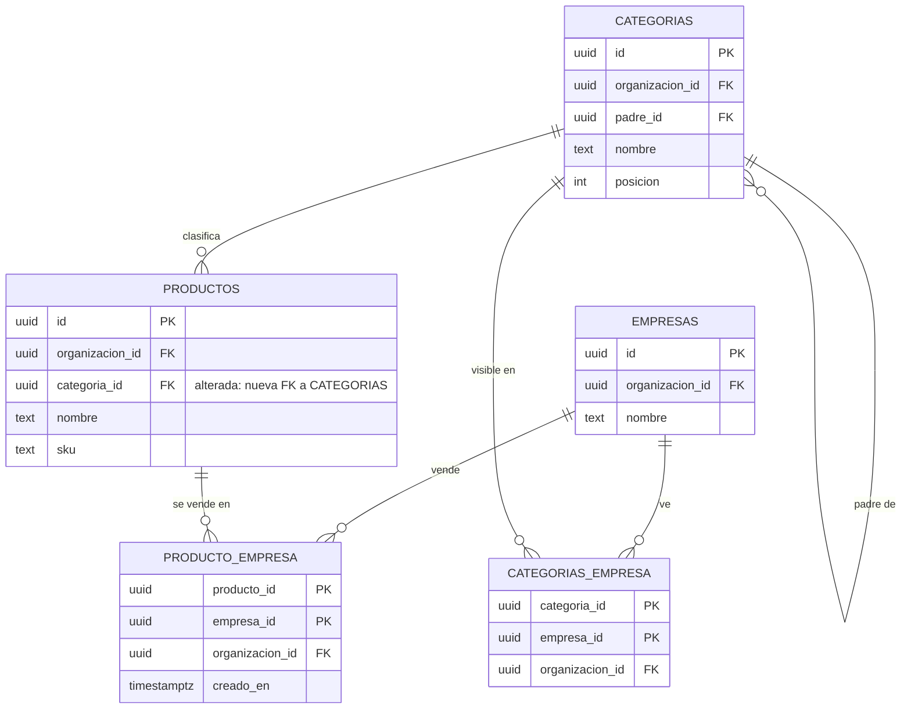
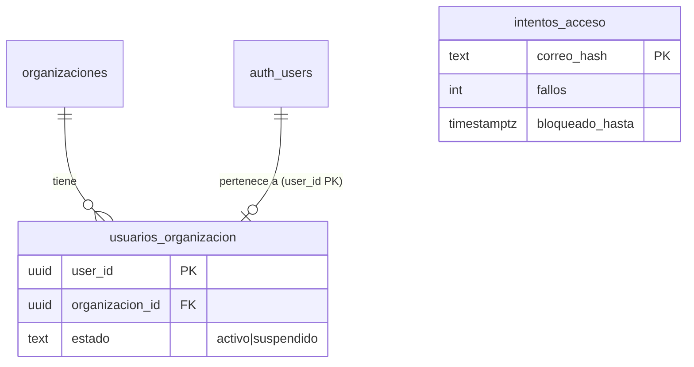
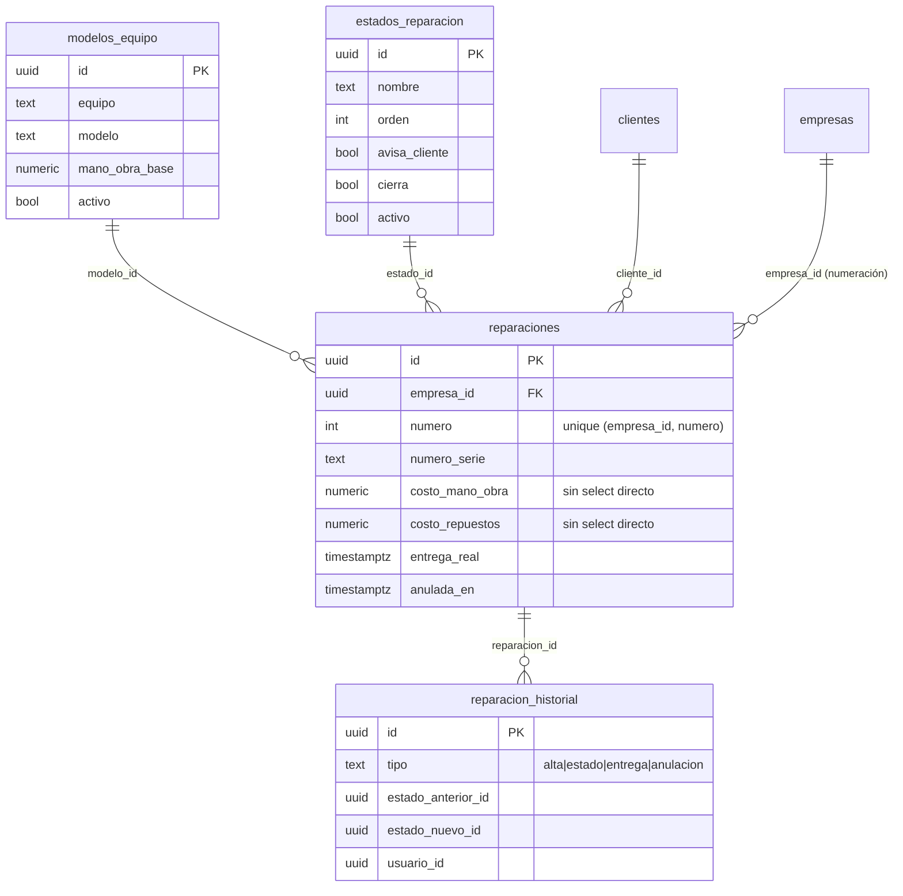
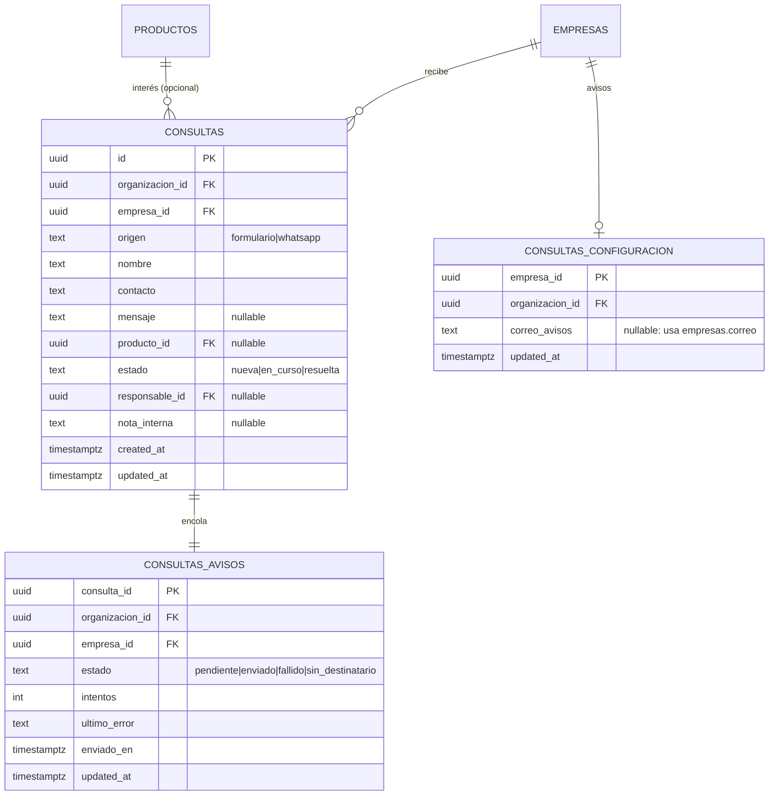
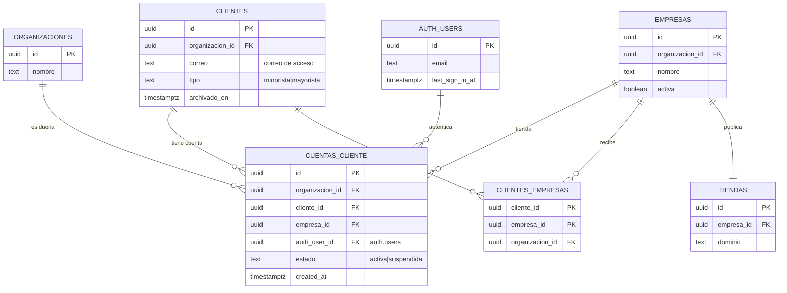
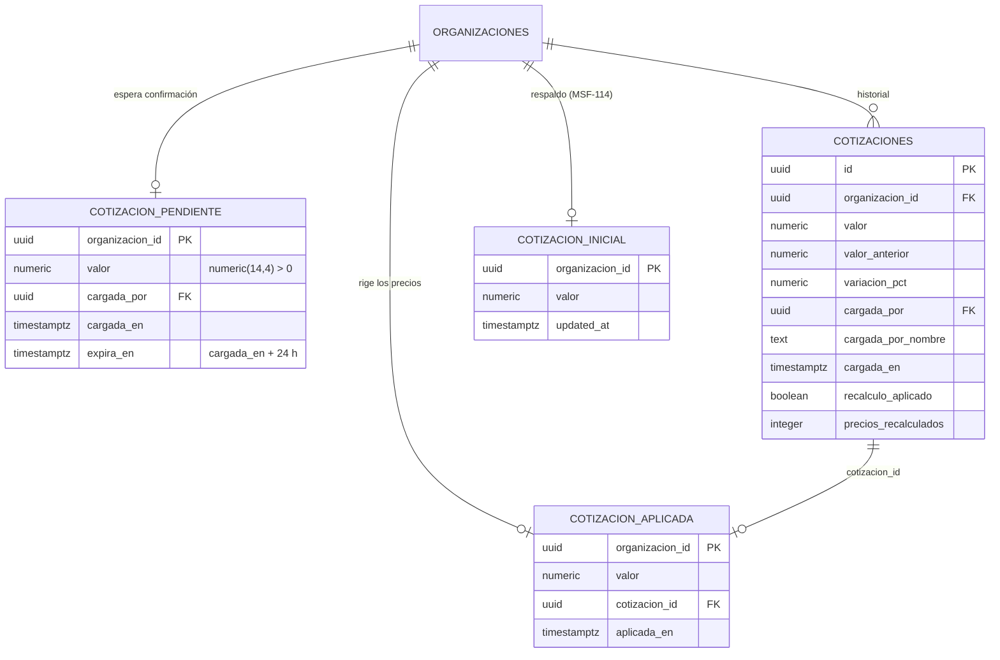

# Datos y DER

## Esquemas

| Esquema | Qué guarda |
|---|---|
| `public` | Plataforma: organizaciones, usuarios, roles, permisos, actividad, ejecuciones, imports |
| `dominio` | Negocio: empresas, clientes, productos, categorías, stock, comprobantes, reparaciones, historial |

Toda tabla expuesta tiene **RLS** por organización. Las secciones por empresa resuelven el nivel con `private.nivel_seccion()` y la empresa activa.

## Modelo del catálogo (MSF-160)

- **[ERD interactivo (Archify)](../diagrams/msf-160-erd.html)** — todas las columnas, PK/FK y cardinalidad.
- **[Arquitectura del catálogo](../diagrams/msf-160-architecture.html)** — cómo se lee y quién consume.

## Acceso y membresía (MSF-119)

- `public.usuarios_organizacion.estado` (`activo` | `suspendido`, default `activo`): migración aditiva `20261012140100`. Las funciones `private.organizacion_id()` y `private.puede_escribir()` excluyen a los suspendidos (más `20261012140300` para las de administración). El trigger `cortar_sesiones_suspendido` (`20261012150000`) borra `auth.sessions` al suspender.
- `public.intentos_acceso` (`correo_hash` PK, `fallos`, `ultimo_fallo`, `bloqueado_hasta`; `20261012140200`): contador de fallos por correo en hash HMAC (clave `acceso_hmac` en Vault). RLS activado y sin privilegios para `anon`/`authenticated`; solo se accede por RPC y por el hook `verificar_intento_acceso` (`20261014100000`). Es plataforma/auth, por eso vive en `public`. Cada migración lleva su reversión en el encabezado.
- Una persona pertenece a una sola organización (`user_id` PK de `usuarios_organizacion`, spec 003).

Detalle y operación: [Acceso](../acceso-ingreso.md) · regla para tablas nuevas: [Aislamiento](../aislamiento-por-organizacion.md).

## Service técnico (MSF-182)

Todas las tablas van en `dominio` (Principio VII), con RLS por `organizacion_id` y nivel de `service_tecnico` (`private.nivel_seccion`); lectura además restringida a tiendas accesibles (`20261020140000`). Sin `delete`. Migraciones: `supabase/migrations/20261020100100`–`20261020150000` (aditivas; reversión en el encabezado de cada una).

- **Modelos y estados son por organización; la numeración es por empresa** (`private.siguiente_numero_reparacion`, bloqueo asesor por transacción). Sembrado idempotente: `private.sembrar_service` (`20261020100300`, siete modelos y siete estados).
- FK compuestas `(…_id, organizacion_id)` impiden cruzar organizaciones.
- Costos: grant por columna sin `costo_*`; solo los entrega `obtener_reparacion`, enmascarados sin `ver_costos`.
- `reparacion_historial` es solo lectura para la app; lo escriben las RPC en la misma transacción.
- Rol `tecnico`: solo datos en `roles_organizacion`/`permisos_rol` (matriz fija); detalle en la rama de la épica (`docs/permisos-por-rol.md`).

## Consultas (MSF-122)

Tres tablas nuevas en `dominio` (Principio VII), con RLS por organización, empresa accesible y sección
`consultas`; sin escritura directa desde la app. El alta entra solo por `publico.crear_consulta_publica`
(la empresa sale del dominio de la tienda) y la edición por `public.actualizar_consulta`. Migraciones:
`20261205100000_consultas.sql`, `20261205200000_consultas_configuracion.sql` y
`20261205200100_consultas_avisos.sql` (aditivas; reversión en el encabezado de cada una y consolidada en
[Consultas: modelo, RPC y aviso](consultas.md#reversion)).

- `consultas` guarda estado, responsable y nota interna; `consultas_configuracion` la dirección de avisos
  (una fila por empresa); `consultas_avisos` la cola del correo, con `consulta_id` como clave (un aviso por
  consulta).
- FK compuestas `(empresa_id, organizacion_id)` y `(producto_id, organizacion_id)` impiden cruzar
  organizaciones.
- La vista `public.consultas_bandeja` y las RPC del panel viven en `public` y no almacenan datos.
- Detalle de RPC, permisos, aviso y operación: [Consultas](consultas.md).

## Tienda pública (MSF-147 / MSF-167)

**Sin cambios de esquema:** las épicas de tienda crean y alteran tablas solo en MSF-147 (modelo de
tienda, identidad, contenido y catálogo visible). MSF-167 (catálogo y ficha) **no crea ni altera tablas**:
agrega funciones de lectura en `publico` y lógica interna en `private`. `publico` sigue sin tablas.

| Función | Qué expone |
|---|---|
| `publico.categorias_por_dominio(host)` | Categorías visibles de la tienda del dominio, con conteo de productos efectivos |
| `publico.catalogo_pagina_por_dominio(host, categoria, solo_con_stock, precio_max, orden, pagina)` | Página de 24 productos con lista blanca (precio final, disponible, imagen, categoría y destacado) |
| `publico.producto_por_dominio(host, producto)` | Ficha con nombre, descripción, SKU, categoría, precio, disponibilidad, compatibilidad e imágenes |
| `publico.imagen_publica(ruta)` | Booleano que respalda la política de lectura anónima de imágenes de productos visibles |

- La visibilidad efectiva sale de `private.catalogo_tienda_efectivo` (producto activo, visible y con
  categoría visible); el precio, de `private.precio_final_publico`, y la disponibilidad, de
  `private.disponible_publico` (solo booleano).
- `anon` ejecuta solo funciones de `publico`; las tablas conservan su RLS por organización.
- Detalle de contratos, seguridad y operación: [Tienda pública: catálogo y ficha](tienda-catalogo-y-ficha.md).
  Modelo del catálogo y ERD vigente: [MSF-160](#modelo-del-catálogo-msf-160).

## Cuenta web del cliente (MSF-237)

Una tabla nueva en `public` (plataforma/autenticación, atada a `public.clientes` por la excepción
documentada) y funciones de lectura en `publico`/`private`; `publico` sigue **sin tablas**. Migraciones
aditivas `20261206100000`–`20261206110100` (rama de la épica, pendiente de merge a `main`; reversión en
el encabezado de cada una y consolidada en [Cuenta web del cliente](cuenta-web-cliente.md#alcance-de-entrega)).
Detalle de RLS, RPC y operación: [Cuenta web del cliente](cuenta-web-cliente.md).

| Tabla | Estado | Cambio |
|---|---|---|
| `public.cuentas_cliente` | **nueva** | Cuenta web por `(cliente, tienda)`: `id`, `organizacion_id`, `cliente_id`, `empresa_id`, `auth_user_id`, `estado` (`activa` \| `suspendida`), `created_at`; única `(cliente_id, empresa_id)`; FK en cascada a organización, cliente, empresa y `auth.users`. |
| `public.clientes` | existente | Solo se referencia; el correo de acceso sale de `clientes.correo` y el tipo define la escala. |
| `public.clientes_empresas` | existente | Determina «Habilitado en»; su ausencia deriva «No habilitado». |
| `public.organizaciones` | existente | Dueña y límite de aislamiento. |
| `dominio.empresas` / `dominio.tiendas` | existentes | Empresa de la cuenta y dominio para el enlace de Auth. |
| `auth.users` | existente | Un usuario por cliente (D1); `last_sign_in_at` alimenta «Último ingreso». |
| `public.usuarios_organizacion` | existente | **No** recibe la cuenta web: por eso no accede al panel. |

- RLS activada; lectura `authenticated` por organización, sección Clientes y `private.empresas_accesibles()`;
  sin políticas de escritura (solo RPC `security definer`). `anon` no tiene grants.
- «Sin cuenta» (sin fila) y «No habilitado» (cliente fuera de `clientes_empresas`) se **derivan**, no se
  guardan; «No habilitado» prevalece sobre el estado guardado.

## Precios y dólar (MSF-116)

Tres tablas nuevas en `dominio` (Principio VII), una por organización y con RLS; la cotización es **de la
organización**, no de una empresa. La cuarta, `cotizacion_inicial`, ya existe (MSF-114) y queda como
respaldo. Migraciones aditivas `20261023140000`–`20261023140500` (rama de la épica, pendiente de merge a
`main`; reversión en el encabezado de cada una y consolidada en
[Dólar y recálculo](dolar-y-recalculo.md#reversión)).

- `cotizacion_pendiente`: valor cargado que espera confirmación; vence a las 24 h y se resuelve al
  consultar; los tiempos los fija un trigger.
- `cotizaciones`: historial append-only de cargas confirmadas; sin grants de escritura y con triggers
  `ENABLE ALWAYS` que rechazan `UPDATE`, `DELETE` y `TRUNCATE`. Único escritor:
  `public.confirmar_cotizacion`.
- `cotizacion_aplicada`: una fila por organización; la lee `private.a_pesos` con
  `coalesce(aplicada, inicial)`. Sin fila, rige la inicial.
- `anon` sin privilegios en las tres. RPC, umbral, eventos y operación: [Dólar y recálculo](dolar-y-recalculo.md).

## Datos vivos vs. archivo

- **Vivos:** comprobantes, cobros, stock, reparaciones. Afectan estados, saldos y reportes.
- **Archivo (`historial_*`):** datos del panel anterior, importados una sola vez, **solo lectura**. No tocan stock, saldos ni estados.
  - **[Flujo de importación](../diagrams/msf-275-dataflow.html)**
  - **[Estados de la ejecución](../diagrams/msf-275-lifecycle.html)**

## Migraciones y RLS

- Cada historia trae **su propia migración aditiva** con reversión en el encabezado.
- Las RPC nuevas son `security invoker` (o `definer` justificado), con `revoke`/`grant` explícitos.
- `rls_en_toda_tabla` y `aislamiento_organizaciones` recorren `public` + `dominio` en pgTAP.

## Inventario

El listado de tablas/rutas/variables generado desde el código está en **[Inventario](../_generated/inventory.md)**.

> **service_role (server-only):** tiene grants explícitos en `public`, `dominio` y `private`; `BYPASSRLS` no alcanza para usar un esquema/tabla. Lo usa el sandbox y las herramientas server-side, nunca el navegador.
