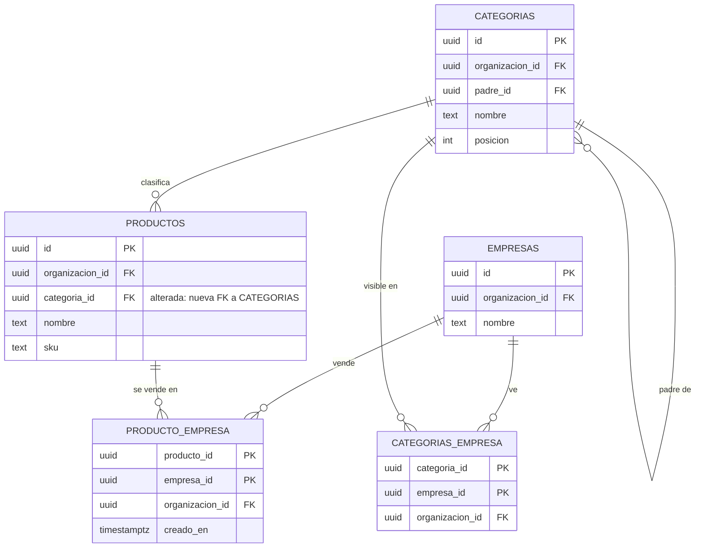

---
sources:
  - supabase/migrations
---

# Datos y DER

## Esquemas

| Esquema | Qué guarda |
|---|---|
| `public` | Plataforma: organizaciones, usuarios, roles, permisos, actividad, ejecuciones, imports |
| `dominio` | Negocio: empresas, clientes, productos, categorías, stock, comprobantes, reparaciones, historial |

Toda tabla expuesta tiene **RLS** por organización. Las secciones por empresa resuelven el nivel con `private.nivel_seccion()` y la empresa activa.

## Modelo del catálogo (MSF-160)

- **[ERD interactivo (Archify)](../diagrams/msf-160-erd.html)** — todas las columnas, PK/FK y cardinalidad.
- **[Arquitectura del catálogo](../diagrams/msf-160-architecture.html)** — cómo se lee y quién consume.

## Datos vivos vs. archivo

- **Vivos:** comprobantes, cobros, stock, reparaciones. Afectan estados, saldos y reportes.
- **Archivo (`historial_*`):** datos del panel anterior, importados una sola vez, **solo lectura**. No tocan stock, saldos ni estados.
  - **[Flujo de importación](../diagrams/msf-275-dataflow.html)**
  - **[Estados de la ejecución](../diagrams/msf-275-lifecycle.html)**

## Migraciones y RLS

- Cada historia trae **su propia migración aditiva** con reversión en el encabezado.
- Las RPC nuevas son `security invoker` (o `definer` justificado), con `revoke`/`grant` explícitos.
- `rls_en_toda_tabla` y `aislamiento_organizaciones` recorren `public` + `dominio` en pgTAP.

## Inventario

El listado de tablas/rutas/variables generado desde el código está en **[Inventario](../_generated/inventory.md)**.
