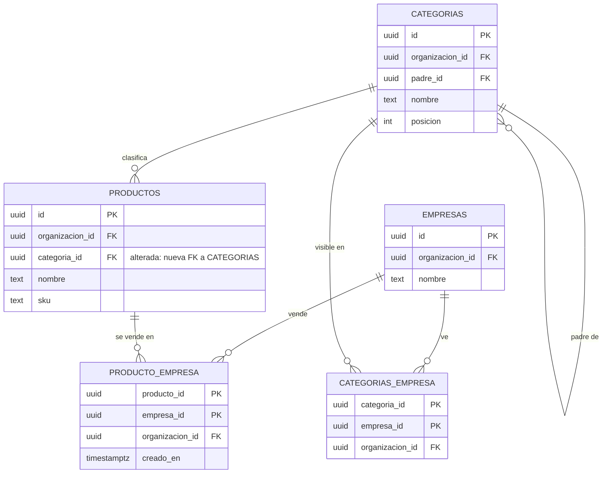
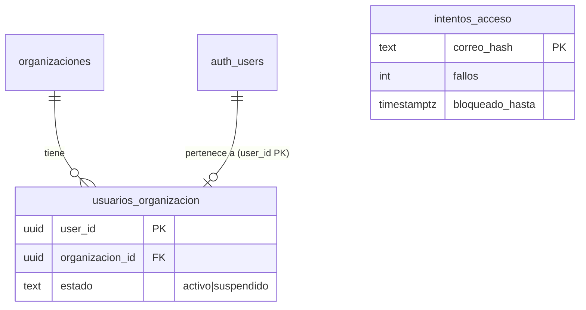
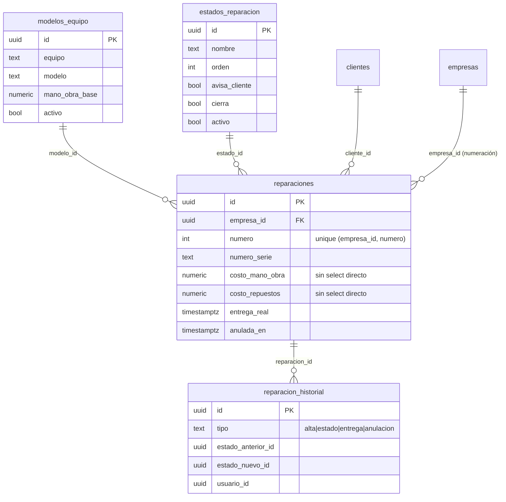
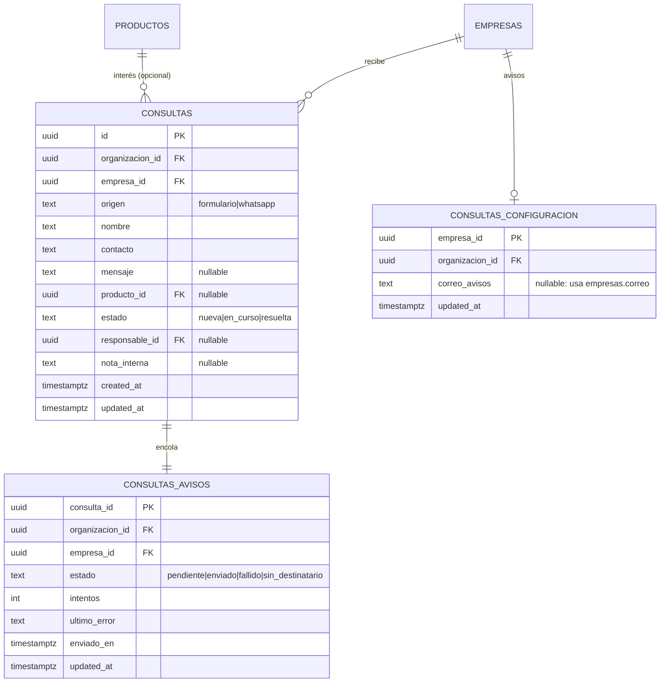
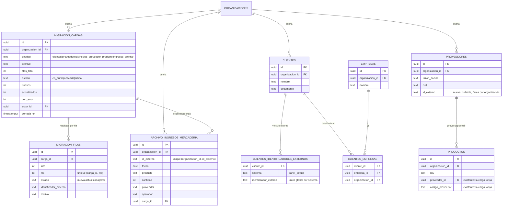

# Datos y DER

## Esquemas

| Esquema | Qué guarda |
|---|---|
| `public` | Plataforma: organizaciones, usuarios, roles, permisos, actividad, ejecuciones, imports |
| `dominio` | Negocio: empresas, clientes, productos, categorías, stock, comprobantes, reparaciones, historial |

Toda tabla expuesta tiene **RLS** por organización. Las secciones por empresa resuelven el nivel con `private.nivel_seccion()` y la empresa activa.

## Modelo del catálogo (MSF-160)

- **[ERD interactivo (Archify)](../diagrams/msf-160-erd.html)** — todas las columnas, PK/FK y cardinalidad.
- **[Arquitectura del catálogo](../diagrams/msf-160-architecture.html)** — cómo se lee y quién consume.

## Acceso y membresía (MSF-119)

- `public.usuarios_organizacion.estado` (`activo` | `suspendido`, default `activo`): migración aditiva `20261012140100`. Las funciones `private.organizacion_id()` y `private.puede_escribir()` excluyen a los suspendidos (más `20261012140300` para las de administración). El trigger `cortar_sesiones_suspendido` (`20261012150000`) borra `auth.sessions` al suspender.
- `public.intentos_acceso` (`correo_hash` PK, `fallos`, `ultimo_fallo`, `bloqueado_hasta`; `20261012140200`): contador de fallos por correo en hash HMAC (clave `acceso_hmac` en Vault). RLS activado y sin privilegios para `anon`/`authenticated`; solo se accede por RPC y por el hook `verificar_intento_acceso` (`20261014100000`). Es plataforma/auth, por eso vive en `public`. Cada migración lleva su reversión en el encabezado.
- Una persona pertenece a una sola organización (`user_id` PK de `usuarios_organizacion`, spec 003).

Detalle y operación: [Acceso](../acceso-ingreso.md) · regla para tablas nuevas: [Aislamiento](../aislamiento-por-organizacion.md).

## Service técnico (MSF-182)

Todas las tablas van en `dominio` (Principio VII), con RLS por `organizacion_id` y nivel de `service_tecnico` (`private.nivel_seccion`); lectura además restringida a tiendas accesibles (`20261020140000`). Sin `delete`. Migraciones: `supabase/migrations/20261020100100`–`20261020150000` (aditivas; reversión en el encabezado de cada una).

- **Modelos y estados son por organización; la numeración es por empresa** (`private.siguiente_numero_reparacion`, bloqueo asesor por transacción). Sembrado idempotente: `private.sembrar_service` (`20261020100300`, siete modelos y siete estados).
- FK compuestas `(…_id, organizacion_id)` impiden cruzar organizaciones.
- Costos: grant por columna sin `costo_*`; solo los entrega `obtener_reparacion`, enmascarados sin `ver_costos`.
- `reparacion_historial` es solo lectura para la app; lo escriben las RPC en la misma transacción.
- Rol `tecnico`: solo datos en `roles_organizacion`/`permisos_rol` (matriz fija); detalle en la rama de la épica (`docs/permisos-por-rol.md`).

## Consultas (MSF-122)

Tres tablas nuevas en `dominio` (Principio VII), con RLS por organización, empresa accesible y sección
`consultas`; sin escritura directa desde la app. El alta entra solo por `publico.crear_consulta_publica`
(la empresa sale del dominio de la tienda) y la edición por `public.actualizar_consulta`. Migraciones:
`20261205100000_consultas.sql`, `20261205200000_consultas_configuracion.sql` y
`20261205200100_consultas_avisos.sql` (aditivas; reversión en el encabezado de cada una y consolidada en
[Consultas: modelo, RPC y aviso](consultas.md#reversion)).

- `consultas` guarda estado, responsable y nota interna; `consultas_configuracion` la dirección de avisos
  (una fila por empresa); `consultas_avisos` la cola del correo, con `consulta_id` como clave (un aviso por
  consulta).
- FK compuestas `(empresa_id, organizacion_id)` y `(producto_id, organizacion_id)` impiden cruzar
  organizaciones.
- La vista `public.consultas_bandeja` y las RPC del panel viven en `public` y no almacenan datos.
- Detalle de RPC, permisos, aviso y operación: [Consultas](consultas.md).

## Migración inicial de datos (MSF-142)

El importador del panel anterior (MSF-142) agrega dos tablas de plataforma en `public`, una tabla de
historial en `dominio` y una columna en `dominio.proveedores`. Migraciones:
`20261201100000_migracion_cargas.sql`, `20261201110000_proveedores_id_externo.sql`,
`20261201120000_archivo_ingresos_mercaderia.sql` y `20261201130000_migracion_conciliacion.sql`
(aditivas; reversión en el encabezado de cada una).

| Tabla | Estado | Cambio |
|---|---|---|
| `public.organizaciones` | existente | Dueña de las cargas y del archivo; no cambia. |
| `public.migracion_cargas` | nueva | Cabecera de cada ejecución (entidad, archivo, filas, estado, contadores, actor). RLS de lectura solo Administrador. |
| `public.migracion_filas` | nueva | Resultado por fila; única por `(carga_id, fila)`. RLS de lectura solo Administrador. |
| `public.clientes` | existente | Destino de la carga de clientes; sin cambios de esquema. Los nuevos se habilitan en todas las tiendas. |
| `public.clientes_identificadores_externos` | existente | Clave de conciliación con `sistema = 'panel_actual'`; sin cambios de esquema. |
| `public.clientes_empresas` | existente | Relación cliente ↔ tienda que rellena el alta de la migración; sin cambios de esquema. |
| `dominio.empresas` | existente | Tiendas donde se habilitan los clientes nuevos; sin cambios de esquema. |
| `dominio.proveedores` | alterada | `+ id_externo` (nullable, único por organización cuando tiene valor). |
| `dominio.productos` | existente | La carga de vínculos fija `proveedor_id` y `codigo_proveedor`; sin cambios de esquema. |
| `dominio.archivo_ingresos_mercaderia` | nueva | Historial de ingresos del panel anterior, único por `(organizacion_id, id_externo)`; solo `select` para `authenticated`. |

- `migracion_filas.fila` es el número de fila del archivo contando el encabezado como 1; es la base de
  la idempotencia `(carga, fila)`.
- `clientes_identificadores_externos` es único por `(sistema, identificador_externo)` en toda la base:
  el identificador del panel actual no se repite entre organizaciones.
- `archivo_ingresos_mercaderia` no tiene FK a productos, proveedores, depósitos ni a
  `dominio.ingresos_mercaderia`: no mueve stock ni se mezcla con los ingresos vivos.
- Detalle de RPC, contrato CSV, conciliación y operación:
  [Migración inicial de datos](migracion-inicial-de-datos.md).

## Datos vivos vs. archivo

- **Vivos:** comprobantes, cobros, stock, reparaciones. Afectan estados, saldos y reportes.
- **Archivo (`historial_*`):** datos del panel anterior, importados una sola vez, **solo lectura**. No tocan stock, saldos ni estados.
  - **[Flujo de importación](../diagrams/msf-275-dataflow.html)**
  - **[Estados de la ejecución](../diagrams/msf-275-lifecycle.html)**
- **Archivo de ingresos (`dominio.archivo_ingresos_mercaderia`, MSF-142):** historial de ingresos del panel anterior, solo lectura y sin efecto en el stock. Ver [Migración inicial de datos](migracion-inicial-de-datos.md).

## Migraciones y RLS

- Cada historia trae **su propia migración aditiva** con reversión en el encabezado.
- Las RPC nuevas son `security invoker` (o `definer` justificado), con `revoke`/`grant` explícitos.
- `rls_en_toda_tabla` y `aislamiento_organizaciones` recorren `public` + `dominio` en pgTAP.

## Inventario

El listado de tablas/rutas/variables generado desde el código está en **[Inventario](../_generated/inventory.md)**.

> **service_role (server-only):** tiene grants explícitos en `public`, `dominio` y `private`; `BYPASSRLS` no alcanza para usar un esquema/tabla. Lo usa el sandbox y las herramientas server-side, nunca el navegador.
