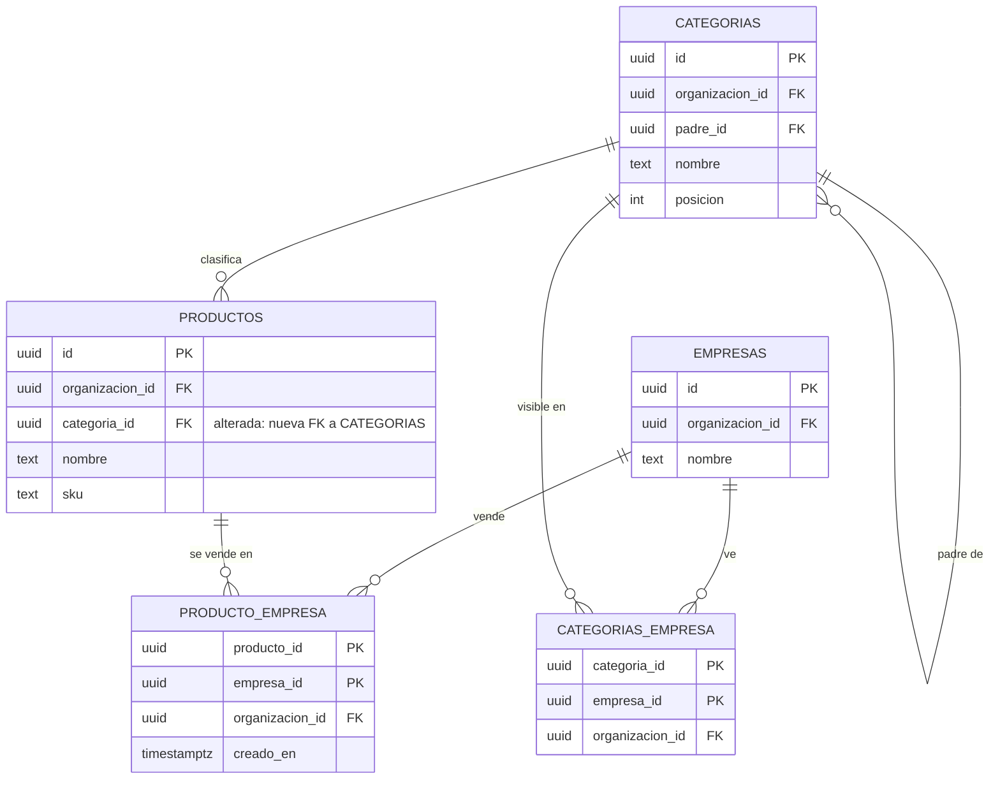
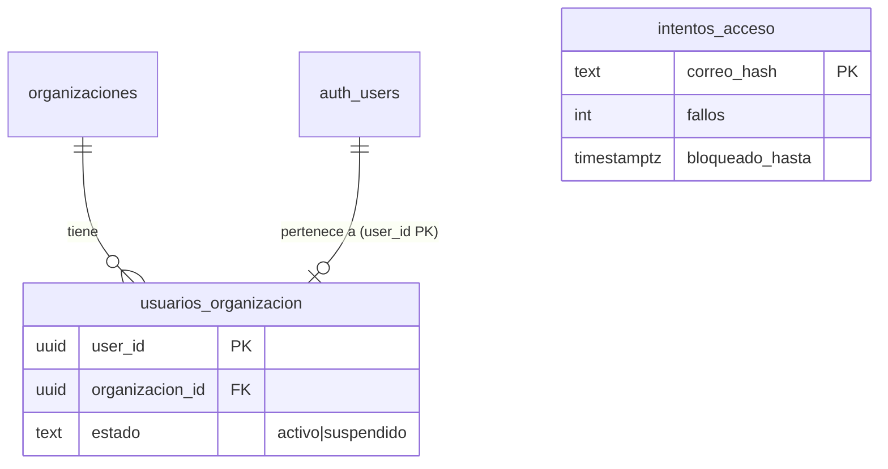
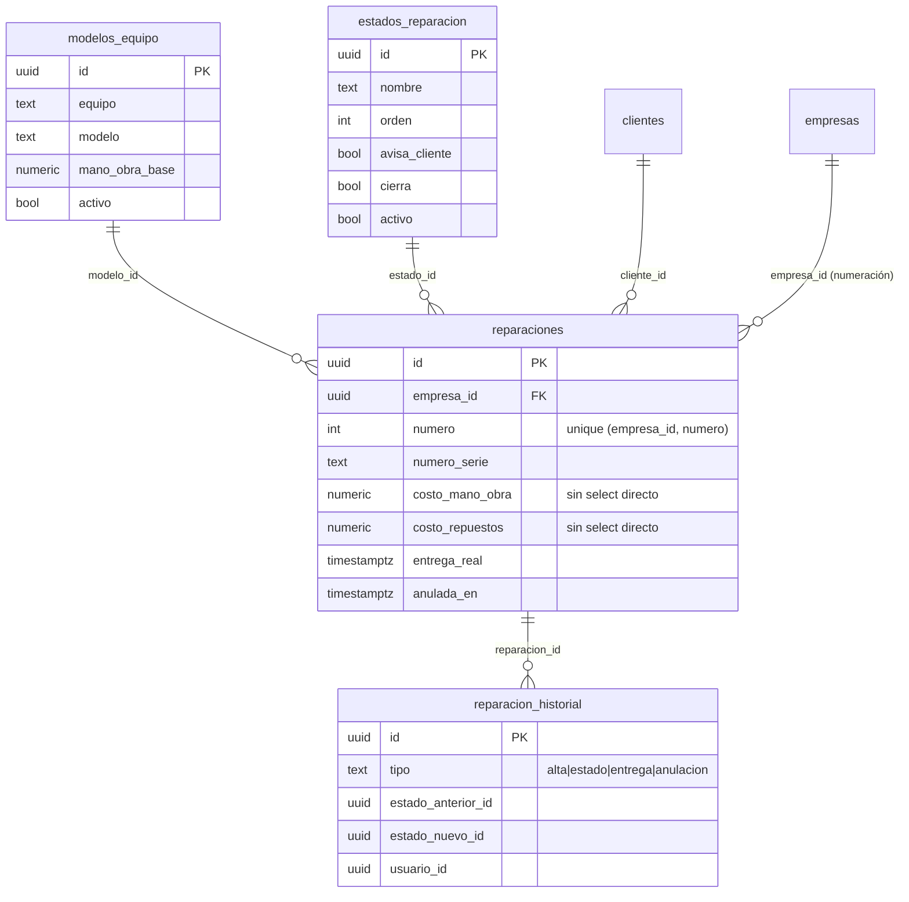

# Datos y DER

## Esquemas

| Esquema | Qué guarda |
|---|---|
| `public` | Plataforma: organizaciones, usuarios, roles, permisos, actividad, ejecuciones, imports |
| `dominio` | Negocio: empresas, clientes, productos, categorías, stock, comprobantes, reparaciones, historial |

Toda tabla expuesta tiene **RLS** por organización. Las secciones por empresa resuelven el nivel con `private.nivel_seccion()` y la empresa activa.

## Modelo del catálogo (MSF-160)

- **[ERD interactivo (Archify)](../diagrams/msf-160-erd.html)** — todas las columnas, PK/FK y cardinalidad.
- **[Arquitectura del catálogo](../diagrams/msf-160-architecture.html)** — cómo se lee y quién consume.

## Acceso y membresía (MSF-119)

- `public.usuarios_organizacion.estado` (`activo` | `suspendido`, default `activo`): migración aditiva `20261012140100`. Las funciones `private.organizacion_id()` y `private.puede_escribir()` excluyen a los suspendidos (más `20261012140300` para las de administración). El trigger `cortar_sesiones_suspendido` (`20261012150000`) borra `auth.sessions` al suspender.
- `public.intentos_acceso` (`correo_hash` PK, `fallos`, `ultimo_fallo`, `bloqueado_hasta`; `20261012140200`): contador de fallos por correo en hash HMAC (clave `acceso_hmac` en Vault). RLS activado y sin privilegios para `anon`/`authenticated`; solo se accede por RPC y por el hook `verificar_intento_acceso` (`20261014100000`). Es plataforma/auth, por eso vive en `public`. Cada migración lleva su reversión en el encabezado.
- Una persona pertenece a una sola organización (`user_id` PK de `usuarios_organizacion`, spec 003).

Detalle y operación: [Acceso](../acceso-ingreso.md) · regla para tablas nuevas: [Aislamiento](../aislamiento-por-organizacion.md).

## Service técnico (MSF-182)

Todas las tablas van en `dominio` (Principio VII), con RLS por `organizacion_id` y nivel de `service_tecnico` (`private.nivel_seccion`); lectura además restringida a tiendas accesibles (`20261020140000`). Sin `delete`. Migraciones: `supabase/migrations/20261020100100`–`20261020150000` (aditivas; reversión en el encabezado de cada una).

- **Modelos y estados son por organización; la numeración es por empresa** (`private.siguiente_numero_reparacion`, bloqueo asesor por transacción). Sembrado idempotente: `private.sembrar_service` (`20261020100300`, siete modelos y siete estados).
- FK compuestas `(…_id, organizacion_id)` impiden cruzar organizaciones.
- Costos: grant por columna sin `costo_*`; solo los entrega `obtener_reparacion`, enmascarados sin `ver_costos`.
- `reparacion_historial` es solo lectura para la app; lo escriben las RPC en la misma transacción.
- Rol `tecnico`: solo datos en `roles_organizacion`/`permisos_rol` (matriz fija); detalle en la rama de la épica (`docs/permisos-por-rol.md`).

## Datos vivos vs. archivo

- **Vivos:** comprobantes, cobros, stock, reparaciones. Afectan estados, saldos y reportes.
- **Archivo (`historial_*`):** datos del panel anterior, importados una sola vez, **solo lectura**. No tocan stock, saldos ni estados.
  - **[Flujo de importación](../diagrams/msf-275-dataflow.html)**
  - **[Estados de la ejecución](../diagrams/msf-275-lifecycle.html)**

## Migraciones y RLS

- Cada historia trae **su propia migración aditiva** con reversión en el encabezado.
- Las RPC nuevas son `security invoker` (o `definer` justificado), con `revoke`/`grant` explícitos.
- `rls_en_toda_tabla` y `aislamiento_organizaciones` recorren `public` + `dominio` en pgTAP.

## Inventario

El listado de tablas/rutas/variables generado desde el código está en **[Inventario](../_generated/inventory.md)**.

> **service_role (server-only):** tiene grants explícitos en `public`, `dominio` y `private`; `BYPASSRLS` no alcanza para usar un esquema/tabla. Lo usa el sandbox y las herramientas server-side, nunca el navegador.
