# Flujos

Los flujos importantes se documentan con **Mermaid** (inline) y, cuando aporta, con un **artefacto Archify** interactivo.

## Importación del historial (MSF-275)

- **[Dataflow interactivo](../diagrams/msf-275-dataflow.html)** — export del panel → Storage → worker → `historial_*` → consulta.
- **[Estados de la ejecución](../diagrams/msf-275-lifecycle.html)** — solicitada → en curso → exitosa/fallida, con la regla todo-o-nada.

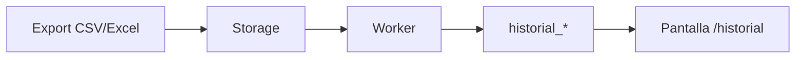

## Cambio de estado y entrega (MSF-303)

- **[Secuencia interactiva](../diagrams/msf-303-sequence.html)** — técnico → UI → RPC → `reparaciones` + `reparacion_historial` + evento.

- **Alta y edición (MSF-283)**: `crear_reparacion` valida tienda, cliente, modelo activo y técnico, asigna el próximo número de la empresa, el primer estado activo por `orden` y el ingreso de hoy (hora de Argentina), y escribe el evento `alta` y la actividad `reparacion.creada`. Edición con bloqueo optimista por `updated_at`.
- **Reglas**: cualquier estado activo se puede elegir desde otro (también hacia atrás); un estado que `cierra` solo con la entrega (diálogo de fecha y quién entregó); tras entregar o anular no hay más cambios.

## Service técnico: listado, ítems e impresión (MSF-199)

El listado pagina en el servidor y la tienda sale de la empresa activa. Agregar o quitar un ítem bloquea la
reparación (`for update`), recalcula `total_mano_obra`/`total_repuestos` en la misma transacción y devuelve el
documento completo. Los documentos imprimibles leen `obtener_reparacion` y los datos de la tienda o del técnico;
no incluyen costos internos.

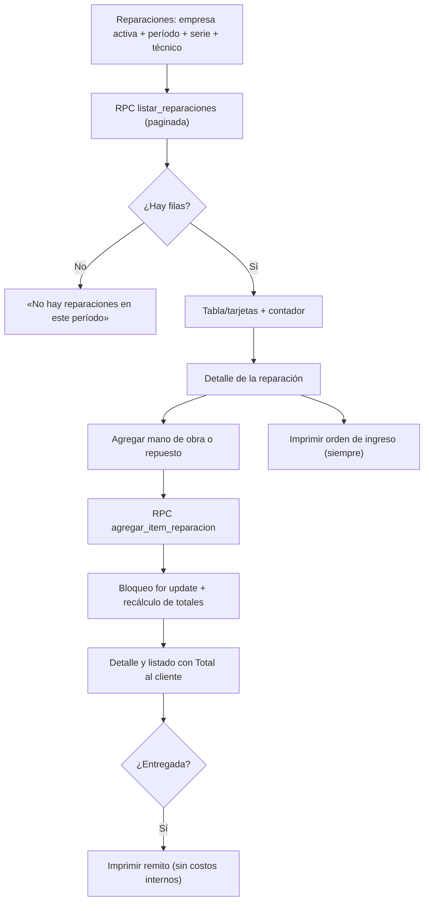

La compuerta de ítems rechaza reparaciones anuladas, entregadas o con estado que cierra (`55000`); el remito
solo está disponible para reparaciones entregadas y no anuladas. Detalle:
[Service técnico: listado, ítems e impresión](service-listado-items-impresion.md).

## Ingreso de mercadería por proveedor (MSF-219)

El formulario envía empresa, proveedor, fecha, comprobante y N líneas a
`public.registrar_ingreso_mercaderia`. La RPC valida permisos, entidades activas y líneas, y por cada una llama a
`public.registrar_movimiento_stock` con tipo `entrada` y motivo «Compra a proveedor». Todo ocurre en una
transacción: cabecera, líneas, movimientos, costo opcional y evento `ingreso.registrado`. Anular recorre las
líneas ordenadas por producto, crea una `salida` por línea y, si falta stock, revierte la anulación completa.
Detalle: [Ingreso de mercadería](ingreso-de-mercaderia.md).

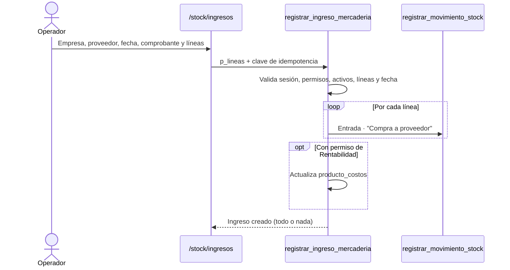

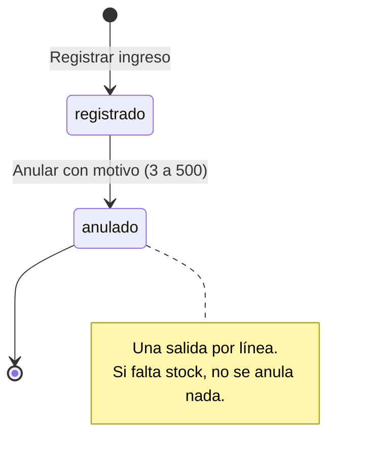

## Consultas (MSF-122)

Alta pública → consulta `nueva` + aviso encolado → barrido de Kestra → correo → bandeja → atención manual.
Los tres estados son fijos y las transiciones son manuales; asignar o anotar no cambia el estado.

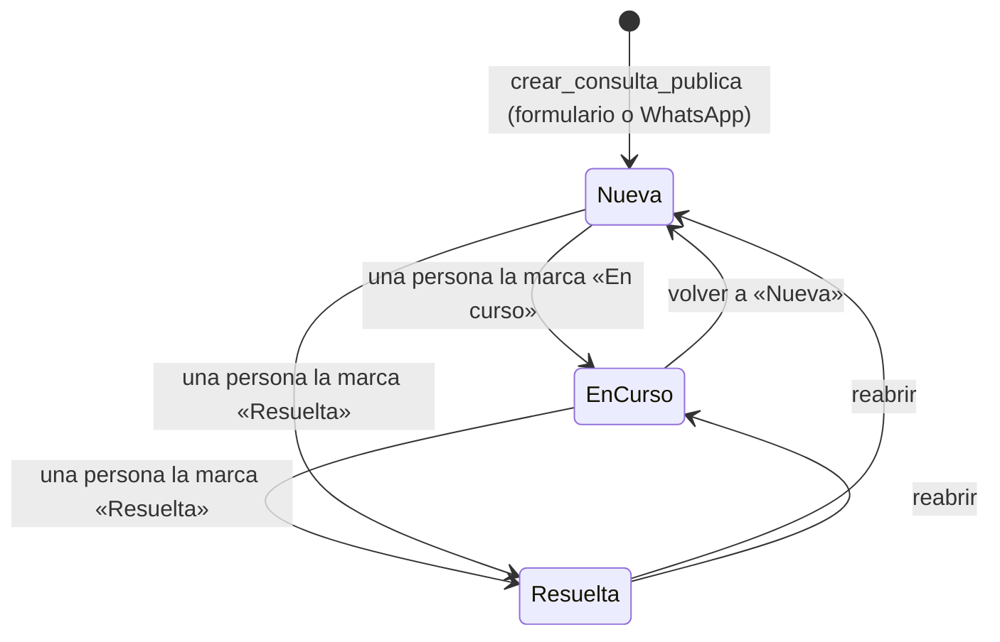

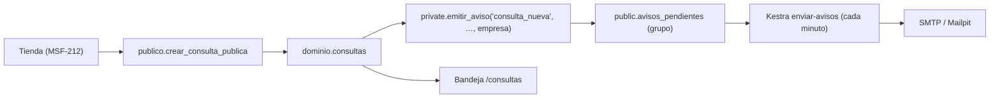

Desde MSF-189 el aviso respeta la preferencia de cada persona, la agrupación de 15 minutos y el acceso a la
empresa de la consulta. `dominio.consultas_avisos` y el flow `avisos-consultas` quedan solo para drenar lo
que ya estaba encolado por el camino anterior. La lista `dominio.estados_consulta` se administra, pero la
bandeja todavía usa los tres estados fijos: conectarlos es seguimiento.

Detalle: [Consultas: modelo, RPC y aviso](consultas.md) y [Avisos y listas](avisos-y-listas.md). Dueños:
FR-002 (alta), FR-003 (edición y actividad), FR-005…FR-008 (bandeja y empresa activa), FR-011…FR-013 (cola,
envío y enlace).

## Avisos por correo (MSF-189)

Un componente llama a `private.emitir_aviso`; la base resuelve destinatarios, agrupa y una función
`security definer` reclama los grupos vencidos cada minuto. Kestra envía un correo por grupo y registra el
resultado. Si el correo falla, el grupo se reprograma con espera creciente; si Kestra se cae a mitad de un
envío, el reclamo vence a los 10 minutos y el grupo vuelve a estar disponible.

```mermaid
sequenceDiagram
  autonumber
  participant C as Componente
  participant DB as Supabase
  participant K as Kestra (enviar-avisos)
  participant S as SMTP
  participant U as Usuario
  C->>DB: emitir_aviso(tipo, organización, datos, empresa?)
  DB->>DB: destinatarios con acceso y preferencia; agrupa 15 min
  K->>DB: reclamar_avisos_listos(50)
  DB-->>K: grupos vencidos (re-verifica preferencia y acceso)
  K->>S: un correo por grupo
  S-->>U: correo con cantidad y detalle
  K->>DB: marcar_aviso_enviado / registrar_fallo_aviso
```

Detalle de tablas, RPC, flow y operación: [Avisos y listas: modelo, RPC y flujos](avisos-y-listas.md).
Dueños: FR-001…FR-012 (MSF-189).

## Dólar y recálculo (MSF-116)

Cargar → pendiente (24 h) → vista previa por empresa → confirmar (recalcula si la variación llega al 1 %)
o descartar. No hay worker: el vencimiento se resuelve al consultar y el recálculo es una transacción.

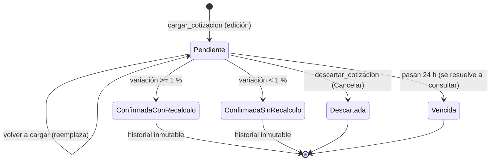

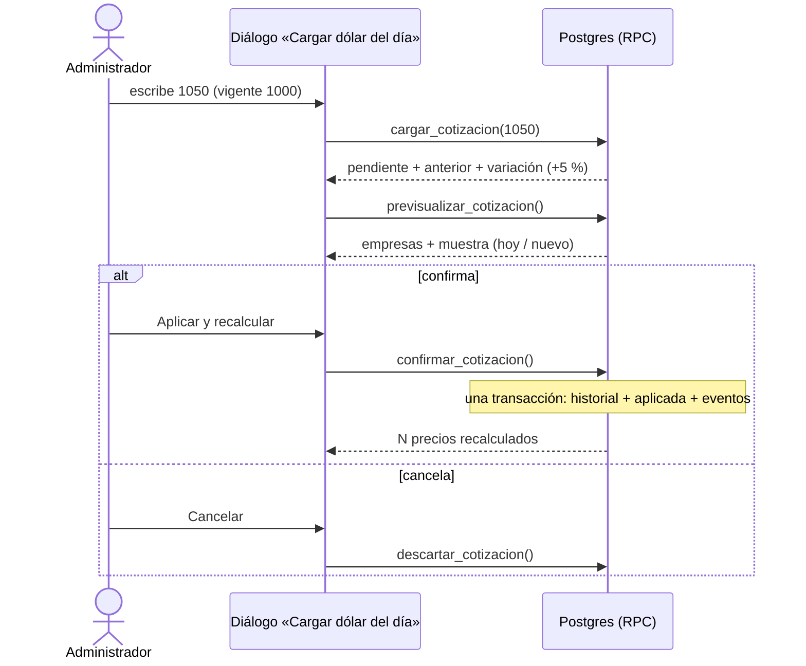

El aviso «Todavía no se cargó el dólar de hoy» (`cotizacion_del_dia`) se monta en `/cotizacion` y en la
portada; «Cargar ahora» reutiliza el mismo diálogo. Detalle: [Dólar y recálculo](dolar-y-recalculo.md).
Dueños: FR-001…FR-003 (carga y vencimiento), FR-009…FR-015 (vista previa, confirmación y descarte),
FR-016…FR-018 (historial), FR-019…FR-022 (aviso).

## Catálogo (MSF-160)

- **[Arquitectura](../diagrams/msf-160-architecture.html)** y **[ERD](../diagrams/msf-160-erd.html)**.

## Acceso y sesión (MSF-119)

Ingreso → `bloqueo_acceso_hasta` → Auth (hook `verificar_intento_acceso` cuenta fallos) → consulta de `estado` (suspendido: rechazo y cierre) → sesión (`localStorage` con «Mantener», `sessionStorage` sin ella) → vence a 12 h de inactividad o por `timebox` de 30 días. Recuperación: aviso neutro → enlace de 1 h y un solo uso → definir contraseña. Dueño: spec `20261012-140000-acceso-y-organizacion`; tests: Vitest, pgTAP (`estado_usuario`, `bloqueo_servidor`, `rls_en_toda_tabla`, `aislamiento_organizaciones`) y `scripts/e2e-acceso.e2e.mjs`. Detalle: [Acceso](../acceso-ingreso.md).

## Stock · lotes e inventario (MSF-131)

- **Carga en lote (F-STK-10)**: el formulario envía las líneas y una clave de idempotencia a `registrar_lote_stock`;
  la RPC bloquea por organización, asigna el número y llama a `registrar_movimiento_stock` una vez por línea con
  `p_lote`. Cualquier error revierte el lote, los movimientos y el stock.

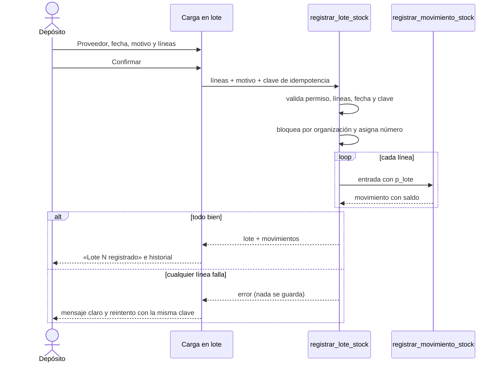

- **Toma de inventario (F-STK-11)**: se elige categoría, se cargan los contados y `confirmar_toma_inventario` crea un
  ajuste por producto con diferencia contra el stock del depósito por defecto. La toma no se persiste: repetir la
  confirmación no crea movimientos porque la diferencia ya es cero.

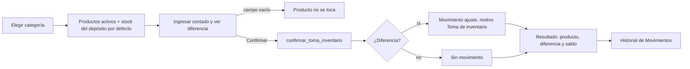

Detalle técnico y reversión: [Stock · lotes e inventario](stock-lotes-e-inventario.md).
## Cuenta web del cliente (MSF-237)

Invitación desde el panel → enlace de Auth al dominio de la tienda → el cliente define su contraseña →
ingresa y consulta su estado en cada carga → ve los precios de su escala. La cuenta no es miembro del
panel y no hay auto-registro (D2). Detalle: [Cuenta web del cliente](cuenta-web-cliente.md).

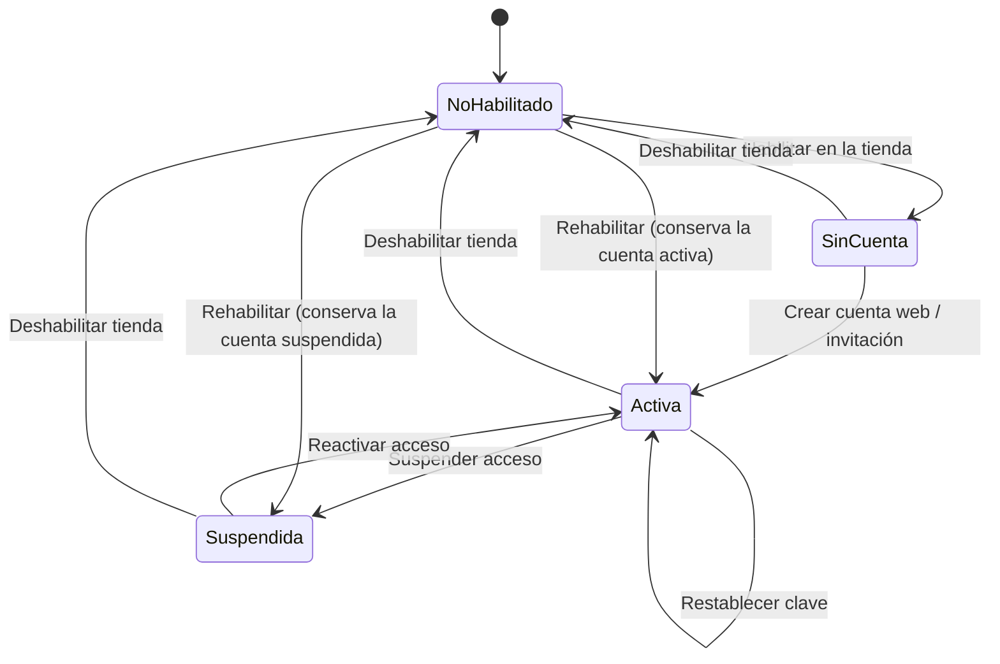

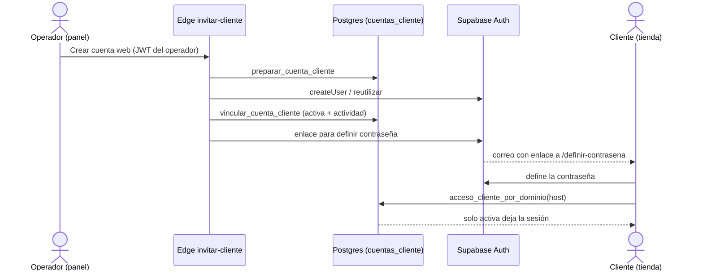

El precio sigue el tipo y el estado del cliente en cada carga: visitante o cuenta no activa, precio
público; minorista, x1; mayorista, x1/x5/x10/x50 en la ficha (tarjetas en x1, D3). La recuperación
responde siempre igual y solo envía el enlace con una cuenta activa en esa tienda.

## Convención

- **Mermaid** para lo que se lee en GitHub y en esta wiki.
- **Archify** para lo que se explora (zoom, foco, fuentes), validado con `finalize`.
- Todo flujo tiene un **dueño** (spec/FR) y un **test** (Vitest/pgTAP/e2e) que lo respalda.
