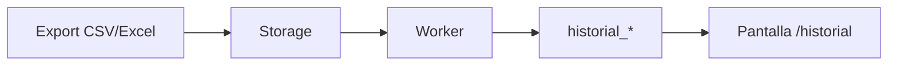
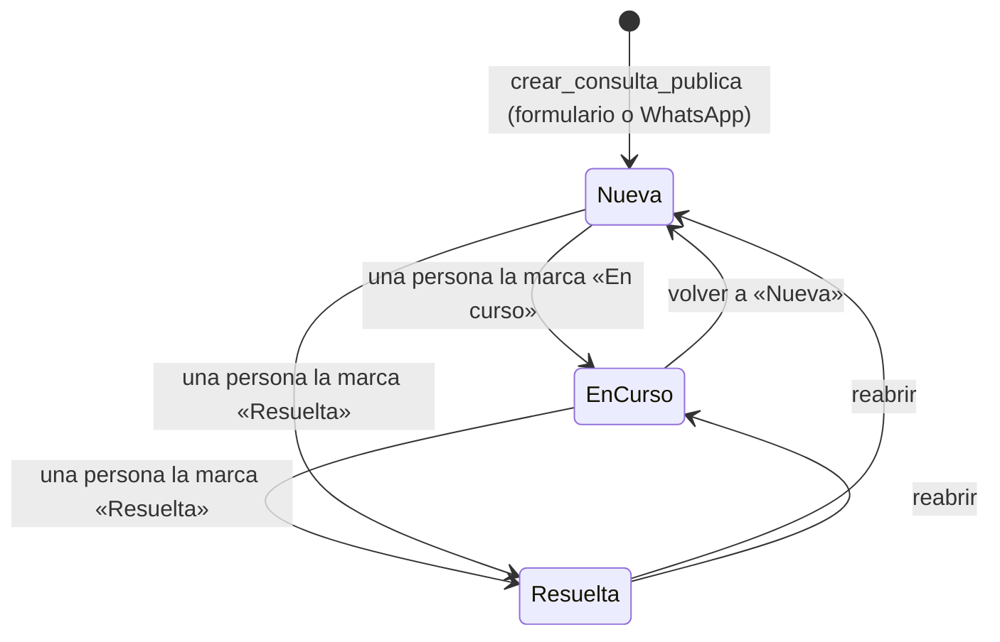
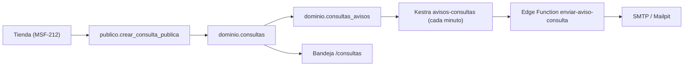
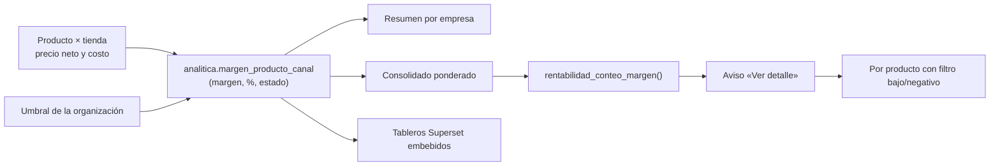

# Flujos

Los flujos importantes se documentan con **Mermaid** (inline) y, cuando aporta, con un **artefacto Archify** interactivo.

## Importación del historial (MSF-275)

- **[Dataflow interactivo](../diagrams/msf-275-dataflow.html)** — export del panel → Storage → worker → `historial_*` → consulta.
- **[Estados de la ejecución](../diagrams/msf-275-lifecycle.html)** — solicitada → en curso → exitosa/fallida, con la regla todo-o-nada.

## Cambio de estado y entrega (MSF-303)

- **[Secuencia interactiva](../diagrams/msf-303-sequence.html)** — técnico → UI → RPC → `reparaciones` + `reparacion_historial` + evento.

- **Alta y edición (MSF-283)**: `crear_reparacion` valida tienda, cliente, modelo activo y técnico, asigna el próximo número de la empresa, el primer estado activo por `orden` y el ingreso de hoy (hora de Argentina), y escribe el evento `alta` y la actividad `reparacion.creada`. Edición con bloqueo optimista por `updated_at`.
- **Reglas**: cualquier estado activo se puede elegir desde otro (también hacia atrás); un estado que `cierra` solo con la entrega (diálogo de fecha y quién entregó); tras entregar o anular no hay más cambios.

## Consultas (MSF-122)

Alta pública → consulta `nueva` + aviso encolado → barrido de Kestra → correo → bandeja → atención manual.
Los tres estados son fijos y las transiciones son manuales; asignar o anotar no cambia el estado.

Detalle: [Consultas: modelo, RPC y aviso](consultas.md). Dueños: FR-002 (alta), FR-003 (edición y
actividad), FR-005…FR-008 (bandeja y empresa activa), FR-011…FR-013 (cola, envío y enlace).

## Catálogo (MSF-160)

- **[Arquitectura](../diagrams/msf-160-architecture.html)** y **[ERD](../diagrams/msf-160-erd.html)**.

## Acceso y sesión (MSF-119)

Ingreso → `bloqueo_acceso_hasta` → Auth (hook `verificar_intento_acceso` cuenta fallos) → consulta de `estado` (suspendido: rechazo y cierre) → sesión (`localStorage` con «Mantener», `sessionStorage` sin ella) → vence a 12 h de inactividad o por `timebox` de 30 días. Recuperación: aviso neutro → enlace de 1 h y un solo uso → definir contraseña. Dueño: spec `20261012-140000-acceso-y-organizacion`; tests: Vitest, pgTAP (`estado_usuario`, `bloqueo_servidor`, `rls_en_toda_tabla`, `aislamiento_organizaciones`) y `scripts/e2e-acceso.e2e.mjs`. Detalle: [Acceso](../acceso-ingreso.md).

## Rentabilidad (MSF-120)

Cálculo al leer + tablero embebido + restricción por sección. El neto sale de `public.precios_empresa_neto`,
el costo de `dominio.producto_costos` convertido con `private.a_pesos` y el umbral de
`dominio.rentabilidad_config`; las tres vistas de `analitica` se derivan de la vista base. El guest token
lleva `rls` por `organizacion_id` y `emitir-acceso-reporte` solo lo emite si la persona tiene la sección del
reporte (`reportes.seccion`).

- Sin costo, sin neto positivo o sin cotización → **no hay fila**; no se inventa el margen.
- Guardar el umbral deja `rentabilidad.umbral_actualizado` en Actividad y recarga tablero y aviso.
- El aviso navega a `/rentabilidad/productos?estado=bajo_o_negativo`; el parámetro se traduce a un filtro
  nativo de Superset con valores de una lista cerrada.
- Detalle: [Rentabilidad](rentabilidad.md). Dueños: F-REN-01 (cálculo, umbral y token), F-REN-02 (resumen,
  aviso y estados), F-REN-03 (tabla y filtros).

## Convención

- **Mermaid** para lo que se lee en GitHub y en esta wiki.
- **Archify** para lo que se explora (zoom, foco, fuentes), validado con `finalize`.
- Todo flujo tiene un **dueño** (spec/FR) y un **test** (Vitest/pgTAP/e2e) que lo respalda.
