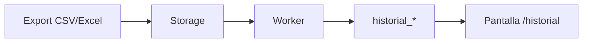
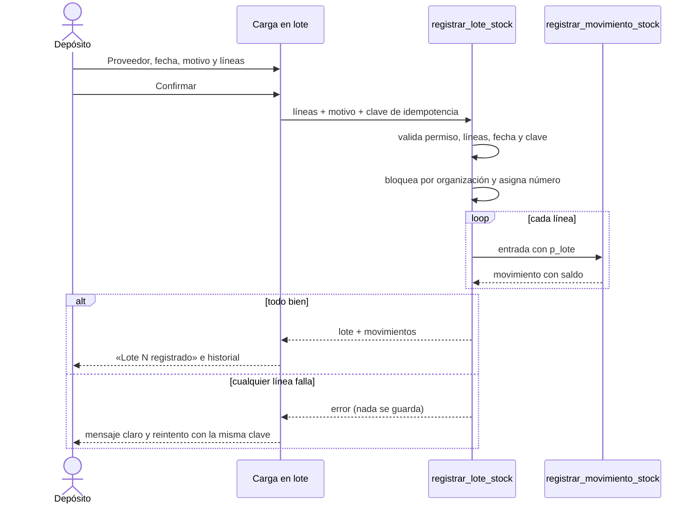
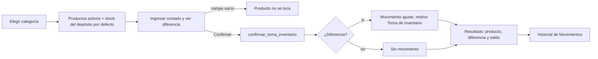

# Flujos

Los flujos importantes se documentan con **Mermaid** (inline) y, cuando aporta, con un **artefacto Archify** interactivo.

## Importación del historial (MSF-275)

- **[Dataflow interactivo](../diagrams/msf-275-dataflow.html)** — export del panel → Storage → worker → `historial_*` → consulta.
- **[Estados de la ejecución](../diagrams/msf-275-lifecycle.html)** — solicitada → en curso → exitosa/fallida, con la regla todo-o-nada.

## Cambio de estado y entrega (MSF-303)

- **[Secuencia interactiva](../diagrams/msf-303-sequence.html)** — técnico → UI → RPC → `reparaciones` + `reparacion_historial` + evento.

- **Alta y edición (MSF-283)**: `crear_reparacion` valida tienda, cliente, modelo activo y técnico, asigna el próximo número de la empresa, el primer estado activo por `orden` y el ingreso de hoy (hora de Argentina), y escribe el evento `alta` y la actividad `reparacion.creada`. Edición con bloqueo optimista por `updated_at`.
- **Reglas**: cualquier estado activo se puede elegir desde otro (también hacia atrás); un estado que `cierra` solo con la entrega (diálogo de fecha y quién entregó); tras entregar o anular no hay más cambios.

## Catálogo (MSF-160)

- **[Arquitectura](../diagrams/msf-160-architecture.html)** y **[ERD](../diagrams/msf-160-erd.html)**.

## Acceso y sesión (MSF-119)

Ingreso → `bloqueo_acceso_hasta` → Auth (hook `verificar_intento_acceso` cuenta fallos) → consulta de `estado` (suspendido: rechazo y cierre) → sesión (`localStorage` con «Mantener», `sessionStorage` sin ella) → vence a 12 h de inactividad o por `timebox` de 30 días. Recuperación: aviso neutro → enlace de 1 h y un solo uso → definir contraseña. Dueño: spec `20261012-140000-acceso-y-organizacion`; tests: Vitest, pgTAP (`estado_usuario`, `bloqueo_servidor`, `rls_en_toda_tabla`, `aislamiento_organizaciones`) y `scripts/e2e-acceso.e2e.mjs`. Detalle: [Acceso](../acceso-ingreso.md).

## Stock · lotes e inventario (MSF-131)

- **Carga en lote (F-STK-10)**: el formulario envía las líneas y una clave de idempotencia a `registrar_lote_stock`;
  la RPC bloquea por organización, asigna el número y llama a `registrar_movimiento_stock` una vez por línea con
  `p_lote`. Cualquier error revierte el lote, los movimientos y el stock.

- **Toma de inventario (F-STK-11)**: se elige categoría, se cargan los contados y `confirmar_toma_inventario` crea un
  ajuste por producto con diferencia contra el stock del depósito por defecto. La toma no se persiste: repetir la
  confirmación no crea movimientos porque la diferencia ya es cero.

Detalle técnico y reversión: [Stock · lotes e inventario](stock-lotes-e-inventario.md).

## Convención

- **Mermaid** para lo que se lee en GitHub y en esta wiki.
- **Archify** para lo que se explora (zoom, foco, fuentes), validado con `finalize`.
- Todo flujo tiene un **dueño** (spec/FR) y un **test** (Vitest/pgTAP/e2e) que lo respalda.
