# Flujos

Los flujos importantes se documentan con **Mermaid** (inline) y, cuando aporta, con un **artefacto Archify** interactivo.

## Importación del historial (MSF-275)

- **[Dataflow interactivo](../diagrams/msf-275-dataflow.html)** — export del panel → Storage → worker → `historial_*` → consulta.
- **[Estados de la ejecución](../diagrams/msf-275-lifecycle.html)** — solicitada → en curso → exitosa/fallida, con la regla todo-o-nada.

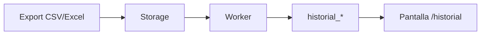

## Cambio de estado y entrega (MSF-303)

- **[Secuencia interactiva](../diagrams/msf-303-sequence.html)** — técnico → UI → RPC → `reparaciones` + `reparacion_historial` + evento.

- **Alta y edición (MSF-283)**: `crear_reparacion` valida tienda, cliente, modelo activo y técnico, asigna el próximo número de la empresa, el primer estado activo por `orden` y el ingreso de hoy (hora de Argentina), y escribe el evento `alta` y la actividad `reparacion.creada`. Edición con bloqueo optimista por `updated_at`.
- **Reglas**: cualquier estado activo se puede elegir desde otro (también hacia atrás); un estado que `cierra` solo con la entrega (diálogo de fecha y quién entregó); tras entregar o anular no hay más cambios.

## Service técnico: listado, ítems e impresión (MSF-199)

El listado pagina en el servidor y la tienda sale de la empresa activa. Agregar o quitar un ítem bloquea la
reparación (`for update`), recalcula `total_mano_obra`/`total_repuestos` en la misma transacción y devuelve el
documento completo. Los documentos imprimibles leen `obtener_reparacion` y los datos de la tienda o del técnico;
no incluyen costos internos.

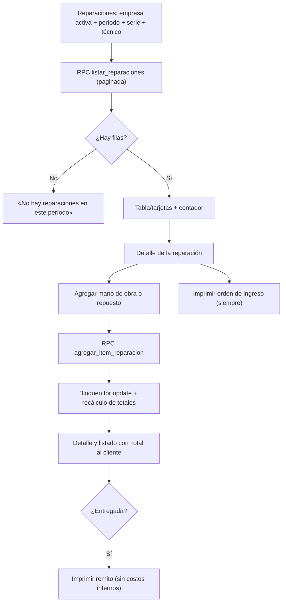

La compuerta de ítems rechaza reparaciones anuladas, entregadas o con estado que cierra (`55000`); el remito
solo está disponible para reparaciones entregadas y no anuladas. Detalle:
[Service técnico: listado, ítems e impresión](service-listado-items-impresion.md).

## Ingreso de mercadería por proveedor (MSF-219)

El formulario envía empresa, proveedor, fecha, comprobante y N líneas a
`public.registrar_ingreso_mercaderia`. La RPC valida permisos, entidades activas y líneas, y por cada una llama a
`public.registrar_movimiento_stock` con tipo `entrada` y motivo «Compra a proveedor». Todo ocurre en una
transacción: cabecera, líneas, movimientos, costo opcional y evento `ingreso.registrado`. Anular recorre las
líneas ordenadas por producto, crea una `salida` por línea y, si falta stock, revierte la anulación completa.
Detalle: [Ingreso de mercadería](ingreso-de-mercaderia.md).

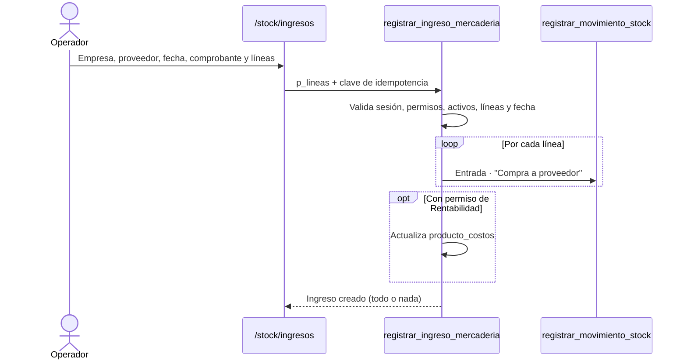

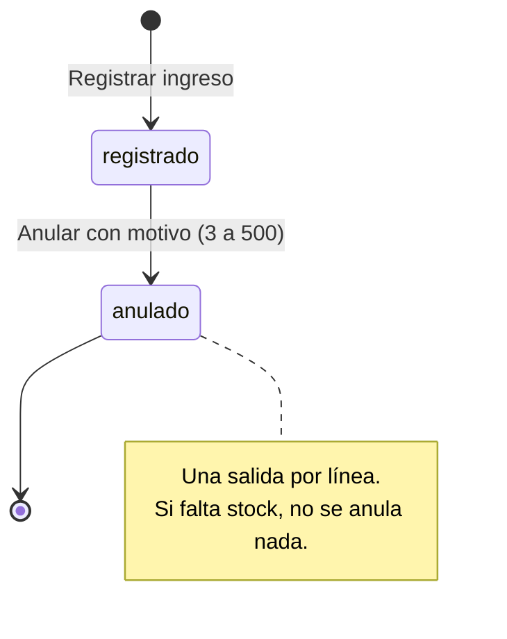

## Consultas (MSF-122)

Alta pública → consulta `nueva` + aviso encolado → barrido de Kestra → correo → bandeja → atención manual.
Los tres estados son fijos y las transiciones son manuales; asignar o anotar no cambia el estado.

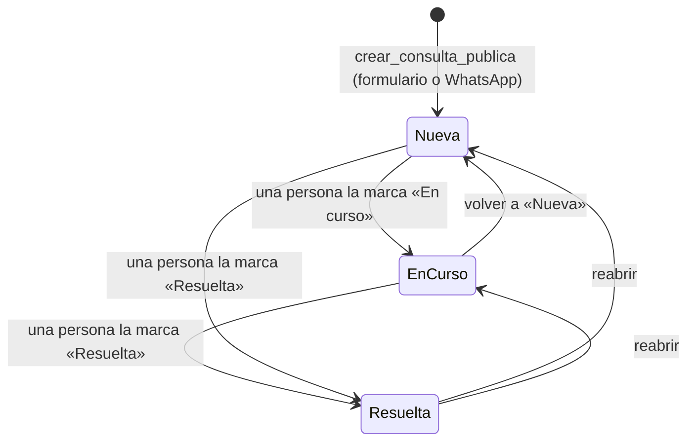

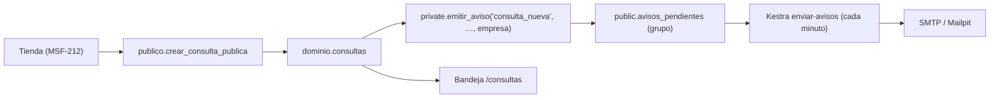

Desde MSF-189 el aviso respeta la preferencia de cada persona, la agrupación de 15 minutos y el acceso a la
empresa de la consulta. `dominio.consultas_avisos` y el flow `avisos-consultas` quedan solo para drenar lo
que ya estaba encolado por el camino anterior. La lista `dominio.estados_consulta` se administra, pero la
bandeja todavía usa los tres estados fijos: conectarlos es seguimiento.

Detalle: [Consultas: modelo, RPC y aviso](consultas.md) y [Avisos y listas](avisos-y-listas.md). Dueños:
FR-002 (alta), FR-003 (edición y actividad), FR-005…FR-008 (bandeja y empresa activa), FR-011…FR-013 (cola,
envío y enlace).

## Avisos por correo (MSF-189)

Un componente llama a `private.emitir_aviso`; la base resuelve destinatarios, agrupa y una función
`security definer` reclama los grupos vencidos cada minuto. Kestra envía un correo por grupo y registra el
resultado. Si el correo falla, el grupo se reprograma con espera creciente; si Kestra se cae a mitad de un
envío, el reclamo vence a los 10 minutos y el grupo vuelve a estar disponible.

```mermaid
sequenceDiagram
  autonumber
  participant C as Componente
  participant DB as Supabase
  participant K as Kestra (enviar-avisos)
  participant S as SMTP
  participant U as Usuario
  C->>DB: emitir_aviso(tipo, organización, datos, empresa?)
  DB->>DB: destinatarios con acceso y preferencia; agrupa 15 min
  K->>DB: reclamar_avisos_listos(50)
  DB-->>K: grupos vencidos (re-verifica preferencia y acceso)
  K->>S: un correo por grupo
  S-->>U: correo con cantidad y detalle
  K->>DB: marcar_aviso_enviado / registrar_fallo_aviso
```

Detalle de tablas, RPC, flow y operación: [Avisos y listas: modelo, RPC y flujos](avisos-y-listas.md).
Dueños: FR-001…FR-012 (MSF-189).

## Precios e IVA (MSF-114)

Del precio de lista al precio que ve el cliente, **todo al leer**: no hay columna de precio en pesos y no
hay worker. La cotización es de la organización; la regla y el interruptor de IVA, de la empresa.

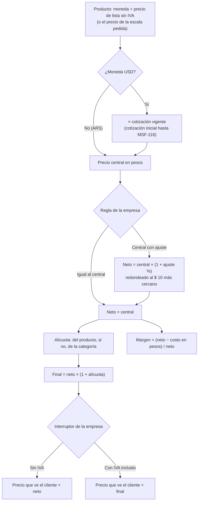

La regla de precio y el interruptor se guardan por separado en la misma pestaña, con bloqueo optimista por
`updated_at`:

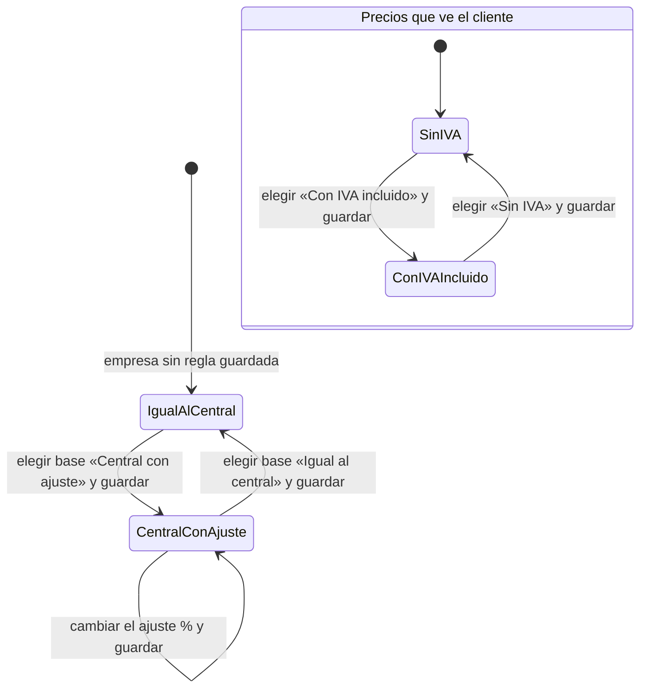

El margen **no** cambia con el interruptor: se calcula siempre sobre el neto. Detalle:
[Precios e IVA (técnico)](precios-e-iva.md). Dueños: FR-001…FR-006 (precio, costo y margen),
FR-008…FR-014 (regla por empresa), FR-015…FR-022 (IVA y precio final), FR-024…FR-027 (escalas).

## Dólar y recálculo (MSF-116)

Cargar → pendiente (24 h) → vista previa por empresa → confirmar (recalcula si la variación llega al 1 %)
o descartar. No hay worker: el vencimiento se resuelve al consultar y el recálculo es una transacción.

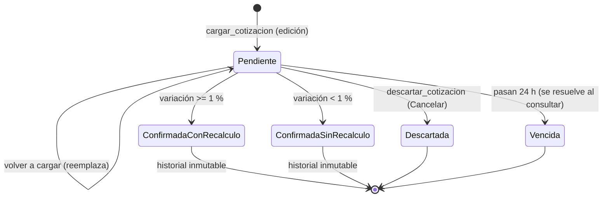

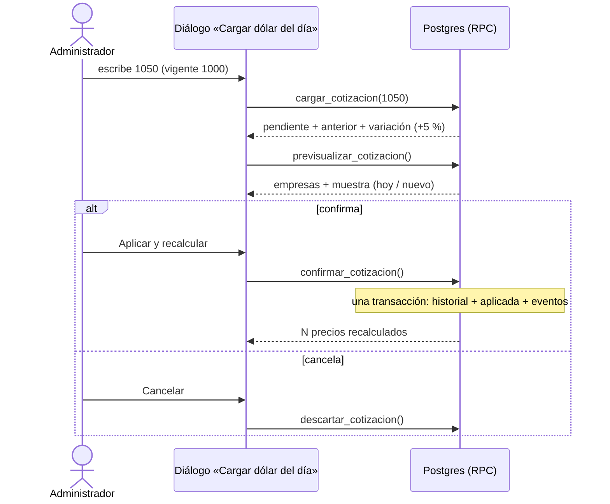

El aviso «Todavía no se cargó el dólar de hoy» (`cotizacion_del_dia`) se monta en `/cotizacion` y en la
portada; «Cargar ahora» reutiliza el mismo diálogo. Detalle: [Dólar y recálculo](dolar-y-recalculo.md).
Dueños: FR-001…FR-003 (carga y vencimiento), FR-009…FR-015 (vista previa, confirmación y descarte),
FR-016…FR-018 (historial), FR-019…FR-022 (aviso).

## Ventas comprobantes (MSF-159)

La factura nace en `borrador`, se edita y al confirmar pasa a `confirmada` descontando stock por depósito.
El presupuesto nace `pendiente`, se puede aceptar o copiar y **nunca** mueve stock.

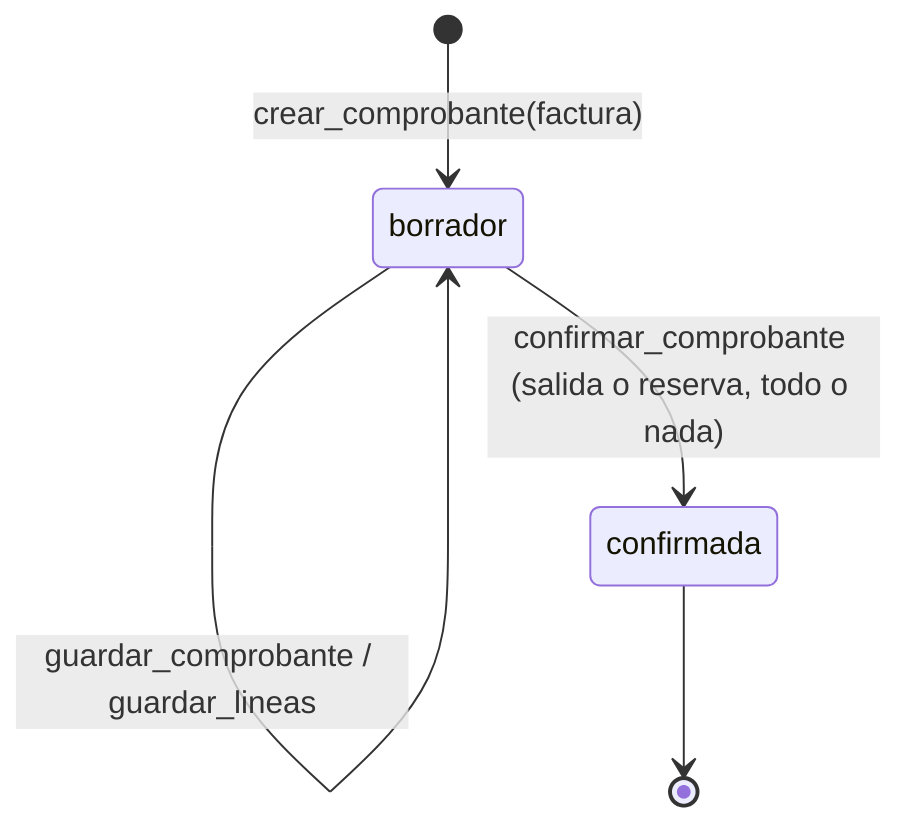

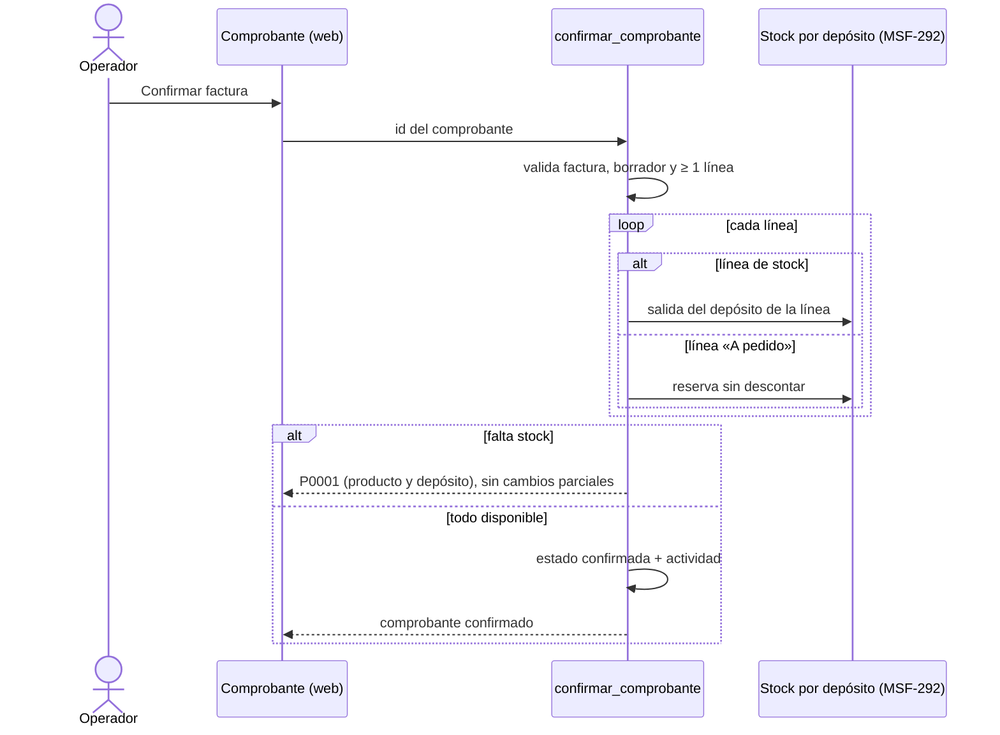

Detalle: [Ventas · comprobantes (técnico)](ventas-comprobantes.md#confirmacion-y-stock-f-vta-07).

## Ventas listado, estados y anulación (MSF-177)

Estados del comprobante y de cobro (F-VTA-10): la matriz de transiciones vive **por datos** en
`dominio.transiciones_estado_comprobante` y la aplica `public.cambiar_estado_comprobante` según el rol del
actor en la empresa del comprobante. Cobrado y Deuda los fija solo el sistema (`sistema` en la matriz): es
`private.marcar_estado_cobro_comprobante`, que dispara el cobro de MSF-195.

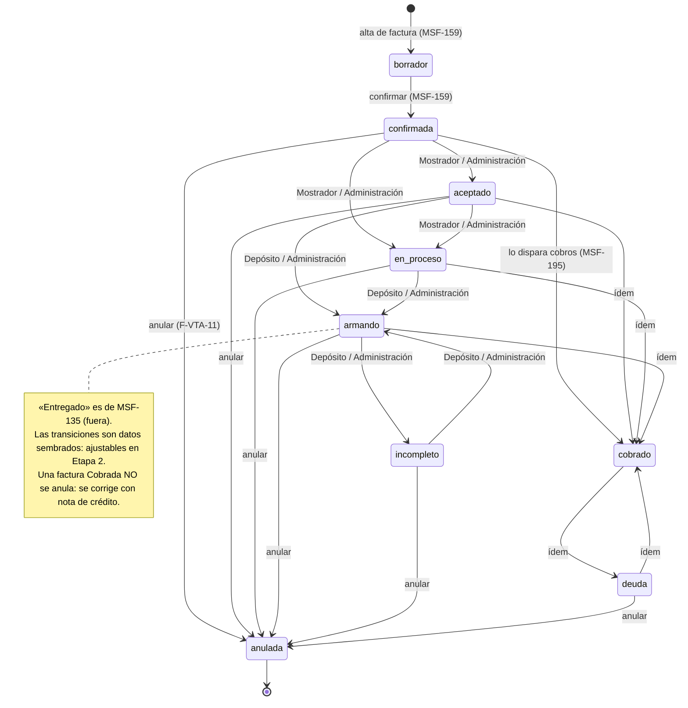

Exportación (F-VTA-09): el conteo `filas` del listado decide la vía.

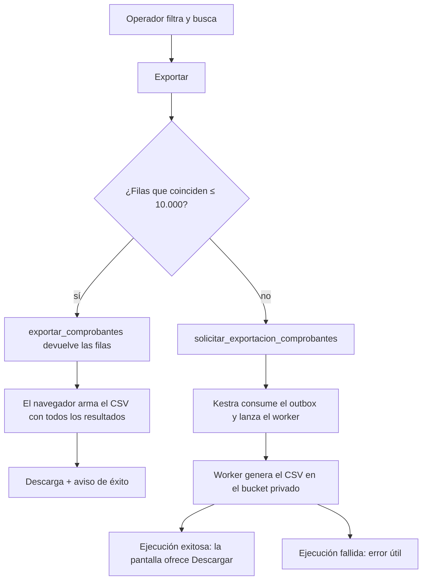

Anulación (F-VTA-11): todo o nada, con la factura tomada `for update`.

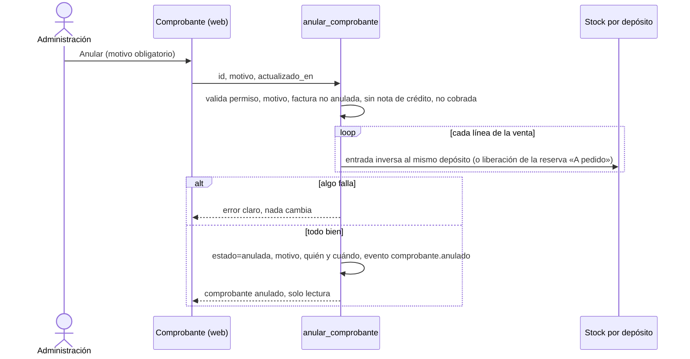

Nota de crédito (F-VTA-11): documento propio, numerado y asociado a la factura; solo «Devolución de productos»
devuelve mercadería al depósito de origen.

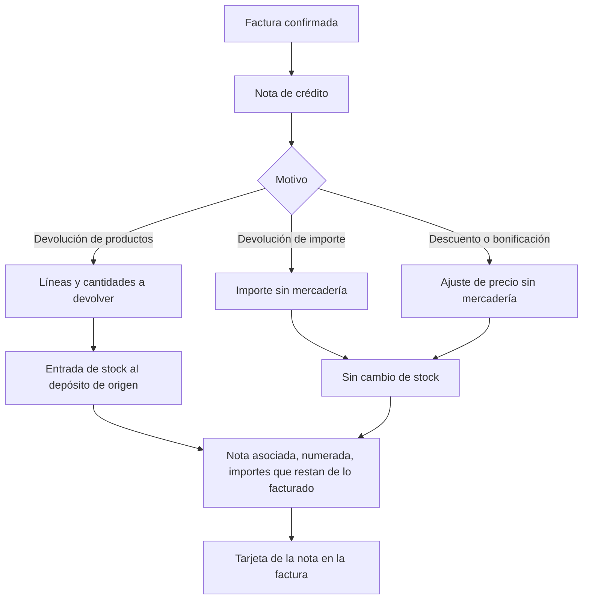

Detalle: [Ventas · listado, estados y anulación (técnico)](ventas-listado-estados-y-anulacion.md).

## Ventas cobros y conciliación (MSF-195)

Cobro (F-VTA-12), conciliación (F-VTA-13) y contrarreembolso (F-VTA-14) del libro de cobros
`dominio.cobros_comprobante`. El único camino al libro es `private.registrar_cobro_interno`: por eso
Cobrado y Deuda los aplica él (con `private.marcar_estado_cobro_comprobante` de MSF-177) y nadie los
cambia a mano.

Del cobro al estado del comprobante:

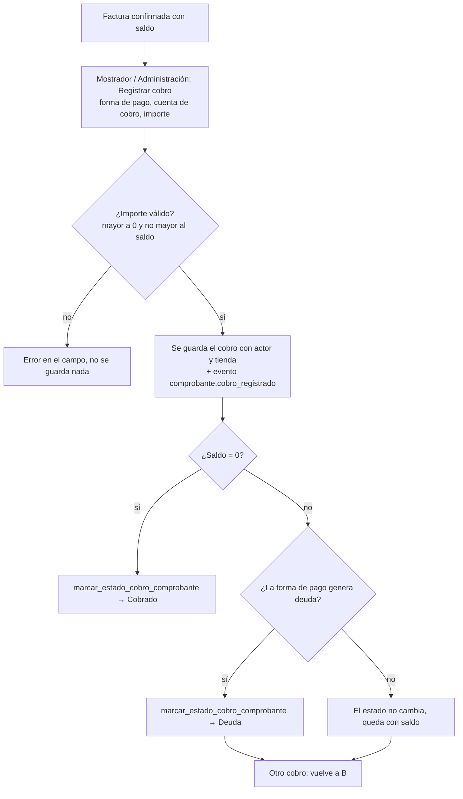

Conciliación (F-VTA-13): no es un estado del comprobante, es la **aprobación** del cobro.

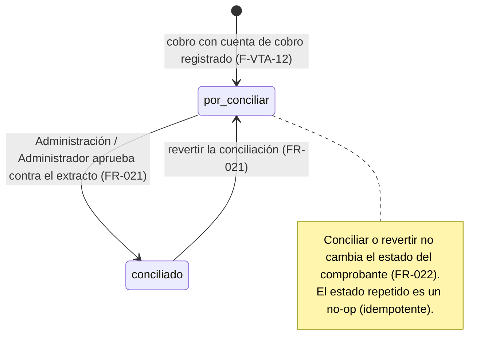

Contrarreembolso (F-VTA-14): lo abre la guía de despacho (F-VTA-16 · MSF-135) y lo cobra
Administración.

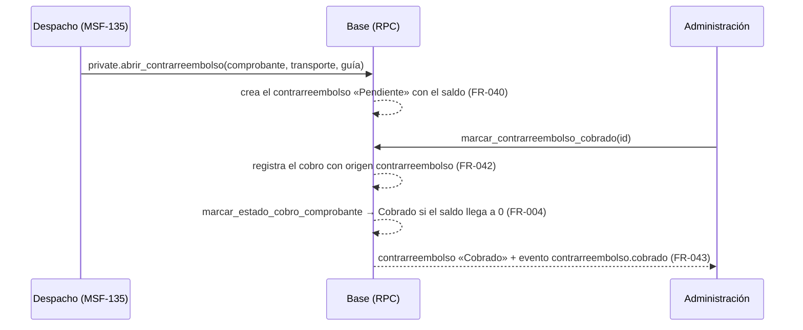

Empresa activa (Principio VIII): las tres pantallas invalidan y recargan **todas** sus consultas al
cambiarla, reencuadran la paginación y descartan el filtro de cuenta que ya no existe; el detalle del
comprobante además cierra con aviso el diálogo «Registrar cobro» abierto.

Detalle: [Ventas · cobros y conciliación (técnico)](ventas-cobros-y-conciliacion.md).

## Catálogo (MSF-160)

- **[Arquitectura](../diagrams/msf-160-architecture.html)** y **[ERD](../diagrams/msf-160-erd.html)**.

## Acceso y sesión (MSF-119)

Ingreso → `bloqueo_acceso_hasta` → Auth (hook `verificar_intento_acceso` cuenta fallos) → consulta de `estado` (suspendido: rechazo y cierre) → sesión (`localStorage` con «Mantener», `sessionStorage` sin ella) → vence a 12 h de inactividad o por `timebox` de 30 días. Recuperación: aviso neutro → enlace de 1 h y un solo uso → definir contraseña. Dueño: spec `20261012-140000-acceso-y-organizacion`; tests: Vitest, pgTAP (`estado_usuario`, `bloqueo_servidor`, `rls_en_toda_tabla`, `aislamiento_organizaciones`, `cortar_sesiones_suspendido`) y `scripts/e2e-acceso.e2e.mjs`.

```mermaid
stateDiagram-v2
  [*] --> SinSesion
  SinSesion --> SesionDePestana: ingreso sin «Mantener»
  SinSesion --> SesionMantenida: ingreso con «Mantener»
  SesionDePestana --> SinSesion: 12 h de inactividad
  SesionDePestana --> SinSesion: «Cerrar sesión»
  SesionMantenida --> SinSesion: 30 días (timebox)
  SesionMantenida --> SinSesion: «Cerrar sesión»
  SesionDePestana --> SinSesion: cuenta suspendida (trigger corta auth.sessions)
  SesionMantenida --> SinSesion: cuenta suspendida (trigger corta auth.sessions)
  SinSesion --> Bloqueado: 5 intentos fallidos por correo
  Bloqueado --> SinSesion: pasan 15 min
  Bloqueado --> Bloqueado: nuevo intento rechazado
```

Detalle: [Acceso y organización (técnico)](acceso.md) · resumen de producto: [Acceso](../acceso-ingreso.md).

## Rentabilidad (MSF-120)

Cálculo al leer + tablero embebido + restricción por sección. El neto sale de `public.precios_empresa_neto`,
el costo de `dominio.producto_costos` convertido con `private.a_pesos` y el umbral de
`dominio.rentabilidad_config`; las tres vistas de `analitica` se derivan de la vista base. El guest token
lleva `rls` por `organizacion_id` y `emitir-acceso-reporte` solo lo emite si la persona tiene la sección del
reporte (`reportes.seccion`).

```mermaid
flowchart LR
  P["Producto × tienda<br/>precio neto y costo"] --> M["analitica.margen_producto_canal<br/>(margen, %, estado)"]
  U["Umbral de la organización"] --> M
  M --> R["Resumen por empresa"]
  M --> C["Consolidado ponderado"]
  C --> Q["rentabilidad_conteo_margen()"]
  Q --> A["Aviso «Ver detalle»"]
  A --> T["Por producto con filtro bajo/negativo"]
  M --> S["Tableros Superset embebidos"]
```

- Sin costo, sin neto positivo o sin cotización → **no hay fila**; no se inventa el margen.
- Guardar el umbral deja `rentabilidad.umbral_actualizado` en Actividad y recarga tablero y aviso.
- El aviso navega a `/rentabilidad/productos?estado=bajo_o_negativo`; el parámetro se traduce a un filtro
  nativo de Superset con valores de una lista cerrada.
- Detalle: [Rentabilidad](rentabilidad.md). Dueños: F-REN-01 (cálculo, umbral y token), F-REN-02 (resumen,
  aviso y estados), F-REN-03 (tabla y filtros).
## Migración inicial de datos (MSF-142)

Archivo CSV en el navegador → previsualización → lotes atómicos por RPC → conciliación contra el
origen. Sin worker ni Kestra: el navegador del Administrador es el único ejecutor y la organización
sale de la sesión. El detalle de tablas, contrato CSV y RPC está en
[Migración inicial de datos](migracion-inicial-de-datos.md).

```mermaid
stateDiagram-v2
  [*] --> Subido: subir CSV UTF-8
  Subido --> Mapeado: mapear columnas
  Mapeado --> VistaPrevia: validar filas
  VistaPrevia --> Aplicando: Importar N
  Aplicando --> Aplicada: lotes completos
  Aplicando --> Fallida: error de lote o carga incompleta
  Fallida --> Aplicando: reintento idempotente
  Subido --> Cancelada: Cancelar
  Mapeado --> Cancelada: Cancelar
  VistaPrevia --> Cancelada: Cancelar
```

```mermaid
flowchart LR
  C["CSV UTF-8"] --> P["Previsualizar lote (nueva / actualizada / error)"]
  P --> A["Aplicar lote (upsert por identificador externo)"]
  A --> F["migracion_filas (resultado por fila)"]
  F --> R["Cerrar carga"]
  R --> I["Informe de conciliación"]
  I -->|diferencia 0| OK["Conciliado"]
  I -->|diferencia distinta de 0| X["Revisar errores u omitidos"]
```

Orden del corte: clientes → proveedores → vínculos proveedor ↔ producto → archivo de ingresos. El
archivo no mueve stock y el stock inicial entra por F-STK-07 (Stock). Plan y criterios de negocio:
[Migración inicial de datos (producto)](../producto/migracion-inicial-de-datos.md).
## Stock · lotes e inventario (MSF-131)

- **Carga en lote (F-STK-10)**: el formulario envía las líneas y una clave de idempotencia a `registrar_lote_stock`;
  la RPC bloquea por organización, asigna el número y llama a `registrar_movimiento_stock` una vez por línea con
  `p_lote`. Cualquier error revierte el lote, los movimientos y el stock.

```mermaid
sequenceDiagram
  actor U as Depósito
  participant UI as Carga en lote
  participant RPC as registrar_lote_stock
  participant MOV as registrar_movimiento_stock
  U->>UI: Proveedor, fecha, motivo y líneas
  U->>UI: Confirmar
  UI->>RPC: líneas + motivo + clave de idempotencia
  RPC->>RPC: valida permiso, líneas, fecha y clave
  RPC->>RPC: bloquea por organización y asigna número
  loop cada línea
    RPC->>MOV: entrada con p_lote
    MOV-->>RPC: movimiento con saldo
  end
  alt todo bien
    RPC-->>UI: lote + movimientos
    UI-->>U: «Lote N registrado» e historial
  else cualquier línea falla
    RPC-->>UI: error (nada se guarda)
    UI-->>U: mensaje claro y reintento con la misma clave
  end
```

- **Toma de inventario (F-STK-11)**: se elige categoría, se cargan los contados y `confirmar_toma_inventario` crea un
  ajuste por producto con diferencia contra el stock del depósito por defecto. La toma no se persiste: repetir la
  confirmación no crea movimientos porque la diferencia ya es cero.

```mermaid
flowchart LR
  A[Elegir categoría] --> B[Productos activos + stock del depósito por defecto]
  B --> C[Ingresar contado y ver diferencia]
  C -->|campo vacío| D[Producto no se toca]
  C -->|Confirmar| E[confirmar_toma_inventario]
  E --> F{¿Diferencia?}
  F -->|sí| G[Movimiento ajuste, motivo Toma de inventario]
  F -->|no| H[Sin movimiento]
  G --> I[Resultado: producto, diferencia y saldo]
  H --> I
  I --> J[Historial de Movimientos]
```

Detalle técnico y reversión: [Stock · lotes e inventario](stock-lotes-e-inventario.md).
## Cuenta web del cliente (MSF-237)

Invitación desde el panel → enlace de Auth al dominio de la tienda → el cliente define su contraseña →
ingresa y consulta su estado en cada carga → ve los precios de su escala. La cuenta no es miembro del
panel y no hay auto-registro (D2). Detalle: [Cuenta web del cliente](cuenta-web-cliente.md).

```mermaid
stateDiagram-v2
  [*] --> NoHabilitado
  NoHabilitado --> SinCuenta: Habilitar en la tienda
  SinCuenta --> Activa: Crear cuenta web / invitación
  Activa --> Activa: Restablecer clave
  Activa --> Suspendida: Suspender acceso
  Suspendida --> Activa: Reactivar acceso
  SinCuenta --> NoHabilitado: Deshabilitar tienda
  Activa --> NoHabilitado: Deshabilitar tienda
  Suspendida --> NoHabilitado: Deshabilitar tienda
  NoHabilitado --> Activa: Rehabilitar (conserva la cuenta activa)
  NoHabilitado --> Suspendida: Rehabilitar (conserva la cuenta suspendida)
```

```mermaid
sequenceDiagram
  actor Op as Operador (panel)
  participant EF as Edge invitar-cliente
  participant DB as Postgres (cuentas_cliente)
  participant Auth as Supabase Auth
  actor Cli as Cliente (tienda)
  Op->>EF: Crear cuenta web (JWT del operador)
  EF->>DB: preparar_cuenta_cliente
  EF->>Auth: createUser / reutilizar
  EF->>DB: vincular_cuenta_cliente (activa + actividad)
  EF->>Auth: enlace para definir contraseña
  Auth-->>Cli: correo con enlace a /definir-contrasena
  Cli->>Auth: define la contraseña
  Cli->>DB: acceso_cliente_por_dominio(host)
  DB-->>Cli: solo activa deja la sesión
```

El precio sigue el tipo y el estado del cliente en cada carga: visitante o cuenta no activa, precio
público; minorista, x1; mayorista, x1/x5/x10/x50 en la ficha (tarjetas en x1, D3). La recuperación
responde siempre igual y solo envía el enlace con una cuenta activa en esa tienda.

## Convención

- **Mermaid** para lo que se lee en GitHub y en esta wiki.
- **Archify** para lo que se explora (zoom, foco, fuentes), validado con `finalize`.
- Todo flujo tiene un **dueño** (spec/FR) y un **test** (Vitest/pgTAP/e2e) que lo respalda.
