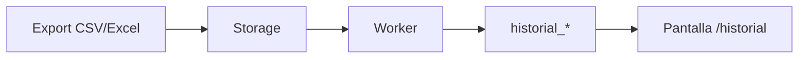

---
sources:
  - specs
---

# Flujos

Los flujos importantes se documentan con **Mermaid** (inline) y, cuando aporta, con un **artefacto Archify** interactivo.

## Importación del historial (MSF-275)

- **[Dataflow interactivo](../diagrams/msf-275-dataflow.html)** — export del panel → Storage → worker → `historial_*` → consulta.
- **[Estados de la ejecución](../diagrams/msf-275-lifecycle.html)** — solicitada → en curso → exitosa/fallida, con la regla todo-o-nada.

## Cambio de estado y entrega (MSF-303)

- **[Secuencia interactiva](../diagrams/msf-303-sequence.html)** — técnico → UI → RPC → `reparaciones` + `reparacion_historial` + evento.

## Catálogo (MSF-160)

- **[Arquitectura](../diagrams/msf-160-architecture.html)** y **[ERD](../diagrams/msf-160-erd.html)**.

## Convención

- **Mermaid** para lo que se lee en GitHub y en esta wiki.
- **Archify** para lo que se explora (zoom, foco, fuentes), validado con `finalize`.
- Todo flujo tiene un **dueño** (spec/FR) y un **test** (Vitest/pgTAP/e2e) que lo respalda.
