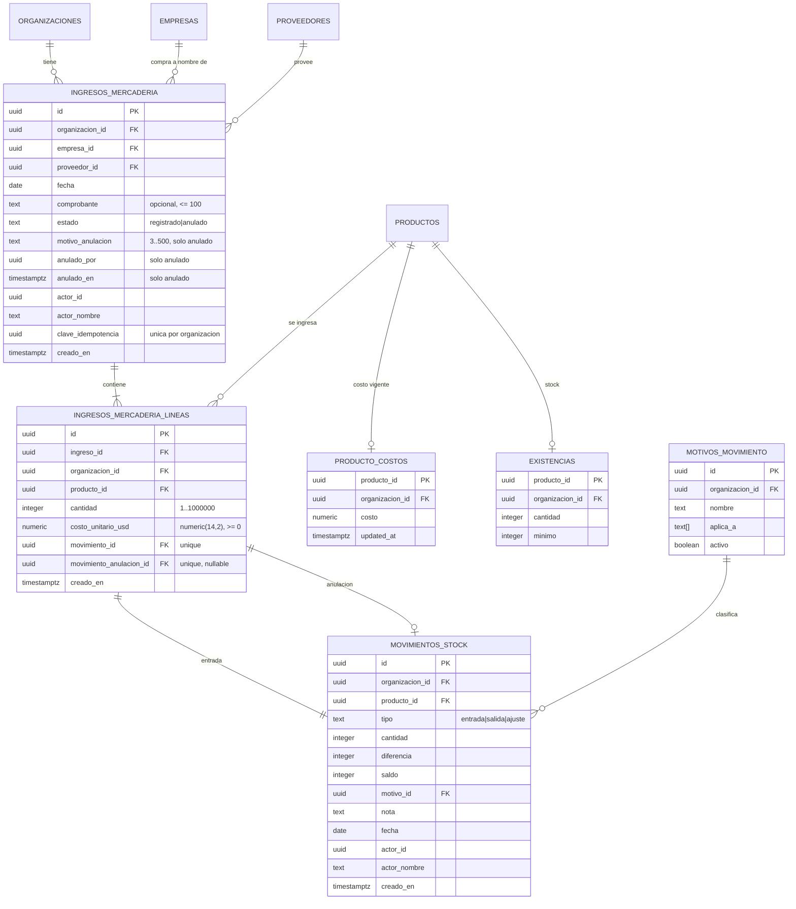
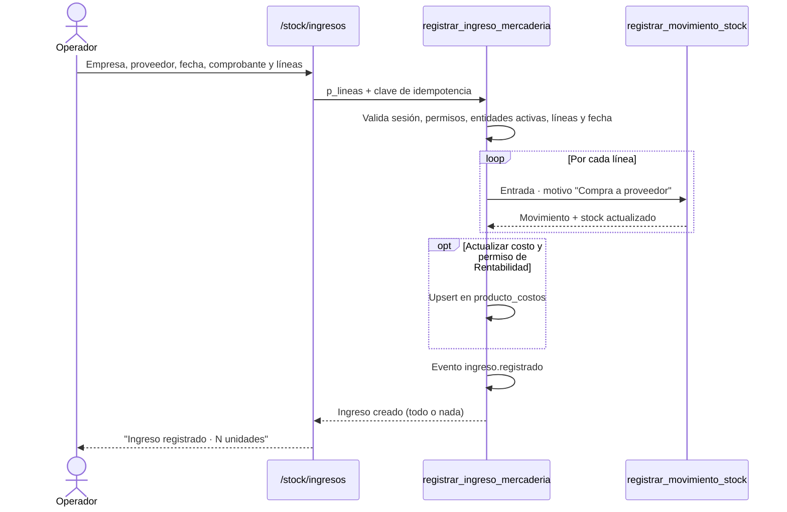
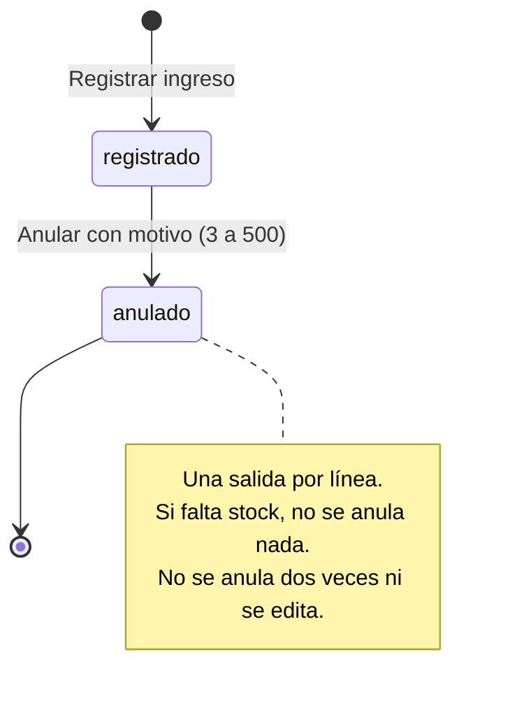

# Ingreso de mercadería: modelo, RPC y flujos (MSF-219)

**Épica:** MSF-219 · **Historias:** F-PRV-04 (MSF-383), F-PRV-05 (MSF-393) y F-PRV-06 (MSF-404).
**Spec:** `specs/20261021-183246-ingreso-de-mercaderia-por-proveedor/`.
**Alcance de entrega:** `refine` (`apps/web`) y `supabase` (migraciones, RPC y pgTAP). Sin `kestra`,
`superset` ni `workers`.

Este componente **no calcula stock**: por cada línea llama a `public.registrar_movimiento_stock`
(MSF-136) con tipo `entrada` y el motivo «Compra a proveedor». La cabecera, las líneas, los movimientos,
la eventual actualización de costo y el evento de actividad se confirman en **una sola transacción**.

## Estado de entrega

Las migraciones `20261021180000`–`20261021180300` y la pantalla `/stock/ingresos` se construyeron en la
rama `epic/MSF-219-ingreso-de-mercaderia-por-proveedor` (commits `a4147652`, `edc4f8f6` y `ddbc5dde`), que
se integró a `dokploy` en `dac760f2`. A la fecha de esta página, la épica **todavía no está promovida a
`main`**. Todo lo de abajo se verificó contra esas migraciones y el código de la rama.

## Modelo de datos

Dos tablas nuevas en **`dominio`** (Principio VII: entidades del negocio) y una fila de dato en el catálogo
de motivos. Las RPC se publican en `public`. Las tablas nacen sin privilegios para `anon` y sin políticas
de escritura: solo escriben las RPC.

| Tabla | Estado | Cambio |
|---|---|---|
| `dominio.ingresos_mercaderia` | **nueva** | Cabecera: empresa, proveedor, fecha, comprobante, estado, anulación, actor y clave de idempotencia. |
| `dominio.ingresos_mercaderia_lineas` | **nueva** | Producto, cantidad, costo unitario USD y vínculo a los movimientos de entrada y anulación. |
| `dominio.movimientos_stock` | existente | Se referencia; sin cambios de esquema. |
| `dominio.motivos_movimiento` | existente | Se agrega el motivo «Anulación de ingreso de mercadería» (`{salida}`) como dato. |
| `dominio.proveedores` | existente | FK compuesta `(proveedor_id, organizacion_id)` (MSF-205). |
| `dominio.productos` | existente | FK compuesta `(producto_id, organizacion_id)`; `proveedor_id` y `codigo_proveedor` de MSF-205. |
| `dominio.producto_costos` | existente | La RPC la actualiza si se marca la casilla y hay `rentabilidad` en edición. |
| `dominio.existencias` | existente | La actualiza `registrar_movimiento_stock`; no se escribe directo. |
| `dominio.empresas` | existente | «Compra a nombre de»; la RPC exige que sea activa y accesible. |
| `public.organizaciones` | existente | Alcance multi-tenant. |
| `public.registro_actividad` | existente | Eventos `ingreso.registrado` e `ingreso.anulado`. |

- **[ERD interactivo (Archify)](../diagrams/msf-219-erd.html)** — tablas nuevas, referencias y cardinalidad.



Detalle de las tablas nuevas:

- **`dominio.ingresos_mercaderia`**: `id`, `organizacion_id` (default `private.organizacion_id()`,
  cascada con la organización), `empresa_id`, `proveedor_id`, `fecha`, `comprobante`,
  `estado` (`registrado` / `anulado`), `motivo_anulacion`, `anulado_por`, `anulado_en`, `actor_id`,
  `actor_nombre`, `clave_idempotencia` (default `gen_random_uuid()`) y `creado_en`.
  - FK compuesta `(proveedor_id, organizacion_id)` → `dominio.proveedores`;
    `empresa_id` → `dominio.empresas`; ambas con `on delete restrict`.
  - `unique (organizacion_id, clave_idempotencia)`.
  - `check` de coherencia: un ingreso `registrado` tiene los tres campos de anulación nulos; uno
    `anulado` los tiene no nulos.
  - Índices `(organizacion_id, creado_en desc, id)`, `(organizacion_id, proveedor_id, fecha desc)` y
    `(organizacion_id, empresa_id, fecha desc)`.
- **`dominio.ingresos_mercaderia_lineas`**: `id`, `ingreso_id` (cascada), `organizacion_id`,
  `producto_id`, `cantidad` (`> 0`), `costo_unitario_usd` (`numeric(14,2)`, `>= 0`), `movimiento_id`
  (único), `movimiento_anulacion_id` (único, opcional) y `creado_en`.
  - FK compuesta `(producto_id, organizacion_id)` → `dominio.productos`.
  - `unique (ingreso_id, producto_id)`: un producto no se repite en el mismo ingreso.
  - Índices `(organizacion_id, producto_id)` y `(ingreso_id)`.
- **Motivo nuevo**: la migración inserta «Anulación de ingreso de mercadería» (`{salida}`) en todas las
  organizaciones y actualiza `private.sembrar_motivos_movimiento` para las nuevas. Es un dato, no un
  cambio de esquema.

`RLS` en ambas tablas: `select` para `authenticated` cuando
`organizacion_id = private.organizacion_id()` y `private.nivel_seccion('stock')` es `lectura` o `edicion`.
No hay políticas de `insert`/`update`/`delete`; `grant select` a `authenticated` y `revoke` de todo a
`public` y `anon`.

## RPC

### `public.registrar_ingreso_mercaderia(...)`

`p_empresa uuid, p_proveedor uuid, p_fecha date, p_comprobante text, p_lineas jsonb,
p_actualizar_costo boolean default false, p_clave_idempotencia uuid default null` →
`dominio.ingresos_mercaderia`. `security definer`, `search_path = ''`.

- Exige sesión, organización y `nivel_seccion('stock') = 'edicion'` (`42501`).
- **Idempotencia**: si llega una `p_clave_idempotencia` que ya existe para la organización, devuelve el
  ingreso existente sin volver a mover stock. La clave también se protege con la `unique` (dos envíos
  simultáneos devuelven el mismo ingreso).
- Valida que la **empresa** sea accesible (`private.empresas_accesibles()`), de la organización y
  **activa**; el **proveedor**, activo y de la organización; la **fecha**, no futura; el **comprobante**,
  de hasta 100 caracteres.
- Valida `p_lineas`: array no vacío, hasta 100 elementos; `producto_id` UUID; `cantidad` entero entre 1 y
  1.000.000; `costo_unitario_usd` con hasta dos decimales y `>= 0`; sin productos repetidos; todos los
  productos activos y de la organización.
- Si `p_actualizar_costo`, exige `nivel_seccion('rentabilidad') = 'edicion'` (`42501`). La UI oculta la
  casilla sin ese permiso, pero la base lo vuelve a validar.
- Busca el motivo activo «Compra a proveedor» (`aplica_a = {entrada}`). Inserta la cabecera y, por cada
  línea, llama a `public.registrar_movimiento_stock(p_producto, 'entrada', cantidad, motivo, nota,
  p_fecha)`; la nota incluye el comprobante. Guarda `movimiento_id`.
- Con `p_actualizar_costo`, hace `insert ... on conflict (producto_id) do update` en
  `dominio.producto_costos` con el costo de la línea. **No toca `precio_lista`.**
- Registra `ingreso.registrado` con proveedor, empresa, comprobante y unidades (sin costos) y devuelve la
  cabecera. Todo o nada: si una línea falla, no queda cabecera, línea, movimiento, costo ni evento.
- Errores que reconoce la app: `42501` (sin permiso), `22023` (dato inválido), `23505` (clave repetida) y
  `23514` (stock insuficiente al anular; ver abajo).

`revoke execute ... from public, anon` y `grant execute ... to authenticated`.

### `public.anular_ingreso_mercaderia(p_ingreso uuid, p_motivo text)`

`security definer`, `search_path = ''`; devuelve la cabecera anulada.

- Exige `stock` en `edicion` y un **motivo** de 3 a 500 caracteres (`22023`).
- Bloquea la cabecera con `for update`; si no existe, es de otra organización o ya está anulada, rechaza.
- Busca el motivo activo «Anulación de ingreso de mercadería» (`aplica_a = {salida}`).
- Recorre las líneas **ordenadas por `producto_id`** (para que dos anulaciones concurrentes bloqueen en el
  mismo orden y no se crucen) y crea una `salida` por línea con `registrar_movimiento_stock`, fecha del
  servidor y nota con el id del ingreso. Guarda `movimiento_anulacion_id`.
- Si algún producto **no tiene stock suficiente**, la RPC de stock lanza y **toda la anulación se
  revierte**: no cambia el estado del ingreso ni queda ningún movimiento.
- Marca `estado = 'anulado'`, `motivo_anulacion`, `anulado_por = auth.uid()` y `anulado_en = now()`.
- Registra `ingreso.anulado` (sin costos).
- Dos anulaciones simultáneas se serializan con el bloqueo de la cabecera: solo una prospera.

### Lectura

| RPC | Contrato |
|---|---|
| `public.listar_ingresos_mercaderia(p_desde date, p_hasta date, p_proveedor uuid, p_empresa uuid, p_producto uuid, p_operador uuid, p_pagina integer, p_tamano integer)` | `security invoker`: la RLS decide las filas. Una fila **por producto**. Devuelve `ingreso_id`, `fecha`, `creado_en`, `estado`, `comprobante`, `motivo_anulacion`, `anulado_en`, `producto_id`, `producto_nombre`, `producto_sku`, `cantidad`, `costo_unitario_usd`, `destino`, `empresa`, `proveedor`, `operador` y `total`. Orden `creado_en desc, ingreso_id, producto_nombre`; tamaño 25 por defecto, tope 100; `total` cuenta las líneas del conjunto filtrado. «Destino» es siempre `Depósito principal`. |
| `public.detalle_ingreso_mercaderia(p_ingreso uuid)` | `security invoker`; devuelve `jsonb` con cabecera, líneas y vínculos a los movimientos, o `null` si no existe o es de otra organización. La pantalla de esta entrega no abre un detalle dedicado. |
| `public.operadores_ingresos_mercaderia()` | `security invoker`; `actor_id` y `actor_nombre` distintos de quienes registraron ingresos, para el filtro Operador. |

Todas hacen `revoke ... from public, anon` y `grant execute ... to authenticated`.

## Permisos y seguridad

| Acción | Requisito | Dónde se valida |
|---|---|---|
| Ver el historial y el detalle | `stock` en `lectura` o `edicion` | RLS de las dos tablas y RPC `security invoker` |
| Registrar un ingreso | `stock` en `edicion` | `registrar_ingreso_mercaderia` |
| Anular | `stock` en `edicion` | `anular_ingreso_mercaderia` |
| Actualizar el costo del producto | además, `rentabilidad` en `edicion` | `registrar_ingreso_mercaderia` |

- Organización y actor salen de la sesión; `creado_en` lo pone el servidor. El cliente no los fija.
- Las tablas no tienen escritura directa; los movimientos siguen siendo inmutables por MSF-136.
- `anon` no tiene privilegios y no ejecuta las RPC.
- No se usa la service-role key en el navegador.

## Pantalla y piezas de `apps/web`

- Ruta `lazy` `/stock/ingresos` en `apps/web/src/App.tsx`, envuelta en
  `RequiereAccesoSeccion seccion="stock"`.
- `apps/web/src/pages/stock/ingresos.tsx`: título Stock, empresa activa, pestañas y composición.
  - Con `stock` en edición renderiza el formulario; con solo lectura muestra «Tu rol puede ver el
    historial, pero no registrar ingresos de mercadería».
  - `PestanasStock.tsx` suma la tercera pestaña «Ingreso de mercadería».
- `IngresoMercaderiaForm.tsx`: empresa (empresas accesibles; arranca en la activa), proveedor activo,
  fecha, comprobante, líneas con producto/SKU, cantidad con −/+, costo USD, quitar, «Agregar producto»,
  total de unidades, casilla de costo solo con `rentabilidad` en edición, «Limpiar» y «Registrar
  ingreso» con estado de envío y snackbar «Ingreso registrado · N unidades». Si el producto tiene
  `proveedor_id` igual al proveedor elegido, muestra «Proveedor del producto: coincide»; no lo exige.
- `HistorialIngresos.tsx`: tabla o tarjetas adaptables, filtros por fechas, proveedor, empresa, producto y
  operador, chip «Registrado» / «Anulado» (con motivo), paginación de 25 líneas y acción «Anular» una sola
  vez por ingreso, solo con edición y estado `registrado`.
- `AnularIngresoDialog.tsx`: motivo obligatorio (3–500), confirmación y estados de envío/error; el mensaje
  de stock insuficiente es «No hay stock suficiente para anular: parte de la mercadería ya se movió.».
- Hooks `useIngresos`, `useRegistrarIngreso` y `useAnularIngreso`; normalización, validación local y
  clave de idempotencia en `apps/web/src/lib/ingresos.ts`. Al registrar o anular, la pantalla recarga el
  historial; las demás pantallas leen el stock al montarse.

## Flujos

### Registrar (F-PRV-04)



### Historial y anulación (F-PRV-05 y F-PRV-06)



## Pruebas

- pgTAP `supabase/tests/database/ingresos_mercaderia_base.test.sql`: tablas en `dominio`, RLS, `anon`,
  motivo sembrado, unicidad de idempotencia y de producto por ingreso, FK entre organizaciones.
- pgTAP `ingresos_mercaderia_registrar.test.sql`: una y varias líneas, stock y movimientos, evento, costo
  solo con permiso, fecha futura, productos/proveedores inactivos o ajenos, duplicados, idempotencia,
  atomicidad y `anon`.
- pgTAP `ingresos_mercaderia_historial.test.sql`: orden, paginación, total, filtros combinados, anulado,
  detalle, operadores, aislamiento y rol sin acceso.
- pgTAP `ingresos_mercaderia_anular.test.sql`: reversión, motivo, doble anulación, stock insuficiente,
  permisos y aislamiento.
- Vitest `lib/ingresos.test.ts`, `IngresoMercaderiaForm.test.tsx`, `HistorialIngresos.test.tsx`,
  `AnularIngresoDialog.test.tsx`, `useRegistrarIngreso.test.tsx`, `useIngresos.test.tsx` y
  `useAnularIngreso.test.tsx`.
- E2E `apps/web/e2e/ingresos-mercaderia.e2e.ts`: proveedor → ingreso de dos productos con costo → stock
  sube → historial → anular → stock vuelve y queda «Anulado». Se omite sin `SUPABASE_URL` y
  `SUPABASE_SERVICE_ROLE_KEY`; se ejecuta a mano con `pnpm dev:supabase` (seguimiento MSF-499).

## Reversión

Migraciones aditivas; para deshacer, en una migración posterior y exportando antes los datos:

```sql
drop function public.anular_ingreso_mercaderia(uuid, text);
drop function public.operadores_ingresos_mercaderia();
drop function public.detalle_ingreso_mercaderia(uuid);
drop function public.listar_ingresos_mercaderia(date, date, uuid, uuid, uuid, uuid, integer, integer);
drop function public.registrar_ingreso_mercaderia(uuid, uuid, date, text, jsonb, boolean, uuid);
drop table dominio.ingresos_mercaderia_lineas;
drop table dominio.ingresos_mercaderia;
-- restaurar private.sembrar_motivos_movimiento y borrar el motivo de anulación
```

El detalle está en el encabezado de cada migración.

## Fuera de alcance

- Depósitos, selector de depósito y stock por depósito: MSF-292.
- Archivo consultable del historial de ingresos del sistema anterior: MSF-330.
- Ingreso en lote de Stock (F-STK-10): decisión abierta en Stock; no se implementa acá.
- Lotes, vencimientos, órdenes de compra, pagos, cuentas corrientes y costo en ARS.
- Edición o borrado de un ingreso: solo anulación.
