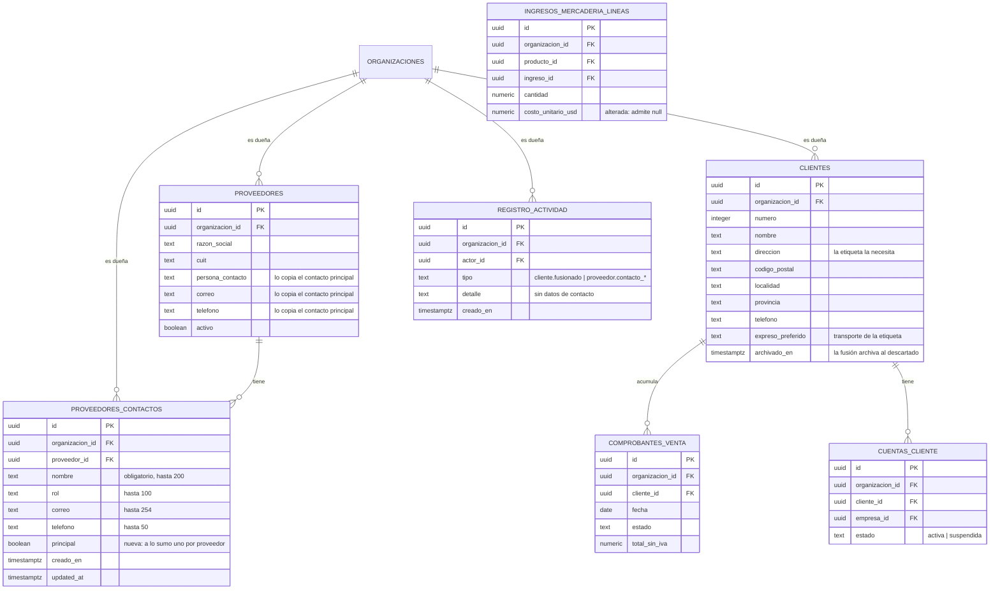

# Mejoras de clientes y proveedores: modelo, RPC y pantallas (MSF-445)

**Épica:** MSF-445 — Clientes y proveedores · Mejoras de clientes y proveedores.
**Historias:** F-CLI-17 (MSF-446, etiqueta impresa), F-CLI-18 (MSF-447, fusión de clientes), F-PRV-07
(MSF-448, historial de costos) y F-PRV-08 (MSF-449, contactos de proveedor).
**Spec:** `specs/20261029-100000-mejoras-de-clientes-y-proveedores/` (`spec.md`, `plan.md`, `tasks.md`,
`contracts/mejoras-clientes-proveedores.md`).
**Alcance de entrega:** `refine` (`apps/web`) y `supabase` (migraciones, RPC y pgTAP). Sin `kestra`,
`superset` ni `workers`.
**Guías de producto:** [Clientes](../clientes.md) · [Proveedores](../proveedores.md) ·
[Manual de Clientes](../producto/clientes.md) · [Manual de Proveedores](../producto/proveedores.md).

## Estado de entrega

La épica está integrada en la rama `epic/MSF-445-clientes-y-proveedores-mejoras-de-client` (**PR #695**),
**no en `main`** a la fecha de esta página: `main` todavía no tiene las migraciones `20270204…` ni los
componentes de la etiqueta, la fusión, la evolución del costo y los contactos. Las cuatro historias se
cerraron por PR separados (`#671` F-CLI-17/MSF-446, `#676` F-CLI-18/MSF-447, `#678` F-PRV-07/MSF-448,
`#683` F-PRV-08/MSF-449) y el cierre (T026–T028) en `#692` (MSF-766).

Las migraciones se escribieron primero como `20270115…` y se **renumeraron a `20270204…`** al integrar la
base `dokploy` (su máximo era `20270203120000`): la versión vieja quedó bajo la cola aplicada y el
aplicador la salteaba. Cada archivo renumerado lo dice en su primera línea.

Todo lo de abajo está verificado contra esas migraciones y contra el código de `apps/web` de la rama.

## Modelo de datos

| Tabla / objeto | Estado | Cambio |
|---|---|---|
| `dominio.proveedores_contactos` | **nueva** | Contactos del proveedor: `nombre` (obligatorio), `rol`, `correo`, `telefono`, `principal`. FK compuesta `(proveedor_id, organizacion_id)` contra `dominio.proveedores`. |
| `dominio.ingresos_mercaderia_lineas` | **alterada** | `costo_unitario_usd` deja de ser `not null`: una línea sin costo se guarda con `null` (que no es cero). |
| `public.clientes` | existente | Sin columnas nuevas: la fusión solo escribe `archivado_en` del cliente descartado. |
| `public.cuentas_cliente` | existente | La fusión reasigna `cliente_id` y **elimina** la fila de la cuenta no elegida (no hay estado «dada de baja»). Sin cambios de esquema. |
| `dominio.comprobantes_venta` | existente | La fusión reasigna `cliente_id`. Sin cambios de esquema. |
| `public.clientes_empresas` | existente | La fusión habilita en el conservado las tiendas de la cuenta web reasignada. Sin cambios de esquema. |
| `dominio.proveedores` | existente | `persona_contacto`, `correo` y `telefono` los copia el contacto principal. Sin cambios de esquema. |
| `public.registro_actividad` | existente | Recibe `cliente.fusionado`, `proveedor.contacto_agregado` y `proveedor.contacto_principal_cambiado`. Sin cambios de esquema. |

Restricciones e índices nuevos:

| Objeto | Qué garantiza |
|---|---|
| `proveedores_contactos_un_principal_idx` (único parcial) | **A lo sumo un contacto principal por proveedor**: `unique (proveedor_id) where principal`. |
| `proveedores_contactos_org_proveedor_idx` | Índice de lectura por `(organizacion_id, proveedor_id)`. |
| FK compuesta `(proveedor_id, organizacion_id)` → `dominio.proveedores (id, organizacion_id)` | Un contacto no puede colgar de un proveedor de otra organización; `on delete restrict`. |
| `proveedores_contactos_nombre_ck` y topes de largo | `nombre` no vacío y hasta 200; `rol` 100, `correo` 254, `telefono` 50. |

## Migraciones

| Migración | Qué agrega |
|---|---|
| `20270204100000_fusion_clientes.sql` | `public.fusionar_clientes(p_conservar_id, p_descartar_id, p_cuenta_web_de)`: permiso de Administrador, bloqueo de ambas filas, validaciones, reasignación de documentos de venta y cuenta web, archivo del descartado. |
| `20270204100100_fusion_clientes_cuenta_web.sql` | `create or replace` de la misma firma: `p_cuenta_web_de` resuelve la cuenta web activa y da de baja la no elegida. |
| `20270204100200_fusion_clientes_actividad.sql` | `private.registrar_actividad_fusion_clientes(...)` y el evento `cliente.fusionado` dentro de la misma transacción. |
| `20270204100300_vista_previa_fusion_clientes.sql` | `public.vista_previa_fusion_clientes(p_conservar_id, p_descartar_id)`: solo lectura. |
| `20270204110000_costo_ingreso_opcional.sql` | `alter column costo_unitario_usd drop not null` y `registrar_ingreso_mercaderia` con la misma firma y el costo de línea opcional. |
| `20270204110100_historial_costos_producto.sql` | `public.historial_costos_producto(p_producto_id, p_proveedor_id)`. |
| `20270204120000_proveedores_contactos.sql` | Tabla `dominio.proveedores_contactos`, RLS, índices y grants (solo `select`). |
| `20270204120100_proveedores_contactos_rpc.sql` | `listar_contactos_proveedor`, `agregar_contacto_proveedor`, `marcar_contacto_principal` y el auxiliar `private.aplicar_contacto_principal`. |
| `20270204120200_proveedores_contactos_actividad.sql` | `private.registrar_actividad_contacto_proveedor(...)`: `proveedor.contacto_agregado` y `proveedor.contacto_principal_cambiado`. |

Todas son **aditivas** y traen la reversión escrita en el encabezado (ver [Reversión](#reversion)).

## F-CLI-17 · Etiqueta impresa del cliente

**Sin cambios de esquema y sin RPC**: es una función de lectura del navegador sobre `public.clientes`.

- `apps/web/src/lib/etiquetasCliente.ts` son **funciones puras** (no leen ni escriben datos):
  `faltantes(cliente)` (devuelve `['dirección']` si falta la dirección y nada más),
  `armarEtiqueta(cliente)` (devuelve `null` si falta la dirección; si no, arma las líneas: dirección,
  «CP localidad», provincia, `Tel. …` y `Transporte: …`, omitiendo las vacías), `armarEtiquetas(clientes)`
  (separa **aptas** y **omitidos**), `avisoOmitidos(omitidos)` («Nombre (falta dirección)»),
  `rutaEtiquetas(ids)` e `idsDeParametro(parametro)`.
- `COLUMNAS_ETIQUETA = 'id,nombre,direccion,codigo_postal,localidad,provincia,telefono,expreso_preferido'`:
  son las únicas columnas que lee; la RLS de `clientes` (organización y nivel de sección) sigue mandando.
- `MAXIMO_ETIQUETAS = 200`: el parámetro `ids` de la URL se parte por comas, se valida como UUID, se
  deduplica y se recorta a 200 antes de llegar a la consulta.
- `apps/web/src/components/clientes/HojaEtiquetas.tsx` es la hoja: carga, vacío, error y avisos
  compartidos; una etiqueta por cliente en el orden de la selección.
- Estilos de impresión (`GlobalStyles`): `@page { size: A4; margin: 10mm }` y `@media print` que oculta
  `.MuiAppBar-root`, `.MuiDrawer-root`, `nav` y `.no-imprimir`, de modo que **al imprimir sale solo la
  etiqueta** (sin menú ni barra superior). La grilla es de una columna en pantallas angostas y dos desde
  `sm`; cada etiqueta lleva `breakInside: 'avoid'`.
- La ruta `/clientes/etiquetas` es `lazy` y cuelga de `RequiereAccesoSeccion seccion="clientes"` (en
  `apps/web/src/App.tsx`): sin lectura de Clientes no se abre.
- Entradas: `pages/clientes/show.tsx` («Etiqueta» en el encabezado e «Imprimir etiqueta de envío» en el
  bloque de la ficha) y `pages/clientes/list.tsx` («Imprimir etiquetas (N)», solo con `edicion` en
  `clientes`).
- Avisos: «Etiqueta enviada a imprimir» (éxito), «Algunos clientes no tienen etiqueta.» con el detalle de
  los omitidos, «No hay clientes para imprimir.» (vacío) y, en la ficha, «No se puede imprimir la
  etiqueta: falta dirección. Cargala en «Editar» y probá de nuevo.».
- **No escribe nada**: no hay RPC ni escritura; la impresión es `window.print()`.

## F-CLI-18 · Fusión de clientes duplicados

Contratos (todos `security definer`, `search_path = ''`, `revoke execute … from public, anon` y
`grant execute … to authenticated`):

| RPC | Qué hace | Seguridad |
|---|---|---|
| `public.fusionar_clientes(p_conservar_id uuid, p_descartar_id uuid, p_cuenta_web_de uuid default null) returns jsonb` | Reasigna al conservado los documentos de venta y la cuenta web, habilita en él las tiendas de esa cuenta, **archiva** al descartado (`archivado_en = now()`) y registra `cliente.fusionado`. Devuelve `{documentos_reasignados, cuentas_reasignadas, campanas_reasignadas, cuentas_dadas_de_baja}` | Exige `private.es_administrador_de(organización de la sesión)`; el resto recibe `42501` |
| `public.vista_previa_fusion_clientes(p_conservar_id uuid, p_descartar_id uuid) returns table (cliente_id, numero, nombre, documentos, cuentas_web_activas, cuentas_web_total)` | Vista previa de **solo lectura**: por cliente, N.º, nombre, documentos de venta y cuentas web (activas/total) | Mismas validaciones que la fusión; `stable` |

Orden dentro de la transacción de `fusionar_clientes`:

1. **Permiso**: `42501` «Solo el Administrador puede fusionar clientes».
2. **Validaciones**: `22023` «Elegí los dos clientes a fusionar», `22023` «No se puede fusionar un cliente
   consigo mismo», `P0002` «Alguno de los clientes no existe» (inexistente o de otra organización),
   `22023` «Alguno de los clientes ya está archivado (¿la fusión ya se hizo?)».
3. **Bloqueo**: `select … where c.id in (…) order by c.id for update` sobre las dos filas: bloquea en
   **orden por id**, así dos fusiones cruzadas no se traban.
4. **Cuenta web**: si los dos lados tienen cuentas, `p_cuenta_web_de` es obligatorio; con las dos
   **activas** sin elegir, `22023` «Los dos clientes tienen cuenta web activa: elegí cuál se mantiene»; con
   un valor ajeno, `22023` «La cuenta web elegida debe ser la de uno de los dos clientes». La cuenta **no
   elegida se da de baja** (se elimina la fila de `public.cuentas_cliente`; el usuario de Auth queda sin
   uso, como ya documenta esa tabla).
5. **Reasignaciones**: `update dominio.comprobantes_venta set cliente_id = p_conservar_id` y
   `update public.cuentas_cliente set cliente_id = p_conservar_id`; además `insert into
   public.clientes_empresas` de las tiendas de la cuenta reasignada (`on conflict do nothing`), para que
   el conservado quede habilitado en esas tiendas.
6. **Campañas**: no hay nada que reasignar — **no existe la tabla de campañas** (MSF-155 no se entregó);
   `campanas_reasignadas` devuelve `0`. Cuando MSF-155 cree su tabla, tiene que sumar la reasignación a
   esta RPC.
7. **Archivo**: `update public.clientes set archivado_en = now()` sobre el descartado (no se borra y
   conserva sus datos de ficha).
8. **Actividad**: `cliente.fusionado` en la **misma transacción**.

Lo que **no** se toca (Decisión 4 de la spec): reparaciones de Service, avisos de faltantes, tiendas
habilitadas e identificadores externos siguen asociados al cliente archivado; no se pierde nada.

Frontend (`apps/web/src/components/clientes/DialogoFusionarClientes.tsx` y `apps/web/src/lib/clientes.ts`):

- `vistaPreviaFusion(conservar, descartar)` y `fusionarClientes(conservar, descartar, cuentaWebDe)`
  llaman las RPC; `hayCuentaWebParaResolver(filas)` decide si hay que resolver la cuenta web (los dos con
  cuentas activas) y `mensajeDeFusion(error)` muestra el mensaje de la base tal cual (`42501`, `22023`,
  `P0002`) sin identificadores técnicos.
- El diálogo muestra «3 compras y 5 compras: la ficha que se conserva quedará con 8 compras.», deja elegir
  la ficha a conservar y, cuando hace falta, la cuenta web que se mantiene (obligatorio para poder
  confirmar).
- La acción «Fusionar con otro cliente…» aparece en `pages/clientes/show.tsx` solo con
  `contexto.rol_efectivo === 'administrador'` y ni en clientes archivados ni en el Consumidor final; al
  terminar, recarga la ficha del conservado con la suma de las compras (o navega a ella si la ficha actual
  fue la descartada) y avisa «Clientes fusionados: las compras se sumaron en esta ficha».

## F-PRV-07 · Costo por línea y evolución del costo

- `20270204110000_costo_ingreso_opcional.sql` relaja la columna:
  `alter table dominio.ingresos_mercaderia_lineas alter column costo_unitario_usd drop not null`.
  El comentario de la columna lo deja explícito: «nulo si el ingreso se cargó sin costo (no es cero). Se
  copia a `dominio.producto_costos` solo si se pidió actualizar el costo y la línea trae costo».
- `public.registrar_ingreso_mercaderia` **mantiene la firma** (`p_empresa`, `p_proveedor`, `p_fecha`,
  `p_comprobante`, `p_lineas`, `p_actualizar_costo`, `p_clave_idempotencia`): la línea sin costo se guarda
  con `v_costo` nulo y, con `p_actualizar_costo`, el `insert into dominio.producto_costos` solo ocurre
  `if coalesce(p_actualizar_costo, false) and v_costo is not null`. No es un cambio incompatible para los
  llamadores actuales.
- `public.historial_costos_producto(p_producto_id uuid, p_proveedor_id uuid default null)` devuelve una
  fila por línea de ingreso **registrado** (no anulado) **con costo**, con `proveedor_id`,
  `proveedor_razon_social`, `ingreso_id`, `fecha`, `comprobante` y `costo_unitario_usd`; ordena por
  `i.fecha, i.creado_en, i.id`. Una línea **sin costo no aparece** (no se cuenta como cero) y un ingreso
  **anulado** tampoco.
- Es `security definer` (el permiso exigido es Rentabilidad + Proveedores, no Stock) y exige sesión,
  organización de la sesión y `nivel_seccion('rentabilidad')` **y** `nivel_seccion('proveedores')` en
  `lectura`/`edicion`; si falta alguno, `42501` «Tu rol no puede ver el historial de costos». Filtra por
  `l.organizacion_id` y `i.empresa_id in (select private.empresas_accesibles())`.
- Frontend: `apps/web/src/hooks/useHistorialCostos.ts` (consulta solo con `activo`; «última petición
  gana») y `apps/web/src/components/proveedores/DialogoEvolucionCosto.tsx`, que agrupa los puntos por
  proveedor y muestra **Fecha**, **Comprobante** y **Costo unit. USD**. La acción «Evolución del costo» se
  agrega a cada fila de la tabla de productos de la ficha del proveedor
  (`ProductosDelProveedor.tsx`) y solo se renderiza con lectura en Rentabilidad **y** Proveedores.
- El formulario de ingreso (`apps/web/src/lib/ingresos.ts`) valida el costo solo si no está vacío y envía
  `costo_unitario_usd: number | null`; el resto del formulario no cambia.

## F-PRV-08 · Contactos de proveedor

- Tabla `dominio.proveedores_contactos` (esquema `dominio`: es parte de la entidad de negocio
  «proveedor», no de la plataforma).
- **RLS**: una sola política, `proveedores_contactos_select`, `for select to authenticated` con
  `organizacion_id = private.organizacion_id()` **y** `nivel_seccion('proveedores') in ('lectura','edicion')`.
  No hay política ni grant de `INSERT`, `UPDATE` o `DELETE`: la escritura es **solo por RPC**.
- **Grants**: `revoke all on dominio.proveedores_contactos from public, anon, authenticated` y
  `grant select on dominio.proveedores_contactos to authenticated`. `anon` no tiene acceso.

| RPC | Qué hace | Seguridad |
|---|---|---|
| `public.listar_contactos_proveedor(p_proveedor_id uuid) returns table (id, nombre, rol, correo, telefono, principal)` | Contactos del proveedor, **principal primero** (`order by principal desc, lower(nombre), id`) | `security definer`, `stable`; exige `proveedores` en `lectura`/`edicion`; `42501` «Tu rol no puede ver los contactos del proveedor» |
| `public.agregar_contacto_proveedor(p_proveedor_id uuid, p_nombre text, p_rol text default null, p_correo text default null, p_telefono text default null, p_principal boolean default false) returns uuid` | Alta de un contacto; opcionalmente como principal | Exige `proveedores` en `edicion` (`42501`); `22023` «El nombre del contacto es obligatorio» y «El correo no tiene un formato válido»; `P0002` «El proveedor no existe» |
| `public.marcar_contacto_principal(p_contacto_id uuid) returns void` | Deja al contacto como **único** principal y copia sus datos a la ficha | Exige `proveedores` en `edicion` (`42501`); `P0002` «El contacto no existe» |

- **Concurrencia**: `agregar_contacto_proveedor` y `marcar_contacto_principal` bloquean antes la fila del
  proveedor (`select … from dominio.proveedores … for update`): dos altas simultáneas como principal se
  serializan y la segunda deja a la primera sin marca. El índice único parcial es la red de seguridad.
- `private.aplicar_contacto_principal(p_organizacion, p_contacto_id)` (la llama quien ya bloqueó al
  proveedor) desmarca al anterior, marca al nuevo y **copia** `nombre`, `correo` y `telefono` a
  `dominio.proveedores.persona_contacto`, `.correo` y `.telefono`, en la misma transacción.
- Frontend: `apps/web/src/components/proveedores/ListaContactos.tsx` (sección «Contactos» de la ficha con
  «Agregar contacto» y «Marcar como principal», ocultas sin edición) y
  `apps/web/src/hooks/useContactosProveedor.ts`. En «Editar proveedor»
  (`ProveedorFormDialog.tsx`), con contacto principal, «Persona de contacto», «Correo» y «Teléfono»
  quedan de **solo lectura** con la leyenda «Se toma del contacto principal»; sin principal se editan
  como antes. El `ProveedorFormDialog` recibe el dato con la prop `contactoPrincipal`, que la ficha le pasa
  desde `ListaContactos` (y que se refresca al cambiar el principal).
- **Divergencia con la spec:** el caso borde «proveedor desactivado conserva sus contactos (solo lectura)»
  de la spec **no está implementado como solo lectura**: `puedeEditar` depende solo del nivel de la
  sección `proveedores` (`pages/proveedores/show.tsx`), así que con edición se pueden agregar contactos y
  cambiar el principal de un proveedor desactivado. Los contactos **se conservan** (la tabla tiene FK
  `on delete restrict` y el proveedor no se borra).

## Actividad

| Evento | Cuándo | Detalle |
|---|---|---|
| `cliente.fusionado` | Dentro de la transacción de la fusión | «Fusionó al cliente Nº <n> · <nombre> en el cliente Nº <n> · <nombre>». **Nunca** DNI/CUIT. |
| `proveedor.contacto_agregado` | Al agregar un contacto | «Agregó el contacto <nombre> al proveedor <razón social>». **Sin** correo ni teléfono. |
| `proveedor.contacto_principal_cambiado` | Al marcar un principal (o al agregarlo ya como principal) | «Marcó a <nombre> como contacto principal del proveedor <razón social>». |

Catálogo completo: [Actividad e historial](../actividad.md).

## Pantallas y empresa activa

| Pieza | Archivo | Notas |
|---|---|---|
| Hoja de etiquetas | `apps/web/src/components/clientes/HojaEtiquetas.tsx` | Ruta `/clientes/etiquetas` (`lazy`, `RequiereAccesoSeccion` de `clientes`). |
| Armado de la etiqueta | `apps/web/src/lib/etiquetasCliente.ts` | Funciones puras; `MAXIMO_ETIQUETAS = 200`. |
| Botones de etiqueta | `apps/web/src/pages/clientes/show.tsx`, `apps/web/src/pages/clientes/list.tsx` | En el listado, «Imprimir etiquetas (N)» solo con `edicion` en `clientes`. |
| Diálogo de fusión | `apps/web/src/components/clientes/DialogoFusionarClientes.tsx` | Búsqueda del otro cliente, vista previa, ficha a conservar y cuenta web. |
| Llamadas de fusión | `apps/web/src/lib/clientes.ts` | `vistaPreviaFusion`, `fusionarClientes`, `hayCuentaWebParaResolver`, `mensajeDeFusion`. |
| Contactos del proveedor | `apps/web/src/components/proveedores/ListaContactos.tsx`, `apps/web/src/hooks/useContactosProveedor.ts` | Sección «Contactos» de la ficha del proveedor. |
| Evolución del costo | `apps/web/src/components/proveedores/DialogoEvolucionCosto.tsx`, `apps/web/src/hooks/useHistorialCostos.ts` | Acción por producto en `ProductosDelProveedor.tsx`. |
| Costo opcional | `apps/web/src/lib/ingresos.ts`, `apps/web/src/components/stock/IngresoMercaderiaForm.tsx` | El campo de costo acepta vacío. |

**Empresa activa (Principio VIII).** Los clientes y los proveedores (y sus contactos) son de la
**organización**: la ficha del cliente, la fusión, la ficha del proveedor y los contactos **no aplican**
(la organización sale de la sesión y las empresas no son un filtro de esos datos). La **impresión de
etiquetas desde el listado sí está acotada a la empresa activa**: al cambiar la empresa se invalidan las
consultas, se reencuadra la paginación y **se descarta la selección**. La **evolución del costo** no filtra
por la empresa activa: muestra los ingresos de las **empresas accesibles** del usuario
(`private.empresas_accesibles()`).

## Pruebas

**pgTAP** (`supabase/tests/database/`):

| Archivo | Qué cubre |
|---|---|
| `fusion_clientes.test.sql` (29 aserciones) | 3 + 5 compras = 8 en el conservado; descartado archivado con sus datos de ficha; evento `cliente.fusionado` sin DNI/CUIT; Operador rechazado y `anon` sin ejecución; dos cuentas activas sin resolver → rechazo sin cambios; validaciones (mismo cliente, inexistente, otra organización, archivado, repetida) y atomicidad; vista previa de solo lectura. |
| `historial_costos_producto.test.sql` (17 aserciones) | Dos ingresos del mismo producto a distinto costo con su fecha; línea sin costo ≠ cero; ingreso anulado excluido; permisos (Rentabilidad + Proveedores), organización de la sesión y empresas accesibles; `anon` sin acceso. |
| `proveedores_contactos.test.sql` (25 aserciones) | `CA-PRV-08-1`: marcar otro principal desmarca al anterior y copia a la ficha; índice único parcial; serialización de dos altas como principal; RLS por organización y nivel; sin `DELETE` directo; `anon` sin acceso; eventos de Actividad sin correo ni teléfono. |

**Vitest** (`apps/web/src/`):

- F-CLI-17: `lib/etiquetasCliente.test.ts`, `components/clientes/HojaEtiquetas.test.tsx`,
  `pages/clientes/show.etiqueta.test.tsx`, `pages/clientes/list.etiquetas.test.tsx`.
- F-CLI-18: `components/clientes/DialogoFusionarClientes.test.tsx`, `pages/clientes/show.fusion.test.tsx`.
- F-PRV-07: `components/stock/IngresoMercaderiaForm.test.tsx`,
  `components/proveedores/DialogoEvolucionCosto.test.tsx`, `lib/ingresos.test.ts`.
- F-PRV-08: `components/proveedores/ListaContactos.test.tsx`,
  `components/proveedores/ProveedorFormDialog.test.tsx`.

**E2E**: `apps/web/e2e/clientes-etiqueta.e2e.ts` es el único E2E de la épica (rótulo
`[MSF-446:T005][F-CLI-17#1]`): recorre `CA-CLI-17-1` (cliente sin dirección → aviso y sin hoja; cliente
con dirección → etiqueta) a 320, 768 y 1440 px, con teclado, y verifica que la hoja trae `@page` y que en
`media: print` el botón **Imprimir** desaparece. Se omite si no hay `SUPABASE_URL` y
`SUPABASE_SERVICE_ROLE_KEY`. **Faltan** los E2E de fusión, evolución del costo y contactos.

## Cómo probarlo

### Prerrequisitos

- `pnpm dev:supabase` con las migraciones de la épica aplicadas y `pnpm dev:refine:host` para la
  aplicación (o el stack de DEV con esas migraciones).
- Un usuario **Administrador** (para la fusión y para los contactos) y, para la evolución del costo,
  un rol con lectura en **Rentabilidad** y **Proveedores**.
- Datos: un cliente **con dirección** (nombre, dirección, CP, localidad, provincia, teléfono y
  expreso preferido) y otro **sin dirección**; dos clientes duplicados con compras (3 y 5) y, si se quiere
  probar la resolución de la cuenta web, dos con cuenta web activa; un proveedor con al menos un producto
  y con ingresos de mercadería cargados con costo y otro sin costo.

### Pasos

1. **Etiqueta desde la ficha** (`/clientes/show/:id`): con el cliente **sin** dirección, hacé clic en
   **Imprimir etiqueta de envío** → **ves** el aviso «falta dirección» y **no** se abre la hoja. Con el
   cliente **con** dirección, hacé clic en **Etiqueta** → **ves** la hoja «Etiquetas de envío» con una
   sola etiqueta (nombre, dirección, «CP localidad», provincia, `Tel.` y `Transporte:`) y el botón
   **Imprimir**; al imprimir, **ves** solo la etiqueta (sin menú ni barra superior).
2. **Etiqueta por selección** (`/clientes`): marcá las casillas de los dos clientes y hacé clic en
   **Imprimir etiquetas (2)** → **ves** una etiqueta por cliente apto, el aviso «Algunos clientes no
   tienen etiqueta.» nombrando al que falta dirección y **no** una etiqueta vacía. Si desmarcás todo,
   **ves** «No hay clientes para imprimir.».
3. **Cambio de empresa** con la selección hecha: cambiá la empresa activa en la barra superior → **ves**
   que la selección se descarta y el listado se recarga.
4. **Fusión** (Administrador): abrí la ficha de uno de los dos clientes duplicados y hacé clic en
   **Fusionar con otro cliente…** → **ves** el cuadro con el cliente actual, el selector del otro, la
   vista previa («3 compras y 5 compras: la ficha que se conserva quedará con 8 compras») y las opciones
   **Ficha que se conserva**. Elegí la ficha a conservar y confirmá → **ves** «Clientes fusionados: las
   compras se sumaron en esta ficha» y la ficha del conservado con **8** compras; el descartado **queda
   archivado** (filtro **Archivados**) con sus datos.
5. **Fusión sin permiso**: repetí el paso 4 con un usuario **Operador** → **ves** que la acción no está en
   la pantalla y, si se llama a la base, la respuesta es «Solo el Administrador puede fusionar clientes».
6. **Cuenta web de los dos**: con los dos clientes con cuenta web activa, repetí el paso 4 sin elegir
   → **ves** el aviso «Los dos clientes tienen cuenta web activa. La que no elijas se da de baja.» con las
   dos opciones y que el botón **Fusionar clientes** no se habilita hasta que elijas una; elegí una y
   confirmá → la fusión sigue.
7. **Costo opcional** (Stock → Ingreso de mercadería): cargá un ingreso con una línea **sin** costo y
   otra **con** costo, marcá **Actualizar el costo del producto con este ingreso** y registrá → **ves** que
   el ingreso se registra igual y que solo la línea con costo actualiza el costo del producto.
8. **Evolución del costo**: en la ficha del proveedor, en la tabla de productos, hacé clic en **Evolución
   del costo** → **ves** una tabla por proveedor con **Fecha**, **Comprobante** y **Costo unit. USD**, solo
   con los ingresos que tienen costo. Con un rol sin acceso a Rentabilidad, **ves** «No tenés permiso.» y
   ningún importe.
9. **Contactos**: en la ficha del proveedor, hacé clic en **Agregar contacto**, cargá **Nombre** y, si
   querés, **Rol**, **Correo** y **Teléfono**, y marcá **Contacto principal** → **ves** «Contacto {nombre}
   agregado», la marca **Principal** en la fila y los campos **Persona de contacto**, **Correo** y
   **Teléfono** de la ficha con esos valores. Agregá un segundo contacto y marcá **Marcar como principal**
   → **ves** que el primero deja de ser principal y que la ficha toma los datos del nuevo. Abrí
   **Editar** → **ves** los tres campos de solo lectura con la leyenda «Se toma del contacto principal».

### Resultado esperado

- Dado un cliente sin dirección, cuando se pide su etiqueta, entonces el sistema avisa qué dato falta y
  no genera ninguna etiqueta; los demás datos vacíos no bloquean.
- Dado dos clientes con 3 y 5 compras, cuando el Administrador los fusiona, entonces la ficha conservada
  muestra 8 compras, la descartada queda archivada (no borrada) y queda registrado el evento
  `cliente.fusionado`.
- Dado un Operador, cuando intenta fusionar, entonces la operación se rechaza y no cambia nada.
- Dado un ingreso con una línea sin costo, cuando se registra, entonces el ingreso se guarda igual y esa
  línea no actualiza el costo del producto; la evolución del costo muestra solo las líneas con costo.
- Dado un proveedor con dos contactos, cuando se marca otro como principal, entonces el anterior deja de
  serlo y la ficha toma los datos del nuevo.

### Cómo automatizarlo

- **E2E (existe)**: `pnpm --filter @platform/web test:e2e --grep "T005"` para
  `apps/web/e2e/clientes-etiqueta.e2e.ts` (rótulo `[MSF-446:T005][F-CLI-17#1]`), que cubre `CA-CLI-17-1`,
  la impresión por selección y los tres anchos.
- **Base de datos**: `pnpm test:db` incluye `fusion_clientes.test.sql`,
  `historial_costos_producto.test.sql` y `proveedores_contactos.test.sql`. Para una corrida puntual:
  `supabase test db --local supabase/tests/database/fusion_clientes.test.sql` (idem los otros dos).
- **Vitest**: `pnpm --filter @platform/web test -- apps/web/src/components/clientes/HojaEtiquetas.test.tsx
  apps/web/src/components/clientes/DialogoFusionarClientes.test.tsx
  apps/web/src/components/proveedores/ListaContactos.test.tsx
  apps/web/src/components/proveedores/DialogoEvolucionCosto.test.tsx
  apps/web/src/components/stock/IngresoMercaderiaForm.test.tsx`.
- **E2E pendientes de automatizar** (no existen todavía): la fusión de clientes desde el navegador
  (`[MSF-447:T010]`), la evolución del costo (`[MSF-448:T016]`) y los contactos de proveedor
  (`[MSF-449:T023]`). Los rótulos propuestos siguen la convención `[EPICA:TASK]`; el manifiesto de
  cobertura (`pnpm cobertura:e2e`) resuelve la épica por `**Jira Epic**:` del `spec.md` (MSF-445), así que
  habría que usar la clave de la **épica** (`[MSF-445:T010]`) y no la de la historia. Sin video: la
  verificación de esta épica es funcional y de base de datos; no hay grabación.

## Reversión

Todas las migraciones son **aditivas** y traen la reversión escrita en el encabezado. Ninguna borra datos
en el mismo PR que las crea.

- `20270204100000` / `…100` / `…200` / `…300`: `drop function public.fusionar_clientes(uuid, uuid, uuid)`,
  `public.vista_previa_fusion_clientes(uuid, uuid)` y
  `private.registrar_actividad_fusion_clientes(uuid, uuid, uuid, uuid)`.
- `20270204110000`: restaurar la versión previa de `public.registrar_ingreso_mercaderia` **y**
  `alter table dominio.ingresos_mercaderia_lineas alter column costo_unitario_usd set not null`, solo si
  no quedan filas con costo nulo (si las hay, hay que cargarles un costo antes).
- `20270204110100`: `drop function public.historial_costos_producto(uuid, uuid)`.
- `20270204120000`: `drop table dominio.proveedores_contactos` (exportar los datos antes).
- `20270204120100` / `…20200`: `drop function public.marcar_contacto_principal(uuid)`,
  `public.agregar_contacto_proveedor(uuid, text, text, text, text, boolean)`,
  `public.listar_contactos_proveedor(uuid)`, `private.aplicar_contacto_principal(uuid, uuid)` y
  `private.registrar_actividad_contacto_proveedor(uuid, uuid, text, uuid)`.

**Lo que una reversión no deshace**: las fusiones ya hechas (las compras reasignadas y el cliente
archivado) ni los costos ya cargados; deshacerlos exige un respaldo de los datos.

## Deuda trazada y pendientes

| Deuda o pendiente | Dueño |
|---|---|
| E2E de la fusión de clientes, de la evolución del costo y de los contactos (hoy solo Vitest y pgTAP) | QA / responsable de plataforma |
| Rótulos de E2E: el test de la etiqueta usa la clave de la historia (`[MSF-446:T005]`); el manifiesto resuelve la épica por `**Jira Epic**:` del `spec.md` (MSF-445), así que el rótulo debería ser `[MSF-445:T005]` | QA |
| **Capturas** de las pantallas nuevas (etiqueta de envío, fusión, contactos, evolución del costo) para el manual: no se pudieron generar porque el comando de capturas (`pnpm docs:capturas`, con `pnpm demo:dataset`) todavía no está en `main` — vive en la rama `docs/dataset-demo-y-capturas`. Hasta que exista, el manual describe los pasos sin imágenes | Documentador |
| ERD Archify de la épica: pendiente de generar (el panorama está en [Datos y DER](datos.md#mejoras-de-clientes-y-proveedores-msf-445)) | Documentador |
| Reasignación de campañas en `fusionar_clientes` cuando MSF-155 cree su tabla | MSF-155 |
| Decisión provisoria pendiente del OK del cliente: **relajar** `costo_unitario_usd` a `NULL` en lugar de agregar una columna nueva (la épica decía que el costo no se guardaba; el repo ya lo guardaba y era obligatorio). Camino de vuelta: volver a exigirlo en el formulario y en la RPC (la columna sigue admitiendo `NULL`) | Producto / Nicolás |
| Confirmar con el cliente que clientes y proveedores son **de la organización** y se comparten entre sus empresas (supuesto de la épica) | Producto / Nicolás |
| Visibilidad del rol efectivo en la fusión: la UI usa `contexto.rol_efectivo === 'administrador'`, pero la base exige el Administrador de la organización | Plataforma |
| Caso borde de la spec «proveedor desactivado conserva sus contactos (solo lectura)»: la implementación deja agregar contactos y cambiar el principal con edición en Proveedores, aunque el proveedor esté desactivado (los contactos **se conservan**) | Producto / QA |

## Ver también

- [Clientes](../clientes.md) — guía de producto: etiqueta impresa y fusión de clientes.
- [Proveedores](../proveedores.md) — guía de producto: contactos y evolución del costo.
- [Clientes: modelo, RPC y pantallas](clientes.md) — la base de MSF-180 sobre la que se apoya la épica.
- [Proveedores: modelo, RPC y pantallas](proveedores.md) — la base de MSF-205.
- [Ingreso de mercadería: modelo, RPC y flujos](ingreso-de-mercaderia.md) — el costo de la línea de ingreso.
- [Datos y DER](datos.md#mejoras-de-clientes-y-proveedores-msf-445) — el modelo dentro del panorama.
- [API y RPC](api.md#mejoras-de-clientes-y-proveedores-msf-445) — los contratos resumidos.
- [Flujos](flujos.md#mejoras-de-clientes-y-proveedores-msf-445) — los cuatro flujos de la épica.
- [Actividad e historial](../actividad.md) — eventos `cliente.fusionado` y `proveedor.contacto_*`.
- [Permisos por rol](../permisos-por-rol.md) — RLS de `dominio.proveedores_contactos` y permisos de las RPC.
