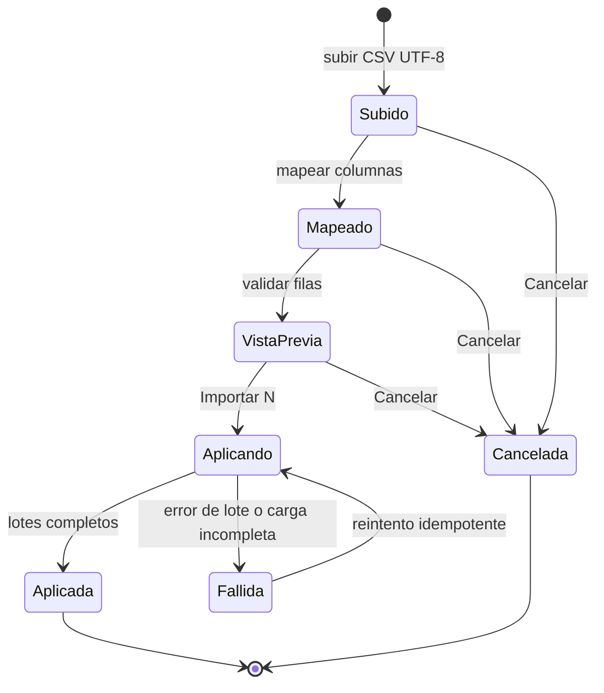
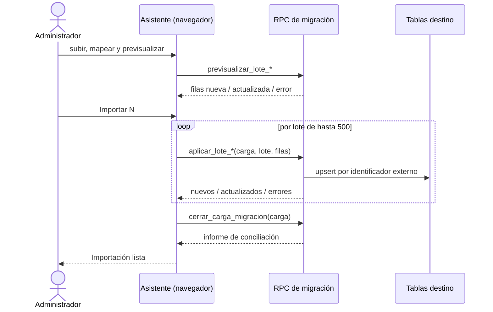

# Migración inicial de datos: modelo, RPC y operación

**Épica:** MSF-142 · **Spec:** `20261023-120000-migracion-inicial-de-datos` (rama
`epic/MSF-142-clientes-y-proveedores-migracion-inicial`, pendiente de merge a `main` en este
repositorio).

El asistente corre en el navegador (`apps/web/src/pages/migracion/`): lee el CSV, permite mapear,
muestra la vista previa y envía las filas por lotes a RPC de Postgres. **No hay worker, Kestra ni
Superset**: 135 proveedores y la base de clientes no justifican una pieza de infraestructura nueva
(spec, *Delivery scope*). Todo el estado vive en Supabase.

El plan de corte, los responsables y los criterios de aceptación de negocio están en
[Migración inicial de datos (producto)](../producto/migracion-inicial-de-datos.md).

## Modelo

| Objeto | Esquema | Estado | Para qué | Migración |
|---|---|---|---|---|
| `migracion_cargas` | `public` | nueva | Cabecera de cada ejecución: entidad, archivo, filas del origen, estado, contadores, actor. | `20261201100000_migracion_cargas.sql` |
| `migracion_filas` | `public` | nueva | Resultado por fila; base de la idempotencia y de los errores. | `20261201100000_migracion_cargas.sql` |
| `clientes` / `clientes_identificadores_externos` | `public` | existentes (MSF-180) | Destino de la carga de clientes; el vínculo usa `sistema = 'panel_actual'`. | `20261201100000_migracion_cargas.sql` (sin DDL) |
| `clientes_empresas` | `public` | existente (F-CLI-05) | Un cliente nuevo queda habilitado en todas las tiendas de la organización. | `20261201100000_migracion_cargas.sql` (sin DDL) |
| `proveedores` | `dominio` | alterada | Gana `id_externo` (nullable, único por organización cuando tiene valor). | `20261201110000_proveedores_id_externo.sql` |
| `productos` | `dominio` | existente | La carga de vínculos fija `proveedor_id` y `codigo_proveedor`; sin cambios de esquema. | `20261201110000_proveedores_id_externo.sql` (sin DDL) |
| `archivo_ingresos_mercaderia` | `dominio` | nueva | Historial de ingresos del panel anterior, de solo lectura. | `20261201120000_archivo_ingresos_mercaderia.sql` |
| `informe_conciliacion_migracion` | `public` | función nueva | Informe por carga; no crea tablas. | `20261201130000_migracion_conciliacion.sql` |

Leyenda y `erDiagram` completo en **[Datos y DER](datos.md#migracion-inicial-de-datos-msf-142)**.

### `migracion_cargas` y `migracion_filas`

- `migracion_cargas.entidad` solo admite `clientes`, `proveedores`,
  `vinculos_proveedor_producto` e `ingresos_archivo`; `estado` es `en_curso`, `aplicada` o `fallida`.
  Guarda `filas_total`, contadores (`nuevos`, `actualizados`, `con_error`), `error`, `actor_id`,
  `created_at` y `cerrada_en`.
- `migracion_filas` es única por `(carga_id, fila)` y guarda `lote`, `estado`
  (`nueva` | `actualizada` | `error`), `identificador_externo` y `motivo`. `fila` es el número de fila
  del archivo contando el encabezado como fila 1.
- Las dos tablas tienen RLS por organización y solo se leen como Administrador
  (`private.puede_escribir()`); no hay grants de escritura para `authenticated`. Toda escritura pasa
  por las RPC `security definer`.

### `dominio.proveedores.id_externo`

Columna aditiva, nullable, con índice único parcial `proveedores_org_id_externo_uidx` sobre
`(organizacion_id, id_externo) where id_externo is not null`. No se toca el `id` ni el CUIT.

### `dominio.archivo_ingresos_mercaderia`

`id`, `organizacion_id`, `id_externo`, `fecha`, `producto` (texto), `cantidad` (entero > 0),
`proveedor` (texto, nullable), `operador` (texto, nullable), `carga_id` (nullable) y `creado_en`.
Único por `(organizacion_id, id_externo)`. Sin FK a productos, proveedores, depósitos ni a
`dominio.ingresos_mercaderia`: **no mueve stock** ni se mezcla con los ingresos vivos.

## Contrato del archivo CSV

Todas las plantillas se descargan desde el asistente, son **CSV UTF-8 con encabezado** y usan estas
columnas (definiciones en `apps/web/src/pages/migracion/entidades/`):

| Entidad | Plantilla | Columnas | Obligatorias |
|---|---|---|---|
| Clientes | `clientes.csv` | Identificador del panel actual, Nombre o razón social, DNI / CUIT, Tipo de cliente, Correo, Teléfono, Celular, Dirección, CP, Localidad, Provincia, Expreso preferido | Identificador y Nombre |
| Proveedores | `proveedores.csv` | Identificador del panel actual, Razón social, CUIT, Persona de contacto, Correo, Teléfono, Dirección, Observaciones | Identificador, Razón social y CUIT |
| Vínculos | `vinculos-proveedor-producto.csv` | SKU del producto, Identificador del proveedor en el panel actual, Código del proveedor (opcional) | SKU e identificador del proveedor |
| Ingresos anteriores | `ingresos-anteriores.csv` | Identificador del panel actual, Fecha, Producto, Cantidad, Proveedor, Operador | Identificador, Fecha, Producto y Cantidad |

Reglas de aplicación (migraciones `20261201100000`…`20261201120000`):

- **Identidad de la fila = identificador externo.** Si ya existe, **actualiza**; si no, **crea**. La
  clave de clientes es `clientes_identificadores_externos` con `sistema = 'panel_actual'`; en
  proveedores, `dominio.proveedores.id_externo`; en ingresos, `(organizacion_id, id_externo)`.
- **Reaplicar no duplica.** Una fila ya aplicada en la misma carga se omite; el lote es atómico y el
  reintento completa lo pendiente.
- **Repetido dentro del mismo archivo:** gana la primera fila aplicada; las siguientes se marcan con
  error («El identificador está repetido en el archivo»). En vínculos se compara el SKU sin distinguir
  mayúsculas.
- **Celdas vacías no borran datos.** En una actualización, las columnas no mapeadas o vacías conservan
  el valor existente. En ingresos, `proveedor` y `operador` vacíos conservan el valor anterior
  (`coalesce`); para vaciarlos hay que enviar un valor explícito.
- **Clientes:** mismas validaciones del alta MSF-180 (nombre, documento único por organización, tipo)
  más el identificador obligatorio. El `numero` lo asigna el sistema; no se mapea (D4). El cliente
  nuevo se habilita en todas las tiendas de la organización.
- **Proveedores:** mismas validaciones de MSF-205 (CUIT con dígito verificador módulo 11 y único por
  organización, incluidos los desactivados). Un CUIT de otro proveedor es error de fila; no se fusiona.
- **Vínculos:** el SKU debe existir en el catálogo y el proveedor estar cargado y activo. No se crean
  productos ni proveedores. Si el producto cambia de proveedor y el código viene vacío, el código
  anterior se limpia.
- **Ingresos:** `fecha` acepta `AAAA-MM-DD` o `DD/MM/AAAA`; `cantidad` es un entero > 0; producto,
  proveedor y operador se guardan como texto.
- **Unicidad global en clientes:** `clientes_identificadores_externos` es único por
  `(sistema, identificador_externo)` en toda la base, no por organización. Si otra organización ya
  usa ese identificador, la fila se rechaza con un mensaje genérico (no se revela de quién es).

## RPC

Todas son `public.*`, `security definer`, `set search_path = ''`, validan Administrador
(`private.puede_escribir()`) y toman la organización de `private.organizacion_id()`. Llevan
`revoke execute … from public, anon` y `grant execute … to authenticated`. El lote máximo es **500
filas** (`54000` si se supera); una carga inexistente o de otra organización responde `P0002`; un rol
sin permiso, `42501`; datos inválidos, `22023`.

| RPC | Firma | Qué hace |
|---|---|---|
| `iniciar_carga_migracion` | `(p_entidad text, p_archivo text, p_filas_total integer) returns uuid` | Crea la cabecera en `en_curso` y devuelve su id. |
| `previsualizar_lote_clientes` | `(p_filas jsonb) returns jsonb` | Clasifica filas (nueva / actualizada / error + motivo) **sin escribir**. |
| `aplicar_lote_clientes` | `(p_carga uuid, p_lote integer, p_filas jsonb) returns jsonb` | Upsert por identificador externo; crea el vínculo y habilita tiendas; registra cada fila. |
| `previsualizar_lote_proveedores` | `(p_filas jsonb) returns jsonb` | Igual, para proveedores. |
| `aplicar_lote_proveedores` | `(p_carga uuid, p_lote integer, p_filas jsonb) returns jsonb` | Upsert por `id_externo`. |
| `previsualizar_lote_vinculos_proveedor_producto` | `(p_filas jsonb) returns jsonb` | Valida SKU y proveedor sin escribir. |
| `aplicar_lote_vinculos_proveedor_producto` | `(p_carga uuid, p_lote integer, p_filas jsonb) returns jsonb` | Fija `productos.proveedor_id` y `codigo_proveedor`. |
| `previsualizar_lote_archivo_ingresos` | `(p_filas jsonb) returns jsonb` | Valida fecha, cantidad y repetidos sin escribir. |
| `aplicar_lote_archivo_ingresos` | `(p_carga uuid, p_lote integer, p_filas jsonb) returns jsonb` | Upsert del archivo; **no toca stock**. |
| `cerrar_carga_migracion` | `(p_carga uuid) returns jsonb` | Cuenta desde `migracion_filas`, marca `aplicada` (todas las filas con resultado) o `fallida`, y devuelve el informe. Repetible. |
| `informe_conciliacion_migracion` | `(p_carga uuid) returns jsonb` | Solo lee y devuelve el informe de conciliación; repetible. |

`aplicar_lote_*` devuelve `{ nuevos, actualizados, omitidos, errores: [{ fila, motivo }] }`. Si un
error inesperado revierte el lote entero; los errores de datos de una fila se registran y las demás
siguen.

## Flujo





### Informe de conciliación

`informe_conciliacion_migracion` devuelve `origen.filas`, `cargado.{nuevos, actualizados,
con_error, omitidos}`, `diferencia`, `destino.{verificadas, diferencia}`, `conciliado` y hasta 200
errores. `conciliado` es `true` solo si la carga está `aplicada` y las dos diferencias son 0. La
verificación contra el destino comprueba:

| Entidad | Tabla destino |
|---|---|
| Clientes | `clientes_identificadores_externos` (`panel_actual`) |
| Proveedores | `dominio.proveedores.id_externo` |
| Vínculos | `dominio.productos` con SKU y algún proveedor asignado |
| Ingresos | `dominio.archivo_ingresos_mercaderia.id_externo` |

En vínculos la verificación exige que el SKU exista con **algún** proveedor, no que sea el del
archivo (alcance acotado documentado en la migración).

## Pantallas

- **Asistente:** `/migracion/importar/:entidad` (`apps/web/src/pages/migracion/importar.tsx`), con
  las entidades `clientes`, `proveedores`, `vinculos-proveedor-producto` e `ingresos_archivo`
  (`entidades/registro.ts`). Sin Administrador muestra «Sin permiso»; una entidad desconocida muestra
  un error.
- **Informes:** `/migracion/informes` y `/migracion/informes/:carga`
  (`apps/web/src/pages/migracion/informes.tsx`).
- **Entradas:** «Importar» en Clientes y Proveedores (solo Administrador) y, al terminar proveedores,
  el enlace para seguir con los vínculos.
- **Archivo:** segunda pestaña de **Stock › Ingreso de mercadería**, componente
  `apps/web/src/components/stock/ArchivoIngresos.tsx` con `useArchivoIngresos` (25 filas por página,
  orden `fecha desc, id asc`, estados de carga/vacío/error). Es de solo consulta.
- **Empresa activa:** no aplica filtrado por empresa; el lote y el archivo son de la organización.
  Cambiar la empresa no cambia el destino ni recarga datos de otra. Test: cambio de empresa durante el
  asistente y en la pestaña.

## Permisos y seguridad

| Acción | Requisito |
|---|---|
| Importar, ver cargas e informes | Administrador (`private.puede_escribir()`); `42501` si no. |
| Consultar el archivo de ingresos | `private.nivel_seccion('stock')` en `lectura` o `edicion`. |
| Escribir el archivo o las cargas | Solo las RPC de migración; no hay grants de escritura para `authenticated`. |
| `anon` | Sin ejecución de RPC y sin privilegios sobre las tablas nuevas. |

- La organización sale siempre de la sesión, nunca de un parámetro. Otra organización recibe `P0002`
  y no ve datos aunque repita el identificador externo.
- El navegador usa la sesión del Administrador: **no se usa service-role** en ninguna pantalla ni
  librería de migración.
- El informe no devuelve datos de la fila, solo número y motivo; la UI no vuelca el error crudo (PII).
- `archivo_ingresos_mercaderia` tiene RLS de solo `select`; la política no admite `insert`, `update`
  ni `delete`.
- Revisión de seguridad del conjunto (SC-006) en la spec: sin hallazgos abiertos.

## Ensayo y evidencia

El ensayo es la prueba pgTAP `supabase/tests/database/migracion_ensayo.test.sql`. Corre el
procedimiento completo dos veces sobre los mismos archivos sintéticos, en el orden del corte
(clientes → proveedores → vínculos → archivo), y verifica: cuatro cargas conciliadas, segunda corrida
sin duplicados, stock sin cambios y aislamiento entre organizaciones. Imprime las líneas
`# EVIDENCIA corrida 1/2: {...}` con el informe de cada entidad.

```bash
pnpm dev:supabase
supabase test db --local supabase/tests/database/migracion_ensayo.test.sql
supabase test db --local supabase/tests/database/migracion_conciliacion.test.sql
```

El CI corre los pgTAP con `pnpm test:db`. Al armar la historia el entorno local no tenía
Docker/Supabase, así que la corrida verificada de pgTAP es la del CI del PR; los Vitest sí se
corrieron localmente.

| Cobertura | Archivos |
|---|---|
| pgTAP clientes | `supabase/tests/database/migracion_clientes.test.sql` (upsert, idempotencia, documento repetido, rol, `anon`, aislamiento). |
| pgTAP proveedores | `supabase/tests/database/migracion_proveedores.test.sql` (idempotencia, CUIT, SKU inexistente, aislamiento, rol, `anon`). |
| pgTAP archivo | `supabase/tests/database/archivo_ingresos.test.sql` (escritura directa rechazada, stock e ingresos intactos, idempotencia, aislamiento). |
| pgTAP conciliación y ensayo | `supabase/tests/database/migracion_conciliacion.test.sql`, `migracion_ensayo.test.sql`. |
| Vitest | `apps/web/src/lib/migracion.test.ts`, `migracionCsv.test.ts`, `paginas/migracion/*.test.tsx`, `entidades/*.test.ts`, `components/stock/ArchivoIngresos.test.tsx` y guarda de fixtures sintéticas. |

## Operación

- **Datos:** solo producción tiene datos reales. En git, tests y PR solo hay fixtures inventados;
  una guarda falla si aparece un correo fuera de los dominios reservados o un documento con forma de
  dato real.
- **Orden y prerrequisitos:** ver el plan de corte en
  [Migración inicial de datos (producto)](../producto/migracion-inicial-de-datos.md#el-dia-del-corte).
- **Reintento:** la misma carga se puede reintentar; las filas ya aplicadas se omiten y el resto se
  completa. Reimportar un archivo corregido actualiza por identificador externo.
- **Vuelta atrás de una carga:** el registro `migracion_filas` (estado `nueva`) lista lo creado. Los
  clientes y proveedores se desactivan o corrigen por su pantalla; el archivo se corrige con un CSV
  nuevo. La copia de seguridad previa cubre la vuelta atrás del corte completo.
- **Límites conocidos:** el informe muestra hasta 200 errores (la pantalla avisa «Mostrando X de N»);
  el lote es de 500 filas; no se lee `.xlsx`; la unicidad del identificador de clientes es global por
  sistema; el archivo no reemplaza la carga inicial de stock (F-STK-07).

## Reversión

Migraciones aditivas; la reversión va en una migración posterior y **no** borra los datos ya
cargados. El encabezado de cada archivo trae los comandos:

- `20261201100000`: `drop function` de `iniciar_carga_migracion`, `previsualizar_lote_clientes`,
  `aplicar_lote_clientes`, `cerrar_carga_migracion` y las funciones privadas; luego
  `drop table public.migracion_filas, public.migracion_cargas;` (exportar antes `migracion_filas`).
- `20261201110000`: `drop function` de previsualizar/aplicar de proveedores y vínculos;
  `alter table dominio.proveedores drop column id_externo;` (en un PR posterior al que la crea).
- `20261201120000`: `drop function` de previsualizar/aplicar del archivo y las funciones privadas;
  `drop table dominio.archivo_ingresos_mercaderia;` (exportando antes los datos).
- `20261201130000`: `drop function public.informe_conciliacion_migracion(uuid);`.

> **Revisión de fuentes:** 2026-10-25 23:00 — se revisaron las fuentes de esta página (specs, prototipos, migraciones y código) y su contenido no cambia.
