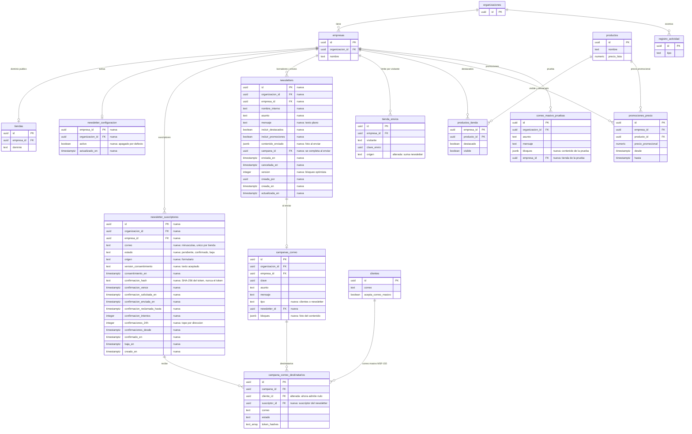
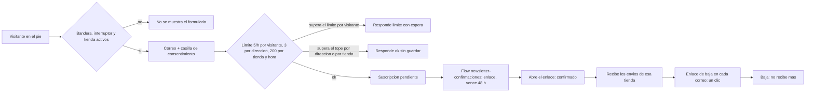
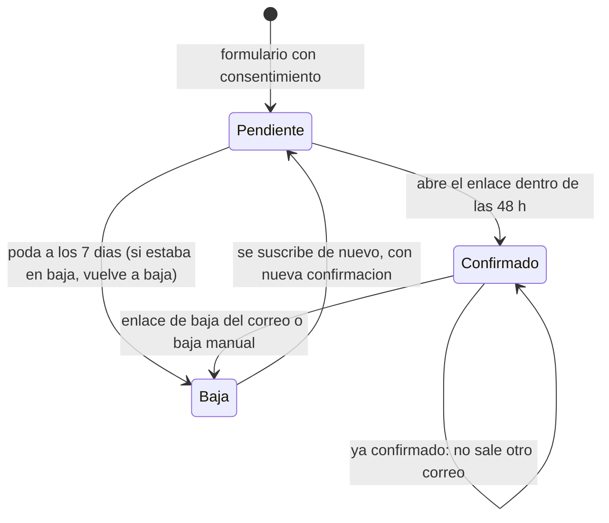
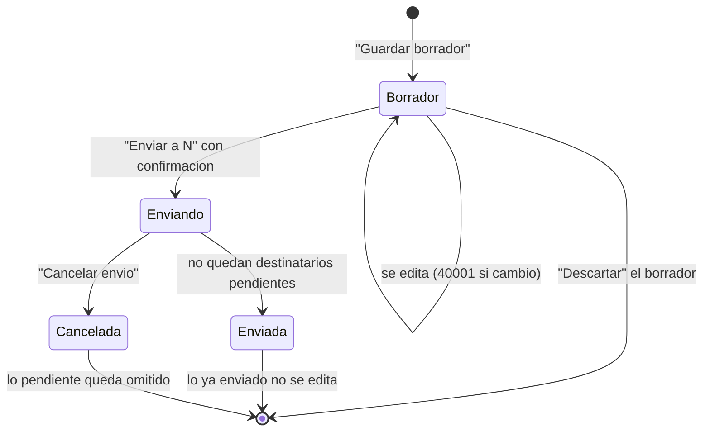

# Newsletter de la tienda (MSF-468)

**Épica:** MSF-468 · **Componente:** Tiendas online · **Spec:** `newsletter-de-la-tienda`
(`specs/20270328-100000-newsletter-de-la-tienda/`) · **Alcance de entrega:** `refine`, `supabase` y
`kestra` (sin `superset` ni `workers`) · **Hito:** Etapa 2 · **Prioridad:** P2 (provisoria).

**Estado: implementada y apagada.** Las fases 1 a 5 de `tasks.md` están hechas (T001–T030). De la fase 6
(cierre) está la documentación (T031) y quedan el E2E (T032), la revisión de seguridad (T033), el encendido
en dev (T034) y los guards finales (T035, parcial). La función **nace apagada por defecto**: sin la bandera
`newsletter` encendida y el interruptor de la tienda, el pie no muestra el formulario y no sale ningún
correo.

> **Dónde está el código.** Toda la épica vive en la rama de integración **`dokploy`** (PRs
> [#1042](https://github.com/nicolasjones/multistorefront-meli/pull/1042) «fases 1 y 2» y
> [#1057](https://github.com/nicolasjones/multistorefront-meli/pull/1057) «fases 3 a 6»); al escribir esta
> página `main` no tenía ninguna migración, RPC, ruta, flow ni test de newsletter (solo el prototipo en
> `design/pantallas/`). Cuando la épica se promueva a `main`, hay que volver a verificar las referencias.

Resumen para quien usa el panel: [Newsletter de la tienda](../producto/newsletter.md).

## Evidencia del estado

| Qué se buscó | Resultado |
|---|---|
| Spec de la épica | `specs/20270328-100000-newsletter-de-la-tienda/` (`spec.md`, `plan.md`, `tasks.md`, `contracts/newsletter.md`), escrita sobre la decisión de Nicolás del 2026-11-15. Commits `78987302`, `6f7dc08c`, `b439b3b5`. |
| Implementación | Rama `dokploy`: `34255829` y `56d504c3` (fases 1 y 2), `d5568f40` (endurecimiento del correo), `e8635e5f`, `57ae5602`, `432db86d` (fases 3 a 5), `0cbd6710` (documentación), merges `1f98829f` (PR #1042) y `0e743157` (PR #1057). |
| Migraciones | 11 migraciones aditivas, todas con su reversión en el encabezado: `20270342000000_newsletter_suscripcion.sql`, `20270342000100_newsletter_publico.sql`, `20270342000200_newsletter_confirmaciones.sql`, `20270342000300_exportacion_total_newsletter.sql`, `20270420000000_newsletter_baja_y_gestion.sql`, `20270420000100_newsletters.sql`, `20270420000200_exportacion_total_newsletters.sql`, `20270420000300_newsletter_bloques_y_prueba.sql`, `20270420000400_newsletter_envio.sql`, `20270420000500_newsletter_lote.sql`, `20270420000600_newsletter_correo_sin_llaves.sql`. |
| Front | `apps/web/src/pages/clientes/newsletter/` (`index.tsx`, `DialogoNuevaCampana.tsx`, `VistaPreviaNewsletter.tsx`, `index.test.tsx`), `apps/web/src/lib/newsletter.ts`, `apps/web/src/lib/tiendaNewsletter.ts`, `apps/web/src/hooks/useNewsletterTienda.ts`, `apps/web/src/pages/tienda-publica/newsletter/FormularioSuscripcion.tsx`, `apps/web/src/pages/tienda-publica/rutas/newsletter.confirmar.tsx` y `newsletter.baja.tsx`; ruta lazy `/clientes/newsletter` en `apps/web/src/App.tsx`; entrada de menú en `apps/web/src/components/navegacion/destinosPanel.ts`. |
| Flows | `infra/kestra/flows/newsletter-confirmaciones.yml` (nuevo) y `infra/kestra/flows/correo-masivo.yml` (extendido con la plantilla del newsletter). |
| Pruebas | pgTAP: `newsletter_suscripcion`, `newsletter_bandera`, `newsletter_aislamiento`, `newsletter_baja`, `newsletter_gestion`, `newsletter_composicion`, `newsletter_envio`, `newsletter_lote`, `newsletter_correo_llaves` y extensiones de `tienda_contacto`, `tienda_capacidades`, `exportacion_total` y `correo_masivo_*`. Vitest: `pages/clientes/newsletter/index.test.tsx`, `lib/newsletter.test.ts`, `lib/tiendaNewsletter.test.ts`, `lib/tiendaNewsletterBaja.test.ts`, `FormularioSuscripcion.test.tsx`, `newsletter.confirmar.test.tsx`, `newsletter.baja.test.tsx`. Kestra: `newsletter-confirmaciones.test.mjs`, `correo-masivo.test.mjs`. Edge: `baja-correo-masivo` sin cambios de contrato. |
| E2E | **No existe**: `apps/web/e2e/tienda-newsletter.e2e.ts` no se escribió (T032, seguimiento MSF-978). |
| Prototipo | `design/pantallas/Newsletter.dc.html` e `design/pantallas/Newsletter.inventory.json`. |

## Dependencias y reutilización

| Épica | Qué se reutiliza | Nota |
|---|---|---|
| MSF-189 · Avisos y listas configurables | El proveedor de correo (SMTP de Kestra) y el patrón de cola con reclamo y reintentos. **No** las preferencias por usuario: esas son avisos al equipo y no sirven para suscriptores externos. | Ver [Avisos y listas](avisos-y-listas.md). |
| MSF-155 · Correo masivo a clientes | El motor de envío entero: `dominio.campanas_correo`, `dominio.campana_correo_destinatarios`, `dominio.correo_masivo_pruebas`, `private.reclamar_lote_correo_masivo`, la Edge Function `baja-correo-masivo`, el flow `correo-masivo.yml`, el cupo diario por organización y la baja por hash. | El newsletter **comparte motor** con el correo a clientes pero **otra lista y otro consentimiento**. Ver [Correo masivo a clientes](correo-masivo-a-clientes.md). |
| MSF-212 · Formulario de contacto de la tienda | El límite por visitante (`private.visitante_hash`, `private.registrar_envio_tienda`) y la superficie pública anónima (`publico.*`). | El origen `newsletter` comparte el cupo de 5 por hora con el contacto y WhatsApp. |

## Apagado por defecto

Dos llaves, y **ninguna se toca por migración**:

```sql
-- 1) bandera de plataforma (equipo técnico o Nicolás; dev → stg → prd)
update public.banderas_plataforma set activa = true where clave = 'newsletter';

-- 2) interruptor por tienda (Administrador, desde la pantalla «Mostrar suscripción en el pie de la tienda»)
insert into dominio.newsletter_configuracion (empresa_id, organizacion_id, activo)
values (:empresa_id, :organizacion_id, true)
on conflict (empresa_id) do update set activo = true;
```

Con cualquiera de las dos apagadas: el pie no muestra el formulario, `publico.suscribirse_newsletter`
responde `error` (idéntico para host desconocido, tienda desactivada, interruptor apagado y bandera
apagada), `publico.confirmar_newsletter` responde `invalido` y el reclamo de confirmaciones no entrega
nada. Las RPC de escritura del panel responden `55000`; **la baja y el borrado de datos funcionan
siempre**. El interruptor apagado no es lo mismo que la tienda desactivada: `enviar_newsletter` exige
además interruptor (`22023`, hint `tienda_apagada`) y dominio activo (`sin_dominio`).

## Modelo de datos

| Tabla | Estado | Cambio |
|---|---|---|
| `dominio.newsletter_configuracion` | nueva | Una fila por tienda: `empresa_id` (PK), `organizacion_id`, `activo` (apagado por defecto), `actualizado_en`. |
| `dominio.newsletter_suscriptores` | nueva | Suscriptor de una tienda: `correo` (recortado, en minúsculas, ≤ 254, forma estricta), `estado` (`pendiente` \| `confirmado` \| `baja`), `origen` (`formulario`), `version_consentimiento`, `consentimiento_en`, `confirmacion_hash` (SHA-256; el token nunca se guarda), `confirmacion_vence`, `confirmacion_solicitada_en`, `confirmacion_enviada_en`, `confirmacion_reclamada_hasta`, `confirmacion_intentos`, `confirmaciones_24h`, `confirmaciones_desde`, `confirmado_en`, `baja_en`, `creado_en`. Único `(empresa_id, lower(correo))`. |
| `dominio.newsletters` | nueva | Borrador o envío de una tienda: `nombre_interno` (≤ 100), `asunto` (≤ 200, sin saltos de línea), `mensaje` (≤ 10 000), `incluir_destacados`, `incluir_promociones`, `contenido_enviado` (jsonb, la foto), `campana_id`, `enviada_en`, `cancelada_en`, `version` (bloqueo optimista), `creada_por`, `creada_en`, `actualizada_en`. |
| `dominio.campanas_correo` | alterada | `tipo` (`clientes` \| `newsletter`), `newsletter_id` (FK), `bloques` (jsonb, la foto del contenido). |
| `dominio.campana_correo_destinatarios` | alterada | `cliente_id` pasa a admitir nulo y se suma `suscriptor_id`, con `check (num_nonnulls(cliente_id, suscriptor_id) <= 1)` y único `(campana_id, suscriptor_id)`. |
| `dominio.correo_masivo_pruebas` | alterada | `bloques` (jsonb) y `empresa_id` (la tienda de la prueba). |
| `dominio.tienda_envios` | alterada | El `check` de `origen` suma `newsletter` (límite por visitante). |
| `public.banderas_plataforma` | alterada | Fila `newsletter`, **apagada**. |
| `dominio.empresas` | existente | Tienda: nombre, remitente y dueña de todo lo anterior. |
| `dominio.tiendas` | existente | Dominio público de la tienda (arma los enlaces de confirmación y baja). |
| `public.clientes` | existente | Sin cambios: **no** se enlaza con los suscriptores (D5 de la spec). |
| `dominio.productos_tienda` | existente | `destacado` por tienda: fuente de la sección «Productos destacados». |
| `dominio.productos` | existente | Nombre, precio e imagen del producto mostrado. |
| `dominio.promociones_precio` | existente | Fuente de la sección «Promociones vigentes». |
| `public.registro_actividad` | existente | Eventos `newsletter.*` (sin correos ni textos). |
| `public.organizaciones` | existente | Organización dueña de todo. |



`clientes` aparece sin relación con `newsletter_suscriptores` a propósito (D5 de la spec): el newsletter
**no** se puebla con los clientes existentes.

**Exportación total.** `dominio.newsletter_configuracion`, `dominio.newsletter_suscriptores` y
`dominio.newsletters` entran en la allow-list `private.conjuntos_exportacion_total()`. La exportación
deriva todas las columnas: por eso `confirmacion_hash` (SHA-256 del token de confirmación) queda **fuera**
del volcado y con él no se puede confirmar ninguna suscripción.

## Contratos

### RPC públicas de la tienda (esquema `publico`; las únicas ejecutables por `anon`)

| Función | Entrada | Respuesta |
|---|---|---|
| `publico.newsletter_por_dominio(p_host text)` | host de la tienda | `{ activo: boolean, tienda: text \| null }`; `activo` solo con bandera, interruptor y tienda activos. |
| `publico.suscribirse_newsletter(p_host, p_correo, p_consentimiento, p_clave, p_trampa)` | correo, casilla, clave por intento, campo trampa | `{ resultado: 'ok' }` \| `{ resultado: 'invalido', campos: [...] }` \| `{ resultado: 'limite', espera_segundos: n }` \| `{ resultado: 'error' }`. |
| `publico.confirmar_newsletter(p_host, p_token)` | host y token | `{ resultado: 'ok' \| 'vencido' \| 'invalido' \| 'limite' }`. |

Reglas: la validación corre **antes** del límite (un correo inválido no consume cupo); `p_consentimiento`
debe ser `true`; `p_trampa` no vacío responde `ok` sin guardar; la respuesta es idéntica para dirección
nueva, existente o en baja (no se enumeran suscriptores); nunca devuelven ids, hash, IP ni el estado de
la dirección. `confirmar_newsletter` **también** consume el límite por visitante (5 por hora) y puede
responder `limite`: es el único agregado al contrato de la spec.

### RPC del panel (esquema `public`, `security definer`, `search_path = ''`)

| Función | Permiso | Devuelve |
|---|---|---|
| `resumen_newsletter(p_empresa uuid default null)` | lectura en `clientes` | `{ confirmados, pendientes, bajas, envios, bandera, tiendas }`. |
| `listar_suscriptores_newsletter(p_empresa, p_estado, p_texto, p_pagina default 1, p_tamano default 25)` | lectura en `clientes` | `{ total, filas }`; búsqueda literal por correo; tamaño ≤ 100. |
| `guardar_newsletter_configuracion(p_empresa, p_activo)` | Administrador | `{ empresa_id, activo }`; `55000` con la bandera apagada. |
| `dar_de_baja_suscriptor_newsletter(p_suscriptor uuid)` | Administrador | `{ ok }`; idempotente; omite lo pendiente. |
| `borrar_datos_suscriptor_newsletter(p_suscriptor uuid)` | Administrador | `{ ok }`; elimina la fila y deja `[eliminado]`; funciona con la bandera apagada. |
| `guardar_newsletter(p_id, p_version, p_empresa, p_nombre, p_asunto, p_mensaje, p_destacados, p_promociones)` | Administrador y acceso a la tienda | `{ id, version }`; `40001` si cambió; `55000` si ya se envió. |
| `descartar_newsletter(p_id uuid)` | Administrador | `{ ok }`; solo borradores. |
| `detalle_newsletter(p_id uuid)` | lectura en `clientes` | Borrador o envío con la foto enviada y los totales. |
| `vista_previa_newsletter(p_empresa, p_mensaje, p_destacados, p_promociones)` | Administrador | `{ cuerpo_html, confirmados, generado_en }`. |
| `solicitar_prueba_newsletter(p_empresa, p_asunto, p_mensaje, p_destacados, p_promociones)` | Administrador | `{ ok }`; tope de 5 por hora. |
| `enviar_newsletter(p_id uuid, p_version integer, p_clave uuid)` | Administrador y acceso a la tienda | `{ campana_id, destinatarios }`; `22023` con hint `sin_destinatarios`; idempotente por clave. |
| `cancelar_envio_newsletter(p_id uuid)` | Administrador | `{ cancelados }` (los pendientes pasan a `omitido`). |
| `listar_newsletters(p_empresa, p_estado, p_pagina, p_tamano)` | lectura en `clientes` | `{ total, filas }`; estados `borrador`, `enviando`, `enviada`, `cancelada`. |

### Funciones internas (`private`)

| Función | Quién la ejecuta | Qué hace |
|---|---|---|
| `private.empresa_newsletter_activa(p_host)` | funciones `security definer` | Devuelve la empresa de la tienda del host solo si están la bandera, el interruptor y la tienda activos. |
| `private.validar_suscripcion_newsletter(p_correo, p_consentimiento)` | funciones `security definer` | Valida el correo (forma estricta) y el consentimiento; devuelve los campos con error. |
| `private.version_consentimiento_newsletter()` | — | Versión del texto de consentimiento vigente (`newsletter-v1`). |
| `private.tope_confirmaciones_hora_newsletter()` | — | Tope global por tienda: 200 confirmaciones nuevas por hora. |
| `private.reclamar_confirmaciones_newsletter(p_lote, p_vence_seg)` | `kestra_orquestacion` | Poda `pendiente` > 7 días; reclama confirmaciones; genera el token (solo se guarda su hash) con vencimiento de 48 h. |
| `private.cerrar_confirmacion_newsletter(p_suscriptor, p_resultado, p_error)` | `kestra_orquestacion` | Idempotente; marca `confirmacion_enviada_en` o deja el reintento. |
| `private.armar_bloques_newsletter(p_empresa, p_destacados, p_promociones)` | funciones `security definer` | Arma la foto del contenido: hasta 6 destacados y 6 promociones vigentes, con el precio público de la tienda y el enlace a la ficha. |
| `private.escapar_html(p_texto)` / `private.cuerpo_html_newsletter(p_mensaje, p_bloques, p_tienda, p_enlace_baja)` | funciones `security definer` | Escapan el texto y arman el HTML del correo (secciones, pie fijo, enlace de baja). |
| `private.remitente_newsletter(p_nombre)` | — | Sanea el nombre de la tienda para el encabezado `From`. |
| `private.reclamar_lote_correo_masivo(p_lote, p_limite_diario, p_vence_seg)` | `kestra_orquestacion` | Redefinida: re-verifica `confirmado`, bandera, interruptor y tienda activa; devuelve `tipo`, `cuerpo_html`, `remitente`, `tienda` y `dominio_tienda`. |

**Cambio incompatible (BREAKING) declarado en la spec:** `private.reclamar_lote_correo_masivo` suma
columnas a su conjunto de retorno. La firma no cambia; el `returns table` sí, y el flow que lo consume se
actualiza en el mismo PR.

La Edge Function `baja-correo-masivo` **no** cambia de contrato (`{ token }` → `{ ok: true }`): el hash se
resuelve contra clientes o suscriptores.

## Flujos







### Kestra

- **`newsletter-confirmaciones`** (nuevo, namespace `producto.clientes`): cada minuto reclama con
  `private.reclamar_confirmaciones_newsletter(lote, 900)`, envía por SMTP (`KESTRA_SMTP_*`, sin proveedor
  nuevo) con el nombre de la tienda como remitente visible y un enlace
  `https://{dominio}/newsletter/confirmar/{token}`, y cierra con `private.cerrar_confirmacion_newsletter`.
  Reintenta 4 veces con espera creciente (30 s, 60 s, 2 min) y, si persiste, deja la confirmación sin
  enviar con un motivo fijo (nunca el mensaje del SMTP) y reintenta en el ciclo siguiente hasta 4 veces.
  Variable nueva: `NEWSLETTER_CONFIRMACION_LOTE` (20). Rol de base: `kestra_orquestacion`, con `EXECUTE`
  solo sobre las dos funciones del flow.
- **`correo-masivo`** (existente): si la fila trae `tipo = 'newsletter'`, usa el `cuerpo_html` ya armado por
  la base y el `remitente` con el nombre de la tienda; el correo de clientes sale **idéntico** a hoy.
  El flujo muestra el HTML con `| raw` porque la base ya lo escapó.

### Permisos, RLS y actividad

- RLS por `organizacion_id` en las tres tablas nuevas; política `select` para `authenticated` con
  `private.nivel_seccion('clientes')` en lectura o edición y `empresa_id in (private.empresas_accesibles())`.
- `revoke all` a `public`, `anon` y `authenticated`; `grant select` **por columna** a `authenticated`,
  **sin `confirmacion_hash`** ni el estado interno del reclamo. `anon` sin privilegios sobre tablas.
- Toda escritura pasa por RPC `security definer` con `search_path = ''`; `revoke … from public, anon` y
  `grant execute … to authenticated` explícitos en cada RPC nueva (salvo las `publico`, que solo ejecutan
  `anon`).
- El acceso a la tienda elegida se comprueba **dentro de la RPC** (`42501`; otra organización, `P0002`).
  La UI solo oculta: componer, guardar, enviar, cancelar, dar de baja y borrar datos exigen rol
  Administrador con edición en `clientes`.
- **Invariante de destinatarios (MSF-967):** toda lista o conteo filtra `estado = 'confirmado'`, nunca
  `<> 'baja'`. Un `pendiente` que conserva `baja_en` no cuenta ni recibe nada.
- Eventos de Actividad (`apps/web/src/lib/actividad.ts`), sin correos, mensajes ni cuerpo:
  `newsletter.configurar`, `.guardar`, `.prueba`, `.enviar` (asunto y cantidad), `.cancelar`, `.baja`
  (solo la primera vez), `.baja_manual`, `.datos_borrados`.

### Empresa activa

La pantalla filtra suscriptores, campañas y números por la empresa activa y la preselecciona como «Tienda
remitente»; con «Todas mis empresas» muestra todas con la columna «Tienda» (la columna aparece solo en ese
caso). Al cambiar de empresa se invalidan y recargan **todas** las consultas (resumen, suscriptores y
campañas), las listas vuelven a la página 1 y se descartan filtros y selecciones inválidos. Un **diálogo
abierto se cierra con aviso** («Cambiaste de empresa: se cerró la campaña sin guardar») y nunca guarda ni
envía con la empresa anterior; un borrador guardado no se pierde. El pie, la página de confirmación y la
de baja son públicas: **«Empresa activa: no aplica»** (las resuelve el dominio de la tienda).

## Límites y comportamientos que hay que tener en cuenta

- **Forma estricta del correo**: parte local `atom(.atom)*` con `atom = [a-z0-9'+_=&*#$?^~-]+` (sin llaves
  desde la migración `20270420000600`, sin `%`, `!`, `|`, `/`, ni punto inicial, final o doble; local ≤ 64),
  dominio con etiquetas alfanuméricas y TLD de dos o más letras (acepta punycode `xn--`, no acepta IP),
  total ≤ 254, en minúsculas. Sin `<`, `>`, comillas, paréntesis, `\`, `:`, `,` ni `;`. El mismo criterio
  rige en el `check` de la tabla, en el validador y en `lib/tiendaNewsletter.ts`.
- **Tope global por tienda (riesgo aceptado, MSF-971):** máximo 200 confirmaciones nuevas por hora y
  tienda (`private.tope_confirmaciones_hora_newsletter()`). Superado, la suscripción no se guarda ni se
  envía y la respuesta sigue siendo `ok`: **las altas legítimas se descartan en silencio** hasta una hora.
  Es un riesgo de disponibilidad (DoS) aceptado en estas fases; la mitigación prevista es CAPTCHA o un
  cupo separado por visitante, más una alerta al alcanzar el tope (no hay alerta todavía).
- **Límite por visitante compartido:** 5 por hora por visitante HMAC y tienda, el mismo del formulario de
  contacto y de WhatsApp. `confirmar_newsletter` también lo consume. Quienes comparten IP pueden quedar
  bloqueados por un rato.
- **Tope por dirección:** 3 confirmaciones por dirección y 24 h. No ve los alias de proveedor (`+tag`,
  puntos de Gmail, catch-all): el tope global por tienda es lo que acota ese caso.
- **Re-suscripción:** si la dirección ya está `pendiente` con un enlace vigente, un nuevo pedido responde
  `ok` pero no emite otro correo ni pisa el hash. Si estaba en `baja`, vuelve a `pendiente` con nuevo
  consentimiento y el enlace anterior deja de valer; `baja_en` se conserva hasta que se confirme y, si
  nunca se confirma, la poda de 7 días la devuelve a `baja` (lista de supresión).
- **Envío «al menos una vez»** (heredado de MSF-155): si Kestra se corta entre enviar y cerrar, el reclamo
  vence y el correo puede salir de nuevo.
- **Plantillas de Kestra (defensa en profundidad):** `infra/kestra/compose.yaml` fija
  `kestra.templating.recursive-rendering: false`; **hay que verificar en cada entorno** (dev, stg, prd)
  que la configuración efectiva lo respete, porque no se pudo comprobar contra un Kestra real. Además,
  `private.escapar_html` convierte `{` y `}` del cuerpo en entidades, el remitente pierde llaves, comillas,
  `<`, `>` y caracteres de control, y el reclamo omite («Correo inválido») a cualquier destinatario, de
  clientes o suscriptores, cuyo correo tenga `{` o `}`. Siguen crudos el `subject` y el `mensaje` del
  correo a clientes: vienen de quien tiene edición en Clientes y solo serían un riesgo con el renderizado
  recursivo activo.

## Desvíos respecto de la spec (declarados en las tareas)

| Desvío | Qué se hizo | Por qué |
|---|---|---|
| **Entrada de menú** | El ítem quedó en **Contactos → Newsletter** (`destinosPanel.ts`), no en «Canales» como dibuja el prototipo (`AdminSider.dc.html:123`) y como fijaba la decisión D19 de la spec. | La decisión D16 (ruta y audiencia) y la implementación prevalecieron sobre lo visual. **Contradicción con el prototipo sin resolver.** |
| **Listados por cursor → por tandas** | `listar_suscriptores_newsletter` y `listar_newsletters` usan `p_pagina`/`p_tamano` (25 por defecto, ≤ 100), no el cursor `(creado_en, id)` de la spec. | La carga infinita del panel ya resuelve las tandas con `useListadoAcumulado`. |
| **Un solo renderizado** | El HTML lo arma `private.cuerpo_html_newsletter`; la vista previa lo muestra en un `iframe sandbox=""` y el flow lo recibe ya armado. No hay plantilla de React y plantilla de Kestra que puedan divergir. | Se eliminó la causa del riesgo en lugar de testear la paridad (T023). |
| **Sin imágenes en el correo** | `imagen_url` queda nulo en la foto del contenido. | El bucket de productos es privado y un correo no puede llevar una URL firmada de larga vida. Queda pendiente de decisión. |
| **Columna «Aperturas»** | No se construyó (la tabla de campañas muestra enviados/fallidos/omitidos/bajas). | Decisión D9 de la spec: no hay pixel de rastreo. |
| **`private.cerrar_envio_correo_masivo`** | No se redefinió. | No hacía falta: cierra por id de destinatario o de prueba. |
| **Archivo de prueba nuevo** | `newsletter_lote.test.sql` en lugar de extender `correo_masivo_lote.test.sql`. | Este sigue verde sin cambios: es la paridad con las campañas de clientes. |
| **axe en un solo ancho** | Se corrió sobre la pantalla en un tamaño (jsdom no cambia de ancho ni calcula contraste); 320/768/1440 px quedan para el E2E. | Seguimiento MSF-961 (y MSF-978 para el E2E). |
| **`confirmar_newsletter` con `limite`** | Devuelve `{ resultado: 'limite', espera_segundos }` cuando el visitante superó el cupo por hora. | Único agregado al contrato de la spec; la página lo muestra como «Probá de nuevo en unos minutos». |

## Guía de prueba técnica

**Sin video:** no hay una pantalla filmada de esta función (la capacidad está apagada y el E2E no existe).
La verificación es a nivel de base de datos (pgTAP), de la interfaz (Vitest) y de los flows (Kestra), con
rótulos por tarea.

### Prerrequisitos

- Entorno con la rama `dokploy` desplegada: `pnpm dev:supabase` + `pnpm dev:refine:host` (o DEV). En
  `main` **no hay nada** de esta épica: los pasos de abajo no se pueden ejecutar ahí.
- Un usuario **Administrador** (para componer y enviar) y otro con solo **lectura** en `clientes`.
- Una tienda con dominio activo y con productos publicados (para la foto del contenido).
- El flow `newsletter-confirmaciones` y el `correo-masivo` publicados en Kestra, con `KESTRA_SMTP_*` y
  `NEWSLETTER_CONFIRMACION_LOTE` configurados; en local el correo se lee en **Mailpit**.
- La bandera `newsletter` **encendida** y el interruptor de la tienda **encendido** para las pruebas de
  envío; para probar la bandera apagada, apagarla.

### Pasos

1. **Bandera apagada (SQL).** `update public.banderas_plataforma set activa = false where clave =
   'newsletter';` y, en la tienda, `select activo from dominio.newsletter_configuracion where empresa_id =
   :empresa_id;` (sin fila = apagado). Con la bandera apagada, `select publico.newsletter_por_dominio(:host)`
   devuelve `activo = false` y `select publico.suscribirse_newsletter(:host, 'a@b.com', true, :clave, '')`
   devuelve `resultado = 'error'` **sin** guardar nada ni gastar cupo. Ver rótulo `[MSF-468:T004]`.
2. **Suscripción (pgTAP o RPC).** Con la bandera y el interruptor encendidos, subscribirse con un correo
   válido y la casilla marcada devuelve `ok`; con la casilla sin marcar o un correo inválido devuelve
   `invalido` con los campos; con el campo trampa lleno devuelve `ok` sin guardar. La fila queda `pendiente`
   con `consentimiento_en` y **sin** IP ni nombre: `select estado, correo, version_consentimiento,
   confirmacion_hash is not null as tiene_hash from dominio.newsletter_suscriptores;`. Ver
   `[MSF-468:T002]`.
3. **Confirmación (pgTAP y página).** El flow reclama la confirmación, manda el correo con el enlace
   `https://{dominio}/newsletter/confirmar/{token}` y guarda **solo** el SHA-256. Abrir el enlace lleva a
   la página «Listo, ya estás suscripto»; uno vencido dice «El enlace venció»; uno mal formado dice
   «Enlace inválido»; abrirlo dos veces responde «Listo» las dos. Ver `[MSF-468:T003]` y
   `[MSF-468:T010]`.
4. **Baja (pgTAP y página).** Con la Edge Function `baja-correo-masivo`, `select
   public.dar_de_baja_correo_masivo(:hash)` deja el suscriptor en `baja` **conservando el correo** y
   registra el evento una sola vez; la página `/newsletter/baja/:token` pide un clic y responde siempre
   igual. Ver `[MSF-468:T013]` y `[MSF-468:T014]`.
5. **Gestión (pgTAP).** Con solo lectura en `clientes`, `guardar_newsletter_configuracion`,
   `dar_de_baja_suscriptor_newsletter` y `borrar_datos_suscriptor_newsletter` responden `42501`; con la
   bandera apagada responden `55000` salvo el borrado de datos. `borrar_datos_suscriptor_newsletter`
   borra la fila y deja `correo = '[eliminado]'` en los envíos pasados. Ver `[MSF-468:T015]`.
6. **Composición (pgTAP).** `guardar_newsletter` crea el borrador con `version = 1`; llamarlo otra vez con
   la versión vieja devuelve `40001`; sobre un envío ya enviado devuelve `55000`. `vista_previa_newsletter`
   devuelve el `cuerpo_html` con el texto escapado, hasta 6 destacados y 6 promociones vigentes (con el
   precio público de la tienda) y el número de **confirmados**. `solicitar_prueba_newsletter` deja el
   correo en `dominio.correo_masivo_pruebas` con `bloques` y `empresa_id`, con prefijo «[Prueba]» y un
   tope de 5 por hora. Ver `[MSF-468:T019]`, `[MSF-468:T020]` y `[MSF-468:T021]`.
7. **Envío (pgTAP).** `enviar_newsletter` con la versión vigente crea **una** campaña `tipo = 'newsletter'`
   con los confirmados de esa tienda y devuelve `{ campana_id, destinatarios }`; llamarlo de nuevo con la
   misma clave devuelve la misma campaña (idempotencia); sin confirmados devuelve `22023` con hint
   `sin_destinatarios`; `cancelar_envio_newsletter` deja lo pendiente `omitido` y lo ya enviado sigue. Ver
   `[MSF-468:T025]`.
8. **Lote (pgTAP).** El reclamo re-verifica `estado = 'confirmado'`: un suscriptor dado de baja o un
   `pendiente` con `baja_en` queda `omitido` y no recibe nada. El cupo diario es el mismo para clientes y
   newsletter. `correo_masivo_lote.test.sql` sigue verde sin cambios: es la paridad con MSF-155. Ver
   `[MSF-468:T026]`.
9. **Aislamiento (pgTAP).** Una suscripción de la tienda A no se ve desde la B ni desde otra organización;
   el administrador de otra organización no envía ni cancela (`P0002`). Ver `[MSF-468:T005]` y
   `[MSF-468:T029]`.
10. **Empresa activa (Vitest).** Con la pantalla abierta, cambiar la empresa en la barra superior recarga
    el resumen, los suscriptores y las campañas con la empresa nueva, vuelve a la página 1 y **cierra el
    diálogo con aviso** sin llamar a `guardar_newsletter` ni a `enviar_newsletter`. Ver `[MSF-468:T016]` y
    `[MSF-468:T022]`.

### Resultado esperado

- **Given** la bandera apagada, **when** un visitante intenta suscribirse, **then** la respuesta es la misma
  que con un host desconocido y no queda ninguna fila.
- **Given** una suscripción `pendiente`, **when** se abre el enlace dentro de las 48 h, **then** pasa a
  `confirmado`; **when** se pasa el plazo, **then** la página dice «El enlace venció».
- **Given** un suscriptor `confirmado`, **when** el Administrador envía un newsletter, **then** solo lo
  reciben los confirmados de esa tienda, el correo lleva su propio enlace de baja y la campaña figura con
  sus totales.
- **Given** un suscriptor dado de baja, **when** hay un envío en curso, **then** lo pendiente queda
  `omitido` y no recibe nada.
- **Given** un cambio de empresa activa con el diálogo abierto, **then** el diálogo se cierra con aviso y no
  se guarda ni se manda nada con la empresa anterior.

### Cómo automatizarlo

| Rótulo | Qué cubre | Dónde | Estado |
|---|---|---|---|
| `[MSF-468:T002]` | Suscripción pública: validación, consentimiento obligatorio, trampa, respuesta uniforme, `anon` limitado a las tres `publico`. | pgTAP `newsletter_suscripcion.test.sql` | Hecho. |
| `[MSF-468:T003]` | Confirmaciones: reclamo, token nuevo por envío, hash, vencimiento de 48 h, reintento y poda a los 7 días. | pgTAP `newsletter_suscripcion.test.sql` | Hecho. |
| `[MSF-468:T004]` | Bandera apagada: `activo = false`, `error` uniforme, nada guardado ni cupo gastado. | pgTAP `newsletter_bandera.test.sql` | Hecho. |
| `[MSF-468:T005]` | Aislamiento entre organizaciones y entre tiendas; RLS y `anon` endurecidos; cupo compartido con el contacto. | pgTAP `newsletter_aislamiento.test.sql`, `tienda_contacto.test.sql` | Hecho. |
| `[MSF-468:T006]` | Exportación total: las dos tablas de suscripción se exportan sin `confirmacion_hash`. | pgTAP `exportacion_total.test.sql` | Hecho. |
| `[MSF-468:T009]` | Formulario del pie: estados, error por campo, límite con espera y reintento con la misma clave. | Vitest `FormularioSuscripcion.test.tsx` | Hecho (axe a tres anchos pendiente, MSF-961). |
| `[MSF-468:T010]` | Página de confirmación: «Listo, ya estás suscripto», «El enlace venció», «Enlace inválido», reintento. | Vitest `newsletter.confirmar.test.tsx` | Hecho. |
| `[MSF-468:T013]` | Baja de suscriptor: queda en `baja`, conserva el correo, evento una sola vez; las campañas de clientes no cambian. | pgTAP `newsletter_baja.test.sql` | Hecho. |
| `[MSF-468:T014]` | Página de baja: un clic confirma y repetirla responde igual. | Vitest `newsletter.baja.test.tsx` | Hecho. |
| `[MSF-468:T015]` | Pantalla: KPI, tablas, filtros, interruptor por tienda, acciones solo del Administrador. | Vitest `pages/clientes/newsletter/index.test.tsx` | Hecho. |
| `[MSF-468:T016]` | Empresa activa: recargan todas las consultas y el diálogo se cierra con aviso. | Vitest `index.test.tsx` | Hecho. |
| `[MSF-468:T019]` | Composición: borrador, `40001` por versión vieja, `55000` si ya se envió, descartar. | pgTAP `newsletter_composicion.test.sql` | Hecho. |
| `[MSF-468:T020]` | Foto del contenido: hasta 6 destacados y 6 promociones, bandera de promociones, precio público, tope de 5 pruebas por hora. | pgTAP `newsletter_composicion.test.sql` | Hecho (sin imágenes). |
| `[MSF-468:T025]` | Envío: solo confirmados, `sin_destinatarios`, idempotencia por clave, cancelar, totales y estados. | pgTAP `newsletter_envio.test.sql` | Hecho. |
| `[MSF-468:T026]` | Lote: re-verificación del suscriptor, cupo compartido, cancelado no reenvía, paridad con las campañas de clientes. | pgTAP `newsletter_lote.test.sql` | Hecho. |
| `[MSF-468:T032]` | Recorrido completo: suscribir, confirmar, componer, previsualizar, enviar a un suscriptor de prueba y darse de baja. | E2E `apps/web/e2e/tienda-newsletter.e2e.ts` | **No existe** (MSF-978). |
| `[MSF-468:T033]` | Revisión de seguridad de las RPC `publico`, la baja, los flows y los secretos de SMTP. | Informe del PR con `authz-security` y `crypto-secrets` | **Pendiente**. |
| `[MSF-468:T034]` | Encendido en dev con los flows publicados y SMTP real: suscripción, confirmación, prueba y envío. | Consulta SQL y capturas en la nota de cierre | **Pendiente** (acción de Nicolás). |

## Qué falta y quién lo debe resolver

| Pendiente | Dueño | Evidencia |
|---|---|---|
| Publicar en Kestra el flow `correo-masivo` actualizado y el `newsletter-confirmaciones` antes de encender la bandera | Operaciones / Plataforma | T034; sin el flow nuevo, un newsletter saldría con la plantilla de clientes. |
| Encender la bandera en dev y verificar el recorrido completo con SMTP real (suscripción, confirmación, prueba, envío y baja) | Nicolás / Documentador | T034: **no hay video ni capturas** de esta función. |
| E2E del recorrido (`apps/web/e2e/tienda-newsletter.e2e.ts`) | QA / Playwright | T032; seguimiento MSF-978. |
| axe a 320/768/1440 px del formulario, del diálogo y de la pantalla | QA | T009 y T021; seguimiento MSF-961. |
| Revisión de seguridad de la épica (`authz-security`, `crypto-secrets`) | Quien revisa el PR | T033: **sin informe**. |
| `List-Unsubscribe` / `List-Unsubscribe-Post` | Operaciones | T011: no se pudo verificar si `MailSend` de Kestra admite encabezados propios. Seguimiento MSF-962. |
| CORS de la Edge Function `baja-correo-masivo` | Operaciones | T011: responde `Access-Control-Allow-Origin: *` y acepta los encabezados de `supabase-js`, así que no hizo falta tocarlo. Seguimiento MSF-963. |
| Imágenes en el correo | Producto / Plataforma | `imagen_url` queda nulo: hay que decidir entre un bucket público de miniaturas o una URL firmada de larga vida. |
| Cupo diario separado del newsletter y alerta al alcanzar el tope global | Producto | D14 y MSF-971: hoy el cupo es uno solo entre clientes y newsletter. |
| CAPTCHA de la suscripción | Producto | Solo si hay abuso real. |
| Rate limit en el borde de la baja (Edge Function anónima) | Plataforma | MSF-980: los tokens son de 244 bits y la respuesta es uniforme, pero la función no limita por visitante. |
| Verificar `kestra.templating.recursive-rendering: false` en dev, stg y prd | Operaciones | Fijado en `infra/kestra/compose.yaml`; no se pudo comprobar contra un Kestra real. |
| Reubicar el ítem de menú a «Canales» o actualizar el prototipo | Producto | Desvío abierto: la implementación lo puso en **Contactos** y el prototipo lo dibuja en **Canales**. |
| Mergear la épica a `main` | Spec Kit | Todo vive en `dokploy`: en `main` no hay migraciones, RPC, rutas, flows ni tests. |

## Reversión

Inmediata, sin código: `update public.banderas_plataforma set activa = false where clave = 'newsletter';`
(el pie deja de mostrar el formulario y el flow no envía; lo pendiente queda intacto y retoma al
encenderla). La baja y el borrado de datos siguen funcionando.

Migraciones posteriores (nunca en el mismo PR que las crea), en el orden inverso de las fases: `drop
function` de las funciones de `20270342000100` y `20270342000200`; `drop table
dominio.newsletter_suscriptores` y `dominio.newsletter_configuracion` (exportar antes los suscriptores si
hace falta); borrar la fila de la bandera; restaurar la definición de `private.conjuntos_exportacion_total()`
vigente antes de las tablas del newsletter; restaurar el `check` de `tienda_envios.origen` de
`20270321100000`. Para las fases 3 a 5 (`20270420…`): `drop function` de las RPC `newsletter` y de las
`private` (`armar_bloques_newsletter`, `cuerpo_html_newsletter`, `escapar_html`, `remitente_newsletter`,
`exigir_admin_newsletter`); restaurar `reclamar_lote_correo_masivo`, `dar_de_baja_correo_masivo`,
`listar_campanas_correo` y `detalle_campana_correo` a sus cuerpos de `20270201200122`/`…123`;
`alter table … drop column` de las columnas nuevas de las tres tablas del correo masivo (solo tras borrar o
migrar las filas `tipo = 'newsletter'`); `drop table dominio.newsletters`; la migración `…0600` se revierte con
`drop constraint newsletter_suscriptores_correo_llaves_ck` y restaurando el validador de `20270342000100`.
Cada migración lleva su reversión en el encabezado.

## Capturas

TODO (dueño: Documentador): cuando la función se encienda en dev (T034), generar las capturas con
`pnpm docs:capturas` (specs en `apps/web/e2e/capturas/`) y referenciarlas en
`docs/producto/img/newsletter/`. No se inventa una imagen del prototipo.

## Referencias

- Spec, plan, tareas y contratos: `specs/20270328-100000-newsletter-de-la-tienda/` (`spec.md`, `plan.md`,
  `tasks.md`, `contracts/newsletter.md`).
- Prototipo: `design/pantallas/Newsletter.dc.html:97-126` (pantalla y diálogo) y
  `design/pantallas/Newsletter.inventory.json`.
- Entrada de menú en el prototipo: `design/pantallas/AdminSider.dc.html:123`.
- Paridad pantalla↔prototipo:
  `specs/20261017-193000-paridad-pantallas/inventario-pantallas-prototipo.md:48`.
- Roadmap: `docs/system-design/roadmap.md:34-38`.
- Motor de envío: [Correo masivo a clientes](correo-masivo-a-clientes.md) · proveedor de correo y cola:
  [Avisos y listas](avisos-y-listas.md) · empresa activa: [Empresa activa](../empresa-activa.md) ·
  datos: [Datos y DER](datos.md).
