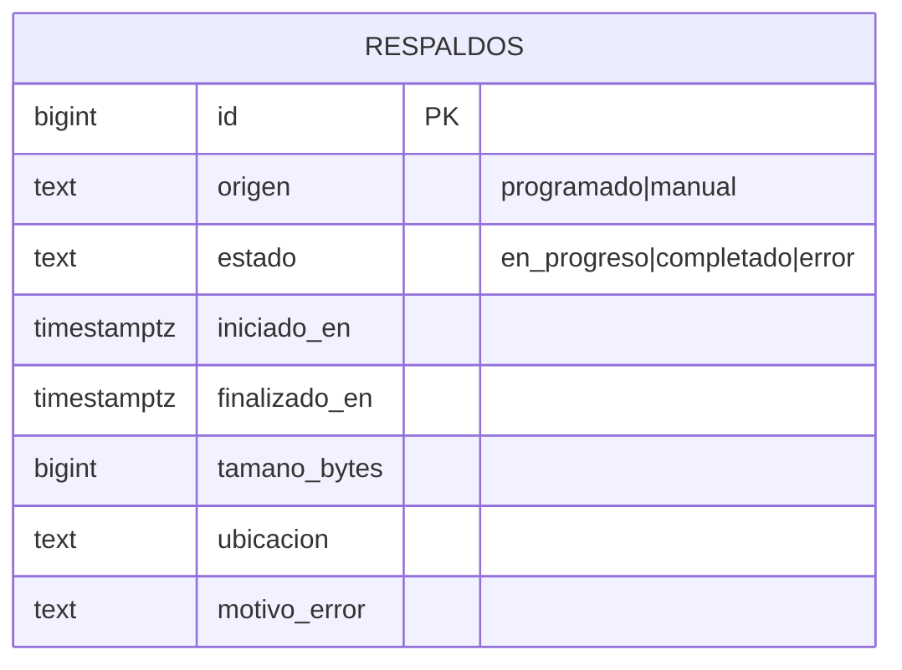

# Operación, copias y documentación (MSF-457) · técnico

Nota de producto: [Plataforma · Operación, copias y documentación](../producto/operacion-copias-y-documentacion.md).

> **Estado al 2026-11-18:** la épica MSF-457 tiene spec propia (`specs/20261018-120000-operacion-copias-y-documentacion`) y
> migración propia (`supabase/migrations/20261018120000_copias_imagenes_y_verificaciones.sql`). Esta página describe la base
> original (spec 011); el detalle vigente de imágenes, retención, verificación de restauración y alertas está en
> [Copias de seguridad y restauración](../copias-y-restauracion.md).

## Base existente: respaldo de Postgres (spec 011)

- **Flow:** `infra/kestra/flows/respaldo-postgres.yml`, namespace `platform.backups`, input `origen`
  (`manual` por defecto; el trigger lo fija en `programado`), cron `0 3 * * *`.
- **Pasos:** `iniciar_respaldo` → `pg_dump --format=custom` (contenedor `postgres:17-alpine` vía Docker task
  runner) → `verificar_respaldo` (no vacío y cabecera `PGDMP`) → `finalizar_respaldo_completado`. Ante
  fallo, el bloque `errors` llama `finalizar_respaldo_error` salvo que haya fallado `iniciar_respaldo`.
- **Datos:** tabla `public.respaldos` (`id`, `origen`, `estado` ∈ `en_progreso|completado|error`,
  `iniciado_en`, `finalizado_en`, `tamano_bytes`, `ubicacion`, `motivo_error`) con un `check` de
  consistencia por estado y un índice único parcial que impide dos `en_progreso`. Migración
  `supabase/migrations/20260913140000_backups_postgres.sql`.
- **Acceso:** el rol `kestra_backups` sólo ejecuta `iniciar_respaldo`, `finalizar_respaldo_completado` y
  `finalizar_respaldo_error`; `authenticated` sólo tiene `select` sobre `respaldos`. El volcado usa una
  conexión aparte (`KESTRA_BACKUPS_PGDUMP_URL`).
- **Pruebas:** `supabase/tests/database/backups_postgres.test.sql`.
- **Operación:** [Restaurar base](runbooks/db-restore.md) y [Operación](operacion.md#backups-y-recuperacion).

## Lo que la épica agregó sobre la spec 011

| Ítem | Estado | Dónde |
|---|---|---|
| Retención por días con tope (base: 30 días + 12 mensuales; fotos de imágenes: 7 días, 2 mensuales, tope 7) | Implementado | `infra/kestra/flows/retencion-copias.yml` (04:30) |
| Copia de imágenes de Storage (tabla `public.respaldos_imagenes`) | Implementado; el destino es el mismo servidor (riesgo asumido), migrable a S3/B2/SFTP solo con variables | `infra/kestra/flows/respaldo-imagenes.yml` (03:15) |
| Verificación periódica de restauración (tabla `public.verificaciones_restauracion`) en un Postgres descartable sin red; falla ante cualquier error no esperado | Implementado | `infra/kestra/flows/verificar-restauracion.yml` (lunes 05:00) |
| Aviso por correo ante fallo y alerta de ausencia de copias (30 h) | Implementado; requiere configurar `KESTRA_SMTP_*` y `SOPORTE_CORREO` y probar el correo | `aviso-fallo-copias.yml`, `alerta-ausencia-respaldos.yml` (06:30) |
| Purga del almacenamiento interno de Kestra (dump publicado como archivo de salida) | Implementado | `purgar-almacenamiento-kestra.yml` (04:45) y `PurgeCurrentExecutionFiles` en `finally` |
| Simulacro de restauración medido (RPO 24 h / RTO 4 h propuestos) | **Pendiente de ejecución** en staging | [simulacro-restauracion.md](../simulacro-restauracion.md) |
| Documentación funcional y técnica completa (F-OPS-05) | Se cierra al estar las funciones de todos los componentes; `pnpm docs:check` ya exige docs por cambio | — |

Cualquier migración que cree esta épica debe ser aditiva o documentar su reversión, y ubicar cada tabla
por Principio VII (plataforma → `public`).
