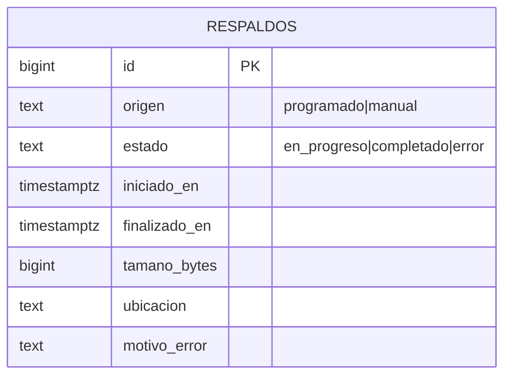

# Operación, copias y documentación (MSF-457) · técnico

Nota de producto: [Plataforma · Operación, copias y documentación](../producto/operacion-copias-y-documentacion.md).

> **Estado al 2026-10-30:** la épica MSF-457 **no tiene spec ni migraciones propias** en el repo. Esta
> página describe la base existente (spec 011) sobre la que se construye y lista lo pendiente.

## Base existente: respaldo de Postgres (spec 011)

- **Flow:** `infra/kestra/flows/respaldo-postgres.yml`, namespace `platform.backups`, input `origen`
  (`manual` por defecto; el trigger lo fija en `programado`), cron `0 3 * * *`.
- **Pasos:** `iniciar_respaldo` → `pg_dump --format=custom` (contenedor `postgres:17-alpine` vía Docker task
  runner) → `verificar_respaldo` (no vacío y cabecera `PGDMP`) → `finalizar_respaldo_completado`. Ante
  fallo, el bloque `errors` llama `finalizar_respaldo_error` salvo que haya fallado `iniciar_respaldo`.
- **Datos:** tabla `public.respaldos` (`id`, `origen`, `estado` ∈ `en_progreso|completado|error`,
  `iniciado_en`, `finalizado_en`, `tamano_bytes`, `ubicacion`, `motivo_error`) con un `check` de
  consistencia por estado y un índice único parcial que impide dos `en_progreso`. Migración
  `supabase/migrations/20260913140000_backups_postgres.sql`.
- **Acceso:** el rol `kestra_backups` sólo ejecuta `iniciar_respaldo`, `finalizar_respaldo_completado` y
  `finalizar_respaldo_error`; `authenticated` sólo tiene `select` sobre `respaldos`. El volcado usa una
  conexión aparte (`KESTRA_BACKUPS_PGDUMP_URL`).
- **Pruebas:** `supabase/tests/database/backups_postgres.test.sql`.
- **Operación:** [Restaurar base](runbooks/db-restore.md) y [Operación](operacion.md#backups-y-recuperacion).

## Pendiente de la épica (sin implementar)

| Ítem | Dueño | Nota |
|---|---|---|
| Retención 30 diarias + 12 mensuales | tecnico | Propuesta; spec 011 la excluyó. Definir con el cliente |
| Copia de imágenes de Storage fuera del proyecto Supabase | tecnico | Roadmap #43 |
| Verificación periódica de restauración y simulacro medido (RPO 24 h / RTO 4 h propuestos) | operacion | Roadmap #6; resultado firmado por la persona propietaria |
| Aviso por correo ante fallo | producto | Bloqueado por elegir proveedor de correo |
| Documentación funcional y técnica completa (F-OPS-05) | producto | Se cierra al estar las funciones de todos los componentes; `pnpm docs:check` ya exige docs por cambio |
| Dependencia | — | Bloqueada por MSF-455 (ambientes de prueba y producción) |

Cualquier migración que cree esta épica debe ser aditiva o documentar su reversión, y ubicar cada tabla
por Principio VII (plataforma → `public`).
