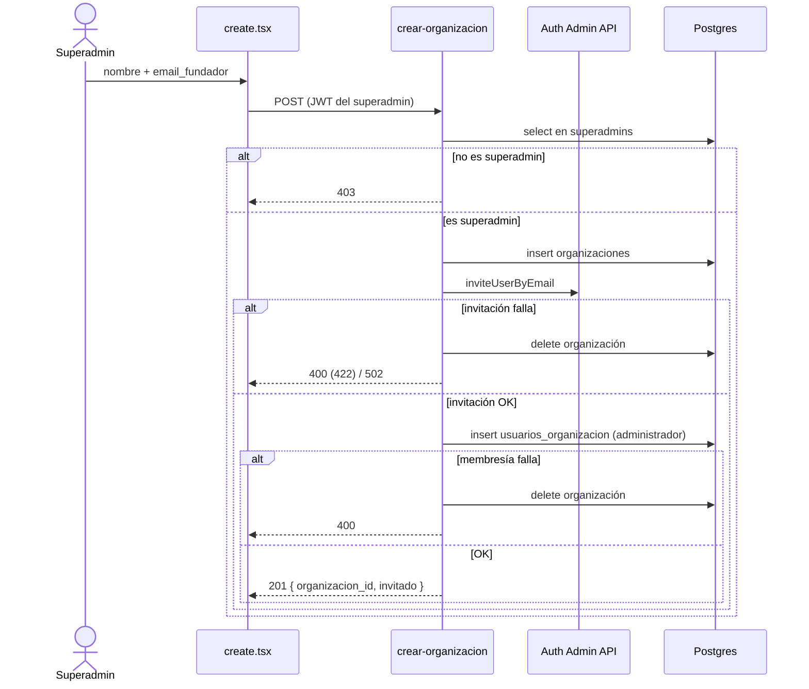

# Organizaciones nuevas: alta, contrato y pruebas (MSF-162)

Épica MSF-162 (F-ORG-02). Spec: `specs/20261016-130000-organizaciones-nuevas/`.
El alta ya existía en el template: esta épica **verifica y documenta** el flujo, sin migraciones
ni cambios de modelo. Alcance de entrega: `refine` (pantallas existentes) y `supabase` (pruebas
pgTAP).

## Componentes

| Pieza | Rol | Archivo |
|---|---|---|
| Listado `/organizaciones` | Lista las organizaciones y permite «Ingresar» como superadmin | `apps/web/src/pages/organizaciones/list.tsx` |
| Alta `/organizaciones/create` | Formulario nombre + correo del fundador; invoca la Edge Function | `apps/web/src/pages/organizaciones/create.tsx` |
| Gate de UI | Oculta las pantallas a quien no es superadmin (la seguridad real está en la función/RPC) | `apps/web/src/hooks/useIsSuperadmin.ts` |
| Edge Function `crear-organizacion` | Única vía de alta; usa la service-role key del lado servidor | `supabase/functions/crear-organizacion/index.ts` |
| Lógica de la función | Validaciones, alta, invitación, membresía y reversión | `supabase/functions/crear-organizacion/handler.ts` |
| Rutas y recurso | Registra `organizaciones` como recurso y las rutas de listado/alta | `apps/web/src/App.tsx:183` |

El listado usa `public.entrar_a_organizacion(org_id)` para que un superadmin entre a una
organización y navega a `/clientes` (`list.tsx`). Esa RPC es del template
(`supabase/migrations/20260908172920_fundacion_multitenant.sql`), con `execute` solo para
`authenticated` (`supabase/migrations/20261013110000_endurecer_rpc_acceso.sql`).

## Contrato de `crear-organizacion`

- **Método y ruta:** `POST /functions/v1/crear-organizacion`.
- **Autorización:** header `Authorization: Bearer <JWT>` del llamador. La función identifica al
  llamador con su JWT (`admin.auth.getUser`) y exige una fila en `public.superadmins`; no usa la
  service-role para identificar a la persona.
- **Cuerpo:** `{ "nombre": string, "email_fundador": string }` (se recortan los espacios).
- **Respuestas:**

| Código | Cuándo | Cuerpo |
|---|---|---|
| `201` | Alta correcta | `{ organizacion_id, invitado }` |
| `400` | Método distinto de `POST`, JSON inválido, faltan `nombre`/`email_fundador`, falla el `insert` de la organización, falla la membresía, o el correo ya tiene cuenta (GoTrue `422` traducido) | `{ error }` |
| `403` | Falta `Authorization`, token inválido/expirado, o el llamador no es superadmin | `{ error }` |
| `502` | La invitación falla por un error de envío (no `422`) | `{ error }` |

`OPTIONS` responde `ok` con los headers CORS (`handler.ts`).

## Flujo y reversión

1. La pantalla verifica `useIsSuperadmin`; si no lo es, muestra un aviso y no hay formulario.
2. `create.tsx` invoca la función con `supabaseClient.functions.invoke`; un error HTTP muestra el
   `error` devuelto por la función.
3. La función valida al llamador, inserta en `organizaciones` y pide a la Auth Admin API
   (`inviteUserByEmail`) la invitación del fundador.
4. Con el usuario invitado, inserta la membresía en `usuarios_organizacion` con
   `rol_id = 'administrador'`.
5. Si la invitación o la membresía fallan, **borra la organización recién creada** y responde el
   motivo; no queda una organización huérfana.

## Datos y aislamiento

Sin tablas nuevas ni alteradas: `organizaciones`, `usuarios_organizacion` y `superadmins` viven en
`public` (plataforma). El detalle del modelo y su DER está en [Datos y DER](datos.md#acceso-y-membresía-msf-119).

- `usuarios_organizacion.user_id` es **clave primaria**: un usuario pertenece a una sola
  organización. El fundador de una organización nueva debe ser un correo sin cuenta; si ya la
  tiene, la invitación responde `422` y el alta se revierte (`handler.ts`).
- No hay policy ni privilegio de `INSERT` en `organizaciones` para `authenticated` ni `anon`: la
  única vía es la función con `service_role`. `service_role` sí tiene `INSERT` en `organizaciones`
  y `usuarios_organizacion`.
- El fundador queda aislado: ve solo su organización y su membresía, no puede escribir datos en
  otra organización y las demás no ven la nueva. La regla general está en
  [Aislamiento por organización](../aislamiento-por-organizacion.md).

## Pruebas

| Prueba | Qué cubre | Comando |
|---|---|---|
| `supabase/functions/crear-organizacion/handler.test.ts` | Escenarios 1–3: alta + fundador administrador, `403` a no-superadmin/token inválido, reversión por `422`, error de envío (`502`) y fallo de membresía | `pnpm test:edge:crear-organizacion` |
| `apps/web/src/pages/organizaciones/create.test.tsx` | Gate de superadmin, estado de carga, éxito con navegación y error visible | `pnpm --filter @platform/web test` |
| `supabase/tests/database/alta_organizacion_nueva.test.sql` | Escenario 4: la organización nueva queda aislada, sin `INSERT` por API, un usuario una organización; `plan(12)` | `pnpm test:db` |

La función se prueba con clientes simulados mediante el handler extraído; `index.ts` solo cablea
los clientes reales (`handler.ts`, `index.ts`).

## Operación

- La función necesita `SUPABASE_URL` y `SUPABASE_SERVICE_ROLE_KEY` en su entorno
  (`supabase/functions/crear-organizacion/index.ts`). La service-role **nunca** llega al navegador.
- Si la función no está desplegada, la pantalla de alta falla al invocarla; no hay alta por
  PostgREST.
- La invitación la envía Supabase Auth; el alta no crea contraseña ni cuenta desde el panel.

## Fuera de alcance

Un usuario en varias organizaciones, selector de organización para usuarios normales, cambio de la
clave de `usuarios_organizacion`, autoservicio, facturación propia y pantallas nuevas. Las empresas
de la organización nueva las crea su administrador con la pantalla de Empresas existente.

Ver también: [Alta de nuevas organizaciones (producto)](../alta-de-organizaciones.md).
