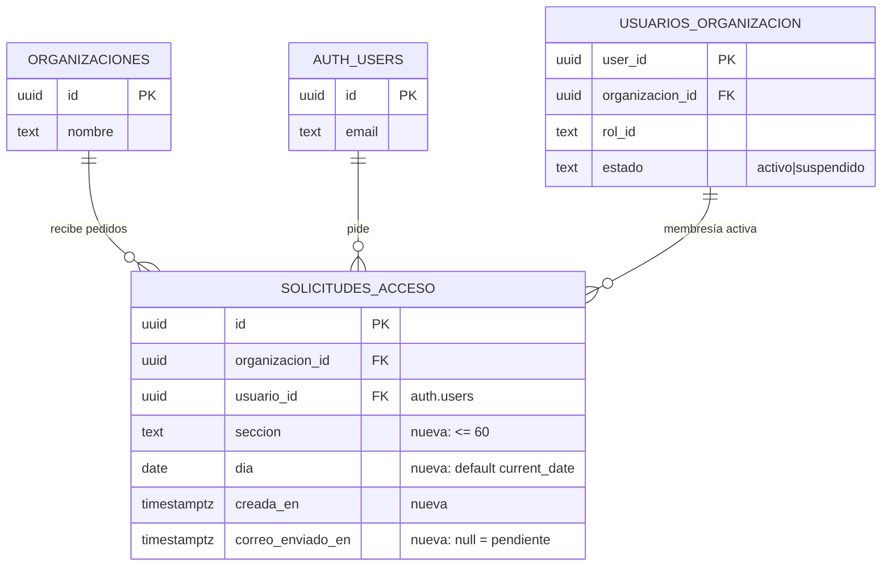

# Perfil y permisos avanzados (MSF-148)

Épica **MSF-148 · Acceso, organización y permisos** (F-PRF-01 y F-ROL-05). Spec:
`specs/20261016-130000-perfil-y-permisos-avanzados/spec.md`; plan y tareas en la misma carpeta.
Implementada y mergeada en `main` con el PR **#110** (merge commit `415163c4`). Resumen de producto:
[Perfil propio](../producto/perfil-propio.md) · [Solicitar acceso](../solicitar-acceso.md).

## Alcance de entrega

- **`refine`:** verificación y textos del perfil y del cambio de contraseña (F-PRF-01); botón y estados de
  «Solicitar acceso» en la pantalla de acceso restringido (F-ROL-05).
- **`supabase`:** tabla, RPC, Edge Function y envío de correo del pedido de acceso (F-ROL-05).
- **Sin** `kestra`, `superset`, `workers` ni Compose nuevo.
- **F-PRF-01 no reconstruye nada:** el perfil, la foto, los avisos de seguridad y el cambio de contraseña
  vienen de la spec 008 (`apps/web/src/pages/cuenta/`). Esta épica agrega pruebas de aceptación y ajusta
  textos (commits `db249f9b` y `c00c0350`).
- **F-ROL-05 es la construcción nueva:** migraciones aditivas `20261017100000_solicitudes_acceso.sql` y
  `20261017100001_rpc_solicitar_acceso.sql`, Edge Function `supabase/functions/solicitar-acceso/` y el guion
  de verificación del correo (commit `94f01232`). El transporte SMTP se cerró en `2717cc34`.

**Empresa activa: no aplica.** Tanto el perfil como el pedido son de la persona y su organización; el
selector de empresa de la barra superior no cambia qué se lee, qué se escribe ni el destinatario del aviso.

## Modelo de datos

| Tabla | Estado | Cambio |
|---|---|---|
| `public.solicitudes_acceso` | **nueva** | Pedido de acceso por persona, organización, sección y día. `unique (organizacion_id, usuario_id, seccion, dia)`; índice `(organizacion_id, dia desc)`. |
| `public.organizaciones` | existente | FK con `on delete cascade`; no cambia. |
| `auth.users` | existente | FK `usuario_id` con `on delete cascade`; no cambia. |
| `public.usuarios_organizacion` | existente | Solo se lee para resolver la membresía activa y los administradores activos; sin cambios. |
| `public.perfiles_usuario` | existente | Solo se lee para el nombre visible del solicitante; sin cambios (spec 008). |
| `public.eventos_seguridad_usuario` | existente | Lo lee el perfil para las últimas 20 acciones; sin cambios (spec 008). |
| Bucket `fotos-perfil` | existente | Fotos del perfil; sin cambios (spec 008). |

Columnas de `public.solicitudes_acceso` (migración `20261017100000`):

- `id uuid` (PK), `organizacion_id uuid` (FK a `organizaciones`), `usuario_id uuid` (FK a `auth.users`),
  `seccion text` (`btrim` no vacío y hasta 60 caracteres), `dia date` (default `current_date`),
  `creada_en timestamptz` (default `now()`) y `correo_enviado_en timestamptz` (nulo = aviso pendiente).
- **Un pedido por persona, sección y día:** la clave única `(organizacion_id, usuario_id, seccion, dia)` es
  la que hace idempotente el flujo; el índice por organización y día alimenta la lectura de administradores.
- **RLS activada:** la política `solicitudes_acceso_select` deja leer a `authenticated` cuando la fila es de
  su organización (`private.organizacion_id()`) y es propia (`auth.uid()`) o de una organización que
  administra (`private.es_administrador_de(organizacion_id)`). No hay políticas de escritura.
- **Privilegios:** `revoke all … from public, anon, authenticated` y `grant select … to authenticated`. La
  app no inserta, actualiza ni borra directo; el alta va por la RPC y `correo_enviado_en` lo actualiza la
  Edge Function con la service-role (que no pasa por RLS).
- **Reversión (en una migración posterior, no en la que crea):** `drop function public.solicitar_acceso(text)`
  y después `drop table public.solicitudes_acceso`. Se pierden los pedidos; exportarlos antes.

El modelo de acceso y membresía que se referencia está en [Datos y DER](datos.md#perfil-y-permisos-avanzados-msf-148) y en [Acceso y membresía](datos.md#acceso-y-membresia-msf-119).

## RPC `public.solicitar_acceso`

Migración `20261017100001_rpc_solicitar_acceso.sql`. Firma:
`public.solicitar_acceso(p_seccion text) returns jsonb`, `security definer` y `search_path = ''`.

1. Exige `auth.uid()`; sin sesión devuelve `42501` («Se requiere una sesión»).
2. Resuelve la **membresía activa propia** en `usuarios_organizacion`; sin membresía activa devuelve `42501`
   («No perteneces a una organización activa»). Un superadmin sin membresía tampoco puede pedir.
3. Valida la sección contra el catálogo `private.matriz_inicial()`; si no existe devuelve `22023`
   («Sección inválida»).
4. Rechaza con `22023` («Ya tienes acceso a esta sección») cuando `private.nivel_seccion(p_seccion)` es
   `lectura` o `edicion`.
5. Inserta con `on conflict (organizacion_id, usuario_id, seccion, dia) do nothing`. Si no insertó, relee la
   fila del día; devuelve `{ id, organizacion_id, nuevo, correo_enviado }`, con `nuevo = false` cuando el
   pedido ya existía.
6. `revoke execute … from public, anon` y `grant execute … to authenticated`.

La autorización real es de la RPC y la RLS; el botón sólo oculta la acción. La organización sale de la
membresía, nunca de un dato enviado por el navegador.

## Edge Function `solicitar-acceso`

Código: `supabase/functions/solicitar-acceso/index.ts` (cableado real) y `handler.ts` (lógica con
dependencias inyectadas). La invoca el panel por
`supabaseClient.functions.invoke('solicitar-acceso', { body: { seccion } })` desde
`apps/web/src/lib/solicitarAcceso.ts`.

1. Acepta `POST` y `OPTIONS`; exige `Authorization: Bearer <jwt>` y valida el token con
   `admin.auth.getUser(jwt)`. Sin token o token inválido responde `403`.
2. Valida `seccion` (texto no vacío, hasta 60 caracteres). Con un JWT válido crea un cliente con la
   `anon key` y el token de la persona, y llama a la RPC `solicitar_acceso`; los errores `42501`/`22023` se
   traducen a `403`/`400` con mensaje legible.
3. **Reclamo atómico del envío:** con la service-role hace
   `update solicitudes_acceso set correo_enviado_en = now() where id = … and correo_enviado_en is null`
   y comprueba si actualizó. Sólo quien gana envía; un doble clic o dos invocaciones concurrentes no
   duplican el correo. Si la RPC ya informó `correo_enviado`, responde éxito sin reenviar.
4. Destinatarios: todos los `usuarios_organizacion` con `rol_id = 'administrador'` y `estado = 'activo'`
   de la organización; los correos se obtienen con `admin.auth.admin.getUserById`. El nombre visible sale de
   `perfiles_usuario` y, si falta, del correo del solicitante.
5. Envía **un** correo por el transporte de `supabase/functions/_shared/correo.ts`; el asunto es
   `Solicitud de acceso a <Sección>` y el texto indica quién pide y qué sección. La sección se presenta con
   la clave en formato legible (guiones bajos a espacios y mayúscula inicial).
6. Sin administradores activos: libera el reclamo (`correo_enviado_en = null`), conserva el pedido y
   responde `resultado: 'sin_administradores'`; la UI avisa que no hay a quién notificar.
7. Si el envío falla: libera el reclamo, responde `502` con «Tu solicitud quedó registrada, pero no pudimos
   avisar al administrador. Intentá de nuevo.»; la pantalla muestra el error compartido con «Reintentar» y
   el reintento reutiliza el registro del día.

La respuesta `{ resultado: 'solicitud_enviada', nuevo }` es la que consume el panel. La confirmación en
pantalla es «Solicitud enviada al administrador». La función usa la service-role sólo en el servidor; el
navegador nunca la recibe.

## Correo de negocio

Supabase no expone una API de correo transaccional con contenido libre: sólo envía los correos de Auth por
su SMTP. Por eso la función reutiliza **el mismo SMTP de Auth**, sin proveedor nuevo
(`supabase/functions/_shared/correo.ts`, cliente `denomailer`).

| Entorno | SMTP |
|---|---|
| Local | Mailpit del stack (`supabase_inbucket_<project_id>`, puerto SMTP 1025 dentro de la red Docker). La interfaz de Mailpit usa `SUPABASE_MAILPIT_PORT` (4302). `SMTP_TLS=false`. |
| Self-hosted (STG/PROD) | El relay configurado para Auth (`GOTRUE_SMTP_*`): host, puerto, TLS y credenciales reales fuera de Git. Si no hay SMTP configurado, el correo no sale. |

Variables de la función (nombres en `supabase/functions/.env.example`; los valores reales son secretos de
la función, nunca llegan al navegador ni a Git): `SMTP_HOST`, `SMTP_PORT` (default 587), `SMTP_TLS`,
`SMTP_USER`, `SMTP_PASS` y `SMTP_FROM` (obligatorio junto con el host). El nombre del remitente y el asunto
se limpian de saltos de línea antes de ir a las cabeceras.

**Verificación de salida (FR-012):** `scripts/verificar-salida-correo.mjs`, ejecutable como
`pnpm correo:verificar-salida`. Es manual y opt-in: **no** corre en `pnpm test` ni en el CI.

- **Local:** inicia sesión como una persona sin acceso, invoca la función real y consulta la API de Mailpit
  (`MAILPIT_URL`) hasta encontrar el mensaje.
- **Servidor:** sin `MAILPIT_URL`; el administrador de la organización de prueba debe tener como correo
  `CORREO_PRUEBA` y se confirma a mano que el mensaje llegó a esa casilla. Requiere `AUTH_URL`,
  `FUNCTIONS_URL`, `SUPABASE_ANON_KEY`, `ACCESO_EMAIL`, `ACCESO_PASSWORD` y, opcionalmente, `SECCION`.
- La entregabilidad (SPF/DKIM del remitente) es infraestructura; si el relay del servidor no está
  configurado, se documenta el hallazgo y se traza como seguimiento.

## Pantallas

### Acceso restringido

`apps/web/src/pages/acceso-restringido/AccesoRestringido.tsx` conserva el contrato de F-ROL-03 y suma
`seccionClave?: string`. El guard `apps/web/src/components/RequiereAccesoSeccion.tsx` la pasa con la clave
de la sección denegada; sin clave, la pantalla mantiene sólo «Volver al inicio».

- Botón «Solicitar acceso» deshabilitado mientras envía (texto «Enviando…») y deshabilitado tras la
  confirmación; un `useRef` evita el doble envío antes de que React repinte.
- Estados: inicial, enviando, enviada (`sinAdministradores` cambia el detalle) y error con reintento; usan
  `EstadoVacio`, `EstadoExito` y `EstadoError` del sistema de diseño (MUI `Alert`), anunciados a lectores de
  pantalla. El enlace «Volver al inicio» sigue siendo operable por teclado.
- `apps/web/src/pages/stock/motivos.tsx` reutiliza la pantalla **sin** clave a propósito: allí el acceso
  restringido es para quien ya tiene la sección pero no el permiso de administración, así que no hay una
  sección nueva que pedir.

### Perfil y contraseña

- Rutas `/cuenta/perfil` y `/cuenta/cambiar-contrasena` en `apps/web/src/App.tsx`; accesos en el menú de
  cuenta (`apps/web/src/components/navegacion/MenuCuenta.tsx`).
- `apps/web/src/pages/cuenta/perfil.tsx` lee `usuarios_organizacion` (organización y rol),
  `perfiles_usuario` (nombre, apellido y `foto_path`) y las últimas 20 filas de
  `eventos_seguridad_usuario`; muestra la foto con una URL firmada del bucket `fotos-perfil`. Nombre y
  apellido son obligatorios; la foto acepta JPG, PNG o WebP de hasta 2 MiB. Antes de reemplazar o borrar la
  foto se descarga la anterior y se restaura si falla el upsert del perfil.
- `apps/web/src/pages/cuenta/cambiar-contrasena.tsx` valida la contraseña nueva con
  `apps/web/src/lib/passwordPolicy.ts` (mínimo 12 caracteres, mayúscula, minúscula, número y símbolo) y la
  confirmación **antes** de llamar a Auth. Verifica la contraseña actual con
  `verifyCurrentPassword` (`apps/web/src/lib/supabase.ts`, un cliente efímero con
  `signInWithPassword`), actualiza con `auth.updateUser({ current_password, password })` y cierra las demás
  sesiones con `closeOtherSessions` (`signOut({ scope: 'others' })`). Si la actual no coincide, la credencial
  no cambia y se ofrece «Recuperar acceso».
- **Sin cambios de esquema ni de contrato por el perfil:** `perfiles_usuario`,
  `eventos_seguridad_usuario` y el bucket son de la spec 008. La pantalla de perfil no está dibujada en el
  prototipo; se usa la del template con el sistema de diseño.

## Pruebas

- **pgTAP:** `supabase/tests/database/solicitudes_acceso.test.sql` (25 aserciones) cubre estructura y
  privilegios, un pedido por persona/sección/día, sección inválida, sección ya accesible, escritura directa
  cerrada, `anon` sin ejecución, sin sesión, sin membresía, aislamiento entre organizaciones y lectura del
  solicitante/administrador. `rls_en_toda_tabla.test.sql` recorre la tabla nueva.
- **Vitest:** `apps/web/src/pages/acceso-restringido/AccesoRestringido.test.tsx` (botón, confirmación,
  doble clic, error con reintento, sin administrador), `apps/web/src/pages/cuenta/perfil.test.tsx`,
  `apps/web/src/pages/cuenta/cambiar-contrasena.test.tsx` y `apps/web/src/lib/passwordPolicy.test.ts`.
- **Edge Function:** `supabase/functions/solicitar-acceso/handler.test.ts` con un transporte simulado
  (`pnpm test:edge:solicitar-acceso`), incluido en `pnpm test:web`.
- **Comandos:** `pnpm test:db` requiere `pnpm dev:supabase`; `pnpm test` incluye la suite web y de base.
  La salida real del correo se valida aparte con `pnpm correo:verificar-salida`.

## Límites y fuera de alcance

- **No hay bandeja de solicitudes ni historial en el panel.** El administrador recibe el correo y actúa desde
  Usuarios y permisos; tampoco hay campanita ni notificación interna. Aprobar el pedido es la acción normal
  de la matriz de permisos o del rol, no un flujo nuevo.
- **El aviso depende del SMTP de Supabase.** Si falta el relay en el servidor, el pedido se guarda pero el
  correo no sale; la configuración y la entregabilidad (SPF/DKIM) quedan a cargo de infraestructura.
- **Reutilización futura:** si MSF-224 entrega antes un mecanismo propio de notificaciones, se reemplaza el
  transporte del correo, no el pedido ni la RPC.
- **Regla de contraseña a confirmar con el cliente.** Está centralizada en `passwordPolicy.ts` para
  ajustarla en un solo lugar. Dueño: Nicolás / Producto.
- **Perfil fuera del prototipo.** No hay artboard de perfil; la pantalla es la del template y no se rediseñó.
  Dueño de la validación visual: Producto. Administrar sesiones activas o cerrar sesiones de otras personas
  también queda fuera de esta entrega.
