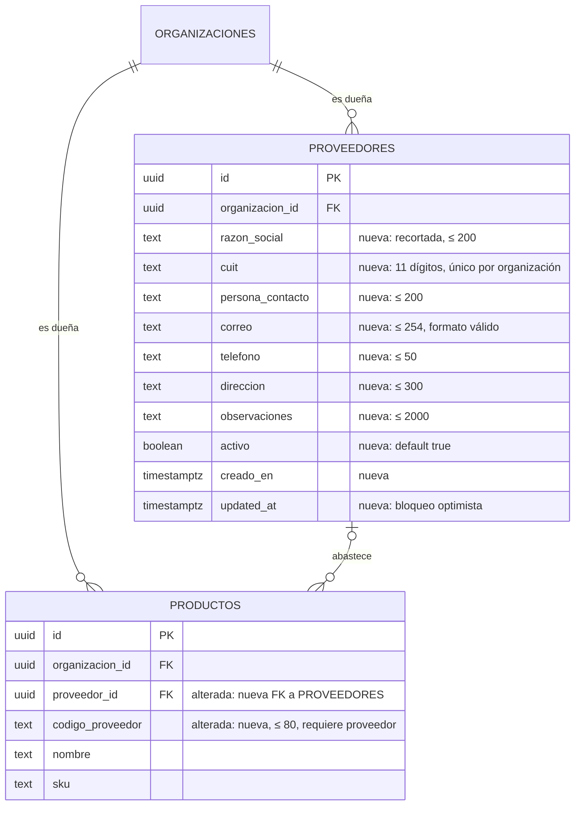

# Proveedores: modelo, RPC y pantallas (MSF-205)

**Épica:** MSF-205 · **Historias:** F-PRV-01 (MSF-336), F-PRV-02 (MSF-351) y F-PRV-03 (MSF-367).
**Spec:** `specs/20261018-190000-proveedores-y-productos/`.
**Alcance de entrega:** `refine` (`apps/web`) y `supabase` (migraciones, RPC, vista y pgTAP). Sin
`kestra`, `superset` ni `workers`.

## Estado de entrega

Las migraciones `20261021161600`–`20261021162300`, las pantallas `/proveedores` y
`/proveedores/show/:id` y los campos de proveedor del producto se construyeron en la rama
`epic/MSF-205-clientes-y-proveedores-proveedores-y-pro` (delta reconstruido en `76a48ea9`, integrado al
lote de STG en `3f259f7c`). A la fecha de esta página la épica **todavía no está promovida a `main`**.
Todo lo de abajo se verificó contra esas migraciones y el código de la rama.

## Modelo de datos

Una tabla nueva en **`dominio`** (Principio VII: entidad del negocio), dos columnas aditivas en
`dominio.productos` y una **vista** de superficie en `public`. `proveedores` es de la organización, no
de una empresa: la sección se comparte entre empresas.

| Tabla / objeto | Estado | Cambio |
|---|---|---|
| `dominio.proveedores` | **nueva** | `razon_social`, `cuit`, `persona_contacto`, `correo`, `telefono`, `direccion`, `observaciones`, `activo`, `creado_en`, `updated_at`; `unique (id, organizacion_id)` y `unique (organizacion_id, cuit)`; se desactiva, no se borra. |
| `dominio.productos` | existente | Gana `proveedor_id uuid` y `codigo_proveedor text` (≤ 80), FK compuesta `(proveedor_id, organizacion_id)` con `on delete restrict`, restricción «sin código sin proveedor» e índice `(organizacion_id, proveedor_id)`. |
| `public.proveedores_basico` | **vista nueva** | No almacena datos: expone solo `id`, `razon_social` y `activo` para selectores de producto e ingreso. |
| `public.organizaciones` | existente | FK de `dominio.proveedores`; sin cambios. |
| `public.registro_actividad` | existente | Recibe `proveedor.creado`, `proveedor.editado`, `proveedor.desactivado` y `proveedor.reactivado`. |

Migraciones, en orden:

| Migración | Qué agrega |
|---|---|
| `20261021161600_proveedores_tabla.sql` | Tabla, `private.cuit_valido`, disparador `private.normalizar_proveedor`, RLS, grants por columna e índices de razón social. |
| `20261021161700_proveedores_rpc.sql` | `crear_proveedor`, `actualizar_proveedor` y `cambiar_estado_proveedor`. |
| `20261021161800_proveedores_actividad.sql` | Disparadores de actividad `proveedor.*`. |
| `20261021161900_proveedores_listar.sql` | `listar_proveedores`, extensión `pg_trgm` e índices GIN de búsqueda. |
| `20261021162000_productos_proveedor.sql` | Columnas, FK, `check`, índice y disparador «proveedor nuevo activo». |
| `20261021162100_proveedores_basico.sql` | Vista `public.proveedores_basico`. |
| `20261021162200_productos_proveedor_rpc.sql` | Reemplazo de `crear_producto` y `actualizar_producto` con proveedor y código. |
| `20261021162300_productos_de_proveedor.sql` | `productos_de_proveedor` para la ficha. |

- Modelo general y demás tablas: [Datos y DER](datos.md#proveedores-y-productos-msf-205).
- TODO (dueño: Documentador): ERD Archify interactivo de MSF-205. Por ahora el DER vive en Mermaid en
  esta página y en `docs/tecnico/datos.md`; no se generó un artefacto Archify nuevo.

### CUIT: la base es la autoridad

El disparador `private.normalizar_proveedor` (`security definer`, `search_path = ''`) corre en `insert`
y `update`:

- recorta `razon_social` y rechaza vacío (`23514`, ≤ 200);
- acepta solo dígitos, espacios, puntos y guiones en el CUIT; lo guarda con **11 dígitos** (`22023` si
  sobran letras o el largo es distinto);
- valida el dígito verificador con módulo 11 y pesos `5,4,3,2,7,6,5,4,3,2`; resto 1 es inválido porque
  daría dígito 10 (`private.cuit_valido`);
- valida el correo si viene (`22023`, misma regla que `apps/web/src/lib/proveedores.ts`);
- **no avanza `updated_at`** si los datos no cambiaron, para no romper el bloqueo optimista con escrituras
  idempotentes.

El duplicado lo rechaza el índice `unique (organizacion_id, cuit)` con `23505`, también entre
desactivados. El espejo del formulario es `apps/web/src/lib/cuit.ts`; comparte vectores con
`supabase/tests/database/proveedores.test.sql`.

## Permisos y RLS

| Operación | Política | Nivel exigido |
|---|---|---|
| `select` | `organizacion_id = (select private.organizacion_id())` y `private.nivel_seccion('proveedores')` | `lectura` o `edicion` |
| `insert` / `update` | misma organización y sección | `edicion` |
| `delete` | **no existe política ni grant** | — |

- `anon` no tiene privilegios; `authenticated` recibe grants **por columna**: no puede fijar
  `organizacion_id` (sale de la sesión por default de la columna), `creado_en` ni `updated_at`.
- Administrador y Administración editan; con `lectura` se ve la ficha sin acciones; Depósito, Operador,
  Mostrador, Consulta y Miembro tienen `ninguno` y la base no les entrega filas.
- La FK compuesta `(proveedor_id, organizacion_id)` impide asignar a un producto un proveedor de otra
  organización.
- Detalle del contrato de secciones: [Permisos por rol](../permisos-por-rol.md).

## RPC (`security invoker`, rige RLS)

Todas hacen `revoke … from public, anon`, `grant execute … to authenticated` y fijan `search_path = ''`.
La organización sale de la sesión, nunca del llamador.

| RPC | Contrato |
|---|---|
| `public.crear_proveedor(p_razon_social, p_cuit, p_persona_contacto, p_correo, p_telefono, p_direccion, p_observaciones)` | Exige `edicion` en `proveedores`; delega normalización y unicidad en la tabla; devuelve la fila creada. |
| `public.actualizar_proveedor(p_id, p_actualizado_en, …)` | **Bloqueo optimista** por `updated_at`: si la fila cambió, `40001` y no se pisa nada; `P0002` si no existe o es de otra organización. |
| `public.cambiar_estado_proveedor(p_id, p_activo)` | Desactiva o reactiva sin tocar los datos; **idempotente** (mismo estado = no-op). No hay borrado. |
| `public.listar_proveedores(p_busqueda, p_estado, p_pagina, p_tamano)` | Búsqueda y paginación en servidor. `p_estado` = `activos` (default), `inactivos` o `todos`; 25 por página, tope 200; devuelve `total_filas`. |
| `public.productos_de_proveedor(p_proveedor_id, p_pagina, p_tamano)` | Productos del proveedor (`nombre`, `codigo_proveedor`, `activo`), ordenados por nombre; 10 por página, tope 100; exige `proveedores` **y** `productos`; `42501` si falta alguno. |

`listar_proveedores` busca por razón social parcial sin mayúsculas ni tildes (`translate(lower(...),
'áéíóúü', 'aeiouu')` + índice GIN `proveedores_razon_social_trgm_idx`) o por CUIT con o sin guiones
(solo si el texto es numérico; índice `proveedores_cuit_trgm_idx`). Escapa `\`, `%` y `_` para que el
texto se busque literal. `pg_trgm` vive en `extensions`; la migración aborta si no puede crear los
índices.

## Vista `proveedores_basico`

`public.proveedores_basico` (`id`, `razon_social`, `activo`) es **deliberadamente
`security_invoker = false`**: el Operador no tiene `select` sobre `dominio.proveedores`. Por eso el
filtro es explícito dentro de la vista:

- `organizacion_id = (select private.organizacion_id())`;
- nivel `edicion` en `productos`, o `lectura`/`edicion` en `stock`, o `lectura`/`edicion` en
  `proveedores`.

No expone CUIT, contacto ni observaciones. `revoke` para `public, anon`; `select` para `authenticated`.
La consumen `useProveedoresBasico` (selector del producto) y, en MSF-219, el selector de ingreso.

## Cambio de contrato en las RPC de producto

`20261021162200_productos_proveedor_rpc.sql` **reemplaza las firmas** de `crear_producto` y
`actualizar_producto` (hace `drop function` de la versión anterior y crea la nueva):

- `crear_producto(..., p_costo, p_proveedor_id uuid default null, p_codigo_proveedor text default null)`.
- `actualizar_producto(..., p_costo, p_proveedor_id uuid default null, p_codigo_proveedor text default null,
  p_cambiar_proveedor boolean default false)`.

`p_cambiar_proveedor` en `false` (default) **no toca** proveedor ni código, así los llamadores con la
firma anterior no pierden datos; con `true` se reemplazan (nulo = sin proveedor y se limpia el código).
El formulario de producto lo envía siempre. El cambio de proveedor o de código cuenta como cambio real:
avanza `updated_at` y deja `producto.editado`, sin costo ni precio en el detalle.

Los permisos, el bloqueo optimista y el costo se conservan igual que en `20261017120200` y
`20261017120400`. Es un **cambio de contrato de alto riesgo**: el PR de la épica lo señala y la
reversión restaura esas dos funciones.

## Pantallas y hooks

| Pieza | Archivo |
|---|---|
| Listado `/proveedores` | `apps/web/src/pages/proveedores/list.tsx` |
| Ficha `/proveedores/show/:id` | `apps/web/src/pages/proveedores/show.tsx` |
| Diálogo Nuevo/Editar | `apps/web/src/components/proveedores/ProveedorFormDialog.tsx` |
| Productos de la ficha | `apps/web/src/components/proveedores/ProductosDelProveedor.tsx` |
| Listado paginado | `apps/web/src/hooks/useListarProveedores.ts` |
| Selector mínimo | `apps/web/src/hooks/useProveedoresBasico.ts` |
| Productos del proveedor | `apps/web/src/hooks/useProductosDeProveedor.ts` |
| Cliente y errores | `apps/web/src/lib/proveedores.ts`, `apps/web/src/lib/cuit.ts` |
| Campos del producto | `apps/web/src/components/productos/FormularioProducto.tsx`, `apps/web/src/pages/productos/{create,edit}.tsx` |

- Entrada de menú **Proveedores** (icono camión) en Clientes y proveedores, visible con `lectura` o
  `edicion`; la ruta directa sin permiso lleva a «Acceso restringido».
- El listado espera 300 ms antes de buscar; conserva búsqueda y estado al paginar; muestra «Sin
  resultados», vacío inicial, carga y error con «Reintentar»; en pantallas angostas usa tarjetas.
- La ficha carga los productos en una consulta aparte: un error ahí no rompe el resto de la ficha.
- **Empresa activa: no aplica.** No hay `empresa_id` ni consulta filtrada por empresa; cambiar de
  empresa no invalida estas consultas.

## Errores que la UI traduce

| Código | Caso | Mensaje |
|---|---|---|
| `23505` | CUIT repetido (incluye desactivados) | «Ya existe un proveedor con ese CUIT en tu organización (también si está desactivado).» |
| `40001` | Edición simultánea del mismo proveedor | Conflicto: recargar y no se guardó nada. |
| `42501` | Sin `edicion` o sin `lectura` | «No tenés permiso para esta acción…». |
| `P0002` | Proveedor inexistente o de otra organización | «El proveedor ya no existe o no pertenece a tu organización.» |
| `22023` / `23514` | Dato inválido (CUIT, correo, largo) | Revisar el formulario. |

## Actividad

`proveedor.creado|editado|desactivado|reactivado` se registran en `public.registro_actividad` con los
disparadores `proveedores_registrar_actividad_alta` y `proveedores_registrar_actividad` (misma
transacción, solo con sesión y ante cambios reales). El detalle nombra la razón social, nunca el CUIT ni
identificadores internos. Ver [Actividad e historial](../actividad.md).

## Pruebas

- pgTAP: `supabase/tests/database/proveedores.test.sql` (RLS, CUIT, duplicado, conflicto, estado,
  actividad, sin `delete`, `anon`), `proveedores_listar.test.sql` (búsqueda, estado, orden, paginación,
  aislamiento) y `proveedores_productos.test.sql` (columnas, FK, proveedor ajeno/inactivo, vista,
  `productos_de_proveedor`, RPC de producto).
- Vitest: `apps/web/src/lib/{cuit,proveedores,productos}.test.ts`,
  `apps/web/src/components/proveedores/*.test.tsx`,
  `apps/web/src/pages/proveedores/*.test.tsx` y
  `apps/web/src/pages/productos/{create,edit}.test.tsx`.
- Cierre de la épica: `pnpm lint && pnpm build && pnpm test && pnpm docs:check && pnpm matriz:check`.

## Reversión

Migraciones aditivas. Para volver atrás, en una migración **posterior** (no en el mismo PR; exportar
antes los datos):

1. Restaurar `crear_producto` y `actualizar_producto` con las firmas y cuerpos de `20261017120200` y
   `20261017120400`, y devolver `private.conservar_updated_at_producto()` y
   `private.registrar_actividad_producto_editado()` a su versión anterior.
2. `drop function public.productos_de_proveedor(uuid, integer, integer);`
3. `drop view public.proveedores_basico;`
4. Quitar de `dominio.productos` el disparador `productos_proveedor_valido`, la función
   `private.validar_proveedor_producto` y las columnas `proveedor_id` y `codigo_proveedor`.
5. `drop function public.listar_proveedores(...)` y los índices GIN
   `proveedores_razon_social_trgm_idx` y `proveedores_cuit_trgm_idx`.
6. Quitar los disparadores y funciones de actividad, `private.normalizar_proveedor`,
   `private.cuit_valido`, las tres RPC de proveedor y la tabla `dominio.proveedores`.

Cada archivo lleva los pasos exactos en su encabezado.

## Para seguir

- **[Proveedores (producto)](../proveedores.md)** — qué resuelve y cómo se usa.
- **[Datos y DER](datos.md)** — modelo completo, tablas y demás épicas.
- **[Ingreso de mercadería](ingreso-de-mercaderia.md)** — consumo de `proveedores_basico`.
- **[API y RPC](api.md)** — catálogo de funciones públicas.
