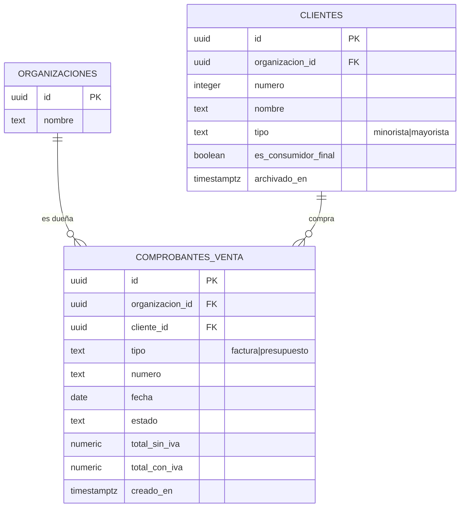

# Clientes · ranking y compras (técnico, MSF-126)

Implementación de la épica **MSF-126** (spec `ranking-de-clientes`): ranking de clientes por facturación
(**F-CLI-08**, MSF-238), exportación a Excel (**F-CLI-09**, MSF-255) e historial de compras en la ficha
(**F-CLI-10**, MSF-269). La vista de producto está en
[Clientes · ranking y compras](../producto/ranking-de-clientes.md).

!!! note "Estado"
    Al escribir esta página (25/10/2026) el código está en la rama de release `release/stg-lote` (commit
    `3bd79c7d`, «Release MSF-126»), **todavía no en `main`**. Las migraciones citadas son
    `supabase/migrations/20261018100000` … `20261018100200`. Confirmá la rama vigente antes de operar.

## Alcance y dependencias

- **Delivery scope:** `refine` + `supabase`. Sin Kestra, Superset ni workers.
- **Solo lectura** de documentos de venta. La emisión, el listado, los estados y la anulación son de Ventas
  (MSF-159/177); esta épica no escribe comprobantes.
- **Sin cambios en `public.clientes`**: solo un índice único aditivo para la FK compuesta.
- **Una sola función** (`public.ranking_clientes`) alimenta la pantalla y el Excel; **un solo predicado**
  (`private.comprobante_cuenta_como_facturado`) fija qué comprobantes suman en el ranking, el Excel y la
  ficha.

## Datos

Migraciones aditivas, con reversión en el encabezado de cada una:

| Migración | Qué crea |
|---|---|
| `20261018100000_ventas_contrato_comprobantes.sql` | `dominio.comprobantes_venta`, índices y RLS; índice único `public.clientes_id_organizacion_uq`. |
| `20261018100100_clientes_ranking.sql` | `private.comprobante_cuenta_como_facturado(text, text)` y `public.ranking_clientes(...)`. |
| `20261018100200_clientes_compras.sql` | `public.compras_de_cliente(uuid, integer, integer)`. |

### Contrato `dominio.comprobantes_venta` (F-CLI-08)

Un documento de venta por fila. Vive en `dominio` porque es una entidad de negocio del producto
(Principio VII). Ventas la amplía con migraciones aditivas (MSF-159).

| Columna | Tipo | Regla |
|---|---|---|
| `id` | `uuid` | PK, `gen_random_uuid()`. |
| `organizacion_id` | `uuid` | `not null`, FK a `public.organizaciones` con `on delete cascade`. |
| `cliente_id` | `uuid` | `not null`; FK compuesta `(cliente_id, organizacion_id)` → `public.clientes (id, organizacion_id)`: no puede apuntar a un cliente de otra organización. |
| `tipo` | `text` | `not null`; `check (tipo in ('factura', 'presupuesto'))`. |
| `numero` | `text` | `not null`; `check (btrim(numero) <> '')`. Es el número visible. |
| `fecha` | `date` | `not null`; fecha de emisión. |
| `estado` | `text` | `not null`; `check (btrim(estado) <> '')`. El catálogo de estados lo fija Ventas. |
| `total_sin_iva` | `numeric(14,2)` | `not null`, `>= 0`. |
| `total_con_iva` | `numeric(14,2)` | `not null`, `>= total_sin_iva`. |
| `creado_en` | `timestamptz` | `not null default now()`. |

- **Índices:** `comprobantes_venta_cliente_fecha_idx (organizacion_id, cliente_id, fecha desc)` para la
  ficha y el ranking; `comprobantes_venta_fecha_idx (organizacion_id, fecha)` para el barrido por período.
- **RLS:** activa. Una sola política `select` para `authenticated`:
  `organizacion_id = (select private.organizacion_id())` y
  `(select private.nivel_seccion('ventas')) in ('lectura', 'edicion')`.
  `revoke all ... from anon, public` y `grant select ... to authenticated`. **No hay políticas ni grants de
  escritura:** escribe Ventas con sus propias migraciones.
- **Datos de ejemplo:** solo en `supabase/seed.sql` (local); los pgTAP crean sus propios datos. Nunca se
  cargan en producción.



- El ERD interactivo con la tabla ya ampliada por Ventas (empresa, líneas y numeración) está en
  [ERD de ventas comprobantes](../diagrams/msf-159-erd.html).
- El detalle de la ampliación de Ventas está en [Ventas · comprobantes (técnico)](ventas-comprobantes.md)
  y en [Datos y DER](datos.md#ventas-comprobantes-msf-159).

### Predicado único de facturación (FR-005)

```sql
create or replace function private.comprobante_cuenta_como_facturado(p_tipo text, p_estado text)
returns boolean
language sql
immutable
set search_path = ''
as $$
  select p_tipo = 'factura' and p_estado <> 'anulada'
$$;
```

- Es el **único lugar** donde se decide qué comprobante suma. Cambiar el criterio (por ejemplo, si «Deuda»
  deja de contar) es cambiar solo este cuerpo.
- No se concede a `authenticated`: lo ejecutan las funciones `security definer`.
- Prueba: `supabase/tests/database/ranking_clientes.test.sql` verifica factura en deuda (cuenta), anulada
  (no cuenta) y presupuesto (no cuenta).

## RPC `public.ranking_clientes` (F-CLI-08)

```sql
public.ranking_clientes(
  p_desde date,
  p_hasta date,
  p_tipo text default null,
  p_incluir_consumidor_final boolean default false,
  p_con_iva boolean default false,
  p_pagina integer default 1,
  p_tamano integer default 25
)
returns table (
  posicion bigint,
  cliente_id uuid,
  numero integer,
  nombre text,
  tipo text,
  comprobantes bigint,
  facturado numeric,
  participacion numeric,
  total_filas bigint
)
```

- **Seguridad:** `security definer`, `stable`, `set search_path = ''`. La organización sale de
  `private.organizacion_id()`, **nunca** del llamador; exige `private.nivel_seccion('clientes')` en
  `lectura` o `edicion` (`42501` si no). `revoke ... from public, anon` y
  `grant execute ... to authenticated`.
- **Agregación:** une `dominio.comprobantes_venta` con `public.clientes` por `(id, organizacion_id)`,
  filtra la organización, `fecha between p_desde and p_hasta`, el predicado único, el tipo y el Consumidor
  final; suma `total_con_iva` o `total_sin_iva` según `p_con_iva`; cuenta los comprobantes que sumaron.
- **Participación:** `facturado * 100 / total del ranking filtrado` (0 si el total es 0), calculada sobre el
  conjunto completo y **no** sobre la página. No se redondea en el servidor: devuelve 0–100 y la pantalla
  muestra una decimal.
- **Orden:** `facturado desc`, `lower(nombre)`, `numero` (paginación estable). Un cliente archivado sigue
  contando.
- **Paginación:** `limit p_tamano offset (p_pagina - 1) * p_tamano`; `total_filas` con `count(*) over ()`.
- **Validación (`22023`):** fechas nulas, `p_desde > p_hasta`, rango mayor a 5 años, tipo fuera de
  (`minorista`, `mayorista`) o nulo, página fuera de 1…1.000.000, tamaño fuera de 1…1.000.
- **Base:** sin IVA por defecto; con IVA si `p_con_iva`. **Consumidor final:** excluido por defecto
  (`p_incluir_consumidor_final = false`).
- **Rendimiento:** cada página vuelve a agregar el rango completo (máx. 5 años). Se apoya en
  `(organizacion_id, fecha)`; se acepta para el volumen actual y no se midió con `EXPLAIN` sobre datos
  reales. Si el volumen crece, la salida documentada es una vista materializada por período, sin cambiar el
  contrato. La página se acota para no desbordar el `offset` de `integer`.
- **Errores:** `42501` sin permiso; `22023` validación.

## RPC `public.compras_de_cliente` (F-CLI-10)

```sql
public.compras_de_cliente(
  p_cliente_id uuid,
  p_pagina integer default 1,
  p_tamano integer default 10
)
returns table (
  facturado_anio numeric,
  numero text,
  fecha date,
  tipo text,
  estado text,
  total_sin_iva numeric,
  total_filas bigint
)
```

- **Seguridad:** `security definer`, `stable`, `search_path = ''`; organización de
  `private.organizacion_id()`; exige Clientes en `lectura` o `edicion` (`42501`). `revoke ... from public,
  anon` y `grant execute ... to authenticated`.
- **Aislamiento:** un cliente de **otra organización o inexistente** devuelve **cero filas** (no revela si
  existe fuera de la organización).
- **Total del año:** suma `total_sin_iva` desde el **1 de enero hasta hoy** en la zona horaria de la
  organización (`public.organizaciones.zona_horaria`; si falta, `current_date`), con el predicado único.
- **Listado:** todos los comprobantes del cliente (facturas y presupuestos, cualquier estado), orden
  `fecha desc, numero desc, tipo`, paginado (tamaño 1…100).
- **Fila centinela:** si la página no trae comprobantes (cliente sin compras o página más allá del final),
  devuelve una fila con `numero is null`, `facturado_anio` y la cantidad real de comprobantes. Así la ficha
  muestra `$ 0` sin una segunda llamada.
- **Validación (`22023`):** cliente nulo, página fuera de 1…1.000.000, tamaño fuera de 1…100.

## Frontend

### Solapa de ranking

- **Ruta y solapa:** vive dentro de `/clientes` (`apps/web/src/pages/clientes/list.tsx`); no cambia el menú
  ni la ruta de la ficha. Las solapas **Listado** / **Ranking por facturación** se muestran solo con
  Clientes en `lectura` o `edicion` (`useNivelSeccion`). El componente se carga con `React.lazy` al abrir
  la solapa, para no engordar el listado.
- **Componente:** `apps/web/src/components/clientes/RankingClientes.tsx`.
  - Arranca en **Este mes**; el rango se consulta al pulsar **Aplicar** o un atajo. Los filtros de tipo,
    Consumidor final y «Ver con IVA» se aplican al cambiarlos y vuelven a la página 1.
  - Atajos: **Este mes**, **Mes anterior**, **Últimos 90 días**, **Año en curso**. Se calculan en
    `America/Argentina/Buenos_Aires` (`lib/periodosRanking.ts`), no en la zona del navegador.
  - Validación de pantalla: fechas válidas, Desde ≤ Hasta y máximo 5 años, con un error por campo
    (`lib/periodosRanking.ts`); el servidor vuelve a validar.
  - Tabla con `ContenidoAdaptable` (tarjetas en angosto), paginación de servidor de 25, enlace del cliente
    a `/clientes/show/:id` y barra de participación proporcional al primero de la página.
  - Formatos: `$ 1.234.567`, `12,5 %` y `dd/mm/aaaa` (`lib/formatoRanking.ts`).
  - Estados compartidos: carga, vacío («Sin facturación en el período»), error con «Reintentar».
- **Hook:** `apps/web/src/hooks/useRankingClientes.ts` llama a la RPC con «última petición gana», conserva
  filas previas mientras pagina (`isFetching`) y vuelve a cargar al cambiar la organización activa. La
  autorización la resuelve el servidor.

### Exportación a Excel

- **Archivo:** `apps/web/src/lib/exportarRanking.ts`.
- **Permiso:** el botón se monta solo con `usePuedeAccion('clientes', 'exportar')`. La acción se exige en
  la interfaz; la RPC solo exige `lectura`/`edicion` porque el dato ya es visible para quien puede ver el
  ranking (decisión provisoria de la spec). Imponerla también en el servidor queda para una épica
  posterior.
- **Qué exporta:** **todas** las filas del ranking vigente (período aplicado, tipo, Consumidor final, base
  con/sin IVA), llamando por lotes de **1.000** a la **misma** `public.ranking_clientes`. Tope: **100.000**
  clientes; si lo supera, pide acotar el período o los filtros.
- **Archivo `.xlsx`:** hoja **«Ranking de clientes»**, encabezados en la primera fila (#, Cliente, Tipo,
  Comprobantes, Facturado (sin/con IVA), Participación), y al pie el período, la base y el total facturado.
  Nombre: `ranking-clientes-<desde>_<hasta>.xlsx`.
- **Formato y seguridad:** importes y participación se escriben como números con formato; las celdas de
  texto pasan por `neutralizarFormula` (reutilizada de `lib/exportarClientes.ts`) para neutralizar `=`, `+`,
  `-` y `@` iniciales. `write-excel-file` (MIT, ya dependencia) se carga con `import()` diferido.
- **Estados:** botón deshabilitado con el ranking vacío o mientras exporta; progreso, «Cancelar
  exportación», «Exportación lista» y error con «Reintentar».
- **Concurrencia:** la paginación es por posición; si Ventas emite comprobantes durante la exportación, el
  archivo puede diferir de la pantalla en esas filas. Se documenta, no se bloquea.

### Compras en la ficha

- **Montaje:** `apps/web/src/pages/clientes/show.tsx` monta `ComprasCliente` solo con Clientes en `lectura`
  o `edicion`.
- **Componente:** `apps/web/src/components/clientes/ComprasCliente.tsx`: **Resumen comercial** (total
  facturado del año sin IVA) y **Últimos comprobantes** (número, fecha, estado y total), 10 por página.
  Muestra facturas y presupuestos con su estado; solo las facturas que cumplen el predicado suman.
- **Hook:** `apps/web/src/hooks/useComprasCliente.ts` consume la fila centinela; un error de Compras no
  afecta al resto de la ficha. Si una página queda más allá del final y hay comprobantes, vuelve a la
  página 1.
- **Accesibilidad:** `ContenidoAdaptable` (tarjetas en 320 px), encabezados de sección y estados
  compartidos de carga/vacío/error.

## Permisos

| Quién | Ranking | Exportar | Compras en la ficha |
|---|---|---|---|
| Administrador, Administración, Operador, Mostrador (`edicion`) | Sí | Sí (por defecto) | Sí |
| Consulta (`lectura`) | Sí | Solo con la acción `exportar` | Sí |
| Depósito (`ninguno`) | No: `42501` en la base | No | No |
| `anon` | No: sin `grant execute` | No | No |

El detalle del contrato de permisos está en [Permisos por rol](../permisos-por-rol.md).

## Empresa activa

- La organización la resuelve el servidor (`private.organizacion_id()`); ni la pantalla ni la RPC aceptan
  una organización por parámetro.
- El ranking y las compras son **de toda la organización**, no de una tienda: no hay filtro ni desglose por
  tienda en esta épica. Al cambiar la empresa activa, `useRankingClientes` vuelve a consultar (depende de
  `useOrganizacionActiva`) y descarta el estado anterior; como la lectura es por organización, el resultado
  no cambia.
- **Filtro y desglose por tienda:** fuera de alcance; quedan en las historias de Ventas · Reportes
  (MSF-159/177).

## Reversión

Todo es aditivo; la reversión va en migraciones posteriores, nunca en el mismo PR que crea:

1. `drop function public.compras_de_cliente(uuid, integer, integer);`
2. `drop function public.ranking_clientes(date, date, text, boolean, boolean, integer, integer);`
3. `drop function private.comprobante_cuenta_como_facturado(text, text);`
4. Si Ventas todavía no escribe en la tabla, **exportando antes los datos**: `drop table
   dominio.comprobantes_venta;` y `drop index public.clientes_id_organizacion_uq;`.

La exportación a Excel es solo frontend: se deshace revirtiendo el PR. La spec completa se deshace con un
`git revert -m 1` del merge de la épica.

## Pruebas

- **pgTAP:** `supabase/tests/database/comprobantes_venta_contrato.test.sql` (esquema, RLS por organización y
  sección `ventas`, sin escritura, FK cruzada, `anon`), `ranking_clientes.test.sql` (predicado, orden y
  desempate, anuladas y presupuestos que no suman, filtros, participación, paginación, validaciones,
  niveles de sección, otra organización, `anon`) y `clientes_compras.test.sql` (total del año, orden y
  paginación, vacío con `$ 0`, cliente ajeno o inexistente, zona horaria, permisos).
- **Vitest:** `lib/periodosRanking.test.ts`, `lib/exportarRanking.test.ts`,
  `components/clientes/RankingClientes.test.tsx`, `components/clientes/ComprasCliente.test.tsx`,
  `hooks/useComprasCliente.test.tsx`, `pages/clientes/list.ranking.test.tsx` y
  `pages/clientes/show.test.tsx`.
- **Seed local:** `supabase/seed.sql` agrega clientes y comprobantes de ejemplo (facturas cobradas/en deuda,
  una anulada, un presupuesto y una factura del Consumidor final) solo si la organización no tiene
  comprobantes.

## Trazabilidad

| Historia | Commits |
|---|---|
| Spec, plan y tareas | `b7602d26` |
| F-CLI-08 · contrato y `ranking_clientes` | `507f7ba5`, `bc2dfb79`, `b8d4bb42` |
| F-CLI-09 · exportación | `6b69873a` |
| F-CLI-10 · compras en la ficha | `36df0485`, `6576c8f3`, `402b9e9e` |
| Cierre, docs y verificación de esquema | `eb14c4ad`, `f8fde2f1`, `441f37b0` |
| Integración a STG | `3bd79c7d` |

## Fuera de alcance / seguimiento

- **Ranking en Ventas · Reportes** (misma tabla con filtro y desglose por tienda): dueño **MSF-159/177**;
  esta épica no lo construye.
- **Ranking avanzado de clientes** (F-CLI-14/15/16): **MSF-171**.
- **Filtro y desglose por tienda**, Superset/dashboards, saldo deudor, enlace al comprobante desde la ficha,
  «Nuevo comprobante» y el resto de Clientes (correo, etiquetas, importación, cuenta web): otras épicas.
- **Estados que cuentan:** el criterio definitivo lo fija Ventas; hoy el predicado considera toda factura no
  anulada (incluida «Deuda»). Cambiarlo es cambiar solo el cuerpo del predicado.
- **Exportar en el servidor:** la acción `exportar` hoy se exige en la interfaz; si se quiere imponer en la
  base, se agrega en una épica posterior.
