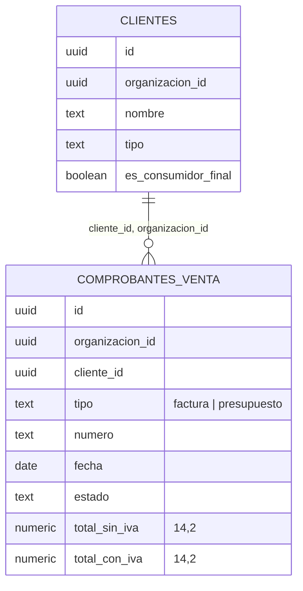

# Ranking de clientes: contrato, RPC y pantallas (MSF-126)

**Épica:** MSF-126 — Clientes y proveedores · Ranking de clientes. **Historias:** F-CLI-08, F-CLI-09,
F-CLI-10. **Alcance de entrega:** `refine` + `supabase` (sin `kestra`, `superset` ni `workers`). **Spec:**
`specs/20261018-100000-ranking-de-clientes/` (`spec.md`, `plan.md`, `tasks.md`; commit `b7602d26`). Guía de
producto: [Ranking de clientes](../producto/ranking-de-clientes.md).

> **Estado (verificado contra `main` al 2026-10-30):** solo existe la spec. Las tareas T001–T020 están
> `[ ]` y **no hay** migración, RPC, componente ni test de la épica en `supabase/` ni `apps/web/`
> (`grep ranking_clientes supabase apps` sin resultados). Lo de abajo es el **diseño acordado en la spec**,
> no código verificado; cada ítem cita su requisito (FR) y tarea. TODO (dueño: quien implemente): al
> mergear, reemplazar por rutas y migraciones reales y completar `datos.md`/`api.md`.
>
> **Inconsistencia a resolver:** [Ventas · reportes (técnico)](ventas-reportes.md) y
> [API](api.md) ya citan `public.ranking_clientes` como existente (y la reversión de
> [Ventas · listado](ventas-listado-estados-y-anulacion.md) cita `private.comprobante_cuenta_como_facturado`
> y `compras_de_cliente`), pero esos objetos no están en las migraciones de este árbol.
> TODO (dueño: MSF-338/MSF-177): confirmar de dónde salen.

## Datos

Esquema por Principio VII (spec, «Esquema de datos»):

| Tabla | Esquema | Cambio | RLS |
|---|---|---|---|
| `comprobantes_venta` | **`dominio`** (documento de venta: dominio del producto) | **Nueva**, migración M1 `20261018100000_ventas_contrato_comprobantes.sql` (T001) | `organizacion_id = (select private.organizacion_id())` y `select` con `private.nivel_seccion('ventas')` en `lectura`/`edicion`; sin escritura para `authenticated` (escribe Ventas, MSF-159/177); `anon` sin acceso |
| `clientes` | `public` (excepción de MSF-180) | **Sin cambios** (FR-016) | Vigente |

Contrato de `dominio.comprobantes_venta` (FR-001): FK compuesta `(cliente_id, organizacion_id)` →
`public.clientes`, `organizacion_id` → `public.organizaciones` `on delete cascade`, `tipo` limitado a
`factura`/`presupuesto`, totales `not null` y `>= 0`, índice `(organizacion_id, cliente_id, fecha desc)`.
La tabla es el **mínimo para leer y probar**; Ventas la completa con migraciones aditivas. Datos de ejemplo:
`supabase/seed.sql` y fixtures pgTAP (T005), nunca en producción.

## API (RPC de lectura)

Todas `security definer`, `search_path = ''`, organización tomada de `private.organizacion_id()` (nunca del
llamador), `revoke … from public, anon` y `grant execute … to authenticated` (FR-004, FR-014; ver el
contrato de `anon` en `docs/acceso-ingreso.md`).

| RPC | Migración prevista | Contrato |
|---|---|---|
| `private.comprobante_cuenta_como_facturado(tipo, estado)` | M2 `20261018100100_clientes_ranking.sql` (T002) | **Único** predicado del criterio de facturación: hoy `tipo = 'factura'` y `estado <> 'anulada'`. Ranking, Excel y ficha lo usan; lo cambia Ventas en un solo lugar (FR-005) |
| `public.ranking_clientes(p_desde, p_hasta, p_tipo default null, p_incluir_consumidor_final default false, p_con_iva default false, p_pagina default 1, p_tamano default 25)` | M2 (T002) | Devuelve `posicion`, `cliente_id`, `numero`, `nombre`, `tipo`, `comprobantes`, `facturado`, `participacion`, `total_filas`. Orden `facturado` desc, nombre (sin mayúsculas), número. Exige `nivel_seccion('clientes')` en `lectura`/`edicion` (FR-003, FR-004) |
| `public.compras_de_cliente(p_cliente_id, p_pagina default 1, p_tamano default 10)` | M3 `20261018100200_clientes_compras.sql` (T012) | `facturado_anio` (1 de enero a hoy, mismo predicado, sin IVA) y comprobantes (`numero`, `fecha`, `estado`, `tipo`, `total_sin_iva`, `total_filas`), más reciente primero; cliente de otra organización → sin filas (FR-012) |

Reglas del ranking:

- **Rango** sobre `fecha` de emisión, extremos inclusivos, zona `America/Argentina/Buenos_Aires`.
- **Validación en servidor** (FR-007): `p_desde <= p_hasta`, máximo 5 años, `p_tipo` en
  (`minorista`, `mayorista`) o nulo, página ≥ 1, tamaño 1–1.000.
- **Participación** = `facturado / total del ranking filtrado` calculada sobre el conjunto completo, no sobre
  la página; 0 si el total es 0 (FR-006).
- **Base:** `total_sin_iva` por defecto, `total_con_iva` con `p_con_iva`.
- **Cliente archivado** sigue contando; el Consumidor final se excluye salvo `p_incluir_consumidor_final`.

## Flujo y pantallas

- `apps/web/src/lib/periodosRanking.ts` (atajos y validación de rango) y
  `apps/web/src/hooks/useRankingClientes.ts` (T006).
- `apps/web/src/components/clientes/RankingClientes.tsx` montado como solapa en
  `apps/web/src/pages/clientes/list.tsx`, con carga diferida y visibilidad por
  `SECCION_POR_RECURSO.clientes` (T007, FR-008/009/015).
- **Excel** (F-CLI-09): `apps/web/src/lib/exportarRanking.ts` llama por lotes a **la misma**
  `ranking_clientes` hasta `total_filas` (tope 100.000), arma el `.xlsx` con `write-excel-file` (carga
  diferida) y neutraliza fórmulas con `neutralizarFormula` (T009, FR-010/011). El botón exige
  `usePuedeAccion('clientes','exportar')`; **la acción no se impone en el servidor** (Decisión 7: los datos
  son los que ya ve quien tiene lectura). Si Ventas emite mientras se exporta, el archivo puede diferir de la
  pantalla (lectura paginada por posición); se documenta, no se bloquea.
- **Ficha** (F-CLI-10): `useComprasCliente.ts` y `ComprasCliente.tsx` en `pages/clientes/show.tsx`
  (T014/T015, FR-013).
- **Empresa activa:** no aplica; el ranking y las compras se acotan por organización.

## Operación y reversión

- Migraciones **aditivas**; reversión en el encabezado de cada una (FR-016):
  M1 `drop table dominio.comprobantes_venta`; M2 `drop function public.ranking_clientes(...)` y
  `private.comprobante_cuenta_como_facturado(text, text)`; M3 `drop function public.compras_de_cliente(uuid, integer, integer)`.
  No se destruye nada en el PR que lo crea; un `git revert -m 1` del PR deshace la épica.
- Si Ventas llega antes con la tabla definitiva, M1 se ajusta (`create table if not exists` + columnas
  faltantes) o se descarta sin cambiar las funciones (Decisión 6).
- Pruebas previstas: pgTAP `ranking_clientes.test.sql`, `comprobantes_venta_contrato.test.sql`,
  `clientes_compras.test.sql`; el test de `anon` y `rls_en_toda_tabla` deben seguir verdes; Vitest del ranking,
  el Excel y la ficha. E2E: pendiente (ver la guía de producto).

## Decisiones abiertas

Entrada oficial (Clientes), Consumidor final (excluido), con/sin IVA, criterio de estados (Ventas), quién ve
el ranking, tabla de contrato y garantía del Excel: ver `spec.md`, «Decisiones abiertas». TODO (dueño:
Nicolás Jones): confirmarlas; la épica MSF-171 depende de ellas.
