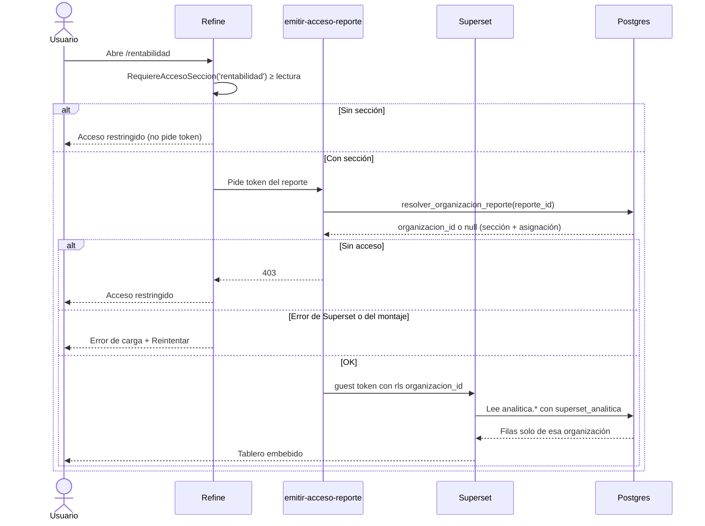
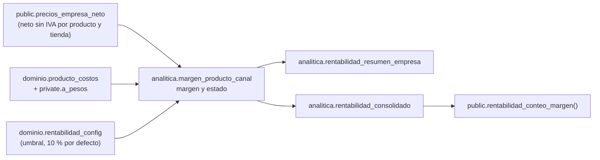

# Rentabilidad: datos, RPC y tableros (MSF-120)

Spec `rentabilidad-margen` · épica **MSF-120** · historias F-REN-01 (`0aab690`), F-REN-02 (`730d42d`) y
F-REN-03 (`1cf16a9`). Alcance de entrega: `refine` + `supabase` + `superset`; sin `kestra` ni `workers`
(el cálculo es SQL y el tablero lo sirve Superset).

La pantalla vive en `apps/web/src/pages/rentabilidad/`; el cálculo, en tres vistas del esquema `analitica`
(`supabase/migrations/20261130100200_analitica_margen_producto_canal.sql` y
`20261130110000_analitica_rentabilidad_resumen.sql`); los tableros, como YAML versionado en
`infra/superset/dashboards/rentabilidad/`.

## Piezas

| Capa | Qué hace | Dónde |
|---|---|---|
| Refine | Rutas `/rentabilidad` y `/rentabilidad/productos`, pestañas, aviso, «Cómo se calcula», diálogo del umbral, acceso restringido, error con reintento | `apps/web/src/pages/rentabilidad/`, `apps/web/src/lib/rentabilidad.ts`, `apps/web/src/App.tsx` |
| Supabase | Umbral por organización, RPC, cálculo en vistas, rol de lectura de Superset y restricción por sección del token | `supabase/migrations/2026113010*` y `2026113011*` |
| Superset | Dos tableros embebidos («Resumen» y «Por producto») y su registro en `public.reportes` | `infra/superset/dashboards/rentabilidad/` |
| Edge Function | `emitir-acceso-reporte` responde 403 sin token si falta la sección del reporte | `supabase/functions/emitir-acceso-reporte/` |

## Flujo de acceso y cálculo



- La ruta está envuelta en `RequiereAccesoSeccion` (`apps/web/src/App.tsx`): sin `lectura` no se monta la
  pantalla ni se pide token. Un 403 del token también muestra `AccesoRestringido`
  (`apps/web/src/pages/rentabilidad/index.tsx`, `PorProducto.tsx`).
- El error de carga usa `EstadoError` con `Reintentar`, que remonta el tablero y repite la solicitud del
  token (`key` con el número de intento).
- Los tableros **no** dependen de la empresa activa: comparan todas las empresas de la organización. Es la
  excepción declarada al Principio VIII y está cubierta por el test de cambio de empresa.

## Datos y DER

### Objetos afectados

| Objeto | Esquema | Estado | Cambio |
|---|---|---|---|
| `rentabilidad_config` | `dominio` | nueva | `organizacion_id` PK, `umbral_margen_bajo` (0 < valor ≤ 1, default 0,10) y `updated_at`. |
| `margen_producto_canal` | `analitica` | nueva (vista) | Una fila por producto activo × empresa activa con margen calculable. |
| `rentabilidad_resumen_empresa` | `analitica` | nueva (vista) | Agregado por empresa derivado de `margen_producto_canal`. |
| `rentabilidad_consolidado` | `analitica` | nueva (vista) | Agregado por organización, ponderado y con conteos. |
| `reportes.seccion` | `public` | alterada | Columna nueva, nullable; el reporte declara qué sección exige para emitir el token. |
| `reportes` | `public` | existente | Catálogo de reportes de la spec 007; sin cambios más que la columna anterior. |
| `reportes_organizaciones` | `public` | existente | Asignación reporte ↔ organización que consulta el resolver. |
| `productos` | `dominio` | existente | Fuente de nombre, SKU, moneda, precio de lista y estado activo. |
| `producto_costos` | `dominio` | existente | Fuente del costo; restringido por la sección `rentabilidad` (MSF-179). |
| `precios_empresa` | `dominio` | existente | Regla de precio por empresa (MSF-114); el neto se lee por `public.precios_empresa_neto`. |
| `empresas` | `dominio` | existente | Nombre y estado activo de cada tienda. |
| `organizaciones` | `public` | existente | Dueña de los datos y del umbral. |

Migraciones: `20261130100000` (tabla, RLS y RPC del umbral), `20261130100100` (evento de Actividad),
`20261130100200` (`analitica` y vista base), `20261130110000` (vistas del resumen) y `20261130110100`
(RPC de conteo). `20261130100300` crea el rol de Superset y `20261130100400` agrega `reportes.seccion`.

```mermaid
erDiagram
  ORGANIZACIONES ||--o| RENTABILIDAD_CONFIG : "configura"
  ORGANIZACIONES ||--o{ EMPRESAS : "tiene"
  ORGANIZACIONES ||--o{ PRODUCTOS : "tiene"
  PRODUCTOS ||--o| PRODUCTO_COSTOS : "costo"
  PRODUCTOS ||--o{ PRECIOS_EMPRESA : "precio por tienda"
  EMPRESAS ||--o{ PRECIOS_EMPRESA : "regla"
  REPORTES ||--o{ REPORTES_ORGANIZACIONES : "asignado"
  ORGANIZACIONES ||--o{ REPORTES_ORGANIZACIONES : "recibe"

  RENTABILIDAD_CONFIG { uuid organizacion_id PK
    numeric umbral_margen_bajo "nueva: fraccion 0-1, default 0.10"
    timestamptz updated_at }
  ORGANIZACIONES { uuid id PK
    text nombre }
  EMPRESAS { uuid id PK
    uuid organizacion_id FK
    text nombre
    bool activa }
  PRODUCTOS { uuid id PK
    uuid organizacion_id FK
    text nombre
    text sku
    text moneda
    numeric precio_lista
    bool activo }
  PRODUCTO_COSTOS { uuid producto_id PK
    uuid organizacion_id FK
    numeric costo }
  PRECIOS_EMPRESA { uuid empresa_id PK
    uuid organizacion_id FK
    text base
    numeric ajuste_pct }
  REPORTES { uuid id PK
    text nombre
    text superset_dashboard_uuid
    text seccion "alterada: nueva columna nullable" }
  REPORTES_ORGANIZACIONES { uuid reporte_id PK
    uuid organizacion_id PK }
```



Las vistas de `analitica` no son tablas: no guardan datos ni tienen RLS. Cada una expone
`organizacion_id` y el aislamiento lo fuerza la cláusula `rls` del guest token
(`organizacion_id = '<org>'`). El esquema está cerrado para `anon` y `authenticated`; solo lo lee el rol
`superset_analitica` (`20261130100300_analitica_rol_superset.sql`).



## Fórmula y reglas

Fuente: `20261130100200_analitica_margen_producto_canal.sql`.

```text
precio_neto = analitica.neto_empresa(producto, empresa)  -- private.precio_neto_empresa
costo       = analitica.a_pesos(costo, moneda, organizacion) -- private.a_pesos
comision    = 0
margen      = precio_neto - costo
margen_pct  = margen / precio_neto
estado      = negativo si margen_pct < 0
              bajo     si margen_pct < umbral
              ok       en otro caso
```

- **Sin fila** si falta `producto_costos`, si el neto no es positivo o si un importe en USD no tiene
  cotización. No se rellena con cero.
- Solo productos activos y empresas activas.
- La vista corre con los permisos de su dueño; las funciones `analitica.neto_empresa` y
  `analitica.a_pesos` son envoltorios `security definer` con `search_path = ''` para que el rol de
  Superset no necesite acceso a `private` ni a las tablas de cotización.
- El consolidado usa **Σ márgenes ÷ Σ precios netos** sobre las filas producto × tienda. Los productos y
  los conteos se calculan por producto distinto, con su peor estado entre tiendas (un negativo gana sobre
  un bajo; los conteos no se superponen).

## RPC y permisos

| RPC / función | Seguridad | Quién | Errores |
|---|---|---|---|
| `public.leer_umbral_margen_bajo()` | `security invoker` | `rentabilidad` ≥ lectura | `42501` sin la sección |
| `public.guardar_umbral_margen_bajo(p_umbral, p_updated_at)` | `security invoker` | `rentabilidad` = `edicion` | `42501` sin permiso, `23514` fuera de rango, `40001` conflicto |
| `public.rentabilidad_conteo_margen()` | `security definer` (justificado) | `rentabilidad` ≥ lectura | `42501` sin la sección |
| `public.resolver_organizacion_reporte(p_reporte_id)` | `security definer` | token de un reporte asignado | `null` → 403 en la Edge Function |
| `emitir-acceso-reporte` | Edge Function | usuario autenticado | 403 sin token, 503 si Superset no responde |

- `rentabilidad_conteo_margen` es `security definer` porque las vistas de `analitica` están cerradas para
  `authenticated`; valida organización activa y sección adentro y filtra por `organizacion_id`. Devuelve
  `con_margen_bajo`, `con_margen_negativo` y `productos_con_margen` (el último distingue el estado vacío de
  «cero bajos»).
- `guardar_umbral_margen_bajo` es idempotente: guardar el mismo valor devuelve el `updated_at` vigente sin
  evento. El bloqueo optimista compara `p_updated_at` con la fila y falla con `40001` si otra persona la
  cambió.
- El evento `rentabilidad.umbral_actualizado` lo escribe el trigger
  `20261130100100_rentabilidad_umbral_actividad.sql` con `private.insertar_actividad`; guarda actor y
  porcentaje anterior/nuevo, y no se emite si el valor no cambió.
- `reportes.seccion` (`20261130100400_reportes_seccion.sql`) hace que `resolver_organizacion_reporte` exija
  `lectura` o `edicion` en esa sección y que el reporte esté asignado a la organización activa. Los reportes
  de Rentabilidad se registran con `seccion = 'rentabilidad'`.

La matriz vigente de la sección `rentabilidad` es Administrador = edición, Administración = lectura y el
resto = ninguno. El detalle de roles vive en [Permisos por rol](../permisos-por-rol.md).

## Frontend

- Rutas: `/rentabilidad` (`RentabilidadResumen`) y `/rentabilidad/productos` (`RentabilidadPorProducto`),
  en `apps/web/src/App.tsx`. Menú **Análisis**, ícono `Insights`.
- Pestañas: **Resumen** y **Por producto**. «Por publicación de ML» no se monta (Etapa 2).
- El resumen usa `useConteoMargen` para el aviso y el estado vacío; si no hay productos con margen
  calculado muestra `EstadoVacio`, y si no hay reporte asignado o falla el montaje muestra `EstadoError`
  con reintento (`apps/web/src/pages/rentabilidad/index.tsx`).
- El diálogo `DialogoUmbral` se monta bajo demanda, lee el umbral vigente al abrir y mapea los códigos de
  la base a mensajes claros (`apps/web/src/lib/rentabilidad.ts`). Solo se ofrece con `edicion`.
- «Por producto» pasa el filtro inicial por `urlParams` al tablero: `?estado=bajo_o_negativo` o
  `?estado=negativo` se traducen a `native_filters` (rison) del filtro `NATIVE_FILTER-estado`
  (`apps/web/src/lib/rentabilidad.ts`). Cualquier otro valor se ignora.
- **Desvíos de F-REN-03 (MSF-556):** el orden está fijo por menor margen (no hay selector
  «Mayor/Menor margen primero») y la búsqueda es un `filter_select` de Superset, no un campo de texto
  libre. La tabla no pagina en el cliente (`row_limit` 10000); el volumen esperado es de cientos de filas
  producto × tienda.
- «Cómo se calcula» toma las empresas activas de `useEmpresas`; no consulta una tabla nueva.

## Tableros y operación de Superset

- YAML versionado en `infra/superset/dashboards/rentabilidad/`: base de datos lógica
  `Rentabilidad_analitica`, datasets `margen_producto_canal`, `rentabilidad_resumen_empresa` y
  `rentabilidad_consolidado`, charts y los dashboards `rentabilidad-resumen` y
  `rentabilidad-por-producto`.
- `infra/superset/dashboards/rentabilidad/reportes.json` registra los nombres que busca la pantalla:
  `Rentabilidad · Resumen` y `Rentabilidad · Por producto`, ambos con `seccion = 'rentabilidad'` y rol
  por defecto `administracion`. El Administrador no se lista porque tiene acceso incondicional.
- Importación (idempotente) desde `infra/superset/importar-dashboards.mjs`, usada por el despliegue:

  ```bash
  pnpm superset:importar-dashboards -- --directorio infra/superset/dashboards/rentabilidad --entorno staging
  pnpm superset:importar-dashboards -- --directorio infra/superset/dashboards/rentabilidad --entorno production
  ```

- Variables (solo en `.env`/secrets): `SUPERSET_ANALITICA_DB_HOST`, `SUPERSET_ANALITICA_DB_PASSWORD`,
  `SUPABASE_URL`, `SUPABASE_SERVICE_ROLE_KEY` (server-side) y `SUPERSET_REPORTE_CREADO_POR`.
- El rol `superset_analitica` nace `nologin` y sin contraseña en la migración; el despliegue
  (`pnpm db:migrar:cloud`) le habilita login con la contraseña del entorno. Tiene `usage` en `analitica`,
  `select` en las vistas y `execute` en las dos funciones de apoyo.
- El detalle operativo de red, orígenes permitidos, permisos de `Guest` y UUIDs está en
  [Operar Superset](../operar-superset.md#tableros-de-rentabilidad-msf-120).

## Seguridad e aislamiento

- `dominio.rentabilidad_config`: RLS por organización y sección; `select` con lectura/edición,
  `insert`/`update` solo con edición, sin `DELETE`; `anon` sin privilegios.
- `analitica`: `revoke all` para `public`, `anon` y `authenticated`; solo `superset_analitica` lo usa.
- Las vistas no aplican RLS dentro de Superset: el aislamiento depende de la cláusula `rls` del guest
  token. Por eso **toda vista nueva de `analitica` debe exponer `organizacion_id`**.
- Las pruebas `supabase/tests/database/rentabilidad_aislamiento.test.sql` y
  `rentabilidad_permisos.test.sql` cubren dos organizaciones, 403 sin sección y la matriz de roles.
- Revisión de cierre (T031): RLS/grants de tabla y RPC, `anon` sin acceso, esquema `analitica` cerrado,
  rol de Superset y token por sección; guardas en `rentabilidad_superficie.test.sql` y
  `rls_en_toda_tabla`.

## Pruebas

| Prueba | Qué cubre |
|---|---|
| `supabase/tests/database/rentabilidad_margen.test.sql` | Fórmula, conversión USD/ARS, sin fila, bordes de estado, umbral y evento. |
| `supabase/tests/database/rentabilidad_permisos.test.sql` | RPC del umbral, matriz de roles y bloqueo optimista. |
| `supabase/tests/database/rentabilidad_aislamiento.test.sql` | Dos organizaciones, token con `rls` y 403 sin sección. |
| `supabase/tests/database/rentabilidad_consolidado.test.sql` | Ponderación Σ márgenes ÷ Σ netos y coherencia del conteo. |
| `supabase/tests/database/rentabilidad_por_producto.test.sql` | Un producto en dos tiendas = dos filas, estados, filtros y orden. |
| Vitest `apps/web/src/pages/rentabilidad/*.test.tsx` y `lib/rentabilidad.test.ts` | Tarjetas, aviso, navegación, estados, diálogo, permisos y ocultación de ML. |
| `apps/web/e2e/rentabilidad-roles.e2e.ts` | Administrador edita el umbral, Administración lee, Operador/Consulta restringidos (SC-008). |

El E2E con roles está **escrito pero no ejecutado** en el entorno del desarrollo (sin Docker); requiere
`pnpm dev:supabase` y se corre con `pnpm --filter @platform/web test:e2e rentabilidad-roles`. No monta
Superset: valida aviso, diálogo y acceso contra la base real. Ver [E2E de la app](../e2e-app.md).

## Reversión

Las migraciones son aditivas y su camino de vuelta está en el encabezado de cada una. Se aplica en una
migración posterior, nunca en el PR que crea los objetos: quitar las vistas de `analitica` y el esquema,
las RPC del umbral y del conteo, `dominio.rentabilidad_config` (exportar antes los datos) y
`public.reportes.seccion`, y restaurar `resolver_organizacion_reporte` de la spec 007. Para deshacer la
épica completa: `git revert -m 1` del merge.

## Pendientes y deuda trazada

| Pendiente | Dueño / seguimiento |
|---|---|
| Verificar en un Superset real la importación de los tableros y el filtro inicial desde el aviso. | Cierre de MSF-120 (SC-003/SC-009) |
| Ejecutar el E2E de tres roles con el stack local. | MSF-499 / cierre de MSF-120 |
| Selector de orden «Mayor/Menor margen primero» y búsqueda de texto libre. | MSF-556 |
| Ponderar el consolidado por stock o ventas reales. | MSF-192 |
| Confirmar si Administración debe ver los tableros y si Consulta debe ver costos. | Cliente / producto |
| Dónde viven los eventos de Actividad (F-AUD-01 no está cargada en Jira). | Plataforma / producto |

> **Revisión de fuentes:** 2026-10-25 23:00 — se revisaron las fuentes de esta página (specs, prototipos, migraciones y código) y su contenido no cambia.
