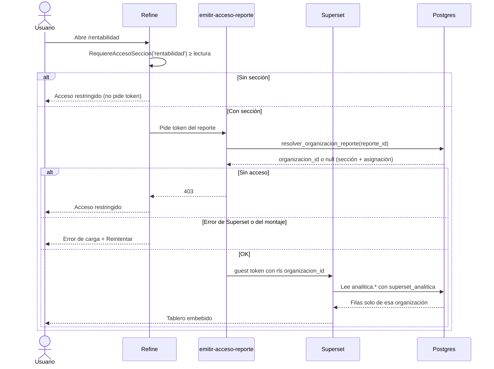
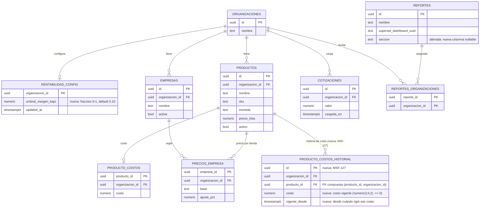
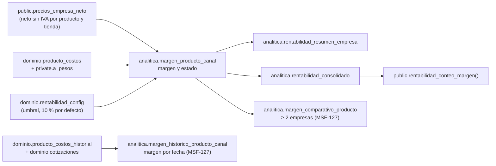
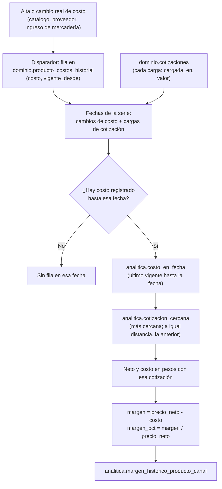

# Rentabilidad: datos, RPC y tableros (MSF-120, MSF-127)

- **MSF-120** — spec `rentabilidad-margen` · historias F-REN-01 (`0aab690`), F-REN-02 (`730d42d`) y
  F-REN-03 (`1cf16a9`).
- **MSF-127** — spec `rentabilidad-comparativos-e-historia` · historia F-REN-06 (`28f5c82c`, `ac5d548e`,
  `087ec27b`, `4bd94e07`, `af1459e2`) e historia F-REN-07 (`fb03665f`, `a7916e28`, `9e41f6e2`, `64df8502`);
  cierre MSF-569 (`ec852933`).

Alcance de entrega: `refine` + `supabase` + `superset`; sin `kestra` ni `workers` (el cálculo es SQL y el
tablero lo sirve Superset).

La pantalla vive en `apps/web/src/pages/rentabilidad/`; el cálculo, en vistas del esquema `analitica`
(`supabase/migrations/20261130100200_analitica_margen_producto_canal.sql` y
`20261130110000_analitica_rentabilidad_resumen.sql`, más las cuatro de MSF-127 que se detallan abajo); los
tableros, como YAML versionado en `infra/superset/dashboards/rentabilidad/`.

## Piezas

| Capa | Qué hace | Dónde |
|---|---|---|
| Refine | Rutas `/rentabilidad`, `/rentabilidad/productos`, `/rentabilidad/comparativo` y `/rentabilidad/historia`, pestañas, aviso, «Cómo se calcula», diálogo del umbral, acceso restringido, error con reintento | `apps/web/src/pages/rentabilidad/`, `apps/web/src/lib/rentabilidad.ts`, `apps/web/src/App.tsx` |
| Supabase | Umbral por organización, RPC, cálculo en vistas, rol de lectura de Superset y restricción por sección del token | `supabase/migrations/2026113010*` y `2026113011*` |
| Supabase (MSF-127) | Vistas del comparativo y del histórico, funciones `costo_en_fecha` y `cotizacion_cercana`, tabla `dominio.producto_costos_historial` y su disparador | `supabase/migrations/2027011110*` y `2027011111*` |
| Superset | Cuatro tableros embebidos («Resumen», «Por producto», «Comparativo» y «Historia») y su registro en `public.reportes` | `infra/superset/dashboards/rentabilidad/` |
| Edge Function | `emitir-acceso-reporte` responde 403 sin token si falta la sección del reporte | `supabase/functions/emitir-acceso-reporte/` |

## Flujo de acceso y cálculo



- La ruta está envuelta en `RequiereAccesoSeccion` (`apps/web/src/App.tsx`): sin `lectura` no se monta la
  pantalla ni se pide token. Un 403 del token también muestra `AccesoRestringido`
  (`apps/web/src/pages/rentabilidad/index.tsx`, `PorProducto.tsx`).
- El error de carga usa `EstadoError` con `Reintentar`, que remonta el tablero y repite la solicitud del
  token (`key` con el número de intento).
- Los tableros **no** dependen de la empresa activa: comparan todas las empresas de la organización. Es la
  excepción declarada al Principio VIII y está cubierta por el test de cambio de empresa.

## Datos y DER

### Objetos afectados

| Objeto | Esquema | Estado | Cambio |
|---|---|---|---|
| `rentabilidad_config` | `dominio` | nueva | `organizacion_id` PK, `umbral_margen_bajo` (0 < valor ≤ 1, default 0,10) y `updated_at`. |
| `margen_producto_canal` | `analitica` | nueva (vista) | Una fila por producto activo × empresa activa con margen calculable. |
| `rentabilidad_resumen_empresa` | `analitica` | nueva (vista) | Agregado por empresa derivado de `margen_producto_canal`. |
| `rentabilidad_consolidado` | `analitica` | nueva (vista) | Agregado por organización, ponderado y con conteos. |
| `margen_comparativo_producto` | `analitica` | nueva (vista, MSF-127) | Una fila por producto × empresa, solo productos con margen en 2 o más empresas, con mejor/peor margen y diferencia en pp. |
| `margen_historico_producto_canal` | `analitica` | nueva (vista, MSF-127) | Una fila por producto × empresa × fecha de la serie (cambio de costo o carga de cotización). |
| `costo_en_fecha` / `cotizacion_cercana` | `analitica` | nuevas (funciones, MSF-127) | Apoyo de la vista histórica: costo vigente en una fecha y cotización más cercana a una fecha. |
| `producto_costos_historial` | `dominio` | nueva (tabla, MSF-127) | Append-only: una fila por alta o cambio real de costo, con `vigente_desde`. |
| `producto_costos_historial` (disparador) | `dominio` | nuevo (MSF-127) | Disparador `after insert or update of costo` sobre `dominio.producto_costos` que escribe la historia. |
| `reportes.seccion` | `public` | alterada | Columna nueva, nullable; el reporte declara qué sección exige para emitir el token. |
| `reportes` | `public` | existente | Catálogo de reportes de la spec 007; sin cambios más que la columna anterior. |
| `reportes_organizaciones` | `public` | existente | Asignación reporte ↔ organización que consulta el resolver. |
| `productos` | `dominio` | existente | Fuente de nombre, SKU, moneda, precio de lista y estado activo. |
| `producto_costos` | `dominio` | existente | Fuente del costo; restringido por la sección `rentabilidad` (MSF-179) y disparador de la historia (MSF-127). |
| `cotizaciones` | `dominio` | existente | Historial de cotizaciones (F-PRE-04, MSF-116): `valor` y `cargada_en`; es la serie de fechas del histórico. |
| `precios_empresa` | `dominio` | existente | Regla de precio por empresa (MSF-114); el neto se lee por `public.precios_empresa_neto`. |
| `empresas` | `dominio` | existente | Nombre y estado activo de cada tienda. |
| `organizaciones` | `public` | existente | Dueña de los datos y del umbral. |

Migraciones de MSF-120: `20261130100000` (tabla, RLS y RPC del umbral), `20261130100100` (evento de
Actividad), `20261130100200` (`analitica` y vista base), `20261130110000` (vistas del resumen) y
`20261130110100` (RPC de conteo). `20261130100300` crea el rol de Superset y `20261130100400` agrega
`reportes.seccion`.

Migraciones de MSF-127 (rama `epic/MSF-127-inicio-rentabilidad-y-reportes-rentabili`, pendientes de merge a
`main`): `20270111100000_analitica_margen_comparativo.sql` (vista del comparativo),
`20270111100100_analitica_margen_comparativo_diferencia.sql` (mejor/peor y diferencia en pp),
`20270111110000_dominio_producto_costos_historial.sql` (tabla, disparador y siembra) y
`20270111110100_analitica_margen_historico.sql` (las dos funciones y la vista del histórico). Todas aditivas,
con reversión en el encabezado.



Las vistas de `analitica` no son tablas: no guardan datos ni tienen RLS. Cada una expone
`organizacion_id` y el aislamiento lo fuerza la cláusula `rls` del guest token
(`organizacion_id = '<org>'`). El esquema está cerrado para `anon` y `authenticated`; solo lo lee el rol
`superset_analitica` (`20261130100300_analitica_rol_superset.sql`).



## Fórmula y reglas

Fuente: `20261130100200_analitica_margen_producto_canal.sql`.

```text
precio_neto = analitica.neto_empresa(producto, empresa)  -- private.precio_neto_empresa
costo       = analitica.a_pesos(costo, moneda, organizacion) -- private.a_pesos
comision    = 0
margen      = precio_neto - costo
margen_pct  = margen / precio_neto
estado      = negativo si margen_pct < 0
              bajo     si margen_pct < umbral
              ok       en otro caso
```

- **Sin fila** si falta `producto_costos`, si el neto no es positivo o si un importe en USD no tiene
  cotización. No se rellena con cero.
- Solo productos activos y empresas activas.
- La vista corre con los permisos de su dueño; las funciones `analitica.neto_empresa` y
  `analitica.a_pesos` son envoltorios `security definer` con `search_path = ''` para que el rol de
  Superset no necesite acceso a `private` ni a las tablas de cotización.
- El consolidado usa **Σ márgenes ÷ Σ precios netos** sobre las filas producto × tienda. Los productos y
  los conteos se calculan por producto distinto, con su peor estado entre tiendas (un negativo gana sobre
  un bajo; los conteos no se superponen).

## RPC y permisos

| RPC / función | Seguridad | Quién | Errores |
|---|---|---|---|
| `public.leer_umbral_margen_bajo()` | `security invoker` | `rentabilidad` ≥ lectura | `42501` sin la sección |
| `public.guardar_umbral_margen_bajo(p_umbral, p_updated_at)` | `security invoker` | `rentabilidad` = `edicion` | `42501` sin permiso, `23514` fuera de rango, `40001` conflicto |
| `public.rentabilidad_conteo_margen()` | `security definer` (justificado) | `rentabilidad` ≥ lectura | `42501` sin la sección |
| `public.resolver_organizacion_reporte(p_reporte_id)` | `security definer` | token de un reporte asignado | `null` → 403 en la Edge Function |
| `emitir-acceso-reporte` | Edge Function | usuario autenticado | 403 sin token, 503 si Superset no responde |

- `rentabilidad_conteo_margen` es `security definer` porque las vistas de `analitica` están cerradas para
  `authenticated`; valida organización activa y sección adentro y filtra por `organizacion_id`. Devuelve
  `con_margen_bajo`, `con_margen_negativo` y `productos_con_margen` (el último distingue el estado vacío de
  «cero bajos»).
- `guardar_umbral_margen_bajo` es idempotente: guardar el mismo valor devuelve el `updated_at` vigente sin
  evento. El bloqueo optimista compara `p_updated_at` con la fila y falla con `40001` si otra persona la
  cambió.
- El evento `rentabilidad.umbral_actualizado` lo escribe el trigger
  `20261130100100_rentabilidad_umbral_actividad.sql` con `private.insertar_actividad`; guarda actor y
  porcentaje anterior/nuevo, y no se emite si el valor no cambió.
- `reportes.seccion` (`20261130100400_reportes_seccion.sql`) hace que `resolver_organizacion_reporte` exija
  `lectura` o `edicion` en esa sección y que el reporte esté asignado a la organización activa. Los reportes
  de Rentabilidad se registran con `seccion = 'rentabilidad'`.

La matriz vigente de la sección `rentabilidad` es Administrador = edición, Administración = lectura y el
resto = ninguno. El detalle de roles vive en [Permisos por rol](../permisos-por-rol.md).

## Comparativo e historia (MSF-127)

Épica **MSF-127**, spec `rentabilidad-comparativos-e-historia`, rama
`epic/MSF-127-inicio-rentabilidad-y-reportes-rentabili` (pendiente de merge a `main`). Dos pestañas nuevas de
`/rentabilidad` que reusan la vista base, el rol de Superset, el guest token por sección y el patrón de
embebido de MSF-120: **no cambia la firma de ningún RPC ni de ninguna función existente**.

### Objetos nuevos

| Objeto | Tipo | Qué es | Archivo |
|---|---|---|---|
| `analitica.margen_comparativo_producto` | vista | Una fila por producto × empresa, **solo** para productos con margen en 2 o más empresas; expone `margen_pct_mejor`, `margen_pct_peor`, `diferencia_pp`, `empresa_mejor` y `empresa_peor`. | `20270111100000_analitica_margen_comparativo.sql` + `20270111100100_analitica_margen_comparativo_diferencia.sql` |
| `analitica.costo_en_fecha(p_producto, p_organizacion, p_fecha)` | función | Último costo de la historia con `vigente_desde ≤ fecha`; `null` si no hay. `security definer`, `search_path = ''`. | `20270111110100_analitica_margen_historico.sql` |
| `analitica.cotizacion_cercana(p_organizacion, p_fecha)` | función | Carga de `dominio.cotizaciones` de menor distancia temporal a la fecha; a igual distancia, la anterior; `null` si no hay cotizaciones. `security definer`, `search_path = ''`. | `20270111110100_analitica_margen_historico.sql` |
| `analitica.margen_historico_producto_canal` | vista | Una fila por producto × empresa × fecha de la serie, con `cotizacion`, `precio_neto`, `costo`, `margen` y `margen_pct` convertidos a pesos. | `20270111110100_analitica_margen_historico.sql` |
| `dominio.producto_costos_historial` | tabla | Append-only: `id`, `organizacion_id`, `producto_id`, `costo`, `vigente_desde`. FK compuesta a `dominio.productos (id, organizacion_id)` con `on delete cascade`. | `20270111110000_dominio_producto_costos_historial.sql` |
| `private.registrar_costo_historial()` + disparador `producto_costos_historial` | trigger | `after insert or update of costo` sobre `dominio.producto_costos`; escribe una fila por alta o **cambio real** de costo. `security definer`, `search_path = ''`. | `20270111110000_dominio_producto_costos_historial.sql` |

El contrato completo está en
`specs/20261024-130000-rentabilidad-comparativos-e-historia/contracts/analitica-comparativos-historia.md`
(spec `rentabilidad-comparativos-e-historia`, épica MSF-127).

**[ERD interactivo (Archify)](../diagrams/msf-127-erd.html)** — la historia de costos nueva, las dos vistas de
`analitica` y las tablas de las que dependen, con columnas, PK/FK y cardinalidad.

### Comparativo: cómo se calcula

La vista deriva de `analitica.margen_producto_canal` y **no duplica ninguna fórmula**: precio neto sin IVA,
costo con `private.a_pesos`, comisión 0, `margen = precio_neto − costo`, `margen_pct = margen / precio_neto`.
Lo único que agrega es la comparación:

```text
empresas_comparadas = count(*) over (partition by organizacion_id, producto_id)
filtro              = empresas_comparadas >= 2
margen_pct_mejor    = max(margen_pct) over (partition by organizacion_id, producto_id)
margen_pct_peor     = min(margen_pct) over (partition by organizacion_id, producto_id)
diferencia_pp       = (margen_pct_mejor - margen_pct_peor) * 100   -- en puntos porcentuales
empresa_mejor       = first_value(empresa_nombre) over (… order by margen_pct desc, empresa_nombre, empresa_id)
empresa_peor        = first_value(empresa_nombre) over (… order by margen_pct, empresa_nombre, empresa_id)
```

- El desempate es **estable por nombre y después por id**: con dos empresas al mismo margen, gana la primera
  por nombre (pgTAP: Alfa antes que Beta).
- `diferencia_pp` es una **fracción multiplicada por 100**: 40 % contra 33,3 % da 6,67 pp.
- El filtro `empresas_comparadas >= 2` se aplica sobre la vista base, que ya excluye los productos sin costo,
  con neto no positivo o sin cotización: **sin fila en la base, sin fila en el comparativo**.

### Historia: cómo se calcula



- **Fechas de la serie**: la unión de los `vigente_desde` de la historia de costos y los `cargada_en` de
  `dominio.cotizaciones` de la organización.
- **Costo de una fecha**: el último `vigente_desde ≤ fecha` (`costo_en_fecha`); si no hay ninguno, la fecha no
  tiene fila (no se inventa un costo anterior al primer registro).
- **Cotización de una fecha**: la carga de menor distancia temporal; a igual distancia, **la anterior**
  (`cotizacion_cercana` ordena por `abs(epoch(cargada_en - fecha))`, luego `cargada_en`, luego `id`).
- **El precio es el neto de la tienda vigente hoy**, en su moneda, convertido con la cotización de esa fecha
  (`private.aplicar_regla_precio` sobre `p.precio_lista`, con la regla de `dominio.precios_empresa`): la épica
  **no reconstruye precios de lista históricos**.
- **Sin fila** si falta el costo registrado hasta la fecha, si el neto no es positivo, o si el producto está en
  USD y no hay cotización para esa fecha. Un producto **en ARS sin cotizaciones cargadas conserva su
  historia** (la cotización queda nula) — corrigió el commit `64df8502` («la historia de margen no exige
  cotización a productos en pesos»).
- Solo productos activos y empresas activas.

### Historia de costos: por qué es una tabla propia

**Decisión de Nicolás (AGE-1102, 24/10)**: la historia del costo **no** se reconstruye desde Actividad. La
Actividad registra el cambio de costo como `producto.precio_actualizado` «Cambió el costo de \<producto\>»
**sin importes, por diseño** (`20261022121200_precios_actividad_producto.sql`, `docs/actividad.md`), y así se
mantiene. Por eso MSF-127 **no depende** de F-AUD-01 ni del evento `producto.costo_modificado`: la «verificación
previa» de la épica queda resuelta por esta decisión.

- El disparador vive **sobre `dominio.producto_costos`**, así que cubre a todos los escritores del costo
  (RPC de catálogo, proveedores, ingreso de mercadería) sin cambiar ninguna firma.
- Guardar **el mismo costo no agrega fila**: el disparador compara `new.costo is distinct from old.costo`.
- La migración **siembra una fila inicial por cada costo existente** (con `vigente_desde = clock_timestamp()`):
  el punto de partida de la historia. **Antes de esa fecha no hay costo registrado y por lo tanto no hay
  margen histórico.**
- La tabla es **append-only**: no hay políticas de `insert`/`update`/`delete` para `authenticated`; solo la
  escribe el disparador.

### RLS y permisos de la superficie nueva

| Objeto | `anon` | `authenticated` | Rol de Superset |
|---|---|---|---|
| `analitica.margen_comparativo_producto` | sin privilegios | sin privilegios | `select` |
| `analitica.margen_historico_producto_canal` | sin privilegios | sin privilegios | `select` |
| `analitica.costo_en_fecha` / `cotizacion_cercana` | sin `execute` | sin `execute` | `execute` |
| `dominio.producto_costos_historial` | sin privilegios | `select` con `organizacion_id = private.organizacion_id()` y sección `rentabilidad` en (`lectura`, `edicion`); sin escritura | — |

- `revoke all on analitica.<vista> from public, anon, authenticated` y
  `revoke execute on function … from public, anon, authenticated` en cada migración.
- La **RLS de `dominio.producto_costos_historial`** es la única defensa de los importes del historial para
  `authenticated`: nadie sin la sección `rentabilidad` los lee, ni por la tabla, ni por Actividad, ni por un
  tablero.
- Las dos funciones son `security definer` con `set search_path = ''`; el rol `superset_analitica` es el único
  que las ejecuta.
- El aislamiento entre organizaciones de las dos vistas depende de la **cláusula `rls` del guest token**: por
  eso ambas exponen `organizacion_id` (invariante que verifica
  `supabase/tests/database/rentabilidad_superficie.test.sql`).
- Revisión de cierre de MSF-127 (T022, FR-016): sin hallazgos nuevos ni cambios de código.

### Frontend de las dos pestañas

- Rutas: `/rentabilidad/comparativo` (`RentabilidadComparativo`) y `/rentabilidad/historia`
  (`RentabilidadHistoria`), en `apps/web/src/App.tsx`; las pestañas se arman con `PESTANAS_RENTABILIDAD` en
  `apps/web/src/lib/rentabilidad.ts` (`RUTA_COMPARATIVO`, `RUTA_HISTORIA`, `NOMBRE_REPORTE_COMPARATIVO`,
  `NOMBRE_REPORTE_HISTORIA`).
- Las dos reutilizan el mismo patrón que **Por producto**: `ReporteEmbebido`, `EstadoCargaPagina`,
  `EstadoError` con **Reintentar** (cada intento remonta el tablero con un `key` y repite la solicitud del
  token) y `AccesoRestringido` ante un 403 —sin pedir token— y sin la sección `rentabilidad`.
- Cada pestaña muestra una nota informativa propia: «Compará el margen del mismo producto en cada empresa.
  Solo aparecen los productos con margen calculado en dos o más empresas.» y «Elegí un producto para ver cómo
  evolucionó su margen en cada empresa, con la cotización del dólar y el costo de cada fecha.»
- **No dependen de la empresa activa**: comparan todas las empresas de la organización (Principio VIII, no
  aplica). El test de cambio de empresa comprueba que el tablero no se altera.

### Tableros y datasets de MSF-127

| Tablero | Slug | Dataset | Gráficos | Filtros nativos |
|---|---|---|---|---|
| **Rentabilidad · Comparativo** | `rentabilidad-comparativo` | `margen_comparativo_producto` (virtual, agrupa el margen % de cada empresa en `margenes_html`) | tabla Handlebars con Producto, Margen % por empresa, Diferencia, Mejor margen, Peor margen y el contador «N productos» | `Buscar producto o SKU` (`producto_busqueda`) y `Orden por diferencia` (`orden_etiqueta`) |
| **Rentabilidad · Historia** | `rentabilidad-historia` | `margen_historico_producto_canal` | serie `echarts_timeseries_line` de margen % por empresa a lo largo de la fecha, y tabla de apoyo (Fecha, Empresa, Cotización, Costo, Neto, Margen, Margen %) | `Producto` (`producto_etiqueta`, selección única) |

- El **orden por diferencia** se resuelve sin Jinja: el dataset repite cada producto con `orden_etiqueta`
  («Mayor diferencia primero» / «Menor diferencia primero») y su `posicion`; el filtro nativo elige el
  conjunto y la tabla ordena por `posicion`. No hace falta activar `ENABLE_TEMPLATE_PROCESSING`.
- El filtro **Producto** del tablero «Historia» es de **una sola opción** (`multiSelect: false`) y su valor
  vacío está permitido (`enableEmptyFilter: true` en
  `infra/superset/dashboards/rentabilidad/dashboards/Rentabilidad_Historia_5.yaml`): con el filtro vacío el
  tablero muestra el motivo de negocio, no series mezcladas.
- Los **estados vacíos** los dibuja Superset: «Sin resultados. No hay productos con margen en dos o más
  empresas. Cambiá el filtro o la búsqueda.» (Comparativo) y «Sin historia para este producto…» (Historia),
  con el motivo de negocio y sin identificadores técnicos.
- Los dos tableros se registran en `infra/superset/dashboards/rentabilidad/reportes.json` con
  `seccion = 'rentabilidad'` y rol por defecto `administracion`; el importador es idempotente
  (`pnpm test:superset:importar-dashboards`).
- Detalle operativo: [Operar Superset](../operar-superset.md#tableros-de-rentabilidad-msf-120).

## Frontend

- Rutas: `/rentabilidad` (`RentabilidadResumen`), `/rentabilidad/productos` (`RentabilidadPorProducto`),
  `/rentabilidad/comparativo` (`RentabilidadComparativo`) y `/rentabilidad/historia` (`RentabilidadHistoria`),
  en `apps/web/src/App.tsx`. Menú **Análisis**, ícono `Insights`.
- Pestañas: **Resumen**, **Por producto**, **Comparativo** y **Historia**. «Por publicación de ML» no se
  monta (Etapa 2).
- El resumen usa `useConteoMargen` para el aviso y el estado vacío; si no hay productos con margen
  calculado muestra `EstadoVacio`, y si no hay reporte asignado o falla el montaje muestra `EstadoError`
  con reintento (`apps/web/src/pages/rentabilidad/index.tsx`).
- El diálogo `DialogoUmbral` se monta bajo demanda, lee el umbral vigente al abrir y mapea los códigos de
  la base a mensajes claros (`apps/web/src/lib/rentabilidad.ts`). Solo se ofrece con `edicion`.
- «Por producto» pasa el filtro inicial por `urlParams` al tablero: `?estado=bajo_o_negativo` o
  `?estado=negativo` se traducen a `native_filters` (rison) del filtro `NATIVE_FILTER-estado`
  (`apps/web/src/lib/rentabilidad.ts`). Cualquier otro valor se ignora.
- **Desvíos de F-REN-03 (MSF-556):** el orden está fijo por menor margen (no hay selector
  «Mayor/Menor margen primero») y la búsqueda es un `filter_select` de Superset, no un campo de texto
  libre. La tabla no pagina en el cliente (`row_limit` 10000); el volumen esperado es de cientos de filas
  producto × tienda.
- «Cómo se calcula» toma las empresas activas de `useEmpresas`; no consulta una tabla nueva.
- **Comparativo** e **Historia** (MSF-127) son la misma pantalla con otro reporte: `useReportesAsignados`
  busca el reporte por nombre, `ReporteEmbebido` lo monta y el error con **Reintentar** remonta el tablero
  repitiendo el token. Detalle en
  [Comparativo e historia (MSF-127)](#comparativo-e-historia-msf-127).

## Tableros y operación de Superset

- YAML versionado en `infra/superset/dashboards/rentabilidad/`: base de datos lógica
  `Rentabilidad_analitica`, datasets `margen_producto_canal`, `rentabilidad_resumen_empresa`,
  `rentabilidad_consolidado`, `margen_comparativo_producto` y `margen_historico_producto_canal`, charts y los
  dashboards `rentabilidad-resumen`, `rentabilidad-por-producto`, `rentabilidad-comparativo` y
  `rentabilidad-historia`.
- `infra/superset/dashboards/rentabilidad/reportes.json` registra los nombres que busca la pantalla:
  `Rentabilidad · Resumen`, `Rentabilidad · Por producto`, `Rentabilidad · Comparativo` y
  `Rentabilidad · Historia`, todos con `seccion = 'rentabilidad'` y rol por defecto `administracion`. El
  Administrador no se lista porque tiene acceso incondicional.
- Importación (idempotente) desde `infra/superset/importar-dashboards.mjs`, usada por el despliegue:

  ```bash
  pnpm superset:importar-dashboards -- --directorio infra/superset/dashboards/rentabilidad --entorno staging
  pnpm superset:importar-dashboards -- --directorio infra/superset/dashboards/rentabilidad --entorno production
  ```

- Variables (solo en `.env`/secrets): `SUPERSET_ANALITICA_DB_HOST`, `SUPERSET_ANALITICA_DB_PASSWORD`,
  `SUPABASE_URL`, `SUPABASE_SERVICE_ROLE_KEY` (server-side) y `SUPERSET_REPORTE_CREADO_POR`.
- El rol `superset_analitica` nace `nologin` y sin contraseña en la migración; el despliegue
  (`pnpm db:migrar:cloud`) le habilita login con la contraseña del entorno. Tiene `usage` en `analitica`,
  `select` en las vistas y `execute` en las dos funciones de apoyo.
- El detalle operativo de red, orígenes permitidos, permisos de `Guest` y UUIDs está en
  [Operar Superset](../operar-superset.md#tableros-de-rentabilidad-msf-120).

## Seguridad e aislamiento

- `dominio.rentabilidad_config`: RLS por organización y sección; `select` con lectura/edición,
  `insert`/`update` solo con edición, sin `DELETE`; `anon` sin privilegios.
- `dominio.producto_costos_historial` (MSF-127): RLS por organización y sección `rentabilidad`; solo
  `select` para `authenticated`; **sin políticas de escritura** (la escribe el disparador `security definer`);
  `anon` sin privilegios.
- `analitica`: `revoke all` para `public`, `anon` y `authenticated`; solo `superset_analitica` lo usa. Las
  funciones nuevas de MSF-127 además revocan `execute` a `public`, `anon` y `authenticated`.
- Las vistas no aplican RLS dentro de Superset: el aislamiento depende de la cláusula `rls` del guest
  token. Por eso **toda vista nueva de `analitica` debe exponer `organizacion_id`**.
- **Secreto de costos (MSF-127):** los importes de la historia de costos y del margen histórico no salen por
  Actividad (que sigue registrando «Cambió el costo de X» sin importes) ni por ninguna vista o función
  legible por `authenticated` sin la sección `rentabilidad`; los RPC de costo no cambiaron de firma.
- Las pruebas `supabase/tests/database/rentabilidad_aislamiento.test.sql` y
  `rentabilidad_permisos.test.sql` cubren dos organizaciones, 403 sin sección y la matriz de roles.
- Revisión de cierre (T031): RLS/grants de tabla y RPC, `anon` sin acceso, esquema `analitica` cerrado,
  rol de Superset y token por sección; guardas en `rentabilidad_superficie.test.sql` y
  `rls_en_toda_tabla`.
- Revisión de cierre de MSF-127 (T022, FR-016): la superficie nueva (`margen_comparativo_producto`,
  `margen_historico_producto_canal`, `costo_en_fecha`, `cotizacion_cercana`,
  `dominio.producto_costos_historial` y el disparador) se revisó en las migraciones `20270111100000`–
  `20270111110100`: sin hallazgos nuevos ni cambios de código.

## Pruebas

| Prueba | Qué cubre |
|---|---|
| `supabase/tests/database/rentabilidad_margen.test.sql` | Fórmula, conversión USD/ARS, sin fila, bordes de estado, umbral y evento. |
| `supabase/tests/database/rentabilidad_permisos.test.sql` | RPC del umbral, matriz de roles y bloqueo optimista. |
| `supabase/tests/database/rentabilidad_aislamiento.test.sql` | Dos organizaciones, token con `rls` y 403 sin sección. |
| `supabase/tests/database/rentabilidad_consolidado.test.sql` | Ponderación Σ márgenes ÷ Σ netos y coherencia del conteo. |
| `supabase/tests/database/rentabilidad_por_producto.test.sql` | Un producto en dos tiendas = dos filas, estados, filtros y orden. |
| `supabase/tests/database/rentabilidad_comparativo.test.sql` (MSF-127) | Comparabilidad (≥ 2 empresas), diferencia en pp (40 % vs 33,3 % → 6,7), mejor/peor con desempate por nombre, exclusiones, valores iguales a la vista base, `anon`/`authenticated` sin acceso y rol de Superset de solo lectura. |
| `supabase/tests/database/rentabilidad_comparativo_aislamiento.test.sql` (MSF-127) | Dos organizaciones y token rechazado (403) para roles sin `rentabilidad`. |
| `supabase/tests/database/rentabilidad_historia.test.sql` (MSF-127) | Disparador (alta, cambio y mismo costo sin fila), siembra, `costo_en_fecha`, `cotizacion_cercana` con empate, USD se mueve y ARS queda plano, varias cargas el mismo día, exclusiones y acceso. |
| `supabase/tests/database/rentabilidad_historia_aislamiento.test.sql` (MSF-127) | Dos organizaciones, 403 sin sección y secreto de costos para roles sin `rentabilidad` y para `anon`. |
| Vitest `apps/web/src/pages/rentabilidad/*.test.tsx` y `lib/rentabilidad.test.ts` | Tarjetas, aviso, navegación, estados, diálogo, permisos y ocultación de ML. |
| Vitest `apps/web/src/pages/rentabilidad/Comparativo.test.tsx` y `Historia.test.tsx` (MSF-127) | Pestañas: error y reintento, acceso restringido, sin Mercado Libre, teclado/lector y que cambiar la empresa de la barra superior no altera el tablero. |
| Vitest `apps/web/src/pages/rentabilidad/tableroComparativo.contrato.test.ts` y `tableroHistoria.contrato.test.ts` (MSF-127) | Contrato de los YAML: columnas de las tablas, contador «N productos», estados vacíos con motivo de negocio, filtros nativos, serie por empresa y registro en `reportes.json`. |
| `apps/web/e2e/rentabilidad-roles.e2e.ts` | Administrador edita el umbral, Administración lee, Operador/Consulta restringidos (SC-008); desde MSF-127 recorre además `/rentabilidad/comparativo` y `/rentabilidad/historia` (SC-007). |

El E2E con roles está **escrito pero no ejecutado** en el entorno del desarrollo (sin Docker); requiere
`pnpm dev:supabase` y se corre con `pnpm --filter @platform/web test:e2e rentabilidad-roles`. No monta
Superset: valida aviso, diálogo y acceso contra la base real. Ver [E2E de la app](../e2e-app.md).

## Reversión

Las migraciones son aditivas y su camino de vuelta está en el encabezado de cada una. Se aplica en una
migración posterior, nunca en el PR que crea los objetos: quitar las vistas de `analitica` y el esquema,
las RPC del umbral y del conteo, `dominio.rentabilidad_config` (exportar antes los datos) y
`public.reportes.seccion`, y restaurar `resolver_organizacion_reporte` de la spec 007. Para deshacer la
épica completa: `git revert -m 1` del merge.

Para MSF-127, la reversión de cada migración está en su encabezado; el camino completo para deshacer la épica
es (migración posterior, nunca en el PR que crea los objetos):

```sql
drop view analitica.margen_historico_producto_canal;
drop view analitica.margen_comparativo_producto;
drop function analitica.costo_en_fecha(uuid, uuid, timestamptz);
drop function analitica.cotizacion_cercana(uuid, timestamptz);
drop trigger producto_costos_historial on dominio.producto_costos;
drop function private.registrar_costo_historial();
drop table dominio.producto_costos_historial;  -- exportar antes los datos
```

Además hay que borrar las filas de `public.reportes` de «Comparativo» y «Historia». La tabla de historia de
costos es el único objeto de MSF-127 que **guarda datos**: exportala antes de borrarla.

## Pendientes y deuda trazada

| Pendiente | Dueño / seguimiento |
|---|---|
| Verificar en un Superset real la importación de los tableros y el filtro inicial desde el aviso. | Cierre de MSF-120 (SC-003/SC-009) |
| Ejecutar el E2E de tres roles con el stack local. | MSF-499 / cierre de MSF-120 |
| Selector de orden «Mayor/Menor margen primero» y búsqueda de texto libre. | MSF-556 |
| Ponderar el consolidado por stock o ventas reales. | MSF-192 |
| Confirmar si Administración debe ver los tableros y si Consulta debe ver costos. | Cliente / producto |
| Dónde viven los eventos de Actividad (F-AUD-01 no está cargada en Jira). | Plataforma / producto |
| Verificar en un Superset real la importación de «Comparativo» y «Historia» y el selector de producto del histórico. | Cierre de MSF-127 |
| Capturas a 320/768/1440 px y revisión visual de la pestaña «Comparativo» (`pantallas:capturar` toma un solo viewport y la pestaña no está en el prototipo). | MSF-570 (seguimiento de F-REN-06) |
| Ejecutar el E2E con los dos tableros nuevos (MSF-569, ya escrito). | Cierre de MSF-127 |
| Columnas y series de cuentas de Mercado Libre en los dos tableros. | Épica de Mercado Libre (Etapa 2) |
| Validar con el cliente los márgenes de ejemplo de los escenarios (40 % contra 33,3 %). | Producto (AGE-1102) |

