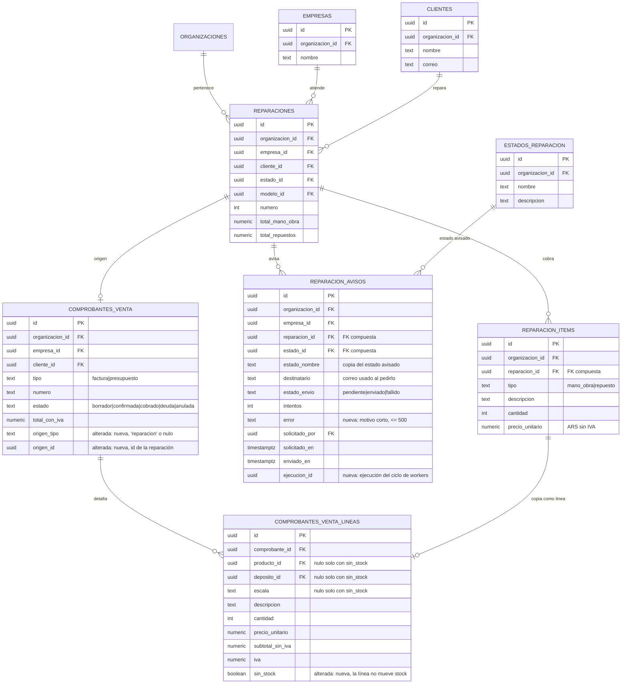

# Service técnico: cobro, avisos y ficha del cliente (técnico, MSF-232)

Épica **MSF-232** (F-SVC-13 / MSF-418, F-SVC-14 / MSF-424, F-SVC-15 / MSF-429 y cierre MSF-576). Spec, plan,
tareas y contratos: `specs/20261028-100000-service-cobro-y-avisos/`. Implementación en la rama
`epic/MSF-232-service-tecnico-service-cobro-y-avisos`, **pendiente de merge a `main`** al momento de esta página.
Resumen de producto y guía de prueba: [Service técnico: cobro, avisos y ficha del cliente
(producto)](../producto/service-cobro-y-avisos.md).

Alcance de entrega: **`refine`** (`apps/web`), **`supabase`** (migraciones, RPC y pgTAP) y **`kestra`** (un flow de
envío de correo). Sin `superset` ni `workers`: el correo sale por el SMTP que ya usa Kestra, como
`comprobantes-correo`.

## Modelo de datos

No hay tablas nuevas de plataforma: la épica **agrega dos columnas a `dominio.comprobantes_venta`**, **una columna
a `dominio.comprobantes_venta_lineas`**, **crea `dominio.reparacion_avisos`** y **cinco RPC en `public`** (más
funciones internas en `private`). `dominio.reparaciones`, `dominio.reparacion_items`, `dominio.estados_reparacion` y
`public.clientes` solo se leen; la outbox (`public.capacidades_ejecucion`, `public.ejecuciones_worker`,
`public.despachos_ejecucion`) recibe filas solo por RPC.

| Tabla | Estado | Cambio |
|---|---|---|
| `dominio.comprobantes_venta` | **alterada** | `origen_tipo text` (`check in ('reparacion')`) y `origen_id uuid`: de qué documento nació el comprobante. `check` de que van juntas o ninguna (`comprobantes_venta_origen_check`) e índice único parcial `comprobantes_venta_origen_vigente_uk` sobre `(organizacion_id, origen_tipo, origen_id) where origen_tipo is not null and estado <> 'anulada'`: **un solo comprobante vigente por reparación**, también bajo concurrencia. Una factura anulada libera el origen. |
| `dominio.comprobantes_venta_lineas` | **alterada** | `sin_stock boolean not null default false`: la línea **no mueve stock**. Solo esas líneas admiten `producto_id`, `deposito_id` y `escala` nulos (`comprobantes_venta_lineas_sin_stock_check`); las líneas de catálogo quedan igual (`sin_stock = false`). |
| `dominio.reparacion_avisos` | **nueva** | Historial de avisos al cliente de una reparación: `estado_id`/`estado_nombre` (copia del estado avisado), `destinatario` (correo **al pedir** el aviso), `estado_envio` (`pendiente` \| `enviado` \| `fallido`), `intentos`, `error` (motivo corto, ≤ 500), `solicitado_por`, `solicitado_en`, `enviado_en`, `ejecucion_id`. FK compuestas por organización hacia la reparación, el estado y la tienda. Índice único parcial `reparacion_avisos_pendiente_uq` sobre `(reparacion_id, estado_id) where estado_envio = 'pendiente'`: **un solo aviso pendiente por reparación y estado**. |
| `dominio.reparaciones`, `dominio.reparacion_items` | existentes | Solo se leen (ítems, cliente, tienda, total al cliente). |
| `dominio.estados_reparacion` | existente | Solo se lee (nombre y descripción del estado avisado). |
| `public.clientes` | existente | Solo se lee (`correo` del cliente). |
| `public.capacidades_ejecucion`, `public.ejecuciones_worker`, `public.despachos_ejecucion` | existentes | La outbox de plataforma: solo inserta filas la RPC `avisar_cliente_reparacion`. |

- **Esquema (Principio VII)**: `reparacion_avisos` es una entidad de negocio del taller → **`dominio`**. Las columnas
  nuevas de Ventas también quedan en `dominio` (el comprobante ya es dominio del producto). Las RPC viven en `public`
  (contrato de la app) y las ayudas internas del flow en `private`.
- **`origen_id` no es FK**: el origen vive en otra tabla de `dominio` y el tipo puede crecer; la RPC valida el vínculo.
- **RLS y privilegios**:
  - `reparacion_avisos`: RLS por `organizacion_id`, nivel `service_tecnico` (`lectura`/`edicion`) y tienda
    accesible (`private.empresas_accesibles()`). **Sin** políticas ni grants de escritura para `authenticated`: se
    escribe solo por `public.avisar_cliente_reparacion` y `private.cerrar_aviso_reparacion`. **Sin `delete`**.
    `anon` sin privilegios. `authenticated` lee solo columnas **sin** el correo del cliente (`destinatario`) ni la
    ejecución: el historial completo sale por `public.avisos_de_reparacion`, que valida permiso y tienda.
  - `comprobantes_venta` / `comprobantes_venta_lineas`: la RLS vigente de Ventas; las columnas nuevas no tienen
    escritura directa (solo la RPC de generación) y `sin_stock` no se edita desde la app.
  - `rls_en_toda_tabla` (pgTAP, recorre `public` + `dominio`) debe seguir verde.

## RPC

Todas son `security definer` con `search_path = ''`, `revoke execute … from public, anon` y
`grant execute … to authenticated`. La organización y el actor salen de la sesión, nunca del llamador.

| RPC | Qué hace | Permisos |
|---|---|---|
| `public.generar_comprobante_reparacion(p_reparacion uuid)` | Crea (o devuelve) la **factura en `borrador`** de la reparación, en su tienda y con su cliente, con `origen_tipo = 'reparacion'` y una línea por ítem marcada `sin_stock`. Devuelve `{ comprobante_id, creado }`. | `service_tecnico` en `edicion` **y** `ventas` en `edicion` en la tienda de la reparación. |
| `public.comprobante_de_reparacion(p_reparacion uuid)` | Devuelve `{ id, numero, tipo, estado, total, empresa_id, empresa }` del comprobante **vigente** (no anulado) o `null`. | `service_tecnico` en `lectura` o más y tienda accesible. |
| `public.avisar_cliente_reparacion(p_reparacion uuid, p_estado_id uuid default null)` | En **una sola transacción**: bloquea la reparación (`for update`), crea el aviso `pendiente` del estado pedido (por defecto el actual) con el correo **actual** del cliente y deja la orden de despacho `enviar-aviso-reparacion-<aviso>` en la outbox. Devuelve `{ resultado: 'encolado' \| 'sin_correo', aviso_id }`. | `service_tecnico` en `edicion` y tienda accesible. |
| `public.avisos_de_reparacion(p_reparacion uuid)` | Historial (más reciente primero): estado avisado, destinatario, resultado, motivo, fechas y **nombre visible** de quien lo pidió (nunca su correo). Antes de leer cierra como fallidos los pendientes vencidos. | `service_tecnico` en `lectura` o más y tienda accesible. |
| `public.reparaciones_de_cliente(p_cliente uuid, p_empresa uuid default null, p_pagina int default 1, p_tamano int default 25)` | `{ total_filas, filas[] }` paginado: número `R-0238`, tienda, equipo, modelo, estado, ingreso, entrega prevista y total (mano de obra + repuestos). **Nunca costos internos**. | `service_tecnico` en `lectura` o más y tiendas accesibles. |

Además, **sin `grant` a `authenticated`** (solo el rol de servicio `kestra_orquestacion`): `private.datos_aviso_reparacion(aviso)`,
`private.cerrar_aviso_reparacion(aviso, motivo)` y `private.aplicar_cierre_aviso_reparacion(aviso, motivo)`.
`private.expirar_avisos_reparacion(reparacion)` cierra como fallidos los avisos pendientes que ya no pueden
completarse: la llaman las dos RPC de aviso, no Kestra.

### Errores

| Código | Cuándo | Mensaje (castellano, la app los muestra tal cual) |
|---|---|---|
| `42501` | falta `service_tecnico` en `edicion` (o `ventas` en `edicion` para generar) | «Tu rol no puede generar el comprobante de una reparación» / «Tu rol no puede crear comprobantes en la tienda de esta reparación» / «Tu rol no puede avisar a los clientes de las reparaciones» |
| `P0002` | la reparación no existe o su tienda no es accesible | «La reparación no existe» |
| `55000` | la reparación está anulada | «La reparación está anulada: no se puede generar su comprobante» / «La reparación está anulada: no se puede avisar al cliente» |
| `22023` | sin ítems, tienda desactivada, cliente archivado o estado inexistente | «La reparación no tiene ítems: cargá mano de obra o repuestos para generar el comprobante» / «La tienda de la reparación está desactivada» / «El cliente de la reparación está archivado: restauralo para generar el comprobante» |
| `P0001` (hint `sin_conexion`) | la organización no tiene habilitada la conexión de envíos | la app lo traduce a «El envío de avisos todavía no está habilitado para tu organización…» |

### Alícuota (provisoria)

*Decisiones abiertas* 1 de la spec; a confirmar con el cliente. La alícuota de cada línea sale de **Precios e IVA**
(`dominio.alicuotas_iva`):

- **Repuesto vinculado al catálogo** → la alícuota efectiva del producto (`private.alicuota_producto`: la del
  producto o, si no tiene, la de su categoría).
- **Mano de obra y repuesto libre** → la **alícuota general vigente** de la organización (`private.alicuota_general`:
  la activa al 21 %, si no la mayor activa no exenta; 0 % si no hay ninguna).

No hay porcentajes escritos en el código fuera de esa elección. Si el cliente quiere presupuesto o sin IVA, cambia
solo la RPC.

### Idempotencia y concurrencia

- **Comprobante**: la reparación se toma `for update`, así dos personas que pulsan a la vez se serializan; la segunda
  ve el comprobante de la primera y recibe `{ creado: false }`. El **índice único parcial** por origen vigente es el
  respaldo en la base: si dos transacciones se escapan al bloqueo, la segunda recibe `unique_violation` y devuelve el
  comprobante existente en lugar de crear otro. Con el comprobante **anulado** se puede generar uno nuevo.
- **Aviso**: `reparacion_avisos_pendiente_uq` garantiza **un solo aviso pendiente por reparación y estado**: el doble
  clic es un solo aviso. «Reenviar» es la misma RPC con el `estado_id` del aviso original y crea un aviso **nuevo**
  con el correo actual del cliente.

### `sin_stock` y el stock

`sin_stock` **no es** `a_pedido` (que reserva stock): la línea marcada `sin_stock` ni descuenta, ni reserva, ni
devuelve. La migración `20270115010100_lineas_sin_stock.sql` reemplaza (misma firma, mismos permisos) las funciones
de stock para saltear esas líneas:

| Función | Qué hace con las líneas `sin_stock` |
|---|---|
| `public.confirmar_comprobante` | No genera salida ni reserva. |
| `private.revertir_venta_comprobante`, `private.devolver_stock_nota_credito` | No devuelven stock. |
| `public.emitir_nota_credito` | La línea acreditada copia la marca `sin_stock`. |
| `public.guardar_lineas_comprobante` | Conserva las líneas `sin_stock` al re-guardar las de catálogo y las suma a los totales. |
| `private.datos_documento_comprobante` (PDF) y el detalle de anulación de nota de crédito | `left join` de depósito, para que la línea sin depósito no desaparezca del documento. |

Las líneas de catálogo quedan **exactamente igual** (`sin_stock = false`): es una regresión de MSF-159 que el pgTAP
`service_cobro_stock.test.sql` cubre.

## Flow de Kestra (aviso por correo)

`infra/kestra/flows/reparaciones-aviso-correo.yml` (namespace `producto.service`, `cron: "* * * * *"`), con el
patrón de `comprobantes-correo`:

1. **Reclama** solo las órdenes `enviar-aviso-reparacion-*` (`private.reclamar_despachos_capacidad`, 5 por vez,
   900 s de reclamo).
2. **Resuelve los datos** con `private.datos_aviso_reparacion(aviso)`: destinatario, cliente, tienda, número `R-000N`,
   equipo (modelo), estado y su descripción. **Sin importes ni costos**; los textos del asunto van sin saltos de línea.
3. **Envía** el correo por el SMTP existente (`KESTRA_SMTP_*`, **sin variables nuevas**) con **3 reintentos**
   (`maxAttempts: 3`, `interval: PT30S`) y, si el aviso sigue pendiente, lo cierra con
   `private.cerrar_aviso_reparacion(aviso, null)` → `enviado`.
4. **Si falla** tras los reintentos, lo cierra como `fallido` con el motivo fijo **«No se pudo enviar el correo»**
   (nunca el mensaje del SMTP, que puede traer hosts o credenciales) y **confirma** la orden para no reenviar en
   bucle.

Las dos funciones `private` solo las ejecuta el rol de servicio `kestra_orquestacion` (mismo guardia que el envío de
presupuestos, `private.exigir_llamante_kestra`); son **idempotentes** (un segundo cierre no cambia nada). La entrega
es **al menos una vez**: si Kestra se corta entre enviar y cerrar, el reclamo vence y el correo puede salir dos
veces. Un aviso pendiente de más de **15 minutos**, o cuya orden quedó agotada o cancelada, se cierra como fallido
(«El correo tardó demasiado en enviarse. Probá de nuevo.») al consultar el historial o pedir otro aviso, para que
«Reenviar» no quede bloqueado.

### Plantilla del correo (provisoria)

*Decisiones abiertas* 3 de la spec; no hay artboard.

- **Asunto:** «Tu reparación `R-000N`: `<estado>` · `<tienda>`».
- **Cuerpo:** saludo con el nombre del cliente, la tienda y el número, el equipo, el estado (en negrita) y la
  descripción del estado. Todos los valores se escapan en el HTML (`| escape`).

La organización usa la **conexión `comprobantes-pdf`** que ya usa el envío de presupuestos: sin proveedor ni conexión
nuevos. Sin esa conexión, la RPC devuelve `P0001` (hint `sin_conexion`) y no encola nada.

## Interfaz

### Detalle de la reparación (`apps/web/src/pages/service-tecnico/reparacion.tsx`)

| Pieza | Dónde | Qué hace |
|---|---|---|
| `useComprobanteReparacion` (`apps/web/src/hooks/useComprobanteReparacion.ts`) | hook | Carga el comprobante vigente y expone `generar()`, `comprobante`, `cargando`, `errorCarga`, `errorGenerar` y `recargar()`. |
| `ComprobanteReparacion` (`apps/web/src/components/service/ComprobanteReparacion.tsx`) | tarjeta «Comprobante asociado» | Número, Tipo, Estado (chip del catálogo de Ventas), Tienda, Total (con IVA) y «Abrir en Ventas» **solo** con `ventas` en la tienda; estados de carga, error con «Reintentar» y vacío (no se muestra). |
| Botón «Generar comprobante» | `accionTotal` de `ItemsReparacion`, junto al «Total al cliente» | Se ofrece con permisos, ítems, reparación no anulada y sin comprobante vigente; deshabilitado con «Generando comprobante…». |
| `useAvisosReparacion` (`apps/web/src/hooks/useAvisosReparacion.ts`) | hook | Carga el historial y expone `avisar(estadoId?)`, `avisando`, `avisos`, `cargando`, `errorCarga`, `errorAvisar` y `clienteConCorreo`. |
| `AvisosReparacion` (`apps/web/src/components/service/AvisosReparacion.tsx`) | sección «Avisos al cliente» | Historial con Pendiente / Enviado / Fallido, destinatario, fecha, quién lo pidió y motivo del fallo; «Reenviar» (solo con `edicion` y cliente con correo, y no en pendientes); aviso «El cliente no tiene correo»; estados vacío («Todavía no se avisó al cliente»), error con «Reintentar» y carga. |
| Casilla «Avisar al cliente» | junto al selector de estado | **Destildada por defecto** (`AVISAR_AL_CAMBIAR_ESTADO_POR_DEFECTO = false`). Se muestra con `puedeEditar` y reparación abierta; deshabilitada si el cliente no tiene correo. |
| Botón «Avisar al cliente» del encabezado | `accion` de `EncabezadoPagina` | Encola el aviso del **estado actual** sin cambiarlo; mensaje «Aviso enviado al cliente». |

**El aviso nunca revierte el cambio de estado** (FR-025): la pantalla llama primero a `cambiar_estado_reparacion` y
recién después a `avisar_cliente_reparacion`. Si el aviso falla, el estado queda cambiado y la pantalla informa
«No pudimos avisar al cliente. El estado ya quedó cambiado: probá avisar de nuevo.»

Mensajes y mapeo de errores: `apps/web/src/lib/reparacionAvisos.ts` (`MENSAJE_AVISO_ENCOLADO`,
`MENSAJE_CLIENTE_SIN_CORREO`, `MENSAJE_ERROR_AVISAR`, `MENSAJE_AVISOS_SIN_CONEXION`) y
`apps/web/src/lib/reparacionComprobante.ts`.

### Ficha del cliente (`apps/web/src/pages/clientes/show.tsx`)

- La ficha pasa a **dos pestañas**: «Datos» (todo el contenido previo, sin cambios) y «Reparaciones». La segunda se
  carga **diferida** (`lazy`) y **no aparece** con `service_tecnico` en `ninguno`; con `lectura` aparece sin acciones
  de edición. Si se pierde el acceso, vuelve a «Datos».
- `ReparacionesDeCliente` (`apps/web/src/components/clientes/ReparacionesDeCliente.tsx`): tabla en escritorio y
  tarjetas en móvil (`ContenidoAdaptable`), contador «N reparaciones», paginación en el servidor (25 por página) y
  estado vacío «Este cliente todavía no tiene reparaciones».
- `apps/web/src/lib/reparacionesDeCliente.ts`: tipos, llamada a `reparaciones_de_cliente` y hook con **«última petición
  gana»**: al cambiar de cliente, de empresa activa o de organización se descartan las filas anteriores.

### Ventas

- `/ventas/comprobantes/:id` muestra **«Origen: Reparación R-000N»** con enlace al detalle de Service **solo** si la
  persona tiene acceso a `service_tecnico`; sin acceso, el texto va sin enlace (`comprobante.origen.test.tsx`).
- `obtener_comprobante` devuelve `origen_tipo` y `origen_id` (contrato aditivo) y `origen_numero` («R-000N») **solo**
  con `service_tecnico` en lectura o más; sin ese permiso queda `null` (la pantalla muestra el origen sin número).
- Las líneas `sin_stock` se ven en solo lectura, con la marca «No descuenta stock».

### Empresa activa (Principio VIII)

- El detalle de una reparación y su comprobante son de **una sola tienda**: al cambiar la empresa activa se recarga la
  consulta del comprobante y se descarta el de la tienda anterior.
- La pestaña «Reparaciones» de la ficha filtra por la empresa activa; al cambiarla, la consulta se invalida, se
  recarga, vuelve a la **página 1** y no quedan filas de la empresa anterior.

## Actividad

| Evento | Cuándo | Detalle |
|---|---|---|
| `reparacion.comprobante_generado` | al **crear** el comprobante (una repetición idempotente no vuelve a registrar) | «Generó la factura `<número>` de la reparación `R-000N`», con el código visible y nunca ids. |
| `reparacion.aviso_solicitado` | al encolar el aviso (idem, solo cuando se crea) | estado avisado y código `R-000N`. |
| `reparacion.aviso_enviado` / `reparacion.aviso_fallido` | al cerrar el aviso (una sola vez: el cierre es idempotente) | con quien lo pidió como actor y la tienda de la reparación. |

Los registra `private.registrar_actividad` en la **misma transacción** que la operación. Catálogo: [Actividad y
historial](../actividad.md).

## Pruebas

- **pgTAP** (`pnpm test:db`, requiere `pnpm dev:supabase`):
  - `supabase/tests/database/service_cobro.test.sql`: borrador con cliente, tienda, origen y líneas; idempotencia
    (segunda llamada y respaldo del índice); regenerar tras anular; sin ítems / anulada / cliente archivado;
    permisos `service_tecnico` + `ventas`; tienda y organización ajenas; `anon` sin ejecución; RLS en `public` y
    `dominio`; actividad `reparacion.comprobante_generado`.
  - `supabase/tests/database/service_cobro_stock.test.sql`: confirmar y anular con líneas `sin_stock` no genera
    movimientos ni reservas; las líneas de catálogo siguen descontando y devolviendo (regresión de MSF-159); editar
    conserva las líneas de Service; la nota de crédito copia la marca.
  - `supabase/tests/database/service_avisos.test.sql`: encolado atómico con su orden de despacho, idempotencia,
    cliente sin correo, reparación anulada, cierre `enviado`/`fallido` idempotente, funciones del flow solo para
    `kestra_orquestacion`, aislamiento entre dos organizaciones, `anon`.
  - `supabase/tests/database/service_cliente_reparaciones.test.sql`: filtro por cliente y tienda, paginación, orden,
    visibilidad por tienda, sin costos, aislamiento, `anon`.
- **Vitest** (`pnpm test:web`): `apps/web/src/pages/service-tecnico/reparacion.comprobante.test.tsx`,
  `apps/web/src/pages/service-tecnico/reparacion.avisos.test.tsx`, `apps/web/src/pages/ventas/comprobante.origen.test.tsx`
  y `apps/web/src/pages/clientes/show.reparaciones.test.tsx`.
- **Flow** (`pnpm test:kestra:reparaciones-aviso`): `infra/kestra/flows/reparaciones-aviso-correo.test.mjs` — prefijo
  reclamado, reintentos, cierre, escape del HTML y ausencia de importes. También `pnpm test:kestra:copias`.
- **E2E** (`pnpm test:e2e`): `apps/web/e2e/service-cobro-avisos.e2e.ts` (rótulo `[MSF-576:T032]`) — reparación de dos
  ítems → comprobante generado → cobrado en Ventas → aviso al cliente → visible en la pestaña de la ficha. Se omite
  sin `SUPABASE_URL`/`SUPABASE_SERVICE_ROLE_KEY`; con `E2E_CORREO_KESTRA=1` (Kestra + Mailpit) además espera el correo
  recibido. Ver [E2E de la app](../e2e-app.md).

## Migraciones y reversión

Todas son **aditivas** y llevan su camino de reversión en el encabezado; la reversión se hace en una migración
posterior, no en el mismo PR.

| Migración | Contenido |
|---|---|
| `20270115010000_comprobantes_origen.sql` | `origen_tipo` / `origen_id`, checks e índice único parcial. |
| `20270115010100_lineas_sin_stock.sql` | `sin_stock`, check y las funciones de stock que la saltean. |
| `20270115010200_generar_comprobante_reparacion.sql` | RPC de generación + `private.alicuota_general`. |
| `20270115010300_comprobante_de_reparacion.sql` | RPC de lectura del comprobante vigente. |
| `20270115010400_obtener_comprobante_origen.sql` | `obtener_comprobante` expone el origen (aditivo). |
| `20270115020100_reparacion_avisos.sql` | Tabla, índices y RLS. |
| `20270115020200_avisar_cliente_reparacion.sql` | RPC que encola el aviso. |
| `20270115020300_avisos_de_reparacion.sql` | RPC de lectura del historial. |
| `20270115020400_avisos_reparacion_flow.sql` | `private.datos_aviso_reparacion`, `private.cerrar_aviso_reparacion`, `private.aplicar_cierre_aviso_reparacion`, `private.expirar_avisos_reparacion` y los `grant` a `kestra_orquestacion`. |
| `20270115030000_reparaciones_de_cliente.sql` | RPC de la pestaña «Reparaciones». |

Reversión (migración posterior):

1. `drop function public.generar_comprobante_reparacion(uuid);`,
   `public.comprobante_de_reparacion(uuid)`, `private.alicuota_general(uuid);`
2. `drop function public.avisar_cliente_reparacion(uuid, uuid);`, `public.avisos_de_reparacion(uuid);` y
   `public.reparaciones_de_cliente(uuid, uuid, integer, integer);`
3. `drop function private.expirar_avisos_reparacion(uuid);`, `private.cerrar_aviso_reparacion(uuid, text);`,
   `private.aplicar_cierre_aviso_reparacion(uuid, text);`, `private.datos_aviso_reparacion(uuid);` y
   `drop table dominio.reparacion_avisos;`
4. Restaurar el cuerpo de `public.obtener_comprobante` de `20261203200300_lineas_rpc.sql` (saca `origen_tipo`,
   `origen_id`, `origen_numero` y `sin_stock` de la salida).
5. Restaurar las **siete funciones de stock** de sus migraciones originales (`20261204140000`, `20261212120100`,
   `20261212120300`, `20261212120400`, `20261203200300`, `20261211120200`, `20261212120600`).
6. `drop index dominio.comprobantes_venta_origen_vigente_uk;` y quitar los constraints de origen y de `sin_stock`.
7. `alter table dominio.comprobantes_venta_lineas alter column producto_id set not null, alter column deposito_id set
   not null, alter column escala set not null;` (antes hay que borrar o migrar las filas con `sin_stock`) y
   `alter table dominio.comprobantes_venta_lineas drop column sin_stock;` /
   `alter table dominio.comprobantes_venta drop column origen_id, drop column origen_tipo;`

Los comprobantes ya generados **no se borran solos**: se anulan en Ventas (y quedan como historial). Quitar el flow
del despliegue de Kestra y revertir el merge de la historia.

## Seguridad (revisión T033)

- `dominio.reparacion_avisos` está en `dominio` (entidad de negocio del taller), con RLS por organización, nivel
  `service_tecnico` y tienda accesible, **sin escritura directa**, **sin `delete`** y **sin acceso de `anon`**.
- Las RPC nuevas son `security definer` con `search_path = ''`, `revoke … from public, anon` y
  `grant execute … to authenticated`; las funciones del flow están en `private` y solo las ejecuta
  `kestra_orquestacion`.
- El índice único parcial + `for update` hacen idempotente y seguro ante concurrencia a
  `generar_comprobante_reparacion`.
- El correo **escapa los valores** y **no lleva importes ni costos**; el motivo de un fallo es un texto fijo, nunca
  el mensaje del SMTP.
- El historial muestra el **nombre visible** de quien pidió el aviso, nunca su correo; el aviso guarda el correo del
  **cliente** (dato de negocio, no de la persona del panel).

## Ver también

- [Service técnico: cobro, avisos y ficha del cliente (producto)](../producto/service-cobro-y-avisos.md) — qué
  resuelve, para quién, límites y guía de prueba.
- [Service técnico: listado, ítems e impresión (técnico)](service-listado-items-impresion.md) — los ítems que se
  cobran (MSF-199).
- [Ventas · comprobantes (técnico)](ventas-comprobantes.md) — el documento de venta, su numeración y su RLS
  (MSF-159).
- [Clientes (técnico)](clientes.md) — la ficha del cliente y su RLS (MSF-180).
- [Datos y DER](datos.md#service-tecnico-cobro-y-avisos-msf-232) — el modelo dentro del panorama.
- [API y RPC](api.md) — los contratos resumidos.
- [Actividad e historial](../actividad.md) — los eventos `reparacion.*`.
