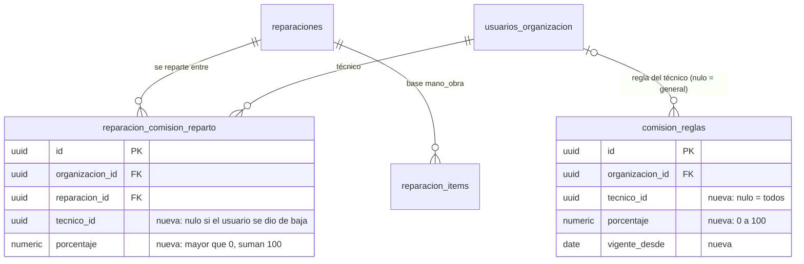

# Service técnico · Comisiones de técnicos (MSF-187, MSF-953, MSF-954, MSF-957)

Comisión de los técnicos por la mano de obra de las reparaciones entregadas, con **reparto entre varios técnicos**, **«Mis comisiones»**
para cada técnico y un **permiso propio `ver_comisiones`**. Es una **estimación para liquidar**: no registra ni paga nada.
Antes de este lote no existía ninguna comisión en `dokploy` (ni tabla, ni función, ni pantalla): este cambio trae la base mínima
(reglas + cálculo) y las tres seguimientos de la épica MSF-118 (S-2, S-3, S-6).

## Decisiones por delegación

Nicolás delegó en Claude la decisión de los requisitos (2026-11-26). Lo decidido:

| # | Decisión | Por qué |
|---|---|---|
| 1 | **Fórmula**: comisión = base × % de la regla del técnico × % de su parte del reparto. La base es la suma de los ítems `mano_obra` al cliente, sin IVA. Nunca se leen costos internos. | Un solo cálculo, verificable con una cuenta. Repuestos y ganancia quedan fuera (D-15 de la spec v2). |
| 2 | **Reglas mínimas**: un porcentaje (0 a 100) por técnico o general, con vigencia por fecha de **entrega**. Solo se agregan (sin update ni delete). El técnico gana a la general; entre reglas del mismo alcance, la de `vigente_desde` más reciente que no supere la entrega. Sin regla, comisión 0 y se avisa («sin regla»). | Un cambio de regla no reescribe el pasado. Se descartó el monto fijo y el alcance por tienda de la spec v2: con un reparto entre N técnicos el monto fijo no tiene un reparto evidente. |
| 3 | **Reparto**: la comisión de una reparación se reparte entre hasta 10 técnicos con porcentajes (hasta dos decimales, mayores que 0) que **suman exactamente 100**. Por defecto, 100 % al técnico asignado (sin filas guardadas). Se valida en la RPC y, además, con un disparador de restricción diferido en la tabla. | La suma 100 es un invariante de la base, no de la pantalla. |
| 4 | **Congelado al entregar**: al pasar `entrega_real` de nulo a una fecha, un disparador guarda el reparto por defecto. Cambiar después el técnico asignado no mueve comisiones. Se rellenaron así las reparaciones ya entregadas. | La comisión de una entrega pasada no debe cambiar por una reasignación posterior. |
| 5 | **Cambio posterior a la entrega**: solo con `ver_comisiones` (más edición en Service), con **motivo** (3 a 500 caracteres) y queda en la Actividad con el reparto anterior y el nuevo (`comision.reparto_cambiado`). Antes de la entrega alcanza con edición en Service. | Es dinero de otra persona: el cambio es del que administra comisiones y deja rastro. |
| 6 | **«Mis comisiones»**: lista por mes lo del propio técnico (el usuario sale del JWT, la RPC no recibe un usuario), con total y detalle por reparación. Sin costos, sin márgenes, sin datos del cliente y sin otros técnicos. Exige solo acceso de lectura a Service. | El técnico ve lo suyo sin depender de permisos de dirección. |
| 7 | **`ver_comisiones` es independiente de `ver_costos`**: ninguno implica al otro. Se siembra en `true` solo para Administrador y Administración en `service_tecnico`; el resto en `false`. Permite ver las comisiones de todos los técnicos y las reglas; **cargar** reglas además exige edición en Service. Los técnicos (matriz fija) ven solo lo propio. | Separar la comisión del costo interno (S-6 / D-12). |
| 8 | **Período** de la consulta: hasta 366 días. «Mis comisiones» y «Equipo» usan el mes calendario (Buenos Aires). Una reparación anulada, sin técnico o sin entrega no genera comisión. | Acota el costo de la consulta. |
| 9 | **Fuera de alcance** (queda como seguimiento): estado cobrada/pendiente por comprobante, exportación CSV, monto fijo, reglas por tienda, liquidación y pagos. | Lote de requisitos mínimos; no hay botón ni estado de «pagada». |

## Datos (DER)

| Tabla | Esquema | Estado | Cambio |
|---|---|---|---|
| `comision_reglas` | `dominio` | nueva | Regla de comisión (porcentaje, técnico o general, `vigente_desde`). |
| `reparacion_comision_reparto` | `dominio` | nueva | Parte de cada técnico en una reparación (porcentaje). |
| `reparaciones` | `dominio` | existente | Sin cambio de columnas; un disparador `after update of entrega_real` congela el reparto. |
| `reparacion_items` | `dominio` | existente | Solo lectura (base de mano de obra). |
| `permisos_rol_accion` | `public` | alterada | Acción nueva `ver_comisiones` en el `check`. |

Las dos tablas nacen con RLS por organización, sin políticas ni grants de escritura (escriben solo las RPC `security definer`),
sin privilegios para `anon` y dentro de la exportación total. `tecnico_id` del reparto queda en nulo si el usuario se borra (el
100 % se conserva); las reglas de un usuario borrado se van con él.

## Funciones

Todas en `public` (salvo las `private`), `security definer`, `search_path` vacío, `revoke … from public, anon` y `grant execute … to authenticated`.
Los errores de negocio siguen `docs/errores-negocio-postgrest.md` (validaciones con `hint` del campo; reparación inexistente o ajena
sin revelar su existencia).

- `mis_comisiones(desde, hasta)`: lo del usuario de la sesión.
- `comisiones_resumen(desde, hasta)` y `comisiones_de_tecnico(tecnico, desde, hasta)`: equipo; exigen `ver_comisiones` y se limitan a las tiendas accesibles de quien consulta. El detalle de un técnico suma lo mismo que su fila del resumen.
- `guardar_regla_comision(tecnico, porcentaje, vigente_desde)` y `listar_reglas_comision()`.
- `obtener_reparto_comision(reparacion)` y `guardar_reparto_comision(reparacion, reparto, motivo)`.
- `private.comisiones_calculadas`: **un solo cálculo** que alimenta resumen y detalle. Una fila por (reparación, técnico del reparto).

Redondeo: cada parte se redondea a centavos por separado; la suma de las partes puede diferir de la comisión de la reparación entera en centavos.

## Permiso `ver_comisiones` (MSF-957)

Acción nueva de `service_tecnico` en `public.permisos_rol_accion`, sembrada por `private.sembrar_permisos` y reconocida por
`private.puede_accion` (exige al menos lectura, como `ver_costos`). `public.permisos_actuales()` devuelve la columna nueva. La
pantalla de Roles ofrece «Ver comisiones» solo en la fila de Servicio técnico. Ver `docs/permisos-por-rol.md`.

## Pantallas

- **Servicio técnico → Comisiones** (`/service-tecnico/comisiones`): «Mis comisiones» para todos los que acceden a Service; «Equipo» y «Reglas» solo con `ver_comisiones`. Empresa activa: no aplica (es de la persona y del equipo de toda la organización; el equipo respeta las tiendas accesibles).
- **Detalle de la reparación → Comisión de técnicos**: reparto entre técnicos, sin importes. «Repartir comisión» se ofrece según `puede_editar` (lo decide la base).

## Pruebas

- pgTAP `service_comisiones.test.sql`: filas reales armadas con las RPC del producto (reparaciones, ítems, entrega); fronteras de porcentaje, vigencia, reparto, período y motivo; independencia de `ver_comisiones` y `ver_costos`; aislamiento entre organizaciones y tiendas accesibles; «Mis comisiones» sin costos ni lo de otros; resumen = suma del detalle; reparto congelado; registro en la Actividad.
- Vitest: `comisiones.test.ts` (período, validación del reparto, mapeo), componentes y página; axe a 320, 768 y 1440 px.
