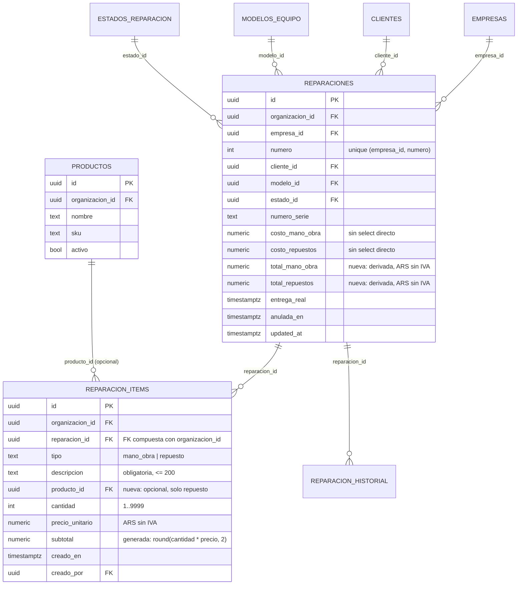

# Service técnico: listado, ítems e impresión (MSF-199)

Épica **MSF-199** (F-SVC-04, F-SVC-06 y F-SVC-07). Spec, plan y tareas:
`specs/20261022-100000-service-listado-items-e-impresion/`. Implementación en la rama
`epic/MSF-199-service-tecnico-service-listado-items-e-` (merge `c8d9930`, PR #258), **pendiente de merge a
`main`** al momento de esta página. Resumen de producto y límites:
[Service técnico: listado, ítems e impresión](../producto/service-listado-items-impresion.md).

Alcance de entrega: **`refine`** (`apps/web`) y **`supabase`** (migraciones, RPC y pgTAP). Sin `kestra`,
`superset` ni `workers`. La tabla `dominio.productos` y los catálogos de modelo/estado vienen de MSF-182 y
Catálogo; esta épica los reutiliza.

## Modelo de datos

`dominio.reparacion_items` es una entidad de negocio del taller (qué se cobra por una reparación), así que
vive en **`dominio`** (Principio VII). `dominio.reparaciones` suma dos columnas derivadas. Las RPC viven en
`public` (contrato de la app) y las ayudas internas en `private`.

| Objeto | Estado | Cambio |
|---|---|---|
| `dominio.reparacion_items` | nueva | Tabla de ítems de mano de obra y repuestos. |
| `dominio.reparaciones` | alterada | `total_mano_obra` y `total_repuestos`, derivadas de los ítems. |
| `dominio.productos` | existente | Solo se lee para vincular un repuesto del catálogo (opcional). |

### `dominio.reparacion_items` (migración `20261022100100_reparacion_items.sql`)

| Columna | Regla |
|---|---|
| `id` | uuid, PK. |
| `organizacion_id` | uuid, default `private.organizacion_id()`; FK a `organizaciones` con `on delete cascade`. |
| `reparacion_id` | uuid; FK compuesta `(reparacion_id, organizacion_id)` a `dominio.reparaciones`. |
| `tipo` | `mano_obra` o `repuesto`. |
| `descripcion` | Obligatoria, sin blancos, máximo 200 caracteres. |
| `producto_id` | Opcional; FK compuesta `(producto_id, organizacion_id)` a `dominio.productos`; solo si `tipo = 'repuesto'`. |
| `cantidad` | Entero entre 1 y 9999. |
| `precio_unitario` | `numeric(10,2)` ARS sin IVA, entre 0 y 99.999.999,99. |
| `subtotal` | Generada y almacenada: `round(cantidad × precio_unitario, 2)`. |
| `creado_en` / `creado_por` | Fecha del servidor y autor de la sesión. |

Índices: `(reparacion_id, creado_en)` y `producto_id` parcial cuando no es nulo. Las FK compuestas impiden
que un ítem apunte a una reparación o a un producto de **otra organización**.

### `dominio.reparaciones`: totales derivados

`total_mano_obra` y `total_repuestos` son `numeric(14,2) not null default 0` con `check >= 0`
(migración `20261022100200_reparaciones_totales.sql`). Son **de cara al cliente**, no los costos internos de
MSF-182. Tienen `grant select` por columna a `authenticated` y **sin** grant de escritura: solo las toca
`private.recalcular_totales_reparacion`. El total al cliente se calcula al leer
(`total_mano_obra + total_repuestos`) y no se almacena por separado.

### RLS y privilegios

- `reparacion_items`: `select` para `authenticated` con `organizacion_id = private.organizacion_id()`, nivel
  `lectura`/`edicion` en `service_tecnico` y la tienda de la reparación dentro de
  `private.empresas_accesibles()`. **Sin** políticas ni grants de `insert`/`update`/`delete`: escriben solo las
  RPC `security definer`. `anon` sin privilegios.
- `reparaciones`: RLS vigente de MSF-182. Los costos internos siguen sin `select` directo; los dos totales
  nuevos sí se leen porque el listado y el detalle los muestran.
- `rls_en_toda_tabla` (pgTAP, recorre `public` + `dominio`) debe seguir verde.

## RPC

Todas las RPC de la épica son `security definer` con `search_path = ''`, `revoke execute … from public, anon`
y `grant execute … to authenticated`. La organización y el actor salen de la sesión, nunca del llamador.
Errores: `22023` con el campo afectado en `hint`, `42501` sin permiso, `P0002` inexistente o tienda no
accesible, `55000` reparación anulada/entregada o cerrada.

| RPC | Qué hace |
|---|---|
| `public.listar_reparaciones(p_empresa, p_periodo, p_serie, p_tecnico, p_pagina, p_tamano)` | Devuelve `{ total_filas, filas[] }` paginado. Filtra por empresa, período sobre la entrega prevista, N.º de serie y técnico. Nunca devuelve costos internos ni ganancia. Migración `20261022110200_reparaciones_listar.sql`. |
| `public.agregar_item_reparacion(p_reparacion_id, p_tipo, p_descripcion, p_producto_id, p_cantidad, p_precio)` | Valida permiso `edicion`, tipo, descripción (≤ 200), cantidad entera 1–9999 y precio 0–99.999.999,99; valida el producto activo de la organización si viene; inserta, recalcula totales y devuelve la reparación completa. Migración `20261022100300_reparacion_item_agregar.sql`. |
| `public.quitar_item_reparacion(p_item_id)` | Ubica la reparación del ítem, aplica la misma compuerta de permiso, tienda y situación abierta, borra y recalcula los totales en la misma transacción. Migración `20261022100400_reparacion_item_quitar.sql`. |
| `public.obtener_reparacion(id)` | Contrato aditivo de MSF-182: agrega `items` (orden de carga, con `sku` cuando hay producto), `total_mano_obra`, `total_repuestos`, `total_cliente` y `ganancia_estimada` (esta última `null` sin `ver_costos`). Las claves anteriores no cambian. Migración `20261022100500_reparaciones_leer_items.sql`. |

### `listar_reparaciones` en detalle

| Parámetro | Regla |
|---|---|
| `p_empresa` | `null` = todas las tiendas accesibles; una tienda ajena o inaccesible no devuelve filas. |
| `p_periodo` | `hoy` (hoy), `semana` (hoy … hoy+6) o `mes` (mes calendario en curso **más** las reparaciones sin entrega prevista). Otro valor → `22023` con `hint = periodo`. «Hoy» se calcula en `America/Argentina/Buenos_Aires`. |
| `p_serie` | Coincidencia parcial sobre `lower(numero_serie)`, con `%`, `_` y `\` escapados como literales; en blanco = sin búsqueda. Si hay serie, **el período no se aplica**. |
| `p_tecnico` | `tecnico_id` exacto. |
| `p_pagina`, `p_tamano` | Página 1-based y tamaño 1–200 (25 por defecto). El total cuenta todas las filas, no solo la página. |

Orden: ingreso descendente y luego número descendente. Cada fila trae `id, numero, codigo, ingreso_en,
empresa_id, empresa, cliente, equipo, modelo, numero_serie, estado, estado_tono, tecnico_id, tecnico,
entrega_prevista, total_cliente`.

**Desvío de la spec**: el requisito pedía `security invoker`, pero la función es `security definer`, igual que
`obtener_reparacion`. El cliente vive en `public.clientes`, cuya RLS exige la sección *Clientes*; un rol de
Service sin esa sección vería el listado vacío. La función aplica a mano el mismo límite de la RLS de
`reparaciones`: organización del llamador, al menos `lectura` en `service_tecnico` y tiendas de
`private.empresas_accesibles()`.

### Compuerta y concurrencia de ítems

`private.bloquear_reparacion_para_items(id)` valida sesión, organización, nivel `edicion`, tienda accesible y
situación abierta, y bloquea la fila de la reparación con `for update`
(`20261022100200_reparaciones_totales.sql`). Cada alta o baja llama a
`private.recalcular_totales_reparacion` dentro de la **misma transacción**, así dos cargas simultáneas se
serializan y ninguna pisa el total de la otra. El recálculo es una función de los ítems (no acumula), por lo
que reintentar no duplica importes; además avanza `updated_at`, y el detalle recarga la reparación después de
cada operación para no provocar un falso conflicto (`40001`) en el siguiente «Guardar».

## Índices y rendimiento

`20261022110100_reparaciones_listado_indices.sql` agrega:

- `reparaciones_org_empresa_entrega_idx (organizacion_id, empresa_id, entrega_prevista)`: tienda + período.
- `reparaciones_org_serie_idx (organizacion_id, lower(numero_serie)) where numero_serie is not null`: sirve a
  la búsqueda **exacta** por serie. La búsqueda **parcial** (`%texto%`) no puede usar un índice btree y recorre
  las filas de la organización.
- `reparaciones_tecnico_idx` ya existía (MSF-182).

`supabase/tests/database/service_listado_volumen.test.sql` siembra 2.000 reparaciones en tres tiendas y dos
técnicos, mide una página de Mes, Semana por tienda y búsqueda por serie con un umbral provisorio de **menos de
500 ms** en base local, y comprueba con `explain` (con `enable_seqscan = off`, porque con 2.000 filas el
planificador prefiere el barrido secuencial aunque el índice sirva) que cada índice es utilizable. Si el umbral
dejara de alcanzar, se evalúa un índice trigram en una migración aditiva.

## Interfaz

- `apps/web/src/pages/service-tecnico/reparaciones.tsx`: listado, tabla/tarjetas (`ContenidoAdaptable`),
  paginación en servidor, contador, estados de carga/error/vacío y botón «Nueva reparación» solo con `edicion`.
- `apps/web/src/components/service/FiltrosReparaciones.tsx`: chips Hoy/Semana/Mes, buscador por N.º de serie
  con espera de 300 ms y selector de técnico.
- `apps/web/src/lib/reparacionesListado.ts`: tipos, llamada a `listar_reparaciones`, formato de fechas y
  mensajes de error. La paginación y los filtros viajan al servidor; el navegador no descarga la lista
  completa.
- `apps/web/src/components/service/ItemsReparacion.tsx`: sección «Mano de obra y repuestos», tablas,
  subtotales, Total al cliente copiable, ganancia estimada y confirmación de quitar.
- `AgregarManoObraDialog.tsx`, `AgregarRepuestoDialog.tsx` y el cuerpo común `AgregarItemDialog.tsx`: campos
  del prototipo, «Subtotal:» en vivo, validación antes de enviar y errores de la base en el campo.
- `apps/web/src/lib/reparacionItems.ts`: validación, subtotal en vivo, llamadas a las RPC y mapeo de errores
  `22023`/`42501`/`55000`/`P0002` a mensajes claros.

### Empresa activa

La tienda del listado es la **empresa activa** de la barra superior, no un filtro de la pantalla. Al cambiarla:

- se vuelve a la **página 1** y se descartan las filas de la empresa anterior y las de «todas»;
- mientras se resuelve la empresa activa no se muestran filas (`useListarReparaciones` conserva las filas
  anteriores solo mientras llega otra página de la **misma** combinación de filtros);
- la búsqueda por serie y el filtro de técnico se mantienen, pero se reejecutan con la nueva empresa;
- si la página quedó fuera de rango, la pantalla vuelve a la primera.

## Impresión

| Documento | Ruta | Disponible |
|---|---|---|
| Orden de ingreso | `/service-tecnico/reparaciones/:id/orden` | Toda reparación. |
| Remito de entrega | `/service-tecnico/reparaciones/:id/remito` | Solo reparaciones **entregadas** y no anuladas; si no, «Remito no disponible». |

- `apps/web/src/pages/service-tecnico/orden-ingreso.tsx` y `remito-entrega.tsx` cargan de forma diferida y
  están dentro de `RequiereServiceTecnico`: exigen `lectura` en `service_tecnico`; sin permiso muestran «Acceso
  restringido».
- `apps/web/src/lib/documentosReparacion.ts` arma ambos documentos con lo que devuelve `obtener_reparacion`,
  los datos de la tienda (`dominio.empresas`: nombre, dirección, WhatsApp y correo; lo no cargado se omite) y
  el nombre del técnico. No lee `costo_mano_obra`, `costo_repuestos` ni `ganancia_estimada`.
- `apps/web/src/components/service/DocumentoA4.tsx` define `@page { size: A4 }` y `@media print` que oculta la
  barra superior, el menú lateral y los botones (`.no-imprimir`); el botón «Imprimir» llama a `window.print()`.
- Rótulos fijos: «Documento no fiscal» e «Importes sin IVA».
- **No hay PDF de servidor** ni mecanismo compartido con Ventas (MSF-213): es una vista propia de Service.
- **CUIT y domicilio fiscal** no existen hoy en `dominio.empresas`: no se imprimen. El **texto de condiciones**
  es una constante provisoria (`CONDICIONES_PENDIENTES`), pendiente de confirmar con el negocio.

## Actividad

Las altas y bajas registran `reparacion.item_agregado` y `reparacion.item_quitado` con
`private.registrar_actividad`, en la misma transacción que la operación, con el código visible (`R-0001`) y la
descripción del ítem; nunca ids. Sin sesión (migraciones, sembrados) no se registra nada. Migración
`20261022100600_reparacion_items_actividad.sql`; catálogo de eventos en [Actividad](../actividad.md).

## Pruebas

- **pgTAP** (`supabase/tests/database/`): `service_items.test.sql` (totales tras agregar y quitar, compuerta
  `for update`, cantidad/precio inválidos, entregada y anulada rechazadas, producto ajeno o inactivo, ganancia
  enmascarada sin `ver_costos`, aislamiento, `anon`, actividad y ausencia de movimientos de stock),
  `service_listado.test.sql` (períodos, serie, técnico, tienda, paginación, aislamiento y `anon`) y
  `service_listado_volumen.test.sql` (2.000 reparaciones). Se corren con `pnpm test:db` y requieren
  `pnpm dev:supabase`.
- **Vitest**: `components/service/ItemsReparacion.test.tsx`, `pages/service-tecnico/reparacion.test.tsx`,
  `pages/service-tecnico/reparaciones.test.tsx`, `pages/service-tecnico/impresion.test.tsx` y
  `lib/reparaciones.test.ts` (columnas, filtros, empresa activa, vacío/error/carga, paginación, solo lectura,
  errores de cantidad y precio, documentos y ausencia de costos).
- **E2E**: `apps/web/e2e/service-recorrido.e2e.ts` recorre alta, ítems, estados, entrega y remito sin costos;
  se omite sin `SUPABASE_URL`/`SUPABASE_SERVICE_ROLE_KEY` (ver [E2E de la app](../e2e-app.md)).

Comandos de cierre de la épica: `pnpm lint`, `pnpm build`, `pnpm test`, `pnpm docs:check`, `pnpm matriz:check`,
`pnpm prototipo:check` y `rls_en_toda_tabla`.

## Migraciones y reversión

Todas son **aditivas** y llevan su camino de reversión en el encabezado; la reversión se hace en una migración
posterior, no en el mismo PR, y se exportan los datos antes.

| Migración | Contenido |
|---|---|
| `20261022100100_reparacion_items.sql` | Tabla, índices, RLS y grants. |
| `20261022100200_reparaciones_totales.sql` | Columnas derivadas, `private.recalcular_totales_reparacion` y `private.bloquear_reparacion_para_items`. |
| `20261022100300_reparacion_item_agregar.sql` | RPC `agregar_item_reparacion`. |
| `20261022100400_reparacion_item_quitar.sql` | RPC `quitar_item_reparacion`. |
| `20261022100500_reparaciones_leer_items.sql` | `private.reparacion_json` con ítems, totales y ganancia. |
| `20261022100600_reparacion_items_actividad.sql` | Disparadores de actividad de alta y baja. |
| `20261022110100_reparaciones_listado_indices.sql` | Índices del listado. |
| `20261022110200_reparaciones_listar.sql` | RPC `listar_reparaciones`. |

Orden inverso: listado → índices → actividad → lectura → quitar → agregar → totales → tabla.

> **Revisión de fuentes:** 2026-10-25 — se sincronizó el prototipo `design/pantallas/AdminHeader.dc.html`; esta página se revisó y su contenido no cambia.

> **Revisión de fuentes:** 2026-10-25 23:00 — se revisaron las fuentes de esta página (specs, prototipos, migraciones y código) y su contenido no cambia.
