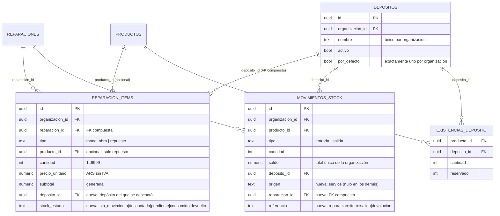
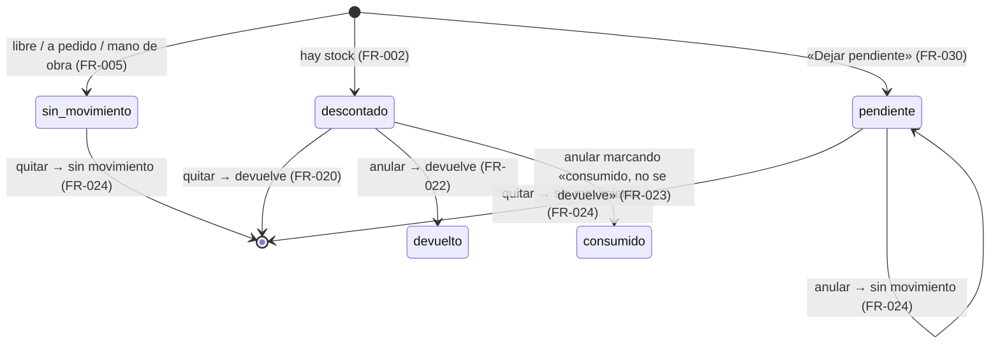

# Service técnico: repuestos y stock (MSF-217)

Épica **MSF-217** (F-SVC-10 / MSF-390, F-SVC-11 / MSF-402, F-SVC-12 / MSF-412 y cierre / MSF-575). Spec, plan,
tareas y contrato:
`specs/20261028-100000-service-repuestos-y-stock/`. Implementación en la rama
`epic/MSF-217-service-tecnico-service-repuestos-y-stoc` (PR #509), **pendiente de merge a `main`** al momento de
esta página. Resumen de producto y guía de prueba: [Service técnico: repuestos y stock](../producto/service-repuestos-y-stock.md).

Alcance de entrega: **`refine`** (`apps/web`) y **`supabase`** (migraciones, RPC y pgTAP). Sin `kestra`,
`superset` ni `workers`. Reusa las tablas de Stock de MSF-136 y MSF-292 (`dominio.depositos`,
`dominio.existencias_deposito`, `dominio.existencias`, `dominio.movimientos_stock`) y las de Service de MSF-182 y
MSF-199 (`dominio.reparaciones`, `dominio.reparacion_items`).

## Modelo de datos

**No hay tablas nuevas.** La épica suma **columnas** a dos tablas que ya viven en `dominio` (Principio VII) y
**funciones** nuevas. Ninguna tabla en `public`.

- **[ERD interactivo](../diagrams/msf-217-erd.html)** — las tablas del descuento y de la devolución, con las
  columnas nuevas de la épica (`deposito_id`, `stock_estado`, `origen`, `reparacion_id`, `referencia`).

| Tabla | Estado | Cambio |
|---|---|---|
| `dominio.reparacion_items` | alterada | `deposito_id` (FK compuesta a `dominio.depositos`) y `stock_estado` (`sin_movimiento` \| `descontado` \| `pendiente` \| `consumido` \| `devuelto`, por defecto `sin_movimiento`). |
| `dominio.movimientos_stock` | alterada | `origen` (por ahora solo `service`; nulo en los movimientos existentes), `reparacion_id` (FK compuesta a `dominio.reparaciones`) y `referencia` (clave de idempotencia). |
| `dominio.depositos` | existente | Sin cambio (MSF-292): se leen los depósitos activos y el por defecto. |
| `dominio.existencias_deposito` | existente | Sin cambio (MSF-292): es la base del disponible por depósito. |
| `dominio.existencias` | existente | Sin cambio (MSF-136): `for update` por producto para serializar cargas. |
| `dominio.reparaciones` | existente | Sin cambio (MSF-182): los totales al cliente no cambian por el stock. |

### `dominio.reparacion_items`: `deposito_id` y `stock_estado`

Migración `20270114100200_reparacion_items_deposito.sql`.

- `deposito_id uuid` con **FK compuesta** `(deposito_id, organizacion_id)` a `dominio.depositos`: un ítem no puede
  apuntar a un depósito de otra organización. Se completa **solo** en un repuesto con producto del catálogo que
  mueve stock (`check`: si `deposito_id` no es nulo, `tipo = 'repuesto'` y `producto_id` no es nulo).
- `stock_estado text not null default 'sin_movimiento'` con `check` sobre los cinco valores. Es la **fuente de
  verdad de la devolución**: solo se devuelve lo que está `descontado`.
- Índice parcial `reparacion_items_deposito_idx (deposito_id) where deposito_id is not null`.
- Los ítems **existentes** quedan `sin_movimiento`: la épica **no** descuenta retroactivamente lo cargado antes.
- Sin grants nuevos: la tabla sigue sin escritura directa; solo la tocan las RPC `security definer`.

### `dominio.movimientos_stock`: `origen`, `reparacion_id` y `referencia`

Migración `20270114100100_stock_movimientos_origen_service.sql` (el ajuste a Stock que pide la épica).

- `origen text` con `check (origen in ('service'))`; **nulo** en todos los movimientos que no vienen de una
  reparación.
- `reparacion_id uuid` con **FK compuesta** `(reparacion_id, organizacion_id)` a `dominio.reparaciones`, y `check`:
  si `origen` no es nulo, `reparacion_id` y `referencia` no pueden ser nulos.
- `referencia text` con **índice único parcial** `(organizacion_id, referencia) where origen = 'service'`: es la
  clave de idempotencia. El segundo intento de un mismo descuento o devolución no inserta nada.
- Índice `movimientos_stock_reparacion_idx (reparacion_id) where reparacion_id is not null`.
- El libro **sigue siendo de solo agregado** y `movimientos_stock.saldo` sigue siendo el **total único** de la
  organización: el saldo por depósito se lee de `dominio.existencias_deposito`.

## RPC

Todas son `security definer` con `search_path = ''`, `revoke execute … from public, anon` y
`grant execute … to authenticated`. La organización y el actor salen de la sesión, nunca del llamador. Errores:
`22023` con el campo afectado en `hint`, `42501` sin permiso, `P0002` inexistente o de otra organización, `55000`
reparación entregada/anulada o cerrada, `23514` «No hay stock suficiente».

| RPC | Qué hace |
|---|---|
| `public.depositos_para_repuesto(p_producto_id uuid)` | Devuelve `jsonb` con los **depósitos activos** de la organización y, por cada uno, `cantidad`, `reservado` y `disponible` (cantidad − reservado) del producto; el **por defecto primero**. Gate `service_tecnico` en `lectura`/`edicion`: el técnico **no** necesita Stock. Producto de otra organización o inexistente → `P0002`. Migración `20270114100500`. |
| `public.agregar_item_reparacion(p_reparacion_id, p_tipo, p_descricao, p_producto_id, p_cantidad, p_precio, p_deposito_id uuid default null, p_dejar_pendiente boolean default false)` | Inserta el ítem y, si es un repuesto del catálogo que **no** es «a pedido», **descuenta del depósito elegido** y recalcula los totales **en la misma transacción**. `p_deposito_id` nulo = depósito por defecto; el depósito debe ser **activo** y de la organización (`22023`, hint `deposito_id`). Sin stock → `23514` «No hay stock suficiente» y **no queda ítem, movimiento ni cambio de totales**; con `p_dejar_pendiente` el ítem se carga `pendiente` **sin movimiento**. Gate `edicion` en `service_tecnico`. Migraciones `20270114100400` y `20270114140100`. |
| `public.quitar_item_reparacion(p_item_id uuid)` | Si el ítem estaba `descontado`, registra la **entrada** al depósito original, lo borra y recalcula los totales en la misma transacción. Firma y gate sin cambios respecto de MSF-199. Migración `20270114110100`. |
| `public.anular_reparacion(p_id uuid, p_motivo text, p_consumidos uuid[] default '{}')` | Anula con motivo obligatorio y, en la misma transacción, **devuelve al depósito original** cada repuesto `descontado` **no** consumido (queda `devuelto`) y marca los consumidos (`consumido`). Un id de `p_consumidos` que no sea un repuesto `descontado` de esa reparación → `22023` (hint `consumidos`) y **no se anula nada**. Migración `20270114110200`. |
| `public.listar_reparaciones(p_empresa, p_periodo, p_serie, p_tecnico, p_pagina, p_tamano)` | **Firma sin cambios**; suma por fila `pendientes_stock` = repuestos `pendiente` de reparaciones **no anuladas ni entregadas** (`0` si la reparación está anulada o entregada). Migración `20270114140200`. |
| `public.obtener_reparacion(id)` | Contrato aditivo: por ítem suma `deposito_id`, `deposito_nombre` y `stock_estado`. Lo implementa `private.reparacion_json`, que comparten `obtener_reparacion` y las RPC de escritura. Migración `20270114100600`. |

### Funciones internas (sin `grant`)

| Función | Qué hace |
|---|---|
| `private.mover_stock_reparacion(p_organizacion, p_reparacion, p_item, p_producto, p_deposito, p_cantidad, p_sentido text)` | **Única** rutina que mueve stock por un repuesto. `p_sentido` es `salida` o `entrada` (`22023` si no). Usa `private.aplicar_movimiento_deposito` (la barrera de Stock) y el motivo de sistema «Repuesto de reparación» (salida) o «Devolución de repuesto de reparación» (entrada). Inserta el movimiento con `origen = 'service'`, `reparacion_id`, `deposito_id`, actor, fecha y `referencia` única. Si la `referencia` ya existe **no mueve nada** y devuelve `false` (idempotencia). `security definer`, `search_path = ''`, **sin `grant`** a `authenticated`. Migración `20270114100300`. |
| `private.devolver_stock_item_reparacion(p_organizacion, p_item)` | Si el ítem está `descontado`, llama a `mover_stock_reparacion(..., 'entrada')` y lo marca `devuelto`; en cualquier otro estado (`pendiente`, `sin_movimiento`, `consumido`, `devuelto`) **no mueve stock**. Lee el ítem con `for update`. Migración `20270114110100`. |

**Por qué no `public.registrar_movimiento_stock`:** esa RPC exige `edicion` en **Stock** y un motivo elegido; el
técnico de Service no tiene Stock. El camino es el mismo que usan las notas de crédito y el despacho: la barrera
es `private.aplicar_movimiento_deposito` (F-STK-14).

### Contratos que cambian

| RPC | Antes | Ahora | Consecuencia |
|---|---|---|---|
| `public.agregar_item_reparacion` | 6 parámetros (MSF-199, `20261022100300`) | 7 (`20270114100400`) y luego **8** (`20270114140100`) | Se **eliminan** las firmas anteriores (`drop function`) porque dos sobrecargas con `default` serían ambiguas para PostgREST. El cliente (`apps/web/src/lib/reparacionItems.ts`) se actualiza en el mismo cambio. |
| `public.anular_reparacion` | `(uuid, text)` (MSF-182, `20261020120300`) | `(uuid, text, uuid[])` (`20270114110200`) | Se elimina la firma de 2 parámetros. El cliente (`apps/web/src/lib/reparaciones.ts`) cambia en el mismo commit. |

Los dos cambios son **alto riesgo** y llevan *gate* humano (los deja la historia, con el contrato en
`specs/20261028-100000-service-repuestos-y-stock/contracts/service-repuestos-stock.md`).

## Libro, barrera y concurrencia

- Cada descuento inserta una **salida** con `origen = 'service'`, `reparacion_id`, `deposito_id`, actor, fecha y
  `referencia = reparacion:<id>:item:<item>:salida`; cada devolución, una **entrada** con
  `referencia = reparacion:<id>:item:<item>:devolucion`. El índice único parcial de `referencia` impide el
  segundo asiento.
- La **barrera** es la de `private.aplicar_movimiento_deposito` (F-STK-14): serializa por producto con
  `select … for update` sobre `dominio.existencias`, bloquea el disponible del depósito (cantidad − reservado) y
  falla con `23514` «No hay stock suficiente» **revirtiendo todo** (ítem, movimiento y totales).
- **Concurrencia** (FR-004): dos cargas simultáneas del último artículo se serializan por ese `for update`; una
  gana y la otra recibe «No hay stock suficiente». El saldo nunca queda negativo.
- **Orden de bloqueo**: al agregar, primero la reparación (`for update`, en
  `private.bloquear_reparacion_para_items`), después las existencias del producto (`for update`) y el depósito
  (`for share`, para que un depósito no se desactive mientras sale mercadería), igual que
  `registrar_movimiento_stock`. Al quitar o anular: reparación → ítem → existencias.
- La devolución va al **depósito original** aunque hoy esté inactivo: la mercadería vuelve físicamente ahí
  (FR-026).
- El saldo del libro (`movimientos_stock.saldo`) sigue siendo el **total único** de la organización; el saldo por
  depósito se lee de `dominio.existencias_deposito`.

## Estados de stock de un ítem

`stock_estado` es el estado del repuesto frente al stock, no el estado de la reparación (los estados de la
reparación son los de MSF-182).

## Interfaz

| Archivo | Qué aporta |
|---|---|
| `apps/web/src/lib/reparacionItems.ts` | `agregarItem` (envía `p_deposito_id` y `p_dejar_pendiente`), `listarDepositosParaRepuesto`, `disponibleEnDeposito`, `descuentaStock` (solo un producto del catálogo que **no** es «a pedido»), `notaDisponible` («Disponible en &lt;depósito&gt;: N u.» + «(falta stock: pedí el repuesto al proveedor)»), `MENSAJE_SIN_STOCK` («No hay stock suficiente»), `mensajeRepuestoAgregado` («Repuesto agregado · se descuenta de &lt;depósito&gt;» / «… queda pendiente de stock») y el mapeo de errores `23514`/`22023`/`42501`/`55000`/`P0002`. |
| `apps/web/src/components/service/SelectorDepositoRepuesto.tsx` | Botones segmentados (`ToggleButtonGroup`) con los depósitos activos, el por defecto preseleccionado, la nota de disponible y el aviso «No hay depósitos activos: pedile a un administrador que active uno». |
| `apps/web/src/components/service/AgregarRepuestoDialog.tsx` | Integra el selector y el buscador de catálogo; al cambiar la **empresa activa** con el diálogo abierto lo **cierra con aviso** («Cambiaste de tienda: cerramos «Agregar repuesto» para no mezclar datos de dos tiendas.») y al reabrirlo consulta la disponibilidad de nuevo. Para un producto «a pedido» muestra «Producto a pedido: no descuenta stock» y no ofrece depósito. |
| `apps/web/src/components/service/AvisoSinStock.tsx` | Aviso ante «No hay stock suficiente»: muestra el disponible y ofrece **«Dejar pendiente»**. |
| `apps/web/src/components/service/MarcaStockItem.tsx` | Marcas de la fila: «Pendiente de stock», «Consumido» y «Devuelto». |
| `apps/web/src/components/service/ItemsReparacion.tsx` | Columna **Depósito de mercadería** (o «—» si el ítem no mueve stock), ayuda «Productos del catálogo. Se descuentan del depósito de mercadería elegido al agregar el repuesto.» (FR-009) y la confirmación de quitar con el aviso «Las unidades vuelven al depósito del que se descontaron.» |
| `apps/web/src/components/service/AnularDialog.tsx` | Lista de repuestos descontados con la casilla «Consumido, no se devuelve» y el aviso «Los repuestos descontados vuelven al stock, salvo los que marques como consumidos». |
| `apps/web/src/lib/reparaciones.ts` / `reparacionesListado.ts` | `anularReparacion(id, motivo, consumidos)` y el campo `pendientes_stock` de la fila del listado. |
| `apps/web/src/pages/service-tecnico/reparaciones.tsx` | Indicador «Pendiente de stock» en la tabla y en la tarjeta de móvil. |

### Empresa activa (Principio VIII)

La reparación pertenece a una tienda: el detalle **no** tiene selector propio (alcance declarado en la spec). Lo
que sí depende de la empresa activa es el **diálogo «Agregar repuesto»**: si la empresa cambia mientras está
abierto, el diálogo **se cierra con aviso** (`AVISO_CAMBIO_DE_EMPRESA`) y, al reabrirlo, se vuelve a consultar la
disponibilidad de los depósitos. El indicador de pendientes del listado hereda el filtro de empresa de MSF-199.

## Permisos y seguridad

- `depositos_para_repuesto`: `service_tecnico` en `lectura` o `edicion`. El técnico **no** necesita Stock.
- `agregar_item_reparacion` y `quitar_item_reparacion`: `edicion` en `service_tecnico`, organización de la
  sesión, tienda accesible y reparación abierta (`private.bloquear_reparacion_para_items`).
- `anular_reparacion`: `edicion` en `service_tecnico` y tienda accesible (`42501`).
- `private.mover_stock_reparacion` y `private.devolver_stock_item_reparacion`: **sin `grant`** a `authenticated`
  (y `revoke` a `public, anon`); solo las llaman las RPC.
- Las RPC hacen `revoke … from public, anon` y `grant execute … to authenticated`: `anon` **no** puede ejecutarlas.
- Sin `service-role` en el navegador: las salidas y devoluciones salen de la sesión de la persona.
- `rls_en_toda_tabla` (pgTAP, recorre `public` + `dominio`) sigue verde: **no hay tablas nuevas** y las columnas
  nuevas no agregan políticas (las tablas ya las tienen de MSF-199 y MSF-136).
- El depósito se valida en la base: un depósito **inactivo** o de **otra organización** se rechaza con `22023`
  (hint `deposito_id`); el `for share` impide desactivarlo mientras sale mercadería.

## Pruebas

- **pgTAP** (`supabase/tests/database/`): `service_repuestos_stock.test.sql` (SC-001: descuento por depósito,
  libro con `origen = 'service'`, «a pedido»/libre/mano de obra sin movimiento, rechazo sin rastro, depósito
  inactivo o ajeno, `depositos_para_repuesto`, aislamiento entre organizaciones, `anon` sin ejecución),
  `service_repuestos_concurrencia.test.sql` (SC-002: dos repuestos del último artículo a la vez),
  `service_repuestos_devolucion.test.sql` (SC-004: devolución al quitar, idempotencia, sin movimiento para
  pendientes/libres, devolución a un depósito inactivo), `service_repuestos_anulacion.test.sql` (SC-005: anulación
  con y sin consumidos, `22023` con un consumido ajeno) y `service_repuestos_pendiente.test.sql` (SC-007: pendiente
  sin movimiento, `pendientes_stock`, anuladas y entregadas no cuentan). Se corren con `pnpm test:db` y requieren
  `pnpm dev:supabase`.
- **Vitest**: `apps/web/src/components/service/ItemsReparacion.test.tsx` (selector con disponible, aviso de falta
  de stock, envío del depósito, producto «a pedido» sin depósito, «No hay stock suficiente», «Dejar pendiente»,
  marca «Pendiente de stock», columna de depósito, texto de ayuda, cierre del diálogo al cambiar de empresa,
  confirmación de quitar y marcas «Devuelto»/«Consumido»),
  `apps/web/src/components/service/AnularDialog.test.tsx` (opción «Consumido, no se devuelve») y
  `apps/web/src/pages/service-tecnico/reparaciones.test.tsx` (indicador «Pendiente de stock» del listado). Comando:
  `pnpm test:web -- ItemsReparacion AnularDialog reparaciones`.
- **E2E**: `apps/web/e2e/service-repuestos-stock.e2e.ts` (rótulo `[MSF-575:T033]`) recorre por **API**
  (PostgREST con la sesión de la persona) agregar desde un depósito, el rechazo por falta de stock, quitar y
  anular. Se omite sin `SUPABASE_URL`/`SUPABASE_SERVICE_ROLE_KEY` (no corre en el CI público) y aborta si el
  Supabase no es local. **No** recorre la interfaz: el selector de depósito, el botón «Dejar pendiente» y el
  indicador del listado están cubiertos por Vitest, no por un E2E de navegador.

Comandos de cierre de la épica: `pnpm lint`, `pnpm build`, `pnpm test`, `pnpm docs:check`, `pnpm matriz:check`,
`pnpm prototipo:check` y `rls_en_toda_tabla`.

## Migraciones y reversión

Todas son **aditivas** (columnas con valor por defecto, funciones) y llevan su camino de reversión en el
encabezado. La reversión se hace en una **migración posterior**, no en el mismo PR, y los movimientos ya
asentados **no se deshacen solos** (el libro es de solo agregado): hay que exportarlos y compensar el stock a mano.

| Migración | Contenido |
|---|---|
| `20270114100100_stock_movimientos_origen_service.sql` | `origen`, `reparacion_id` y `referencia` en `dominio.movimientos_stock`, con checks, FK compuesta e índice único parcial. |
| `20270114100200_reparacion_items_deposito.sql` | `deposito_id` y `stock_estado` en `dominio.reparacion_items`, con checks, FK compuesta e índice parcial. |
| `20270114100300_service_mover_stock.sql` | `private.mover_stock_reparacion` (sin `grant` a `authenticated`). |
| `20270114100400_reparacion_item_agregar_stock.sql` | `agregar_item_reparacion` con `p_deposito_id` (reemplaza la firma de 6 parámetros). |
| `20270114100500_depositos_para_repuesto.sql` | `public.depositos_para_repuesto`. |
| `20270114100600_reparaciones_leer_stock.sql` | `private.reparacion_json` con `deposito_id`, `deposito_nombre` y `stock_estado`. |
| `20270114110100_reparacion_item_quitar_devolucion.sql` | `private.devolver_stock_item_reparacion` y `quitar_item_reparacion` que devuelve antes de borrar. |
| `20270114110200_reparaciones_anular_devolucion.sql` | `anular_reparacion` con `p_consumidos` (reemplaza la firma de 2 parámetros). |
| `20270114140100_reparacion_item_agregar_pendiente.sql` | `agregar_item_reparacion` con `p_dejar_pendiente` (reemplaza la firma de 7 parámetros). |
| `20270114140200_reparaciones_listar_pendientes.sql` | `listar_reparaciones` con `pendientes_stock` (misma firma). |

Orden inverso: listar pendientes → agregar pendiente → anular devolución → quitar devolución → leer stock →
depósitos para repuesto → agregar stock → mover stock → ítems con depósito → libro con origen.

> **Nota de versiones**: las tareas de la spec (`tasks.md`) nombraban estas migraciones con los números
> `20270113100100`–`20270113120200`; la implementación las renumeró a `20270114100100`–`20270114140200` (versiones
> libres) para no chocar con otras épicas.

## Decisiones provisionales que quedan abiertas

| Decisión | Estado actual | Dueño |
|---|---|---|
| **Devolución a un depósito inactivo** | Vuelve al depósito original (FR-026). Si el negocio prefiere otro destino, se cambia en `private.mover_stock_reparacion`. | Producto / Stock |
| **Resolución de un repuesto pendiente** | No hay descuento automático posterior: se quita el ítem y se vuelve a cargar cuando llega la mercadería (spec, decisión 5). | Producto / negocio |
| **Horas de F-SVC-10** | 16 h por talla contra las 20 h de la épica: la diferencia queda anotada para revisar al planificar la Etapa 2 (spec, decisión 6). | Producto / plataforma |
| **Depósitos que se ofrecen** | Todos los **activos** de la organización; el «venden desde acá» por empresa (F-STK-14) no aplica a Service (spec, decisión 8). | Producto / Stock |

## Para seguir

- **[Service técnico: repuestos y stock (producto)](../producto/service-repuestos-y-stock.md)** — qué resuelve y
  cómo se prueba a mano.
- **[Service técnico: listado, ítems e impresión](service-listado-items-impresion.md)** — las RPC y la pantalla de
  las que hereda esta épica (MSF-199).
- **[Stock · depósitos y reservas](stock-depositos-y-reservas.md)** — `dominio.depositos`,
  `dominio.existencias_deposito` y `private.aplicar_movimiento_deposito` (MSF-292).
- **[Stock · movimientos, historial y mínimo](stock-movimientos.md)** — el libro de `dominio.movimientos_stock`
  (MSF-136).
- **[Datos y DER](datos.md)** — el modelo completo con la sección de esta épica.
