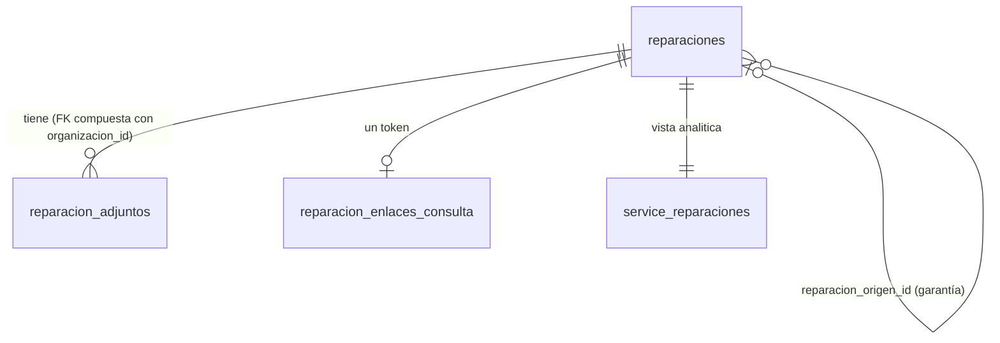

# Service técnico: seguimiento y reportes (técnico, MSF-124)

Épica **MSF-124** · historias F-SVC-20 (MSF-134, fotos y adjuntos), F-SVC-21 (MSF-146, garantía), F-SVC-22 (MSF-157,
enlace de consulta) y F-SVC-23 (MSF-168, reportes y exportación), más el cierre MSF-582. Spec, plan, tareas y
contratos: `specs/20261028-100000-service-seguimiento-y-reportes/`. Implementación en
`epic/MSF-124-service-tecnico-service-seguimiento-y-re`, **pendiente de merge a `main`** al escribir esta página
(las guías de abajo viven en esa rama). Resumen para usuarios:
[Service técnico: fotos, garantía, seguimiento y reportes](../producto/service-seguimiento-y-reportes.md).

Alcance de entrega: `refine`, `supabase` (migraciones, RPC, Storage, Edge Function) y `superset`.

## Guías por historia (en la rama de la épica)

| Historia | Guía | Contenido |
|---|---|---|
| F-SVC-20 | `docs/service-adjuntos.md` | Tabla, bucket privado, políticas, límites, huérfanos, reversión |
| F-SVC-21 | `docs/service-garantia.md` | Regla, RPC, vínculo, numeración, reversión |
| F-SVC-22 | `docs/service-seguimiento.md` | Token, Edge Function pública, límite por IP, riesgos |
| F-SVC-23 | `docs/service-reportes.md` | Exportación, vistas `analitica`, tablero, datos de prueba |
| Cierre | `docs/service-tecnico.md` | Índice y revisión de seguridad (T056) |

## Modelo de datos

Esquema (Principio VII): negocio del taller en `dominio`; contador transversal del endpoint público en `public`;
vistas de lectura en `analitica`.

| Objeto | Esquema | Migración | Acceso |
|---|---|---|---|
| `reparacion_adjuntos` | `dominio` | `20270122140100` | `select` por RLS (organización, nivel `service_tecnico`, tienda accesible); sin escritura directa |
| Bucket `reparacion-adjuntos` (privado, 5 MB, jpeg/png/webp) y políticas de `storage.objects` | plataforma | `20270122140200`, `20270122140600` | `select` lectura/edición; `insert`/`delete` edición; sin `update` |
| `registrar_adjunto_reparacion`, `quitar_adjunto_reparacion`, `listar_adjuntos_reparacion` | `public` | `20270122140300`, `…0400`, `…0500` | `authenticated`; máximo 20 por reparación bajo `for update`; anulada → `55000` |
| `reparaciones.reparacion_origen_id` | `dominio` | `20270122150100` | FK compuesta, `check (origen <> id)`, sin escritura directa |
| `reingresar_por_garantia`, `obtener_vinculos_garantia` | `public` | `20270122150200`, `…0300` | `authenticated`; origen entregado y no anulado (`55000`) |
| `reparacion_enlaces_consulta` | `dominio` | `20270122160100` | RLS sin políticas ni grants |
| `obtener_enlace_consulta` | `public` | `20270122160200` | `authenticated`, exige `edicion`; idempotente |
| `consultas_publicas_intentos`, `registrar_consulta_publica` | `public` | `20270122160300` | RLS sin políticas; función solo `service_role` |
| `estado_publico_reparacion` (`private`) y `obtener_estado_publico_reparacion` | `private`/`public` | `20270122160400` | envoltorio solo `service_role` |
| `analitica.service_reparaciones`, `analitica.service_reparacion_items` | `analitica` | `20270122130100`, `…0200` | solo `select` para `superset_analitica`; sin costos |
| Fila en `public.reportes` (`seccion = 'service_tecnico'`) | `public` | `20270122130300` | asignada a organizaciones con el módulo |

Todas las migraciones son aditivas, con reversión en el encabezado de cada guía. Las RPC de la app llevan
`revoke … from public, anon` y `grant execute … to authenticated`.

## Flujos y contratos

- **Adjuntos**: la interfaz valida extensión, cabecera real, 5 MB y 20 por reparación, sube a
  `<organizacion_id>/<reparacion_id>/<uuid>.<ext>` y llama a `registrar_adjunto_reparacion`; si falla, borra el objeto.
  Miniaturas con URL firmada de 5 minutos. Un archivo huérfano es inofensivo y sin limpieza automática (guía de
  adjuntos trae la consulta para detectarlos).
- **Garantía**: `reingresar_por_garantia` copia tienda, cliente, contacto, modelo, serie y accesorios; numera con el
  bloqueo de MSF-182; no copia ítems, costos ni adjuntos.
- **Enlace**: página `/seguimiento/:token` fuera del panel (`apps/web/src/pages/seguimiento/index.tsx`) →
  Edge Function `supabase/functions/consultar-estado-reparacion` (`verify_jwt = false` en `supabase/config.toml`).
  Respuestas 200 (lista blanca), 404 uniforme, 429 con `Retry-After`, 500. Límite: 30 consultas por 10 minutos por IP
  hasheada con `SEGUIMIENTO_IP_SALT` (solo en `supabase/functions/.env.example`); proxies de confianza en
  `SEGUIMIENTO_SALTOS_PROXY` (por defecto 1). Detalle en `docs/service-seguimiento.md`.
- **Exportación**: `apps/web/src/lib/exportarReparaciones.ts` sobre `listar_reparaciones` por lotes de 200, tope
  100.000 filas, sin RPC nueva ni costos.
- **Reportes**: tablero YAML en `infra/superset/dashboards/service/`, importado con `pnpm superset:importar-dashboards`;
  pestaña `/service-tecnico/reportes` con `ReporteEmbebido`; token de invitado con cláusula
  `organizacion_id = '<org>'` y acceso con `lectura`/`edicion` en `service_tecnico`.

## Empresa activa

Listado y exportación respetan la empresa activa (el export congela filtros y empresa al pulsar). El diálogo de
reingreso se cierra con aviso al cambiar de empresa. El tablero de Reportes **no** se filtra por empresa activa
(compara todas las tiendas). La página pública no es de empresa.

## Guía de prueba (técnica)

Rótulos de la spec; los E2E se omiten sin `SUPABASE_URL` / `SUPABASE_SERVICE_ROLE_KEY` (ver `docs/e2e-app.md`).

| Qué | Prueba | Rótulo / archivo |
|---|---|---|
| Adjuntos: RLS, bucket, RPC, tope 20 | pgTAP | `service_adjuntos.test.sql` |
| Adjuntos: validación y solo lectura | Vitest | `AdjuntosReparacion.test.tsx` |
| Adjuntos de punta a punta | E2E | `service-adjuntos.e2e.ts` |
| Garantía: reglas, vínculo, aislamiento | pgTAP / Vitest | `service_garantia.test.sql`, `ReingresoGarantiaDialog.test.tsx`, `VinculosGarantia.test.tsx` |
| Garantía de punta a punta | E2E | `service-garantia.e2e.ts` (`[MSF-146:T022]`) |
| Enlace: token, lista blanca, límite, aislamiento | pgTAP / Deno | `service_enlace_consulta.test.sql`, `handler.test.ts` (`pnpm test:edge:consultar-estado-reparacion`) |
| Página pública y diálogo | Vitest / E2E | `seguimiento.test.tsx`, `EnlaceSeguimientoDialog.test.tsx`, `service-seguimiento.e2e.ts` |
| Exportación | Vitest / E2E | `exportarReparaciones.test.ts`, `service-exportacion.e2e.ts` |
| Vistas y acceso a reportes | pgTAP | `service_analitica.test.sql`, `service_reportes_acceso.test.sql` |
| Tablero | contrato + revisión manual | `tableroService.contrato.test.ts`; datos con `supabase/verificacion/service_datos_prueba.sql` (revisión T055) |

Prueba manual del enlace: copiar el enlace desde el detalle, abrirlo en una ventana sin sesión y comprobar que solo
muestra la lista blanca; con un token inventado ver «No encontramos esa reparación».

## Pendientes y decisiones abiertas

- **TODO (dueño: documentación/producto):** capturas del manual (`pnpm docs:capturas`, specs en
  `apps/web/e2e/capturas/`, datos de `pnpm demo:dataset`); la rama de la épica aún no está en `main` y no se
  generaron.
- Decisiones provisorias de la spec a confirmar con el cliente: formatos distintos de imagen, garantía sin cargo o con
  plazo, «Regenerar enlace»/vencimiento, `.xlsx` real, y si los reportes se limitan a quien ve todas las tiendas
  (riesgo heredado de Rentabilidad: el token filtra por organización, no por tienda accesible).
- Las pantallas del tablero y la página pública no tienen prototipo: se armaron con el sistema de diseño.
